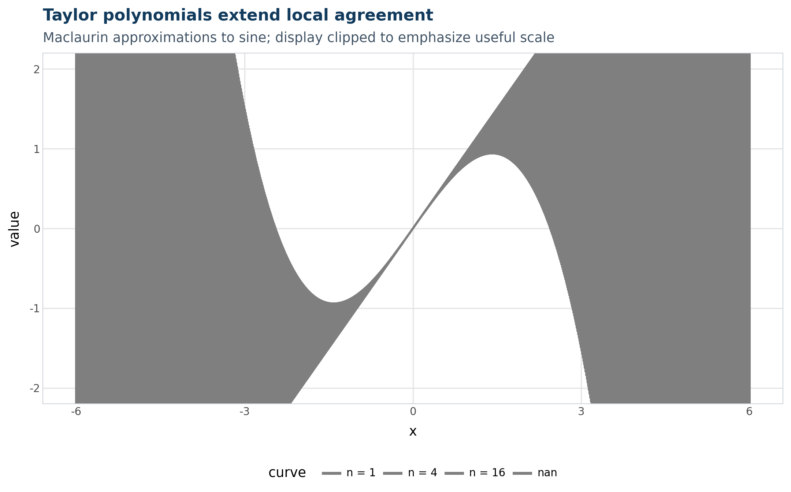

# Sequences, series, and Taylor approximation {#sec-series}

Finite computations can describe infinite processes when their approximations settle in a controlled way. A sequence asks whether individual terms approach a value. A series asks whether partial sums approach a finite total. Power and Taylor series go further: they represent functions by infinite polynomials, but only inside intervals where convergence and error are understood.

## Sequences and convergence

A **sequence** $(a_n)$ is a function from positive integers to real numbers. We say $a_n\to L$ if for every $\varepsilon>0$ there is an integer $N$ such that $n\ge N$ implies $|a_n-L|<\varepsilon$. Early terms do not affect convergence.

Limit laws resemble those for functions. If $a_n\to A$ and $b_n\to B$, sums and products converge accordingly, and quotients do when $B\ne0$. A bounded monotone sequence converges. For example, $a_n=1-1/n$ increases and is bounded above by $1$, so it converges; direct analysis identifies the limit as $1$.

A sequence can be bounded without converging: $(-1)^n$ alternates. It can have terms approaching zero yet generate a divergent sum, as the harmonic series demonstrates.

## Series and partial sums

The infinite series $\sum_{n=1}^{\infty}a_n$ **converges** to $S$ when its partial sums
$$
s_N=\sum_{n=1}^N a_n
$$
form a sequence tending to $S$. Thus an infinite sum is defined by a limit, not by performing infinitely many additions.

The geometric series satisfies
$$
\sum_{n=0}^{\infty}ar^n=\frac{a}{1-r}\qquad(|r|<1).
$$
Its finite sum $a(1-r^{N+1})/(1-r)$ proves the formula and explains divergence when $|r|\ge1$ except trivial cases.

**Worked example: repeating decimal.** $0.272727\ldots$ equals
$$
\frac{27}{100}\sum_{n=0}^{\infty}\left(\frac1{100}\right)^n
=\frac{27}{99}=\frac3{11}.
$$
The equality is exact because the remainders tend to zero.

A telescoping series collapses through cancellation. Since
$$
\frac1{n(n+1)}=\frac1n-\frac1{n+1},
$$
the $N$th partial sum is $1-1/(N+1)$ and the infinite sum is $1$.

## Convergence tests

If $\sum a_n$ converges, necessarily $a_n\to0$. This **nth-term test for divergence** works only in one direction: $a_n\to0$ does not guarantee convergence. The harmonic series $\sum1/n$ diverges, as grouping terms in powers of two shows.

For positive terms:

- the integral test compares $\sum f(n)$ with $\int f(x)dx$ when $f$ is positive, continuous, and decreasing;
- direct comparison transfers convergence from a larger known series or divergence from a smaller one;
- limit comparison uses $\lim a_n/b_n=c$ with $0<c<\infty$;
- the ratio and root tests detect exponential behavior.

The $p$-series $\sum1/n^p$ converges exactly when $p>1$. For
$$
\sum_{n=1}^{\infty}\frac{3n+1}{n^3+2},
$$
limit comparison with $1/n^2$ gives ratio $3$, so the series converges.

If $a_n$ decreases to zero, the alternating series $\sum(-1)^{n-1}a_n$ converges, and the error after $N$ terms has magnitude at most $a_{N+1}$. This is a rare, convenient a priori bound.

A series converges **absolutely** if $\sum|a_n|$ converges; absolute convergence implies convergence. A series that converges but not absolutely is **conditionally convergent**. Rearrangement is harmless for absolutely convergent series but can change a conditionally convergent sum, a warning that infinite algebra needs hypotheses.

## Power series

A power series centered at $a$ is
$$
\sum_{n=0}^{\infty}c_n(x-a)^n.
$$
There is a radius $R$ such that the series converges absolutely for $|x-a|<R$ and diverges for $|x-a|>R$. Endpoints must be tested separately. Ratio or root tests often find $R$ but usually say nothing at the boundary.

Inside its interval of convergence, a power series can be differentiated and integrated term by term, with the same radius though endpoint behavior may change. From
$$
\frac1{1-x}=\sum_{n=0}^{\infty}x^n,\qquad |x|<1,
$$
integration gives
$$
-\ln(1-x)=\sum_{n=1}^{\infty}\frac{x^n}{n},\qquad |x|<1.
$$

## Taylor polynomials and remainder

<!-- uni-06-taylor-remainder:start -->

The degree-$n$ Taylor polynomial of $f$ centered at $a$ matches derivatives through order $n$:
$$
T_n(x)=\sum_{k=0}^n\frac{f^{(k)}(a)}{k!}(x-a)^k.
$$
Matching derivatives does not alone guarantee the infinite series equals the
function. Here is one precise sufficient version of Taylor's theorem with
Lagrange remainder. Let $n$ be a nonnegative integer and let $f$ have
continuous derivatives through order $n+1$ on an open interval $J$ containing
the entire closed segment
$$
I=[\min(a,x),\max(a,x)].
$$
We write this regularity as $f\in C^{n+1}(J)$. If $x\ne a$, there is a point
$c$ strictly between $a$ and $x$ such that
$$
R_n(x)=f(x)-T_n(x)=\frac{f^{(n+1)}(c)}{(n+1)!}(x-a)^{n+1}.
$$
For $x=a$, the remainder is zero. The stated regularity is sufficient; it is
not claimed to be necessary.

**Why the remainder formula holds.** For $x\ne a$, put $E=R_n(x)$ and
$$
w(t)=f(t)-T_n(t)-E\left(\frac{t-a}{x-a}\right)^{n+1}.
$$
Then $w(a)=w(x)=0$ and $w^{(k)}(a)=0$ for $1\le k\le n$.
Repeated applications of Rolle's theorem give $w^{(n+1)}(c)=0$ for an
interior point $c$. Since the $(n+1)$st derivative of $T_n$ is zero,
solving that equation for $E$ gives the displayed formula, in either
endpoint order.

If a number $M\ge0$ satisfies $|f^{(n+1)}(t)|\le M$ for **every**
$t\in I$, then
$$
|R_n(x)|\le\frac{M|x-a|^{n+1}}{(n+1)!}.
$$
A derivative bound only at the center, or on a smaller interval that misses
part of $I$, does not justify this estimate. For a uniform estimate on a
closed interval $K$ containing $a$, require the same regularity on an open
interval containing $K$ and one derivative bound throughout $K$.

This is an upper bound, not the actual error. A bound strictly below a
tolerance certifies that target. A larger bound leaves the target unresolved;
it does not prove the approximation inaccurate. To identify a function with
its infinite Taylor series, one must additionally show that the remainders
tend to zero.

**Changed applicability task.** Use $a=0$, $n=2$ and the strict error target
$1/3$.

1. For $f(t)=1/(1-t)$ at $x=1/2$, use a derivative bound on $[0,1/2]$.
   Does the resulting Lagrange bound certify the target? Calculate the actual
   error separately.
2. Keep $f$ but change the target point to $x=3/2$. Both endpoint values are
   finite. Does that suffice to apply the theorem? Calculate the error
   directly if the theorem is unavailable.
3. Instead use $g(t)=|t|^3$ at $x=1/2$. Determine $T_2$, check the stated
   sufficient regularity, and decide the error target by a direct calculation.

**Full answer.** For the first case, $f'''(t)=6/(1-t)^4$ and
$1-t\ge1/2$ throughout $[0,1/2]$. Thus $M=96$ is valid and the
Lagrange bound is
$$
\frac{96(1/2)^3}{3!}=2.
$$
It does not certify an error below $1/3$. However,
$T_2(x)=1+x+x^2$ and the exact finite identity
$$
\frac1{1-x}-(1+x+x^2)=\frac{x^3}{1-x}\qquad(x\ne1)
$$
gives $R_2(1/2)=1/4<1/3$. The approximation meets the target even though
that sufficient bound is too large.

For the second case, the connecting segment $[0,3/2]$ contains the pole
$t=1$. There is no open interval containing that segment on which $f$ is
even continuous, so the stated theorem cannot be used. Endpoint values and
derivatives at the center do not repair this gap. The finite algebraic identity
still gives $R_2(3/2)=-27/4$, whose absolute value exceeds $1/3$.

For the third case, $g(0)=g'(0)=g''(0)=0$, so $T_2=0$.
Here $g''(t)=6|t|$: its right derivative at zero is $6$ and its left
derivative is $-6$. Hence $g'''(0)$ does not exist and the stated
$C^3$ sufficient hypothesis fails. That failure alone does not decide the
approximation. Directly,
$$
|g(1/2)-T_2(1/2)|=\frac18<\frac13.
$$
This last conclusion follows from the function's exact value, without invoking
the inapplicable sufficient version of the theorem.

<!-- uni-06-taylor-remainder:end -->

**Worked example.** For $e^x$ centered at zero,
$$
T_4(x)=1+x+\frac{x^2}{2}+\frac{x^3}{6}+\frac{x^4}{24}.
$$
On $|x|\le1$, the fifth derivative is at most $e$, so error is at most $e/120\approx0.0227$. At $x=0.2$ the actual bound can be tightened using $e^{0.2}/120$ times $0.2^5$.

For sine and cosine,
$$
\sin x=x-\frac{x^3}{3!}+\frac{x^5}{5!}-\cdots,
$$
$$
\cos x=1-\frac{x^2}{2!}+\frac{x^4}{4!}-\cdots.
$$
Alternating error bounds are often sharper than a generic Lagrange bound.

For sine at a nonnegative input, successive odd-power terms alternate while
their magnitudes eventually decrease. The following bounded loop stops only
when the first omitted term supplies the requested certificate.

```python
from math import factorial, sin

def sine_taylor_with_bound(
    input_value: float, tolerance: float, maximum_terms: int
) -> tuple[float, float, int]:
    """Approximate sin(x) and return the first-omitted-term bound."""
    if input_value < 0.0 or tolerance <= 0.0 or maximum_terms <= 0:
        raise ValueError("require x >= 0, positive tolerance, and a finite budget")
    approximation = 0.0
    for term_index in range(maximum_terms):
        exponent = 2 * term_index + 1
        approximation += (-1.0) ** term_index * input_value**exponent / factorial(exponent)
        next_exponent = exponent + 2
        error_bound = input_value**next_exponent / factorial(next_exponent)
        if error_bound <= tolerance:
            return approximation, error_bound, term_index + 1
    raise RuntimeError("the term budget did not reach the requested tolerance")

approximation, error_bound, terms_used = sine_taylor_with_bound(0.3, 1e-6, 20)
observed_error = abs(approximation - sin(0.3))
if observed_error > error_bound:
    raise RuntimeError("the observed error exceeded the alternating bound")
print(approximation, error_bound, terms_used)
```

This returns a degree-five approximation with a bound below $10^{-6}$. The
certificate relies on the proved alternating-series hypotheses; the call to
`sin` merely checks this particular computation.

<figure id="fig-taylor">


<figcaption>

Figure 10.1: Taylor polynomials of increasing degree approximate sine over a widening region.

</figcaption>
</figure>

[Figure 10.1](#fig-taylor) shows local derivative matching: all approximants agree near the center, and higher degree widens the visibly accurate interval. Outside that region a polynomial can depart rapidly, so degree without a domain and tolerance is not an accuracy claim.

## Accuracy versus cost

To approximate $\sin(0.3)$ within $10^{-6}$, choose degree using the first omitted alternating term. The degree-five error is at most $0.3^7/7!<4.4\times10^{-8}$, already sufficient. This workflow chooses a method from the tolerance instead of calculating many unnecessary terms.

<div class="callout callout-warning">
<p class="callout-title">Common pitfalls</p>

- Terms tending to zero do not guarantee that their series converges.
- A convergence test's inconclusive outcome is not a proof of divergence.
- Test power-series endpoints individually.
- A Taylor polynomial is local; attach a remainder bound and interval to accuracy claims.

</div>

<!-- inline-formula-code:start -->
## Formula and finite computation

A useful formula in this chapter is

$$
e^x\approx\sum_{k=0}^n\frac{x^k}{k!}
$$

The recurrence for successive terms avoids recomputing powers and factorials. The following standalone Python block expresses that finite rule with its inputs and stopping conditions visible.

```python
from math import exp

def exp_taylor(input_value: float, degree: int) -> float:
    """Return the requested-degree Taylor approximation at input_value."""
    if degree < 0:
        raise ValueError("degree must be nonnegative")
    total = 1.0
    term = 1.0
    for term_index in range(1, degree + 1):
        term *= input_value / term_index
        total += term
    return total

for degree in (0, 1, 2, 4, 8, 12):
    value = exp_taylor(1.0, degree)
    print(degree, value, abs(value - exp(1.0)))
```

**What the computation establishes.** The calculation checks a declared finite instance; the surrounding argument explains what is true beyond those inputs.
<!-- inline-formula-code:end -->

## Summary

Sequence convergence controls terms; series convergence controls partial sums. Geometric, comparison, integral, ratio, root, and alternating tests answer different structural questions. Power series have a radius and endpoint behavior. Taylor polynomials encode derivative data, while remainder estimates make approximation claims reliable.

## Exercises

<div class="exercise" id="calculus-10-series-taylor-ex-1">
<p class="exercise-title"><strong>Exercise 1</strong></p>

Prove from the definition that $1/n\to0$ by choosing $N$ from $\varepsilon$.

</div>

<div class="exercise" id="calculus-10-series-taylor-ex-2">
<p class="exercise-title"><strong>Exercise 2</strong></p>

Find the sum of $\sum_{n=2}^{\infty}1/(n^2-n)$ by telescoping.

</div>

<div class="exercise" id="calculus-10-series-taylor-ex-3">
<p class="exercise-title"><strong>Exercise 3</strong></p>

Determine convergence of $\sum n/(n^3+1)$ and justify the test.

</div>

<div class="exercise" id="calculus-10-series-taylor-ex-4">
<p class="exercise-title"><strong>Exercise 4</strong></p>

Classify $\sum(-1)^{n-1}/\sqrt n$ as absolute, conditional, or divergent.

<details class="solution"><summary>Solution</summary>

For Chapter 10, Exercise 4, $\sum(-1)^{n-1}/\sqrt n$ converges by the alternating-series test because $1/\sqrt n$ decreases to zero. Its absolute series is a $p$-series with $p=1/2$, which diverges. The original series is therefore conditionally convergent.

</details>

</div>

<div class="exercise" id="calculus-10-series-taylor-ex-5">
<p class="exercise-title"><strong>Exercise 5</strong></p>

Find the interval of convergence of $\sum (x-2)^n/(n\,3^n)$, including endpoints.

</div>

<div class="exercise" id="calculus-10-series-taylor-ex-6">
<p class="exercise-title"><strong>Exercise 6</strong></p>

Find the degree-three Maclaurin polynomial for $\ln(1+x)$ and bound its error at $x=0.1$.

</div>

<div class="exercise" id="calculus-10-series-taylor-ex-7">
<p class="exercise-title"><strong>Exercise 7</strong></p>

**Challenge.** Use the Cauchy criterion idea to explain why the harmonic series cannot converge.

</div>

<div class="exercise" id="calculus-10-series-taylor-ex-8">
<p class="exercise-title"><strong>Exercise 8</strong></p>

**Project.** Compare Taylor evaluation of $e^x$ at small and large $x$, including range reduction, term count, and a verified error target.

</div>
