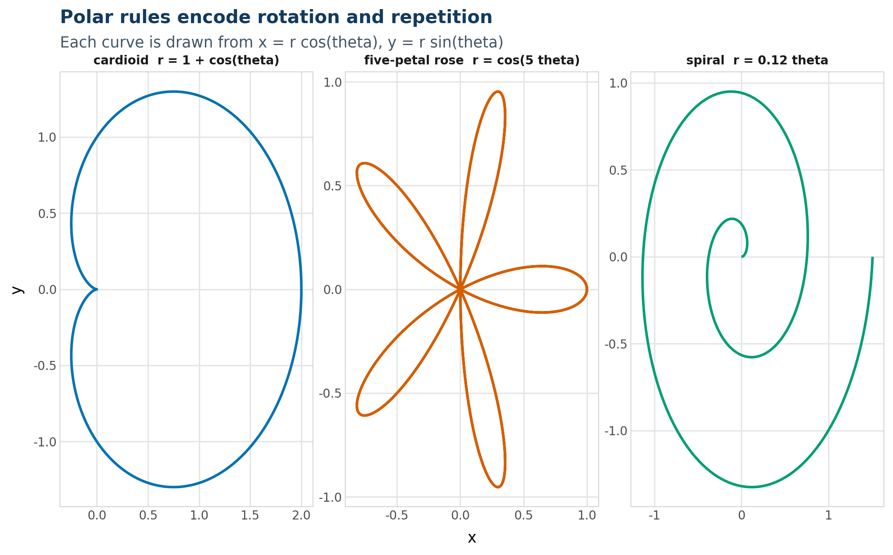

# Parametric and polar curves {#sec-parametric}

A Cartesian equation treats $y$ as a function of $x$, but many curves loop, reverse, or pass a vertical line more than once. Parametric equations describe both coordinates through a third variable, often time. Polar coordinates describe a point by distance and direction. Calculus adapts by tracking how these coordinate descriptions change.

## Parametric curves and orientation

A plane curve can be given by
$$
x=f(t),\qquad y=g(t),\qquad \alpha\le t\le\beta.
$$
The parameter determines orientation and timing. The same geometric circle arises from $(\cos t,\sin t)$ and $(\cos2t,\sin2t)$, but the second traversal is twice as fast and completes two rounds on $[0,2\pi]$.

Eliminating the parameter can reveal geometry but lose orientation or multiplicity. For $x=t^2$, $y=t^3$, eliminating gives $y^2=x^3$, yet the parameter tells which branch is visited before and after the cusp.

If $dx/dt\ne0$, then
$$
\frac{dy}{dx}=\frac{dy/dt}{dx/dt}.
$$
The second derivative is
$$
\frac{d^2y}{dx^2}=\frac{d}{dt}(dy/dx)\bigg/\frac{dx}{dt}.
$$
It is not generally $(d^2y/dt^2)/(d^2x/dt^2)$.

**Worked example.** For $x=t^2+1$, $y=t^3-t$,
$$
\frac{dy}{dx}=\frac{3t^2-1}{2t}.
$$
At $t=1$, the point is $(2,0)$ and slope is $1$. At $t=0$, $dx/dt=0$ while $dy/dt=-1$, producing a vertical tangent at $(1,0)$.

## Speed and arc length

For position $\mathbf r(t)=\langle x(t),y(t)\rangle$, velocity is $\mathbf r'(t)$ and speed is its magnitude:
$$
v(t)=\sqrt{[x'(t)]^2+[y'(t)]^2}.
$$
Distance traveled is
$$
L=\int_\alpha^\beta\sqrt{[x'(t)]^2+[y'(t)]^2}\,dt.
$$
Unlike displacement, distance accounts for reversals and is nonnegative.

For a cycloid $x=t-\sin t$, $y=1-\cos t$ on $[0,2\pi]$, speed simplifies to $2\sin(t/2)$, so one arch has length $8$. The zero speeds at endpoints correspond to cusps.

## Polar coordinates

Polar coordinates $(r,\theta)$ correspond to
$$
x=r\cos\theta,\qquad y=r\sin\theta.
$$
Coordinates are nonunique: $(r,\theta)$ and $(r,\theta+2\pi)$ agree, and $(-r,\theta)$ agrees with $(r,\theta+\pi)$. Negative radius points opposite the named angle.

A polar curve $r=f(\theta)$ can be graphed by tracking sign, symmetry, key angles, and zeros. Symmetry tests are suggestive but not exhaustive because representation is nonunique.

<figure id="fig-polar">


<figcaption>

Figure 11.1: A cardioid, rose, and spiral illustrate distinctive polar geometries.

</figcaption>
</figure>

[Figure 11.1](#fig-polar) demonstrates why polar descriptions are economical: short radius formulas encode loops, petals, and rotation that would be awkward as single Cartesian functions.

## Polar slope and area

Treat $x=r(\theta)\cos\theta$ and $y=r(\theta)\sin\theta$ parametrically. Then
$$
\frac{dy}{dx}=
\frac{r'\sin\theta+r\cos\theta}
{r'\cos\theta-r\sin\theta},
$$
when the denominator is nonzero.

A thin polar sector has approximate area $(1/2)r^2d\theta$, so
$$
A=\frac12\int_\alpha^\beta r(\theta)^2d\theta.
$$
Bounds must trace the target region exactly once.

**Worked example.** One petal of $r=\cos(2\theta)$ is traced for $-\pi/4\le\theta\le\pi/4$. Its area is
$$
\frac12\int_{-\pi/4}^{\pi/4}\cos^2(2\theta)d\theta=\frac\pi8.
$$
Multiplying by four gives total rose area $\pi/2$.

Polar arc length is
$$
L=\int_\alpha^\beta\sqrt{r^2+(dr/d\theta)^2}\,d\theta.
$$
This follows from parametric speed after differentiating $r\cos\theta$ and $r\sin\theta$; cross terms cancel.

## Conics and model choice

With a focus at the pole, conics have forms such as
$$
r=\frac{ed}{1+e\cos\theta},
$$
where eccentricity $e$ distinguishes ellipse ($e<1$), parabola ($e=1$), and hyperbola ($e>1$), subject to orientation conventions. Polar coordinates foreground distance to a focus, while Cartesian coordinates foreground axes. Neither system is universally superior.

<div class="callout callout-warning">
<p class="callout-title">Common pitfalls</p>

- A parameterized curve includes orientation and multiplicity, not only its point set.
- Parametric second derivatives require division by $dx/dt$ after differentiating the first slope.
- Negative polar radius is meaningful.
- Choose bounds that trace a polar region once; a familiar interval can double-count.

</div>

<!-- inline-formula-code:start -->
## Formula and finite computation

A useful formula in this chapter is

$$
L\approx\sum_k\|\mathbf r(t_{k+1})-\mathbf r(t_k)\|
$$

Refining polygonal chords exhibits the arc-length limit. The following standalone Python block expresses that finite rule with its inputs and stopping conditions visible.

```python
from math import pi, sin

def quarter_circle_polygon_length(segments: int) -> float:
    """Return the inscribed polygonal length of a unit quarter circle."""
    if segments <= 0:
        raise ValueError("segments must be positive")
    return 2.0 * segments * sin(pi / (4.0 * segments))

for segments in (2, 4, 8, 16, 64, 256):
    length = quarter_circle_polygon_length(segments)
    print(segments, length, pi / 2.0 - length)
```

**What the computation establishes.** The calculation checks a declared finite instance; the surrounding argument explains what is true beyond those inputs.
<!-- inline-formula-code:end -->

## Summary

Parametric equations describe position and motion through a parameter. Derivatives divide coordinate rates, and arc length integrates speed. Polar coordinates encode distance and direction nonuniquely, offering concise models of rotational geometry. Polar slope, area, and length follow by treating the curve parametrically and by summing thin sectors.

## Exercises

<div class="exercise" id="calculus-11-parametric-polar-ex-1">
<p class="exercise-title"><strong>Exercise 1</strong></p>

Sketch $x=t^2-1$, $y=t+1$ for $-2\le t\le2$, marking orientation, and eliminate $t$.

</div>

<div class="exercise" id="calculus-11-parametric-polar-ex-2">
<p class="exercise-title"><strong>Exercise 2</strong></p>

Find horizontal and vertical tangents of $x=t^2-2t$, $y=t^3-3t$.

</div>

<div class="exercise" id="calculus-11-parametric-polar-ex-3">
<p class="exercise-title"><strong>Exercise 3</strong></p>

Find distance traveled by $\mathbf r(t)=\langle3\cos t,3\sin t\rangle$ on $[0,\pi/2]$.

</div>

<div class="exercise" id="calculus-11-parametric-polar-ex-4">
<p class="exercise-title"><strong>Exercise 4</strong></p>

Identify and sketch $r=2\sin\theta$ by converting to Cartesian form.

</div>

<div class="exercise" id="calculus-11-parametric-polar-ex-5">
<p class="exercise-title"><strong>Exercise 5</strong></p>

Find the area inside $r=2\cos\theta$ and outside $r=1$.

</div>

<div class="exercise" id="calculus-11-parametric-polar-ex-6">
<p class="exercise-title"><strong>Exercise 6</strong></p>

Find the slope of $r=1+\cos\theta$ at $\theta=\pi/2$.

</div>

<div class="exercise" id="calculus-11-parametric-polar-ex-7">
<p class="exercise-title"><strong>Exercise 7</strong></p>

**Challenge.** Explain why $r=\sin(5\theta)$ has five petals but $r=\sin(4\theta)$ has eight.

</div>

<div class="exercise" id="calculus-11-parametric-polar-ex-8">
<p class="exercise-title"><strong>Exercise 8</strong></p>

**Project.** Compare Cartesian, parametric, and polar descriptions of one curve, discussing domain, orientation, computation, and visual clarity.

</div>
