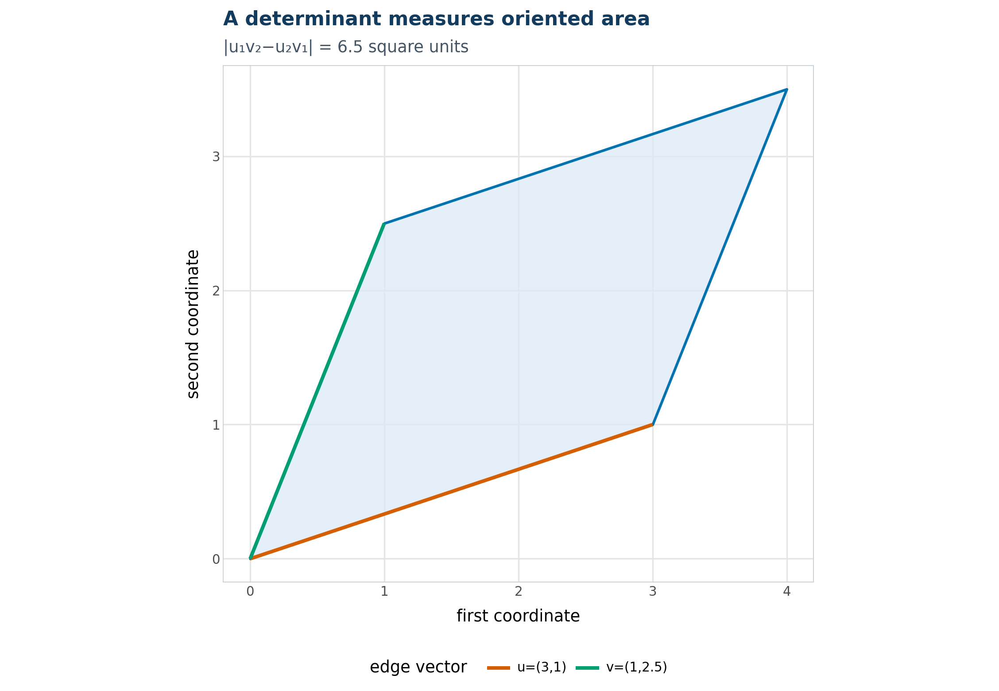

# Vectors and geometry of space {#sec-vectors}

Multivariable calculus needs a language for magnitude and direction. Vectors describe displacement, velocity, force, and local change. Dot and cross products encode angles, projections, and oriented area. Lines, planes, and vector-valued curves then provide the geometric stage for derivatives and integrals in space.

## Vectors and components

A vector in $\mathbb R^n$ is an ordered tuple $\mathbf v=\langle v_1,\ldots,v_n\rangle$. Addition and scalar multiplication act componentwise. Its Euclidean norm is
$$
\|\mathbf v\|=\sqrt{v_1^2+\cdots+v_n^2}.
$$
If $\mathbf v\ne\mathbf0$, then $\mathbf v/\|\mathbf v\|$ is its unit direction.

The vector from point $P$ to point $Q$ is $\overrightarrow{PQ}=Q-P$. Points mark locations; vectors mark displacements. Coordinates make them look similar, but their roles differ.

**Worked example.** From $P=(1,-2,3)$ to $Q=(4,2,1)$,
$$
\overrightarrow{PQ}=\langle3,4,-2\rangle,
$$
with length $\sqrt{29}$. A unit vector from $P$ toward $Q$ is $\langle3,4,-2\rangle/\sqrt{29}$.

## Dot products and projection

The dot product is
$$
\mathbf u\cdot\mathbf v=u_1v_1+\cdots+u_nv_n
=\|\mathbf u\|\|\mathbf v\|\cos\theta.
$$
Thus nonzero vectors are perpendicular exactly when their dot product is zero. The scalar component of $\mathbf u$ along $\mathbf v$ is $(\mathbf u\cdot\mathbf v)/\|\mathbf v\|$, and the vector projection is
$$
\operatorname{proj}_{\mathbf v}\mathbf u
=\frac{\mathbf u\cdot\mathbf v}{\mathbf v\cdot\mathbf v}\mathbf v.
$$

Work by a constant force is a dot product $W=\mathbf F\cdot\mathbf d$: only the force component parallel to displacement contributes.

The Cauchy–Schwarz inequality $|\mathbf u\cdot\mathbf v|\le\|\mathbf u\|\|\mathbf v\|$ ensures the cosine formula is valid and leads to the triangle inequality.

## Cross products

In $\mathbb R^3$, $\mathbf u\times\mathbf v$ is perpendicular to both vectors, oriented by the right-hand rule, with magnitude
$$
\|\mathbf u\times\mathbf v\|=\|\mathbf u\|\|\mathbf v\|\sin\theta.
$$
Its magnitude is the area of the parallelogram spanned by $\mathbf u$ and $\mathbf v$; half gives triangle area. The cross product is anti-commutative: $\mathbf v\times\mathbf u=-(\mathbf u\times\mathbf v)$.

For $\mathbf u=\langle1,2,0\rangle$ and $\mathbf v=\langle0,1,3\rangle$,
$$
\mathbf u\times\mathbf v=\langle6,-3,1\rangle.
$$
Dotting this result with each input gives zero, a useful check.

## Lines and planes

A line through point $\mathbf r_0$ with direction $\mathbf v$ is
$$
\mathbf r(t)=\mathbf r_0+t\mathbf v.
$$
A plane through $\mathbf r_0$ with normal $\mathbf n$ satisfies
$$
\mathbf n\cdot(\mathbf r-\mathbf r_0)=0.
$$
Thus $\mathbf n=\langle A,B,C\rangle$ gives $Ax+By+Cz=D$. Two nonparallel directions in a plane determine a normal through their cross product.

Distance from point $P$ to the plane $Ax+By+Cz=D$ is
$$
\frac{|Ax_P+By_P+Cz_P-D|}{\sqrt{A^2+B^2+C^2}},
$$
the magnitude of a projection onto the unit normal.

**Worked example.** The plane through $(1,0,2)$ containing directions $\langle1,1,0\rangle$ and $\langle0,1,1\rangle$ has normal $\langle1,-1,1\rangle$, so its equation is $x-y+z=3$.

## Vector-valued functions

A space curve is $\mathbf r(t)=\langle x(t),y(t),z(t)\rangle$. Limits, derivatives, and integrals act componentwise. Velocity is $\mathbf v=\mathbf r'$, speed is $\|\mathbf v\|$, and acceleration is $\mathbf a=\mathbf r''$.

When speed is nonzero, the unit tangent is
$$
\mathbf T=\frac{\mathbf r'}{\|\mathbf r'\|}.
$$
Curvature measures change of tangent per unit arc length:
$$
\kappa=\left\|\frac{d\mathbf T}{ds}\right\|
=\frac{\|\mathbf r'\times\mathbf r''\|}{\|\mathbf r'\|^3}
$$
in three dimensions. A line has zero curvature; a circle of radius $R$ has curvature $1/R$.

For a helix with positive radius $a>0$ and real $b$, $\mathbf r(t)=\langle a\cos t,a\sin t,bt\rangle$, speed is constant $\sqrt{a^2+b^2}$ and curvature is $a/(a^2+b^2)$. For fixed positive radius, increasing the magnitude of the vertical pitch makes the path less sharply curved.

## Coordinate systems

Cartesian coordinates suit boxes and planes. Cylindrical coordinates use $(r,\theta,z)$ with $x=r\cos\theta$, $y=r\sin\theta$. Spherical coordinates use radial distance $\rho$, polar angle $\phi$ from the positive $z$-axis, and azimuth $\theta$ in the $xy$-plane:
$$
x=\rho\sin\phi\cos\theta,\quad
y=\rho\sin\phi\sin\theta,\quad
z=\rho\cos\phi.
$$
Conventions for spherical angles vary, so define them each time. Coordinate singularities, such as all values of $\theta$ representing the axis when $r=0$, are representation issues rather than physical singularities.

<div class="callout callout-warning">
<p class="callout-title">Common pitfalls</p>

- Do not add a point to a point; use their difference as a displacement vector.
- Projection onto $\mathbf v$ divides by $\mathbf v\cdot\mathbf v$, not merely $\|\mathbf v\|$.
- Cross-product order controls orientation.
- Speed is the norm of velocity, not the componentwise derivative of position's norm.

</div>

## Visual checkpoint: determinant and vector area

<figure id="fig-calc-vectors-parallelogram">


<figcaption>

Figure 12.1: Two planar vectors span a parallelogram whose area is a determinant magnitude.

</figcaption>
</figure>

[Figure 12.1](#fig-calc-vectors-parallelogram) gives geometric meaning to
$|u_1v_2-u_2v_1|$. Parallel vectors collapse the shape and make the determinant
zero; swapping the vectors reverses orientation but not unsigned area.

<!-- inline-formula-code:start -->
## Formula and finite computation

A useful formula in this chapter is

$$
\operatorname{area}=|u_1v_2-u_2v_1|
$$

The determinant formula becomes four multiplications and one absolute value. The following standalone Python block expresses that finite rule with its inputs and stopping conditions visible.

```python
def parallelogram_area(first: tuple[float, float], second: tuple[float, float]) -> float:
    """Return the area spanned by two planar vectors."""
    first_x, first_y = first
    second_x, second_y = second
    return abs(first_x * second_y - first_y * second_x)

examples = (
    ((3.0, 1.0), (1.0, 2.5)),
    ((1.0, 0.0), (0.0, 1.0)),
    ((2.0, 1.0), (4.0, 2.0)),
)
for first, second in examples:
    print(first, second, parallelogram_area(first, second))
```

**What the computation establishes.** The calculation checks a declared finite instance; the surrounding argument explains what is true beyond those inputs.
<!-- inline-formula-code:end -->

## Summary

Vectors encode magnitude and direction. Dot products measure alignment and projection, while cross products encode perpendicular direction and oriented area. Lines use direction vectors and planes use normals. Vector-valued derivatives describe motion and curvature. Cartesian, cylindrical, and spherical coordinates align computations with different symmetries.

## Exercises

<div class="exercise" id="calculus-12-vectors-space-ex-1">
<p class="exercise-title"><strong>Exercise 1</strong></p>

Find the angle between $\langle1,1,0\rangle$ and $\langle1,0,1\rangle$.

</div>

<div class="exercise" id="calculus-12-vectors-space-ex-2">
<p class="exercise-title"><strong>Exercise 2</strong></p>

Decompose $\langle3,4\rangle$ into components parallel and perpendicular to $\langle1,1\rangle$.

</div>

<div class="exercise" id="calculus-12-vectors-space-ex-3">
<p class="exercise-title"><strong>Exercise 3</strong></p>

Find the area of the triangle with vertices $(0,0,0)$, $(1,2,0)$, and $(0,1,3)$.

</div>

<div class="exercise" id="calculus-12-vectors-space-ex-4">
<p class="exercise-title"><strong>Exercise 4</strong></p>

Find the intersection of the line $(1,0,2)+t\langle2,1,-1\rangle$ with the plane $x+y+z=5$.

</div>

<div class="exercise" id="calculus-12-vectors-space-ex-5">
<p class="exercise-title"><strong>Exercise 5</strong></p>

For $\mathbf r(t)=\langle t,t^2,t^3\rangle$, compute velocity, speed, and acceleration at $t=1$.

</div>

<div class="exercise" id="calculus-12-vectors-space-ex-6">
<p class="exercise-title"><strong>Exercise 6</strong></p>

Convert the point $(\rho,\theta,\phi)=(2,\pi/3,\pi/4)$ to Cartesian coordinates under this book's convention.

</div>

<div class="exercise" id="calculus-12-vectors-space-ex-7">
<p class="exercise-title"><strong>Exercise 7</strong></p>

**Challenge.** Derive the point-to-plane distance formula using projection.

</div>

<div class="exercise" id="calculus-12-vectors-space-ex-8">
<p class="exercise-title"><strong>Exercise 8</strong></p>

**Project.** Model a three-dimensional path parametrically, compute its speed and curvature, and explain how a parameter changes its geometry.

</div>
