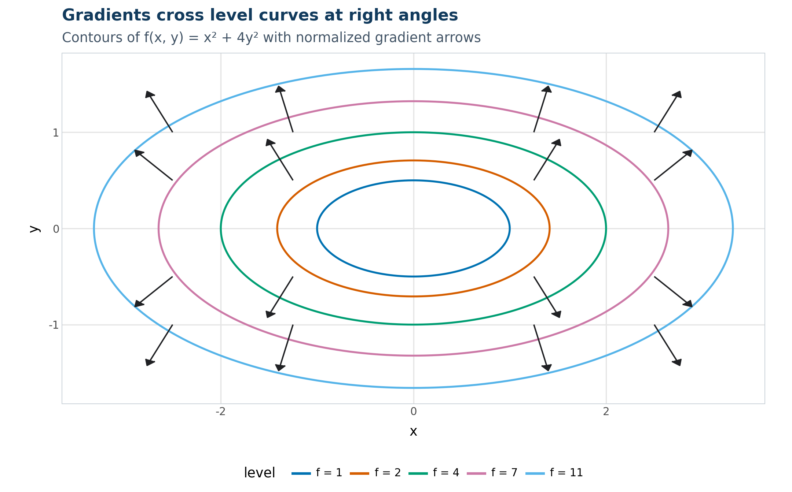

# Partial derivatives and local geometry {#sec-partials}

A function of several variables can change in infinitely many directions. Partial derivatives measure coordinate-aligned change; the gradient assembles them into a direction-independent local linear model. Level sets, tangent planes, chain rules, and optimization all grow from the same principle: near a differentiable point, a smooth surface behaves like a plane.

## Functions, graphs, and level sets

A scalar-valued function $f:\mathbb R^n\to\mathbb R$ assigns a number to each point in its domain. For $f(x,y)=\sqrt{9-x^2-y^2}$, the natural domain is the disk $x^2+y^2\le9$, and the graph is the upper hemisphere.

A graph $z=f(x,y)$ is a surface in three-dimensional space. A **level curve** $f(x,y)=c$ stays in the input plane and joins points with the same output. Topographic contours, isotherms, and pressure lines are level sets. Traces fix one input, such as $x=a$, and show a cross-sectional function of the other.

For $f(x,y)=x^2+4y^2$, level curves $x^2+4y^2=c$ are ellipses. Their spacing carries slope information: close contours indicate rapid change per unit distance.

## Limits and continuity in several variables

We say $f(x,y)\to L$ as $(x,y)\to(a,b)$ if $f(x,y)$ approaches $L$ along every possible path. Agreement along several chosen paths is necessary but not sufficient. To prove nonexistence, however, two paths with different limits suffice.

**Worked example.** Consider
$$
f(x,y)=\frac{x^2-y^2}{x^2+y^2}.
$$
Along $y=0$, $f=1$ near the origin; along $x=0$, $f=-1$. Hence the limit at $(0,0)$ does not exist.

For
$$
g(x,y)=\frac{x^2y}{x^2+y^2},
$$
path testing suggests zero but does not prove it. Since $|y|\le r$ and $x^2/(x^2+y^2)\le1$, where $r=\sqrt{x^2+y^2}$,
$$
|g(x,y)|\le|y|\le r\to0.
$$
This radial bound controls all paths at once.

Continuity is defined by equality of the limit and function value. Polynomials are continuous everywhere; rational functions are continuous where denominators are nonzero; compositions preserve continuity on valid domains.

## Partial derivatives

The partial derivative with respect to $x$ holds other variables fixed:
$$
f_x(a,b)=\lim_{h\to0}\frac{f(a+h,b)-f(a,b)}h.
$$
For $f(x,y)=x^2e^{xy}$,
$$
f_x=2xe^{xy}+x^2ye^{xy},\qquad f_y=x^3e^{xy}.
$$
Their units differ when $x$ and $y$ have different units.

Second partials include $f_{xx}$, $f_{yy}$, and mixed derivatives $f_{xy}$ and $f_{yx}$. If mixed partials are continuous near a point, Clairaut's Theorem gives $f_{xy}=f_{yx}$. Equality can fail when regularity hypotheses are removed.

Partial derivatives may all exist while the function is not continuous or differentiable. Coordinate directions do not sample every approach direction. Differentiability is a stronger statement about a uniform linear approximation.

## Tangent planes and differentiability

A function $f$ is differentiable at $(a,b)$ if
$$
f(a+h,b+k)=f(a,b)+f_x(a,b)h+f_y(a,b)k+R(h,k),
$$
where $R(h,k)/\sqrt{h^2+k^2}\to0$. The linearization is
$$
L(x,y)=f(a,b)+f_x(a,b)(x-a)+f_y(a,b)(y-b).
$$
Its graph is the tangent plane. Continuous first partial derivatives near the point are a convenient sufficient condition for differentiability.

**Worked example.** For $f(x,y)=\sqrt{25-x^2-y^2}$ near $(3,0)$, $f=4$, $f_x=-3/4$, and $f_y=0$. Thus
$$
f(3+h,k)\approx4-\frac34h.
$$
At $(3.02,-0.01)$ this predicts $3.985$. The absent first-order $k$ term reflects symmetry in $y$, not that $y$ has no effect at higher order.

## Chain rule and gradient

Let $\mathbf a=\mathbf r(t_0)$ be an interior point of the domain of $f$. Assume that $f$ is differentiable at $\mathbf a$ and that $\mathbf r(t)=(x(t),y(t))$ is differentiable at $t_0$, with its nearby image in the domain. Then, at $t=t_0$, the chain rule gives
$$
\frac{dz}{dt}=f_x\frac{dx}{dt}+f_y\frac{dy}{dt},\qquad z=f(x(t),y(t)).
$$
Continuous first partial derivatives on an open neighborhood are a sufficient way to verify differentiability of $f$, not a necessary condition. Merely having its two partial derivatives at $\mathbf a$ is not sufficient.

In vector form, define the gradient
$$
\nabla f=\langle f_x,f_y\rangle.
$$
Under the same differentiability assumptions,
$$
\frac{d}{dt}f(\mathbf r(t))\bigg|_{t=t_0}=\nabla f(\mathbf a)\cdot\mathbf r'(t_0).
$$

For a unit vector $\mathbf u$, the two-sided directional derivative is the limit
$$
D_{\mathbf u}f(\mathbf a)=\lim_{t\to0}\frac{f(\mathbf a+t\mathbf u)-f(\mathbf a)}t,
$$
when that limit exists. If $f$ is differentiable at $\mathbf a$, its linear approximation proves
$$
D_{\mathbf u}f(\mathbf a)=\nabla f(\mathbf a)\cdot\mathbf u.
$$
By Cauchy–Schwarz, the largest directional rate is $\|\nabla f(\mathbf a)\|$. When the gradient is nonzero, the unique maximizing unit direction is $\nabla f(\mathbf a)/\|\nabla f(\mathbf a)\|$; when it is zero, every unit direction has rate zero. For a differentiable level curve through $\mathbf a$, differentiating its constant value gives a zero tangent rate. A nonzero gradient is therefore normal to that regular level curve.

**Changed hypothesis task.** Define $g(0,0)=0$ and
$$
g(x,y)=\frac{x^2y}{x^2+y^2}\quad\text{for }(x,y)\ne(0,0).
$$
Do its existing coordinate partials justify either formula above? Check the path $\mathbf r(t)=(t,t)$ and the unit direction $\mathbf u=(1,1)/\sqrt2$.

**Full answer.** The bound $|g(x,y)|\le|y|\le\sqrt{x^2+y^2}$ proves continuity at the origin. Both coordinate slices are zero, so $g_x(0,0)=g_y(0,0)=0$. Nevertheless $g(t,t)=t/2$, and hence $(g\circ\mathbf r)'(0)=1/2$, whereas the unjustified gradient product would be zero. Likewise $g(t\mathbf u)=t/(2\sqrt2)$ for nonzero $t$ of either sign, so
$$
D_{\mathbf u}g(0,0)=\frac1{2\sqrt2}\ne0=\nabla g(0,0)\cdot\mathbf u.
$$
If $g$ were differentiable at the origin, its only possible derivative would be zero. Along $(t,t)$ its absolute remainder divided by input distance is $1/(2\sqrt2)$, not a quantity tending to zero. Thus even continuity together with existing partials does not supply the missing differentiability hypothesis.

<figure id="fig-gradient">


<figcaption>

Figure 13.1: Level curves of a scalar field with normalized gradient arrows point toward steepest increase.

</figcaption>
</figure>

[Figure 13.1](#fig-gradient) links three encodings: contour value, contour spacing, and gradient direction. Arrows point normal to level curves; their equal normalized length keeps the directions readable, while contour spacing indicates local steepness.

## Multivariable optimization

At an interior differentiable local extremum, $\nabla f=\mathbf0$. Such critical points can be maxima, minima, or saddles. For the following second-derivative test, assume $f$ is $C^2$ on an open neighborhood of the interior critical point $\mathbf a$. This sufficient regularity makes the Hessian symmetric and supplies the second-order Taylor expansion with remainder $o(\|\mathbf h\|^2)$. For two variables, define, with all derivatives evaluated at $\mathbf a$,
$$
D=f_{xx}f_{yy}-f_{xy}^2.
$$
Then $D>0$ and $f_{xx}>0$ imply a strict local minimum; $D>0$ and $f_{xx}<0$ imply a strict local maximum; $D<0$ implies a saddle. If $D=0$, the test is inconclusive. The existence of second partials only at the point does not establish this test's hypotheses.

**Changed regularity task.** Define $h(0,0)=0$ and
$$
h(x,y)=x^2+y^2-\frac{6x^2y^2}{x^2+y^2}\quad\text{for }(x,y)\ne(0,0).
$$
Compute its origin partials through second order and decide whether the apparent value $D=4$ proves a minimum.

**Full answer.** Write $r=\sqrt{x^2+y^2}$. Since $0\le x^2y^2/r^2\le r^2/4$, we have $-r^2/2\le h\le r^2$, so $|h|/r\le r\to0$. Therefore $h$ is differentiable at the origin with gradient zero. Its axis restrictions are $h(x,0)=x^2$ and $h(0,y)=y^2$, giving $h_{xx}(0,0)=h_{yy}(0,0)=2$. Moreover $h_x(0,y)=0$ and $h_y(x,0)=0$ along the axes, so $h_{xy}(0,0)=h_{yx}(0,0)=0$. The pointwise Hessian is $2I$ and its determinant is $4$, yet
$$
h(t,0)=t^2>0,\qquad h(t,t)=-t^2<0\quad(t\ne0).
$$
Both signs occur arbitrarily close to the origin, so it is a saddle. There is no contradiction: for $y\ne0$, direct differentiation gives $h_{xx}(0,y)=-10$, which does not tend to $h_{xx}(0,0)=2$. The required $C^2$ neighborhood is absent. Equivalently the candidate Taylor quadratic $x^2+y^2$ leaves normalized remainder $-3/2$ along $(t,t)$, rather than a remainder tending to zero.

**Worked example.** For $f=x^2+xy+y^2-3x$, solving
$$
2x+y-3=0,\qquad x+2y=0
$$
gives $(2,-1)$. Here $D=4-1=3>0$ and $f_{xx}=2>0$, so the point is a local minimum. Because the quadratic form is positive definite and grows without bound, it is also global.

For a constraint $g(x,y)=c$, **Lagrange multipliers** seek
$$
\nabla f=\lambda\nabla g.
$$
At a constrained extremum, the objective's level curve is tangent to the constraint, so their normals are parallel. The method requires checking points where $\nabla g=0$, boundary pieces, and endpoints separately.

**Worked example.** Maximize $xy$ on $x^2+y^2=1$. Equations $\langle y,x\rangle=\lambda\langle2x,2y\rangle$ yield $x=\pm y$. Candidate products are $1/2$ and $-1/2$; maximum $1/2$ occurs at $(1/\sqrt2,1/\sqrt2)$ and its opposite.

The multiplier often measures sensitivity: under regularity, $\lambda$ approximates the change in optimal objective per unit change of constraint level $c$.

<div class="callout callout-warning">
<p class="callout-title">Common pitfalls</p>

- Checking finitely many paths cannot prove a multivariable limit.
- Existing partial derivatives do not by themselves guarantee continuity or differentiability.
- Normalize a direction vector before computing a directional derivative per unit distance.
- Critical points and Lagrange candidates require classification and boundary checks.

</div>

<!-- inline-formula-code:start -->
## Formula and finite computation

A useful formula in this chapter is

$$
\nabla f=(\partial_1f,\ldots,\partial_nf)
$$

Centered coordinate differences form a finite approximation to the gradient. The following standalone Python block expresses that finite rule with its inputs and stopping conditions visible.

```python
from collections.abc import Callable

import numpy as np
from numpy.typing import NDArray

def central_gradient(
    function: Callable[[NDArray[np.float64]], float],
    point: NDArray[np.float64],
    step: float = 1e-5,
) -> NDArray[np.float64]:
    """Approximate a gradient with centered coordinate differences."""
    if step <= 0.0 or point.ndim != 1:
        raise ValueError("step must be positive and point must be one-dimensional")
    gradient = np.empty_like(point, dtype=float)
    for index in range(point.size):
        offset = np.zeros_like(point, dtype=float)
        offset[index] = step
        gradient[index] = (function(point + offset) - function(point - offset)) / (
            2.0 * step
        )
    return gradient

point = np.array([1.0, -2.0])
estimate = central_gradient(lambda z: float(z[0] ** 2 + 3.0 * z[1] ** 2), point)
print(estimate)
```

**What the computation establishes.** The calculation checks a declared finite instance; the surrounding argument explains what is true beyond those inputs.
<!-- inline-formula-code:end -->

## Summary

Level sets visualize scalar fields without confusing domain and graph. Multivariable limits require control over all paths. Partial derivatives measure coordinate rates; differentiability assembles them into a tangent-plane approximation. The gradient governs directional change and is normal to levels. Hessian information classifies unconstrained critical points, and Lagrange multipliers encode constrained tangency.

## Exercises

<div class="exercise" id="calculus-13-partial-derivatives-ex-1">
<p class="exercise-title"><strong>Exercise 1</strong></p>

Describe the domain, graph, and level curves of $f(x,y)=\ln(4-x^2-y^2)$.

</div>

<div class="exercise" id="calculus-13-partial-derivatives-ex-2">
<p class="exercise-title"><strong>Exercise 2</strong></p>

Show that $xy/(x^2+y^2)$ has no limit at the origin using two paths.

</div>

<div class="exercise" id="calculus-13-partial-derivatives-ex-3">
<p class="exercise-title"><strong>Exercise 3</strong></p>

Compute all first and second partials of $x^2\sin(xy)$.

</div>

<div class="exercise" id="calculus-13-partial-derivatives-ex-4">
<p class="exercise-title"><strong>Exercise 4</strong></p>

Find the tangent plane to $z=xe^y$ at $(2,0,2)$ and use it to estimate $2.01e^{-0.02}$.

<details class="solution"><summary>Solution</summary>

For Chapter 13, Exercise 4, $f(x,y)=xe^y$. At $(2,0)$, $f=2$, $f_x=1$, and $f_y=2$, so
$$
L(x,y)=2+(x-2)+2y.
$$
At $(2.01,-0.02)$ this gives $2+0.01-0.04=1.97$. The actual expression $2.01e^{-0.02}$ is close because both input changes are small.

</details>

</div>

<div class="exercise" id="calculus-13-partial-derivatives-ex-5">
<p class="exercise-title"><strong>Exercise 5</strong></p>

Find the rate of change of $f=x^2+3y^2$ at $(1,-1)$ toward $(4,3)$.

</div>

<div class="exercise" id="calculus-13-partial-derivatives-ex-6">
<p class="exercise-title"><strong>Exercise 6</strong></p>

Classify all critical points of $f=x^3-3x+y^2$.

</div>

<div class="exercise" id="calculus-13-partial-derivatives-ex-7">
<p class="exercise-title"><strong>Exercise 7</strong></p>

Use Lagrange multipliers to find extrema of $x+2y$ on $x^2+y^2=5$.

</div>

<div class="exercise" id="calculus-13-partial-derivatives-ex-8">
<p class="exercise-title"><strong>Exercise 8</strong></p>

**Challenge.** Prove the gradient is normal to a differentiable level curve by differentiating $f(\mathbf r(t))=c$.

</div>

<div class="exercise" id="calculus-13-partial-derivatives-ex-9">
<p class="exercise-title"><strong>Exercise 9</strong></p>

**Project.** Use a contour map to plan a path of bounded steepness, explaining how gradient and level spacing guide the route.

</div>
