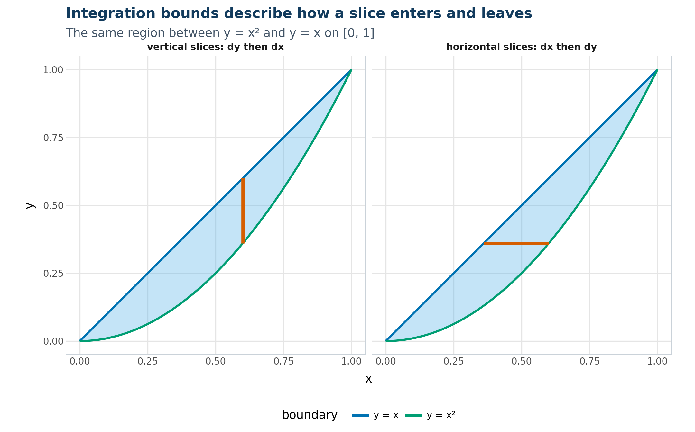

# Multiple integrals {#sec-multiple-integrals}

A single integral accumulates along an interval. Double and triple integrals accumulate over regions and solids. Iterated integration turns these higher-dimensional limits into sequences of one-variable calculations; coordinate transformations reshape awkward domains, with the Jacobian accounting for local area or volume distortion.

## Double integrals and iterated integration

Partition a rectangle $R=[a,b]\times[c,d]$ into small rectangles of area $\Delta A_{ij}$. A Riemann sum
$$
\sum_{i,j}f(x_{ij}^*,y_{ij}^*)\Delta A_{ij}
$$
approaches $\iint_R f\,dA$ when $f$ is integrable. For $f\ge0$, it can represent volume under $z=f(x,y)$; more generally it is signed accumulation with units $f$-units times area-units.

Fubini's Theorem, under continuity or suitable integrability conditions, gives
$$
\iint_R f(x,y)dA
=\int_a^b\int_c^d f(x,y)\,dy\,dx
=\int_c^d\int_a^b f(x,y)\,dx\,dy.
$$
The inner integral treats the outer variable as constant.

**Worked example.** On $R=[0,1]\times[0,2]$,
$$
\iint_R(x+2y)dA
=\int_0^1\left[xy+y^2\right]_{0}^{2}dx
=\int_0^1(2x+4)dx=5.
$$
Reversing order agrees. Symmetry or factorization can shorten a computation: on a product region, $\iint g(x)h(y)dA=(\int g)(\int h)$ when the integrals exist.

## General regions and order reversal

A Type I region has
$$
D=\{(x,y):a\le x\le b,\ g_1(x)\le y\le g_2(x)\},
$$
so integrate $y$ first. A Type II description reverses roles. Sketching the region before writing bounds is indispensable.

**Worked example.** Let $D$ lie between $y=x^2$ and $y=x$ for $0\le x\le1$. Then
$$
\iint_D(x+y)dA=\int_0^1\int_{x^2}^{x}(x+y)\,dy\,dx.
$$
To reverse order, $0\le y\le1$, with $y\le x\le\sqrt y$:
$$
\int_0^1\int_y^{\sqrt y}(x+y)\,dx\,dy.
$$
The two setups describe the same points. Reversal can simplify an integral such as $\int\int e^{y^2}dydx$ even when no elementary antiderivative exists in the original inner variable.

<figure id="fig-region">


<figcaption>

Figure 14.1: A curved planar region is sliced vertically and horizontally to illustrate two integration orders.

</figcaption>
</figure>

[Figure 14.1](#fig-region) makes the outer variable's range and inner variable's entry and exit boundaries visible. Bounds are a compressed geometric description; each must be checked against a representative slice.

## Polar coordinates

For circular regions, set $x=r\cos\theta$, $y=r\sin\theta$. A small polar rectangle resembles a sector with area $r\,dr\,d\theta$, so
$$
\iint_D f(x,y)dA
=\int_\alpha^\beta\int_{r_1(\theta)}^{r_2(\theta)}
f(r\cos\theta,r\sin\theta)r\,dr\,d\theta.
$$
The factor $r$ is a Jacobian, not optional.

**Worked example: Gaussian disk.** Over $x^2+y^2\le a^2$,
$$
\iint e^{-(x^2+y^2)}dA
=\int_0^{2\pi}\int_0^a e^{-r^2}r\,dr\,d\theta
=\pi(1-e^{-a^2}).
$$
The transformation aligns both integrand and boundary with radial symmetry.

## Triple integrals

For a solid $E$, $\iiint_E f\,dV$ accumulates over volume. If $f=1$, the result is volume; if $f=\rho$ is density, it is mass. Bounds are often nested, with each inner range depending on outer coordinates.

Cylindrical coordinates have volume element
$$
dV=r\,dz\,dr\,d\theta
$$
up to the chosen order. Spherical coordinates under this book's convention have
$$
dV=\rho^2\sin\phi\,d\rho\,d\phi\,d\theta.
$$
The factors express local stretching: angular wedges widen with radius, and azimuthal circles shrink toward the polar axis.

**Worked example.** The volume of a ball of radius $R$ is
$$
\int_0^{2\pi}\int_0^\pi\int_0^R
\rho^2\sin\phi\,d\rho\,d\phi\,d\theta
=2\pi\cdot2\cdot\frac{R^3}{3}=\frac{4\pi R^3}{3}.
$$
This also validates the spherical volume element.

## General change of variables

For a transformation $x=x(u,v)$, $y=y(u,v)$, the Jacobian determinant is
$$
J=\frac{\partial(x,y)}{\partial(u,v)}
=\begin{vmatrix}x_u&x_v\\y_u&y_v\end{vmatrix}.
$$
Locally, a small $uv$ rectangle maps to a parallelogram of area approximately $|J|du\,dv$, so
$$
\iint_Df(x,y)dA
=\iint_S f(x(u,v),y(u,v))|J|du\,dv.
$$
Absolute value ensures positive area. The transformation should be one-to-one on the interior, apart from manageable boundary identifications.

For $u=x+y$, $v=x-y$, inverse formulas are $x=(u+v)/2$, $y=(u-v)/2$, and $|\partial(x,y)/\partial(u,v)|=1/2$. Boundaries expressed through $x+y$ and $x-y$ become coordinate lines.

## Mass, moments, and probability

For planar density $\rho(x,y)$,
$$
m=\iint_D\rho\,dA,
\quad
\bar x=\frac1m\iint_Dx\rho\,dA,
\quad
\bar y=\frac1m\iint_Dy\rho\,dA.
$$
Moments of inertia weight by squared distance, such as $I_x=\iint y^2\rho\,dA$. Symmetry can force $\bar x=0$ or eliminate odd integrals.

A joint probability density satisfies $p(x,y)\ge0$ and $\iint p=1$. Event probabilities integrate over regions. Marginal density follows by integrating out the other variable; independence requires factorization $p(x,y)=p_X(x)p_Y(y)$ on a product support, not merely zero covariance.

<div class="callout callout-warning">
<p class="callout-title">Common pitfalls</p>

- Bounds must describe the region, not only its boundary curves.
- Reversing order requires re-deriving inner and outer ranges.
- Include $r$ in polar/cylindrical and $\rho^2\sin\phi$ in spherical volume.
- A zero Jacobian signals local collapse and requires special care.

</div>

<!-- inline-formula-code:start -->
## Formula and finite computation

A useful formula in this chapter is

$$
\iint_R f\,dA\approx\sum_{i,j}f(x_i^*,y_j^*)\Delta A
$$

The two-dimensional loop is the displayed midpoint sum. The following standalone Python block expresses that finite rule with its inputs and stopping conditions visible.

```python
import numpy as np

def midpoint_double_integral(panels: int) -> float:
    """Approximate the integral of x+y over the unit square."""
    if panels <= 0:
        raise ValueError("panels must be positive")
    spacing = 1.0 / panels
    coordinates = (np.arange(panels) + 0.5) * spacing
    x, y = np.meshgrid(coordinates, coordinates, indexing="xy")
    return float(np.sum(x + y) * spacing**2)

for panels in (2, 4, 8, 16):
    print(panels, midpoint_double_integral(panels))
```

**What the computation establishes.** The calculation checks a declared finite instance; the surrounding argument explains what is true beyond those inputs.
<!-- inline-formula-code:end -->

## Summary

Multiple integrals are limits of weighted area or volume sums. Fubini's Theorem enables iterated evaluation, while order choice reflects slicing geometry. Polar, cylindrical, spherical, and general transformations simplify symmetric domains; Jacobians measure local distortion. The framework supports volume, mass, moments, and joint probability.

## Exercises

<div class="exercise" id="calculus-14-multiple-integrals-ex-1">
<p class="exercise-title"><strong>Exercise 1</strong></p>

Evaluate $\int_0^2\int_1^3(xy+y^2)dy\,dx$ and reverse the order.

</div>

<div class="exercise" id="calculus-14-multiple-integrals-ex-2">
<p class="exercise-title"><strong>Exercise 2</strong></p>

Set up both orders for the triangle bounded by $x=0$, $y=2x$, and $y=4$.

</div>

<div class="exercise" id="calculus-14-multiple-integrals-ex-3">
<p class="exercise-title"><strong>Exercise 3</strong></p>

Reverse $\int_0^1\int_{\sqrt{x}}^1 f(x,y)dy\,dx$.

</div>

<div class="exercise" id="calculus-14-multiple-integrals-ex-4">
<p class="exercise-title"><strong>Exercise 4</strong></p>

Evaluate $\iint_D(x^2+y^2)dA$ over the unit disk using polar coordinates.

</div>

<div class="exercise" id="calculus-14-multiple-integrals-ex-5">
<p class="exercise-title"><strong>Exercise 5</strong></p>

Find the volume inside the sphere $\rho\le2$ above the cone $\phi=\pi/4$.

</div>

<div class="exercise" id="calculus-14-multiple-integrals-ex-6">
<p class="exercise-title"><strong>Exercise 6</strong></p>

Use $u=x+y$, $v=x-y$ to transform a region bounded by $0\le x+y\le2$ and $-1\le x-y\le1$.

</div>

<div class="exercise" id="calculus-14-multiple-integrals-ex-7">
<p class="exercise-title"><strong>Exercise 7</strong></p>

Find the center of mass of the unit square with density $\rho=1+x$.

</div>

<div class="exercise" id="calculus-14-multiple-integrals-ex-8">
<p class="exercise-title"><strong>Exercise 8</strong></p>

**Challenge.** Derive the polar Jacobian from its determinant.

<details class="solution"><summary>Solution</summary>

For Chapter 14, Exercise 8,
$$
\frac{\partial(x,y)}{\partial(r,\theta)}
=\begin{vmatrix}
\cos\theta&-r\sin\theta\\
\sin\theta&r\cos\theta
\end{vmatrix}
=r(\cos^2\theta+\sin^2\theta)=r.
$$
Since $r\ge0$ in the usual polar convention, the area scale is $r$.

</details>

</div>

<div class="exercise" id="calculus-14-multiple-integrals-ex-9">
<p class="exercise-title"><strong>Exercise 9</strong></p>

**Project.** Choose a three-dimensional solid for which a non-Cartesian coordinate system shortens the bounds, then compute volume and explain every limit geometrically.

</div>
