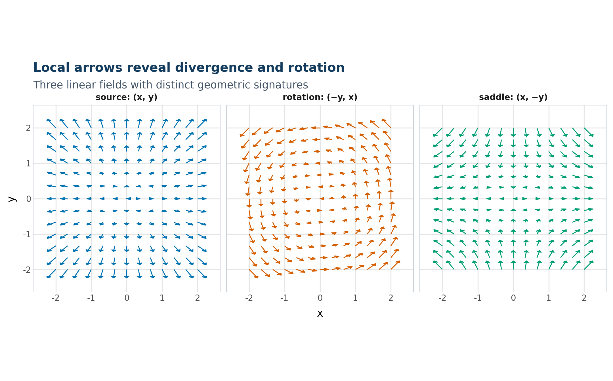

# Vector calculus {#sec-vector-calculus}

Vector calculus studies fields that assign a scalar or vector to each point and integrals taken along curves or across surfaces. Its central theorems compare what happens inside a region with what happens on its boundary. The Fundamental Theorem of Calculus, Green's Theorem, Stokes' Theorem, and the Divergence Theorem are increasingly dimensional versions of one organizing idea.

## Vector fields and line integrals

A vector field $\mathbf F:\mathbb R^n\to\mathbb R^n$ assigns a vector to each point. It may represent fluid velocity, force, or an electric field. A scalar field assigns a number such as temperature or density.

For a parameterized curve $C: \mathbf r(t)$, $a\le t\le b$, the scalar line integral is
$$
\int_C f\,ds=\int_a^b f(\mathbf r(t))\|\mathbf r'(t)\|dt.
$$
It accumulates scalar density along length and does not depend on orientation.

The work integral of a vector field is
$$
\int_C\mathbf F\cdot d\mathbf r
=\int_a^b\mathbf F(\mathbf r(t))\cdot\mathbf r'(t)dt.
$$
It does depend on orientation. Only the component tangent to motion contributes.

**Worked example.** For $\mathbf F=\langle-y,x\rangle$ around the unit circle counterclockwise, use $\mathbf r(t)=\langle\cos t,\sin t\rangle$. Then $\mathbf F(\mathbf r)=\langle-\sin t,\cos t\rangle=\mathbf r'(t)$, so work is $\int_0^{2\pi}1dt=2\pi$. Reversing orientation gives $-2\pi$.

## Conservative fields

A field is **conservative** on a domain if $\mathbf F=\nabla\phi$ for some potential $\phi$. Then the Fundamental Theorem for Line Integrals states
$$
\int_C\nabla\phi\cdot d\mathbf r
=\phi(\mathbf r(b))-\phi(\mathbf r(a)).
$$
Work is path independent and integrals around closed curves vanish.

In a simply connected planar domain, a continuously differentiable field $\mathbf F=\langle P,Q\rangle$ is conservative when $P_y=Q_x$. The domain condition matters: $\langle-y/(x^2+y^2),x/(x^2+y^2)\rangle$ has matching cross-partials away from the origin but has nonzero circulation around the missing point.

To find a potential, integrate one component and restore an unknown function of the other variables. For $\mathbf F=\langle2xy+3,x^2+2y\rangle$, integrating the first component gives $\phi=x^2y+3x+g(y)$. Matching $\phi_y=x^2+g'(y)$ to the second gives $g'=2y$, so $\phi=x^2y+3x+y^2+C$.

## Green's Theorem

Let $D$ be a bounded planar region whose entire boundary $C=\partial D$ is a finite union of piecewise smooth simple closed curves. Assume $P$ and $Q$ are $C^1$ on an open neighborhood of the closure of $D$, including every boundary component. Orient $C$ positively: the region stays on the left, so an outer boundary is counterclockwise and a hole boundary is clockwise. Then
$$
\oint_C P\,dx+Q\,dy
=\iint_D(Q_x-P_y)dA.
$$
The left side is circulation around the entire boundary; the right sums scalar curl inside. In the flux form, $\mathbf n$ is the outward planar unit normal along each smooth boundary arc:
$$
\oint_C \mathbf F\cdot\mathbf n\,ds
=\iint_D(P_x+Q_y)dA.
$$

Green's Theorem can simplify line integrals and derive area formulas such as
$$
A=\frac12\oint_C(x\,dy-y\,dx).
$$
The same full positive boundary orientation is required in this area formula, including clockwise boundaries of holes.

**Worked example.** For $\mathbf F=\langle-y,x\rangle$ around any positively oriented simple curve enclosing region $D$, $Q_x-P_y=1-(-1)=2$. Hence circulation is $2\operatorname{Area}(D)$, recovering $2\pi$ for the unit disk.

**Changed domain task.** Put $X=x-1$, $Y=y+1$, $r=\sqrt{X^2+Y^2}$ and consider
$$
\mathbf A(x,y)=\left\langle-\frac Y{r^2},\frac X{r^2}\right\rangle\quad(r>0).
$$
Its scalar curl is zero wherever defined. Is its circulation around the radius-$2$ circle centered at $(1,-1)$ zero? Repair the domain by removing the concentric radius-$1$ disk. What if both circles are supplied counterclockwise?

**Full answer.** On $\mathbf c_R(t)=(1+R\cos t,-1+R\sin t)$, $0\le t\le2\pi$, the product $\mathbf A(\mathbf c_R(t))\cdot\mathbf c_R'(t)=1$. Thus every such counterclockwise circle has circulation $2\pi$, despite zero scalar curl away from the center. Green's Theorem cannot be used on the full disk because the field is undefined at its center; smoothness just on the boundary is insufficient. On the closed annulus $1\le r\le2$, the field is $C^1$ on an open neighborhood. Its positive boundary consists of the outer counterclockwise circle and the inner clockwise circle, so the total is $2\pi-2\pi=0$, agreeing with the curl integral. Two counterclockwise circles instead give $4\pi$; that sum does not use the positive boundary of this annulus. Reversing only the inner circle repairs the orientation.

## Surfaces and surface integrals

A parameterized surface is $\mathbf r(u,v)$. Tangent vectors $\mathbf r_u$ and $\mathbf r_v$ span its tangent plane, and
$$
dS=\|\mathbf r_u\times\mathbf r_v\|du\,dv.
$$
Thus scalar surface accumulation is
$$
\iint_S f\,dS
=\iint_D f(\mathbf r(u,v))\|\mathbf r_u\times\mathbf r_v\|du\,dv.
$$

An orientation chooses a continuous unit normal. Flux of $\mathbf F$ is
$$
\iint_S\mathbf F\cdot\mathbf n\,dS.
$$
Using an oriented area vector, replace $\mathbf n\,dS$ by $\pm(\mathbf r_u\times\mathbf r_v)du\,dv$. Closed surfaces use outward orientation by convention unless stated otherwise.

For a graph $z=g(x,y)$ oriented upward,
$$
\mathbf n\,dS=\langle-g_x,-g_y,1\rangle dA.
$$
Normalization is unnecessary because the vector's magnitude already accounts for area stretching.

## Divergence and curl

For $\mathbf F=\langle P,Q,R\rangle$,
$$
\nabla\cdot\mathbf F=P_x+Q_y+R_z
$$
measures net outward flux density, while
$$
\nabla\times\mathbf F
=\langle R_y-Q_z,\ P_z-R_x,\ Q_x-P_y\rangle
$$
measures local rotational tendency. These are local derivatives, not complete global descriptions. A field can have zero divergence yet circulate, or zero curl on a punctured domain yet have global circulation.

<figure id="fig-fields">


<figcaption>

Figure 15.1: Three planar vector fields contrast source, rotation, and saddle behavior.

</figcaption>
</figure>

[Figure 15.1](#fig-fields) shows qualitative signatures. The source has positive divergence and zero curl; rigid rotation has zero divergence and positive scalar curl; the saddle has zero divergence and curl despite strong directional stretching.

## Stokes' and Divergence Theorems

<div class="callout callout-note">
<p class="callout-title">Stokes' Theorem</p>

One sufficient classical version assumes that $S$ is a compact orientable surface, given by finitely many regular piecewise smooth patches, with a chosen consistent normal and a piecewise smooth entire boundary $\partial S$. Assume $\mathbf F$ is $C^1$ on an open neighborhood of $S$, including its boundary. With the boundary orientation induced by that normal,
$$
\oint_{\partial S}\mathbf F\cdot d\mathbf r
=\iint_S(\nabla\times\mathbf F)\cdot\mathbf n\,dS.
$$

</div>

Stokes' Theorem says boundary circulation equals accumulated normal curl. The right-hand rule links surface normal with boundary orientation. Green's circulation theorem is the planar case. Reversing the normal requires reversing every induced boundary component as well.

**Changed spanning-surface task and full answer.** Extend the preceding angular field to $\mathbf A_3(x,y,z)=\langle-Y/r^2,X/r^2,0\rangle$. It is undefined along the entire vertical line $x=1,y=-1$, and its curl is zero elsewhere. The counterclockwise radius-$2$ circle in $z=3$ still has circulation $2\pi$. Its upward spanning disk intersects that singular line, so applying Stokes to that disk and claiming zero is invalid. The horizontal annulus $1\le r\le2$ in $z=3$ avoids the line and has a neighborhood on which the field is $C^1$. With upward normal its outer boundary is counterclockwise and its inner boundary clockwise, giving circulation $2\pi-2\pi=0$ and zero curl flux. Replacing a spanning surface is allowed only after verifying the field on a neighborhood of the selected surface, not merely along the common curve.

<div class="callout callout-note">
<p class="callout-title">Divergence Theorem</p>

Let $E$ be a bounded solid with piecewise smooth closed boundary $\partial E$, taken in its entirety. Assume $\mathbf F$ is $C^1$ on an open neighborhood of the closure of $E$, including its boundary. Give every boundary component the normal pointing outward from the solid; on an inner cavity this points into the cavity. Then
$$
\iint_{\partial E}\mathbf F\cdot\mathbf n\,dS
=\iiint_E\nabla\cdot\mathbf F\,dV.
$$

</div>

**Worked example.** Let $\mathbf F=\langle x,y,z\rangle$ and $S$ be the sphere of radius $R$. Since $\nabla\cdot\mathbf F=3$,
$$
\iint_S\mathbf F\cdot\mathbf n\,dS
=3\cdot\frac{4\pi R^3}{3}=4\pi R^3.
$$
Directly, on the sphere $\mathbf n=\mathbf r/R$, so $\mathbf F\cdot\mathbf n=R$ and flux is $R(4\pi R^2)$, confirming the result.

**Changed puncture task.** Let $\mathbf b=(1,-1,2)$, $\rho=\|\mathbf x-\mathbf b\|$, and
$$
\mathbf H(\mathbf x)=\frac{\mathbf x-\mathbf b}{\rho^3}\quad(\rho>0).
$$
Its divergence is zero where it is defined. Find its outward flux through the radius-$2$ sphere centered at $\mathbf b$, explain why a zero-divergence calculation over the ball fails, and repair it on $1\le\rho\le2$.

**Full answer.** On a radius-$R$ sphere, the outward normal from its ball is $(\mathbf x-\mathbf b)/R$, so $\mathbf H\cdot\mathbf n=1/R^2$. Multiplying by area $4\pi R^2$ gives flux $4\pi$, in particular at $R=2$. The full ball contains the undefined point $\mathbf b$, so the divergence theorem does not apply there. On the closed shell $1\le\rho\le2$, the field is $C^1$ on an open neighborhood and the divergence integral is zero. The outer sphere contributes $4\pi$; the shell-outward normal on the inner sphere points toward $\mathbf b$, contributing $-4\pi$. Total shell flux is zero. The puncture cannot be ignored merely because it is a single point.

**Changed closure task and full answer.** For $\mathbf V=\langle0,0,1\rangle$, consider only the curved wall and bottom of a radius-$2$, height-$1$ cylinder, with the normals they inherit from the solid. The wall flux is zero and the bottom flux is $-4\pi$, even though divergence is zero everywhere. This surface is missing its top and is not a closed boundary. Adding the upward top contributes $4\pi$, and only the total closed-cylinder flux is zero. To use the theorem for the requested open surface, add the top, compute the full flux, and subtract the top's flux.

Choosing a theorem is a modeling decision. Use a potential when endpoints are simpler than a path, Green when a planar boundary is harder than its interior, Stokes when one spanning surface is easier than another, and divergence when a closed surface is harder than its volume. First verify smoothness, topology, boundary, and orientation.

## A unified boundary principle

In one dimension,
$$
\int_a^b f'(x)dx=f(b)-f(a).
$$
In two and three dimensions, derivatives such as curl or divergence accumulate over an interior and equal an oriented quantity over its boundary. Interior contributions cancel across neighboring cells, leaving only the outer boundary. This cancellation picture is the geometric heart of all four theorems.

<div class="callout callout-warning">
<p class="callout-title">Common pitfalls</p>

- A scalar line integral uses $ds$ and ignores orientation; work uses $d\mathbf r$ and changes sign on reversal.
- Matching cross-partials implies conservativeness only with appropriate domain hypotheses.
- Orient boundaries and surfaces consistently.
- Stokes couples curl flux to its entire induced boundary, which may be empty; divergence requires a closed surface.

</div>

<!-- inline-formula-code:start -->
## Formula and finite computation

A useful formula in this chapter is

$$
\int_C\mathbf F\cdot d\mathbf r=\int_a^b\mathbf F(\mathbf r(t))\cdot\mathbf r'(t)\,dt
$$

A parameterization turns the line integral into an ordinary finite quadrature. The following standalone Python block expresses that finite rule with its inputs and stopping conditions visible.

```python
from math import pi

import numpy as np

def circle_circulation(panels: int) -> float:
    """Approximate the circulation of (-y, x) around the unit circle."""
    if panels < 3:
        raise ValueError("at least three panels are required")
    t = (np.arange(panels) + 0.5) * (2.0 * pi / panels)
    x, y = np.cos(t), np.sin(t)
    dx_dt, dy_dt = -np.sin(t), np.cos(t)
    integrand = (-y) * dx_dt + x * dy_dt
    return float(np.sum(integrand) * (2.0 * pi / panels))

for panels in (8, 32, 128):
    estimate = circle_circulation(panels)
    print(panels, estimate, estimate - 2.0 * pi)
```

**What the computation establishes.** The calculation checks a declared finite instance; the surrounding argument explains what is true beyond those inputs.
<!-- inline-formula-code:end -->

## Summary

Line integrals accumulate along paths; conservative fields reduce work to endpoint potential differences. Green's Theorem connects planar boundary circulation or flux to interior derivatives. Surface integrals accumulate over parameterized surfaces, with cross products encoding area and orientation. Stokes links circulation to curl, while the Divergence Theorem links outward flux to divergence. Together they express a single boundary–interior architecture.

## Exercises

<div class="exercise" id="calculus-15-vector-calculus-ex-1">
<p class="exercise-title"><strong>Exercise 1</strong></p>

Compute $\int_C(x+y)ds$ along the line from $(0,0)$ to $(1,2)$.

</div>

<div class="exercise" id="calculus-15-vector-calculus-ex-2">
<p class="exercise-title"><strong>Exercise 2</strong></p>

Find the work of $\mathbf F=\langle y,x\rangle$ from $(0,0)$ to $(2,3)$ by finding a potential.

<details class="solution"><summary>Solution</summary>

For Chapter 15, Exercise 2, $\mathbf F=\langle y,x\rangle=\nabla(xy)$. Therefore work from $(0,0)$ to $(2,3)$ is
$$
\phi(2,3)-\phi(0,0)=6.
$$
No path parameterization is needed, and the polynomial potential is defined on all of $\mathbb R^2$.

</details>

</div>

<div class="exercise" id="calculus-15-vector-calculus-ex-3">
<p class="exercise-title"><strong>Exercise 3</strong></p>

Use Green's Theorem to find circulation of $\langle-y^3,x^3\rangle$ around the unit circle.

</div>

<div class="exercise" id="calculus-15-vector-calculus-ex-4">
<p class="exercise-title"><strong>Exercise 4</strong></p>

Parameterize the sphere of radius $2$ and compute its surface area.

</div>

<div class="exercise" id="calculus-15-vector-calculus-ex-5">
<p class="exercise-title"><strong>Exercise 5</strong></p>

Find divergence and curl of $\langle xy,yz,zx\rangle$.

</div>

<div class="exercise" id="calculus-15-vector-calculus-ex-6">
<p class="exercise-title"><strong>Exercise 6</strong></p>

Use Stokes' Theorem to replace a circulation around a tilted circle with a surface integral; state the induced orientation.

</div>

<div class="exercise" id="calculus-15-vector-calculus-ex-7">
<p class="exercise-title"><strong>Exercise 7</strong></p>

Use the Divergence Theorem to find outward flux of $\langle x^3,y^3,z^3\rangle$ across the unit sphere.

</div>

<div class="exercise" id="calculus-15-vector-calculus-ex-8">
<p class="exercise-title"><strong>Exercise 8</strong></p>

**Challenge.** Explain why the boundary of a boundary is empty and connect that phrase to cancellation in Stokes' Theorem.

</div>

<div class="exercise" id="calculus-15-vector-calculus-ex-9">
<p class="exercise-title"><strong>Exercise 9</strong></p>

**Project.** Choose a field and region for which a boundary theorem makes computation shorter. Solve directly if feasible, solve by the theorem, and reconcile orientation.

</div>
