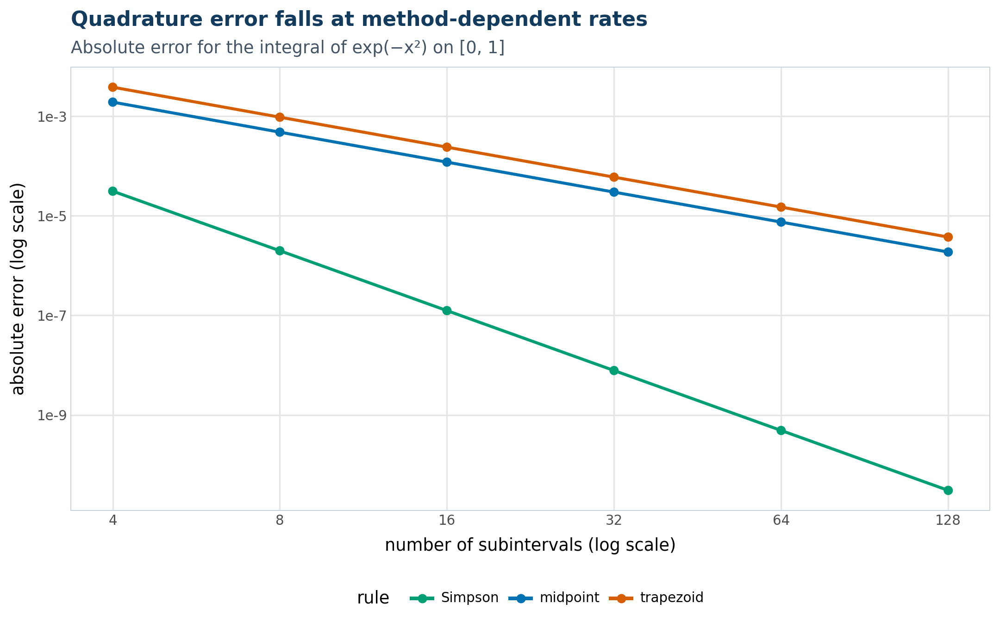

# Numerical Differentiation and Integration {#sec-numerical-calculus}

Calculus gives exact definitions, but data and complicated models often provide
only sampled values. Numerical calculus replaces limiting processes by finite
ones while tracking what is lost. A decimal without an error argument is an
observation, not a reliable answer.

## Error, conditioning, and stability

Let $x$ be an exact quantity and $\widehat x$ an approximation. The **absolute
error** is $|\widehat x-x|$; when $x\ne0$, the **relative error** is
$|\widehat x-x|/|x|$. Reporting twelve digits is not evidence that twelve
digits are correct.

A problem is **ill-conditioned** when small input changes can cause large output
changes. An algorithm is **unstable** when its own rounding or approximation
errors grow unnecessarily. These are different diagnoses. For
$f(x)=\sqrt{x}$ near zero, the derivative $1/(2\sqrt{x})$ is large, so absolute
sensitivity is high, but the relative condition number is only $1/2$. By
contrast, $f(x)=x-1$ near $x=1$ has high relative sensitivity because a small
absolute input error can be a large fraction of the tiny output. Even a perfect
algorithm cannot recover information absent from noisy data.

Numerical formulas balance two errors:

- **truncation error** from replacing a limit or infinite process by finitely
  many steps;
- **roundoff error** from finite-precision arithmetic.

Making a step smaller reduces truncation only until subtraction and rounding
begin to dominate.

## Finite differences

Taylor's theorem gives, for smooth $f$,

$$
f(x+h)=f(x)+hf'(x)+\frac{h^2}{2}f''(x)+O(h^3).
$$

Rearrangement produces the forward difference

$$
D_h^+f(x)=\frac{f(x+h)-f(x)}h=f'(x)+O(h).
$$

The backward difference has the same first-order accuracy. Subtracting the
expansions at $x+h$ and $x-h$ cancels even powers:

$$
D_h^0f(x)=\frac{f(x+h)-f(x-h)}{2h}
=f'(x)+\frac{h^2}{6}f'''(x)+O(h^4).
$$

Thus the centered formula is second order, provided the required derivatives
exist and both sample points lie in the domain.

**Worked example.** For $f(x)=e^x$ at $x=0$ with $h=0.1$,

$$
D_h^+f(0)\approx1.05171,
\qquad D_h^0f(0)\approx1.00167,
$$

while the exact derivative is $1$. One case illustrates the predicted order
but does not establish it; the Taylor derivation does.

## Richardson extrapolation

Suppose an approximation has expansion

$$
A(h)=L+Ch^p+O(h^{p+1}).
$$

Then

$$
R(h)=\frac{2^pA(h/2)-A(h)}{2^p-1}
$$

cancels the leading error. Applying this to centered differences, whose leading
error has $p=2$, gives

$$
R(h)=\frac{4D_{h/2}^0-D_h^0}{3}=f'(x)+O(h^4)
$$

under sufficient smoothness. Extrapolation is not magic: if noise or roundoff
dominates, cancellation of the theoretical truncation term may make the answer
worse.

## Composite quadrature

Partition $[a,b]$ into $n$ equal subintervals of width $h=(b-a)/n$. The
composite trapezoid rule is

$$
T_n=h\left[\frac{f(a)+f(b)}2+\sum_{j=1}^{n-1}f(a+jh)\right].
$$

If $f''$ is continuous, then for some $\xi\in(a,b)$,

$$
\int_a^bf(x)\,dx-T_n=-\frac{(b-a)h^2}{12}f''(\xi).
$$

The composite midpoint rule is also second order, with a different constant.
Simpson's rule combines quadratic interpolation over pairs of subintervals:

$$
S_n=\frac h3\left[f(x_0)+4f(x_1)+2f(x_2)+\cdots+4f(x_{n-1})+f(x_n)\right],
$$

where $n$ must be even. With a continuous fourth derivative, its global error
is $O(h^4)$.

<figure id="fig-numerical-convergence">


<figcaption>

Figure 16.1: Midpoint, trapezoid, and Simpson errors are compared under mesh refinement.

</figcaption>
</figure>

[Figure 16.1](#fig-numerical-convergence) visualizes an **empirical convergence study**. A
straight line of slope $-p$ on a log–log graph is consistent with error
$Cn^{-p}$. It is evidence about the chosen integrand and range, not a proof of
the error formula for all functions.

## Adaptive refinement

A uniform mesh wastes samples where $f$ is nearly linear and undersamples sharp
features. Adaptive Simpson integration compares one Simpson estimate on an
interval with the sum of estimates on its halves. Their difference estimates
local error; intervals failing tolerance are subdivided.

A robust stopping rule needs:

1. absolute and relative tolerances;
2. a maximum recursion depth or minimum interval width;
3. detection of nonfinite function values;
4. accumulated error accounting across subintervals;
5. a failure report when the tolerance is not certified.

Improper integrals require analytic preprocessing. A black-box rule sampling
across a singularity can return a plausible finite value even when the integral
diverges.

## Reproducible convergence studies

To test an algorithm, choose a problem with known answer, run a declared mesh
sequence, record errors and costs, and estimate the observed order

$$
p_k=\frac{\log(E_k/E_{k+1})}{\log(h_k/h_{k+1})}.
$$

If $h$ halves, this becomes $\log_2(E_k/E_{k+1})$. Orders can be misleading
before the asymptotic range, after roundoff dominates, or when an error happens
to cancel. Preserve raw results, software versions, and exact parameter values.

<div class="callout callout-warning">
<p class="callout-title">A smaller step is not automatically better</p>

In $[f(x+h)-f(x)]/h$, the numerator subtracts nearly equal floating-point
numbers when $h$ is tiny, then division by $h$ magnifies the lost digits. Search
for a stable range instead of blindly decreasing $h$.

</div>

<!-- inline-formula-code:start -->
## Formula and finite computation

A useful formula in this chapter is

$$
f'(x)\approx\frac{f(x+h)-f(x-h)}{2h}
$$

The code compares truncation error with floating-point cancellation. The following standalone Python block expresses that finite rule with its inputs and stopping conditions visible.

```python
from math import cos, sin

def centered_derivative(point: float, step_size: float) -> float:
    """Approximate the derivative of sine at a named input point."""
    if step_size <= 0.0:
        raise ValueError("step_size must be positive")
    return (sin(point + step_size) - sin(point - step_size)) / (2.0 * step_size)

for exponent in range(0, 17):
    step_size = 10.0 ** (-exponent)
    error = abs(centered_derivative(1.0, step_size) - cos(1.0))
    print(f"step_size={step_size:.0e}, error={error:.3e}")
```

**What the computation establishes.** The calculation checks a declared finite instance; the surrounding argument explains what is true beyond those inputs.
<!-- inline-formula-code:end -->

## Exercises and checks

<div class="exercise" id="calculus-16-numerical-ex-1">
<p class="exercise-title"><strong>Exercise 1</strong></p>

Derive the backward-difference error through $O(h^2)$.

</div>

<div class="exercise" id="calculus-16-numerical-ex-2">
<p class="exercise-title"><strong>Exercise 2</strong></p>

Use centered differences with $h=0.2$ and $0.1$ to approximate
$(\sin x)'$ at $x=1$, then Richardson-extrapolate.

</div>

<div class="exercise" id="calculus-16-numerical-ex-3">
<p class="exercise-title"><strong>Exercise 3</strong></p>

Prove the trapezoid rule is exact for every linear function.

</div>

<div class="exercise" id="calculus-16-numerical-ex-4">
<p class="exercise-title"><strong>Exercise 4</strong></p>

Approximate $\int_0^1x^4dx$ with composite Simpson using $n=2$ and $n=4$;
compare errors.

</div>

<div class="exercise" id="calculus-16-numerical-ex-5">
<p class="exercise-title"><strong>Exercise 5</strong></p>

Explain why Simpson's rule is exact for cubic polynomials despite being built
from quadratic interpolation.

</div>

<div class="exercise" id="calculus-16-numerical-ex-6">
<p class="exercise-title"><strong>Exercise 6</strong></p>

Design an adaptive-rule failure message for a suspected singularity.

</div>

<div class="exercise" id="calculus-16-numerical-ex-7">
<p class="exercise-title"><strong>Exercise 7</strong></p>

On a log–log plot, errors fall by a factor near $16$ whenever $h$ halves.
Estimate the order.

</div>

<div class="exercise" id="calculus-16-numerical-ex-8">
<p class="exercise-title"><strong>Exercise 8</strong></p>

Describe how measurement noise changes the choice of differentiation step.

</div>

**Selected answers.** The backward rule satisfies
$D_h^-f=f'-hf''/2+O(h^2)$. In (3), linear interpolation reproduces the
integrand exactly, so the region under the secant has the exact trapezoid area.
For (4), $S_2=5/24$ and
$S_4=(1/12)[0+4(1/4)^4+2(1/2)^4+4(3/4)^4+1]=77/384$, while the exact value is
$1/5$. Thus the errors are $1/120$ and $1/1920$, a factor of $16$. The answer
to (7) is fourth order.
