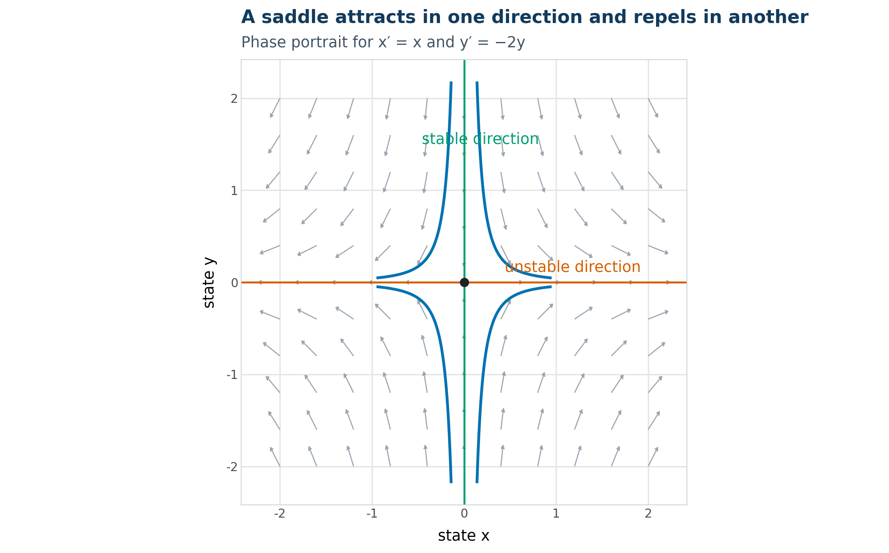

# Differential Equations and Phase Space {#sec-phase-space}

A differential equation specifies a rule for change rather than an explicit
trajectory. **Phase space** records the state needed to determine future change;
the differential equation becomes a vector field on that space. This viewpoint
reveals equilibria and long-term behavior even when no elementary solution
formula exists.

## Autonomous equations and phase lines

An autonomous first-order equation has form

$$
y'=f(y).
$$

An equilibrium $y_*$ satisfies $f(y_*)=0$. On a phase line, arrows point right
where $f(y)>0$ and left where $f(y)<0$. An equilibrium is **asymptotically
stable** if nearby solutions move toward it and **unstable** if some nearby
solutions move away.

For logistic growth

$$
P'=rP\left(1-\frac PK\right),\qquad r,K>0,
$$

equilibria are $0$ and $K$. On $(0,K)$ the derivative is positive; above $K$
it is negative. Thus $K$ is stable for positive populations, while $0$ is
unstable from the positive side.

When $f$ is continuously differentiable near an equilibrium, the derivative
test linearizes: if $f'(y_*)<0$, the equilibrium is locally stable; if
$f'(y_*)>0$, it is unstable. When $f'(y_*)=0$, the test is inconclusive, not
evidence of stability.

## Systems and phase portraits

A two-dimensional autonomous system is

$$
\mathbf x'=\mathbf F(\mathbf x),
\qquad \mathbf x=(x,y).
$$

A solution is a parameterized curve in the phase plane tangent to the vector
field. A phase portrait shows many such trajectories without treating time as a
plotted axis.

### The linear-algebra language used here

A $2\times2$ matrix

$$
A=\begin{pmatrix}a&b\\c&d\end{pmatrix}
$$

acts on a vector by
$A(x,y)=(ax+by,cx+dy)$. A nonzero vector $\mathbf v$ is an
**eigenvector** when $A\mathbf v=\lambda\mathbf v$ for some number $\lambda$,
the corresponding **eigenvalue**. Along such a direction, the system
$\mathbf x'=A\mathbf x$ has solution
$\mathbf x(t)=e^{\lambda t}\mathbf v$.

Eigenvalues are found from

$$
\det(A-\lambda I)
=\lambda^2-(a+d)\lambda+(ad-bc)=0.
$$

Here $\det\begin{pmatrix}u&v\\w&z\end{pmatrix}=uz-vw$, and
$I=\begin{pmatrix}1&0\\0&1\end{pmatrix}$ is the identity matrix, which leaves
every vector unchanged. The quadratic formula can produce complex conjugates
$\alpha\pm i\beta$, where $i^2=-1$. Their real sine-and-cosine combinations
give real rotating trajectories, so no complex-valued physical state is
required.

For the linear system $\mathbf x'=A\mathbf x$, eigenvalues and eigenvectors
organize behavior:

- two negative real eigenvalues give a stable node;
- two positive real eigenvalues give an unstable node;
- opposite signs give a saddle;
- complex eigenvalues $\alpha\pm i\beta$ produce rotation with growth if
  $\alpha>0$ and decay if $\alpha<0$;
- zero real part requires extra care in nonlinear problems.

**Worked system.** If

$$
A=\begin{pmatrix}1&0\\0&-2\end{pmatrix},
$$

then $x(t)=x_0e^t$ and $y(t)=y_0e^{-2t}$. The axes are invariant; generic
trajectories approach the origin in one time direction and leave in the other.
The origin is a saddle and therefore unstable.

<figure id="fig-saddle-phase">


<figcaption>

Figure 17.1: The saddle phase portrait for the linear system x prime equals x and y prime equals negative two y.

</figcaption>
</figure>

[Figure 17.1](#fig-saddle-phase) shows why a saddle is unstable even though an entire line of
initial states approaches it: a generic state has a horizontal component, and
that component grows like $e^t$. Stability requires control of every nearby
direction, not just one favorable direction.

## Nonlinear linearization

For a continuously differentiable vector field, the Jacobian matrix at an
equilibrium $\mathbf x_*$,

$$
J(\mathbf x_*)=
\left(\frac{\partial F_i}{\partial x_j}\right)
$$

is the best linear approximation to the vector field. If no eigenvalue has zero
real part, the linearized system correctly determines local stability type. Such
an equilibrium is **hyperbolic**.

If an eigenvalue has zero real part, nonlinear terms can decide everything.
The equations $y'=y^3$ and $y'=-y^3$ have the same zero linearization at the
origin, yet the first is unstable and the second stable. Do not promote an
inconclusive linear test into a conclusion.

## Euler and Runge–Kutta methods

Euler's method follows the tangent for one step:

$$
\mathbf x_{n+1}=\mathbf x_n+h\mathbf F(t_n,\mathbf x_n).
$$

Its local truncation error is $O(h^2)$ and, over a fixed interval under standard
regularity assumptions, global error is $O(h)$. Halving $h$ should eventually
halve the error.

Classical fourth-order Runge–Kutta samples four slopes:

$$
\begin{aligned}
k_1&=F(t_n,y_n),\\
k_2&=F(t_n+h/2,y_n+hk_1/2),\\
k_3&=F(t_n+h/2,y_n+hk_2/2),\\
k_4&=F(t_n+h,y_n+hk_3),\\
y_{n+1}&=y_n+\frac h6(k_1+2k_2+2k_3+k_4).
\end{aligned}
$$

Its global order is four for smooth problems. High order does not cure
**stiffness**, when rapidly decaying modes force explicit methods to take tiny
steps for stability rather than accuracy.

## Three model families

### Predator–prey interaction

The Lotka–Volterra equations

$$
x'=\alpha x-\beta xy,
\qquad
y'=\delta xy-\gamma y
$$

with $\alpha,\beta,\gamma,\delta>0$ balance prey growth, predation, predator
reproduction, and predator death. The positive equilibrium is
$(\gamma/\delta,\alpha/\beta)$. Idealized positive trajectories are closed
level curves, but real ecosystems include forcing, noise, saturation, and
changing parameters. A beautiful phase portrait is not automatic empirical
validity.

### Compartmental epidemics

An SIR model with nonnegative compartment sizes, fixed population
$N=S+I+R$, and parameters $\beta,\gamma>0$ is

$$
S'=-\beta SI/N,
\quad I'=\beta SI/N-\gamma I,
\quad R'=\gamma I.
$$

Adding gives $(S+I+R)'=0$, an invariant useful for analysis and code checks. The
initial infection grows when $\beta S(0)/(\gamma N)>1$. This threshold depends
on model assumptions; fitting $\beta$ and $\gamma$ from incomplete data adds
uncertainty.

### Logistic saturation

The logistic model assumes per-capita growth decreases linearly with population.
Its exact solution supplies a benchmark for numerical methods, while its phase
line gives behavior without solving. Using both is stronger than relying on
one representation.

## Evidence and claims

A numerical phase portrait samples finitely many initial conditions for finite
time. It can suggest invariant regions, attractors, or cycles. It cannot prove
that no exceptional trajectory exists. A rigorous conclusion may require a
Lyapunov function, invariant, comparison theorem, uniqueness theorem, or a
validated numerical bound.

<div class="callout callout-warning">
<p class="callout-title">Solver output is conditional evidence</p>

Always state the equation, parameters, initial conditions, method, tolerances,
and interval. Check conserved quantities and rerun at tighter tolerances. A
smooth curve from one default solver is not a theorem about the model.

</div>

<!-- inline-formula-code:start -->
## Formula and finite computation

A useful formula in this chapter is

$$
g(t_n)g(t_{n+1})\le0
$$

A sign change brackets an event between two ODE time steps. The following standalone Python block expresses that finite rule with its inputs and stopping conditions visible.

```python
from math import sqrt

def projectile_ground_time(
    initial_height: float,
    initial_velocity: float,
    gravity: float,
    step: float,
    max_steps: int,
) -> tuple[float, int]:
    """Bracket and linearly interpolate the first zero of projectile height."""
    if initial_height < 0.0 or gravity <= 0.0 or step <= 0.0 or max_steps <= 0:
        raise ValueError("height must be nonnegative and controls positive")

    def height(time: float) -> float:
        return initial_height + initial_velocity * time - 0.5 * gravity * time**2

    previous_time = 0.0
    previous_height = height(previous_time)
    for index in range(1, max_steps + 1):
        current_time = index * step
        current_height = height(current_time)
        if current_height <= 0.0:
            fraction = previous_height / (previous_height - current_height)
            event_time = previous_time + fraction * step
            return event_time, index
        previous_time, previous_height = current_time, current_height
    raise RuntimeError("ground event was not bracketed within max_steps")

estimated, index = projectile_ground_time(10.0, 8.0, 9.81, 0.25, 100)
exact = (8.0 + sqrt(8.0**2 + 2.0 * 9.81 * 10.0)) / 9.81
print(estimated, exact, abs(estimated - exact), index)
```

**What the computation establishes.** The calculation checks a declared finite instance; the surrounding argument explains what is true beyond those inputs.
<!-- inline-formula-code:end -->

## Exercises and selected answers

<div class="exercise" id="calculus-17-phase-space-ex-1">
<p class="exercise-title"><strong>Exercise 1</strong></p>

Draw the phase line for $y'=y(1-y)(y-2)$ and classify all equilibria.

</div>

<div class="exercise" id="calculus-17-phase-space-ex-2">
<p class="exercise-title"><strong>Exercise 2</strong></p>

Solve $x'=2x,y'=-y$ and eliminate $t$ to describe phase curves.

</div>

<div class="exercise" id="calculus-17-phase-space-ex-3">
<p class="exercise-title"><strong>Exercise 3</strong></p>

Classify the origin for matrices with eigenvalues $(-1,-3)$, $(2,-4)$, and
$1\pm2i$.

</div>

<div class="exercise" id="calculus-17-phase-space-ex-4">
<p class="exercise-title"><strong>Exercise 4</strong></p>

Compare Euler steps $h=0.2$ and $0.1$ for $y'=-2y,y(0)=1$ at $t=1$.

</div>

<div class="exercise" id="calculus-17-phase-space-ex-5">
<p class="exercise-title"><strong>Exercise 5</strong></p>

Derive conservation of $S+I+R$ in the SIR model.

</div>

<div class="exercise" id="calculus-17-phase-space-ex-6">
<p class="exercise-title"><strong>Exercise 6</strong></p>

Find every nullcline and equilibrium of the Lotka–Volterra system.

</div>

<div class="exercise" id="calculus-17-phase-space-ex-7">
<p class="exercise-title"><strong>Exercise 7</strong></p>

Give two equations with identical linearization at zero but different
stability, and justify the difference from signs.

</div>

<div class="exercise" id="calculus-17-phase-space-ex-8">
<p class="exercise-title"><strong>Exercise 8</strong></p>

Design a convergence and invariant test for a numerical SIR implementation.

</div>

**Selected answers.** In (1), equilibria are $0,1,2$; the sign pattern is
$+,-,+,-$, so $0$ and $2$ are stable and $1$ is unstable. In (2),
$x=x_0e^{2t},y=y_0e^{-t}$, so $xy^2=x_0y_0^2$ along trajectories. The three
matrices in (3) give a stable node, saddle, and unstable spiral. In (5), all
transfer terms cancel exactly.
