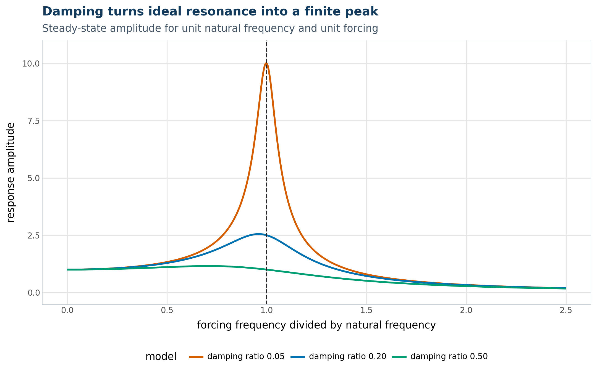

# Second-Order Equations and Oscillation {#sec-oscillation}

Second-order equations describe systems whose state needs both position and
velocity. Springs, circuits, structures, and waves all distinguish displacement
from its rate of change. This extra state creates oscillation, damping, and
resonance.

## Homogeneous linear equations

For real constants $a,b,c$, consider

$$
ay''+by'+cy=0,
\qquad a\ne0.
$$

Trying $y=e^{rt}$ gives the **characteristic equation**

$$
ar^2+br+c=0.
$$

Its roots determine the solution space:

- distinct real roots $r_1,r_2$ give
  $y=C_1e^{r_1t}+C_2e^{r_2t}$;
- a repeated root $r$ gives
  $y=(C_1+C_2t)e^{rt}$;
- roots $\alpha\pm i\beta$, where $i^2=-1$, give
  $y=e^{\alpha t}(C_1\cos\beta t+C_2\sin\beta t)$.

The repeated-root factor $t$ supplies a second linearly independent solution.
It can be derived by reduction of order or by taking a limit as two roots
merge.

**Worked initial value problem.** Solve
$y''+4y'+3y=0$, $y(0)=2$, $y'(0)=0$. Roots are $-1,-3$, so
$y=C_1e^{-t}+C_2e^{-3t}$. Initial conditions give
$C_1+C_2=2$ and $-C_1-3C_2=0$, hence $C_1=3,C_2=-1$:

$$
y(t)=3e^{-t}-e^{-3t}.
$$

Always substitute both the equation and initial data; solving the algebraic
root problem is only part of the task.

## Mass, spring, and damping

Newton's law for displacement $x$ from equilibrium gives

$$
mx''+cx'+kx=F(t),
$$

where $m>0$ is mass, $c\ge0$ damping, $k>0$ stiffness, and $F$ an external
force. Units check every term as force.

With $F=0$, the discriminant $c^2-4mk$ produces three regimes:

- **overdamped:** positive discriminant, two negative real roots;
- **critically damped:** zero discriminant, fastest nonoscillatory return in
  the ideal model;
- **underdamped:** negative discriminant, decaying oscillation.

When $c=0$, the natural angular frequency is
$\omega_0=\sqrt{k/m}$ and period $2\pi/\omega_0$. With damping, the observed
underdamped frequency is $\sqrt{k/m-(c/2m)^2}$.

## Forcing and undetermined coefficients

For

$$
L[y]=ay''+by'+cy=g(t),
$$

the general solution is $y=y_h+y_p$: a homogeneous solution plus one particular
solution. The method of undetermined coefficients guesses a form for $y_p$
when $g$ is built from polynomials, exponentials, sines, and cosines.

For $y''+y=3\cos2t$, try $y_p=A\cos2t+B\sin2t$. Substitution gives
$-3A\cos2t-3B\sin2t=3\cos2t$, so $A=-1,B=0$ and

$$
y=C_1\cos t+C_2\sin t-\cos2t.
$$

The chosen trial must be linearly independent of the homogeneous solution.
If it overlaps, multiply by a sufficient power of $t$.

## Resonance

For the undamped equation

$$
y''+\omega_0^2y=F_0\cos(\omega t),
$$

a nonresonant particular solution has amplitude
$F_0/(\omega_0^2-\omega^2)$. At $\omega=\omega_0$ that formula is not merely
large—it is invalid because the trial function is homogeneous. Multiplying by
$t$ gives a response proportional to

$$
t\sin(\omega_0t),
$$

whose envelope grows without bound in the ideal undamped model.

Real systems have damping, nonlinear effects, and finite operating ranges.
Damping replaces the singular ideal response by a finite frequency-response
peak, generally shifted from the undamped natural frequency. “Resonance occurs
at the natural frequency” is therefore a model-dependent shorthand.

<figure id="fig-damped-resonance">


<figcaption>

Figure 18.1: Frequency-response curves for three damping ratios.

</figcaption>
</figure>

The normalized curves in [Figure 18.1](#fig-damped-resonance) isolate the role of damping.
The dashed line marks the undamped natural frequency; the actual maximum is
finite for every displayed positive damping ratio and need not occur exactly
on that line.

## Energy methods

For the unforced, undamped spring $mx''+kx=0$, define

$$
E(t)=\frac12m(x')^2+\frac12kx^2.
$$

Differentiation gives

$$
E'=x'(mx''+kx)=0,
$$

so energy is conserved. With damping,

$$
mx''+cx'+kx=0
\quad\Longrightarrow\quad
E'=-c(x')^2\le0.
$$

Energy supplies a monotone quantity without solving explicitly. It proves
boundedness and excludes nonconstant periodic motion when $c>0$. It does not
alone give the exact decay rate.

## Laplace-transform introduction

For a function on $t\ge0$, define

$$
\mathcal L\{f\}(s)=\int_0^\infty e^{-st}f(t)\,dt
$$

where the improper integral converges. Integration by parts gives

$$
\mathcal L\{f'\}=sF(s)-f(0),
$$

and therefore

$$
\mathcal L\{f''\}=s^2F(s)-sf(0)-f'(0).
$$

Initial conditions enter algebraically. For $y''+y=0$, $y(0)=0,y'(0)=1$,

$$
(s^2+1)Y(s)=1,
$$

so $Y(s)=1/(s^2+1)$ and inversion gives $y=\sin t$.

Transforms are particularly useful for piecewise and impulsive inputs. Their
use still requires convergence hypotheses and a justified inverse; a table of
transforms is not a substitute for domain checks.

## Electrical analogy

A series RLC circuit with charge $q(t)$ obeys

$$
Lq''+Rq'+\frac1Cq=E(t).
$$

Current is $I=q'$. Inductance $L$, resistance $R$, inverse capacitance $1/C$,
and voltage input correspond mathematically to mass, damping, stiffness, and
force. The analogy transfers solution methods, not physical meaning: energy and
measured variables must be interpreted in their own units.

<div class="callout callout-warning">
<p class="callout-title">Classify before applying a formula</p>

Record coefficients, discriminant, forcing frequency, and initial data. A
formula from the wrong damping regime or a resonant trial duplicated from the
homogeneous solution can look plausible while failing on substitution.

</div>

<!-- inline-formula-code:start -->
## Formula and finite computation

A useful formula in this chapter is

$$
x(t)=A\cos(\omega t)+B\sin(\omega t)
$$

Sampling the exact solution also permits an energy-invariant check. The following standalone Python block expresses that finite rule with its inputs and stopping conditions visible.

```python
from math import cos, sin

amplitude, velocity_scale, omega = 2.0, 0.5, 3.0
for time in (0.0, 0.2, 0.7, 1.1):
    position = amplitude * cos(omega * time) + velocity_scale * sin(omega * time)
    velocity = omega * (-amplitude * sin(omega * time) + velocity_scale * cos(omega * time))
    energy = velocity * velocity + omega * omega * position * position
    print(time, position, energy)
```

**What the computation establishes.** The output certifies only the declared finite case. The theorem, if one is claimed, still requires the argument developed in the chapter.
<!-- inline-formula-code:end -->

## Exercises and checks

<div class="exercise" id="calculus-18-oscillation-ex-1">
<p class="exercise-title"><strong>Exercise 1</strong></p>

Solve $y''-5y'+6y=0$ with $y(0)=1,y'(0)=0$.

</div>

<div class="exercise" id="calculus-18-oscillation-ex-2">
<p class="exercise-title"><strong>Exercise 2</strong></p>

Derive the repeated-root solution by setting $y=v(t)e^{rt}$.

</div>

<div class="exercise" id="calculus-18-oscillation-ex-3">
<p class="exercise-title"><strong>Exercise 3</strong></p>

Classify $2x''+6x'+5x=0$ and find its damped frequency.

</div>

<div class="exercise" id="calculus-18-oscillation-ex-4">
<p class="exercise-title"><strong>Exercise 4</strong></p>

Find a particular solution of $y''+4y=8\sin t$.

</div>

<div class="exercise" id="calculus-18-oscillation-ex-5">
<p class="exercise-title"><strong>Exercise 5</strong></p>

Find the resonant particular solution for $y''+9y=\cos3t$.

</div>

<div class="exercise" id="calculus-18-oscillation-ex-6">
<p class="exercise-title"><strong>Exercise 6</strong></p>

Prove energy decreases for a damped unforced spring and identify when
$E'=0$ instantaneously.

</div>

<div class="exercise" id="calculus-18-oscillation-ex-7">
<p class="exercise-title"><strong>Exercise 7</strong></p>

Transform and solve $y''+4y=0$, $y(0)=2,y'(0)=-1$.

</div>

<div class="exercise" id="calculus-18-oscillation-ex-8">
<p class="exercise-title"><strong>Exercise 8</strong></p>

Map every term of an RLC equation to its mechanical analogue and check
dimensions within each model.

</div>

**Selected answers.** In (1), $y=3e^{2t}-2e^{3t}$. For (3), roots are
$(-3\pm i)/2$, so the motion is underdamped with angular frequency $1/2$.
In (4), $y_p=(8/3)\sin t$. In (5), $y_p=(t/6)\sin3t$. For (7),
$y=2\cos2t-(1/2)\sin2t$.
