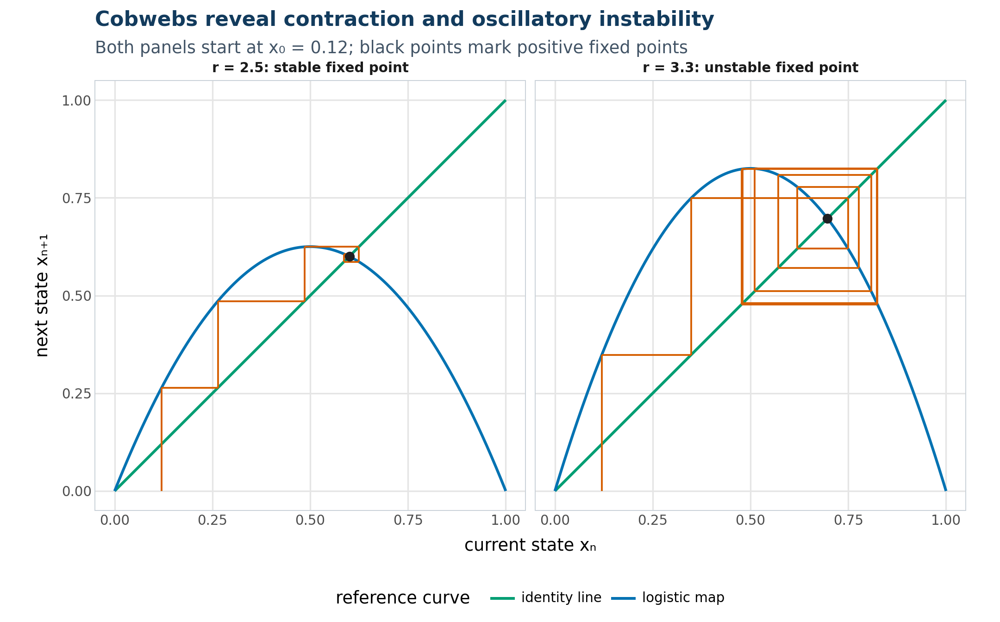

# Discrete Calculus and Difference Equations {#sec-discrete-calculus}

When time advances in steps, change is measured by differences and accumulation
by sums. Discrete calculus is not a crude imitation of continuous calculus; it
has its own exact identities and is the natural language of recurrences,
algorithms, finance, and sampled models.

## Finite differences

The forward-difference operator is

$$
\Delta f(n)=f(n+1)-f(n).
$$

It is linear and obeys a shifted product rule:

$$
\Delta(fg)(n)=f(n+1)\Delta g(n)+g(n)\Delta f(n).
$$

For ordinary powers, $\Delta n^2=2n+1$, which lowers degree but includes a
lower-order term. Falling factorials

$$
n^{\underline{k}}=n(n-1)\cdots(n-k+1)
$$

behave more like monomials under differentiation:

$$
\Delta n^{\underline{k}}=k n^{\underline{k-1}}.
$$

This identity follows by factoring the common $k-1$ terms. It makes Newton's
forward interpolation series the discrete analogue of a Taylor series.

## Summation as antidifferentiation

Telescoping is the Fundamental Theorem of discrete calculus:

$$
\sum_{n=a}^{b-1}\Delta f(n)=f(b)-f(a).
$$

Thus an **indefinite sum** seeks $F$ with $\Delta F=f$, determined only up to an
additive constant. Since
$\Delta[n(n-1)/2]=n$, we obtain

$$
\sum_{n=0}^{N-1}n=\frac{N(N-1)}2.
$$

Summation by parts follows from the product rule. One useful form is

$$
\sum_{n=a}^{b-1}u_n\Delta v_n
=u_bv_b-u_av_a-\sum_{n=a}^{b-1}v_{n+1}\Delta u_n.
$$

Index shifts are not cosmetic. Check the formula on a two-term sum before using
it in a proof.

## Linear recurrences

A second-order homogeneous recurrence

$$
a_{n+2}+c_1a_{n+1}+c_0a_n=0
$$

has characteristic polynomial $r^2+c_1r+c_0$. Distinct roots give
$a_n=A r_1^n+B r_2^n$; a repeated nonzero root gives
$a_n=(A+Bn)r^n$. For a repeated zero root both coefficients vanish: the initial pair is arbitrary and all terms from index two are zero. This parallels constant-coefficient differential equations,
with powers $r^n$ replacing exponentials $e^{rt}$.

For Fibonacci numbers, $F_0=0$, $F_1=1$, and
$F_{n+2}=F_{n+1}+F_n$. The characteristic roots are
$\phi=(1+\sqrt5)/2$ and $\psi=(1-\sqrt5)/2$. These initial conditions yield
Binet's formula

$$
F_n=\frac{\phi^n-\psi^n}{\sqrt5}.
$$

The irrational terms cancel to an integer because the formula satisfies the
same recurrence and initial values. Since $|\psi|<1$, it also gives
$F_n\sim\phi^n/\sqrt5$.

## Generating functions

For a sequence $(a_n)$ define the ordinary generating function

$$
A(x)=\sum_{n\ge0}a_nx^n.
$$

Treating it first as a formal series avoids convergence issues when extracting
coefficients. Multiply the Fibonacci recurrence by $x^{n+2}$ and sum:

$$
A(x)-x=xA(x)+x^2A(x),
$$

so

$$
A(x)=\frac{x}{1-x-x^2}.
$$

Partial fractions recover Binet's formula. A recurrence becomes an algebraic
equation because shifting an index corresponds to multiplying by $x$.

For a nonhomogeneous recurrence, the generating function encodes the forcing as
well. For example, $a_{n+1}=a_n+n$ becomes a rational expression using
$\sum nx^n=x/(1-x)^2$.

## Stability of iterative models

An iteration has form

$$
x_{n+1}=g(x_n).
$$

A fixed point $x_*$ satisfies $g(x_*)=x_*$. If $g$ is continuously
differentiable near $x_*$ and $|g'(x_*)|<1$, nearby errors are contracted to
first order; if $|g'(x_*)|>1$, the fixed point is unstable. At equality, the
test is inconclusive.

The discrete logistic map

$$
x_{n+1}=r x_n(1-x_n)
$$

has fixed points $0$ and $1-1/r$ when $r\ne0$. At the positive fixed point,
$g'=2-r$, so it is locally stable when $1<r<3$. Unlike the continuous logistic
equation, the discrete map can undergo period doubling and chaos as $r$ grows.
The shared name does not imply shared dynamics.

<figure id="fig-logistic-cobwebs">


<figcaption>

Figure 19.1: Cobweb diagrams for stable and unstable positive fixed points of the logistic map.

</figcaption>
</figure>

Each vertical step in [Figure 19.1](#fig-logistic-cobwebs) applies $g$; each horizontal step
returns to the identity line so the output becomes the next input. The left
panel makes local contraction visible. The right panel illustrates instability
of the fixed point, not unboundedness: the orbit is instead attracted toward a
two-cycle.

## Continuous versus discrete modeling

Euler's method turns $y'=f(y)$ into

$$
y_{n+1}=y_n+h f(y_n).
$$

This is a discrete dynamical system whose behavior depends on $h$. For
$y'=-\lambda y$, exact solutions decay when $\lambda>0$, while Euler gives

$$
y_{n+1}=(1-h\lambda)y_n.
$$

Numerical decay requires $|1-h\lambda|<1$, or $0<h\lambda<2$. A step outside
that interval creates artificial growth even though the differential equation
is stable.

Some models are inherently discrete: births counted by generation, compound
interest paid monthly, or algorithm iterations. Others are discretizations of
continuous mechanisms. State which interpretation is intended before drawing
conclusions from step-size effects.

## Difference tables and interpolation

If values of a polynomial of degree $d$ are sampled at equally spaced integer
inputs, its $d$th differences are constant and the $(d+1)$st differences vanish.
Newton's formula reconstructs it:

$$
f(n)=f(0)+\binom n1\Delta f(0)+\binom n2\Delta^2f(0)+\cdots.
$$

The series stops for a polynomial. For general functions it may be an infinite
formal or analytic expansion, and convergence needs separate study.

**Example.** Values $2,5,10,17$ have first differences $3,5,7$ and second
differences $2,2$. Hence the rule is quadratic:
$f(n)=2+3\binom n1+2\binom n2=n^2+2n+2$ for inputs starting at $n=0$.

<div class="callout callout-warning">
<p class="callout-title">An index is part of the definition</p>

Sequences beginning at $0$ and $1$ can obey the same-looking recurrence but
have shifted formulas. Record the initial index, every initial value, and the
range on which the recurrence applies.

</div>

<!-- inline-formula-code:start -->
## Formula and finite computation

A useful formula in this chapter is

$$
\sum_{k=a}^{b-1}\Delta f(k)=f(b)-f(a)
$$

Consecutive differences telescope exactly in ordinary Python arithmetic. The following standalone Python block expresses that finite rule with its inputs and stopping conditions visible.

```python
def value(index: int) -> int:
    return index**3 - 2 * index

start, stop = 2, 9
sum_of_differences = sum(value(k + 1) - value(k) for k in range(start, stop))
print(sum_of_differences, value(stop) - value(start))
```

**What the computation establishes.** The output certifies only the declared finite case. The theorem, if one is claimed, still requires the argument developed in the chapter.
<!-- inline-formula-code:end -->

## Exercises and checks

<div class="exercise" id="calculus-19-discrete-calculus-ex-1">
<p class="exercise-title"><strong>Exercise 1</strong></p>

Prove the shifted product rule for $\Delta$.

</div>

<div class="exercise" id="calculus-19-discrete-calculus-ex-2">
<p class="exercise-title"><strong>Exercise 2</strong></p>

Compute $\Delta n^{\underline4}$ directly and factor the result.

</div>

<div class="exercise" id="calculus-19-discrete-calculus-ex-3">
<p class="exercise-title"><strong>Exercise 3</strong></p>

Use telescoping to sum $1/[n(n+1)]$ from $n=1$ to $N$.

</div>

<div class="exercise" id="calculus-19-discrete-calculus-ex-4">
<p class="exercise-title"><strong>Exercise 4</strong></p>

Solve $a_{n+2}-6a_{n+1}+9a_n=0$ with $a_0=1,a_1=4$.

</div>

<div class="exercise" id="calculus-19-discrete-calculus-ex-5">
<p class="exercise-title"><strong>Exercise 5</strong></p>

Find the generating function for $a_{n+1}=2a_n+1$, $a_0=0$, and extract
$a_n$.

</div>

<div class="exercise" id="calculus-19-discrete-calculus-ex-6">
<p class="exercise-title"><strong>Exercise 6</strong></p>

Classify both fixed points of the logistic map for $0<r<4$ where the
derivative test applies.

</div>

<div class="exercise" id="calculus-19-discrete-calculus-ex-7">
<p class="exercise-title"><strong>Exercise 7</strong></p>

Determine the Euler stability interval for $y'=-5y$.

</div>

<div class="exercise" id="calculus-19-discrete-calculus-ex-8">
<p class="exercise-title"><strong>Exercise 8</strong></p>

Reconstruct the polynomial with values $1,8,27,64$ at $n=1,2,3,4$ using
differences.

</div>

**Selected answers.** In (2), the answer is
$4n^{\underline3}$. For (3), write $1/[n(n+1)]=1/n-1/(n+1)$ to obtain
$N/(N+1)$. In (4), $a_n=(1+n/3)3^n$. In (5),
$A(x)=x/[(1-x)(1-2x)]$ and $a_n=2^n-1$. For (7), $0<h<2/5$.

Continuous and discrete calculus now give two lenses on change. Optimization
adds a third question: which feasible state is best?
