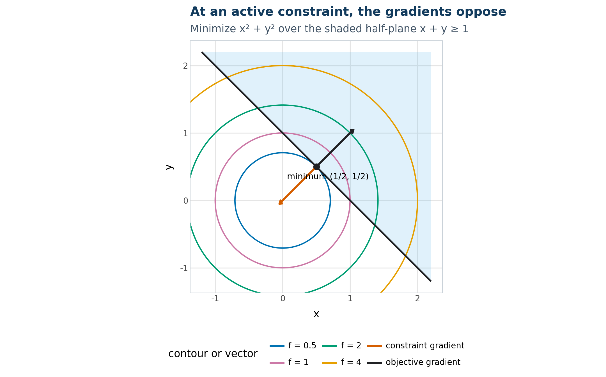

# Optimization with Constraints {#sec-constrained-optimization}

Optimization asks for the best feasible choice, not merely a stationary point.
The objective, constraints, domain, units, and meaning of “best” all belong to
the mathematical problem. Calculus generates candidates; geometry and global
reasoning decide among them.

## Convex sets and functions

A set $C\subseteq\mathbb R^n$ is **convex** if

$$
(1-t)\mathbf x+t\mathbf y\in C
$$

whenever $\mathbf x,\mathbf y\in C$ and $0\le t\le1$. It contains the whole
line segment between any two of its points. Half-spaces, balls, and intersections
of convex sets are convex; a ring-shaped annulus is not.

A function $f:C\to\mathbb R$ is convex if

$$
f((1-t)\mathbf x+t\mathbf y)
\le(1-t)f(\mathbf x)+tf(\mathbf y).
$$

Its graph lies below chords. If $f$ is twice differentiable on an interval,
$f''\ge0$ throughout the interval is sufficient for convexity. If $f$ is twice
differentiable on an open convex domain in $\mathbb R^n$, a
positive-semidefinite Hessian at every point is sufficient.

The payoff is global: every local minimum of a convex function on a convex set
is global. If the function is strictly convex, the minimizer is unique when it
exists. For a nonempty closed feasible set, a proper lower-semicontinuous objective on that set attains its infimum if it has a nonempty compact sublevel; finite-dimensional coercivity supplies bounded sublevels, not closedness.
On a nonempty compact feasible set, lower semicontinuity and properness suffice. Coercivity alone does not restore attainment on an open feasible set.

## Equality constraints and Lagrange multipliers

To optimize differentiable $f(\mathbf x)$ subject to a differentiable equation
$g(\mathbf x)=c$, suppose the constraint surface is smooth and
$\nabla g\ne0$. At a constrained extremum, every feasible tangent direction is
orthogonal to $\nabla f$. Since $\nabla g$ is normal to the surface,

$$
\nabla f=\lambda\nabla g.
$$

This condition produces candidates; it is not automatically sufficient.

**Worked example.** Find extrema of $f(x,y)=xy$ on the circle
$x^2+y^2=2$. Equations

$$
(y,x)=\lambda(2x,2y)
$$

imply $x=\pm y$. The four candidates are $(1,1),(-1,-1),(1,-1),(-1,1)$.
Evaluating $xy$ gives maximum $1$ and minimum $-1$. Compactness of the circle
guarantees global extrema exist, and evaluation finishes the argument.

If $\nabla g=0$ at a feasible point, the multiplier theorem's regularity
hypothesis fails. That point must be examined directly rather than discarded.

## Boundaries and multiple constraints

On a closed planar region, search in layers:

1. interior critical points where $\nabla f=0$;
2. smooth boundary pieces using parametrization or multipliers;
3. corners and endpoints separately.

For several equality constraints $g_i=c_i$, the condition becomes

$$
\nabla f=\lambda_1\nabla g_1+\cdots+\lambda_m\nabla g_m,
$$

provided the constraint gradients are independent. Geometrically, the
objective gradient lies in the normal space to the feasible surface.

## Inequalities and KKT conditions

Write a minimization problem as

$$
\text{minimize }f(\mathbf x)
\quad\text{subject to }g_i(\mathbf x)\le0,
\quad h_j(\mathbf x)=0.
$$

Assume $f$, the $g_i$, and the $h_j$ are continuously differentiable. Under
suitable constraint qualifications, a local minimizer has multipliers
$\lambda_i\ge0$ and $\mu_j$ satisfying the **Karush–Kuhn–Tucker conditions**:

$$
\begin{aligned}
&\nabla f+\sum_i\lambda_i\nabla g_i+\sum_j\mu_j\nabla h_j=0
&&\text{(stationarity)},\\
&g_i\le0,\quad h_j=0
&&\text{(primal feasibility)},\\
&\lambda_i\ge0
&&\text{(dual feasibility)},\\
&\lambda_i g_i=0
&&\text{(complementary slackness)}.
\end{aligned}
$$

Complementary slackness says an inactive constraint $g_i<0$ has zero
multiplier; a positive multiplier can occur only when the constraint is active.
One common sufficient constraint qualification is **linear independence of
active constraint gradients**: the gradients of the equalities and of those
inequalities with $g_i=0$ are linearly independent at the candidate point.

**Worked convex problem.** Minimize $x^2+y^2$ subject to $x+y\ge1$. Use
$g=1-x-y\le0$. The unconstrained minimum $(0,0)$ is infeasible, so the
constraint is active. Stationarity gives

$$
2x-\lambda=0,\qquad2y-\lambda=0,\qquad x+y=1.
$$

Thus $x=y=1/2$ and $\lambda=1$. Convexity makes the KKT point the unique global
minimum. Without convexity, KKT conditions remain candidate conditions, not a
global certificate.

<figure id="fig-kkt-geometry">


<figcaption>

Figure 20.1: Level curves and active-constraint geometry for a convex KKT problem.

</figcaption>
</figure>

In [Figure 20.1](#fig-kkt-geometry) the smallest objective contour touching the feasible set
does so on the active boundary. Its normal is parallel to the boundary normal,
which is the stationarity equation in geometric form. Convexity then upgrades
this local contact condition to a global conclusion.

## Sensitivity and shadow prices

Change the preceding threshold to $x+y\ge b$ with $b>0$. The optimum is
$x=y=b/2$ and optimal value

$$
V(b)=\frac{b^2}{2}.
$$

Its derivative $V'(b)=b$ equals the optimal multiplier under our sign
convention. The multiplier is a **shadow price**: to first order, tightening the
constraint by $\Delta b$ increases optimal cost by about $\lambda\Delta b$.

This interpretation is local and conditional. Active sets can change,
nondifferentiability can occur, and units must match: the multiplier has units
of objective per unit of constraint.

## Model formulation and ethical boundaries

An optimization result is only as sound as its objective and constraints. A
single objective often hides multiple values: cost, safety, delay, fairness,
privacy, or environmental impact. Converting them into one score introduces
weights that are decisions, not facts discovered by calculus.

Before solving, ask:

- Who chose the objective, and whose outcomes does it omit?
- Which constraints represent physical limits, legal duties, or policy choices?
- Are variables genuinely controllable?
- How uncertain are coefficients and measurements?
- Does the optimum sit at a fragile boundary?
- Would a range of near-optimal choices better expose tradeoffs?

Sensitivity analysis is especially important when small parameter changes move
the optimizer substantially. Report the feasible alternatives and assumptions,
not just the winning coordinates.

<div class="callout callout-warning">
<p class="callout-title">Stationary is not synonymous with optimal</p>

A multiplier solution can be a minimum, maximum, saddle, or degenerate point.
Check regularity, feasibility, boundaries, and either compare objective values
or invoke an applicable convexity theorem.

</div>

## Further connections {#forward-handoff}

[Chapter 41](41-computational-optimization.md) turns these optimality
conditions into algorithms. Gradient, Newton, quasi-Newton, trust-region,
projected, proximal, and stochastic methods are compared through descent tests,
KKT residuals, scaling, stopping rules, and failure repairs rather than by a
final objective value alone.

<!-- inline-formula-code:start -->
## Formula and finite computation

A useful formula in this chapter is

$$
x_{k+1}=\Pi_C(x_k-\alpha\nabla f(x_k))
$$

The projection is coded as a separate operation, matching the formula. The following standalone Python block expresses that finite rule with its inputs and stopping conditions visible.

```python
from math import hypot

def projected_descent(
    start: tuple[float, float], step_size: float, iterations: int
) -> list[tuple[float, float]]:
    """Return feasible projected-gradient iterates for a quadratic on a disk."""
    if step_size <= 0.0 or step_size >= 0.5 or iterations <= 0:
        raise ValueError("require 0 < step_size < 1/2 and positive iterations")
    x_value, y_value = start
    if hypot(x_value, y_value) > 1.0:
        raise ValueError("start must lie in the unit disk")
    path = [(x_value, y_value)]
    for _ in range(iterations):
        candidate_x = x_value - step_size * 2.0 * (x_value - 2.0)
        candidate_y = y_value - step_size * 2.0 * (y_value - 1.0)
        radius = hypot(candidate_x, candidate_y)
        if radius > 1.0:
            candidate_x /= radius
            candidate_y /= radius
        x_value, y_value = candidate_x, candidate_y
        path.append((x_value, y_value))
    return path

path = projected_descent(start=(0.0, 0.0), step_size=0.2, iterations=12)
print(path[-1], hypot(*path[-1]))
```

**What the computation establishes.** The calculation checks a declared finite instance; the surrounding argument explains what is true beyond those inputs.
<!-- inline-formula-code:end -->

## Exercises and selected answers

<div class="exercise" id="calculus-20-constrained-optimization-ex-1">
<p class="exercise-title"><strong>Exercise 1</strong></p>

Prove every ball in Euclidean space is convex using the triangle inequality.

</div>

<div class="exercise" id="calculus-20-constrained-optimization-ex-2">
<p class="exercise-title"><strong>Exercise 2</strong></p>

Determine whether $f(x,y)=x^2+4xy+5y^2$ is strictly convex from its Hessian.

</div>

<div class="exercise" id="calculus-20-constrained-optimization-ex-3">
<p class="exercise-title"><strong>Exercise 3</strong></p>

Find the points on $x^2+4y^2=4$ nearest and farthest from $(1,0)$.

</div>

<div class="exercise" id="calculus-20-constrained-optimization-ex-4">
<p class="exercise-title"><strong>Exercise 4</strong></p>

Maximize $xyz$ subject to $x+y+z=12$ and $x,y,z\ge0$.

</div>

<div class="exercise" id="calculus-20-constrained-optimization-ex-5">
<p class="exercise-title"><strong>Exercise 5</strong></p>

Minimize $(x-2)^2+(y-3)^2$ over the half-space $x+y\le2$.

</div>

<div class="exercise" id="calculus-20-constrained-optimization-ex-6">
<p class="exercise-title"><strong>Exercise 6</strong></p>

Write the KKT system for minimizing $x^2+y^2$ with $x\ge0,y\ge0$ and
$x+2y\ge3$; solve it.

</div>

<div class="exercise" id="calculus-20-constrained-optimization-ex-7">
<p class="exercise-title"><strong>Exercise 7</strong></p>

Interpret the units of a multiplier when cost is pounds and a capacity
threshold is kilograms.

</div>

<div class="exercise" id="calculus-20-constrained-optimization-ex-8">
<p class="exercise-title"><strong>Exercise 8</strong></p>

Give an example where a mathematically optimal objective would be socially
incomplete, and propose two explicit additional constraints or objectives.

</div>

**Selected answers.** In (2), the Hessian
$\begin{pmatrix}2&4\\4&10\end{pmatrix}$ has positive leading minors $2$ and
$4$, so it is positive definite. In (4), the interior maximum is
$x=y=z=4$ with product $64$; boundary product is zero. In (5), orthogonal
projection onto $x+y=2$ gives $(1/2,3/2)$. For (6), the active oblique boundary
and stationarity give $(x,y)=(3/5,6/5)$.
