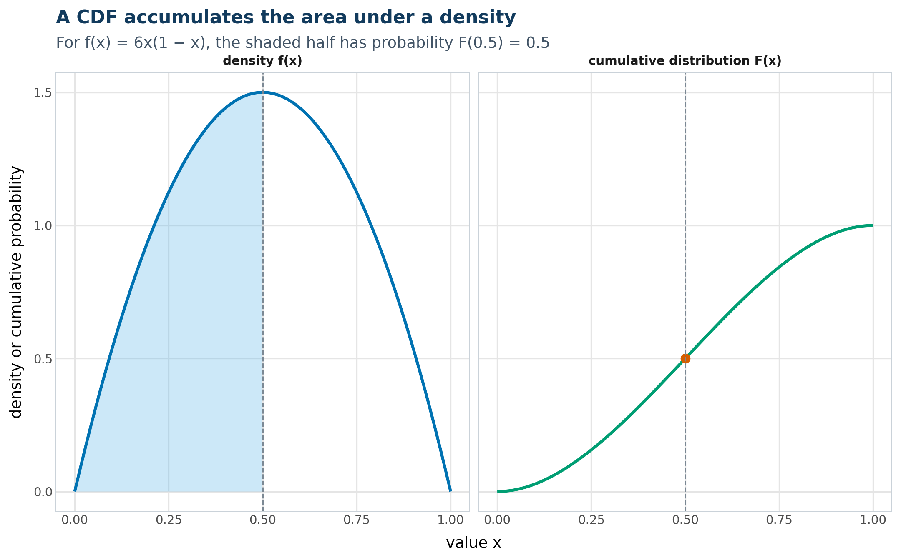

# Probability Densities and Expected Values {#sec-probability-calculus}

Probability uses integration to turn a distribution of possible values into
event probabilities and summaries. This chapter develops the continuous case
without assuming a previous probability course.

## Random variables and densities

A **random variable** assigns a numerical value to each outcome of a random
process. An **absolutely continuous** random variable is described by a
**probability density function** (pdf), a nonnegative function $f$ satisfying

$$
\int_{-\infty}^{\infty}f(x)\,dx=1.
$$

Probabilities are areas:

$$
\mathbb P(a\le X\le b)=\int_a^bf(x)\,dx.
$$

For such a variable, $\mathbb P(X=c)=0$ for every single $c$, even though some
value must occur. Probability belongs to intervals, not the graph height at one
point. A density can exceed $1$ if its support is narrow; only total area must
equal $1$.

**Example.** Let $f(x)=cx(1-x)$ on $0\le x\le1$ and zero otherwise.
Normalization gives

$$
1=c\int_0^1(x-x^2)dx=c\left(\frac12-\frac13\right),
$$

so $c=6$. Then
$\mathbb P(X\le1/2)=\int_0^{1/2}6x(1-x)dx=1/2$ by calculation or symmetry.

## Cumulative distribution functions

The **cumulative distribution function** is

$$
F(x)=\mathbb P(X\le x).
$$

Every CDF is nondecreasing, approaches $0$ at $-\infty$ and $1$ at $+\infty$,
and is right-continuous. When a distribution has a density $f$,

$$
F(x)=\int_{-\infty}^xf(t)dt,
\qquad F'(x)=f(x)\quad\text{where }f\text{ is continuous}.
$$

More generally, the derivative identity holds almost everywhere. Conversely,
differentiating a CDF supplies a density when the CDF is absolutely continuous,
meaning that its changes can be recovered by integrating that density. Mere
differentiability is not, by itself, the right general hypothesis.

The $p$th **quantile** is a value $q_p$ with $F(q_p)=p$ when such a unique value
exists. The median is the $1/2$ quantile. Quantiles transform cleanly under
increasing functions and are less sensitive to extreme tails than means.

<figure id="fig-density-cdf">


<figcaption>

Figure 21.1: A probability density beside the cumulative distribution obtained from its area.

</figcaption>
</figure>

[Figure 21.1](#fig-density-cdf) connects the two representations. The height of the density at
$x$ is not a probability, whereas the accumulated area through $x$ is exactly
$F(x)$. The shared median follows from symmetry and from the shaded area being
$1/2$.

## Expectation, variance, and moments

For a function $g$,

$$
\mathbb E[g(X)]=\int_{-\infty}^{\infty}g(x)f(x)dx
$$

when the integral exists. In particular,

$$
\mu=\mathbb E[X],
\qquad
\operatorname{Var}(X)=\mathbb E[(X-\mu)^2]
=\mathbb E[X^2]-\mu^2.
$$

The variance identity applies when $\mathbb E[X^2]<\infty$. Variance has
squared units; standard deviation is its square root. Expectation is linear,
when the displayed expectations exist, whether or not variables are
independent:

$$
\mathbb E[aX+bY+c]=a\mathbb E[X]+b\mathbb E[Y]+c.
$$

Variance adds only when covariance terms vanish.

For an exponential density
$f(x)=\lambda e^{-\lambda x}$ on $x\ge0$, integration by parts gives
$\mathbb E[X]=1/\lambda$ and
$\operatorname{Var}(X)=1/\lambda^2$. Its survival probability is
$\mathbb P(X>t)=e^{-\lambda t}$ for $t\ge0$, and, for $s,t\ge0$,

$$
\mathbb P(X>s+t\mid X>s)=e^{-\lambda t},
$$

the memoryless property.

Conditional probability here means
$\mathbb P(A\mid B)=\mathbb P(A\cap B)/\mathbb P(B)$ when
$\mathbb P(B)>0$: it rescales attention to outcomes where $B$ occurred.

An expectation may fail to exist even when the density is valid. Tail behavior
must be checked rather than assuming every displayed integral converges.

## Transforming a random variable

Let $Y=g(X)$ on an interval where $g$ is strictly monotone and has a
differentiable inverse. If $x=g^{-1}(y)$, conservation of probability gives

$$
f_Y(y)=f_X(g^{-1}(y))\left|\frac{d}{dy}g^{-1}(y)\right|.
$$

The absolute derivative is the one-dimensional Jacobian.

**Worked transformation.** If $X$ is uniform on $[0,1]$ and $Y=X^2$, then
$x=\sqrt y$ and

$$
f_Y(y)=\frac1{2\sqrt y},\qquad0<y<1.
$$

The density becomes large near zero but integrates to $1$. Alternatively,
$F_Y(y)=\mathbb P(X^2\le y)=\sqrt y$, then differentiate.

If $g$ is not one-to-one, sum contributions from every inverse branch. For
$Y=X^2$ with a distribution on negative and positive $X$, both
$x=\sqrt y$ and $x=-\sqrt y$ may contribute.

## Joint densities and independence

A joint density $f_{X,Y}(x,y)$ is nonnegative and integrates to $1$ over the
plane. Event probabilities are double integrals. Marginal densities are

$$
f_X(x)=\int_{-\infty}^{\infty}f_{X,Y}(x,y)dy,
\qquad
f_Y(y)=\int_{-\infty}^{\infty}f_{X,Y}(x,y)dx.
$$

Variables are independent when

$$
f_{X,Y}(x,y)=f_X(x)f_Y(y)
$$

almost everywhere. A rectangular support does not prove independence, and a
nonrectangular support usually proves dependence because one variable restricts
the other's possible values.

Covariance is

$$
\operatorname{Cov}(X,Y)=\mathbb E[(X-\mu_X)(Y-\mu_Y)].
$$

Independence implies zero covariance when moments exist; zero covariance does
not generally imply independence.

**Geometric example.** Uniform distribution on the triangle
$0<y<x<1$ has constant density $2$. The marginal
$f_X(x)=\int_0^x2dy=2x$, while
$f_Y(y)=\int_y^12dx=2(1-y)$. Their product is not constant on the triangle, so
the variables are dependent.

## Law of large numbers as a vista

Let $X_1,X_2,\ldots$ be independent, identically distributed variables with
finite mean $\mu$. The weak law of large numbers says that the sample mean

$$
\overline X_n=\frac1n\sum_{j=1}^nX_j
$$

converges in probability to $\mu$: for every $\varepsilon>0$,

$$
\mathbb P(|\overline X_n-\mu|>\varepsilon)\to0.
$$

With finite variance $\sigma^2$, independence gives
$\operatorname{Var}(\overline X_n)=\sigma^2/n$, and Chebyshev's inequality
proves the claim. The theorem does not say finite averages move monotonically,
that every sample is close, or that dependence and changing distributions are
irrelevant.

<div class="callout callout-warning">
<p class="callout-title">Density height is not probability</p>

Probability is integral over a set. Changing units rescales density height: a
density per metre and the same distribution per centimetre have different
numerical heights but identical event probabilities.

</div>

## Further connections {#forward-handoff}

[Chapter 38](38-measure-integration.md) supplies the measure-theoretic meaning
of densities, expectation, almost-everywhere statements, and limit exchange.
[Chapter 43](43-statistical-inference.md) then asks what finite data can say
about unknown parameters through likelihood, information, intervals, tests,
regression, and experimental design.

<!-- inline-formula-code:start -->
## Formula and finite computation

A useful formula in this chapter is

$$
\mathbb E[X]=\int_{-\infty}^{\infty}x f_X(x)\,dx
$$

A discrete density table makes normalization and expectation two weighted sums. The following standalone Python block expresses that finite rule with its inputs and stopping conditions visible.

```python
outcomes = [-1.0, 0.0, 2.0, 5.0]
probabilities = [0.1, 0.4, 0.3, 0.2]
if abs(sum(probabilities) - 1.0) > 1e-12:
    raise ValueError("probabilities must sum to one")
expectation = sum(x * probability for x, probability in zip(outcomes, probabilities, strict=True))
print(expectation)
```

**What the computation establishes.** The output certifies only the declared finite case. The theorem, if one is claimed, still requires the argument developed in the chapter.
<!-- inline-formula-code:end -->

## Exercises and selected answers

<div class="exercise" id="calculus-21-probability-ex-1">
<p class="exercise-title"><strong>Exercise 1</strong></p>

Normalize $f(x)=c x^2$ on $0\le x\le2$.

</div>

<div class="exercise" id="calculus-21-probability-ex-2">
<p class="exercise-title"><strong>Exercise 2</strong></p>

Find the CDF and median for a uniform distribution on $[a,b]$.

</div>

<div class="exercise" id="calculus-21-probability-ex-3">
<p class="exercise-title"><strong>Exercise 3</strong></p>

For density $2x$ on $[0,1]$, compute mean and variance.

</div>

<div class="exercise" id="calculus-21-probability-ex-4">
<p class="exercise-title"><strong>Exercise 4</strong></p>

Derive the exponential survival probability and memoryless identity.

</div>

<div class="exercise" id="calculus-21-probability-ex-5">
<p class="exercise-title"><strong>Exercise 5</strong></p>

If $X$ is uniform on $[-1,1]$, find the density of $Y=X^2$ using both
inverse branches.

</div>

<div class="exercise" id="calculus-21-probability-ex-6">
<p class="exercise-title"><strong>Exercise 6</strong></p>

Verify that density $2$ on $0<y<x<1$ integrates to $1$ and compute
$\mathbb E[X]$ and $\mathbb E[Y]$.

</div>

<div class="exercise" id="calculus-21-probability-ex-7">
<p class="exercise-title"><strong>Exercise 7</strong></p>

Construct dependent variables with zero covariance.

</div>

<div class="exercise" id="calculus-21-probability-ex-8">
<p class="exercise-title"><strong>Exercise 8</strong></p>

Use Chebyshev's inequality to bound the probability that the mean of $100$
independent variance-$4$ measurements differs from its mean by at least $1$.

</div>

**Selected answers.** In (1), $c=3/8$. In (2),
$F(x)=(x-a)/(b-a)$ inside the interval and the median is $(a+b)/2$. For (3),
$\mathbb E[X]=2/3$ and $\operatorname{Var}(X)=1/18$. In (5),
$f_Y(y)=1/(2\sqrt y)$ on $(0,1)$. In (6), the means are $2/3$ and $1/3$.
The bound in (8) is $0.04$.
