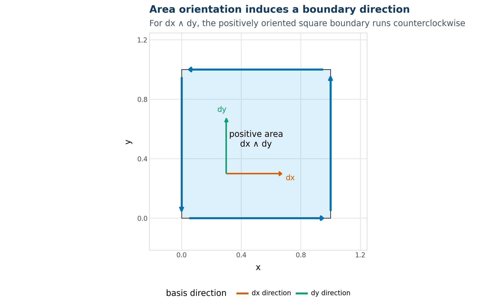

# Vector Calculus in Coordinates and Forms {#sec-forms}

The great integral theorems are easiest to remember when they are seen as one
principle: integrating a derivative over a region equals integrating the
original quantity over the oriented boundary. Curvilinear coordinates explain
the scale factors; differential forms organize what is integrated and how
orientation enters.

## Orthogonal curvilinear coordinates

Suppose position is described by coordinates $(u_1,u_2,u_3)$ through

$$
\mathbf r=\mathbf r(u_1,u_2,u_3).
$$

The coordinate tangent vectors are $\partial\mathbf r/\partial u_i$. In an
orthogonal coordinate system, their lengths

$$
h_i=\left\|\frac{\partial\mathbf r}{\partial u_i}\right\|
$$

are **scale factors**. An infinitesimal coordinate change $du_i$ represents
physical length $h_i\,du_i$, not necessarily $du_i$.

For cylindrical coordinates

$$
x=r\cos\theta,\quad y=r\sin\theta,\quad z=z,
$$

the scale factors are $(1,r,1)$, so

$$
dV=r\,dr\,d\theta\,dz.
$$

For spherical coordinates with polar angle $\phi$ measured from the positive
$z$-axis,

$$
x=\rho\sin\phi\cos\theta,\quad
y=\rho\sin\phi\sin\theta,\quad
z=\rho\cos\phi,
$$

the factors are $(1,\rho\sin\phi,\rho)$ in $(\rho,\theta,\phi)$ order, and

$$
dV=\rho^2\sin\phi\,d\rho\,d\phi\,d\theta.
$$

Angle conventions differ among books. Write the coordinate map before using a
memorized Jacobian.

## Gradient, divergence, and curl in cylindrical coordinates

For $r>0$, let $\mathbf e_r,\mathbf e_\theta,\mathbf e_z$ be the local
orthonormal basis. At the axis $r=0$, the angle and the $\mathbf e_\theta$
direction are undefined, so formulas there require Cartesian coordinates or a
separate limiting argument. Away from the axis, for a scalar field $f$,

$$
\nabla f
=\mathbf e_r\frac{\partial f}{\partial r}
+\mathbf e_\theta\frac1r\frac{\partial f}{\partial\theta}
+\mathbf e_z\frac{\partial f}{\partial z}.
$$

For $\mathbf F=F_r\mathbf e_r+F_\theta\mathbf e_\theta+F_z\mathbf e_z$,

$$
\nabla\cdot\mathbf F
=\frac1r\frac{\partial}{\partial r}(rF_r)
+\frac1r\frac{\partial F_\theta}{\partial\theta}
+\frac{\partial F_z}{\partial z}.
$$

Its curl is

$$
\begin{aligned}
\nabla\times\mathbf F
={}&\left(\frac1r\frac{\partial F_z}{\partial\theta}
-\frac{\partial F_\theta}{\partial z}\right)\mathbf e_r\\
&+\left(\frac{\partial F_r}{\partial z}
-\frac{\partial F_z}{\partial r}\right)\mathbf e_\theta\\
&+\frac1r\left[\frac{\partial}{\partial r}(rF_\theta)
-\frac{\partial F_r}{\partial\theta}\right]\mathbf e_z.
\end{aligned}
$$

The extra $r$ terms reflect changing cell geometry and basis directions. They
are not optional corrections pasted onto Cartesian formulas.

**Example.** For radial planar flow $\mathbf F=r\mathbf e_r$, divergence is

$$
\frac1r\frac{d}{dr}(r^2)=2,
$$

consistent with uniform source strength. For
$\mathbf F=(1/r)\mathbf e_\theta$ away from the axis, local divergence and curl
vanish, yet circulation around a circle centered on the axis is $2\pi$. The
excluded axis creates global topology invisible to local derivatives.

## Vector identities and their hypotheses

For sufficiently smooth fields on an open region,

$$
\nabla\times(\nabla f)=\mathbf0,
\qquad
\nabla\cdot(\nabla\times\mathbf F)=0.
$$

In Cartesian coordinates these follow because mixed partial derivatives cancel.
The smoothness assumption ensures those mixed partials agree. Converse claims
need domain topology: curl-free implies a global potential on a simply
connected domain, but can fail around a hole.

The vector Laplacian of a scalar is

$$
\Delta f=\nabla\cdot\nabla f.
$$

In cylindrical coordinates,

$$
\Delta f=\frac1r\frac\partial{\partial r}
\left(r\frac{\partial f}{\partial r}\right)
+\frac1{r^2}\frac{\partial^2 f}{\partial\theta^2}
+\frac{\partial^2 f}{\partial z^2}.
$$

Harmonic functions satisfy $\Delta f=0$ and model steady temperature and
potential fields under appropriate physical assumptions.

## Differential forms as organized integrands

A **0-form** is a function. A **1-form** in the plane is

$$
\omega=P\,dx+Q\,dy.
$$

It eats a tangent vector—an arrow pointing along a curve at that point—and
returns a scalar; integrating it along a curve gives
$\int_C P\,dx+Q\,dy$. A **2-form** is

$$
\eta=R\,dx\wedge dy.
$$

The wedge symbol records oriented area and antisymmetry:

$$
dx\wedge dy=-dy\wedge dx,
\qquad dx\wedge dx=0.
$$

In three dimensions, 1-forms naturally encode work integrands, 2-forms encode
flux through surfaces, and 3-forms encode volume integrands. This bookkeeping
prevents line, surface, and volume elements from being treated as interchangeable
symbols.

## Exterior derivative

The exterior derivative $d$ raises degree by one. For a function $f$,

$$
df=f_xdx+f_ydy+f_zdz.
$$

For a planar 1-form,

$$
d(Pdx+Qdy)=(Q_x-P_y)dx\wedge dy.
$$

This is scalar curl. For a flux 2-form in three dimensions, the exterior
derivative encodes divergence. A fundamental identity is

$$
d(d\omega)=0,
$$

the forms version of curl gradient equals zero and divergence curl equals zero.

A form is **closed** if $d\omega=0$ and **exact** if $\omega=d\alpha$. Every
exact form is closed. Whether every closed form is exact depends on the domain;
holes can obstruct global antiderivatives.

## One Stokes theorem

Here a **manifold** is a curve, surface, or higher-dimensional region that looks
locally like ordinary Euclidean space; an orientation chooses a consistent
positive direction or side. This chapter uses the general language to organize
familiar objects, not as a prerequisite for constructing abstract manifolds.

The generalized Stokes theorem states

$$
\int_M d\omega=\int_{\partial M}\omega
$$

when $M$ is a compact oriented smooth $n$-manifold with boundary,
$\omega$ is a smooth $(n-1)$-form defined on a neighborhood of $M$, and
$\partial M$ has the induced boundary orientation. It specializes to:

- the Fundamental Theorem of Calculus on an interval;
- the Fundamental Theorem for Line Integrals for exact 1-forms;
- Green's theorem on planar regions;
- classical Stokes on surfaces;
- the Divergence Theorem on volumes.

The formula is compact because the dimension is carried by $M$ and the degree
of $\omega$. It does not remove hypotheses: regularity, orientation, boundary,
and singularities still matter.

**Orientation example.** The standard orientation $dx\wedge dy$ on a planar
region induces counterclockwise boundary orientation. Reversing the region's
orientation reverses the boundary orientation and both integrals' signs,
preserving equality.

<figure id="fig-boundary-orientation">


<figcaption>

Figure 22.1: Positive area orientation and the induced direction around a square boundary.

</figcaption>
</figure>

The counterclockwise arrows in [Figure 22.1](#fig-boundary-orientation) are not an independent
convention added after the area orientation: they are the induced orientation
that makes Stokes' sign consistent. Reversing $dx\wedge dy$ reverses all four
boundary arrows.

## Conservation laws

For density $\rho$ and flux $\mathbf J$, conservation over every fixed region
$V$ says

$$
\frac d{dt}\iiint_V\rho\,dV
=-\iint_{\partial V}\mathbf J\cdot\mathbf n\,dS.
$$

Applying the Divergence Theorem and moving differentiation inside gives the
local continuity equation

$$
\frac{\partial\rho}{\partial t}+\nabla\cdot\mathbf J=0.
$$

The derivation assumes enough smoothness and a fixed control volume. Sources add
a right-hand term; moving material volumes require transport corrections.

<div class="callout callout-warning">
<p class="callout-title">Coordinates can be singular while geometry is not</p>

Cylindrical $\theta$ is undefined at $r=0$, and spherical angles are singular
on axes. A formula containing $1/r$ may reflect coordinate failure rather than
a physical singularity. Return to Cartesian components or take justified
limits.

</div>

<!-- inline-formula-code:start -->
## Formula and finite computation

A useful formula in this chapter is

$$
\oint_{\partial R}\mathbf F\cdot\mathbf n\,ds=\iint_R\nabla\cdot\mathbf F\,dA
$$

The program independently computes both finite sides of the divergence audit. The following standalone Python block expresses that finite rule with its inputs and stopping conditions visible.

```python
def rectangle_divergence_audit(
    width: float, height: float, cells: int
) -> tuple[float, float]:
    """Return midpoint volume and boundary estimates for F=(x^2, x*y)."""
    if width <= 0.0 or height <= 0.0 or cells <= 0:
        raise ValueError("dimensions and cell count must be positive")
    delta_x = width / cells
    delta_y = height / cells
    volume = 0.0
    for row in range(cells):
        y_value = (row + 0.5) * delta_y
        for column in range(cells):
            x_value = (column + 0.5) * delta_x
            volume += 3.0 * x_value * delta_x * delta_y
    right_flux = sum(width**2 * delta_y for _ in range(cells))
    top_flux = sum(
        ((column + 0.5) * delta_x) * height * delta_x
        for column in range(cells)
    )
    boundary = right_flux + top_flux
    return volume, boundary

for cells in (4, 16, 64):
    volume, boundary = rectangle_divergence_audit(2.0, 1.5, cells)
    print(cells, volume, boundary, volume - boundary)
```

**What the computation establishes.** The calculation checks a declared finite instance; the surrounding argument explains what is true beyond those inputs.
<!-- inline-formula-code:end -->

## Exercises and selected answers

<div class="exercise" id="calculus-22-forms-ex-1">
<p class="exercise-title"><strong>Exercise 1</strong></p>

Derive cylindrical scale factors from the coordinate map.

</div>

<div class="exercise" id="calculus-22-forms-ex-2">
<p class="exercise-title"><strong>Exercise 2</strong></p>

Compute $\nabla f$ for $f=r^2z+\cos\theta$ in cylindrical components.

</div>

<div class="exercise" id="calculus-22-forms-ex-3">
<p class="exercise-title"><strong>Exercise 3</strong></p>

Compute the divergence of $r^{-1}\mathbf e_r$ away from the axis and compare
flux through coaxial cylinders of fixed height and different radii.

</div>

<div class="exercise" id="calculus-22-forms-ex-4">
<p class="exercise-title"><strong>Exercise 4</strong></p>

Verify $d(d f)=0$ for a twice continuously differentiable function of two
variables.

</div>

<div class="exercise" id="calculus-22-forms-ex-5">
<p class="exercise-title"><strong>Exercise 5</strong></p>

Find $d\omega$ for $\omega=(x^2-y)dx+(xy+3)dy$.

</div>

<div class="exercise" id="calculus-22-forms-ex-6">
<p class="exercise-title"><strong>Exercise 6</strong></p>

Explain why $(-y\,dx+x\,dy)/(x^2+y^2)$ is closed away from the origin but
not exact on the punctured plane.

</div>

<div class="exercise" id="calculus-22-forms-ex-7">
<p class="exercise-title"><strong>Exercise 7</strong></p>

Derive the continuity equation with a source density $s$.

</div>

<div class="exercise" id="calculus-22-forms-ex-8">
<p class="exercise-title"><strong>Exercise 8</strong></p>

Match each classical integral theorem to $M$, $\partial M$, and the degree of
$\omega$ in generalized Stokes.

</div>

**Selected answers.** In (2),
$\nabla f=2rz\,\mathbf e_r-(\sin\theta/r)\mathbf e_\theta+r^2\mathbf e_z$.
In (3), divergence is zero for $r>0$, while outward flux through a fixed-height
cylinder's curved wall is independent of radius. In (5),
$d\omega=(y+1)dx\wedge dy$. In (6), its integral around the unit circle is
$2\pi$, whereas an exact form would integrate to zero around every closed
curve.
