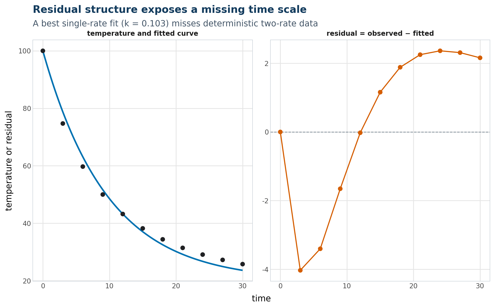

# Capstone Modeling Studio {#sec-modeling-studio}

This studio assembles the book's central practices: choose variables, derive a
model from a mechanism, estimate parameters, solve analytically when possible,
compute responsibly when necessary, visualize, validate, and communicate limits.
The output is not merely a number; it is an auditable chain from assumptions to
claims.

## From a question to variables and scales

Begin with a decision or explanatory question. “Model the temperature” is too
vague. Better: “For how long after removal from an oven does the center
temperature remain above a specified threshold, under a lumped-temperature
assumption?”

Create a quantity table:

| Symbol | Meaning | Units | Known or estimated? |
|---|---|---|---|
| $T(t)$ | object temperature | $^\circ$C | state |
| $T_a$ | ambient temperature | $^\circ$C | measured |
| $k$ | cooling rate | time$^{-1}$ | estimated |
| $t$ | elapsed time | time | input |

Choose characteristic scales $T_s$ and $t_s$. Dimensionless variables
$\theta=(T-T_a)/T_s$ and $\tau=t/t_s$ reveal which parameter combinations
actually control behavior and make comparisons across units easier.

## Mechanism to differential equation

Newton's cooling law assumes the rate of temperature difference is proportional
to that difference:

$$
\frac{dT}{dt}=-k(T-T_a),\qquad k>0.
$$

The assumptions are substantial: uniform internal temperature, constant
ambient conditions, and an effective transfer coefficient that does not change
with temperature or airflow. The equation's solution is

$$
T(t)=T_a+(T_0-T_a)e^{-kt}.
$$

Boundary checks support the formula: $T(0)=T_0$ and $T(t)\to T_a$. The sign is
correct whether the object starts hotter or colder than ambient.

If ambient temperature varies, the equation becomes linear nonhomogeneous:

$$
T'+kT=kT_a(t).
$$

An integrating factor or numerical solver handles it. If internal gradients are
important, a single state variable is inadequate and a heat equation is the
next model, not merely a finer ODE time step.

## Parameter estimation

With constant ambient temperature, take logarithms:

$$
\log|T(t)-T_a|=\log|T_0-T_a|-kt.
$$

Linear regression of log temperature difference against time estimates the
slope $-k$. But transforming data changes the error model: equal additive errors
in temperature do not become equal errors after logarithms, especially near
ambient temperature.

An alternative fits the nonlinear model directly by minimizing

$$
\sum_i\left[T_i-T_a-(T_0-T_a)e^{-kt_i}\right]^2.
$$

Choose the loss according to plausible measurement error, not computational
convenience alone. Plot residuals against time and fitted values. A systematic
curve in residuals is evidence of missing mechanism.

<figure id="fig-cooling-residuals">


<figcaption>

Figure 23.1: A single-rate cooling fit and its systematically curved residuals.

</figcaption>
</figure>

[Figure 23.1](#fig-cooling-residuals) uses deterministic two-rate data so the diagnostic has a
known cause. The fitted curve looks plausible in the left panel, but the
residual run in the right panel is not random scatter around zero. A smaller
solver step cannot remove structural mismatch of this kind.

**Two-point estimate.** If $T_a=20$, $T(0)=100$, and $T(10)=60$, then

$$
60-20=(100-20)e^{-10k},
$$

so $e^{-10k}=1/2$ and $k=(\log2)/10$. The time to reach $30^\circ$C is

$$
t=\frac1k\log\frac{80}{10}=\frac{30\log2}{\log2}=30
$$

in the same time units. A third measurement can test rather than determine the
one-parameter model.

## Analytic, numerical, and visual agreement

For a model with an exact solution, use it as an independent benchmark for the
numerical solver. Compare at a sequence of step sizes, plot error against step,
and check the predicted convergence order. For a model without an exact
solution, compare different methods, tolerances, and conserved or monotone
quantities.

Visualization should answer a declared question:

- state trajectories expose scale and long-term behavior;
- residual plots test systematic mismatch;
- phase portraits show state interaction;
- parameter profiles show identifiability;
- uncertainty bands distinguish prediction from a single fitted line.

Axes need units and captions need parameter values and data scope. Avoid
connecting unordered data as if it were a time series.

## Sensitivity and uncertainty

For a threshold $T_*$ strictly between the initial temperature $T_0$ and the
ambient temperature $T_a$,

$$
t_*(k,T_a,T_0)=\frac1k
\log\left(\frac{T_0-T_a}{T_*-T_a}\right).
$$

The derivative

$$
\frac{\partial t_*}{\partial k}=-\frac{t_*}{k}
$$

shows a $1\%$ relative increase in $k$ produces approximately a $1\%$ relative
decrease in time. Sensitivity to $T_a$ becomes large when $T_*$ is close to
ambient; the prediction is fragile precisely where the exponential tail is
slow and measurement error is relatively important.

Separate at least four uncertainties:

1. measurement error in observed inputs and outputs;
2. parameter uncertainty from finite data;
3. numerical error from approximation;
4. structural error from imperfect assumptions.

Reducing solver tolerance addresses only the third. It cannot repair an
incorrect mechanism or uninformative dataset.

## Validation and extrapolation

Calibration chooses parameters; validation evaluates predictions on data not
used for calibration. If data are scarce, reserve a time block or use repeated
cross-validation appropriate to dependence. Never validate on transformed
training residuals alone.

Interpolation predicts within observed conditions; extrapolation predicts
beyond them. A fitted exponential may describe ten minutes of cooling yet fail
over hours as airflow or phase changes intervene. State the validated domain in
time, temperature, and environmental conditions.

A useful discrepancy plot compares observed and predicted values with uncertainty
bars. Investigate patterns rather than treating a high summary score as proof.
Good prediction does not uniquely validate the proposed mechanism; different
models can agree over a limited range.

## A second studio: dose and elimination

A one-compartment elimination model after an instantaneous dose is

$$
C'=-kC,\qquad C(0)=C_0,\qquad C=C_0e^{-kt}.
$$

Repeated equal doses at interval $\tau$ produce geometric accumulation. Just
after the $n$th dose,

$$
C_n=C_0\left(1+e^{-k\tau}+\cdots+e^{-(n-1)k\tau}\right)
=C_0\frac{1-e^{-nk\tau}}{1-e^{-k\tau}}.
$$

The limiting peak is $C_0/(1-e^{-k\tau})$. This calculation demonstrates how
differential equations between events and discrete recurrence at events fit one
model.

It is not a dosing recommendation. Real pharmacokinetics can include absorption,
multiple compartments, nonlinear elimination, individual variability, and
clinical constraints. Applied mathematics must keep scope attached to output.

## Reproducible project specification

A capstone report should contain:

1. a focused question and audience;
2. quantities, units, data provenance, and exclusions;
3. assumptions and a derivation, not just a chosen formula;
4. analytic work and well-posed initial or boundary data;
5. parameter-estimation method and diagnostic residuals;
6. numerical method, tolerances, convergence check, and software versions;
7. plotnine figures with alt text and captions that state scope;
8. sensitivity and uncertainty analysis;
9. validation on held-out or independent evidence;
10. a conclusion separating supported findings, conditional predictions, and
    limitations.

<div class="callout callout-important">
<p class="callout-title">The final answer is a scoped claim</p>

“Under assumptions A–C and within range R, the model predicts X with
uncertainty U” is stronger science than an unqualified precise number. Visible
limitations make a result more useful, not less mathematical.

</div>

## Capstone exercises and project options

<div class="exercise" id="calculus-23-modeling-studio-ex-1">
<p class="exercise-title"><strong>Exercise 1</strong></p>

Recalculate the cooling example if the ten-minute measurement is $55$ rather
than $60$, and compute sensitivity of threshold time to that observation.

</div>

<div class="exercise" id="calculus-23-modeling-studio-ex-2">
<p class="exercise-title"><strong>Exercise 2</strong></p>

Fit a two-parameter affine trend and an exponential model to a small dataset;
compare residual patterns rather than only squared error.

</div>

<div class="exercise" id="calculus-23-modeling-studio-ex-3">
<p class="exercise-title"><strong>Exercise 3</strong></p>

Nondimensionalize the logistic equation using population scale $K$ and time
scale $1/r$.

</div>

<div class="exercise" id="calculus-23-modeling-studio-ex-4">
<p class="exercise-title"><strong>Exercise 4</strong></p>

For repeated dosing, derive the concentration immediately before each dose
and its limiting trough.

</div>

<div class="exercise" id="calculus-23-modeling-studio-ex-5">
<p class="exercise-title"><strong>Exercise 5</strong></p>

Create synthetic cooling data with known $k$, add a declared noise model,
estimate $k$, and repeat across many seeds. Distinguish simulation truth from
real-data validation.

</div>

<div class="exercise" id="calculus-23-modeling-studio-ex-6">
<p class="exercise-title"><strong>Exercise 6</strong></p>

Build and validate a tank-mixing, falling-object, epidemic, or predator–prey
model using the ten-part specification.

</div>

<div class="exercise" id="calculus-23-modeling-studio-ex-7">
<p class="exercise-title"><strong>Exercise 7</strong></p>

Audit a published graph: identify variables, units, transformations, data
scope, uncertainty, and any causal language unsupported by the design.

</div>

<div class="exercise" id="calculus-23-modeling-studio-ex-8">
<p class="exercise-title"><strong>Exercise 8</strong></p>

Write a one-page executive summary and a separate technical appendix for the
same model. Preserve conclusions while changing detail and vocabulary.

</div>

**Selected checks.** In (3), $u=P/K$ and $\tau=rt$ give
$du/d\tau=u(1-u)$, removing both dimensional parameters. In (4), the trough
after $n$ dose intervals is $C_ne^{-k\tau}$ and tends to
$C_0e^{-k\tau}/(1-e^{-k\tau})$. For (5), a fixed random seed makes a run
reproducible but does not represent uncertainty by itself; repeated, recorded
seeds reveal the sampling distribution under the chosen synthetic model.

## Closing the calculus arc

The book began by measuring small changes and adding small contributions. It now
ends with the full discipline around those operations: representation,
derivation, approximation, computation, uncertainty, and communication. The
durable habit is to move among formulas, geometry, data, and proof while keeping
assumptions visible.

<!-- inline-formula-code:start -->
## Formula and finite computation

A useful formula in this chapter is

$$
S_2-S_1\approx\frac{S_2-S_0}{15}
$$

Adaptive Simpson recursion allocates a visible local error budget. The following standalone Python block expresses that finite rule with its inputs and stopping conditions visible.

```python
from collections.abc import Callable
from math import pi, sin

def adaptive_simpson(
    function: Callable[[float], float],
    left: float,
    right: float,
    tolerance: float,
    max_depth: int = 20,
) -> tuple[float, int]:
    """Return an adaptive Simpson estimate and accepted-panel count."""
    if not left < right or tolerance <= 0.0 or max_depth <= 0:
        raise ValueError("require left < right, positive tolerance and depth")

    def panel(
        a_value: float,
        b_value: float,
        f_a: float,
        f_mid: float,
        f_b: float,
    ) -> float:
        return (b_value - a_value) * (f_a + 4.0 * f_mid + f_b) / 6.0

    middle = (left + right) / 2.0
    f_left, f_middle, f_right = function(left), function(middle), function(right)
    whole = panel(left, right, f_left, f_middle, f_right)
    stack = [
        (left, right, f_left, f_middle, f_right, whole, tolerance, 0)
    ]
    estimate = 0.0
    accepted = 0
    while stack:
        a_value, b_value, f_a, f_mid, f_b, coarse, budget, depth = stack.pop()
        midpoint = (a_value + b_value) / 2.0
        left_midpoint = (a_value + midpoint) / 2.0
        right_midpoint = (midpoint + b_value) / 2.0
        f_left_midpoint = function(left_midpoint)
        f_right_midpoint = function(right_midpoint)
        left_panel = panel(a_value, midpoint, f_a, f_left_midpoint, f_mid)
        right_panel = panel(midpoint, b_value, f_mid, f_right_midpoint, f_b)
        refined = left_panel + right_panel
        if abs(refined - coarse) <= 15.0 * budget:
            estimate += refined + (refined - coarse) / 15.0
            accepted += 1
            continue
        if depth >= max_depth:
            raise RuntimeError("requested tolerance was not resolved")
        stack.append(
            (
                midpoint,
                b_value,
                f_mid,
                f_right_midpoint,
                f_b,
                right_panel,
                budget / 2.0,
                depth + 1,
            )
        )
        stack.append(
            (
                a_value,
                midpoint,
                f_a,
                f_left_midpoint,
                f_mid,
                left_panel,
                budget / 2.0,
                depth + 1,
            )
        )
    return estimate, accepted

estimate, panels = adaptive_simpson(sin, 0.0, pi, tolerance=1e-10)
print(estimate, panels, abs(estimate - 2.0))
```

**What the computation establishes.** The calculation checks a declared finite instance; the surrounding argument explains what is true beyond those inputs.
<!-- inline-formula-code:end -->
