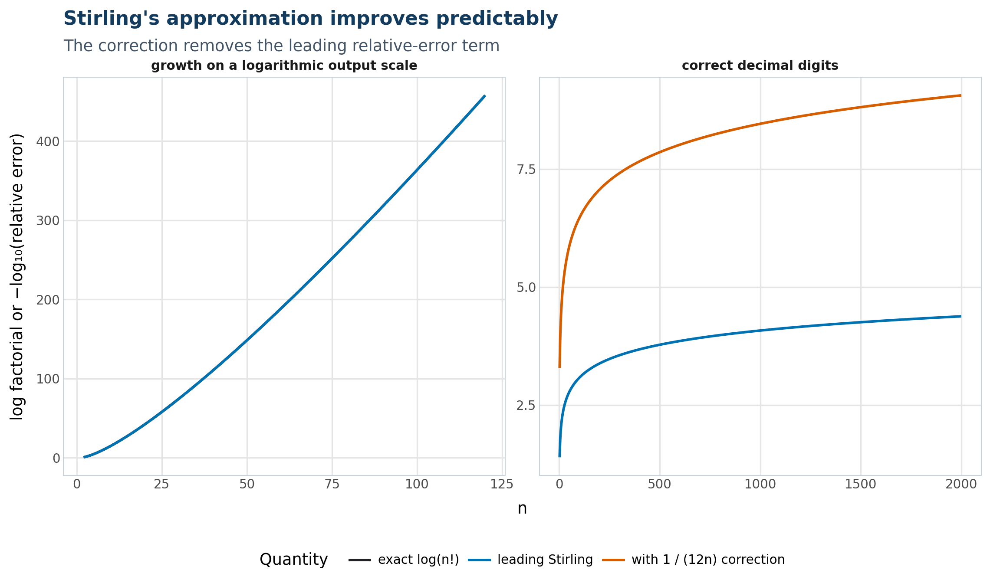

# Asymptotic Thinking and Special Functions {#sec-calculus-asymptotics}

Exact formulas are valuable, but they are often less informative than a controlled
approximation. Asymptotic analysis asks which terms dominate in a stated limit,
how large the discarded part is, and where a formula stops being reliable.

**Prerequisites.** Powers, exponentials, logarithms, and trigonometry from Modules
E–F; limits and Taylor polynomials from [sec-limits](02-limits-continuity.md#sec-limits) and
[sec-series](10-series-taylor.md#sec-series); improper integrals from [sec-techniques](07-integration-techniques.md#sec-techniques).

## Comparing growth precisely

Let $g(x)>0$ eventually as $x\to\infty$.

- $f(x)=O(g(x))$ means $|f(x)|\le Cg(x)$ eventually for some $C$.
- $f(x)=o(g(x))$ means $f(x)/g(x)\to0$.
- $f(x)\sim g(x)$ means $f(x)/g(x)\to1$.
- $f(x)=\Theta(g(x))$ means both $f=O(g)$ and $g=O(f)$.

The limiting regime is part of the notation. The statement
$\sin x\sim x$ is true as $x\to0$, not as $x\to\infty$.

As $x\to\infty$,

$$
\log x=o(x^\alpha),\qquad
x^\alpha=o(a^x),\qquad
a^x=o(x!)
$$

for $\alpha>0$ and $a>1$, with the last comparison interpreted on integers.
L'Hôpital's rule can prove selected ratios, but logarithms, integral estimates,
and repeated comparison are often cleaner.

Algebra is licensed only after hypotheses are checked. If
$f=O(g)$ and $h=O(k)$, then $fh=O(gk)$. If
$f\sim g$ and neither is eventually zero, reciprocals are asymptotic. Subtraction
is dangerous: $x+1\sim x$ and $x\sim x$, but their difference is $1$, not
asymptotic to zero in a useful relative sense.

## Dominant balance

Suppose a small parameter $\varepsilon$ appears in

$$
x^2+x-\varepsilon=0.
$$

One root is small. Balancing $x$ with $\varepsilon$ suggests
$x=O(\varepsilon)$; balancing $x^2$ with $\varepsilon$ would suggest
$O(\sqrt\varepsilon)$, inconsistent because the linear term would then be
larger. Substituting
$x=a_1\varepsilon+a_2\varepsilon^2+\cdots$ gives

$$
x=\varepsilon-\varepsilon^2+2\varepsilon^3+O(\varepsilon^4).
$$

The other root is near $-1$ and needs the shifted scale $x=-1+y$.
One equation can have several asymptotic regions.

Transition regions occur when previously negligible terms become comparable.
For
$e^{-x/\varepsilon}$, the function is tiny for fixed $x>0$ as
$\varepsilon\to0$, but changes rapidly when $x=O(\varepsilon)$. Introducing
$X=x/\varepsilon$ resolves that boundary layer.

## Asymptotic expansions

We write

$$
f(x)\sim\sum_{k=0}^{\infty}a_k\phi_k(x)
$$

in a limit when
$\phi_{k+1}=o(\phi_k)$ and, for every fixed $N$,

$$
f(x)-\sum_{k=0}^{N}a_k\phi_k(x)
=o(\phi_N(x)).
$$

The infinite series need not converge. It means every fixed truncation has a
specified successive accuracy.

Integration by parts gives, as $x\to\infty$,

$$
\int_x^\infty e^{-t^2}\,dt
\sim
\frac{e^{-x^2}}{2x}
\left(1-\frac1{2x^2}+\frac{3}{4x^4}-\cdots\right).
$$

The coefficients eventually grow. For a fixed large $x$, error may decrease
until an optimal truncation and then increase. “More terms” is not automatically
“more accurate.”

Taylor series are local power-series expansions. Asymptotic expansions can use
other scales, apply at infinity, and be useful even when divergent.

## Stirling's formula

Factorials grow faster than exponentials with fixed base. Stirling's formula is

$$
n!
\sim
\sqrt{2\pi n}\left(\frac ne\right)^n.
$$

A refined form is

$$
n!
= \sqrt{2\pi n}\left(\frac ne\right)^n
\left(1+\frac1{12n}+O(n^{-2})\right).
$$

Taking logarithms separates the growth:

$$
\log(n!)
=n\log n-n+\frac12\log(2\pi n)+O(1/n).
$$

The integral comparison
$\int_1^n\log x\,dx$ predicts $n\log n-n$. Euler–Maclaurin corrections
produce the logarithmic term and remainder; identifying $\sqrt{2\pi}$ requires
an additional normalization argument, often using the Gaussian integral.

<figure id="fig-stirling-accuracy">


<figcaption>

Figure 24.1: Exact log factorials approach successive Stirling approximations while corrected accuracy improves.

</figcaption>
</figure>

[Figure 24.1](#fig-stirling-accuracy) uses logarithms in the growth panel so all curves remain
visible. The error panel is the evidence needed to compare approximations.

**Worked example.** The central binomial coefficient satisfies

$$
\binom{2n}{n}
\sim\frac{4^n}{\sqrt{\pi n}}.
$$

Apply Stirling separately to $(2n)!$ and $n!^2$, then cancel exponential and
square-root factors. An asymptotic formula for each factorial does not permit
discarding factors before the ratio is formed.

## Gamma and beta functions

The gamma function extends factorials:

$$
\Gamma(s)=\int_0^\infty t^{s-1}e^{-t}\,dt,
\qquad s>0.
$$

Near zero, integrability needs $s>0$; at infinity, exponential decay wins.
Integration by parts gives

$$
\Gamma(s+1)=s\Gamma(s),\qquad
\Gamma(n+1)=n!.
$$

The Gaussian integral gives
$\Gamma(1/2)=\sqrt\pi$. Gamma can be continued beyond the integral's domain,
with poles at the nonpositive integers; that continuation belongs to complex
analysis.

The beta function is

$$
B(p,q)=\int_0^1t^{p-1}(1-t)^{q-1}\,dt,
\qquad p,q>0.
$$

A two-variable change of coordinates proves

$$
B(p,q)=\frac{\Gamma(p)\Gamma(q)}{\Gamma(p+q)}.
$$

Beta integrals normalize probability densities and evaluate many trigonometric
integrals.

## Laplace's method

Consider

$$
I(\lambda)=\int_a^be^{\lambda\phi(x)}\psi(x)\,dx,
\qquad \lambda\to\infty.
$$

On a finite compact interval $[a,b]$ with $a<b$, assume $\phi$ is twice continuously differentiable and $\psi$ is continuous, both real-valued, and take real $\lambda\to+\infty$.
If $\phi$ has a unique global maximum at an interior point $x_0$, $\phi''(x_0)<0$, and $\psi(x_0)\ne0$, then the main contribution comes from
a window of width $O(\lambda^{-1/2})$. Taylor expansion gives

$$
I(\lambda)
\sim
e^{\lambda\phi(x_0)}
\psi(x_0)
\sqrt{\frac{2\pi}{\lambda|\phi''(x_0)|}}.
$$

Outside a small neighbourhood, $\phi$ is below its maximum by a fixed amount,
so that contribution is exponentially smaller. Inside, rescale
$x-x_0=y/\sqrt\lambda$ and obtain a Gaussian integral.

If the maximum is at an endpoint, if $\phi''(x_0)=0$, or if
$\psi(x_0)=0$, the power of $\lambda$ and coefficient change. The hypotheses
are not decorative.

## Why special functions appear

Some antiderivatives and differential equations cannot be expressed using a
finite combination of familiar elementary functions. Naming the resulting
objects permits calculus to continue.

- The error function
  $\operatorname{erf}(x)=\frac2{\sqrt\pi}\int_0^xe^{-t^2}\,dt$
  describes Gaussian probabilities and diffusion profiles.
- Bessel functions solve radial wave and heat equations.
- Airy functions solve $y''-xy=0$ and describe turning-point transitions.
- Elliptic integrals arise from pendulum periods and arc lengths.

A special function should be specified by an integral, series, differential
equation plus normalization, or another uniqueness-producing definition.
Numerical libraries use domain reduction, rational approximations, recurrence,
and asymptotics; a name is not an instruction to treat it as a black box.

## Euler–Maclaurin and sums as integrals

The integral test compares a sum with area. Euler–Maclaurin turns that comparison
into an expansion. In one common finite form,

$$
\sum_{k=m}^{n}f(k)
= \int_m^nf(x)\,dx
+\frac{f(m)+f(n)}2
+\sum_{r=1}^{p}
\frac{B_{2r}}{(2r)!}
\big(f^{(2r-1)}(n)-f^{(2r-1)}(m)\big)
+R_p,
$$

where $B_{2r}$ are Bernoulli numbers and $R_p$ has an integral expression
involving a higher derivative. The first correction is

$$
\frac{B_2}{2!}(f'(n)-f'(m))
=\frac1{12}(f'(n)-f'(m)).
$$

The theorem explains why trapezoidal corrections and endpoint derivatives appear
in asymptotics for sums. Applied to $\log k$, it leads to Stirling's expansion.
Applied to $1/k$, it gives

$$
H_n
=\log n+\gamma+\frac1{2n}
-\frac1{12n^2}+O(n^{-4}),
$$

where
$\gamma=\lim_{n\to\infty}(H_n-\log n)$ is Euler's constant.

The remainder cannot be ignored merely because several correction terms have
been written. Smoothness, derivative size, and the number of terms all enter.
For some analytic functions the Euler–Maclaurin series is asymptotic rather than
convergent, so optimal truncation returns.

## Uniform and nonuniform approximations

An approximation can be accurate for every fixed parameter value yet fail
uniformly when another variable moves. For example,

$$
\frac1{1+\varepsilon x}
=1-\varepsilon x+O(\varepsilon^2x^2)
$$

as $\varepsilon\to0$ for fixed $x$, but the remainder is not small when
$x=O(1/\varepsilon)$. A valid uniform statement on
$|x|\le M$ has a constant depending on $M$; extending the domain with
$\varepsilon$ changes the problem.

Composite approximations combine an outer solution, a rescaled inner solution,
and subtraction of their shared overlap. This **matched asymptotic** idea handles
boundary layers without demanding one Taylor scale cover the entire domain.
Before matching, each approximation must be derived and checked in its own
region.

## Multiple scales and secular terms

A regular expansion can fail because a small frequency error accumulates over a
long time. For the weakly nonlinear Duffing oscillator

$$
x''+x+\varepsilon x^3=0,\qquad x(0)=1,\quad x'(0)=0,
$$

putting $x=x_0+\varepsilon x_1+\cdots$ at the original time scale makes the
forcing for $x_1$ contain $\cos t$, a homogeneous solution. The resulting term
$t\sin t$ is **secular**: it grows until the correction is no longer smaller
than the leading term.

The Poincaré–Lindstedt repair introduces a strained time
$\tau=\omega t$ with

$$
\omega=1+\varepsilon\omega_1+O(\varepsilon^2).
$$

At first order, with $x_0=\cos\tau$,

$$
x_1''+x_1
=\left(2\omega_1-\frac34\right)\cos\tau
-\frac14\cos3\tau.
$$

Choosing $\omega_1=3/8$ removes the resonant forcing. Matching the initial
conditions gives the uniformly more useful approximation

$$
x(t)\approx
\cos(\omega t)
+\frac{\varepsilon}{32}
\left[\cos(3\omega t)-\cos(\omega t)\right],
\qquad
\omega=1+\frac{3\varepsilon}{8}.
$$

The following finite comparison uses RK4 only as a numerical reference. It
names the slow cumulative effect as a frequency correction rather than hiding
it in the symbol $\omega$:

```python
from math import cos

def duffing_position(
    nonlinearity: float, final_time: float, step_count: int
) -> float:
    """Integrate x'' + x + epsilon*x^3 = 0 by finite RK4 steps."""
    if nonlinearity < 0.0 or final_time <= 0.0 or step_count <= 0:
        raise ValueError("require nonnegative nonlinearity and positive time/work")
    step_size = final_time / step_count
    position, velocity = 1.0, 0.0

    def rate(state_position: float, state_velocity: float) -> tuple[float, float]:
        return state_velocity, -state_position - nonlinearity * state_position**3

    for _ in range(step_count):
        k1_position, k1_velocity = rate(position, velocity)
        k2_position, k2_velocity = rate(
            position + step_size * k1_position / 2.0,
            velocity + step_size * k1_velocity / 2.0,
        )
        k3_position, k3_velocity = rate(
            position + step_size * k2_position / 2.0,
            velocity + step_size * k2_velocity / 2.0,
        )
        k4_position, k4_velocity = rate(
            position + step_size * k3_position,
            velocity + step_size * k3_velocity,
        )
        position += step_size * (
            k1_position + 2.0 * k2_position + 2.0 * k3_position + k4_position
        ) / 6.0
        velocity += step_size * (
            k1_velocity + 2.0 * k2_velocity + 2.0 * k3_velocity + k4_velocity
        ) / 6.0
    return position

nonlinearity = 0.05
for final_time in (10.0, 40.0, 80.0):
    reference = duffing_position(nonlinearity, final_time, 400 * int(final_time))
    leading = cos(final_time)
    corrected_frequency = 1.0 + 3.0 * nonlinearity / 8.0
    corrected = cos(corrected_frequency * final_time) + nonlinearity / 32.0 * (
        cos(3.0 * corrected_frequency * final_time)
        - cos(corrected_frequency * final_time)
    )
    print(final_time, abs(leading - reference), abs(corrected - reference))
```

The finite experiment shows why an $O(\varepsilon)$ frequency correction can
matter at times of order $1/\varepsilon$. It does not prove a uniform error
bound, and RK4 error must be checked independently by step refinement.

<!-- inline-formula-code:start -->
## Formula and finite computation

A useful formula in this chapter is

$$
f(x)\sim g(x)\iff\lim_{x\to\infty}\frac{f(x)}{g(x)}=1
$$

A ratio table is useful evidence for the asymptotic relation while retaining scale. The following standalone Python block expresses that finite rule with its inputs and stopping conditions visible.

```python
from math import factorial, pi, sqrt

for number in (5, 10, 25, 50, 100):
    stirling = sqrt(2.0 * pi * number) * (number / 2.718281828459045) ** number
    ratio = factorial(number) / stirling
    print(number, ratio)
```

**What the computation establishes.** The output certifies only the declared finite case. The theorem, if one is claimed, still requires the argument developed in the chapter.
<!-- inline-formula-code:end -->

## Summary

- Asymptotic notation compares functions in a declared limit.
- Dominant balance identifies scales but must be checked by substitution.
- An asymptotic series can be useful without converging.
- Stirling, gamma, beta, and Laplace methods connect factorial growth, integrals,
  probability, and concentration.
- Special functions are defined mathematical objects with algorithms and error
  questions.
- Multiple-scale variables remove secular artifacts when a small frequency or
  phase correction accumulates over long times.

## Exercises

<div class="exercise" id="calculus-24-asymptotics-special-ex-1">
<p class="exercise-title"><strong>Exercise 1</strong></p>

Order $\log x,x^{1/3},2^x,x!$ by eventual growth.

<details class="solution"><summary>Solution</summary>

$\log x\ll x^{1/3}\ll2^x\ll x!$ on integers for the last comparison.

</details>

</div>

<div class="exercise" id="calculus-24-asymptotics-special-ex-2">
<p class="exercise-title"><strong>Exercise 2</strong></p>

Find two asymptotic scales for the roots of
$x^2+x-\varepsilon=0$.

<details class="solution"><summary>Solution</summary>

One root is $O(\varepsilon)$; the other is $-1+O(\varepsilon)$.

</details>

</div>

<div class="exercise" id="calculus-24-asymptotics-special-ex-3">
<p class="exercise-title"><strong>Exercise 3</strong></p>

Explain why $f\sim g$ does not generally allow asymptotic subtraction.

<details class="solution"><summary>Solution</summary>

Leading terms can cancel and reveal a smaller, previously uncontrolled scale.

</details>

</div>

<div class="exercise" id="calculus-24-asymptotics-special-ex-4">
<p class="exercise-title"><strong>Exercise 4</strong></p>

Use Stirling to estimate $\binom{2n}{n}$.

<details class="solution"><summary>Solution</summary>

The result is $4^n/\sqrt{\pi n}$ to relative error tending to zero.

</details>

</div>

<div class="exercise" id="calculus-24-asymptotics-special-ex-5">
<p class="exercise-title"><strong>Exercise 5</strong></p>

Prove $\Gamma(s+1)=s\Gamma(s)$ and audit the boundary terms.

<details class="solution"><summary>Solution</summary>

Integrate by parts; $t^se^{-t}$ vanishes at both endpoints for $s>0$.

</details>

</div>

<div class="exercise" id="calculus-24-asymptotics-special-ex-6">
<p class="exercise-title"><strong>Exercise 6</strong></p>

Evaluate $B(2,3)$ directly and through gamma functions.

<details class="solution"><summary>Solution</summary>

Both methods give $1/12$.

</details>

</div>

<div class="exercise" id="calculus-24-asymptotics-special-ex-7">
<p class="exercise-title"><strong>Exercise 7</strong></p>

Apply Laplace's method to
$\int_{-1}^1e^{-\lambda x^2}\,dx$.

<details class="solution"><summary>Solution</summary>

The interior maximum of $-x^2$ gives
$\sqrt{\pi/\lambda}$ to leading order.

</details>

</div>

<div class="exercise" id="calculus-24-asymptotics-special-ex-8">
<p class="exercise-title"><strong>Exercise 8</strong></p>

Compare a convergent Taylor series with a divergent asymptotic expansion.

<details class="solution"><summary>Solution</summary>

Convergence concerns fixed input and term number tending to infinity;
asymptotics concerns a limiting input with each truncation fixed.

</details>

</div>

<div class="exercise" id="calculus-24-asymptotics-special-ex-9">
<p class="exercise-title"><strong>Exercise 9</strong></p>

Derive the first-order Duffing frequency correction by eliminating the
resonant $\cos\tau$ forcing.

<details class="solution"><summary>Solution</summary>

The resonant coefficient is $2\omega_1-3/4$, so setting it to zero gives
$\omega_1=3/8$.

</details>

</div>

### Answer support

1. $\log x\ll x^{1/3}\ll2^x\ll x!$ on integers for the last comparison.
2. One root is $O(\varepsilon)$; the other is $-1+O(\varepsilon)$.
3. Leading terms can cancel and reveal a smaller, previously uncontrolled scale.
4. The result is $4^n/\sqrt{\pi n}$ to relative error tending to zero.
5. Integrate by parts; $t^se^{-t}$ vanishes at both endpoints for $s>0$.
6. Both methods give $1/12$.
7. The interior maximum of $-x^2$ gives
   $\sqrt{\pi/\lambda}$ to leading order.
8. Convergence concerns fixed input and term number tending to infinity;
   asymptotics concerns a limiting input with each truncation fixed.
9. The resonant coefficient is $2\omega_1-3/4$, so setting it to zero gives
   $\omega_1=3/8$.
