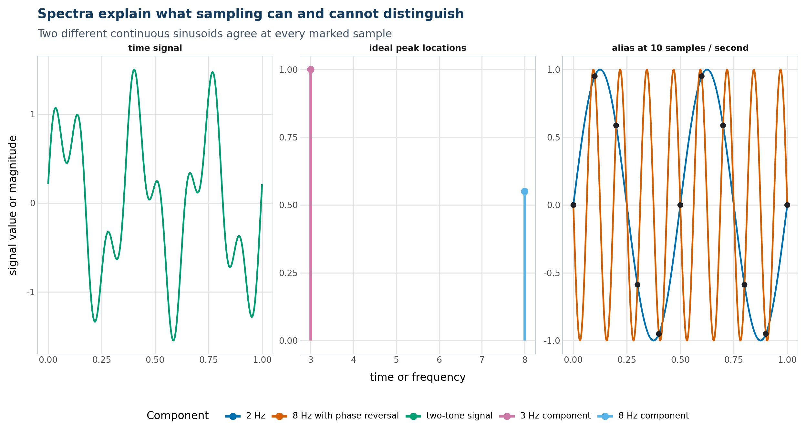

# Integral Transforms and Frequency Methods {#sec-calculus-transforms}

A transform changes coordinates for a function. In time, differentiation and
convolution can look complicated; in frequency, they often become multiplication.
The gain is substantial, but every transform has a convention, a convergence
domain, and an inversion theorem that must be stated.

**Preparation.** The concise primer introduces complex exponentials; integration from
[sec-integrals](06-integrals-ftc.md#sec-integrals), series from [sec-series](10-series-taylor.md#sec-series), linear differential equations
from [sec-odes](09-differential-equations.md#sec-odes), and oscillation from [sec-oscillation](18-oscillation.md#sec-oscillation).

## Signals and spectra

A sinusoid

$$
x(t)=A\cos(2\pi ft+\varphi)
$$

has amplitude $A$, frequency $f$ cycles per unit time, angular frequency
$\omega=2\pi f$, and phase $\varphi$. Confusing $f$ and $\omega$ inserts
a factor $2\pi$ into derivatives and transfer functions.

Real signals can be written with complex exponentials because
$e^{i\theta}=\cos\theta+i\sin\theta$. The real part is taken after linear
calculation. Energy over the real line is
$\int|x(t)|^2dt$, while average power uses a long-time mean; a perpetual
sinusoid has finite power but infinite total energy.

## Convolution and impulse response

For integrable functions,

$$
(f*g)(t)=\int_{-\infty}^{\infty}f(t-\tau)g(\tau)\,d\tau.
$$

It measures sliding overlap and is commutative and associative when changes of
integration order are justified. A causal linear time-invariant system has
output

$$
y=h*x,
$$

where $h$ is its impulse response. Causality corresponds to $h(t)=0$ for
$t<0$.

For $f=\mathbf1_{[0,1]}$, $f*f$ is a triangle supported on $[0,2]$.
Support widths add, while smooth kernels blur sharp changes.

The ideal impulse $\delta$ is not an ordinary function. It is defined by
$\int\delta(t-a)\phi(t)\,dt=\phi(a)$, and satisfies
$f*\delta=f$ in the distributional sense.

## Fourier series revisited

For a $2\pi$-periodic integrable function,

$$
f(x)\sim\frac{a_0}{2}
+\sum_{n=1}^{\infty}
\big(a_n\cos nx+b_n\sin nx\big),
$$

where

$$
a_n=\frac1\pi\int_{-\pi}^{\pi}f(x)\cos nx\,dx,
\qquad
b_n=\frac1\pi\int_{-\pi}^{\pi}f(x)\sin nx\,dx.
$$

Orthogonality makes these coefficients least-squares projections. For
piecewise-smooth $f$, symmetric partial sums converge at a jump to the midpoint
of the one-sided limits. Gibbs overshoot near the jump does not vanish in height,
though it narrows. Fejér averaging suppresses the oscillatory kernel and
converges uniformly for continuous periodic functions.

Coefficient decay diagnoses regularity. Integration by parts shows that one
integrable derivative typically gives an extra factor $1/n$, provided boundary
terms match periodically.

## The Fourier transform

Use the convention

$$
\widehat f(\xi)=
\int_{-\infty}^{\infty}
f(t)e^{-2\pi i\xi t}\,dt.
$$

For sufficiently integrable functions,

$$
\begin{aligned}
\widehat{f*g}&=\widehat f\,\widehat g,\\
\widehat{f'}(\xi)&=2\pi i\xi\widehat f(\xi),\\
\widehat{f(t-a)}(\xi)&=e^{-2\pi i a\xi}\widehat f(\xi),\\
\widehat{e^{2\pi ibt}f(t)}(\xi)&=\widehat f(\xi-b).
\end{aligned}
$$

The Gaussian $e^{-\pi t^2}$ transforms to itself. Scaling produces all centered
Gaussian transform pairs.

If $f,\widehat f\in L^1$, inversion gives

$$
f(t)=\int_{-\infty}^{\infty}
\widehat f(\xi)e^{2\pi i\xi t}\,d\xi
$$

at appropriate points. The transform extends to $L^2$ by Plancherel, but the
integral formula may then exist only as an $L^2$ limit.

## The Laplace transform

For a causal function,

$$
\mathcal L\{f\}(s)=F(s)
=\int_0^\infty e^{-st}f(t)\,dt.
$$

The variable $s$ may be complex. If $f(t)$ grows no faster than
$e^{at}$, the integral converges at least when
$\operatorname{Re}s>a$. This half-plane is part of the transform; the same
algebraic expression can represent different signals under different regions of
convergence in two-sided transform theory.

Integration by parts yields

$$
\mathcal L\{f'\}=sF(s)-f(0),
$$

and

$$
\mathcal L\{f''\}
=s^2F(s)-sf(0)-f'(0).
$$

Initial conditions therefore enter algebraically.

**Worked example.** For

$$
y''+2\zeta\omega_0y'+\omega_0^2y=u(t),
\qquad y(0)=y'(0)=0,
$$

where $u$ is the unit step and $\mathcal L\{u\}=1/s$,

$$
Y(s)=
\frac1{s(s^2+2\zeta\omega_0s+\omega_0^2)}.
$$

Partial fractions and the pole type produce underdamped, critically damped, or
overdamped time responses. Transform algebra does not remove the need to invert
correctly.

## Transfer functions and resonance

For a zero-initial-condition linear system, the transfer function is

$$
H(s)=\frac{Y(s)}{X(s)}.
$$

Poles are zeros of the denominator and encode natural modes; zeros suppress
selected inputs. Evaluating $H(i\omega)$ gives steady sinusoidal gain
$|H(i\omega)|$ and phase $\arg H(i\omega)$, when the system is stable and
transients have decayed.

For the mass–spring–damper equation

$$
mx''+cx'+kx=F_0\cos\omega t,
$$

the steady amplitude is

$$
\frac{F_0}
{\sqrt{(k-m\omega^2)^2+c^2\omega^2}}.
$$

Small damping creates a resonant peak near the natural frequency. Zero damping
at exact resonance produces a growing response, so a bounded steady-state
formula no longer applies.

<figure id="fig-transform-aliasing">


<figcaption>

Figure 25.1: A finite signal has a spectrum, while under-sampling makes distinct frequencies look identical.

</figcaption>
</figure>

[Figure 25.1](#fig-transform-aliasing) separates continuous signals from their samples. The
matching dots prove ambiguity for that sampling grid, not equality of the
underlying curves.

## Sampling, windows, and aliasing

Sampling at rate $f_s$ identifies frequencies differing by integer multiples
of $f_s$. A sinusoid of frequency $f$ and one of frequency $f_s-f$ can have
the same samples up to phase.

**Theorem 25.1 (Sampling, scoped form).** If a square-integrable signal is perfectly
band-limited to $|f|<B$ and sampled uniformly at $f_s>2B$, it is determined
by its samples and can be reconstructed by sinc interpolation.

Real data are finite and not perfectly band-limited. Multiplying by a finite
observation window convolves the true spectrum with the window spectrum, causing
leakage. Tapered windows reduce sidelobes but widen peaks. Anti-alias filtering
must occur before down-sampling; no later computation can recover frequencies
already identified by the sampling map.

The discrete Fourier transform assumes a finite periodic record. Its bin spacing
is $f_s/N$; zero padding interpolates the displayed spectrum but does not create
new resolution.

## The discrete Fourier transform

For samples $x_0,\ldots,x_{N-1}$, define

$$
X_k=
\sum_{n=0}^{N-1}
x_n e^{-2\pi i kn/N},
\qquad k=0,\ldots,N-1.
$$

The inverse is

$$
x_n=
\frac1N\sum_{k=0}^{N-1}
X_k e^{2\pi i kn/N}.
$$

These formulas are an invertible change of coordinates in
$\mathbb C^N$, not an approximation by themselves. Interpretation as samples
of a continuous Fourier transform adds assumptions about sampling, scaling, and
the observation window.

The basis frequencies are periodic in $k$. Indices above $N/2$ are commonly
displayed as negative frequencies. For real data,
$X_{N-k}=\overline{X_k}$, so the spectrum has conjugate symmetry.

Pointwise multiplication of DFT coefficients corresponds to **circular
convolution** of finite sequences. To compute ordinary linear convolution with a
DFT, pad both sequences so the circular wraparound cannot overlap the desired
output.

The direct computation costs $O(N^2)$ arithmetic operations. The fast Fourier
transform exploits factorisation of $N$ and roots-of-unity symmetry to reduce
this to $O(N\log N)$. FFT is an algorithm for the same DFT, not a different
transform.

## Filters and time-frequency trade-offs

A digital linear time-invariant filter with impulse response $h_n$ produces

$$
y_n=\sum_kh_kx_{n-k}.
$$

A finite impulse response filter uses only finitely many $h_k$. Its frequency
response is the DFT or discrete-time Fourier transform of those coefficients.
Sharp frequency cutoffs require long impulse responses and can create ringing
near time-domain jumps.

A spectrogram applies a short window at successive times and plots a local DFT.
A longer window resolves nearby frequencies but blurs when they occur; a shorter
window localises time but broadens frequency peaks. Overlap and window
normalization affect amplitude estimates. There is no parameter-free
“instantaneous spectrum.”

<!-- z-annulus-clinic:start -->
## Bilateral Z-transform clinic {#sec-z-annulus-definition}

A rational expression does not by itself determine a two-sided discrete
signal. Before calculating, predict whether $H(z)=z/(z-2)$ could describe a
stable filter, a causal filter, or both. Keep those predictions while deriving
the two possible sequences below.

For a sequence $h:\mathbb Z\to\mathbb C$, the **bilateral Z-transform** is

$$
\mathcal Z_bh(z)=\sum_{n\in\mathbb Z}h[n]z^{-n},
\qquad z\ne0,
$$

where the series converges absolutely. This clinic considers sequences with a
nonempty open annulus of absolute convergence; its maximal such annulus is the
**region of convergence (ROC)**. In the rational examples below the boundary
circles fail the term test, so their ROCs have strict inequalities. General
bilateral series can have boundary convergence, or no open annulus at all;
we are not making a claim about those cases. Possible extension of a rational
formula to $z=0$ or infinity is separate endpoint bookkeeping.

Use the geometric-series proof from [Chapter 10](10-series-taylor.md): at each
pole, choose a ratio of modulus less than one, and read the coefficient of
$z^{-n}$ as sample $h[n]$. The positive powers of $z$ encode **negative** time
indices. A finite table illustrates this choice; the convergent series proves
it for every index.

### One pole, two time supports {#sec-z-one-pole}

For $|z|>2$, the convergent ratio is $2/z$:

$$
H(z)=\frac{z}{z-2}
=\frac1{1-2/z}
=\sum_{n=0}^{\infty}2^nz^{-n}.
$$

Thus

$$
h_{\mathrm{out}}[n]=
\begin{cases}
2^n,&n\ge0,\\
0,&n\le-1,
\end{cases}
\qquad \text{ROC: }|z|>2.
$$

For $0<|z|<2$, instead use the ratio $z/2$:

$$
H(z)=-\frac{z/2}{1-z/2}
=-\sum_{m=1}^{\infty}2^{-m}z^m.
$$

Putting $n=-m$ gives a different sequence:

$$
h_{\mathrm{in}}[n]=
\begin{cases}
-2^n,&n\le-1,\\
0,&n\ge0,
\end{cases}
\qquad \text{ROC: }0<|z|<2.
$$

There is no inner sample at $n=0$; including one would change the transform.

| $n$ | $-2$ | $-1$ | $0$ | $1$ | $2$ |
| ---: | ---: | ---: | ---: | ---: | ---: |
| $h_{\mathrm{out}}[n]$ | $0$ | $0$ | $1$ | $2$ | $4$ |
| $h_{\mathrm{in}}[n]$ | $-1/4$ | $-1/2$ | $0$ | $0$ | $0$ |

Both sequences satisfy the same difference equation

$$
h[n]-2h[n-1]=\delta[n],
$$

where the discrete unit impulse $\delta[n]$ equals one at $n=0$ and zero
elsewhere. In particular the inner solution gives $0-2(-1/2)=1$ at zero;
at every other index the adjacent exponentials cancel. The recurrence alone,
without a causality or boundary condition, does not select one response.

### Causality and a uniform stability bound {#sec-z-stability}

For discrete convolution, write

$$
(T_hx)[n]=\sum_{k\in\mathbb Z}h[k]x[n-k].
$$

A convolution filter is **causal** exactly when $h[k]=0$ for $k<0$: only present
and past input can affect the output. The outer response is causal. The inner
response uses future samples $x[n+1],x[n+2],\ldots$, so it is not causal.
Such a filter can be meaningful for a recorded signal, but it is not an online
causal realization.

Here **bounded input bounded output (BIBO) stability** means that convolution
is defined for every bounded input and there is **one finite constant $C$**
such that

$$
\|T_hx\|_\infty\le C\|x\|_\infty
\quad\text{for every bounded }x.
$$

The absolute sum supplies both existence and a uniform bound:

$$
\begin{aligned}
\sum_{k\in\mathbb Z}|h[k]|&=C<\infty,\\
|(T_hx)[n]|
&\le\sum_k|h[k]|\,|x[n-k]|
 \le C\|x\|_\infty.
\end{aligned}
$$

Absolute summability is also necessary for such a uniform convolution bound.
For a finite set $S$ of indices, choose a finite-support input by

$$
x[-k]=
\begin{cases}
\overline{h[k]}/|h[k]|,&k\in S,\ h[k]\ne0,\\
0,&\text{otherwise}.
\end{cases}
$$

Its norm is at most one, while $(T_hx)[0]=\sum_{k\in S}|h[k]|$.
Consequently every such finite sum is at most the same $C$, forcing the full
nonnegative series to converge. This argument never assumes that a divergent
infinite convolution has already been defined.

The inner one-pole response is stable, since

$$
\sum_{n\le-1}|h_{\mathrm{in}}[n]|
=\sum_{m=1}^{\infty}2^{-m}=1.
$$

The causal outer response is not stable. The bounded unit-step input, equal to
one for $n\ge0$ and zero for $n<0$, gives

$$
(T_{h_{\mathrm{out}}}x)[n]
=\sum_{k=0}^{n}2^k=2^{n+1}-1
\quad(n\ge0).
$$

This output is unbounded. Causality and stability answer different questions.

The rational continuation $H$ has no pole on the unit circle. Nevertheless,
the outer defining series diverges everywhere on that circle because its
summands do not tend to zero. The inner series converges absolutely there.
Substitution into a rational continuation is a frequency-response calculation
for the recovered filter only when its convergence conditions permit it.

### Changed task: poles on both sides of the unit circle {#sec-z-annulus-task}

Now consider

$$
F(z)=\frac{z}{(z-\tfrac13)(z-3)}.
$$

1. Recover its bilateral sequence on each of the three maximal annuli
   $0<|z|<1/3$, $1/3<|z|<3$ and $|z|>3$. At each pole, explain why your chosen
   geometric ratio converges throughout the required annulus.
2. State each sequence's actual nonzero time support, and prove or refute BIBO
   stability. Can any of these responses be both causal and stable?
3. For the stable response, calculate its exact absolute sum and its output
   to the constant input $x[n]=1$ for every integer $n$. Explain why evaluation
   of $F(1)$ is justified for this response.
4. Check the recurrence
   $h[n]-(10/3)h[n-1]+h[n-2]=\delta[n-1]$, including the transition indices.
   Explain why neither the recurrence alone nor a truncated DFT selects the
   intended infinite response.

Try the [hint](#sec-z-annulus-hint) before the
[full solution](#sec-z-annulus-solution). Choosing a region merely because it
contains points near zero is not a stability argument.

### Hint for the changed task {#sec-z-annulus-hint}

First verify

$$
F(z)=\frac38\left(
 \frac z{z-3}-\frac z{z-\tfrac13}
\right).
$$

At each pole choose the inner or outer expansion from the one-pole proof, then
intersect the two strict inequalities. Absolute convergence on the unit circle
is the stability test here. Compute the positive and negative tails separately,
and check $h[0]$ instead of guessing a support endpoint.

Return to the [task](#sec-z-annulus-task) or continue to the
[full solution](#sec-z-annulus-solution).

### Full solution: three responses, one stable choice {#sec-z-annulus-solution}

For a positive pole $a$, the one-pole argument gives

$$
\begin{aligned}
\frac z{z-a}
 &=\sum_{n=0}^{\infty}a^nz^{-n}
 &&(|z|>a),\\
\frac z{z-a}
 &=-\sum_{m=1}^{\infty}a^{-m}z^m
 &&(0<|z|<a).
\end{aligned}
$$

Apply the appropriate expansion to both terms of the partial fraction formula.

**Outside both poles**, use two outer expansions:

$$
h_{\mathrm{outer}}[n]=
\begin{cases}
\frac38(3^n-3^{-n}),&n\ge0,\\
0,&n\le-1.
\end{cases}
$$

Its ROC is $|z|>3$. It has $h[0]=0$, $h[1]=1$, and actual nonzero support
$n\ge1$. It is causal, but its growing right tail makes it unstable.

**Between the poles**, use the outer expansion at $1/3$ and the inner
expansion at $3$:

$$
h_{\mathrm{middle}}[n]=
\begin{cases}
-\frac38\,3^n,&n\le-1,\\
-\frac38\,3^{-n},&n\ge0.
\end{cases}
$$

The common ROC is $1/3<|z|<3$. Equivalently,

$$
h_{\mathrm{middle}}[n]=-\frac38\,3^{-|n|}
\quad(n\in\mathbb Z).
$$

Every integer index has a nonzero sample, so this response is noncausal.

**Inside both poles**, use two inner expansions:

$$
h_{\mathrm{inner}}[n]=
\begin{cases}
\frac38(3^{-n}-3^n),&n\le-1,\\
0,&n\ge0.
\end{cases}
$$

The ROC is $0<|z|<1/3$. Its nonzero support is $n\le-1$, and its growing left
tail makes it unstable.

These are exact convergence regions for the **combined sequences**, not just
intersections of sufficient conditions on two terms. With $r=|z|$, their actual
outer and inner transform summands have moduli

$$
\begin{aligned}
|h_{\mathrm{outer}}[n]z^{-n}|
 &=\frac38(3/r)^n(1-3^{-2n})
 &&(n\ge1),\\
|h_{\mathrm{inner}}[-m]z^m|
 &=\frac38(3r)^m(1-3^{-2m})
 &&(m\ge1).
\end{aligned}
$$

The first fails the term test when $r\le3$, and the second when $r\ge1/3$.
For the middle response its two geometric tails require respectively
$1/(3r)<1$ and $r/3<1$. Thus both middle boundary circles also fail the term
test. No cancellation between partial fractions enlarges these regions.

Only the middle sequence is absolutely summable:

$$
\begin{aligned}
\sum_{n\in\mathbb Z}|h_{\mathrm{middle}}[n]|
 &=\frac38\left(1+2\sum_{m=1}^{\infty}3^{-m}\right)\\
 &=\frac38(1+2\cdot\tfrac12)=\frac34.
\end{aligned}
$$

The uniform BIBO bound therefore holds with gain $3/4$. The constant input
one gives constant output $-3/4$, because every impulse-response sample is
negative; the bound is attained. Direct substitution gives $F(1)=-3/4$ as
well, legitimately because the unit circle lies in this ROC. In contrast,
the inner annulus misses that circle despite containing arbitrarily small
positive radii.

There is no causal stable choice among the three responses. The causal choice
has the growing pole-$3$ tail. Choosing the stable middle annulus instead
introduces future input, including the nonzero coefficient $h[-1]=-1/8$.

All three sequences satisfy

$$
h[n]-\frac{10}{3}h[n-1]+h[n-2]=\delta[n-1].
$$

Away from $n=0,1$, each active exponential satisfies the homogeneous equation.
For the middle response, the transition checks are

$$
\begin{aligned}
n=0:\quad
 -\frac38-\frac{10}{3}\left(-\frac18\right)-\frac1{24}&=0,\\
n=1:\quad
 -\frac18-\frac{10}{3}\left(-\frac38\right)-\frac18&=1.
\end{aligned}
$$

The outer values $h[-1]=h[0]=0$, $h[1]=1$ give the same checks. For the inner
response, $h[-2]=10/3$, $h[-1]=1$ and $h[0]=h[1]=0$ do so too.
The recurrence does not specify the boundary behavior of the infinite sequence.

#### A finite exact companion

The function below returns a finite sample table for the **fixed two-pole
example**, using exact rational arithmetic. The index range is restricted to
$[-32,32]$, a chosen computational bound. It implements the three coefficient
formulas; it is not a general inverse-transform algorithm.

```python
from fractions import Fraction

def annulus_samples(
    region: str, first: int = -2, last: int = 2
) -> list[tuple[int, Fraction]]:
    """Return bounded exact samples of the fixed two-pole response."""
    if type(region) is not str:
        raise TypeError("region must be a string")
    if region not in ("inner", "middle", "outer"):
        raise ValueError("choose inner, middle, or outer")
    if type(first) is not int or type(last) is not int:
        raise TypeError("sample endpoints must be integers, not booleans")
    if not -32 <= first <= last <= 32:
        raise ValueError("require -32 <= first <= last <= 32")
    factor = Fraction(3, 8)
    rows = []
    for n in range(first, last + 1):
        if region == "middle":
            value = -factor * Fraction(1, 3) ** abs(n)
        elif region == "outer" and n >= 0:
            value = factor * (Fraction(3) ** n - Fraction(1, 3) ** n)
        elif region == "inner" and n <= -1:
            value = factor * (Fraction(1, 3) ** n - Fraction(3) ** n)
        else:
            value = Fraction(0)
        rows.append((n, value))
    return rows

for choice in ("inner", "middle", "outer"):
    print(choice, annulus_samples(choice))
```

For example, the middle rows at $n=-1,0,1$ are
$-1/8,-3/8,-1/8$. The outer rows at $n=0,1,2$ are
$0,1,10/3$; the inner response instead has values $1,10/3$ at
$n=-1,-2$. Check these support cutoffs before using the recurrence.
A finite table can reveal a sign or shift error. The convergence regions,
infinite absolute sum and coefficient uniqueness still require the arguments
in this clinic.

### Why the annulus fixes every coefficient {#sec-z-annulus-uniqueness}

Choose a radius $\rho>0$ inside an annulus of absolute convergence. On its
circle,

$$
\begin{gathered}
H(\rho e^{i\theta})
=\sum_{n\in\mathbb Z}h[n]\rho^{-n}e^{-in\theta},\\
\sum_{n\in\mathbb Z}|h[n]|\rho^{-n}<\infty.
\end{gathered}
$$

Let $S_M(z)=\sum_{n=-M}^{M}h[n]z^{-n}$. For a fixed integer $j$, Fourier
orthogonality gives

$$
\frac1{2\pi}\int_0^{2\pi}
S_M(\rho e^{i\theta})e^{ij\theta}\,d\theta
=h[j]\rho^{-j}
\quad(M\ge|j|).
$$

The absolute tail bounds the corresponding averaged-integral error:

$$
\begin{aligned}
&\left|\frac1{2\pi}\int_0^{2\pi}
 \bigl(H(\rho e^{i\theta})-S_M(\rho e^{i\theta})\bigr)
 e^{ij\theta}\,d\theta\right|\\
&\hspace{1em}\le
 \sum_{|n|>M}|h[n]|\rho^{-n}\longrightarrow0.
\end{aligned}
$$

This same tail bounds the series error uniformly in $\theta$, so the passage
to the integral is justified. Multiplying by $\rho^j$ proves the coefficient
recovery formula

$$
h[j]=\frac{\rho^j}{2\pi}
\int_0^{2\pi}H(\rho e^{i\theta})e^{ij\theta}\,d\theta
\quad(j\in\mathbb Z).
$$

Two absolutely convergent bilateral series giving the same function on that
circle therefore have the same sample at every integer index.

This also proves that the changed task's three responses exhaust the stated
class. Any nonempty open candidate annulus contains a circle with radius
different from $1/3$ and $3$. That circle lies in one of the three displayed
annuli, where an explicit sequence has already been found. Coefficient
uniqueness forces the candidate to equal that sequence, whose exact ROC was
proved above. No general Laurent theorem or unproved pole-crossing rule is
needed. [Chapter 31](31-complex-variables.md) supplies the later complex-analysis
continuation.

A truncated DFT is a finite periodic change of coordinates. It does not prove
the infinite absolute sum converges, recover the omitted tail, or decide
whether the intended filter uses future input. Return to the
[changed task](#sec-z-annulus-task) and revisit your initial causality/stability
predictions using the chosen sequence, not its rational continuation alone.

Oppenheim's [MIT Lecture 3](https://ocw.mit.edu/courses/res-6-008-digital-signal-processing-spring-2011/4a15c19f5f4639dd54d9f07094f3ef24_MITRES_6_008S11_lec03.pdf)
states the convolution causality and absolute-summability criteria;
[Lecture 5](https://ocw.mit.edu/courses/res-6-008-digital-signal-processing-spring-2011/41705cc32f6266c6c765dd89ed8c4a6f_MITRES_6_008S11_lec05.pdf)
emphasises that an ROC distinguishes otherwise identical rational transforms;
[Lecture 6](https://ocw.mit.edu/courses/res-6-008-digital-signal-processing-spring-2011/2ace34fb24e07ad7a22a92aa26ed3e5b_MITRES_6_008S11_lec06.pdf)
develops inverse power-series coefficient reading. The explicit examples,
recurrence checks and coefficient argument above supply the local derivation.
<!-- z-annulus-clinic:end -->

## Further connections {#forward-handoff}

Transform identities become operator statements in
[Chapter 39](39-functional-analysis.md), where norms, completeness, weak
convergence, compactness, and spectra control what a formal diagonalization
means. [Chapter 38](38-measure-integration.md) provides the convergence
theorems needed when limits, infinite sums, and transform integrals are
interchanged.

<!-- inline-formula-code:start -->
## Formula and finite computation

A useful formula in this chapter is

$$
X_k=\sum_{n=0}^{N-1}x_ne^{-2\pi ikn/N}
$$

The nested finite sums are the discrete transform definition verbatim. The following standalone Python block expresses that finite rule with its inputs and stopping conditions visible.

```python
from cmath import exp, pi

signal = [1.0, 0.0, -1.0, 0.0]
size = len(signal)
spectrum = [
    sum(value * exp(-2j * pi * frequency * index / size) for index, value in enumerate(signal))
    for frequency in range(size)
]
print(spectrum)
```

**What the computation establishes.** The output certifies only the declared finite case. The theorem, if one is claimed, still requires the argument developed in the chapter.
<!-- inline-formula-code:end -->

## Summary

- Convolution is the input-output operation of a linear time-invariant system.
- Fourier coordinates diagonalise shifts, derivatives, and convolution.
- Laplace transforms incorporate initial data and exponential growth through a
  convergence half-plane.
- Poles, zeros, gain, and phase organize linear-system response.
- Sampling and windowing change what can be inferred from finite data.

## Exercises

<div class="exercise" id="calculus-25-transforms-ex-1">
<p class="exercise-title"><strong>Exercise 1</strong></p>

Compute $\mathbf1_{[0,1]}*\mathbf1_{[0,1]}$.

<details class="solution"><summary>Solution</summary>

The overlap length rises as $t$, then falls as $2-t$.

</details>

</div>

<div class="exercise" id="calculus-25-transforms-ex-2">
<p class="exercise-title"><strong>Exercise 2</strong></p>

Find the Fourier coefficients of $f(x)=x$ on $(-\pi,\pi)$.

<details class="solution"><summary>Solution</summary>

The series is sine-only, with $b_n=2(-1)^{n+1}/n$.

</details>

</div>

<div class="exercise" id="calculus-25-transforms-ex-3">
<p class="exercise-title"><strong>Exercise 3</strong></p>

Derive the transform rule for a time shift.

<details class="solution"><summary>Solution</summary>

Substitute $u=t-a$ and factor out $e^{-2\pi ia\xi}$.

</details>

</div>

<div class="exercise" id="calculus-25-transforms-ex-4">
<p class="exercise-title"><strong>Exercise 4</strong></p>

Compute $\mathcal L\{t e^{at}\}$.

<details class="solution"><summary>Solution</summary>

It is $1/(s-a)^2$ for $\operatorname{Re}s>a$.

</details>

</div>

<div class="exercise" id="calculus-25-transforms-ex-5">
<p class="exercise-title"><strong>Exercise 5</strong></p>

Solve $y'+2y=u(t)$, $y(0)=0$, by Laplace transform.

<details class="solution"><summary>Solution</summary>

$Y=1/[s(s+2)]$, so $y=(1-e^{-2t})/2$.

</details>

</div>

<div class="exercise" id="calculus-25-transforms-ex-6">
<p class="exercise-title"><strong>Exercise 6</strong></p>

Derive the mass–spring–damper gain.

<details class="solution"><summary>Solution</summary>

Insert a complex sinusoid and take the modulus of
$k-m\omega^2+ic\omega$.

</details>

</div>

<div class="exercise" id="calculus-25-transforms-ex-7">
<p class="exercise-title"><strong>Exercise 7</strong></p>

Give two continuous frequencies with identical samples at rate $10$.

<details class="solution"><summary>Solution</summary>

For example $2$ Hz and $8$ Hz, with a phase or sign adjustment.

</details>

</div>

<div class="exercise" id="calculus-25-transforms-ex-8">
<p class="exercise-title"><strong>Exercise 8</strong></p>

Explain why zero padding does not improve true spectral resolution.

<details class="solution"><summary>Solution</summary>

It samples the same finite-record transform more densely without lengthening
the observation.

</details>

</div>

### Answer support

1. The overlap length rises as $t$, then falls as $2-t$.
2. The series is sine-only, with $b_n=2(-1)^{n+1}/n$.
3. Substitute $u=t-a$ and factor out $e^{-2\pi ia\xi}$.
4. It is $1/(s-a)^2$ for $\operatorname{Re}s>a$.
5. $Y=1/[s(s+2)]$, so $y=(1-e^{-2t})/2$.
6. Insert a complex sinusoid and take the modulus of
   $k-m\omega^2+ic\omega$.
7. For example $2$ Hz and $8$ Hz, with a phase or sign adjustment.
8. It samples the same finite-record transform more densely without lengthening
   the observation.
