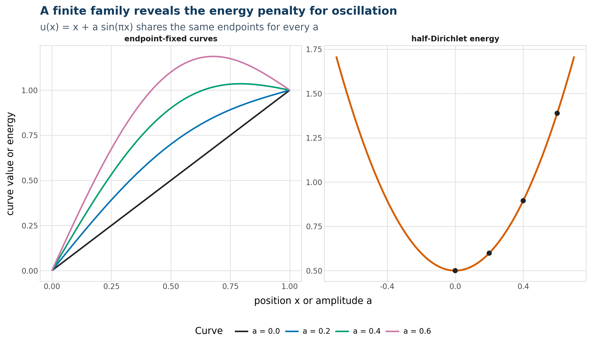

# Calculus of Variations {#sec-calculus-variations}

Optimization usually chooses numbers. A variational problem chooses a whole
curve or function. The derivative of the objective becomes a first variation,
and the equation “derivative equals zero” becomes the Euler–Lagrange differential
equation.

**Prerequisites.** Derivatives, integrals, integration by parts, and ordinary
optimization from [sec-derivative](03-derivative.md#sec-derivative), [sec-integrals](06-integrals-ftc.md#sec-integrals),
[sec-techniques](07-integration-techniques.md#sec-techniques), and [sec-shape](05-shape-optimization.md#sec-shape).

## Functionals and admissible curves

A **functional** assigns a number to a function. A common form is

$$
J[y]=\int_a^bL(x,y(x),y'(x))\,dx.
$$

The function $L$ is the Lagrangian. The **admissible class** states what curves
may compete: their regularity, endpoint values, inequality constraints, and any
integral constraints.

For example,

$$
J[y]=\int_0^1(1+y'^2)\,dx,
\qquad y(0)=0,\quad y(1)=1,
$$

compares differentiable curves joining two fixed points. A local minimizer is
better than nearby curves in a declared function norm; a global minimizer is
better than every admissible curve. These are different claims.

## The first variation

Choose a smooth perturbation $\eta$ with $\eta(a)=\eta(b)=0$ and set
$y_\varepsilon=y+\varepsilon\eta$. Define

$$
\delta J[y](\eta)
= \left.\frac d{d\varepsilon}
J[y+\varepsilon\eta]\right|_{\varepsilon=0}.
$$

The chain rule gives

$$
\delta J[y](\eta)
=\int_a^b
\big(L_y\eta+L_{y'}\eta'\big)\,dx.
$$

If $y$ is an interior local minimizer, then the single-variable function
$\varepsilon\mapsto J[y+\varepsilon\eta]$ has derivative zero at $0$ for
every admissible $\eta$. Therefore $\delta J[y](\eta)=0$.

Differentiating under the integral requires continuity or an appropriate
dominated bound in a common neighbourhood of $\varepsilon=0$. The formal
calculation is not self-justifying.

## The fundamental lemma

If a continuous function $f$ satisfies

$$
\int_a^bf(x)\eta(x)\,dx=0
$$

for every smooth $\eta$ that vanishes near the endpoints, then $f(x)=0$ on
$(a,b)$. If $f(x_0)>0$, continuity makes it positive on a small interval;
choose a nonnegative bump supported there to get a positive integral. The case
$f(x_0)<0$ is analogous.

This lemma turns infinitely many integral identities—one for each test
function—into one pointwise differential equation.

## Euler–Lagrange equation

Integrate the $\eta'$ term by parts:

$$
\delta J[y](\eta)
= \left[L_{y'}\eta\right]_a^b
+\int_a^b
\left(L_y-\frac d{dx}L_{y'}\right)\eta\,dx.
$$

The fixed-endpoint perturbations kill the boundary term. The fundamental lemma
then gives

$$
\boxed{\frac d{dx}L_{y'}=L_y.}
$$

**Worked example: shortest graph.** For
$L=\sqrt{1+y'^2}$, $L_y=0$, so

$$
\frac{y'}{\sqrt{1+y'^2}}=C.
$$

Hence $y'$ is constant and the extremal is the straight segment. Geometry or
convexity confirms it is the global shortest graph; Euler–Lagrange alone only
establishes stationarity.

**Worked example: elastic string.** For

$$
J[y]=\int_0^1
\left(\frac T2y'^2-f(x)y\right)\,dx,
\qquad y(0)=y(1)=0,
$$

the equation is

$$
-Ty''=f(x).
$$

The term $Ty'^2/2$ penalises slope, while $-fy$ models loading.

For several dependent variables $q_1,\ldots,q_m$, one equation appears for
each:

$$
\frac d{dt}\frac{\partial L}{\partial q_j'}
=\frac{\partial L}{\partial q_j}.
$$

## Free endpoints and natural conditions

If $y(b)$ is free, then $\eta(b)$ is arbitrary and the boundary term forces

$$
L_{y'}(b,y(b),y'(b))=0.
$$

This is a **natural boundary condition**. If the endpoint must lie on a curve,
allowed endpoint perturbations are tangent to that constraint and produce a
transversality condition.

One cannot impose both fixed endpoint value and a free-endpoint natural
condition at the same endpoint; they come from different admissible classes.

## Classical geometric examples

### Catenary

A hanging uniform chain minimises gravitational potential energy subject to
fixed length. A multiplier $\lambda$ enforces the length constraint, producing
an effective integrand

$$
L=y\sqrt{1+y'^2}+\lambda\sqrt{1+y'^2}.
$$

The solution is a shifted, scaled hyperbolic cosine:

$$
y(x)=a\cosh\left(\frac{x-b}{a}\right)+c.
$$

It is not a parabola, though shallow portions can look parabolic.

### Brachistochrone

The fastest frictionless descent under gravity minimises travel time. Energy
conservation gives speed proportional to $\sqrt y$ when depth $y$ is measured
downward, so

$$
T[y]=\int
\sqrt{\frac{1+y'^2}{2gy}}\,dx.
$$

The extremal is a cycloid. The singular starting value $y=0$ means a rigorous
treatment needs careful endpoint interpretation; the formula is not licensed by
blind substitution into a smooth theorem.

<figure id="fig-variational-family">


<figcaption>

Figure 26.1: Endpoint-fixed curves form a finite variational comparison, and their energies rise with oscillation.

</figcaption>
</figure>

[Figure 26.1](#fig-variational-family) illustrates one family
$y=x+a\sin(\pi x)$. Testing a family can disprove minimality but cannot prove
global minimality among every admissible curve.

## Constraints and first integrals

For a constraint

$$
G[y]=\int_a^bM(x,y,y')\,dx=c,
$$

a regular constrained extremal satisfies the Euler–Lagrange equation for
$L-\lambda M$. The scalar $\lambda$ and boundary conditions determine the
solution.

If $L$ does not depend on $y$, then
$L_{y'}$ is constant. If $L$ does not depend explicitly on $x$, the
Beltrami identity holds:

$$
L-y'L_{y'}=\text{constant}.
$$

These first integrals can reduce the differential equation by one order. They
are variational versions of conserved momentum and energy.

## Second variation and convexity

At a stationary curve, the second derivative

$$
\delta^2J[y](\eta,\eta)
= \left.\frac{d^2}{d\varepsilon^2}
J[y+\varepsilon\eta]\right|_{\varepsilon=0}
$$

is necessary to distinguish minima from maxima and saddles. Nonnegativity in
every direction is necessary for a smooth local minimum but may be inconclusive.
Uniform positivity plus a controlled remainder gives a strict local minimum.

If $L(x,y,p)$ is jointly convex in $(y,p)$ and the admissible class is convex,
every stationary curve is a global minimizer. Strict convexity gives uniqueness.
This is why quadratic energy problems are especially stable.

Along long geodesic segments, the second variation can acquire negative
directions after a conjugate point. The curve still solves Euler–Lagrange but no
longer minimises length locally across all variations.

## Discretising a variational problem

Choose nodes $x_j$ and represent $y$ by values $y_j$, with straight segments
between them. Replace the integral by quadrature to obtain a multivariable
function $J_h(y_1,\ldots,y_{N-1})$. Gradient-based optimization now gives a
discrete minimizer.

Three audits are essential.

1. **Resolution:** refine the mesh and compare solutions.
2. **Stability:** verify the discrete energy controls unwanted oscillation.
3. **Consistency:** confirm the discrete objective approaches the intended
   continuum functional.

A solver's “success” flag means it satisfied a finite stopping rule. It does not
prove existence or global minimality for the original infinite-dimensional
problem.

## Does a minimizer exist?

The Euler–Lagrange derivation begins “if $y$ is a minimizer.” Existence needs a
separate argument. A practical proof architecture is:

1. choose a minimizing sequence $y_n$ whose energies approach the infimum;
2. use the energy and boundary conditions to bound an appropriate norm;
3. extract a convergent subsequence;
4. prove the limit remains admissible;
5. prove the energy of the limit is no larger than the limiting energies.

In finite dimensions, boundedness gives a convergent subsequence. Function spaces
need a compactness theorem, often in a weaker convergence mode than the one used
to define the energy. This is the **direct method** of the calculus of variations.

For

$$
J[y]=\frac12\int_0^1|y'|^2\,dx
$$

with $y(0)=0,y(1)=1$, existence and minimality can be shown more elementarily.
Cauchy–Schwarz gives

$$
1=
\left(\int_0^1y'\,dx\right)^2
\le
\int_0^1|y'|^2\,dx.
$$

Equality holds exactly when $y'$ is constant, so $y=x$ uniquely minimises
with $J[y]=1/2$. This global inequality proves more than the
Euler–Lagrange equation $y''=0$.

An admissible set must be closed under the convergence being used. Requiring
$y(x)>0$ strictly can allow a minimizing sequence to approach a function that
touches zero and is excluded. The infimum then need not be attained.

Lower semicontinuity is the inequality

$$
J[y]\le\liminf_{n\to\infty}J[y_n].
$$

It prevents energy from disappearing at the limit. Convex integral energies
often have this property under weak convergence; nonconvex energies can develop
fine oscillations and need a relaxed model.

## Further connections {#forward-handoff}

[Chapter 39](39-functional-analysis.md) makes the direct method's ambient
language precise: Banach and Hilbert spaces, weak convergence, bounded linear
functionals, coercive bilinear forms, and compactness. The Lax–Milgram theorem
there gives a reusable existence-and-stability certificate for a broad class of
variational equations.

<!-- inline-formula-code:start -->
## Formula and finite computation

A useful formula in this chapter is

$$
J[y]=\int_a^b L(x,y,y')\,dx
$$

A mesh turns the Dirichlet energy into a finite objective over paths with fixed endpoints. The following standalone Python block expresses that finite rule with its inputs and stopping conditions visible.

```python
def discrete_action(path: list[float], step: float) -> float:
    if len(path) < 2 or step <= 0.0:
        raise ValueError("require a path and positive step")
    return sum(((right - left) / step) ** 2 * step for left, right in zip(path, path[1:]))

straight = [0.0, 0.25, 0.5, 0.75, 1.0]
bent = [0.0, 0.1, 0.7, 0.8, 1.0]
print(discrete_action(straight, 0.25), discrete_action(bent, 0.25))
```

**What the computation establishes.** The output certifies only the declared finite case. The theorem, if one is claimed, still requires the argument developed in the chapter.
<!-- inline-formula-code:end -->

## Summary

- Functionals take functions as inputs, and admissible classes are part of the
  problem.
- The first variation plus the fundamental lemma gives Euler–Lagrange.
- Free endpoints produce natural boundary conditions.
- Constraints introduce multipliers; missing coordinates create first
  integrals.
- Convexity can upgrade stationarity to global minimality.
- Discretisation needs mesh refinement and a continuum error argument.

## Exercises

<div class="exercise" id="calculus-26-variations-ex-1">
<p class="exercise-title"><strong>Exercise 1</strong></p>

Derive Euler–Lagrange for
$J[y]=\int_0^1(y'^2+y^2)\,dx$.

<details class="solution"><summary>Solution</summary>

$-y''+y=0$.

</details>

</div>

<div class="exercise" id="calculus-26-variations-ex-2">
<p class="exercise-title"><strong>Exercise 2</strong></p>

Find the stationary curve for
$\int_0^1y'^2\,dx$ with $y(0)=0,y(1)=2$.

<details class="solution"><summary>Solution</summary>

The straight line $y=2x$.

</details>

</div>

<div class="exercise" id="calculus-26-variations-ex-3">
<p class="exercise-title"><strong>Exercise 3</strong></p>

Derive the natural condition at a free right endpoint.

<details class="solution"><summary>Solution</summary>

The coefficient of arbitrary $\eta(1)$ is $L_{y'}(1)=0$.

</details>

</div>

<div class="exercise" id="calculus-26-variations-ex-4">
<p class="exercise-title"><strong>Exercise 4</strong></p>

Prove the Beltrami identity by differentiating it.

<details class="solution"><summary>Solution</summary>

Substitute $dL/dx=L_x+L_yy'+L_{y'}y''$ and Euler–Lagrange.

</details>

</div>

<div class="exercise" id="calculus-26-variations-ex-5">
<p class="exercise-title"><strong>Exercise 5</strong></p>

Set up the multiplier equation for fixed
$\int_0^1y\,dx=m$.

<details class="solution"><summary>Solution</summary>

Use $L-\lambda y$ and determine $\lambda$ from the integral.

</details>

</div>

<div class="exercise" id="calculus-26-variations-ex-6">
<p class="exercise-title"><strong>Exercise 6</strong></p>

Compute the energy of $y=x+a\sin(\pi x)$.

<details class="solution"><summary>Solution</summary>

It is $1/2+a^2\pi^2/4$ for the half-Dirichlet energy.

</details>

</div>

<div class="exercise" id="calculus-26-variations-ex-7">
<p class="exercise-title"><strong>Exercise 7</strong></p>

Give a stationary point of an ordinary function that is not a minimum.

<details class="solution"><summary>Solution</summary>

$f(x)=x^3$ at zero.

</details>

</div>

<div class="exercise" id="calculus-26-variations-ex-8">
<p class="exercise-title"><strong>Exercise 8</strong></p>

Explain what mesh refinement can reveal and what it cannot prove alone.

<details class="solution"><summary>Solution</summary>

It tests discretisation convergence empirically but does not supply a theorem
about all meshes or all admissible functions.

</details>

</div>

### Answer support

1. $-y''+y=0$.
2. The straight line $y=2x$.
3. The coefficient of arbitrary $\eta(1)$ is $L_{y'}(1)=0$.
4. Substitute $dL/dx=L_x+L_yy'+L_{y'}y''$ and Euler–Lagrange.
5. Use $L-\lambda y$ and determine $\lambda$ from the integral.
6. It is $1/2+a^2\pi^2/4$ for the half-Dirichlet energy.
7. $f(x)=x^3$ at zero.
8. It tests discretisation convergence empirically but does not supply a theorem
   about all meshes or all admissible functions.
