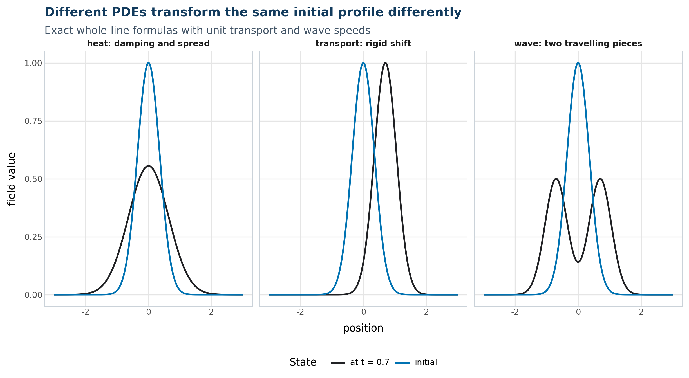

# Partial Differential Equations {#sec-calculus-pdes}

An ordinary differential equation follows one independent variable. A partial
differential equation describes fields depending on several variables—temperature
in space and time, displacement along a string, concentration in a fluid, or
electric potential in a region.

**Prerequisites.** Partial derivatives and multiple integrals from
[sec-partials](13-partial-derivatives.md#sec-partials) and [sec-multiple-integrals](14-multiple-integrals.md#sec-multiple-integrals); vector calculus from
[sec-vector-calculus](15-vector-calculus.md#sec-vector-calculus); ODEs and Fourier series from [sec-odes](09-differential-equations.md#sec-odes)
and [sec-oscillation](18-oscillation.md#sec-oscillation).

## From balance laws to PDEs

Let $u(t,x)$ be a density in one space dimension, $J$ its flux, and $s$ a
source. Conservation over $[a,b]$ says

$$
\frac d{dt}\int_a^bu(t,x)\,dx
=J(t,a)-J(t,b)+\int_a^bs(t,x)\,dx.
$$

If the fields are smooth, the fundamental theorem gives the local equation

$$
u_t+J_x=s.
$$

Different constitutive laws for $J$ produce different PDEs.

- Advection $J=cu$ gives $u_t+cu_x=s$.
- Diffusion $J=-\kappa u_x$ gives $u_t=\kappa u_{xx}+s$.
- Elastic force and Newton's law lead to the wave equation.

A PDE is incomplete without initial data, boundary data, and a domain. Different
equation types accept different combinations.

## Transport and characteristics

For constant velocity $c$,

$$
u_t+cu_x=0,\qquad u(0,x)=u_0(x),
$$

has solution

$$
u(t,x)=u_0(x-ct).
$$

Along a line $x(t)=x_0+ct$,

$$
\frac d{dt}u(t,x(t))=u_t+cu_x=0.
$$

These lines are **characteristics**. The profile moves without changing shape.

For $u_t+a(t,x,u)u_x=b(t,x,u)$, characteristics satisfy coupled ODEs for
$t,x,$ and $u$. In nonlinear equations, different characteristics can
intersect, producing a shock where a classical derivative no longer exists.
Conservation laws then use weak solutions and an additional entropy condition.

On a finite interval with $c>0$, information enters at the left boundary. A
condition at the right outflow boundary generally over-specifies the transport
problem.

## The heat equation

Fourier's law says heat flux is
$J=-\kappa u_x$, pointing down the temperature gradient. Conservation gives

$$
u_t=\kappa u_{xx}.
$$

On $0<x<L$ with ends held at zero, seek
$u(t,x)=T(t)X(x)$. Separation gives

$$
\frac{T'}{\kappa T}=\frac{X''}{X}=-\lambda.
$$

The boundary conditions permit

$$
X_n(x)=\sin\frac{n\pi x}{L},
\qquad
\lambda_n=\left(\frac{n\pi}{L}\right)^2.
$$

Thus

$$
u(t,x)=
\sum_{n=1}^{\infty}
b_ne^{-\kappa(n\pi/L)^2t}
\sin\frac{n\pi x}{L},
$$

where $b_n$ are the sine-series coefficients of the initial temperature.
High-frequency modes decay faster, so heat flow smooths.

The energy identity follows by multiplying by $u$ and integrating:

$$
\frac12\frac d{dt}\int_0^Lu^2\,dx
=-\kappa\int_0^Lu_x^2\,dx,
$$

when boundary terms vanish. This proves uniqueness by applying it to the
difference of two solutions.

<figure id="fig-pde-propagation">


<figcaption>

Figure 27.1: Transport moves a profile, heat smooths it, and wave propagation splits it into travelling pieces.

</figcaption>
</figure>

[Figure 27.1](#fig-pde-propagation) uses exact or finite-series formulas on a declared interval.
It highlights qualitative differences rather than proving existence.

## The wave equation

For a taut string with displacement $u(t,x)$, tension and Newton's law give

$$
u_{tt}=c^2u_{xx}.
$$

On the whole line, d'Alembert's formula is

$$
u(t,x)=
\frac{f(x-ct)+f(x+ct)}2
+\frac1{2c}\int_{x-ct}^{x+ct}g(s)\,ds,
$$

where $f=u(0,\cdot)$ and $g=u_t(0,\cdot)$. Only data within distance $ct$
can influence $(t,x)$, demonstrating finite propagation speed.

For fixed ends, separation of variables gives standing modes
$\sin(n\pi x/L)$, whose time factors oscillate rather than decay.

Wave energy

$$
E(t)=
\frac12\int
\big(u_t^2+c^2u_x^2\big)\,dx
$$

is conserved under compatible boundary conditions. Heat dissipates an $L^2$
energy; ideal waves exchange kinetic and elastic energy without loss.

## Laplace and Poisson equations

Steady heat flow without sources satisfies

$$
\Delta u=0.
$$

Such functions are **harmonic**. With source $f$, the Poisson equation is

$$
-\Delta u=f.
$$

Harmonic functions obey a mean-value property: the value at the center of a ball
equals the average over its boundary or interior. Consequently they cannot have
a strict interior maximum or minimum unless constant. This **maximum principle**
gives uniqueness for Dirichlet boundary data.

In a rectangle, separation of variables combines trigonometric and hyperbolic
functions. On disks, polar coordinates lead to radial powers and Fourier modes.
Coordinate choice should reflect the domain and boundary, not just the
differential operator.

The electrostatic potential is harmonic away from charges; its gradient gives
the electric field. Steady concentration and incompressible irrotational flow
provide other models.

## Classification of second-order equations

For

$$
Au_{xx}+2Bu_{xy}+Cu_{yy}+\text{lower-order terms}=0,
$$

the sign of $B^2-AC$ gives the local constant-coefficient classification:

- elliptic if $B^2-AC<0$, like Laplace;
- parabolic if $B^2-AC=0$, like heat after including time;
- hyperbolic if $B^2-AC>0$, like wave.

Changes of coordinates put the principal part into a canonical form.
Classification predicts the kind of data and qualitative behavior: elliptic
boundary-value problems, parabolic initial-boundary smoothing, and hyperbolic
initial data with propagation.

Variable coefficients can change type across a domain. Lower-order terms affect
solutions but not this principal classification.

## Numerical finite differences

On a grid $x_j=jh$,

$$
u_{xx}(x_j)
\approx\frac{u_{j+1}-2u_j+u_{j-1}}{h^2}.
$$

For the heat equation, forward Euler gives

$$
u_j^{n+1}
=u_j^n+r(u_{j+1}^n-2u_j^n+u_{j-1}^n),
\qquad
r=\frac{\kappa\Delta t}{h^2}.
$$

A Fourier-mode or convex-combination analysis shows stability requires
$0\le r\le1/2$ in one dimension. Refining space without shrinking time can
therefore make the computation less stable.

For the wave equation, centered time and space differences require a Courant
condition $c\Delta t/h\le1$. The numerical domain of dependence must contain
the PDE's domain of dependence.

For Poisson's equation, the five-point stencil in two dimensions averages four
neighbours plus a source correction. Boundary nodes must implement the declared
Dirichlet, Neumann, or mixed data consistently.

**Lax equivalence principle, scoped statement.** For a well-posed linear
initial-value problem and a consistent linear finite-difference scheme, stability
is equivalent to convergence. This theorem does not apply unchanged to nonlinear
schemes, irregular grids, or an ill-posed continuum model.

## Weak formulations and finite elements

Classical Poisson solutions require second derivatives. Multiply
$-\Delta u=f$ by a smooth test function $v$ that vanishes on the boundary and
integrate by parts:

$$
\int_\Omega\nabla u\cdot\nabla v\,dA
=\int_\Omega fv\,dA.
$$

This **weak formulation** requires only first derivatives in an integral sense.
Every sufficiently smooth classical solution satisfies it. Conversely, a weak
solution becomes classical only under additional regularity assumptions on the
domain, coefficients, data, and boundary.

The same equation is the stationarity condition for

$$
J[u]=
\frac12\int_\Omega|\nabla u|^2\,dA
-\int_\Omega fu\,dA.
$$

Energy estimates prove uniqueness and continuous dependence. This variational
view connects [sec-calculus-variations](26-variations.md#sec-calculus-variations) to elliptic PDEs.

Finite elements choose basis functions
$\phi_1,\ldots,\phi_N$ adapted to a mesh and seek
$u_h=\sum_jc_j\phi_j$. Testing against each $\phi_i$ gives

$$
\sum_j
\left(
\int_\Omega\nabla\phi_j\cdot\nabla\phi_i\,dA
\right)c_j
= \int_\Omega f\phi_i\,dA.
$$

The matrix is sparse because local basis functions overlap only nearby elements.
Mesh geometry, numerical quadrature, and boundary enforcement all affect the
computed system.

Finite differences approximate the strong derivative at grid points; finite
elements approximate the weak integral identity in a chosen function space.
They can lead to related matrices on simple grids, but their derivations and
error theories are distinct.

## A modeling workflow

1. Define the field, units, domain, and positive directions.
2. Derive an integral balance before taking a local limit.
3. State constitutive laws and parameter assumptions.
4. Supply initial and boundary data appropriate to the equation type.
5. Check dimensions and limiting cases.
6. Identify an energy, maximum principle, or characteristic invariant.
7. If computing, perform refinement and stability studies.
8. Compare predictions with data without confusing numerical agreement with
   model validity.

## Further connections {#forward-handoff}

[Chapter 39](39-functional-analysis.md) recasts weak PDE formulations as
operator and variational equations. [Chapter 42](42-conservation-laws.md)
develops the nonlinear hyperbolic case in which classical derivatives can fail,
so weak solutions, entropy selection, Rankine–Hugoniot speeds, conservative
finite-volume updates, and numerical fluxes become essential.

<!-- inline-formula-code:start -->
## Formula and finite computation

A useful formula in this chapter is

$$
u_i^{n+1}=u_i^n+r(u_{i-1}^n-2u_i^n+u_{i+1}^n)
$$

Each array update is one explicit heat-equation time step. The following standalone Python block expresses that finite rule with its inputs and stopping conditions visible.

```python
import numpy as np
from numpy.typing import NDArray

def heat_solution(points: int, steps: int, ratio: float) -> NDArray[np.float64]:
    """Return heat-equation snapshots with zero boundary values."""
    if points < 3 or steps <= 0 or not 0.0 < ratio <= 0.5:
        raise ValueError("require points >= 3, steps > 0, and 0 < ratio <= 1/2")
    x = np.linspace(0.0, 1.0, points)
    state = np.sin(np.pi * x)
    history = [state.copy()]
    for _ in range(steps):
        updated = state.copy()
        updated[1:-1] += ratio * (state[:-2] - 2.0 * state[1:-1] + state[2:])
        state = updated
        history.append(state.copy())
    return np.vstack(history)

history = heat_solution(points=51, steps=80, ratio=0.45)
print(history.shape, history[0].max(), history[-1].max())
```

**What the computation establishes.** The calculation checks a declared finite instance; the surrounding argument explains what is true beyond those inputs.
<!-- inline-formula-code:end -->

## Summary

- Conservation plus a flux law produces transport, diffusion, and wave models.
- Characteristics carry first-order information and can form shocks.
- Heat smooths and dissipates; waves propagate finitely and conserve energy.
- Harmonic functions obey mean-value and maximum principles.
- PDE type determines appropriate data and methods.
- Consistency, stability, and convergence are separate numerical requirements.

## Exercises

<div class="exercise" id="calculus-27-pdes-ex-1">
<p class="exercise-title"><strong>Exercise 1</strong></p>

Derive $u_t+cu_x=0$ from conservation with $J=cu$.

<details class="solution"><summary>Solution</summary>

Substitute the flux into $u_t+J_x=0$.

</details>

</div>

<div class="exercise" id="calculus-27-pdes-ex-2">
<p class="exercise-title"><strong>Exercise 2</strong></p>

Verify $u_0(x-ct)$ solves the transport problem.

<details class="solution"><summary>Solution</summary>

The chain rule gives $u_t=-cu_0'$ and $u_x=u_0'$.

</details>

</div>

<div class="exercise" id="calculus-27-pdes-ex-3">
<p class="exercise-title"><strong>Exercise 3</strong></p>

Find the first three heat modes on $(0,L)$.

<details class="solution"><summary>Solution</summary>

They are $\sin(n\pi x/L)$ with decay rates
$\kappa(n\pi/L)^2$, $n=1,2,3$.

</details>

</div>

<div class="exercise" id="calculus-27-pdes-ex-4">
<p class="exercise-title"><strong>Exercise 4</strong></p>

Derive the heat energy identity.

<details class="solution"><summary>Solution</summary>

Multiply by $u$, integrate, and use zero boundary values.

</details>

</div>

<div class="exercise" id="calculus-27-pdes-ex-5">
<p class="exercise-title"><strong>Exercise 5</strong></p>

Verify d'Alembert's formula satisfies the initial conditions.

<details class="solution"><summary>Solution</summary>

At $t=0$ the two $f$ terms average to $f$; differentiating leaves $g$.

</details>

</div>

<div class="exercise" id="calculus-27-pdes-ex-6">
<p class="exercise-title"><strong>Exercise 6</strong></p>

Use the maximum principle to prove uniqueness for harmonic Dirichlet data.

<details class="solution"><summary>Solution</summary>

The difference is harmonic with zero boundary data, so both its maximum and
minimum are zero.

</details>

</div>

<div class="exercise" id="calculus-27-pdes-ex-7">
<p class="exercise-title"><strong>Exercise 7</strong></p>

Derive the heat scheme's condition $r\le1/2$ from nonnegative weights.

<details class="solution"><summary>Solution</summary>

The update is a convex combination when $1-2r,r,r$ are nonnegative.

</details>

</div>

<div class="exercise" id="calculus-27-pdes-ex-8">
<p class="exercise-title"><strong>Exercise 8</strong></p>

Classify $u_{xx}+4u_{xy}+3u_{yy}=0$.

<details class="solution"><summary>Solution</summary>

$B=2$, so $B^2-AC=4-3=1>0$: hyperbolic.

</details>

</div>

### Answer support

1. Substitute the flux into $u_t+J_x=0$.
2. The chain rule gives $u_t=-cu_0'$ and $u_x=u_0'$.
3. They are $\sin(n\pi x/L)$ with decay rates
   $\kappa(n\pi/L)^2$, $n=1,2,3$.
4. Multiply by $u$, integrate, and use zero boundary values.
5. At $t=0$ the two $f$ terms average to $f$; differentiating leaves $g$.
6. The difference is harmonic with zero boundary data, so both its maximum and
   minimum are zero.
7. The update is a convex combination when $1-2r,r,r$ are nonnegative.
8. $B=2$, so $B^2-AC=4-3=1>0$: hyperbolic.
