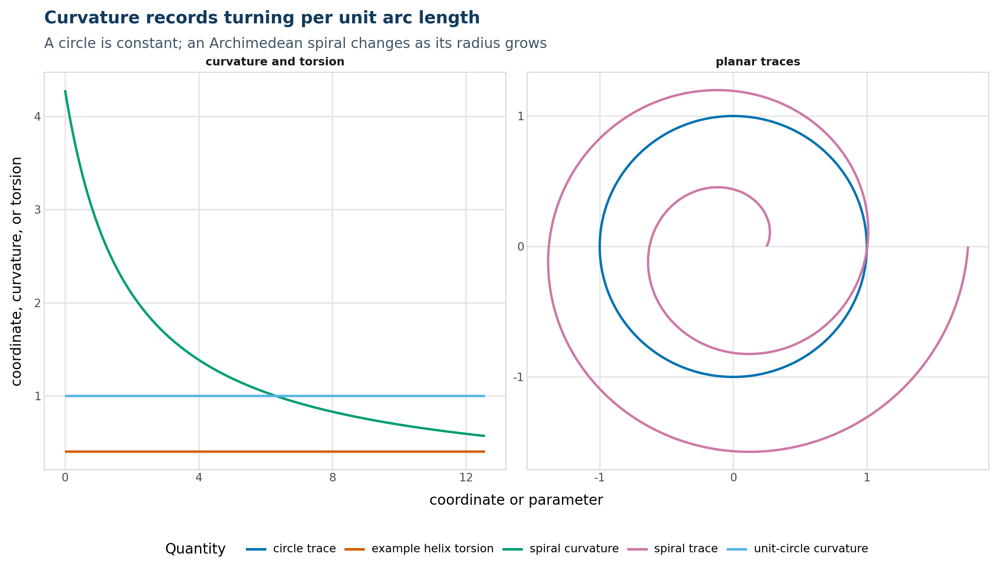

# Differential Geometry of Curves and Surfaces {#sec-calculus-geometry}

Calculus describes how geometric objects bend without requiring them to be
graphs over one fixed coordinate plane. Curvature measures turning along a curve;
the first fundamental form measures lengths on a surface; Gaussian curvature
detects intrinsic bending.

**Prerequisites.** Vectors and cross products from [sec-vectors](12-vectors-space.md#sec-vectors),
multivariable derivatives from [sec-partials](13-partial-derivatives.md#sec-partials), surface integrals from
[sec-vector-calculus](15-vector-calculus.md#sec-vector-calculus), and variational ideas from [sec-calculus-variations](26-variations.md#sec-calculus-variations).

## Regular curves and arc length

A parametrized curve is a differentiable map

$$
\mathbf r:I\to\mathbb R^3.
$$

It is **regular** when $\mathbf r'(t)\ne0$. Its speed is
$\|\mathbf r'(t)\|$, and its length from $a$ to $b$ is

$$
L=\int_a^b\|\mathbf r'(t)\|\,dt.
$$

If $t=\phi(u)$ is a differentiable increasing reparameterization, substitution
shows the length is unchanged. Reversing orientation also preserves length
because the absolute speed removes the sign.

Arc length from a base point is

$$
s(t)=\int_{t_0}^t\|\mathbf r'(\tau)\|\,d\tau.
$$

For a regular curve, $ds/dt>0$, so locally $s$ can be used as a parameter.
Then $\|d\mathbf r/ds\|=1$. Unit-speed parameterization separates geometric
turning from arbitrary changes in traversal speed.

A formula can trace the same geometric curve more than once. Length over the
parameter interval counts multiplicity unless the intended curve segment is
specified.

## Tangent, curvature, and normal

The unit tangent is

$$
\mathbf T=\frac{\mathbf r'}{\|\mathbf r'\|}.
$$

For unit speed, $\mathbf T\cdot\mathbf T=1$ implies
$\mathbf T'\cdot\mathbf T=0$. The curvature is

$$
\kappa=\left\|\frac{d\mathbf T}{ds}\right\|.
$$

When $\kappa>0$, the principal normal is
$\mathbf N=(d\mathbf T/ds)/\kappa$. For an arbitrary parameter,

$$
\kappa=
\frac{\|\mathbf r'\times\mathbf r''\|}
{\|\mathbf r'\|^3}.
$$

For a planar graph $y=f(x)$,

$$
\kappa=
\frac{|f''(x)|}{(1+f'(x)^2)^{3/2}}.
$$

The radius $1/\kappa$ belongs to the osculating circle, the best local circle
when $\kappa\ne0$.

**Worked example: circle.** For
$\mathbf r(t)=(R\cos t,R\sin t)$, speed is $R$ and curvature is $1/R$.
A larger circle turns more slowly per unit distance.

## Torsion and the Frenet frame

For a space curve with $\kappa>0$, define
$\mathbf B=\mathbf T\times\mathbf N$. The orthonormal triple
$(\mathbf T,\mathbf N,\mathbf B)$ is the Frenet frame. Under suitable
regularity,

$$
\frac{d\mathbf T}{ds}=\kappa\mathbf N,\qquad
\frac{d\mathbf N}{ds}=-\kappa\mathbf T+\tau\mathbf B,\qquad
\frac{d\mathbf B}{ds}=-\tau\mathbf N.
$$

The torsion is

$$
\tau=
\frac{(\mathbf r'\times\mathbf r'')\cdot\mathbf r'''}
{\|\mathbf r'\times\mathbf r''\|^2}.
$$

It measures twisting out of the osculating plane. A planar curve has torsion
zero wherever the formula is defined.

For the helix with positive radius $a>0$ and real $b$
$\mathbf r(t)=(a\cos t,a\sin t,bt)$,

$$
\kappa=\frac{a}{a^2+b^2},
\qquad
\tau=\frac{b}{a^2+b^2}.
$$

Both are constant. The positive-radius assumption ensures regularity and positive curvature, so the Frenet torsion is defined.

<figure id="fig-curvature-profiles">


<figcaption>

Figure 28.1: Curvature compares tangent turning along a circle, a widening spiral, and a helix.

</figcaption>
</figure>

[Figure 28.1](#fig-curvature-profiles) computes finite samples from exact formulas. Curvature is
geometric only when compared against arc length, not raw parameter time.

## Surface patches and tangent planes

A surface patch is a differentiable map

$$
\mathbf X(u,v):D\subset\mathbb R^2\to\mathbb R^3.
$$

It is regular when
$\mathbf X_u\times\mathbf X_v\ne0$. The tangent plane is spanned by
$\mathbf X_u,\mathbf X_v$, and a chosen unit normal is

$$
\mathbf n=
\frac{\mathbf X_u\times\mathbf X_v}
{\|\mathbf X_u\times\mathbf X_v\|}.
$$

For a graph $z=f(x,y)$, use
$\mathbf X(x,y)=(x,y,f(x,y))$; the familiar normal
$(-f_x,-f_y,1)$ appears.

One patch rarely covers a sphere regularly: longitude becomes meaningless at the
poles. A smooth surface uses overlapping charts. Coordinate singularity does not
imply geometric singularity.

## The first fundamental form

A tangent displacement
$d\mathbf X=\mathbf X_u\,du+\mathbf X_v\,dv$ has squared length

$$
ds^2=E\,du^2+2F\,du\,dv+G\,dv^2,
$$

where

$$
E=\mathbf X_u\cdot\mathbf X_u,\quad
F=\mathbf X_u\cdot\mathbf X_v,\quad
G=\mathbf X_v\cdot\mathbf X_v.
$$

The matrix

$$
\begin{pmatrix}E&F\\F&G\end{pmatrix}
$$

is the metric in these coordinates. It determines lengths and angles on the
surface. The area element is

$$
dS=\sqrt{EG-F^2}\,du\,dv
=\|\mathbf X_u\times\mathbf X_v\|\,du\,dv.
$$

For a sphere of radius $R$ with colatitude $\theta$ and longitude $\phi$,

$$
ds^2=R^2\,d\theta^2+R^2\sin^2\theta\,d\phi^2.
$$

The coefficient of $d\phi^2$ vanishes at a pole because the chart collapses
there, not because surface distances cease to exist.

## Surface curvature

The normal changes as one moves along a curved surface. The **shape operator**
maps a tangent vector to minus the directional derivative of the normal. Its
eigenvalues $k_1,k_2$ are the principal curvatures.

Define

$$
K=k_1k_2,\qquad
H=\frac{k_1+k_2}{2}.
$$

$K$ is Gaussian curvature and $H$ is mean curvature, with the sign of $H$
depending on normal orientation.

- A plane has $k_1=k_2=0$.
- A cylinder of radius $R$ has principal curvatures $1/R$ and $0$, so
  $K=0$.
- A sphere of radius $R$ has both $1/R$, so $K=1/R^2$.
- A saddle has principal curvatures of opposite signs and $K<0$.

The cylinder bends in space but has zero Gaussian curvature and can be unrolled
without stretching. This hints that Gaussian curvature is intrinsic.

## Geodesics

A geodesic is locally straight within a surface. It can be defined as a critical
point of the length or energy functional

$$
E[\gamma]=\frac12\int
g_{ij}(\gamma(t))\gamma_i'(t)\gamma_j'(t)\,dt.
$$

Euler–Lagrange gives the geodesic equations. For constant-speed curves, energy
and length have the same geodesics.

On a plane, geodesics are straight lines. On a sphere, they are great circles.
Two non-antipodal points lie on one great circle, but there are two arcs; only
the shorter is globally minimizing. Antipodal points have infinitely many
minimizing semicircles.

A geodesic need not minimise after it extends far enough. “Locally straight,”
“locally shortest,” and “globally shortest between endpoints” need separate
scope statements.

## Global vistas

Gauss's Theorema Egregium says Gaussian curvature can be computed entirely from
the first fundamental form and its derivatives. Bending a sheet without
stretching preserves $K$. This is why a flat map cannot reproduce a spherical
region without distortion.

For a compact oriented surface without boundary, Gauss–Bonnet states

$$
\int_S K\,dS=2\pi\chi(S),
$$

where $\chi$ is the Euler characteristic. A sphere has $\chi=2$, so its
total curvature is $4\pi$, independent of radius. With boundary, a geodesic
curvature term and corner angles enter.

This theorem connects local derivatives to global topology. A proof requires
more differential geometry and topology than developed here; the statement is a
map of where multivariable calculus leads.

## Covariant change and parallel transport

A tangent vector field along a surface curve changes as a vector in
$\mathbb R^3$, but part of that change may point normal to the surface. The
**covariant derivative** keeps the tangential component:

$$
\frac{D\mathbf V}{ds}
= \operatorname{proj}_{T_{\gamma(s)}S}
\frac{d\mathbf V}{ds}.
$$

A field is parallel along the curve when this derivative is zero. It can still
rotate in ambient space because the tangent plane itself turns.

A unit-speed surface curve is a geodesic exactly when its acceleration has no
tangential component:

$$
\frac{D\mathbf T}{ds}=0.
$$

Its ambient acceleration is normal to the surface. On a sphere, a great circle's
acceleration points toward the center and is therefore surface-normal.

Parallel transport around a closed loop can return a vector rotated. On a flat
plane the net angle is zero; on a sphere it depends on enclosed curvature. For a
spherical triangle, the rotation is related to its angle excess. This is a local
preview of Gauss–Bonnet.

In coordinates, the geodesic equations have the form

$$
\frac{d^2u^k}{ds^2}
+\sum_{i,j}\Gamma^k_{ij}
\frac{du^i}{ds}\frac{du^j}{ds}=0.
$$

The Christoffel symbols $\Gamma^k_{ij}$ are built from derivatives of the
metric coefficients. They are coordinate-dependent bookkeeping for an intrinsic
derivative; they are not components of an ordinary tensor.

## Map distortion

A differentiable map between surfaces has a derivative between tangent planes.
Its singular values give the largest and smallest local stretch factors. Their
product gives local area scale, while their ratio measures anisotropic
distortion.

- An **isometry** preserves lengths locally.
- A **conformal map** preserves angles but may scale all directions equally at a
  point.
- An **equal-area map** preserves the product of stretches but may distort shape.

No flat map of the whole sphere can preserve both distances and area. Gaussian
curvature provides the obstruction. Cartographic projections therefore state a
design priority—angles, areas, selected distances, or compromise—rather than
claiming no distortion.

<!-- inline-formula-code:start -->
## Formula and finite computation

A useful formula in this chapter is

$$
F(x,y)=0,\qquad y'=-F_x/F_y
$$

Newton continuation follows the implicit circle while reporting residuals. The following standalone Python block expresses that finite rule with its inputs and stopping conditions visible.

```python
def upper_circle_y(
    x_coordinate: float, initial_y: float, iterations: int
) -> tuple[float, float]:
    """Return an upper-circle y estimate and its equation residual."""
    if not -1.0 < x_coordinate < 1.0 or initial_y <= 0.0 or iterations <= 0:
        raise ValueError("require |x|<1, a positive initial value, and iterations>0")
    y_coordinate = initial_y
    for _ in range(iterations):
        y_coordinate = 0.5 * (
            y_coordinate + (1.0 - x_coordinate * x_coordinate) / y_coordinate
        )
    residual = x_coordinate * x_coordinate + y_coordinate * y_coordinate - 1.0
    return y_coordinate, residual

for x_coordinate in (-0.8, -0.4, 0.0, 0.4, 0.8):
    y_coordinate, residual = upper_circle_y(
        x_coordinate, initial_y=1.0, iterations=6
    )
    implicit_slope = -x_coordinate / y_coordinate
    print(x_coordinate, y_coordinate, implicit_slope, residual)
```

**What the computation establishes.** The calculation checks a declared finite instance; the surrounding argument explains what is true beyond those inputs.
<!-- inline-formula-code:end -->

## Summary

- Arc length removes parameter-speed dependence.
- Curvature measures tangent turning; torsion measures spatial twisting.
- A surface patch induces a metric $E\,du^2+2F\,du\,dv+G\,dv^2$.
- Principal curvatures produce Gaussian and mean curvature.
- Geodesics are variationally straight but need not be globally shortest.
- Gauss and Gauss–Bonnet connect intrinsic local geometry to global structure.

## Exercises

<div class="exercise" id="calculus-28-differential-geometry-ex-1">
<p class="exercise-title"><strong>Exercise 1</strong></p>

Reparameterize a regular line segment by arc length.

<details class="solution"><summary>Solution</summary>

Divide displacement by its length and let the new parameter range over that
length.

</details>

</div>

<div class="exercise" id="calculus-28-differential-geometry-ex-2">
<p class="exercise-title"><strong>Exercise 2</strong></p>

Derive the arbitrary-parameter curvature formula for a planar curve.

<details class="solution"><summary>Solution</summary>

Use $d/ds=(1/\|\mathbf r'\|)d/dt$ and simplify the perpendicular component.

</details>

</div>

<div class="exercise" id="calculus-28-differential-geometry-ex-3">
<p class="exercise-title"><strong>Exercise 3</strong></p>

Compute curvature and torsion of a circular helix.

<details class="solution"><summary>Solution</summary>

For the helix above with $a>0$ and real $b$, they are $a/(a^2+b^2)$ and $b/(a^2+b^2)$.

</details>

</div>

<div class="exercise" id="calculus-28-differential-geometry-ex-4">
<p class="exercise-title"><strong>Exercise 4</strong></p>

Find $E,F,G$ for a graph $z=f(x,y)$.

<details class="solution"><summary>Solution</summary>

$E=1+f_x^2,F=f_xf_y,G=1+f_y^2$.

</details>

</div>

<div class="exercise" id="calculus-28-differential-geometry-ex-5">
<p class="exercise-title"><strong>Exercise 5</strong></p>

Compute the sphere's area element from its metric.

<details class="solution"><summary>Solution</summary>

It is $R^2\sin\theta\,d\theta\,d\phi$.

</details>

</div>

<div class="exercise" id="calculus-28-differential-geometry-ex-6">
<p class="exercise-title"><strong>Exercise 6</strong></p>

Explain why a cylinder has one zero principal curvature.

<details class="solution"><summary>Solution</summary>

Moving parallel to the axis does not change the normal.

</details>

</div>

<div class="exercise" id="calculus-28-differential-geometry-ex-7">
<p class="exercise-title"><strong>Exercise 7</strong></p>

Derive the great-circle candidate using a constrained variational argument.

<details class="solution"><summary>Solution</summary>

Extremise energy on $\|\gamma\|=R$; acceleration is normal to the sphere,
placing the curve in a plane through the center.

</details>

</div>

<div class="exercise" id="calculus-28-differential-geometry-ex-8">
<p class="exercise-title"><strong>Exercise 8</strong></p>

Use Gauss–Bonnet to check total curvature of a radius-$R$ sphere.

<details class="solution"><summary>Solution</summary>

$K=1/R^2$ and area is $4\pi R^2$, so the integral is $4\pi$.

</details>

</div>

### Answer support

1. Divide displacement by its length and let the new parameter range over that
   length.
2. Use $d/ds=(1/\|\mathbf r'\|)d/dt$ and simplify the perpendicular component.
3. For the helix above with $a>0$ and real $b$, they are $a/(a^2+b^2)$ and $b/(a^2+b^2)$.
4. $E=1+f_x^2,F=f_xf_y,G=1+f_y^2$.
5. It is $R^2\sin\theta\,d\theta\,d\phi$.
6. Moving parallel to the axis does not change the normal.
7. Extremise energy on $\|\gamma\|=R$; acceleration is normal to the sphere,
   placing the curve in a plane through the center.
8. $K=1/R^2$ and area is $4\pi R^2$, so the integral is $4\pi$.
