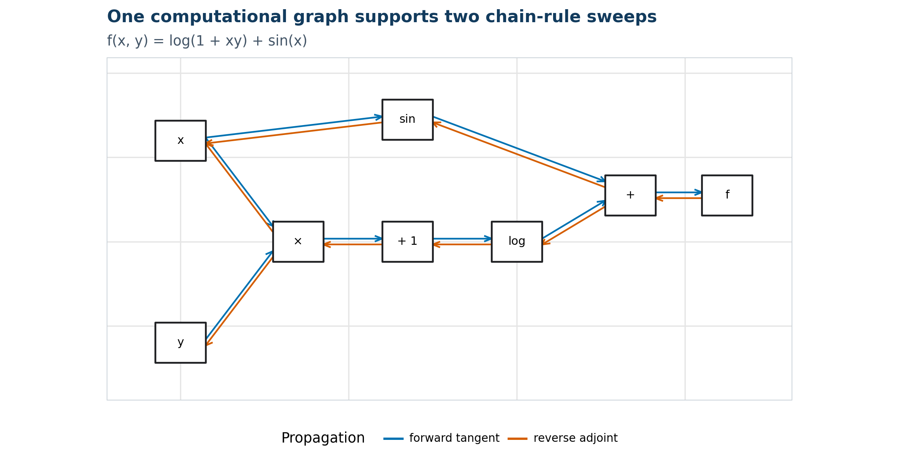

# Automatic Differentiation and Sensitivity {#sec-calculus-ad}

Automatic differentiation evaluates derivatives by applying the chain rule to
the actual sequence of elementary operations used by a program. It is neither
symbolic simplification nor finite differencing. Its accuracy is essentially
floating-point arithmetic accuracy, while its cost depends on whether inputs or
outputs are numerous.

**Prerequisites.** The chain rule from [sec-derivative](03-derivative.md#sec-derivative), partial derivatives and
Jacobians from [sec-partials](13-partial-derivatives.md#sec-partials), and numerical error from
[sec-numerical-calculus](16-numerical.md#sec-numerical-calculus).

## Four derivative routes

For a computed function $f$, one can use:

1. **hand or symbolic differentiation**, producing an expression;
2. **finite differences**, approximating from nearby values;
3. **automatic differentiation (AD)**, propagating exact chain-rule quantities
   through program operations;
4. **complex-step differentiation**, when the implementation extends
   analytically to complex inputs.

The centered finite difference

$$
\frac{f(x+h)-f(x-h)}{2h}
$$

has truncation error $O(h^2)$, but small $h$ causes cancellation and
roundoff. AD avoids the subtraction trade-off, though it still inherits ordinary
roundoff and any instability in the function evaluation.

Symbolic expressions can grow enormously through repeated chain and product
rules. AD reuses stored intermediate values and does not require simplifying one
global formula.

## Computational graphs

Consider

$$
f(x,y)=\log(1+xy)+\sin x.
$$

Break it into primitives:

$$
v_1=xy,\quad
v_2=1+v_1,\quad
v_3=\log v_2,\quad
v_4=\sin x,\quad
f=v_3+v_4.
$$

This directed acyclic graph records data dependence. Each node knows a local
derivative. AD composes these local derivatives in a chosen direction.

<figure id="fig-ad-graph">


<figcaption>

Figure 29.1: A computational graph supports forward tangent propagation and reverse adjoint accumulation.

</figcaption>
</figure>

[Figure 29.1](#fig-ad-graph) shows one graph with two traversal directions. The derivative
values depend on the numerical input even though the graph topology does not.

Branches and loops are handled by differentiating the operations executed for
that input. A data-dependent branch can make the resulting mathematical function
nondifferentiable at the switching boundary.

## Forward mode and dual numbers

To compute a directional derivative in direction $\dot x$, attach to every
quantity a pair

$$
(v,\dot v),
$$

where $v$ is the value and $\dot v$ its directional derivative. Propagate

$$
\begin{aligned}
(u,\dot u)+(v,\dot v)&=(u+v,\dot u+\dot v),\\
(u,\dot u)(v,\dot v)&=(uv,\dot u\,v+u\,\dot v),\\
\sin(u,\dot u)&=(\sin u,\cos u\,\dot u).
\end{aligned}
$$

These rules are arithmetic in dual numbers $u+\epsilon\dot u$ with
$\epsilon^2=0$.

For $F:\mathbb R^n\to\mathbb R^m$, one forward sweep computes

$$
J_F(x)\dot x,
$$

a Jacobian–vector product. Computing the full Jacobian by basis directions
needs $n$ sweeps. Forward mode is attractive when the number of independent
inputs is small.

**Worked graph.** Seed $(\dot x,\dot y)=(1,0)$ in the example. Then

$$
\dot v_1=y,\quad
\dot v_2=y,\quad
\dot v_3=\frac{y}{1+xy},\quad
\dot v_4=\cos x,
$$

so

$$
\frac{\partial f}{\partial x}
=\frac{y}{1+xy}+\cos x.
$$

Seeding $(0,1)$ gives $x/(1+xy)$.

## Reverse mode

Reverse mode first evaluates and stores the graph. Then it propagates
**adjoints**

$$
\bar v=\frac{\partial f}{\partial v}
$$

backward from $\bar f=1$. Each node distributes its adjoint to its parents using
local partial derivatives, adding contributions when paths merge.

For the example:

$$
\bar v_3=1,\quad
\bar v_4=1,\quad
\bar v_2=1/v_2,\quad
\bar v_1=1/v_2.
$$

The multiplication node contributes
$\bar x\mathrel{+}=\bar v_1y$ and
$\bar y\mathrel{+}=\bar v_1x$; the sine node adds
$\bar x\mathrel{+}=\cos x$.

One reverse sweep computes

$$
\bar y^\mathsf TJ_F(x),
$$

a vector–Jacobian product. For scalar output, it yields the entire gradient at a
cost that is a small multiple of the function evaluation, largely independent of
the number of inputs. This is why reverse mode underlies gradient-based machine
learning.

The cost is memory: the reverse sweep needs intermediate primal values or must
recompute them. Checkpointing stores selected states and trades extra computation
for reduced memory.

## Higher derivatives

AD can be nested.

- Forward-over-reverse computes Hessian–vector products efficiently.
- Repeating directions can assemble a full Hessian.
- Reverse-over-reverse is possible but can be memory-intensive and
  implementation-sensitive.

For $f:\mathbb R^n\to\mathbb R$, the product

$$
H_f(x)v
=\left.\frac d{dt}\nabla f(x+tv)\right|_{t=0}
$$

is often all a Newton–Krylov method needs. Forming the dense $n\times n$
Hessian would waste storage.

Nested AD systems must distinguish perturbation symbols. Reusing the same
infinitesimal tag in two derivative levels can mix independent directions, a
problem called perturbation confusion.

## Sensitivity of ODE solutions

Let

$$
y'(t)=f(t,y(t),p),\qquad y(0)=y_0(p),
$$

and define the sensitivity matrix
$S=\partial y/\partial p$. Differentiate the ODE:

$$
S'
=f_y(t,y,p)S+f_p(t,y,p),
\qquad
S(0)=\frac{\partial y_0}{\partial p}.
$$

This **tangent sensitivity equation** evolves with the original state. It is
efficient when the number of parameters is small.

If the objective is scalar,

$$
J(p)=\Phi(y(T),p)+\int_0^TL(t,y,p)\,dt,
$$

an adjoint variable evolved backward can compute the gradient with cost largely
independent of the number of parameters. With a consistent sign convention, it
satisfies

$$
-\lambda'
=f_y^\mathsf T\lambda+L_y,
\qquad
\lambda(T)=\Phi_y,
$$

and the gradient combines
$\Phi_p$, $L_p$, $f_p^\mathsf T\lambda$, and initial-condition terms.

The continuous adjoint of a differential equation and reverse AD of a discrete
time-stepper need not produce identical gradients. “Differentiate then
discretize” and “discretize then differentiate” must be compared at the chosen
accuracy.

## Nonsmooth and numerical hazards

At $x=0$, $|x|$ has no ordinary derivative. A library may return $0$, $1$,
or a chosen subgradient depending on its primitive rule. The result is a
convention, not proof of differentiability.

Other hazards include:

- branches at equality boundaries;
- iteration stopped by a tolerance, whose iteration count changes discontinuously;
- iterative solvers not converged tightly enough for their derivative;
- random-number generation and changing samples;
- mutation or hidden state that breaks the recorded graph;
- overflow, underflow, and unstable algebra in the primal computation.

Implicit differentiation can avoid tracing thousands of solver iterations. If
$F(z,p)=0$ and $F_z$ is invertible, then

$$
\frac{dz}{dp}=-F_z^{-1}F_p.
$$

This requires the solver to be near an actual root and the linear system to be
well-conditioned.

## Sparsity and custom derivative rules

Many Jacobians are sparse. If output $F_i$ depends on only a few inputs, most
partial derivatives are zero. Computing one dense column at a time wastes work.
Graph colouring can combine independent forward seeds whose nonzero patterns do
not collide, then recover several Jacobian columns from one sweep.

Reverse-mode gradients can also exploit sparse or structured primitives. Matrix
solves, convolutions, and Fourier transforms should use derivative rules that
preserve their algorithms rather than expand into scalar operations.

For a linear solve

$$
A(p)x(p)=b(p),
$$

differentiation gives

$$
A\,dx=db-(dA)x.
$$

The tangent derivative needs another solve with the same $A$. For a scalar
objective with adjoint $\lambda$, solve

$$
A^\mathsf T\lambda=\nabla_xJ
$$

and accumulate parameter effects without differentiating the iterations of the
linear solver. This custom rule can be faster and more accurate, provided the
primal residual is small and $A$ is nonsingular.

Custom derivatives are trusted code. A wrong rule can return smooth,
plausible-looking gradients while bypassing the automatic chain-rule trace. Each
rule needs directional finite-difference tests and, for adjoints, an
inner-product identity test.

## Conditioning of derivatives

AD computes the derivative of the implemented map; it does not make that
derivative well-conditioned. For $f(x)=\sqrt x$, $f'(x)=1/(2\sqrt x)$ grows
near zero. For a matrix inverse, sensitivity grows with the condition number.

If the primal result changes enormously under tiny input perturbations, a large
gradient may be correct. Report scaling and condition estimates before labeling
it an AD failure. Conversely, overflow or cancellation in the primal can corrupt
both value and derivative.

Gradient-based optimization also needs a well-scaled objective. Parameters with
different units can produce gradient components that differ by orders of
magnitude. Nondimensionalisation or a meaningful parameter metric changes the
search geometry without changing the underlying physical model.

## Verification audit

For a new derivative implementation:

1. compare directional products against centered differences over a range of
   $h$;
2. check linearity in the seed direction;
3. for scalar objectives, test
   $\langle Jv,w\rangle=\langle v,J^\mathsf Tw\rangle$;
4. test random and boundary inputs separately;
5. declare behavior at nondifferentiable primitives;
6. monitor primal residuals before trusting implicit or adjoint gradients.

Agreement with one finite-difference step is weak evidence. A characteristic
error curve—truncation first falling, roundoff later rising—is more informative.

## Further connections {#forward-handoff}

[Chapter 41](41-computational-optimization.md) uses these derivative products
inside line-search, Newton, quasi-Newton, trust-region, constrained, proximal,
and stochastic algorithms. Its audits keep derivative correctness separate from
objective scaling, globalisation, constraint feasibility, and optimization
stopping error.

<!-- inline-formula-code:start -->
## Formula and finite computation

A useful formula in this chapter is

$$
(u,u')(v,v')=(uv,u'v+uv')
$$

Dual-number pairs carry a value and its derivative through each operation. The following standalone Python block expresses that finite rule with its inputs and stopping conditions visible.

```python
from math import cos, sin

def dual_multiply(
    left: tuple[float, float], right: tuple[float, float]
) -> tuple[float, float]:
    """Multiply (value, derivative) pairs by the product rule."""
    left_value, left_derivative = left
    right_value, right_derivative = right
    return (
        left_value * right_value,
        left_derivative * right_value + left_value * right_derivative,
    )

def dual_sine(number: tuple[float, float]) -> tuple[float, float]:
    """Apply sine to a dual pair by the chain rule."""
    value, derivative = number
    return sin(value), cos(value) * derivative

x_dual = (1.2, 1.0)
x_squared = dual_multiply(x_dual, x_dual)
function_dual = dual_multiply(x_squared, dual_sine(x_dual))
exact_derivative = 2.0 * 1.2 * sin(1.2) + 1.2**2 * cos(1.2)
print(function_dual, exact_derivative, function_dual[1] - exact_derivative)
```

**What the computation establishes.** The calculation checks a declared finite instance; the surrounding argument explains what is true beyond those inputs.
<!-- inline-formula-code:end -->

## Summary

- AD applies local chain rules to a computational graph.
- Forward mode computes Jacobian–vector products; reverse mode computes
  vector–Jacobian products.
- Dual numbers provide a concrete forward-mode algebra.
- Reverse mode is gradient-efficient but stores or recomputes intermediates.
- ODE tangent and adjoint equations propagate parameter sensitivity.
- Nonsmooth branches, solver tolerances, and unstable primal calculations require
  explicit auditing.

## Exercises

<div class="exercise" id="calculus-29-automatic-differentiation-ex-1">
<p class="exercise-title"><strong>Exercise 1</strong></p>

Build a graph for $f(x,y)=e^{xy}+x^2$.

<details class="solution"><summary>Solution</summary>

Use multiply, exponential, square, and add nodes.

</details>

</div>

<div class="exercise" id="calculus-29-automatic-differentiation-ex-2">
<p class="exercise-title"><strong>Exercise 2</strong></p>

Propagate a forward seed $(1,0)$ through it.

<details class="solution"><summary>Solution</summary>

It gives $ye^{xy}+2x$.

</details>

</div>

<div class="exercise" id="calculus-29-automatic-differentiation-ex-3">
<p class="exercise-title"><strong>Exercise 3</strong></p>

Perform a reverse sweep and recover both partial derivatives.

<details class="solution"><summary>Solution</summary>

The gradient is
$(ye^{xy}+2x,xe^{xy})$.

</details>

</div>

<div class="exercise" id="calculus-29-automatic-differentiation-ex-4">
<p class="exercise-title"><strong>Exercise 4</strong></p>

Explain the input/output dimension trade-off between modes.

<details class="solution"><summary>Solution</summary>

Forward cost scales with input directions; reverse cost scales with output
seeds.

</details>

</div>

<div class="exercise" id="calculus-29-automatic-differentiation-ex-5">
<p class="exercise-title"><strong>Exercise 5</strong></p>

Derive the sensitivity equation for $y'=py$, $y(0)=1$.

<details class="solution"><summary>Solution</summary>

$S'=y+pS,S(0)=0$, with exact $S=te^{pt}$.

</details>

</div>

<div class="exercise" id="calculus-29-automatic-differentiation-ex-6">
<p class="exercise-title"><strong>Exercise 6</strong></p>

Compute a Hessian–vector product for a quadratic form without forming its
Hessian.

<details class="solution"><summary>Solution</summary>

If $f=x^\mathsf TAx/2$ with symmetric $A$, then $Hv=Av$.

</details>

</div>

<div class="exercise" id="calculus-29-automatic-differentiation-ex-7">
<p class="exercise-title"><strong>Exercise 7</strong></p>

Give two reasons AD through a branch may be misleading.

<details class="solution"><summary>Solution</summary>

The function may be nondifferentiable at the boundary, and the inactive
branch is ignored.

</details>

</div>

<div class="exercise" id="calculus-29-automatic-differentiation-ex-8">
<p class="exercise-title"><strong>Exercise 8</strong></p>

Design a finite-difference directional check for a gradient.

<details class="solution"><summary>Solution</summary>

Compare
$\nabla f(x)\cdot v$ with
$[f(x+hv)-f(x-hv)]/(2h)$ across logarithmically spaced $h$.

</details>

</div>

### Answer support

1. Use multiply, exponential, square, and add nodes.
2. It gives $ye^{xy}+2x$.
3. The gradient is
   $(ye^{xy}+2x,xe^{xy})$.
4. Forward cost scales with input directions; reverse cost scales with output
   seeds.
5. $S'=y+pS,S(0)=0$, with exact $S=te^{pt}$.
6. If $f=x^\mathsf TAx/2$ with symmetric $A$, then $Hv=Av$.
7. The function may be nondifferentiable at the boundary, and the inactive
   branch is ignored.
8. Compare
   $\nabla f(x)\cdot v$ with
   $[f(x+hv)-f(x-hv)]/(2h)$ across logarithmically spaced $h$.
