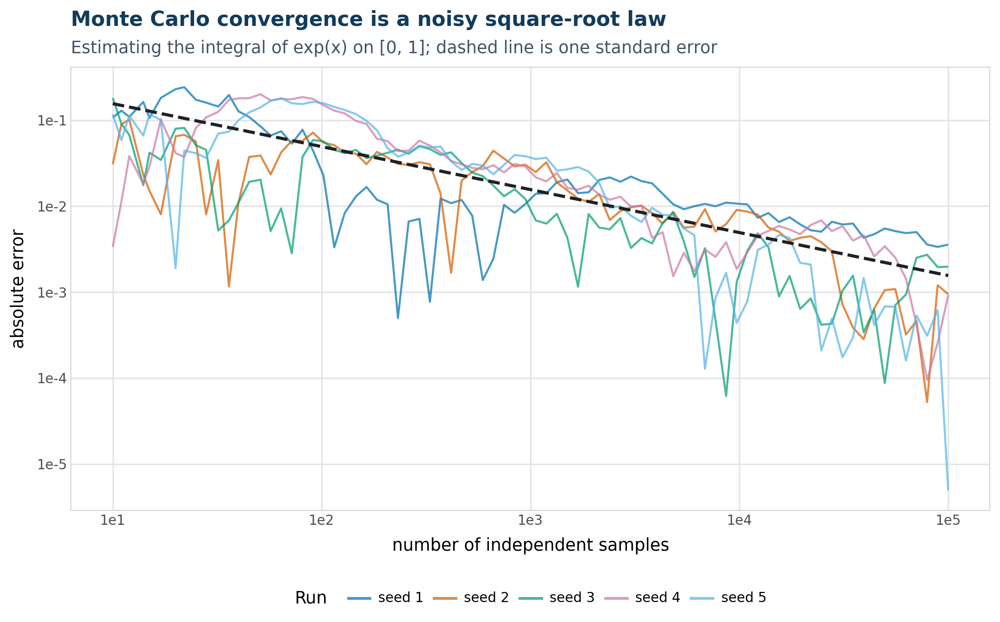

# Monte Carlo, Random Walks, and Stochastic Models {#sec-calculus-stochastic}

Deterministic quadrature places carefully chosen points. Monte Carlo integration
uses random samples and measures uncertainty statistically. Its dimension-robust
rate makes it useful in large models, but randomness does not excuse weak error
analysis.

**Preparation.** The probability review in this chapter and
[sec-probability-calculus](21-probability.md#sec-probability-calculus); numerical integration from [sec-numerical-calculus](16-numerical.md#sec-numerical-calculus);
difference and differential equations from [sec-discrete-calculus](19-discrete-calculus.md#sec-discrete-calculus) and
[sec-odes](09-differential-equations.md#sec-odes).

## Monte Carlo integration

If $X$ has density $p$ and

$$
I=\mathbb E[g(X)]
=\int g(x)p(x)\,dx,
$$

draw independent samples $X_1,\ldots,X_N$ and use

$$
\widehat I_N=\frac1N\sum_{i=1}^Ng(X_i).
$$

The estimator is unbiased when $g(X)$ is integrable:
$\mathbb E[\widehat I_N]=I$. If
$\sigma^2=\operatorname{Var}(g(X))<\infty$, independence gives

$$
\operatorname{Var}(\widehat I_N)=\frac{\sigma^2}{N},
\qquad
\operatorname{SE}(\widehat I_N)=\frac{\sigma}{\sqrt N}.
$$

Halving standard error requires four times as many samples. This rate does not
deteriorate explicitly with dimension, unlike a full tensor grid, but the
variance may grow badly with dimension or a poor sampling distribution.

The sample variance

$$
s^2=\frac1{N-1}\sum_{i=1}^N(g(X_i)-\widehat I_N)^2
$$

estimates $\sigma^2$. A large-sample normal interval is

$$
\widehat I_N
\mathbin{\pm}
z_{\alpha/2}\frac{s}{\sqrt N}.
$$

It relies on independent sampling, finite variance, and an adequate central-limit
regime. Heavy tails can make the displayed interval unstable or meaningless.

<figure id="fig-monte-carlo">


<figcaption>

Figure 30.1: Monte Carlo error falls irregularly around the one-over-square-root-N reference rate.

</figcaption>
</figure>

[Figure 30.1](#fig-monte-carlo) is a convergence study with multiple seeds. A single unusually
accurate run would conceal the estimator's variability.

## Pseudorandomness and reproducibility

Software generators produce deterministic sequences from an internal state. A
seed makes a run reproducible; it does not make samples more random or prove that
a generator is appropriate.

A reproducible report records:

- generator family and software version;
- seed or independent stream construction;
- sample count and transformation method;
- estimator, variance estimate, and stopping rule;
- discarded samples or failed model evaluations.

Reusing one random stream across two methods can be beneficial: **common random
numbers** make their difference less noisy when outputs respond similarly.
Accidentally reusing streams in supposedly independent replications invalidates
the standard error.

## Variance reduction

Improving variance is often more valuable than increasing $N$.

### Antithetic variables

For $U\sim\operatorname{Uniform}(0,1)$, average

$$
\frac{g(U)+g(1-U)}2.
$$

If $g(U)$ and $g(1-U)$ are negatively correlated, variance falls. For a
monotone $g$, this pairing often works well. If covariance is positive, it can
make variance worse.

### Control variates

If $\mathbb E[C]=\mu_C$ is known, use

$$
\widehat I_{\mathrm{cv}}
=\overline G-\beta(\overline C-\mu_C).
$$

The optimal fixed coefficient is

$$
\beta^*=
\frac{\operatorname{Cov}(G,C)}
{\operatorname{Var}(C)}.
$$

A correlated control removes predictable fluctuation. Estimating $\beta$ from
the same data slightly changes the finite-sample analysis.

### Importance sampling

For an integral $I=\int h(x)\,dx$, sample from a density $q>0$ wherever
$h\ne0$:

$$
I=\mathbb E_q\left[\frac{h(X)}{q(X)}\right].
$$

A good $q$ puts samples where $|h|$ is large. A poor $q$ creates huge
weights and possibly infinite variance. Effective sample size summaries based on
weights diagnose concentration but do not repair missing support.

Stratification divides the domain and samples each piece. It guarantees coverage
and reduces variance when within-stratum variation is smaller than overall
variation.

## Random walks

Let $\xi_k$ be independent steps with
$\mathbb E[\xi_k]=\mu$ and
$\operatorname{Var}(\xi_k)=\sigma^2$. Then

$$
S_n=S_0+\sum_{k=1}^n\xi_k
$$

has

$$
\mathbb E[S_n]=S_0+n\mu,\qquad
\operatorname{Var}(S_n)=n\sigma^2.
$$

For a symmetric $\pm1$ walk, typical displacement is $O(\sqrt n)$, not
$O(n)$. Dividing position by $\sqrt n$ gives a nontrivial diffusion scale.

The simple symmetric walk returns to its starting point infinitely often with
probability one in dimensions one and two, but is transient in dimension three
and higher. These are established theorems, not conclusions from finite plots.
Expected return time can still be infinite even when return probability is one.

Absorbing barriers lead to difference equations. If
$p_i$ is the probability of reaching $N$ before $0$ from $i$, then for a
fair walk

$$
p_i=\frac{p_{i-1}+p_{i+1}}2,\qquad
p_0=0,\quad p_N=1.
$$

The solution $p_i=i/N$ is discrete harmonic.

## Brownian motion

Standard Brownian motion $W_t$ satisfies:

1. $W_0=0$;
2. paths are continuous;
3. increments over disjoint intervals are independent;
4. $W_t-W_s\sim N(0,t-s)$ for $t>s$.

It is a scaling limit of centered random walks under broad hypotheses. Brownian
paths are continuous but almost surely nowhere differentiable. Their total
variation is infinite, so ordinary Riemann–Stieltjes calculus does not apply.

On a partition of $[0,T]$, the quadratic sum

$$
\sum_k(W_{t_{k+1}}-W_{t_k})^2
$$

converges in probability to $T$ as the mesh shrinks. Ordinary differentiable
paths would have quadratic variation zero. This nonzero quadratic variation is
why stochastic chain rules contain an extra second-derivative term.

## Stochastic differential equations

An Itô stochastic differential equation is written

$$
dX_t=a(t,X_t)\,dt+b(t,X_t)\,dW_t.
$$

The drift $a$ describes systematic motion and the diffusion coefficient $b$
scales random fluctuations. This notation abbreviates an integral equation

$$
X_t=X_0+\int_0^ta(s,X_s)\,ds
+\int_0^tb(s,X_s)\,dW_s,
$$

where the second integral has a specialised probabilistic definition.

Euler–Maruyama with step $\Delta t$ is

$$
X_{n+1}
=X_n+a(t_n,X_n)\Delta t
+b(t_n,X_n)\sqrt{\Delta t}\,Z_n,
$$

with independent standard normal $Z_n$. The noise scales as
$\sqrt{\Delta t}$, reflecting Brownian variance.

For sufficiently smooth $f$, Itô's formula is

$$
df(X_t)
=f'(X_t)\,dX_t
+\frac12f''(X_t)b(t,X_t)^2\,dt.
$$

The extra term comes from $(dW_t)^2$ contributing at order $dt$.
This is a scoped vista; rigorous stochastic integration requires a probability
course beyond this chapter.

## Strong and weak numerical error

For an SDE approximation $X_T^{\Delta t}$, **strong error** compares paths,
for example

$$
\mathbb E|X_T-X_T^{\Delta t}|.
$$

**Weak error** compares expectations of observables:

$$
\left|
\mathbb E[\varphi(X_T)]
-\mathbb E[\varphi(X_T^{\Delta t})]
\right|.
$$

Euler–Maruyama has strong order $1/2$ and weak order $1$ under standard
global Lipschitz and smoothness assumptions. The orders can deteriorate for
superlinear coefficients, nonsmooth payoffs, boundaries, or unstable steps.

To measure time-discretisation error, couple fine and coarse paths using
consistent Brownian increments. Independent paths add Monte Carlo noise and make
the difference much harder to estimate. A convergence study must vary
$\Delta t$ and $N$ separately because discretisation bias and sampling
standard error have different rates.

Multilevel Monte Carlo combines many cheap coarse paths with fewer expensive fine
corrections. A telescoping expectation,

$$
\mathbb E[P_L]
=\mathbb E[P_0]
+\sum_{\ell=1}^L
\mathbb E[P_\ell-P_{\ell-1}],
$$

is efficient when coupled level differences have rapidly decreasing variance.
The estimator remains biased relative to the continuum unless the finest-level
bias is controlled.

## Rare events

Estimating a probability $p\ll1$ by an indicator has relative standard error
approximately

$$
\frac1{\sqrt{Np}}.
$$

If $p=10^{-6}$, a million samples produce only about one event on average.
Naive Monte Carlo is then unreliable even though $N$ looks large.

Importance sampling changes measure to make the event common and reweights by a
likelihood ratio. Splitting methods replicate trajectories approaching the rare
set. Both require variance analysis: unstable weights or correlated descendants
can erase the apparent gain.

A simulation reporting zero observed failures does not estimate the probability
as exactly zero. Under an independent Bernoulli model, a one-sided confidence
bound or a Bayesian statement with a declared prior is needed.

## Uncertainty propagation

If model output is $Y=f(\theta)$ and the parameter vector has covariance
$\Sigma$, linearisation gives

$$
\operatorname{Var}(Y)
\approx
\nabla f(\bar\theta)^\mathsf T
\Sigma
\nabla f(\bar\theta).
$$

This delta-method approximation is local and can fail for large uncertainty,
strong nonlinearity, thresholds, or multimodal parameters. Monte Carlo pushes
the full declared parameter distribution through the model but introduces
sampling error.

**Aleatory uncertainty** represents modeled variability; **epistemic
uncertainty** represents limited knowledge of parameters, mechanisms, or model
form. A probability distribution assigned to either is a modeling choice.
Narrow simulation intervals do not account for omitted model discrepancy.

## Diagnosing simulation claims

For sample means, dependence changes variance: positive correlation can increase it,
while negative correlation can reduce it.  For a stationary correlated sequence, the variance of a mean is often
written approximately as

$$
\frac{\sigma^2}{N_{\mathrm{eff}}},
\qquad
N_{\mathrm{eff}}
\approx
\frac{N}{1+2\sum_{k\ge1}\rho_k},
$$

when the autocorrelation sum is meaningful.

In Markov chain Monte Carlo, burn-in is intended to reduce initialization bias;
discarding an arbitrary prefix does not prove convergence to stationarity.
Multiple chains, trace plots, autocorrelation, effective sample size, and
problem-specific diagnostics provide evidence, not a universal certificate.

Adaptive stopping can bias naive confidence statements if the stopping rule is
chosen after repeatedly inspecting the estimate. Predeclare precision targets or
use sequential methods whose coverage includes the stopping rule.

<!-- inline-formula-code:start -->
## Formula and finite computation

A useful formula in this chapter is

$$
\widehat I_N=\frac1N\sum_{i=1}^Ng(X_i)
$$

The estimate is returned with a sampling-error calculation and fixed seed. The following standalone Python block expresses that finite rule with its inputs and stopping conditions visible.

```python
from math import sqrt

import numpy as np

def monte_carlo_square(samples: int, seed: int) -> tuple[float, float]:
    """Estimate integral_0^1 x^2 dx and its Monte Carlo standard error."""
    if samples < 2:
        raise ValueError("at least two samples are required")
    generator = np.random.default_rng(seed)
    values = generator.random(samples) ** 2
    estimate = float(values.mean())
    standard_error = float(values.std(ddof=1) / sqrt(samples))
    return estimate, standard_error

for samples in (100, 1_000, 10_000):
    estimate, standard_error = monte_carlo_square(samples, seed=20260811)
    print(samples, estimate, standard_error)
```

**What the computation establishes.** The calculation checks a declared finite instance; the surrounding argument explains what is true beyond those inputs.
<!-- inline-formula-code:end -->

## Summary

- Monte Carlo means have standard error proportional to $N^{-1/2}$ under
  finite-variance independence.
- Variance reduction changes the estimator design rather than merely sample size.
- Random-walk displacement has diffusion scale $\sqrt n$.
- Brownian motion is continuous, nondifferentiable, and has nonzero quadratic
  variation.
- SDE simulation distinguishes drift $O(\Delta t)$ from noise
  $O(\sqrt{\Delta t})$.
- Reproducibility, dependence, model uncertainty, and stopping rules belong in
  every simulation audit.

## Exercises

<div class="exercise" id="calculus-30-stochastic-ex-1">
<p class="exercise-title"><strong>Exercise 1</strong></p>

Prove unbiasedness and variance $\sigma^2/N$ of the Monte Carlo mean.

<details class="solution"><summary>Solution</summary>

Use linearity of expectation and add variances using independence.

</details>

</div>

<div class="exercise" id="calculus-30-stochastic-ex-2">
<p class="exercise-title"><strong>Exercise 2</strong></p>

Determine how much $N$ must grow to reduce standard error by a factor ten.

<details class="solution"><summary>Solution</summary>

By a factor $100$.

</details>

</div>

<div class="exercise" id="calculus-30-stochastic-ex-3">
<p class="exercise-title"><strong>Exercise 3</strong></p>

Derive the optimal control-variate coefficient.

<details class="solution"><summary>Solution</summary>

Expand the variance as a quadratic in $\beta$ and differentiate.

</details>

</div>

<div class="exercise" id="calculus-30-stochastic-ex-4">
<p class="exercise-title"><strong>Exercise 4</strong></p>

Construct an importance density with missing support and explain the bias.

<details class="solution"><summary>Solution</summary>

If $q=0$ where $h\ne0$, those contributions can never be sampled.

</details>

</div>

<div class="exercise" id="calculus-30-stochastic-ex-5">
<p class="exercise-title"><strong>Exercise 5</strong></p>

Solve the fair gambler's-ruin probability difference equation.

<details class="solution"><summary>Solution</summary>

The linear solution with boundary data is $p_i=i/N$.

</details>

</div>

<div class="exercise" id="calculus-30-stochastic-ex-6">
<p class="exercise-title"><strong>Exercise 6</strong></p>

Explain why Brownian increments scale as $\sqrt{\Delta t}$.

<details class="solution"><summary>Solution</summary>

Its variance is $\Delta t$, so its standard deviation is
$\sqrt{\Delta t}$.

</details>

</div>

<div class="exercise" id="calculus-30-stochastic-ex-7">
<p class="exercise-title"><strong>Exercise 7</strong></p>

Apply Euler–Maruyama to $dX=\mu X\,dt+\sigma X\,dW$.

<details class="solution"><summary>Solution</summary>

$X_{n+1}=X_n(1+\mu\Delta t+\sigma\sqrt{\Delta t}Z_n)$.

</details>

</div>

<div class="exercise" id="calculus-30-stochastic-ex-8">
<p class="exercise-title"><strong>Exercise 8</strong></p>

List four diagnostics needed before reporting an MCMC standard error.

<details class="solution"><summary>Solution</summary>

For example trace behavior, multiple-chain agreement, autocorrelation,
effective sample size, and stationarity-sensitive checks.

</details>

</div>

### Answer support

1. Use linearity of expectation and add variances using independence.
2. By a factor $100$.
3. Expand the variance as a quadratic in $\beta$ and differentiate.
4. If $q=0$ where $h\ne0$, those contributions can never be sampled.
5. The linear solution with boundary data is $p_i=i/N$.
6. Its variance is $\Delta t$, so its standard deviation is
   $\sqrt{\Delta t}$.
7. $X_{n+1}=X_n(1+\mu\Delta t+\sigma\sqrt{\Delta t}Z_n)$.
8. For example trace behavior, multiple-chain agreement, autocorrelation,
   effective sample size, and stationarity-sensitive checks.
