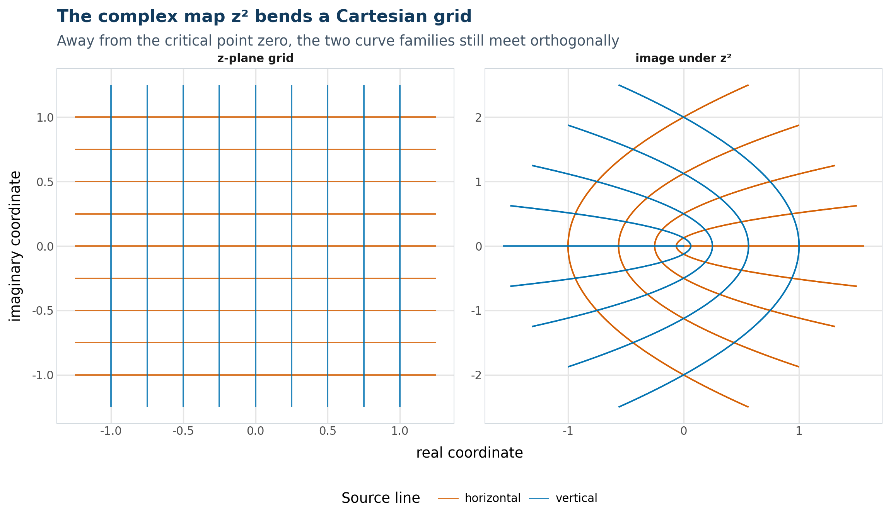

# Complex Variables for Calculus {#sec-calculus-complex}

Complex differentiation looks like ordinary differentiation with one extra
coordinate. In fact it is far more rigid: a derivative must agree along every
direction in the plane. That single requirement links derivatives, harmonic
functions, contour integrals, power series, and residues.

**Preparation.** The concise primer introduces algebra, trigonometry, and exponentials;
multivariable derivatives from [sec-partials](13-partial-derivatives.md#sec-partials); parametric line
integrals from [sec-vector-calculus](15-vector-calculus.md#sec-vector-calculus); power series from [sec-series](10-series-taylor.md#sec-series).

## The complex plane

A complex number is $z=x+iy$, where $i^2=-1$. Its conjugate and modulus are

$$
\overline z=x-iy,\qquad
|z|=\sqrt{x^2+y^2},
$$

and $z\overline z=|z|^2$. For $z\ne0$,

$$
\frac1z=\frac{\overline z}{|z|^2}.
$$

Geometrically, addition is vector addition and multiplication multiplies moduli
while adding angles. Polar form is

$$
z=re^{i\theta}
=r(\cos\theta+i\sin\theta).
$$

The argument is multivalued:
$\theta+2\pi k$ represents the same nonzero number. A chosen continuous
argument exists on a slit plane or small simply connected region avoiding zero,
not globally on $\mathbb C\setminus\{0\}$.

The $n$th roots of $re^{i\theta}$ are

$$
r^{1/n}
e^{i(\theta+2\pi k)/n},
\qquad k=0,\ldots,n-1.
$$

They are equally spaced on a circle.

## Exponential, logarithm, and powers

The power series defines

$$
e^z=\sum_{n=0}^{\infty}\frac{z^n}{n!},
$$

and satisfies $e^{z+w}=e^ze^w$. For $z=x+iy$,

$$
e^z=e^x(\cos y+i\sin y).
$$

Thus $e^{z+2\pi i}=e^z$: the complex exponential is periodic and not
one-to-one.

A complex logarithm must choose an argument:

$$
\operatorname{Log} z=\log|z|+i\operatorname{Arg} z.
$$

The principal branch usually takes
$-\pi<\operatorname{Arg} z<\pi$, discontinuous across the nonpositive real axis. Identities
such as $\operatorname{Log}(zw)=\operatorname{Log} z+\operatorname{Log} w$ can fail by multiples of $2\pi i$ under a
fixed principal branch.

Define $z^\alpha=e^{\alpha\operatorname{Log} z}$ only after declaring the branch. Branch
points are structural, not calculator quirks.

## Complex differentiation

The derivative is

$$
f'(z_0)=
\lim_{h\to0}\frac{f(z_0+h)-f(z_0)}h,
$$

where complex $h$ approaches from every planar direction.

Write $f(x+iy)=u(x,y)+iv(x,y)$. Approaching along real $h$ gives
$f'=u_x+iv_x$; approaching along imaginary $h=ik$ gives
$f'=v_y-iu_y$. Equality yields the Cauchy–Riemann equations

$$
u_x=v_y,\qquad
u_y=-v_x.
$$

If these partial derivatives are continuous near a point and satisfy the
equations, then $f$ is complex differentiable there.

**Examples.**

- $f(z)=z^2$ has $u=x^2-y^2,v=2xy$, satisfies Cauchy–Riemann, and
  $f'=2z$.
- $f(z)=\overline z$ has $u=x,v=-y$, so $u_x=1\ne-1=v_y$; it is nowhere
  complex differentiable.
- $f(z)=|z|^2$ is differentiable at zero as a complex function, because
  $|h|^2/h=\overline h\to0$, but fails in every neighbourhood. One point of
  differentiability does not make a function analytic.

## Analytic functions and harmonic components

A function complex differentiable on an open set is **analytic** or
**holomorphic**. A major theorem says analytic functions equal convergent power
series locally. Unlike real smooth functions, they cannot be infinitely
differentiable without being analytic.

If $f=u+iv$ is analytic with continuous second partials, differentiate the
Cauchy–Riemann equations:

$$
u_{xx}+u_{yy}=0,\qquad
v_{xx}+v_{yy}=0.
$$

The real and imaginary parts are harmonic. They are harmonic conjugates locally.
Given $u$, solving
$v_y=u_x$, $v_x=-u_y$ requires compatibility $\Delta u=0$.

The function $u=\log r$ is harmonic away from zero and has conjugate
$\theta$ only locally, reflecting the logarithm's branch obstruction.

The identity theorem states that if two analytic functions agree on a set with
an accumulation point inside a connected domain, they agree everywhere on that
domain. Analytic functions are therefore rigid; arbitrary local patching is
impossible.

<figure id="fig-complex-map">


<figcaption>

Figure 31.1: A complex map transforms a Cartesian grid, revealing conformal angle preservation away from critical points.

</figcaption>
</figure>

[Figure 31.1](#fig-complex-map) depicts $z\mapsto z^2$. Where $f'(z)\ne0$, the local
linear map is multiplication by a complex number: a rotation and scaling, so
angles are preserved. At $z=0$, the derivative vanishes and conformality fails.

## Contour integration

For a piecewise continuously differentiable path
$\gamma:[a,b]\to\mathbb C$,

$$
\int_\gamma f(z)\,dz
=\int_a^bf(\gamma(t))\gamma'(t)\,dt.
$$

Reversing orientation changes the sign. Concatenating paths adds integrals.

If $F'=f$ on a domain, then

$$
\int_\gamma f(z)\,dz
=F(\gamma(b))-F(\gamma(a)).
$$

Every closed-contour integral of a derivative is zero. Conversely, on a connected
open set, path independence gives an antiderivative.

For $\gamma(t)=Re^{it}$, $0\le t\le2\pi$,

$$
\int_\gamma\frac{dz}{z}
=\int_0^{2\pi}i\,dt=2\pi i.
$$

Thus $1/z$ has no global antiderivative on
$\mathbb C\setminus\{0\}$. The hole matters.

## Cauchy's theorem and formula

**Theorem 31.2 (Cauchy's, simple scoped form).** If $f$ is analytic on a simply
connected open set and $\gamma$ is a closed piecewise-smooth contour there,
then

$$
\int_\gamma f(z)\,dz=0.
$$

Versions on multiply connected domains require tracking holes and singularities.

If $f$ is analytic on and inside a positively oriented simple closed contour
$\gamma$, and $z_0$ lies inside, then

$$
f(z_0)=
\frac1{2\pi i}
\int_\gamma\frac{f(z)}{z-z_0}\,dz.
$$

This is Cauchy's integral formula. Differentiating it gives

$$
f^{(n)}(z_0)
=\frac{n!}{2\pi i}
\int_\gamma
\frac{f(z)}{(z-z_0)^{n+1}}\,dz.
$$

Consequences include:

- analytic functions have derivatives of every order;
- local values determine all derivatives;
- Cauchy estimates bound derivatives by boundary maxima;
- a bounded entire function is constant (Liouville);
- the fundamental theorem of algebra follows by applying Liouville to the
  reciprocal of a polynomial with no zeros.

Each conclusion depends on analyticity over an open region, not merely along the
contour.

## Laurent series and residues

Near an isolated singularity $z_0$, an analytic function on a punctured
annulus has a Laurent series

$$
f(z)=
\sum_{n=-\infty}^{\infty}a_n(z-z_0)^n.
$$

The coefficient $a_{-1}$ is the **residue**:

$$
\operatorname{Res}(f,z_0)=a_{-1}.
$$

For a simple pole $f=g/h$ with
$h(z_0)=0$, $h'(z_0)\ne0$,

$$
\operatorname{Res}(f,z_0)=\frac{g(z_0)}{h'(z_0)}.
$$

**Theorem 31.1 (Residue).** If a positively oriented contour encloses finitely many
isolated singularities and the usual analyticity conditions hold,

$$
\int_\gamma f(z)\,dz
=2\pi i\sum\operatorname{Res}(f,z_k).
$$

**Real-integral vista.** To evaluate

$$
\int_{-\infty}^{\infty}\frac{dx}{x^2+1},
$$

integrate $1/(z^2+1)$ over a large upper semicircle. Only the pole $i$ lies
inside, with residue $1/(2i)$. The arc integral tends to zero, leaving
$\pi$. The decay estimate on the arc and the contour orientation are parts of
the proof.

## Möbius transformations and conformal maps

A Möbius transformation is

$$
T(z)=\frac{az+b}{cz+d},
\qquad ad-bc\ne0.
$$

It acts on the extended complex plane
$\mathbb C\cup\{\infty\}$. Its inverse is another Möbius transformation, and

$$
T'(z)=\frac{ad-bc}{(cz+d)^2}
$$

away from its pole. Thus it is conformal wherever the derivative is finite and
nonzero.

Möbius maps send generalized circles—circles or straight lines—to generalized
circles. Translation, rotation/dilation, and inversion $z\mapsto1/z$ generate
them. Three distinct source points and three distinct target points determine
one transformation.

**Example.** The map

$$
w=\frac{z-i}{z+i}
$$

sends the real axis to the unit circle and the upper half-plane to the unit disk.
For real $x$,

$$
\left|\frac{x-i}{x+i}\right|=1,
$$

and testing $z=i$ gives $w=0$, selecting the interior side.

Conformal maps transfer harmonic boundary-value problems between domains. If
$u$ is harmonic in the target and $T$ is analytic with nonzero derivative,
then $u\circ T$ is harmonic in the source. Boundary data and singular points
must be transformed as well.

## Argument principle vista

If $f$ is meromorphic inside a contour and has no zeros or poles on it, then

$$
\frac1{2\pi i}
\int_\gamma\frac{f'(z)}{f(z)}\,dz
=N-P,
$$

where $N$ and $P$ count zeros and poles inside with multiplicity. Along the
contour, this integral measures the total change of the argument of $f(z)$.

Rouché's theorem compares two analytic functions on a boundary: if
$|g|<|f|$ there, then $f$ and $f+g$ have the same number of zeros inside.
It is a complex analogue of dominant balance with a topological count.

These theorems can locate roots without solving for them. Their hypotheses
include contour orientation, analyticity or meromorphicity on a neighbourhood,
and absence of boundary zeros.

<!-- inline-formula-code:start -->
## Formula and finite computation

A useful formula in this chapter is

$$
f'(x)\approx\frac{\operatorname{Im}f(x+ih)}h
$$

The complex-step rule applies to a real-valued target on an open real interval with a holomorphic extension to a complex neighborhood of the real evaluation point. Use a finite positive real step small enough that the displaced point stays in that neighborhood. Taylor expansion with real coefficients gives an error of order h squared. Analyticity alone is insufficient for a general complex-valued target: the constant function with value i gives an estimate of one over h instead of zero. The unchanged Python rule only rejects steps at most zero; finiteness, the domain, the real trace and floating-point error remain caller obligations. The sine example has the required real trace.

```python
from collections.abc import Callable
from cmath import sin
from math import cos

def complex_step_derivative(
    function: Callable[[complex], complex], point: float, step: float
) -> float:
    """Estimate the derivative of a real target via its holomorphic extension at a real point."""
    if step <= 0.0:
        raise ValueError("step must be positive")
    return float(function(complex(point, step)).imag / step)

for step in (1e-4, 1e-12, 1e-30, 1e-100):
    estimate = complex_step_derivative(sin, point=1.0, step=step)
    print(step, estimate, abs(estimate - cos(1.0)))
```

**What the computation establishes.** The calculation checks a declared finite instance; the surrounding argument explains what is true beyond those inputs.
<!-- inline-formula-code:end -->

## Summary

- Complex multiplication combines scaling and rotation.
- Logarithms and noninteger powers require branch choices.
- Cauchy–Riemann expresses the directional consistency of a complex derivative.
- Analytic functions are locally power series and have harmonic components.
- Cauchy's theorem and formula turn boundary integrals into interior information.
- Residues compute contour integrals by isolated singularities.

## Exercises

<div class="exercise" id="calculus-31-complex-variables-ex-1">
<p class="exercise-title"><strong>Exercise 1</strong></p>

Find all fourth roots of $-16$.

<details class="solution"><summary>Solution</summary>

They have modulus $2$ and arguments
$\pi/4+ k\pi/2$, $k=0,1,2,3$.

</details>

</div>

<div class="exercise" id="calculus-31-complex-variables-ex-2">
<p class="exercise-title"><strong>Exercise 2</strong></p>

Show directly that $e^{x+iy}=e^x(\cos y+i\sin y)$.

<details class="solution"><summary>Solution</summary>

Separate the exponential power series into even and odd powers.

</details>

</div>

<div class="exercise" id="calculus-31-complex-variables-ex-3">
<p class="exercise-title"><strong>Exercise 3</strong></p>

Test $f(z)=x^2-y^2+i\,2xy$ with Cauchy–Riemann.

<details class="solution"><summary>Solution</summary>

It is $z^2$, analytic with derivative $2z$.

</details>

</div>

<div class="exercise" id="calculus-31-complex-variables-ex-4">
<p class="exercise-title"><strong>Exercise 4</strong></p>

Find a harmonic conjugate of $u=x^2-y^2$.

<details class="solution"><summary>Solution</summary>

$v=2xy+C$.

</details>

</div>

<div class="exercise" id="calculus-31-complex-variables-ex-5">
<p class="exercise-title"><strong>Exercise 5</strong></p>

Compute $\int_\gamma z^3\,dz$ between two endpoints by an antiderivative.

<details class="solution"><summary>Solution</summary>

It is $(z_{\mathrm{end}}^4-z_{\mathrm{start}}^4)/4$.

</details>

</div>

<div class="exercise" id="calculus-31-complex-variables-ex-6">
<p class="exercise-title"><strong>Exercise 6</strong></p>

Evaluate $\int_{|z|=2}dz/(z-a)$ for $|a|<2$ and $|a|>2$.

<details class="solution"><summary>Solution</summary>

The values are $2\pi i$ and $0$, respectively.

</details>

</div>

<div class="exercise" id="calculus-31-complex-variables-ex-7">
<p class="exercise-title"><strong>Exercise 7</strong></p>

Find the residue of $e^z/(z-1)^2$ at $1$.

<details class="solution"><summary>Solution</summary>

For a second-order pole, it is the derivative of $e^z$ at $1$, namely
$e$.

</details>

</div>

<div class="exercise" id="calculus-31-complex-variables-ex-8">
<p class="exercise-title"><strong>Exercise 8</strong></p>

Explain why a branch of $\log z$ cannot be continuous around a full loop
enclosing zero.

<details class="solution"><summary>Solution</summary>

The argument would have to increase by $2\pi$ and also return to its
original single value.

</details>

</div>

### Answer support

1. They have modulus $2$ and arguments
   $\pi/4+ k\pi/2$, $k=0,1,2,3$.
2. Separate the exponential power series into even and odd powers.
3. It is $z^2$, analytic with derivative $2z$.
4. $v=2xy+C$.
5. It is $(z_{\mathrm{end}}^4-z_{\mathrm{start}}^4)/4$.
6. The values are $2\pi i$ and $0$, respectively.
7. For a second-order pole, it is the derivative of $e^z$ at $1$, namely
   $e$.
8. The argument would have to increase by $2\pi$ and also return to its
   original single value.
