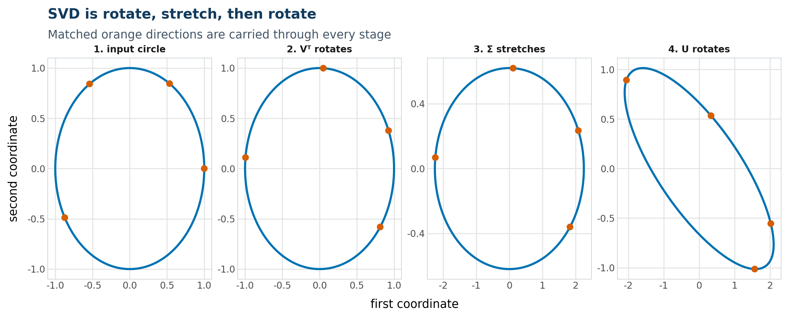

# Linear Algebra for Calculus and Data {#sec-calculus-linear-algebra}

Calculus studies change; linear algebra studies the simplest transformations
that preserve addition and scaling. The two subjects meet whenever a
multivariable function is replaced by its local linear model, a differential
equation evolves a vector of states, or data are projected onto a lower
dimensional description.

This chapter assumes no previous linear algebra. The concise primer introduced
equations and coordinates, and Chapter [sec-vectors](12-vectors-space.md#sec-vectors) introduced vectors.
We rebuild those ideas as needed and develop a complete computational path from
systems of equations to singular values.

## Scalars, vectors, and matrices

A **scalar** is one number. A vector in $\mathbb R^n$ is an ordered list

$$
x=(x_1,\ldots,x_n).
$$

Vectors add componentwise, and a scalar multiplies every component. A
**linear combination** of vectors $v_1,\ldots,v_k$ is

$$
c_1v_1+\cdots+c_kv_k.
$$

Their **span** is the set of all such combinations. They are linearly
independent if

$$
c_1v_1+\cdots+c_kv_k=0
$$

forces every $c_i=0$. A basis is an independent spanning list. Coordinates are
coefficients relative to a basis, not intrinsic labels attached to a vector.

An $m$-by-$n$ matrix $A=(a_{ij})$ represents a rule from
$\mathbb R^n$ to $\mathbb R^m$:

$$
(Ax)_i=\sum_{j=1}^n a_{ij}x_j.
$$

Its $j$th column is the image of the $j$th standard basis vector. Matrix
multiplication is defined so that composition works:

$$
(AB)x=A(Bx).
$$

Order matters. Even when both products exist, $AB$ and $BA$ are generally
different.

## Linear systems and elimination

A system of $m$ linear equations in $n$ unknowns is $Ax=b$. An **augmented
matrix** places $b$ beside $A$. Three row operations preserve the solution set:

1. swap two equations;
2. multiply an equation by a nonzero scalar;
3. add a multiple of one equation to another.

Gaussian elimination creates zeros below successive **pivots**. Continuing to
reduced row echelon form reveals pivot variables and free variables.

Consider

$$
\begin{aligned}
x+2y-z&=2,\\
2x+5y+z&=7,\\
-x-y+2z&=1.
\end{aligned}
$$

Subtract twice the first row from the second and add the first to the third:

$$
\begin{pmatrix}
1&2&-1&|&2\\
0&1&3&|&3\\
0&1&1&|&3
\end{pmatrix}.
$$

Subtract the second of the new rows from the third to get $-2z=0$, then
$z=0$, $y=3$, and $x=-4$. Substitution in the original equations is the
essential final check.

The **rank** is the number of pivots. The system is consistent exactly when the
rank of $A$ equals the rank of $[A|b]$. If consistent, the solution set has
$n-\operatorname{rank}A$ free directions. These statements follow from what
row reduction displays; they are not separate calculator rules.

## Four subspaces

For $A:\mathbb R^n\to\mathbb R^m$:

- the column space $\operatorname{col}A$ is the set of attainable outputs;
- the null space $\ker A$ contains inputs sent to zero;
- the row space is the span of rows in $\mathbb R^n$;
- the left null space is $\ker A^T$.

The rank–nullity theorem says

$$
\dim\ker A+\operatorname{rank}A=n.
$$

Every vector in the row space is orthogonal to every vector in the null space:
if $Ax=0$, each row has dot product zero with $x$. Similarly,

$$
\operatorname{col}A=(\ker A^T)^\perp.
$$

These orthogonal decompositions explain least squares and solvability.

## Linear geometry and determinants

A linear map sends lines through the origin to lines or points, and
parallelograms to parallelograms. In the plane,

$$
A=\begin{pmatrix}a&b\\c&d\end{pmatrix}
$$

scales signed area by

$$
\det A=ad-bc.
$$

The determinant is zero exactly when columns are dependent, the map collapses
dimension, and $A$ has no inverse. In $n$ dimensions it is the alternating
multilinear volume-scaling factor.

The change-of-variables formula from multiple integration contains
$|\det A|$ because ordinary volume ignores orientation. The sign still matters
for oriented integration and local degree.

Elementary row operations explain determinant rules: swapping rows changes
sign, scaling a row scales the determinant, and adding a multiple of one row to
another leaves it unchanged.

## Eigenvalues and dynamics

A nonzero vector $v$ is an eigenvector if

$$
Av=\lambda v.
$$

The direction is preserved and scaled by $\lambda$. Nonzero solutions require

$$
\det(A-\lambda I)=0,
$$

the characteristic equation.

For

$$
A=\begin{pmatrix}2&1\\1&2\end{pmatrix},
$$

the vectors $(1,1)$ and $(1,-1)$ have eigenvalues $3$ and $1$. Decomposing
$x=c_1(1,1)+c_2(1,-1)$ gives

$$
A^kx=c_1 3^k(1,1)+c_2(1,-1).
$$

Long-term growth is usually governed by the largest eigenvalue magnitude.

Not every matrix has a basis of eigenvectors. The matrix

$$
\begin{pmatrix}1&1\\0&1\end{pmatrix}
$$

has only one independent eigenvector. Its powers contain a growing off-diagonal
term $k$ even though every eigenvalue equals one. Stability claims based only
on eigenvalues need diagonalisation or Jordan-form care.

For a differential system $x'=Ax$, eigenmodes evolve as
$e^{\lambda t}v$. Negative real parts decay, positive real parts grow, and
nonzero imaginary parts oscillate.

## Inner products and orthogonal projection

The standard inner product is

$$
\langle x,y\rangle=x^Ty=\sum_i x_i y_i,
$$

with length $\|x\|=\sqrt{\langle x,x\rangle}$. Vectors are orthogonal when
their inner product is zero. The Pythagorean theorem becomes

$$
\|x+y\|^2=\|x\|^2+\|y\|^2
$$

for orthogonal $x,y$.

For a nonzero vector $v$, the projection of $b$ onto its span is

$$
\operatorname{proj}_v b
=\frac{\langle b,v\rangle}{\langle v,v\rangle}v.
$$

The residual $b-\operatorname{proj}_v b$ is orthogonal to $v$. For a subspace
with orthonormal basis columns in $Q$, the projection is

$$
QQ^Tb.
$$

Gram–Schmidt turns an independent list into an orthonormal list. Modified
Gram–Schmidt or Householder QR is usually more stable numerically than the
naive formula.

## Least squares

When $Ax=b$ is inconsistent, choose $x$ to minimise

$$
\|Ax-b\|^2.
$$

At the closest point in $\operatorname{col}A$, the residual is orthogonal to
that space:

$$
A^T(Ax-b)=0.
$$

These are the **normal equations**

$$
A^TAx=A^Tb.
$$

If $A$ has independent columns, $A^TA$ is invertible and the minimiser is
unique.

For fitting $y\approx\beta_0+\beta_1t$, the design matrix has columns
$1$ and $t$. The normal equations state that residuals sum to zero and have
zero dot product with $t$. A fitted slope has units of response per unit input.

Computationally, solving the normal equations squares the condition number.
QR factorisation solves the same geometric projection more stably; singular
value decomposition is safest near rank deficiency.

## Singular value decomposition

Every real $m$-by-$n$ matrix has a factorisation

$$
A=U\Sigma V^T,
$$

where $U$ and $V$ have orthonormal columns and $\Sigma$ is diagonal with

$$
\sigma_1\ge\sigma_2\ge\cdots\ge0.
$$

The right singular vector $v_i$ is an input direction, $A$ stretches it by
$\sigma_i$, and the result points along $u_i$:

$$
Av_i=\sigma_i u_i.
$$

The unit circle becomes an ellipse whose semiaxis lengths are the singular
values.

<figure id="fig-svd-geometry">


<figcaption>

Figure 32.1: The singular value decomposition rotates, stretches, and rotates again.

</figcaption>
</figure>

[Figure 32.1](#fig-svd-geometry) is a two-dimensional exact example. In higher dimensions the
same statement concerns spheres and ellipsoids even though they cannot all be
drawn.

The rank equals the number of positive singular values. The condition number

$$
\kappa_2(A)=\frac{\sigma_1}{\sigma_r}
$$

uses the smallest positive singular value. A large value means some input
direction is nearly lost.

The best rank-$k$ approximation in spectral or Frobenius norm is

$$
A_k=\sum_{i=1}^k\sigma_i u_iv_i^T.
$$

The discarded singular values quantify the error. This is the mathematical
core of compression and principal-component methods.

The formula translates directly into a finite factorization. Multiplying each
retained column of $U$ by its singular value implements
$U_k\Sigma_kV_k^T$ without constructing a large diagonal matrix:

```python
import numpy as np
from numpy.typing import NDArray

def truncated_svd(
    matrix: NDArray[np.float64], retained_rank: int
) -> tuple[NDArray[np.float64], float]:
    """Return a rank-k approximation and its exact Frobenius truncation error."""
    if matrix.ndim != 2 or min(matrix.shape) == 0:
        raise ValueError("matrix must be a nonempty two-dimensional array")
    if not 1 <= retained_rank <= min(matrix.shape):
        raise ValueError("retained_rank must lie between 1 and min(matrix.shape)")
    left_vectors, singular_values, right_vectors_transpose = np.linalg.svd(
        matrix, full_matrices=False
    )
    approximation = (
        left_vectors[:, :retained_rank]
        * singular_values[:retained_rank]
    ) @ right_vectors_transpose[:retained_rank, :]
    discarded_error = float(
        np.sqrt(np.sum(singular_values[retained_rank:] ** 2))
    )
    return approximation, discarded_error

data_matrix = np.array(
    [[3.0, 2.0, 2.0], [2.0, 3.0, -2.0], [0.0, 0.0, 0.2]],
    dtype=float,
)
rank_two, predicted_error = truncated_svd(data_matrix, retained_rank=2)
measured_error = float(np.linalg.norm(data_matrix - rank_two, ord="fro"))
print(rank_two)
print(predicted_error, measured_error)
```

The equality of the two printed errors is a finite check of the Frobenius
error formula for this matrix. It does not prove the best-approximation theorem
or decide that rank two is scientifically adequate.

## Calculus in matrix language

For $F:\mathbb R^n\to\mathbb R^m$, the derivative at $a$ is the linear map
$DF(a)$ satisfying

$$
F(a+h)=F(a)+DF(a)h+o(\|h\|).
$$

Its matrix is the Jacobian. The chain rule is matrix multiplication:

$$
D(G\circ F)(a)=DG(F(a))DF(a).
$$

For scalar $f$, the derivative is the row $\nabla f(a)^T$. The Hessian
$H_f$ is the derivative of the gradient. Near a critical point,

$$
f(a+h)\approx f(a)+\frac12h^TH_f(a)h.
$$

Positive definite Hessian means positive curvature in every direction and
gives a strict local minimum. Eigenvalues identify principal curvature
directions.

## Data case study: principal components

Put $n$ observations as rows of a matrix $X$. Subtract each column mean to form
the centered matrix $X_c$. Its SVD is

$$
X_c=U\Sigma V^T.
$$

Columns of $V$ are principal directions; scores $X_cv_i$ locate observations
along them. The fraction of squared variation explained by the first $k$
directions is

$$
\frac{\sigma_1^2+\cdots+\sigma_k^2}
{\sigma_1^2+\cdots+\sigma_r^2}.
$$

Centering is essential. Scaling columns may be appropriate when units differ,
but it changes the question. Principal components find linear directions of
large sample variation; they do not establish causal variables or guarantee
that a nonlinear cloud is truly low-dimensional.

<div class="callout callout-warning">
<p class="callout-title">Numerical rank depends on scale</p>

Exact rank asks whether a singular value is zero. Floating-point rank compares
it with a tolerance tied to matrix scale and precision. Reports must state the
tolerance and show the singular-value spectrum.

</div>

## Worked clinic: a line fit from first principles

Least squares is easy to describe as a button press and more useful to
understand as a sequence of geometric checks. Return to the three observations

$$
(t,y)=(0,1),(1,2),(2,2)
$$

and fit $y\approx\beta_0+\beta_1t$. Writing one prediction equation per
observation gives

$$
A=
\begin{pmatrix}
1&0\\
1&1\\
1&2
\end{pmatrix},
\qquad
b=\begin{pmatrix}1\\2\\2\end{pmatrix},
\qquad
\beta=\begin{pmatrix}\beta_0\\\beta_1\end{pmatrix}.
$$

There are three equations and only two coefficients. Usually no line passes
through all three points, so $A\beta=b$ is inconsistent. The normal equations
are

$$
\begin{pmatrix}3&3\\3&5\end{pmatrix}
\begin{pmatrix}\beta_0\\\beta_1\end{pmatrix}
= \begin{pmatrix}5\\6\end{pmatrix}.
$$

Eliminate the first unknown by subtracting the first equation from the second:
$2\beta_1=1$, hence $\beta_1=1/2$. The first equation then gives
$\beta_0=7/6$. The fitted values are

$$
A\widehat\beta
=\begin{pmatrix}7/6\\5/3\\13/6\end{pmatrix},
$$

and the residual in the convention $r=A\widehat\beta-b$ is

$$
r=\begin{pmatrix}1/6\\-1/3\\1/6\end{pmatrix}.
$$

Now perform the checks that turn an answer into an audit. First,

$$
1^Tr=\frac16-\frac13+\frac16=0,
$$

so the residual is orthogonal to the intercept column. Second,

$$
t^Tr=0\left(\frac16\right)
+1\left(-\frac13\right)+2\left(\frac16\right)=0,
$$

so it is orthogonal to the time column. These two equalities are precisely
$A^Tr=0$. Finally, the squared residual norm is

$$
\|r\|^2=\frac1{36}+\frac19+\frac1{36}=\frac16.
$$

That value is not a universal measure of fit: its units are response units
squared, and its size depends on the noise scale and sample count. It becomes
interpretable only after comparison with measurement uncertainty or another
model.

Exact fractions let the normal-equation geometry be checked without rounding.
The centered-sum formula below is algebraically equivalent to solving the
two-by-two normal equations when the time values are not all equal.

```python
from fractions import Fraction

def exact_least_squares_line(
    input_values: list[Fraction], response_values: list[Fraction]
) -> tuple[Fraction, Fraction, list[Fraction]]:
    """Return intercept, slope, and residuals for an exact line fit."""
    if len(input_values) != len(response_values) or len(input_values) < 2:
        raise ValueError("provide at least two aligned observations")
    sample_count = len(input_values)
    input_mean = sum(input_values, start=Fraction(0)) / sample_count
    response_mean = sum(response_values, start=Fraction(0)) / sample_count
    denominator = sum((value - input_mean) ** 2 for value in input_values)
    if denominator == 0:
        raise ValueError("input values must not all be equal")
    slope = sum(
        (input_value - input_mean) * (response_value - response_mean)
        for input_value, response_value in zip(
            input_values, response_values, strict=True
        )
    ) / denominator
    intercept = response_mean - slope * input_mean
    residuals = [
        intercept + slope * input_value - response_value
        for input_value, response_value in zip(
            input_values, response_values, strict=True
        )
    ]
    return intercept, slope, residuals

intercept, slope, residuals = exact_least_squares_line(
    [Fraction(0), Fraction(1), Fraction(2)],
    [Fraction(1), Fraction(2), Fraction(2)],
)
if sum(residuals, start=Fraction(0)) != 0:
    raise RuntimeError("residuals are not orthogonal to the intercept column")
print(intercept, slope, residuals)
```

The result is $(7/6,1/2)$ with residuals
$(1/6,-1/3,1/6)$. Orthogonality to both design columns characterizes the
least-squares projection; this finite calculation does not choose a noise model
or make the fitted direction causal.

Units also expose a subtle coordinate issue. If $t$ was measured in seconds,
$\beta_1=1/2$ has units of response units per second. Re-expressing time in
milliseconds replaces the second column of $A$ by values $0,1000,2000$ and the
slope by $1/2000$ response units per millisecond. The physical predictions do
not change, but the matrix column scales and its numerical condition can change
dramatically. Standardising variables may improve computation, provided the
reported coefficients are converted back to meaningful units.

## Worked conditioning audit: an almost lost direction

Exact rank alone cannot warn us that a problem is close to losing information.
Consider

$$
A_\varepsilon=
\begin{pmatrix}
1&1\\
1&1+\varepsilon
\end{pmatrix},
\qquad \varepsilon\ne0.
$$

Its determinant is $\varepsilon$, so the matrix is invertible for every
nonzero $\varepsilon$. Nevertheless, its two columns become nearly parallel as
$\varepsilon\to0$. Suppose the true parameter is
$\theta=(1,1)^T$, giving exact data

$$
b=A_\varepsilon\theta
=\begin{pmatrix}2\\2+\varepsilon\end{pmatrix}.
$$

Now perturb only the second measurement by $\delta$. Since

$$
A_\varepsilon^{-1}
=\frac1\varepsilon
\begin{pmatrix}1+\varepsilon&-1\\-1&1\end{pmatrix},
$$

the parameter perturbation is

$$
\Delta\theta
=A_\varepsilon^{-1}
\begin{pmatrix}0\\\delta\end{pmatrix}
=\begin{pmatrix}-\delta/\varepsilon\\\delta/\varepsilon\end{pmatrix}.
$$

With $\varepsilon=10^{-3}$ and measurement error
$\delta=10^{-4}$, each inferred parameter changes by $0.1$. The data changed
by only one ten-thousandth, yet parameters of size one changed by ten percent.
Worse, the perturbed two-equation system is still solved with zero residual.
A tiny residual therefore does not prove a reliable inverse. Singular values,
condition numbers, and perturbation tests answer a different question from
fit.

The poorly observed direction is approximately $(1,-1)$: increasing one
parameter while decreasing the other barely changes the two sums measured by
the rows. This gives a practical interpretation of a small right-singular
direction. It is a combination of causes that the experiment almost cannot
distinguish.

## Selected solution clinic

Several exercises can now be completed without an unexplained computational
jump.

For Exercise 5, the characteristic polynomial of
$A=\begin{pmatrix}4&2\\1&3\end{pmatrix}$ is

$$
\det(A-\lambda I)
=(4-\lambda)(3-\lambda)-2
=\lambda^2-7\lambda+10
=(\lambda-5)(\lambda-2).
$$

For $\lambda=5$, the equation $-v_1+2v_2=0$ gives an eigenvector
$(2,1)$. For $\lambda=2$, $2v_1+2v_2=0$ gives $(1,-1)$. A check should use
the original matrix:

$$
A\begin{pmatrix}2\\1\end{pmatrix}
=5\begin{pmatrix}2\\1\end{pmatrix},
\qquad
A\begin{pmatrix}1\\-1\end{pmatrix}
=2\begin{pmatrix}1\\-1\end{pmatrix}.
$$

For Exercise 6, take $b=(2,3,4)$ and $v=(1,1,1)$. The projection coefficient
is

$$
\frac{b\cdot v}{v\cdot v}=\frac9{3}=3,
$$

so $\operatorname{proj}_v b=(3,3,3)$. The residual
$(-1,0,1)$ has dot product zero with $v$, and the units remain those of $b$;
the coefficient $3$ carries the quotient of the units of $b$ and $v$ if the
basis vector itself is dimensional.

For Exercise 10,

$$
f(x,y)=x^2+xy+3y^2
$$

has gradient $(2x+y,x+6y)$ and Hessian

$$
H=\begin{pmatrix}2&1\\1&6\end{pmatrix}.
$$

Its leading principal minors are $2$ and $12-1=11$, both positive. Thus
$h^THh>0$ for every nonzero direction $h$, and the origin is a strict local
minimum. Because this particular $f$ is exactly quadratic with no linear or
constant term, the conclusion is global as well. The last sentence would not
follow for an arbitrary nonlinear function merely from a Hessian checked at
one point.

## Further connections {#forward-handoff}

[Chapter 39](39-functional-analysis.md) extends finite vectors and matrices to
complete normed spaces and bounded operators. [Chapter 40](40-numerical-linear-algebra.md)
returns to matrices with finite-precision questions: stable factorizations,
condition estimates, backward error, Krylov subspaces, preconditioning, and
iteration certificates for large sparse systems.

<!-- inline-formula-code:start -->
## Formula and finite computation

A useful formula in this chapter is

$$
\widehat\beta=\arg\min_\beta\|X\beta-y\|_2
$$

A least-squares solver computes the minimizer without forming unstable normal equations. The following standalone Python block expresses that finite rule with its inputs and stopping conditions visible.

```python
import numpy as np
from numpy.typing import NDArray

def fit_line(
    predictor_values: NDArray[np.float64],
    observed_values: NDArray[np.float64],
) -> tuple[float, float, float]:
    """Return intercept, slope, and residual norm for a least-squares line."""
    if (
        predictor_values.ndim != 1
        or observed_values.ndim != 1
        or predictor_values.shape != observed_values.shape
        or predictor_values.size < 2
    ):
        raise ValueError("x and y must be matching one-dimensional samples")
    design = np.column_stack(
        (np.ones_like(predictor_values, dtype=float), predictor_values)
    )
    coefficients, _, _, _ = np.linalg.lstsq(
        design, observed_values, rcond=None
    )
    residual_norm = float(
        np.linalg.norm(design @ coefficients - observed_values)
    )
    return float(coefficients[0]), float(coefficients[1]), residual_norm

predictor_values = np.array([0.0, 1.0, 2.0, 3.0])
observed_values = np.array([1.1, 2.9, 5.2, 6.8])
print(fit_line(predictor_values, observed_values))
```

**What the computation establishes.** The calculation checks a declared finite instance; the surrounding argument explains what is true beyond those inputs.
<!-- inline-formula-code:end -->

## Summary and vocabulary

Matrices encode linear maps; elimination reveals solution geometry; determinants
measure oriented volume; eigenvectors describe invariant directions; orthogonal
projection solves least squares; SVD gives stable principal directions and
rank approximation. Jacobians and Hessians carry these tools back into
calculus.

## Exercises and support

<div class="exercise" id="calculus-32-linear-algebra-data-ex-1">
<p class="exercise-title"><strong>Exercise 1</strong></p>

Express $(3,1)$ as a combination of $(1,1)$ and $(1,-1)$.

</div>

<div class="exercise" id="calculus-32-linear-algebra-data-ex-2">
<p class="exercise-title"><strong>Exercise 2</strong></p>

Solve the worked three-equation system independently and check by
substitution.

</div>

<div class="exercise" id="calculus-32-linear-algebra-data-ex-3">
<p class="exercise-title"><strong>Exercise 3</strong></p>

Find bases for the null and column spaces of
$\begin{pmatrix}1&2&3\\2&4&6\end{pmatrix}$.

</div>

<div class="exercise" id="calculus-32-linear-algebra-data-ex-4">
<p class="exercise-title"><strong>Exercise 4</strong></p>

Derive the inverse of a two-by-two matrix from elimination.

</div>

<div class="exercise" id="calculus-32-linear-algebra-data-ex-5">
<p class="exercise-title"><strong>Exercise 5</strong></p>

Find eigenvalues and eigenvectors of
$\begin{pmatrix}4&2\\1&3\end{pmatrix}$.

</div>

<div class="exercise" id="calculus-32-linear-algebra-data-ex-6">
<p class="exercise-title"><strong>Exercise 6</strong></p>

Project $(2,3,4)$ onto the line spanned by $(1,1,1)$.

</div>

<div class="exercise" id="calculus-32-linear-algebra-data-ex-7">
<p class="exercise-title"><strong>Exercise 7</strong></p>

Fit a line to $(0,1),(1,2),(2,2)$ and audit the residual orthogonality.

</div>

<div class="exercise" id="calculus-32-linear-algebra-data-ex-8">
<p class="exercise-title"><strong>Exercise 8</strong></p>

Show that singular values squared are eigenvalues of $A^TA$.

</div>

<div class="exercise" id="calculus-32-linear-algebra-data-ex-9">
<p class="exercise-title"><strong>Exercise 9</strong></p>

Use SVD to compute a rank-one approximation to a small data matrix and
report the Frobenius error.

</div>

<div class="exercise" id="calculus-32-linear-algebra-data-ex-10">
<p class="exercise-title"><strong>Exercise 10</strong></p>

For $f(x,y)=x^2+xy+3y^2$, write the Hessian and classify the origin.

</div>

<div class="exercise" id="calculus-32-linear-algebra-data-ex-11">
<p class="exercise-title"><strong>Exercise 11</strong></p>

Explain why changing metres to millimetres can change unscaled principal
components.

</div>

<div class="exercise" id="calculus-32-linear-algebra-data-ex-12">
<p class="exercise-title"><strong>Exercise 12</strong></p>

Build a reproducible small dataset, center it, and make a score plot with
an explicit explained-variation caption.

</div>

For Exercise 1, the coefficients are $2$ and $1$. For Exercise 3, one null
basis is $(-2,1,0),(-3,0,1)$ and the column space is one-dimensional. For
Exercise 10, the Hessian has positive leading principal minors.
