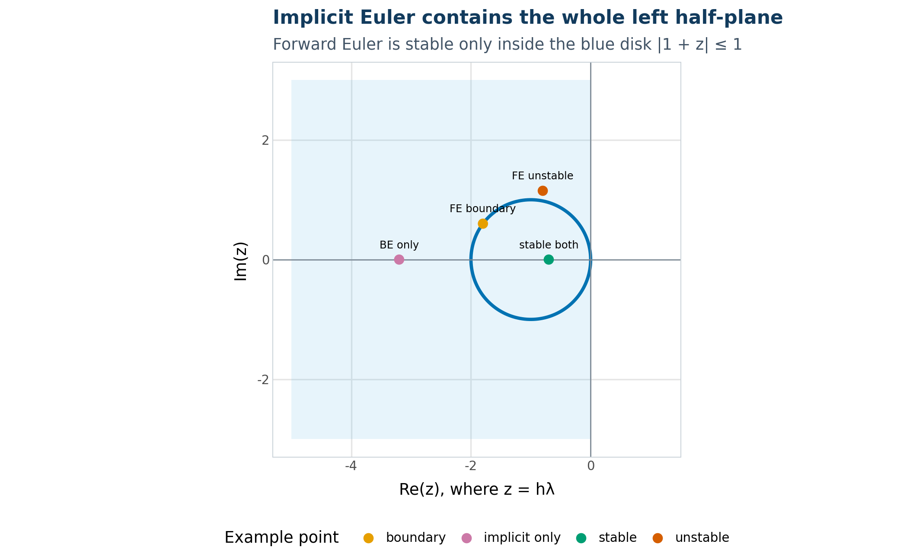

# Numerical Differential Equations {#sec-numerical-odes}

Most differential equations used in science do not have elementary closed-form
solutions. A numerical method replaces continuous time by steps, but a plausible
curve is not automatically close to the true solution. We need three separate
ideas: **consistency** measures one-step approximation, **stability** controls
error amplification, and **convergence** says the accumulated computation
approaches the mathematical solution.

Chapter [sec-odes](09-differential-equations.md#sec-odes) introduced initial-value problems and
Chapter [sec-numerical-calculus](16-numerical.md#sec-numerical-calculus) introduced numerical error. This chapter rebuilds the
necessary pieces and develops a solver audit from first principles.

## Initial-value problems and grids

An initial-value problem has the form

$$
y'(t)=f(t,y(t)),\qquad y(t_0)=y_0.
$$

The state $y$ may be a scalar or vector. Choose grid points

$$
t_n=t_0+nh,\qquad n=0,\ldots,N,
$$

with step size $h=(T-t_0)/N$. A method computes approximations
$y_n\approx y(t_n)$.

If $f$ is continuous in $t$ and locally Lipschitz in $y$, Picard–Lindelöf
gives a unique local solution. A numerical algorithm cannot repair a
mathematical problem whose solution is nonunique or blows up before $T$.

Errors have distinct sources:

- modeling error in the differential equation;
- uncertainty in parameters and initial data;
- discretisation error from finite $h$;
- roundoff and nonlinear-solver error;
- programming error.

A convergence experiment addresses only some of them.

## Euler's method derived

Taylor expansion gives

$$
y(t_n+h)=y(t_n)+hy'(t_n)+O(h^2)
=y(t_n)+hf(t_n,y(t_n))+O(h^2).
$$

Dropping the remainder produces forward Euler:

$$
y_{n+1}=y_n+hf(t_n,y_n).
$$

The **local truncation error** is the defect made in one step when exact input
is supplied; it is $O(h^2)$. Over about $1/h$ steps, stable accumulation gives
global error $O(h)$.

For $y'=-2y$, $y(0)=1$, Euler gives

$$
y_n=(1-2h)^n,
$$

while the exact solution is $e^{-2t_n}$. At a fixed $t$, the limit

$$
\left(1-\frac{2t}{n}\right)^n\to e^{-2t}
$$

shows convergence directly.

If $h>1$, the Euler factor $1-2h$ has magnitude greater than one and the
computed solution grows despite exact decay. Step size affects qualitative
stability.

## Worked time-step clinic: cooling with units

Consider Newton cooling in minutes,

$$
T'=-k(T-T_a),
$$

with ambient temperature $T_a=20\,{}^\circ\mathrm C$, initial temperature
$T(0)=80\,{}^\circ\mathrm C$, and
$k=0.1\,\mathrm{min}^{-1}$. Temperature differences may be measured in degrees
Celsius even though absolute temperature ratios may not. Set
$x=T-T_a$. Then

$$
x'=-0.1x,
\qquad x(0)=60\,{}^\circ\mathrm C.
$$

Euler with $h=2\,\mathrm{min}$ gives

$$
x_{n+1}=(1-kh)x_n=0.8x_n.
$$

The product $kh$ is dimensionless, as every number added to $1$ must be. The
first three updates are

$$
\begin{aligned}
x_1&=0.8(60)=48, &T_1&=68,\\
x_2&=0.8(48)=38.4, &T_2&=58.4,\\
x_3&=0.8(38.4)=30.72, &T_3&=50.72.
\end{aligned}
$$

All temperatures in that display have units $^\circ\mathrm C$. At six minutes
the exact result is

$$
T(6)=20+60e^{-0.6}\approx52.9287,
$$

so the signed Euler error is about $-2.2087\,{}^\circ\mathrm C$. Halving the
step to one minute gives

$$
T_h(6)=20+60(0.9)^6\approx51.8865,
$$

with error about $-1.0422\,{}^\circ\mathrm C$. At $h=0.5$ minute the value is
$20+60(0.95)^{12}\approx52.4216$, with error about
$-0.5071\,{}^\circ\mathrm C$. The error ratios are approaching two, consistent
with first-order global error. This table does more than show agreement: it
checks signs, units, convergence direction, and the claimed order against an
independent exact solution.

The cooling recurrence is a particularly transparent Euler implementation:
each update multiplies the temperature difference by $1-kh$, then restores the
ambient offset.

```python
from math import exp

def euler_cooling(
    initial_temperature: float,
    ambient_temperature: float,
    rate_constant: float,
    step_minutes: float,
    steps: int,
) -> list[float]:
    """Return a bounded forward-Euler cooling trajectory, including time zero."""
    if rate_constant < 0.0 or step_minutes <= 0.0 or steps < 0:
        raise ValueError("require k >= 0, a positive step, and nonnegative steps")
    temperatures = [initial_temperature]
    for _ in range(steps):
        current = temperatures[-1]
        temperatures.append(
            current - rate_constant * step_minutes * (current - ambient_temperature)
        )
    return temperatures

temperatures = euler_cooling(80.0, 20.0, 0.1, 2.0, 3)
exact_at_six = 20.0 + 60.0 * exp(-0.6)
print(temperatures)
print(temperatures[-1] - exact_at_six)
```

The output reproduces the three displayed updates and their signed six-minute
error. It does not certify stability for arbitrary $kh$ or convergence under
mesh refinement; those require the analysis developed in the next sections.

For one step of $y'=-2y$, $y_0=1$, $h=1/4$, explicit midpoint computes

$$
k_1=-2,
\qquad
y_{1/2}=1+\frac18(-2)=\frac34,
\qquad
k_2=-\frac32,
$$

and hence

$$
y_1=1+\frac14\left(-\frac32\right)=\frac58.
$$

Heun predicts $1+(1/4)(-2)=1/2$, evaluates the endpoint slope $-1$, and
averages the two slopes:

$$
y_1=1+\frac18(-2-1)=\frac58.
$$

The methods happen to agree here because both have the same quadratic
stability polynomial on this linear scalar problem. Their internal stages and
behavior on a nonlinear equation need not agree. The exact value is
$e^{-1/2}\approx0.60653$, while Euler gives $0.5$ and the two second-order
methods give $0.625$.

## Error propagation

Assume $f$ is Lipschitz in $y$ with constant $L$. Let
$e_n=y(t_n)-y_n$. Comparing exact and numerical steps gives

$$
|e_{n+1}|
\le(1+hL)|e_n|+Ch^2.
$$

Iterating this inequality and summing a geometric series yields

$$
\max_{0\le n\le N}|e_n|
\le C_T h
$$

on a fixed finite interval. This discrete Grönwall argument explains why local
order two becomes global order one.

The constant may grow like $e^{LT}$. Big-$O$ order alone does not say the
error is small at the chosen step or over a long time.

## Midpoint, Heun, and Runge–Kutta

The explicit midpoint method estimates the slope halfway:

$$
\begin{aligned}
k_1&=f(t_n,y_n),\\
k_2&=f(t_n+h/2,y_n+hk_1/2),\\
y_{n+1}&=y_n+hk_2.
\end{aligned}
$$

Heun's method averages the slope at the beginning with a predicted endpoint
slope:

$$
\begin{aligned}
k_1&=f(t_n,y_n),\\
k_2&=f(t_n+h,y_n+hk_1),\\
y_{n+1}&=y_n+\frac h2(k_1+k_2).
\end{aligned}
$$

Both have local error $O(h^3)$ and global error $O(h^2)$ under smoothness
assumptions.

Classical fourth-order Runge–Kutta uses

$$
\begin{aligned}
k_1&=f(t_n,y_n),\\
k_2&=f(t_n+h/2,y_n+hk_1/2),\\
k_3&=f(t_n+h/2,y_n+hk_2/2),\\
k_4&=f(t_n+h,y_n+hk_3),\\
y_{n+1}&=y_n+\frac h6(k_1+2k_2+2k_3+k_4).
\end{aligned}
$$

The weights match Taylor terms through degree four without requiring explicit
higher derivatives of $f$. Four function evaluations per step do not make it
universally best; stiffness, events, and expensive right-hand sides change the
tradeoff.

## Step-halving and observed order

If a method has error

$$
y_h(T)-y(T)=Ch^p+O(h^{p+1}),
$$

then

$$
y_h(T)-y_{h/2}(T)
\approx C h^p(1-2^{-p}).
$$

With three resolutions, estimate the observed order by

$$
p_{\mathrm{obs}}
=\log_2\left|
\frac{y_h-y_{h/2}}{y_{h/2}-y_{h/4}}
\right|.
$$

This estimate can fail before the asymptotic range, when the leading error
coefficient vanishes, or after roundoff dominates. Report the whole refinement
table, not only one fitted slope.

Richardson extrapolation combines $y_h$ and $y_{h/2}$ to cancel the leading
term:

$$
y_{\mathrm{extra}}
=y_{h/2}+\frac{y_{h/2}-y_h}{2^p-1}.
$$

It inherits the assumptions behind the error expansion.

## Adaptive step size

An embedded Runge–Kutta pair produces two approximations of different order
from mostly shared slopes. Their difference estimates local error. Given an
absolute tolerance $\mathrm{atol}$ and relative tolerance $\mathrm{rtol}$,
scale component $i$ by

$$
s_i=\mathrm{atol}_i+
\mathrm{rtol}_i\max(|y_{n,i}|,|y_{n+1,i}|).
$$

Accept a step when a norm of componentwise error ratios is at most one. A
typical controller proposes

$$
h_{\mathrm{new}}
=\eta h\,\mathrm{err}^{-1/(p+1)},
$$

with safety factor $0<\eta<1$ and bounded growth/shrink factors.

Absolute tolerance protects near zero; relative tolerance scales with
magnitude. One tolerance for variables with different units can be
meaningless. Rejected steps are not wasted evidence: many rejections may signal
discontinuity, stiffness, or an incorrectly scaled model.

## Stability regions and stiffness

Apply a method to the test equation

$$
y'=\lambda y,\qquad \operatorname{Re}\lambda<0.
$$

A one-step method gives

$$
y_{n+1}=R(h\lambda)y_n.
$$

The **absolute stability region** is
$\{z:|R(z)|\le1\}$.

For forward Euler, $R(z)=1+z$, a disk centered at $-1$ of radius one. For
backward Euler,

$$
y_{n+1}=y_n+h\lambda y_{n+1},
\qquad
R(z)=\frac1{1-z},
$$

and the entire left half-plane is stable.

For classical fourth-order Runge–Kutta,

$$
R(z)=1+z+\frac{z^2}{2}+\frac{z^3}{6}+\frac{z^4}{24}.
$$

The following code turns the three displayed stability functions into named
amplification magnitudes. This is often easier to interpret than carrying the
compressed symbol $z=h\lambda$ through mental arithmetic:

```python
def stability_magnitudes(
    step_size: float, mode_eigenvalue: complex
) -> dict[str, float]:
    """Return one-step amplification magnitudes for the linear test equation."""
    if step_size <= 0.0:
        raise ValueError("step_size must be positive")
    scaled_mode = step_size * mode_eigenvalue
    backward_denominator = 1.0 - scaled_mode
    if backward_denominator == 0.0:
        raise ValueError("backward Euler factor is singular for this scaled mode")
    runge_kutta_four = (
        1.0
        + scaled_mode
        + scaled_mode**2 / 2.0
        + scaled_mode**3 / 6.0
        + scaled_mode**4 / 24.0
    )
    return {
        "forward Euler": abs(1.0 + scaled_mode),
        "backward Euler": abs(1.0 / backward_denominator),
        "RK4": abs(runge_kutta_four),
    }

for step_size in (0.0005, 0.002, 0.01):
    print(step_size, stability_magnitudes(step_size, -1000.0 + 0.0j))
```

A magnitude at most one means that this single linear mode does not grow in
one step. It is not a global-error bound, a nonlinear stability proof, or a
claim that the fast transient has been resolved accurately.

<figure id="fig-ode-stability-regions">


<figcaption>

Figure 33.1: Explicit and implicit methods have very different stability regions.

</figcaption>
</figure>

[Figure 33.1](#fig-ode-stability-regions) concerns the linear test equation. Nonlinear
stability also depends on Jacobians and changing modes, but the diagram explains
the core restriction.

A problem is **stiff** when accuracy permits a much larger step than explicit
stability does, usually because fast decaying modes coexist with slow dynamics.
Implicit methods solve an algebraic equation each step but can take far larger
steps. Stiffness is a property of the problem-method combination, not a synonym
for “difficult”.

## Worked stiffness clinic: stable is not the same as accurate

The diagonal system

$$
\begin{aligned}
y_1'&=-y_1,\\
y_2'&=-1000y_2,
\end{aligned}
\qquad
y_1(0)=y_2(0)=1,
$$

contains a slow one-second mode and a fast one-millisecond mode. The exact
solution is $(e^{-t},e^{-1000t})$. Suppose the quantity of interest is the slow
component out to one second. A step of $h=0.01\,\mathrm s$ might be adequate
for resolving $e^{-t}$, but forward Euler multiplies the fast component by

$$
1-1000h=-9
$$

on every step. The exact fast component has nearly vanished by
$t=0.01\,\mathrm s$, while the numerical component has become $-9$ and then
grows in magnitude. Forward Euler requires

$$
|1-1000h|\le1,
$$

so $h\le0.002\,\mathrm s$ merely for stability. It must take at least five
times as many steps as the slow accuracy scale suggests.

Backward Euler instead uses factors

$$
\frac1{1+h}
\quad\text{and}\quad
\frac1{1+1000h}.
$$

At $h=0.01$ the fast factor is $1/11$, so the unwanted mode decays rather than
explodes. Yet $1/11\approx0.0909$ is nowhere near the exact one-step factor
$e^{-10}\approx0.0000454$. Backward Euler is stable at that step, not accurate
through the initial fast transient. If the fast transient itself matters, the
step must still be reduced. If only the later slow state matters, strong
damping of the fast mode may be exactly what is needed. A solver choice is
therefore inseparable from the output and time scales named in the question.

## Implicit solves and Newton iteration

Backward Euler for a nonlinear equation requires

$$
G(z)=z-y_n-hf(t_{n+1},z)=0.
$$

Newton iteration is

$$
z^{(k+1)}
=z^{(k)}-
\left[I-hf_y(t_{n+1},z^{(k)})\right]^{-1}
G(z^{(k)}).
$$

The nonlinear tolerance should be tighter than the requested time-discretisation
error but not wastefully small. Failure to converge needs a defined response:
reduce the step, improve the Jacobian, or return a diagnostic. Silently using
the last Newton iterate changes the method.

For a concrete implicit solve, take $y'=-y^3$, $y_n=1$, and $h=1/2$.
Backward Euler asks for

$$
G(z)=z-1+\frac12z^3=0,
\qquad
G'(z)=1+\frac32z^2.
$$

Starting from the old value $z^{(0)}=1$ gives

$$
z^{(1)}=1-\frac{1/2}{5/2}=0.8.
$$

At $0.8$, $G(0.8)=0.056$ and $G'(0.8)=1.96$, so
$z^{(2)}\approx0.77143$. One more iteration gives approximately $0.77092$.
Because $G'(z)>0$ for every real $z$, this equation has at most one real root;
the sign change between $0$ and $1$ gives existence. The exact solution from
$y(0)=1$ is $y(t)=1/\sqrt{1+2t}$, so at $t=1/2$ it is
$1/\sqrt2\approx0.70711$. Newton has accurately solved the discrete equation,
but the discrete equation still has time-stepping error. Nonlinear residual
and ODE error must never be reported as if they were the same quantity.

## Multistep and structure-preserving methods

The two-step Adams–Bashforth formula is

$$
y_{n+1}=y_n+
\frac h2\left(3f_n-f_{n-1}\right).
$$

It reuses a past derivative but needs a starting method. Linear multistep
methods have a **zero-stability** root condition; consistency plus
zero-stability is equivalent to convergence.

Hamiltonian systems preserve geometric structure. Symplectic Euler for
$q'=p$, $p'=-\nabla V(q)$ can be written

$$
p_{n+1}=p_n-h\nabla V(q_n),
\qquad
q_{n+1}=q_n+hp_{n+1}.
$$

Its pointwise order is only one, yet over long times it often keeps energy
bounded and phase geometry far better than a generic high-order method. The
goal determines which error matters.

## Boundary-value problems

For

$$
y''=g(x,y,y'),\qquad y(a)=\alpha,\quad y(b)=\beta,
$$

the shooting method guesses $y'(a)=s$, solves an initial-value problem, and
finds a root of $F(s)=y_s(b)-\beta$. It can miss branches or become ill
conditioned.

Finite differences replace, at grid point $x_i$,

$$
y''(x_i)\approx
\frac{y_{i+1}-2y_i+y_{i-1}}{h^2}.
$$

The result is a linear or nonlinear algebraic system. Consistency, matrix
stability, and boundary treatment determine convergence. A small discrete
residual does not alone bound continuous error without a stability estimate.

## Events, positivity, and invariant checks

Many simulations ask *when* something happens rather than only for the state at
preselected times. Let an event be described by a scalar function
$g(t,y)=0$: height for ground impact, concentration minus a safety threshold,
or temperature minus a set point. If accepted step endpoints give opposite
signs of $g$, the solver has bracketed a crossing. Interpolation based on the
method's internal data can locate the root without shrinking every step to the
event-time tolerance.

Several declarations are essential. A direction flag distinguishes an upward
crossing from a downward one; a terminal flag says whether integration stops;
and the event tolerance carries time units after root finding. Simply clipping
a negative height to zero changes the state but does not estimate impact time
or velocity. A step can also cross zero twice without opposite endpoint signs,
so event detection relies on a smoothness and step-resolution assumption.

Physical state constraints offer another audit. In an SIR model, negative
populations are impossible and $S+I+R=N$ should remain constant. A coarse
explicit step can violate positivity even while its plotted curve looks smooth.
The invariant error

$$
|S_n+I_n+R_n-N|
$$

should be compared with the requested numerical tolerance and population
scale. Projecting a bad state back onto the positive simplex may conceal the
failure and can alter the method's order. Better responses include a smaller
step, a positivity-preserving method, or a reformulation. Projection is a
modeling decision that must be documented, not silent cleanup.

For Hamiltonian dynamics, energy is often not exactly preserved by the true
system if forcing or damping is present. Monitoring the wrong invariant can be
as misleading as monitoring none. First derive what the continuous equation
actually conserves or dissipates, including boundary work and source terms;
then compare the numerical change with that law.

## What a tolerance does and does not certify

An adaptive solver tolerance is an instruction to its step controller, not a
theorem that the final answer has that many correct digits. The controller
compares an estimated *local* defect with the component scales $s_i$. Global
error also depends on how defects propagate, whether the estimator is reliable,
and whether the problem remains in the method's smooth asymptotic regime.

Suppose a mechanical state contains position $q$ in metres and velocity $v$ in
metres per second. A weighted root-mean-square error norm might be

$$
\mathrm{err}
=\left[
\frac12\left(
\frac{e_q^2}{s_q^2}+
\frac{e_v^2}{s_v^2}
\right)
\right]^{1/2},
$$

where $s_q$ is measured in metres and $s_v$ in metres per second. Each ratio is
dimensionless. Setting both absolute tolerances to the same bare number is not
a unit-consistent decision; it implicitly declares numerical scales in two
different units. A useful configuration begins from the smallest physically
meaningful error in each component, then checks sensitivity to tighter values.

The standard empirical audit runs the same output calculation at, for example,
tolerance pairs scaled by $10^{-1}$ and $10^{-2}$. Record the quantity of
interest, accepted steps, rejected steps, smallest step, function evaluations,
and any nonlinear failures. If the reported output stabilises while cost grows
in the expected way, confidence in discretisation improves. If it changes
irregularly, reaches a step floor, or reports success with many failed
iterations, tightening a printed tolerance has not solved the underlying
problem.

Discontinuities require special care. If a forcing switches at a known time,
integrate to that time, apply the jump or new formula, and restart. A high-order
method taking one smooth polynomial step across an unannounced jump cannot
retain its usual order. Similarly, tabulated inputs need a declared
interpolation rule. Piecewise constant, linear, and spline interpolation define
different right-hand sides and may change both events and derivatives.

**Dense output** is an interpolant built between accepted steps. It can provide
values at requested reporting times and locate events more accurately than
straight lines between plotted points. Its order and validity still depend on
the accepted step. Asking for output at one thousand times does not force the
solver to take one thousand steps, nor does a densely sampled curve supply one
thousand independent accuracy checks.

For chaotic dynamics, pointwise convergence has a finite useful horizon. Two
accurate integrations with slightly different steps may eventually separate
because each carries a tiny perturbation through positive Lyapunov growth.
Before that horizon, step refinement should extend agreement and reduce local
defects. Beyond it, a scientific question may need ensemble distributions,
return-time statistics, invariant measures, or bounded-time shadowing rather
than agreement of individual coordinates. Failure of two long trajectories to
overlay is not by itself evidence that either solver is defective; agreement
of one long trajectory is not proof that both are accurate.

A final solver claim should therefore name its level. “The local error estimate
met tolerance” is weaker than “the stated output changed by less than this
amount under refinement.” That in turn is weaker than a rigorous global error
bound, which needs mathematical stability constants or validated numerics.
Keeping those statements separate prevents a software success flag from being
promoted into an unsupported theorem.

## Verification workflow

For every numerical solution:

1. state the equation, units, interval, and data;
2. record the method, tolerances, and software version;
3. compare at least three refinements or two independently implemented methods;
4. monitor invariants, positivity, or energy when the model has them;
5. report accepted and rejected steps and nonlinear failures;
6. test an equation with a known solution;
7. distinguish discretisation uncertainty from parameter uncertainty.

<div class="callout callout-warning">
<p class="callout-title">Smooth output is cheap</p>

Plotting joins discrete points and can hide oscillation, instability, or missed
events. A trustworthy result includes error evidence and solver diagnostics,
not just a visually smooth line.

</div>

## Selected solution clinic

For Exercise 7, the Newton calculation above solves the first backward Euler
step for $y'=-y^3$. A complete response reports the equation solved, starting
guess, residual tolerance, iteration count, and time-discretisation error
separately. Substitution of $z\approx0.77092$ into
$z-1+z^3/2$ checks the algebraic solve.

For Exercise 10, choose $x_i=ih$ on $[0,1]$ and let
$y_0=y_N=0$. The equation $-y''=1$ becomes, at every interior point,

$$
-\frac{y_{i+1}-2y_i+y_{i-1}}{h^2}=1,
$$

or

$$
-y_{i-1}+2y_i-y_{i+1}=h^2.
$$

The coefficient matrix has $2$ on its diagonal and $-1$ on adjacent
diagonals. The exact solution $y=x(1-x)/2$ satisfies the differential equation
and both endpoints. Since it is quadratic, the centered second difference is
exact at the grid points; any nonzero error here exposes an assembly, boundary,
or linear-solver bug rather than truncation error. On a nonquadratic test with
four continuous derivatives, the same stencil has local defect $O(h^2)$.

For Exercise 11, explicit Euler on $q'=p$, $p'=-q$ gives

$$
\begin{pmatrix}q_{n+1}\\p_{n+1}\end{pmatrix}
= \begin{pmatrix}1&h\\-h&1\end{pmatrix}
\begin{pmatrix}q_n\\p_n\end{pmatrix}.
$$

Therefore

$$
q_{n+1}^2+p_{n+1}^2
=(1+h^2)(q_n^2+p_n^2).
$$

The numerical energy grows by the same factor every step although the exact
energy is constant. Symplectic Euler updates $p$ first and then uses the new
$p$ in the $q$ update. Its update matrix has determinant one, so it preserves
phase-plane area. It does not preserve the original energy exactly, but its
energy error typically oscillates within a bounded envelope over long times.
This is a scope lesson: first-order accuracy at one fixed time and faithful
long-time geometry are different evaluation criteria.

<!-- inline-formula-code:start -->
## Formula and finite computation

A useful formula in this chapter is

$$
y_{n+1}=y_n+\frac h6(k_1+2k_2+2k_3+k_4)
$$

The code places Euler and fourth-order Runge–Kutta beside the same model. The following standalone Python block expresses that finite rule with its inputs and stopping conditions visible.

```python
from collections.abc import Callable

def integrate_scalar(
    rate: Callable[[float, float], float],
    initial: float,
    final_time: float,
    steps: int,
    method: str,
) -> float:
    """Return a scalar Euler or RK4 approximation at final_time."""
    if steps <= 0 or method not in {"euler", "rk4"}:
        raise ValueError("use positive steps and method 'euler' or 'rk4'")
    dt = final_time / steps
    t, y = 0.0, initial
    for _ in range(steps):
        if method == "euler":
            y += dt * rate(t, y)
        else:
            k1 = rate(t, y)
            k2 = rate(t + dt / 2.0, y + dt * k1 / 2.0)
            k3 = rate(t + dt / 2.0, y + dt * k2 / 2.0)
            k4 = rate(t + dt, y + dt * k3)
            y += dt * (k1 + 2.0 * k2 + 2.0 * k3 + k4) / 6.0
        t += dt
    return y

for method in ("euler", "rk4"):
    value = integrate_scalar(lambda t, y: y, 1.0, 1.0, 10, method)
    print(method, value)
```

**What the computation establishes.** The calculation checks a declared finite instance; the surrounding argument explains what is true beyond those inputs.
<!-- inline-formula-code:end -->

## Summary, exercises, and support

Euler's method comes from a tangent approximation. Higher-order Runge–Kutta
methods match more Taylor information, adaptive pairs control local error, and
stability regions explain stiffness. Implicit, multistep, and symplectic
methods solve different numerical needs.

<div class="exercise" id="calculus-33-numerical-odes-ex-1">
<p class="exercise-title"><strong>Exercise 1</strong></p>

Perform four Euler steps for $y'=y$, $y(0)=1$, $h=1/4$ and compare with
$e$.

</div>

<div class="exercise" id="calculus-33-numerical-odes-ex-2">
<p class="exercise-title"><strong>Exercise 2</strong></p>

Derive the local truncation error of Euler using Taylor's theorem.

</div>

<div class="exercise" id="calculus-33-numerical-odes-ex-3">
<p class="exercise-title"><strong>Exercise 3</strong></p>

Apply midpoint and Heun to one step of $y'=-2y$.

</div>

<div class="exercise" id="calculus-33-numerical-odes-ex-4">
<p class="exercise-title"><strong>Exercise 4</strong></p>

Produce a step-halving table for Euler and estimate observed order.

</div>

<div class="exercise" id="calculus-33-numerical-odes-ex-5">
<p class="exercise-title"><strong>Exercise 5</strong></p>

Derive the forward Euler stability disk.

</div>

<div class="exercise" id="calculus-33-numerical-odes-ex-6">
<p class="exercise-title"><strong>Exercise 6</strong></p>

Show backward Euler is stable for every real $h\lambda\le0$.

</div>

<div class="exercise" id="calculus-33-numerical-odes-ex-7">
<p class="exercise-title"><strong>Exercise 7</strong></p>

Solve one backward Euler step for $y'=-y^3$ exactly or by Newton iteration.

</div>

<div class="exercise" id="calculus-33-numerical-odes-ex-8">
<p class="exercise-title"><strong>Exercise 8</strong></p>

Explain why separate absolute tolerances are needed for temperature in
kelvin and concentration in micromoles.

</div>

<div class="exercise" id="calculus-33-numerical-odes-ex-9">
<p class="exercise-title"><strong>Exercise 9</strong></p>

Compare explicit and implicit Euler on a two-mode stiff system.

</div>

<div class="exercise" id="calculus-33-numerical-odes-ex-10">
<p class="exercise-title"><strong>Exercise 10</strong></p>

Derive the finite-difference equations for $-y''=1$ with zero endpoints.

</div>

<div class="exercise" id="calculus-33-numerical-odes-ex-11">
<p class="exercise-title"><strong>Exercise 11</strong></p>

Compare energy drift for explicit Euler and symplectic Euler on a harmonic
oscillator.

</div>

<div class="exercise" id="calculus-33-numerical-odes-ex-12">
<p class="exercise-title"><strong>Exercise 12</strong></p>

Write a solver report that would let another reader reproduce every
numerical decision.

</div>

For Exercise 1, Euler gives $(5/4)^4$. For Exercise 5 require
$|1+z|\le1$. For Exercise 10 the exact solution
$y=x(1-x)/2$ supplies an independent error check.
