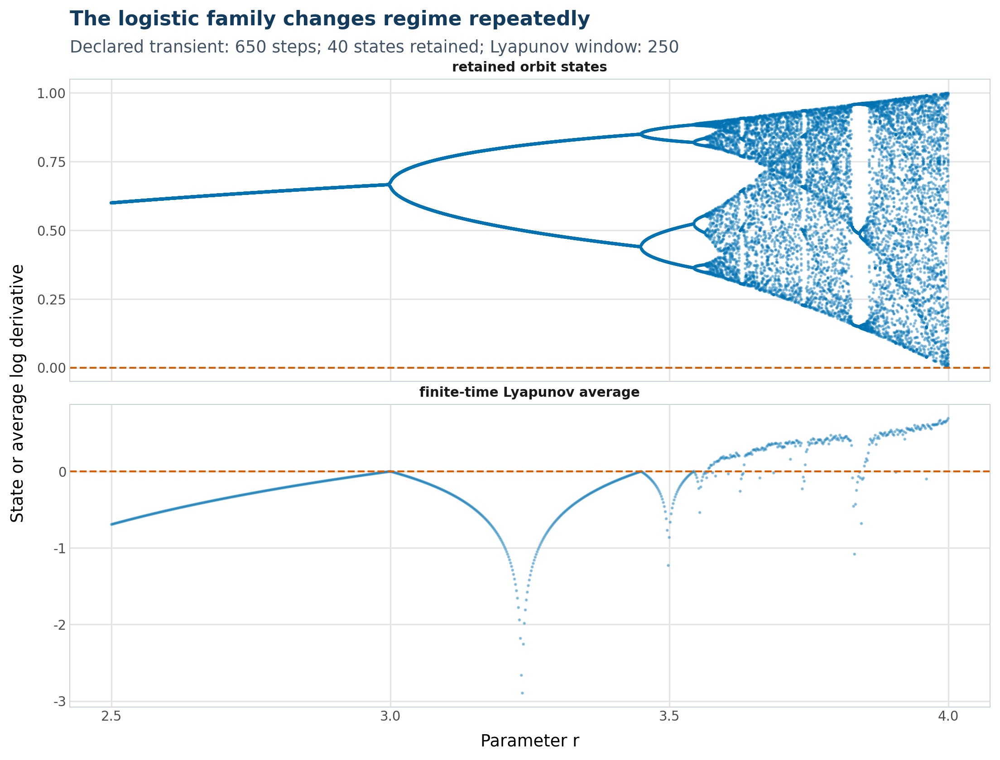

# Bifurcations, Chaos, and Fractals {#sec-bifurcations-chaos}

A deterministic rule can generate behavior that looks random. A tiny parameter
change can create a new equilibrium, split one cycle into two, or destroy
long-term predictability. Dynamical systems use calculus to distinguish these
phenomena from numerical artefacts.

We begin with iteration of a function, so only functions, graphs, and
derivatives are needed. Chapters [sec-phase-space](17-phase-space.md#sec-phase-space) and
[sec-discrete-calculus](19-discrete-calculus.md#sec-discrete-calculus) offer earlier routes, but the repair kit below is
self-contained.

## Orbits and fixed points

Given a map $f$, choose $x_0$ and define

$$
x_{n+1}=f(x_n).
$$

The sequence $(x_n)$ is the **orbit**. A fixed point $x^\ast$ satisfies
$f(x^\ast)=x^\ast$. A point has period $k$ if

$$
f^k(x)=x
$$

and no smaller positive iterate returns it.

A cobweb diagram alternates vertically from $(x_n,x_n)$ to
$(x_n,f(x_n))$ and horizontally to the diagonal at
$(x_{n+1},x_{n+1})$. It is a graphical execution trace, not a proof about all
starting values.

For a differentiable map, write $x=x^\ast+e$. Linearisation gives

$$
f(x)-x^\ast=f'(x^\ast)e+o(|e|).
$$

If $|f'(x^\ast)|<1$, nearby errors shrink and the fixed point is locally
attracting. If $|f'(x^\ast)|>1$, they grow and it is repelling. The borderline
$|f'|=1$ requires higher-order analysis.

For a $k$-cycle $x_0,\ldots,x_{k-1}$, its multiplier is

$$
(f^k)'(x_0)=\prod_{j=0}^{k-1}f'(x_j).
$$

Its magnitude determines local attraction exactly as for a fixed point.

## Families and bifurcations

A parameter-dependent system is written

$$
x'=F(x,\mu)
\quad\text{or}\quad
x_{n+1}=f_\mu(x_n).
$$

A **bifurcation** is a qualitative change in invariant objects or their
stability as $\mu$ passes a critical value.

### Saddle-node

The normal form

$$
x'=\mu-x^2
$$

has no equilibrium for $\mu<0$, one nonhyperbolic equilibrium at $\mu=0$, and
two equilibria $\pm\sqrt\mu$ for $\mu>0$. Since
$F_x=-2x$, the positive branch is stable and the negative branch unstable.
Two equilibria are born together.

### Transcritical

For

$$
x'=\mu x-x^2=x(\mu-x),
$$

the branches $x=0$ and $x=\mu$ cross and exchange stability.

### Pitchfork

For

$$
x'=\mu x-x^3,
$$

$x=0$ changes stability at zero and two symmetric equilibria
$x=\pm\sqrt\mu$ appear for $\mu>0$. The symmetry $x\mapsto-x$ explains the
paired branches. A generic perturbation can unfold the pitchfork into
saddle-node behavior.

Normal forms describe local behavior after smooth coordinate and parameter
changes. They do not determine global dynamics far from the bifurcation.

## The logistic family

The logistic map is

$$
f_r(x)=rx(1-x),\qquad 0\le x\le1,\quad0\le r\le4.
$$

Its fixed points satisfy

$$
x=rx(1-x),
$$

so $x=0$ and, for $r\ne0$,

$$
x^\ast=1-\frac1r.
$$

At zero, $f_r'(0)=r$, so zero is attracting for $0<r<1$. At the nonzero point,

$$
f_r'(x^\ast)=2-r,
$$

which has magnitude below one for $1<r<3$. At $r=3$, the multiplier reaches
$-1$ and a stable period-two orbit emerges. Further increases trigger a
period-doubling cascade.

To find the two-cycle, solve $f_r^2(x)=x$ and remove the fixed-point factors.
Stability uses the product
$f_r'(x_1)f_r'(x_2)$, not either derivative alone.

<figure id="fig-logistic-bifurcation">


<figcaption>

Figure 34.1: The logistic family passes through fixed, periodic, and chaotic-looking regimes as the parameter changes.

</figcaption>
</figure>

[Figure 34.1](#fig-logistic-bifurcation) discards a declared transient and plots finitely many
iterates. Dense ink is not a proof of chaos, and blank pixels are not proof that
a value never occurs.

## Worked derivation: the first logistic two-cycle

The phrase “a two-cycle appears” should be supported by algebra. A point on a
two-cycle satisfies $f_r^2(x)=x$, but that equation also contains both fixed
points. Expanding and factoring gives

$$
f_r^2(x)-x
=-x\bigl(rx-r+1\bigr)
\left(r^2x^2-r(r+1)x+r+1\right).
$$

The first two factors give $x=0$ and $x=1-1/r$. The genuinely period-two
points are the roots of the quadratic:

$$
x_\pm
=\frac{r+1\pm\sqrt{(r-3)(r+1)}}{2r}.
$$

They are distinct real points when $r>3$ in the parameter range under
discussion. At $r=3$ they coincide with the nonzero fixed point, which is why
the new orbit is born there rather than arriving from a distant part of state
space. Substitution into $f_r$ interchanges $x_+$ and $x_-$.

Existence does not imply attraction. The two-cycle multiplier is

$$
m_2=f_r'(x_+)f_r'(x_-)
=r^2(1-2x_+)(1-2x_-).
$$

From the quadratic formula,

$$
x_++x_- = \frac{r+1}{r},
\qquad
x_+x_- = \frac{r+1}{r^2}.
$$

Therefore

$$
\begin{aligned}
m_2
&=r^2\left[1-2(x_++x_-)+4x_+x_-\right]\\
&=-r^2+2r+4.
\end{aligned}
$$

The attraction condition $|m_2|<1$ becomes

$$
3<r<1+\sqrt6\approx3.44949.
$$

At the upper endpoint the multiplier reaches $-1$, signalling the next
period-doubling. For example, at $r=3.2$ the points are approximately
$0.5130$ and $0.7995$, and $m_2=0.16$. A direct numerical orbit should
alternate near those two values after a transient. Algebra establishes the
orbit and local stability; iteration illustrates which initial values enter
its basin and how quickly.

This derivation also demonstrates a common counting error. Solving
$f^2(x)=x$ finds points whose period *divides* two. Only after removing fixed
points and verifying that the remaining roots are distinct can one call them a
period-two orbit.

## Lyapunov exponents

For a one-dimensional orbit avoiding critical derivative zeros, the finite-time
Lyapunov average is

$$
\lambda_N(x_0)
=\frac1N\sum_{n=0}^{N-1}\log|f'(x_n)|.
$$

By the chain rule,

$$
\frac1N\log|(f^N)'(x_0)|=\lambda_N(x_0).
$$

If a limiting exponent $\lambda>0$ exists, infinitesimal perturbations typically
grow like $e^{\lambda N}$ until nonlinear saturation. A rough forecast horizon
from initial uncertainty $\delta_0$ and acceptable uncertainty $\Delta$ is

$$
N\approx\frac{\log(\Delta/\delta_0)}{\lambda}.
$$

A positive finite-time estimate can be distorted by transients, periodic
windows, rounding, or an atypical orbit. The mathematical definition must state
the invariant measure or initial condition and the limiting process.

## Worked predictability audit

For the tent map, every differentiable branch has $|T'(x)|=2$. An orbit that
never lands on the corner or an endpoint therefore has

$$
\lambda_N=\frac1N\sum_{n=0}^{N-1}\log2=\log2
$$

for every $N$. Suppose the initial state is known only to
$\delta_0=10^{-8}$ and a forecast is useful while uncertainty remains below
$\Delta=10^{-1}$. The tangent-growth estimate gives

$$
N\approx
\frac{\log(10^{-1}/10^{-8})}{\log2}
=\frac{7\log10}{\log2}
\approx23.25.
$$

Thus about twenty-three iterates are plausible before the uncertainty reaches
the declared macroscopic scale. This is not a claim that the twenty-fourth
state is literally random. It says that the requested point forecast is no
longer supported by the stated input precision under the tangent model.
Distributional or ensemble predictions may remain useful much longer.

A numerical experiment should evolve both a reference initial value and a
nearby value, record

$$
d_n=|x_n-\widetilde x_n|,
$$

and fit a slope only while $d_n$ is well above roundoff and well below the
diameter of the state space. Once separation is order one, it cannot continue
as $e^{\lambda n}$ because the interval is bounded; the curve saturates. At the
other end, subtracting nearly equal floating-point numbers can contaminate the
first few logarithms. A straight segment chosen after looking at the answer is
not an independent estimate unless the fitting window and exclusion rules are
reported.

For the logistic map, an iterate can land close to the critical point
$x=1/2$, where $f_r'(x)=0$ and the logarithm is very negative. That is part of
the dynamics, not a value to discard silently. Exact landing makes the
finite-time expression $-\infty$; near landing creates a large finite
contribution. A robust report states how derivative zeros, escape, transients,
and multiple initial conditions were handled.

## Sensitive dependence and chaos

Different definitions of chaos emphasise different properties. On a compact
invariant set, one common package includes:

- sensitive dependence on initial conditions;
- topological transitivity, meaning open regions eventually overlap under
  iteration;
- dense periodic points.

Devaney chaos uses the latter two, with sensitivity then following under mild
conditions. Positive metric entropy or a positive Lyapunov exponent is related
but not identical. A responsible statement names its definition.

The **tent map**

$$
T(x)=
\begin{cases}
2x,&0\le x\le1/2,\\
2(1-x),&1/2\le x\le1
\end{cases}
$$

has a transparent binary symbolic coding. Except for endpoint ambiguities,
each iterate shifts a binary digit. Two points sharing $N$ initial digits stay
close for about $N$ steps, then may separate macroscopically.

## Symbolic dynamics and entropy

Partition the state space into labeled regions and record the label visited at
each time. Not every symbolic word must be realisable; forbidden transitions
form a finite directed graph in simple systems.

For a shift with $a_N$ allowed words of length $N$, topological entropy is

$$
h_{\mathrm{top}}=\lim_{N\to\infty}\frac1N\log a_N
$$

when the limit exists. A full shift on $k$ symbols has $a_N=k^N$ and entropy
$\log k$. For a finite transition matrix $M$, entropy is
$\log\rho(M)$, where $\rho(M)$ is its spectral radius.

Entropy measures exponential information growth. It does not equal visual
irregularity or the Shannon entropy of one finite histogram.

## Iterated function systems and fractals

An iterated function system contains contractions
$S_1,\ldots,S_m$ on a complete metric space. On compact sets, define

$$
\mathcal S(K)=S_1(K)\cup\cdots\cup S_m(K).
$$

With the Hausdorff metric, $\mathcal S$ is a contraction, so it has a unique
compact fixed set $K^\ast$. This proves existence of the attractor.

For similarity ratios $r_i$ satisfying an open-set separation condition, the
similarity dimension $s$ solves

$$
\sum_{i=1}^m r_i^s=1.
$$

For the Cantor set, $2(1/3)^s=1$. For the Sierpiński triangle,
$3(1/2)^s=1$, giving $s=\log3/\log2$.

Overlaps can make the actual dimension smaller than the similarity prediction.
A finite box-count regression is an estimator, not the defining limit.

The Cantor calculation can also be read directly from scale. After $k$ stages
there are $2^k$ surviving intervals, each of length $3^{-k}$. If
$\varepsilon=3^{-k}$, the number of intervals needed to cover the set at that
construction scale is $N(\varepsilon)=2^k$. Hence

$$
\frac{\log N(\varepsilon)}{\log(1/\varepsilon)}
=\frac{k\log2}{k\log3}
=\frac{\log2}{\log3}.
$$

For a measured object, however, one does not have infinitely many exact scales.
Pixel size sets a lower cutoff, the field of view sets an upper cutoff, and
noise changes which boxes appear occupied. A reported “fractal dimension”
should include the scale interval, grid offsets, regression residuals, and a
comparison with nonfractal alternatives. A high fitted slope over less than a
decade of scale is weak evidence.

## Continuous-time chaos

An autonomous one-dimensional ODE cannot have chaotic recurrent motion: its
solutions move monotonically between equilibria. Two-dimensional continuous
flows also face strong restrictions. Three dimensions permit stretching and
folding.

The Lorenz equations are

$$
\begin{aligned}
x'&=\sigma(y-x),\\
y'&=x(\rho-z)-y,\\
z'&=xy-\beta z.
\end{aligned}
$$

For classical parameters, numerical trajectories alternate between two lobes.
A Poincaré section turns crossings of a surface into a lower-dimensional
return map. The projected butterfly is useful but hides time, nearby
trajectories, and numerical error.

Rigorous chaos results use trapping regions, invariant manifolds, symbolic
coding, computer-assisted interval bounds, or geometric Lorenz models—not a
single trajectory screenshot.

## Computation protocol

A reproducible bifurcation study records:

1. parameter range and resolution;
2. initial conditions and transient length;
3. number of retained iterates;
4. floating-point type and escape rules;
5. Lyapunov treatment at derivative zeros;
6. tests with multiple starting values;
7. refinement and known analytical thresholds.

Near a stable cycle, an insufficient transient paints false bands. Near chaos,
finite precision eventually makes every computed orbit periodic because the
machine has finitely many states.

<div class="callout callout-warning">
<p class="callout-title">Deterministic is not predictable</p>

Determinism means the rule fixes the next state. Predictability asks whether
finite-precision knowledge remains accurate for the desired time. Positive
Lyapunov growth can destroy the second without changing the first.

</div>

## Theorem and numerical-scope clinic

Four levels of statement are easy to mix.

First, a derivative calculation such as $|f'(x^\ast)|<1$ proves local
attraction under differentiability. It says nothing by itself about the size of
the basin. Second, a finite orbit approaching a cycle is evidence for that
initial condition and arithmetic; it is not proof that all nearby points
converge. Third, a bifurcation diagram is a sampling protocol. It may miss a
coexisting attractor if every parameter uses the same starting point. Fourth,
a theorem about chaos names an invariant set and a definition. “The plot looks
irregular” belongs to none of those theorem categories.

For Exercise 3, $x'=\mu+x^2$ has equilibria only when $\mu\le0$:

$$
x_\pm=\pm\sqrt{-\mu}.
$$

Since $F_x=2x$, the negative branch is stable and the positive branch is
unstable. At $\mu=0$ they collide at a nonhyperbolic equilibrium and disappear
for positive $\mu$. This is the saddle-node normal form with parameter direction
reversed from $x'=\mu-x^2$.

For Exercise 8, the transition matrix

$$
M=\begin{pmatrix}1&1\\1&0\end{pmatrix}
$$

has characteristic equation $\lambda^2-\lambda-1=0$. Its spectral radius is
$\phi=(1+\sqrt5)/2$, so the topological entropy is $\log\phi$. The matrix
counts allowed symbolic paths; it does not assert that an arbitrary measured
time series has that entropy unless a valid generating partition and model
link have been established.

For Exercise 10, a deterministic machine update acts on a finite set of stored
states. Once a state repeats, every later state repeats because the update rule
is deterministic. The pigeonhole principle therefore guarantees eventual
periodicity. The possible period may be enormous, and the machine cycle need
not approximate any periodic orbit of the real-number system. Increasing
precision delays some repetitions but does not turn a finite computation into
an infinite-precision proof.

<!-- inline-formula-code:start -->
## Formula and finite computation

A useful formula in this chapter is

$$
x_{n+1}=r x_n(1-x_n)
$$

A bounded recurrence generates an orbit and a finite Lyapunov ledger. The following standalone Python block expresses that finite rule with its inputs and stopping conditions visible.

```python
from math import log

rate, state = 3.9, 0.2
orbit: list[float] = []
log_derivatives: list[float] = []
for _ in range(100):
    state = rate * state * (1.0 - state)
    orbit.append(state)
    log_derivatives.append(log(abs(rate * (1.0 - 2.0 * state))))
print(orbit[-5:], sum(log_derivatives) / len(log_derivatives))
```

**What the computation establishes.** The output certifies only the declared finite case. The theorem, if one is claimed, still requires the argument developed in the chapter.
<!-- inline-formula-code:end -->

## Summary and vocabulary

Derivatives classify local stability. Bifurcations alter equilibria or cycles
as parameters move. Lyapunov exponents measure tangent growth, symbolic dynamics
counts admissible patterns, and contraction theory constructs self-similar
attractors. Numerical plots explore these objects but need mathematical and
computational audits.

## Exercises and support

<div class="exercise" id="calculus-34-bifurcations-chaos-ex-1">
<p class="exercise-title"><strong>Exercise 1</strong></p>

Classify fixed points of $f(x)=x^2$ on $[0,1]$.

</div>

<div class="exercise" id="calculus-34-bifurcations-chaos-ex-2">
<p class="exercise-title"><strong>Exercise 2</strong></p>

Draw a cobweb for $f(x)=\cos x$ and prove a contraction on a suitable
interval.

</div>

<div class="exercise" id="calculus-34-bifurcations-chaos-ex-3">
<p class="exercise-title"><strong>Exercise 3</strong></p>

Analyse equilibria and stability for $x'=\mu+x^2$.

</div>

<div class="exercise" id="calculus-34-bifurcations-chaos-ex-4">
<p class="exercise-title"><strong>Exercise 4</strong></p>

Derive the logistic nonzero fixed point and its stability interval.

</div>

<div class="exercise" id="calculus-34-bifurcations-chaos-ex-5">
<p class="exercise-title"><strong>Exercise 5</strong></p>

Factor $f_r^2(x)-x$ to isolate the period-two points.

</div>

<div class="exercise" id="calculus-34-bifurcations-chaos-ex-6">
<p class="exercise-title"><strong>Exercise 6</strong></p>

Compute finite-time Lyapunov averages for a fixed orbit using two precisions.

</div>

<div class="exercise" id="calculus-34-bifurcations-chaos-ex-7">
<p class="exercise-title"><strong>Exercise 7</strong></p>

Show how the tent map shifts binary digits away from ambiguous endpoints.

</div>

<div class="exercise" id="calculus-34-bifurcations-chaos-ex-8">
<p class="exercise-title"><strong>Exercise 8</strong></p>

Compute entropy for the transition graph with matrix
$\begin{pmatrix}1&1\\1&0\end{pmatrix}$.

</div>

<div class="exercise" id="calculus-34-bifurcations-chaos-ex-9">
<p class="exercise-title"><strong>Exercise 9</strong></p>

Find the similarity dimension of four copies scaled by $1/3$ and state the
separation assumption.

</div>

<div class="exercise" id="calculus-34-bifurcations-chaos-ex-10">
<p class="exercise-title"><strong>Exercise 10</strong></p>

Explain why a computer orbit in finite-precision arithmetic is eventually
periodic.

</div>

<div class="exercise" id="calculus-34-bifurcations-chaos-ex-11">
<p class="exercise-title"><strong>Exercise 11</strong></p>

Compare two transient lengths in a logistic bifurcation diagram.

</div>

<div class="exercise" id="calculus-34-bifurcations-chaos-ex-12">
<p class="exercise-title"><strong>Exercise 12</strong></p>

Design a claim ledger separating observed periodicity, proved local
stability, and proved chaos.

</div>

For Exercise 1, zero attracts points in $[0,1)$ while one is repelling from the
left. For Exercise 8, use the golden-ratio spectral radius. For Exercise 10,
apply the pigeonhole principle to the finite machine state set.
