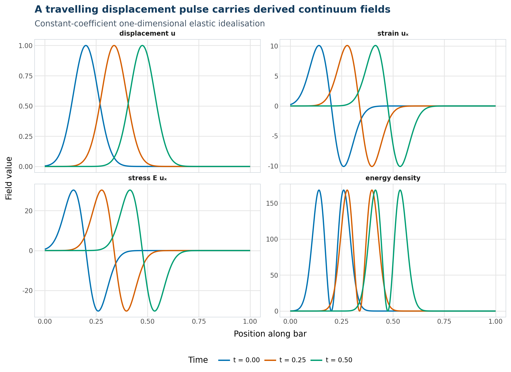

# Tensor Calculus and Continuum Mechanics {#sec-tensor-continuum}

A bridge, fluid, or elastic tissue contains too many particles to track
individually. Continuum mechanics replaces them by fields: density,
displacement, velocity, stress, and temperature at every point. Tensor calculus
keeps those field equations independent of the coordinate system used to
compute them.

No prior tensor course is assumed. Vectors and matrices from
[sec-calculus-linear-algebra](32-linear-algebra-data.md#sec-calculus-linear-algebra) are rebuilt briefly, and every index is explained
before it is summed.

## What is a tensor?

A scalar is unchanged by rotating coordinates. A geometric vector is the same
arrow in space although its component list changes. A second-order tensor is a
linear map that sends vectors to vectors.

Choose an orthonormal basis $e_1,e_2,e_3$. A vector is

$$
v=v_i e_i,
$$

where the repeated index $i$ means sum from $1$ to $3$—the **Einstein
summation convention**. A tensor $A$ has components $A_{ij}$ and acts by

$$
(Av)_i=A_{ij}v_j.
$$

Under a rotation $Q$, components transform as

$$
v'_i=Q_{ij}v_j,
\qquad
A'_{ij}=Q_{ik}Q_{jl}A_{kl},
$$

or in matrix notation $A'=QAQ^T$. This transformation law, not merely a
rectangular array of numbers, makes $A$ a tensor.

The trace and determinant are invariant under rotation:

$$
\operatorname{tr}(QAQ^T)=\operatorname{tr}A,
\qquad
\det(QAQ^T)=\det A.
$$

They describe the physical object independently of axes.

## Tensor operations and decomposition

The outer product $a\otimes b$ is the tensor with components

$$
(a\otimes b)_{ij}=a_i b_j.
$$

Its action is $(a\otimes b)v=a(b\cdot v)$. The double contraction is

$$
A:B=A_{ij}B_{ij}=\operatorname{tr}(A^TB).
$$

Every square tensor splits into symmetric and skew parts:

$$
A=\frac12(A+A^T)+\frac12(A-A^T).
$$

The symmetric part stretches; the skew part represents infinitesimal rotation.
Every symmetric tensor has an orthonormal eigenbasis. Its eigenvalues are
principal values and eigenvectors principal directions.

In three dimensions, split a symmetric tensor into spherical and deviatoric
parts:

$$
A=\frac13(\operatorname{tr}A)I+
\left(A-\frac13(\operatorname{tr}A)I\right).
$$

The first changes volume uniformly; the trace-free part changes shape.

## Index-notation repair clinic

Index notation is compact only when each index has a clear role. In

$$
w_i=A_{ij}v_j,
$$

$j$ is a **dummy index**: it is repeated and therefore summed. The index $i$ is
free, so the equation represents one statement for each output component. In
three dimensions the first component means

$$
w_1=A_{11}v_1+A_{12}v_2+A_{13}v_3.
$$

Renaming a dummy index changes nothing:
$A_{ij}v_j=A_{ik}v_k$. Renaming a free index on only one side changes the
statement and is invalid. In a well-formed monomial, a dummy index appears
exactly twice. An expression such as $A_{ij}v_jw_j$ is ambiguous because the
index $j$ appears three times; write an explicit sum or introduce different
indices.

The contraction

$$
A_{ij}B_{jk}
$$

has free indices $i,k$ and is the $(i,k)$ component of $AB$. By contrast,
$A_{ij}B_{ij}$ has no free index and is a scalar, namely $A:B$. The order of
indices records which slots are paired; it is not decorative typography.

Units survive contractions. If stress $\sigma_{ij}$ has units of force per
area and $n_j$ is a dimensionless unit normal, then
$t_i=\sigma_{ij}n_j$ has force-per-area units. If a formula added
$\sigma_{ij}$ to $v_i$, no rearrangement of indices could repair the physical
unit mismatch.

There is also a difference between an equation valid in one Cartesian frame
and a tensor identity. Component calculations may use a convenient rotated
basis, but both sides must transform by the same rule. Trace, determinant,
eigenvalues of a symmetric tensor, and scalar contractions are useful because
they do not depend on which orthonormal axes were chosen.

## Differentiating fields

For a scalar field $\phi(x)$,

$$
(\nabla\phi)_i=\frac{\partial\phi}{\partial x_i}.
$$

For a vector field $v$,

$$
(\nabla v)_{ij}=\frac{\partial v_i}{\partial x_j},
\qquad
\operatorname{div}v=\frac{\partial v_i}{\partial x_i}.
$$

For a tensor field $A$,

$$
(\operatorname{div}A)_i
=\frac{\partial A_{ij}}{\partial x_j}.
$$

Different books transpose the vector-gradient convention. The formula must be
declared before using identities.

If a material particle follows $x(t)$ with $x'=v(t,x)$, then a field
$\phi(t,x)$ changes along the particle at rate

$$
\frac D{Dt}\phi
=\frac{\partial\phi}{\partial t}+v\cdot\nabla\phi.
$$

This **material derivative** combines local time change and transport through
spatial variation.

The divergence theorem converts a boundary flux to volume production:

$$
\int_{\partial\Omega}v\cdot n\,dS
=\int_\Omega\operatorname{div}v\,dx.
$$

Applied row by row, it also handles tensor fluxes.

## Motion and deformation

Label each material particle by a reference coordinate $X$. A motion is

$$
x=\chi(X,t).
$$

The deformation gradient is

$$
F=\frac{\partial\chi}{\partial X},
\qquad
J=\det F.
$$

A small reference line $dX$ becomes $dx=F\,dX$, and a small volume scales by
$J$. Physical orientation-preserving motion requires $J>0$.

Rigid rotation has $F=Q$ and should produce no strain. Therefore $F-I$ is not
an objective finite-strain measure. The right Cauchy–Green tensor

$$
C=F^TF
$$

removes the rotation, and the Green–Lagrange strain is

$$
E=\frac12(C-I).
$$

For small displacement $u(x)$, linearise to the infinitesimal strain

$$
\varepsilon
=\frac12(\nabla u+\nabla u^T).
$$

The neglected quadratic term is small only when displacement gradients are
small; large rotations can invalidate linear strain even when material stretch
is small.

## Worked deformation clinic: simple shear

Consider a two-dimensional motion

$$
\chi(X,Y)=(X+\gamma Y,Y),
$$

where the dimensionless parameter $\gamma$ measures shear. A material square
becomes a parallelogram. Differentiating each current coordinate with respect
to each reference coordinate gives

$$
F=
\begin{pmatrix}
1&\gamma\\
0&1
\end{pmatrix},
\qquad
J=\det F=1.
$$

Thus area is preserved even though angles and line lengths change. The right
Cauchy–Green tensor is

$$
C=F^TF
= \begin{pmatrix}
1&\gamma\\
\gamma&1+\gamma^2
\end{pmatrix},
$$

and the finite strain is

$$
E=\frac12(C-I)
=\frac12
\begin{pmatrix}
0&\gamma\\
\gamma&\gamma^2
\end{pmatrix}.
$$

The displacement is $u=(\gamma Y,0)$, so its gradient and infinitesimal strain
are

$$
\nabla u=
\begin{pmatrix}0&\gamma\\0&0\end{pmatrix},
\qquad
\varepsilon=
\frac12
\begin{pmatrix}0&\gamma\\\gamma&0\end{pmatrix}.
$$

Linear strain drops the $\gamma^2/2$ term. When $|\gamma|\ll1$, that term is
small relative to the shear terms. When $\gamma$ is order one, omitting it is
not justified merely because the material has not changed area. The
determinant checks volume change; it does not measure every distortion.

Now superimpose a rigid rotation $Q$ on the deformed configuration. The new
gradient is $\widetilde F=QF$, but

$$
\widetilde F^T\widetilde F=F^TQ^TQF=F^TF=C.
$$

This calculation is the concrete meaning of objectivity for this strain
measure: changing the observer by a rigid rotation does not change the measured
stretch.

The matrix formulas can be evaluated without suppressing their geometric
roles. Here the parameter name deformation_gradient carries the meaning that
the one-letter symbol $F$ carries in the equations:

```python
import numpy as np
from numpy.typing import NDArray

def strain_measures(
    deformation_gradient: NDArray[np.float64],
) -> tuple[NDArray[np.float64], NDArray[np.float64], float]:
    """Return finite strain, linearized strain, and volume ratio."""
    if deformation_gradient.shape != (2, 2):
        raise ValueError("this example requires a two-by-two gradient")
    volume_ratio = float(np.linalg.det(deformation_gradient))
    if volume_ratio <= 0.0:
        raise ValueError("the deformation must preserve orientation")
    identity = np.eye(2)
    right_cauchy_green = deformation_gradient.T @ deformation_gradient
    green_lagrange = 0.5 * (right_cauchy_green - identity)
    displacement_gradient = deformation_gradient - identity
    infinitesimal = 0.5 * (
        displacement_gradient + displacement_gradient.T
    )
    return green_lagrange, infinitesimal, volume_ratio

for shear_amount in (0.05, 0.5, 1.0):
    gradient = np.array([[1.0, shear_amount], [0.0, 1.0]])
    finite_strain, linear_strain, volume_ratio = strain_measures(gradient)
    print(shear_amount, volume_ratio)
    print("finite", finite_strain)
    print("linear", linear_strain)
```

The output isolates the quadratic normal-strain term discarded by
linearization while confirming $J=1$. It checks three homogeneous finite
deformations; it does not establish constitutive behavior or small-strain
validity for a spatially varying body.

## Conservation of mass

Let $\rho(t,x)$ be mass per current volume and $v$ velocity. For every material
region $\Omega(t)$,

$$
\frac d{dt}\int_{\Omega(t)}\rho\,dx=0.
$$

The transport theorem converts this integral law to

$$
\frac{\partial\rho}{\partial t}
+\operatorname{div}(\rho v)=0.
$$

Equivalently,

$$
\frac{D\rho}{Dt}+\rho\,\operatorname{div}v=0.
$$

If density is constant along motion, then $\operatorname{div}v=0$, the
incompressibility constraint.

In reference coordinates, mass conservation gives

$$
\rho(\chi(X,t),t)J(X,t)=\rho_0(X).
$$

This identity is also a units and implementation check.

## Stress and momentum balance

The traction $t(n)$ is force per area acting across a surface with unit normal
$n$. Cauchy's tetrahedron argument, using force balance on a shrinking
tetrahedron, shows traction depends linearly on the normal:

$$
t(n)=\sigma n,
$$

where $\sigma$ is the Cauchy stress tensor.

Balance of linear momentum on every material region yields

$$
\rho\frac{Dv}{Dt}
=\operatorname{div}\sigma+\rho b,
$$

where $b$ is body force per unit mass. Balance of angular momentum, absent
couple stresses, implies

$$
\sigma=\sigma^T.
$$

Boundary conditions prescribe either velocity/displacement or traction on
appropriate boundary pieces. Prescribing both arbitrarily overdetermines the
problem; prescribing neither can leave rigid motions undetermined.

## From integral momentum to a local equation

The local momentum equation is best remembered by deriving it. For a material
region $\Omega(t)$, total momentum is

$$
\int_{\Omega(t)}\rho v\,dx.
$$

Surface forces contribute traction $\sigma n$, while a body force $b$ per unit
mass contributes $\rho b$ per unit volume. Newton's law for the whole region is

$$
\frac d{dt}\int_{\Omega(t)}\rho v\,dx
=\int_{\partial\Omega(t)}\sigma n\,dS
+\int_{\Omega(t)}\rho b\,dx.
$$

The transport theorem and mass conservation turn the left side into
$\int_{\Omega(t)}\rho Dv/Dt\,dx$. Applying the divergence theorem row by row
to the surface term gives

$$
\int_{\Omega(t)}
\left(\rho\frac{Dv}{Dt}-\operatorname{div}\sigma-\rho b\right)dx=0.
$$

If the fields are sufficiently regular and this holds for every small material
region, the integrand must vanish, yielding the local balance. This last step
is a localisation argument; one cannot infer a pointwise equation from one
single large control volume.

Every term has units of force per current volume. In SI units,

$$
[\rho Dv/Dt]
=\frac{\mathrm{kg}}{\mathrm m^3}\frac{\mathrm m}{\mathrm s^2}
=\frac{\mathrm N}{\mathrm m^3}.
$$

Stress has units $\mathrm N/\mathrm m^2$, so one spatial derivative in
$\operatorname{div}\sigma$ supplies another factor $1/\mathrm m$. Body force
$b$ is acceleration, making $\rho b$ agree. A source that treats $b$ as force
per volume instead must omit the factor $\rho$; conventions are acceptable
only when definitions and units match.

## Constitutive laws

Balance laws are universal but not closed: stress needs a material model.

For small-strain isotropic linear elasticity,

$$
\sigma=\lambda\,\operatorname{tr}(\varepsilon)I+2\mu\varepsilon,
$$

where $\lambda,\mu$ are Lamé parameters and $\mu>0$ is shear modulus. Equivalent
parameters are Young's modulus $E_Y$ and Poisson ratio $\nu$. Positivity
conditions ensure stored energy

$$
W(\varepsilon)
=\frac\lambda2(\operatorname{tr}\varepsilon)^2
+\mu\,\varepsilon:\varepsilon
$$

does not decrease without bound.

For a Newtonian fluid,

$$
\sigma=-pI+2\mu D,
\qquad
D=\frac12(\nabla v+\nabla v^T).
$$

For spatially constant, nonnegative fluid viscosity, combining this stress with incompressible momentum balance gives the Navier–Stokes specialization below. With spatially varying viscosity, retain the divergence of the viscous stress; the product rule adds twice the rate of deformation tensor applied to the viscosity gradient.

$$
\rho\left(\frac{\partial v}{\partial t}+v\cdot\nabla v\right)
=-\nabla p+\mu\Delta v+\rho b,
\qquad
\operatorname{div}v=0.
$$

The same symbol $\mu$ is traditionally used for elastic shear modulus and
fluid viscosity; units distinguish them.

For three-dimensional isotropic linear elasticity, bounded positive strain
energy requires

$$
\mu>0,
\qquad
3\lambda+2\mu>0.
$$

The first condition controls shape-changing shear; the second controls uniform
volume change. As a worked constitutive check, impose the constrained strain

$$
\varepsilon=
\begin{pmatrix}
e&0&0\\
0&0&0\\
0&0&0
\end{pmatrix}.
$$

Then $\operatorname{tr}\varepsilon=e$ and

$$
\sigma=
\begin{pmatrix}
(\lambda+2\mu)e&0&0\\
0&\lambda e&0\\
0&0&\lambda e
\end{pmatrix}.
$$

This is **uniaxial strain**, not uniaxial stress: preventing lateral strain
creates lateral stresses. A tensile test with traction-free sides instead
allows lateral contraction and is described naturally by Young's modulus and
Poisson ratio. Confusing those boundary conditions produces a wrong apparent
modulus even when the tensor algebra is flawless.

## One-dimensional elastic bar

Let $u(x,t)$ be longitudinal displacement of a bar with area $A(x)$,
density $\rho(x)$, and Young's modulus $E(x)$. Small strain is
$\varepsilon=u_x$, stress is $\sigma=Eu_x$, and force on a cross-section is
$A\sigma$. Momentum balance gives

$$
\rho A u_{tt}=(AEu_x)_x+Af.
$$

For constant coefficients and no body force,

$$
u_{tt}=c^2u_{xx},
\qquad
c=\sqrt{\frac E\rho}.
$$

The wave speed has units

$$
\sqrt{\frac{\mathrm{force}/\mathrm{area}}
{\mathrm{mass}/\mathrm{volume}}}
=\frac{\mathrm{length}}{\mathrm{time}}.
$$

Fixed ends give $u=0$; a free end gives traction $EAu_x=0$.

Multiplying by $u_t$ and integrating shows conservation of

$$
\mathcal E(t)
=\frac12\int
\left(\rho A u_t^2+EAu_x^2\right)dx
$$

when boundary work and forcing vanish.

<figure id="fig-continuum-stress-strain">


<figcaption>

Figure 35.1: A travelling elastic pulse carries strain, stress, and kinetic energy through a bar.

</figcaption>
</figure>

[Figure 35.1](#fig-continuum-stress-strain) uses an ideal constant-coefficient solution. Real
bars may disperse, damp, yield, or have variable cross-section.

## Dimensionless groups

Choose characteristic length $L$, speed $U$, time $L/U$, and pressure scale.
Nondimensionalising fluid equations produces the Reynolds number

$$
\operatorname{Re}=\frac{\rho UL}{\mu},
$$

the ratio of inertial to viscous effects. Small $\operatorname{Re}$ suggests
viscous dominance; large $\operatorname{Re}$ permits inertia and often
instability. It does not alone determine turbulence.

Dimensionless formulation reduces units errors, exposes dominant balances, and
helps compare experiments of different scale.

## Model audit

<div class="callout callout-warning">
<p class="callout-title">A continuum is a scale-dependent model</p>

Fields average molecular behavior over small volumes that must still be large
relative to microscopic scales. Near cracks, shocks, rarefied gases, or atomic
interfaces, the model or constitutive law may fail even when the PDE is solved
accurately.

</div>

Check objectivity under rigid motion, units, positivity of density and energy,
initial and boundary compatibility, regularity needed by derivatives, and the
range where the constitutive law was calibrated.

## Selected solution clinic

For Exercise 10, take the constant-coefficient unforced bar equation

$$
\rho A u_{tt}=EAu_{xx}
$$

and multiply by $u_t$. Integration over $0\le x\le L$ gives

$$
\int_0^L\rho A u_{tt}u_t\,dx
=\int_0^L EAu_{xx}u_t\,dx.
$$

The left side is the time derivative of kinetic energy. Integrating the right
side by parts gives

$$
\left[EAu_xu_t\right]_0^L
-\int_0^L EAu_xu_{tx}\,dx.
$$

The last integral is minus the derivative of elastic energy. For fixed ends,
$u=0$ for all time and hence $u_t=0$ at the endpoints. For free ends,
$EAu_x=0$. Either homogeneous boundary condition makes the boundary-power term
vanish, so

$$
\frac d{dt}\frac12\int_0^L
\left(\rho A u_t^2+EAu_x^2\right)dx=0.
$$

With a prescribed moving end or nonzero traction, the boundary term is work
input and energy need not be conserved. The theorem's boundary hypothesis is
part of the result.

For Exercise 11, consider one-dimensional advection–diffusion,

$$
c_t+Uc_x=Dc_{xx},
$$

where $U$ has units length per time and $D$ has units length squared per time.
Set $x=L\xi$ and $t=(L/U)\tau$. After dividing by the common scale $U/L$,

$$
c_\tau+c_\xi=\frac1{\operatorname{Pe}}c_{\xi\xi},
\qquad
\operatorname{Pe}=\frac{UL}{D}.
$$

The Péclet number compares transport by bulk motion with spreading by
diffusion. Large $\operatorname{Pe}$ does not mean diffusion is absent; thin
boundary layers can make the second derivative large enough for the diffusive
term to remain important. A numerical mesh audit must therefore examine local
length scales, not only the global dimensionless number.

## Further connections {#forward-handoff}

[Chapter 42](42-conservation-laws.md) follows a conserved density after smooth
continuum fields develop discontinuities. Integral balances lead to weak
solutions; entropy conditions select the physical branch; finite-volume fluxes
preserve conservation discretely; and traffic flow supplies a complete shock
and mesh-audit clinic.

<!-- inline-formula-code:start -->
## Formula and finite computation

A useful formula in this chapter is

$$
\varepsilon=\tfrac12(\nabla u+\nabla u^{\mathsf T})
$$

Matrix transposition turns a displacement gradient into its symmetric strain tensor. The following standalone Python block expresses that finite rule with its inputs and stopping conditions visible.

```python
import numpy as np

displacement_gradient = np.array([[0.02, 0.04], [-0.01, -0.03]])
strain = 0.5 * (displacement_gradient + displacement_gradient.T)
rotation = 0.5 * (displacement_gradient - displacement_gradient.T)
print(strain)
print(rotation)
```

**What the computation establishes.** The output certifies only the declared finite case. The theorem, if one is claimed, still requires the argument developed in the chapter.
<!-- inline-formula-code:end -->

## Summary and vocabulary

Tensors are coordinate-independent multilinear objects represented by component
arrays. Deformation gradients map material line elements; strain removes rigid
rotation. Integral conservation laws produce mass and momentum PDEs, while
constitutive laws close them for a chosen material.

## Exercises and support

<div class="exercise" id="calculus-35-tensor-continuum-ex-1">
<p class="exercise-title"><strong>Exercise 1</strong></p>

Transform a vector and tensor under a ninety-degree planar rotation and
verify trace invariance.

</div>

<div class="exercise" id="calculus-35-tensor-continuum-ex-2">
<p class="exercise-title"><strong>Exercise 2</strong></p>

Decompose a given matrix into symmetric and skew parts.

</div>

<div class="exercise" id="calculus-35-tensor-continuum-ex-3">
<p class="exercise-title"><strong>Exercise 3</strong></p>

Show that $(a\otimes b)v=a(b\cdot v)$.

</div>

<div class="exercise" id="calculus-35-tensor-continuum-ex-4">
<p class="exercise-title"><strong>Exercise 4</strong></p>

Compute the material derivative of $\phi(t,x)=tx^2$ along $x'=x$.

</div>

<div class="exercise" id="calculus-35-tensor-continuum-ex-5">
<p class="exercise-title"><strong>Exercise 5</strong></p>

Find $F$, $J$, $C$, and $E$ for uniform stretch
$\chi(X)=\lambda X$.

</div>

<div class="exercise" id="calculus-35-tensor-continuum-ex-6">
<p class="exercise-title"><strong>Exercise 6</strong></p>

Show that a rigid rotation has $E=0$.

</div>

<div class="exercise" id="calculus-35-tensor-continuum-ex-7">
<p class="exercise-title"><strong>Exercise 7</strong></p>

Derive the local mass equation from a fixed control volume and flux balance.

</div>

<div class="exercise" id="calculus-35-tensor-continuum-ex-8">
<p class="exercise-title"><strong>Exercise 8</strong></p>

Check units in the momentum equation term by term.

</div>

<div class="exercise" id="calculus-35-tensor-continuum-ex-9">
<p class="exercise-title"><strong>Exercise 9</strong></p>

Find stress for a uniaxial small strain under the isotropic law.

</div>

<div class="exercise" id="calculus-35-tensor-continuum-ex-10">
<p class="exercise-title"><strong>Exercise 10</strong></p>

Derive energy conservation for the elastic bar with fixed ends.

</div>

<div class="exercise" id="calculus-35-tensor-continuum-ex-11">
<p class="exercise-title"><strong>Exercise 11</strong></p>

Nondimensionalise the advection–diffusion equation and identify its
dimensionless ratio.

</div>

<div class="exercise" id="calculus-35-tensor-continuum-ex-12">
<p class="exercise-title"><strong>Exercise 12</strong></p>

List physical situations in which linear elasticity should not be trusted.

</div>

For Exercise 4,
$D\phi/Dt=x^2+2tx^2$. For Exercise 5 in three dimensions,
$F=\lambda I$, $J=\lambda^3$, and
$E=(\lambda^2-1)I/2$. For Exercise 8 every term is force per volume.
