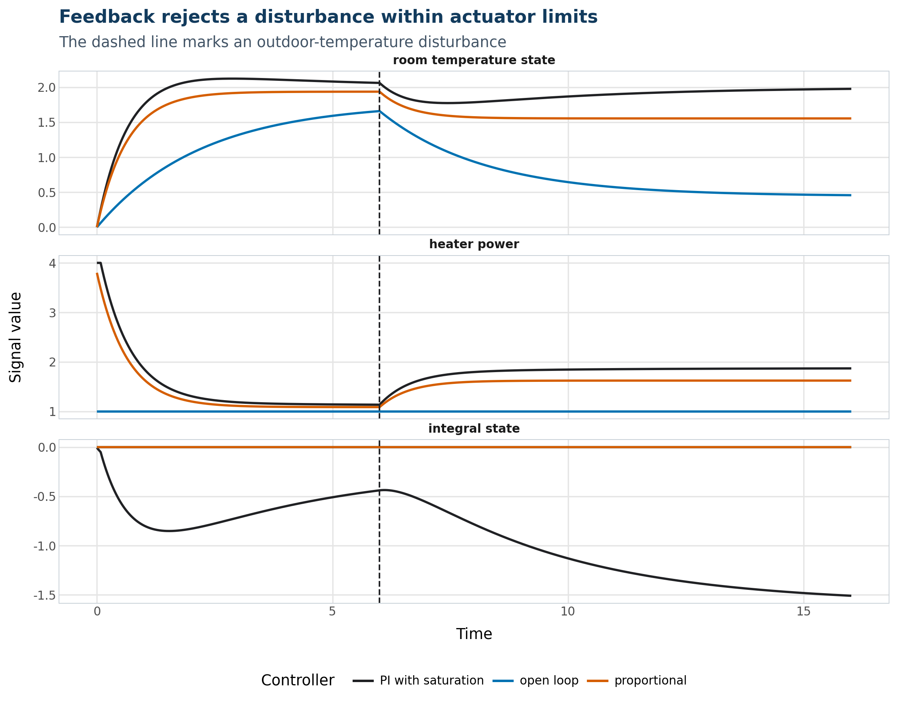

# Control Theory and Optimal Control {#sec-control-theory}

A model predicts what a system will do. A controller chooses inputs so the
system does something desired despite disturbances and imperfect measurements.
Control theory combines differential equations, linear algebra, optimization,
and feedback into a quantitative design discipline.

No engineering course is assumed. We begin with input, state, and output, then
derive controllability, observers, feedback, and trajectory optimization from
small examples.

## States, inputs, and outputs

A continuous-time state-space model is

$$
x'(t)=f(x(t),u(t),t),
\qquad
y(t)=h(x(t),u(t),t).
$$

The state $x$ contains enough information to predict future evolution once the
input $u$ is specified. The output $y$ is what is measured or regulated.

For a heated room:

- $x$ may be indoor temperature;
- $u$ heater power;
- outdoor temperature a disturbance;
- $y$ the thermometer reading.

A linear time-invariant model is

$$
x'=Ax+Bu,\qquad y=Cx+Du.
$$

Matrix dimensions follow from the signal dimensions. Units also constrain
entries: if $x$ is temperature and $u$ power, $B$ has units of temperature
change per time per power.

With zero input, $x(t)=e^{At}x_0$. With input,

$$
x(t)=e^{At}x_0+
\int_0^t e^{A(t-s)}Bu(s)\,ds.
$$

The integral shows how every past input contributes to the current state.

## A thermal model from balance

Let $T$ be indoor temperature, $T_o$ outdoor temperature, $C_h$ thermal
capacity, $R$ thermal resistance, and $u$ heater power. Energy balance gives

$$
C_hT'=-\frac{T-T_o}{R}+u.
$$

Set $x=T-T_o$ when $T_o$ is constant:

$$
x'=-\frac1{RC_h}x+\frac1{C_h}u.
$$

The open-loop time constant is $\tau=RC_h$. A constant input has equilibrium
$x^\ast=Ru$. This simple derivation connects every sign and parameter with
physics.

**Open loop** chooses $u$ without current measurements. **Closed loop** uses
feedback, such as

$$
u=-kx+u_{\mathrm{ref}}.
$$

The closed-loop decay rate becomes
$-(1/(RC_h)+k/C_h)$. Large $k$ speeds ideal response but amplifies noise and
may demand impossible heater power.

## Worked tracking clinic: reference, feedforward, and units

A reference temperature cannot be inserted into a feedback law without
checking the equilibrium input. Let

$$
C_h=2\,\mathrm{kWh}/{}^\circ\mathrm C,
\qquad
R=5\,{}^\circ\mathrm C/\mathrm{kW},
$$

take outdoor temperature $T_o=15\,{}^\circ\mathrm C$, and request
$T_r=20\,{}^\circ\mathrm C$. The open-loop time constant is

$$
RC_h=10\,\mathrm h.
$$

At equilibrium $T'=0$, so the heater must replace the steady heat loss:

$$
u_*=\frac{T_r-T_o}{R}=1\,\mathrm{kW}.
$$

Use proportional feedback around that operating point,

$$
u=u_*-k(T-T_r),
$$

where $k$ has units $\mathrm{kW}/{}^\circ\mathrm C$. Setting
$e=T-T_r$ and substituting the equilibrium relation gives

$$
C_he'=-\left(\frac1R+k\right)e.
$$

For $k=0.4\,\mathrm{kW}/{}^\circ\mathrm C$, the ideal closed-loop time
constant is

$$
\tau_{\mathrm{cl}}
=\frac{C_h}{1/R+k}
=\frac2{0.2+0.4}\,\mathrm h
=\frac{10}{3}\,\mathrm h.
$$

Every addition in $1/R+k$ is dimensionally valid: both terms are power per
degree. If the room starts at outdoor temperature, $e=-5\,{}^\circ\mathrm C$
and the unsaturated command is

$$
u=1-0.4(-5)=3\,\mathrm{kW}.
$$

A $2\,\mathrm{kW}$ heater cannot produce the designed initial response. During
saturation the linear closed-loop pole calculation no longer describes the
trajectory. The honest prediction is piecewise: integrate with $u=2$ until the
command falls below the limit, then use the unsaturated feedback equation.

Feedforward $u_*$ and feedback have different jobs. Feedforward supplies the
nominal equilibrium power; feedback corrects state error and disturbances.
If $R$ or $T_o$ is wrong, proportional feedback generally leaves a steady
offset. Integral action may remove a constant offset, but only if saturation
and anti-windup are handled. This simple case prevents the common error of
crediting a high gain with an equilibrium that was actually supplied by an
unstated constant input.

## Linearisation

Near an equilibrium $(x^\ast,u^\ast)$ satisfying
$f(x^\ast,u^\ast)=0$, write

$$
x=x^\ast+\delta x,\qquad u=u^\ast+\delta u.
$$

Taylor expansion gives

$$
\delta x'
\approx A\delta x+B\delta u,
\qquad
A=f_x(x^\ast,u^\ast),
\qquad
B=f_u(x^\ast,u^\ast).
$$

This model is local. A controller designed from it must be tested over the
claimed operating range. Saturation, friction, and state constraints are often
invisible in the derivative.

## Controllability

Can an input move the state in every direction? For

$$
x'=Ax+Bu,
$$

short-time input effects span columns of

$$
\mathcal C=
\begin{pmatrix}
B&AB&A^2B&\cdots&A^{n-1}B
\end{pmatrix}.
$$

The pair $(A,B)$ is **controllable** exactly when

$$
\operatorname{rank}\mathcal C=n.
$$

The powers arise because dynamics rotate or shear the immediate input
directions. The Cayley–Hamilton theorem ensures higher powers add no new
span.

**Example.** For position and velocity,

$$
x'=
\begin{pmatrix}0&1\\0&0\end{pmatrix}x+
\begin{pmatrix}0\\1\end{pmatrix}u,
$$

we have

$$
\mathcal C=
\begin{pmatrix}0&1\\1&0\end{pmatrix},
$$

so acceleration control reaches both velocity and position.

Controllability is structural and assumes unrestricted inputs over a time
interval. Actuator magnitude constraints change practical reachability.

For a finite state matrix, the controllability formula is executable without
hiding its sequence of directions:

```python
import numpy as np
from numpy.typing import NDArray

def controllability_matrix(
    state_matrix: NDArray[np.float64],
    input_matrix: NDArray[np.float64],
) -> NDArray[np.float64]:
    """Build [B, AB, ..., A^(n-1)B] for a finite linear system."""
    if state_matrix.ndim != 2 or state_matrix.shape[0] != state_matrix.shape[1]:
        raise ValueError("state_matrix must be square")
    state_count = state_matrix.shape[0]
    if input_matrix.ndim != 2 or input_matrix.shape[0] != state_count:
        raise ValueError("input_matrix must have one row per state")
    direction_blocks = []
    propagated_inputs = input_matrix.copy()
    for _ in range(state_count):
        direction_blocks.append(propagated_inputs)
        propagated_inputs = state_matrix @ propagated_inputs
    return np.concatenate(direction_blocks, axis=1)

double_integrator_state = np.array([[0.0, 1.0], [0.0, 0.0]])
acceleration_input = np.array([[0.0], [1.0]])
directions = controllability_matrix(
    double_integrator_state, acceleration_input
)
print(directions)
print("reachable state directions", np.linalg.matrix_rank(directions))
```

The rank computation certifies controllability of this exact two-state matrix
within floating-point tolerance. It does not certify practical reachability
under saturation, delay, noise, or model error.

## Worked two-state design: a double integrator

Let $x_1$ be position in metres, $x_2$ velocity in metres per second, and $u$
acceleration in metres per second squared. Then

$$
x'=
\begin{pmatrix}0&1\\0&0\end{pmatrix}x
+\begin{pmatrix}0\\1\end{pmatrix}u.
$$

The controllability columns are

$$
B=\begin{pmatrix}0\\1\end{pmatrix},
\qquad
AB=\begin{pmatrix}1\\0\end{pmatrix}.
$$

They point in independent state directions, so the rank is two. Physically,
acceleration immediately changes velocity; velocity then accumulates into
position.

Choose $u=-Kx$ with $K=(k_1,k_2)$. The closed-loop matrix is

$$
A-BK=
\begin{pmatrix}0&1\\-k_1&-k_2\end{pmatrix},
$$

whose characteristic polynomial is

$$
\lambda^2+k_2\lambda+k_1.
$$

Desired poles $-2\,\mathrm s^{-1}$ and $-3\,\mathrm s^{-1}$ give desired
polynomial

$$
(\lambda+2)(\lambda+3)=\lambda^2+5\lambda+6.
$$

Matching coefficients yields

$$
k_1=6\,\mathrm s^{-2},
\qquad
k_2=5\,\mathrm s^{-1}.
$$

The units differ because $k_1x_1$ and $k_2x_2$ must both be accelerations. If
the initial error is ten metres with zero velocity, the command is
$-60\,\mathrm m/\mathrm s^2$, more than six times gravitational acceleration.
Pole placement is algebraically possible and physically implausible under an
ordinary actuator. Rescaling coordinates does not remove this effort demand;
it only changes the numerical gain entries.

## Observability {#observability}

Can output measurements reconstruct the initial state? For
$y=Cx$, derivatives at zero give

$$
y(0)=Cx_0,
\qquad
y'(0)=CAx_0,
\qquad\ldots
$$

This creates the observability matrix

$$
\mathcal O=
\begin{pmatrix}
C\\CA\\\vdots\\CA^{n-1}
\end{pmatrix}.
$$

The pair $(C,A)$ is observable exactly when
$\operatorname{rank}\mathcal O=n$. An unobservable direction produces no
output under any zero-input evolution.

Observability and controllability are dual: the observability matrix of
$(C,A)$ is the transpose of the controllability matrix of $(A^T,C^T)$.

Noise makes numerical observability a conditioning question as well as an exact
rank question.

For the same double integrator, measuring position means
$C=(1,0)$. Then

$$
\mathcal O=
\begin{pmatrix}C\\CA\end{pmatrix}
=\begin{pmatrix}1&0\\0&1\end{pmatrix},
$$

so position and its time derivative reveal the two initial-state components in
the ideal noise-free model. Measuring velocity alone gives

$$
C=(0,1),
\qquad
\mathcal O=\begin{pmatrix}0&1\\0&0\end{pmatrix},
$$

which has rank one. A constant shift in initial position never appears in the
velocity output. Sampling a noisy velocity sensor more often cannot identify
that offset without an additional position measurement or prior assumption.

## State feedback and pole placement

Choose

$$
u=-Kx+r.
$$

Then

$$
x'=(A-BK)x+Br.
$$

If $(A,B)$ is controllable, state feedback can place the eigenvalues of
$A-BK$ arbitrarily in the ideal linear model. Desired poles trade settling
speed against control effort, noise sensitivity, and unmodelled dynamics.

For the scalar thermal system $x'=ax+bu$, feedback $u=-kx$ gives pole
$a-bk$. To achieve desired pole $-\gamma$,

$$
k=\frac{a+\gamma}{b}.
$$

This calculation should be followed by a saturation check:
$|u|\le u_{\max}$ may prevent the designed rate for large errors.

Integral action adds a state

$$
z' = y-r
$$

and feeds back $z$. It can remove steady error under constant disturbances, but
actuator saturation can cause **integrator windup**. Anti-windup logic is part
of the controller, not a plotting option.

## Observers

If the full state is not measured, a Luenberger observer is

$$
\widehat x'
=A\widehat x+Bu+L(y-C\widehat x).
$$

The estimation error $e=x-\widehat x$ satisfies

$$
e'=(A-LC)e.
$$

When $(C,A)$ is observable, choose $L$ so this error decays. Feedback using
$u=-K\widehat x$ has closed-loop poles from both controller and observer under
the separation principle.

The observer is a model-driven filter. Bias or unmodelled inputs can produce
confidently wrong estimates, so residuals $y-C\widehat x$ must be monitored.

## Stability and Lyapunov functions

An equilibrium is stable if small initial errors remain small and
asymptotically stable if they also tend to zero. A **Lyapunov function**
$V(x)$ is positive away from equilibrium and decreases along trajectories.

For $x'=Ax$, seek

$$
V(x)=x^TPx,\qquad P=P^T>0.
$$

Then

$$
\dot V=x^T(A^TP+PA)x.
$$

If for some $Q=Q^T>0$,

$$
A^TP+PA=-Q,
$$

then $\dot V=-x^TQx<0$. A matrix $A$ has eigenvalues with negative real parts
exactly when this Lyapunov equation has a positive definite solution for every
positive definite $Q$.

Lyapunov functions extend beyond linearisation and can certify a region of
attraction, but finding one is often the hard part.

## Optimal control and the maximum principle

Choose a control path to minimise

$$
J[u]=\Phi(x(T))+
\int_0^T L(x(t),u(t),t)\,dt
$$

subject to $x'=f(x,u,t)$ and constraints. Introduce a costate $p(t)$ and
Hamiltonian

$$
H(x,u,p,t)=L(x,u,t)+p^Tf(x,u,t).
$$

With this sign convention, Pontryagin's maximum principle is often written as
a minimum condition:

$$
x'=H_p,\qquad
p'=-H_x,\qquad
u(t)\in\operatorname*{arg\,min}_{v\in U}H(x,v,p,t),
$$

with a terminal condition from $\Phi$. Texts using $H=p^Tf-L$ state a maximum
instead; conventions must not be mixed.

For minimum fuel with bounded control entering linearly, minimising $H$ often
pushes $u$ to an endpoint of its interval. Such **bang–bang control** switches
when a switching function changes sign. Singular arcs require separate
analysis.

These are necessary conditions, not always sufficient. Convexity can promote
them to global optimality.

## Linear-quadratic regulation

For

$$
x'=Ax+Bu
$$

and quadratic cost

$$
J=\int_0^\infty
\left(x^TQx+u^TRu\right)dt,
\qquad Q\ge0,\ R>0,
$$

try a value function $V(x)=x^TPx$. Dynamic optimization produces the algebraic
Riccati equation

$$
A^TP+PA-PBR^{-1}B^TP+Q=0.
$$

The optimal feedback is

$$
u=-R^{-1}B^TPx.
$$

$Q$ penalises state deviation; $R$ penalises effort. Scaling them changes the
control priorities and must respect physical units. Standard stabilisability
and detectability hypotheses ensure a stabilising solution.

## Scalar Riccati derivation and interpretation

For the scalar system with $b\ne0$,

$$
x'=ax+bu
$$

with cost

$$
J=\int_0^\infty(qx^2+ru^2)dt,
\qquad q>0,
\qquad r>0,
$$

the Riccati equation becomes

$$
2aP-\frac{b^2}{r}P^2+q=0.
$$

Solving the quadratic gives the stabilising nonnegative root

$$
P=\frac r{b^2}
\left(a+\sqrt{a^2+\frac{b^2q}{r}}\right).
$$

The feedback gain and closed-loop pole are

$$
K=\frac{bP}{r}
=\frac1b\left(a+\sqrt{a^2+\frac{b^2q}{r}}\right),
\qquad
a-bK=-\sqrt{a^2+\frac{b^2q}{r}}.
$$

The other algebraic Riccati root does not produce the required stabilising
value function. Increasing $q/r$ moves the ideal pole left: state error is
made expensive relative to effort, so feedback becomes more aggressive. This
comparison is meaningful only after nondimensionalisation or unit-consistent
weights. If $x$ is degrees Celsius and $u$ kilowatts, $q$ and $r$ cannot be
compared as bare numbers without their units and chosen scales.

The Riccati result assumes unlimited input, exact state information, the stated
linear model, and an infinite horizon. Clipping the optimal command preserves
neither the derivation nor guaranteed optimality. It may still be a sensible
implementation, but it needs a separate constrained and robustness analysis.

## Temperature-control case study

Consider the thermal model with outdoor disturbance $d(t)$:

$$
x'=ax+bu+ed,\qquad a<0.
$$

Use measured-state feedback with saturation:

$$
u(t)=\operatorname{clip}
\bigl(-k(x-r)-k_Iz,0,u_{\max}\bigr),
\qquad
z'=x-r.
$$

<figure id="fig-feedback-control">


<figcaption>

Figure 36.1: Feedback shortens recovery from a temperature disturbance, while saturation limits the ideal response.

</figcaption>
</figure>

[Figure 36.1](#fig-feedback-control) reports one deterministic simulation. A complete audit
also varies thermal parameters, sensor noise, time step, and disturbance shape.

Performance measures include rise time, overshoot, settling time, steady error,
integrated error, peak input, and energy. Optimising one can worsen another.

<div class="callout callout-warning">
<p class="callout-title">Closed-loop simulation is not a robustness proof</p>

A controller that works at nominal parameters may destabilise under delay,
unmodelled high-frequency dynamics, or sign error. Stability margins, parameter
sweeps, and physical failsafes are distinct layers of evidence.

</div>

## Implementation and safety audit

A continuous feedback formula is usually implemented by a sampled computer.
The sensor is read, a command is computed, and the actuator holds that command
until the next sample. Sampling introduces a time scale and usually a delay.
A design whose fastest closed-loop time constant is comparable with the sample
period cannot be justified by continuous-time poles alone.

Noise enters differently from a disturbance. A plant disturbance changes the
physical state equation; measurement noise changes the value fed to the
controller. High proportional or derivative gain can turn small sensor noise
into rapidly changing actuator commands. Filtering reduces high-frequency
noise but adds lag. The tradeoff must be tested with a noise spectrum and delay
model, not the phrase “small noise”.

Integrator windup can be seen directly. If the heater is saturated while the
room remains below target, $z'=T-T_r<0$ continues accumulating. When the room
finally approaches target, the large stored integral term may keep demanding
maximum heat and produce overshoot. A conditional-integration rule can pause
integration when saturation and error would drive the command farther into the
limit; back-calculation can instead drive the integrator toward a value
consistent with the applied command. Either changes the controller equations
and must be included in analysis and simulation.

Safety is not identical to nominal stability. Temperature limits, emergency
shutoff, sensor plausibility checks, and a safe state after communication loss
are supervisory requirements. A proof that $A-BK$ is stable assumes the
feedback signal is present and correctly signed. It does not certify wiring,
software, actuator failure, or human exposure.

## Selected solution clinic

For Exercise 3, a pendulum of point mass $m$, length $\ell$, and applied torque
$u$ obeys

$$
m\ell^2\theta''+mg\ell\sin\theta=u.
$$

With state $x=(\theta,\omega)$ and $\omega=\theta'$, linearisation at the
downward equilibrium uses $\sin\theta\approx\theta$:

$$
x'\approx
\begin{pmatrix}0&1\\-g/\ell&0\end{pmatrix}x
+\begin{pmatrix}0\\1/(m\ell^2)\end{pmatrix}u.
$$

This approximation requires small angular displacement in radians. It says
nothing about full rotations or the upright equilibrium, whose sign is
different after coordinates are shifted.

For Exercise 9, minimise

$$
J=\frac12\int_0^T u(t)^2dt
$$

subject to $x'=u$, $x(0)=x_0$, and $x(T)=x_T$. Integration of the dynamics
requires

$$
\int_0^T u(t)dt=x_T-x_0.
$$

Cauchy–Schwarz gives

$$
(x_T-x_0)^2
\le T\int_0^T u(t)^2dt,
$$

with equality exactly when $u$ is constant. Thus

$$
u^*(t)=\frac{x_T-x_0}{T},
\qquad
J^*=\frac{(x_T-x_0)^2}{2T}.
$$

The costate calculation gives the same result, but the integral proof makes
global optimality transparent. If a magnitude bound excludes this constant
control, feasibility itself must be reconsidered; necessary conditions cannot
move the state farther than the actuator permits.

<!-- inline-formula-code:start -->
## Formula and finite computation

A useful formula in this chapter is

$$
x_{k+1}=Ax_k+Bu_k,\qquad u_k=-Kx_k
$$

A finite state ledger shows how feedback changes the closed-loop recurrence. The following standalone Python block expresses that finite rule with its inputs and stopping conditions visible.

```python
state = 4.0
system, input_gain, feedback = 1.1, 1.0, 0.4
trace = [state]
for _ in range(12):
    control = -feedback * state
    state = system * state + input_gain * control
    trace.append(state)
print(trace)
```

**What the computation establishes.** The output certifies only the declared finite case. The theorem, if one is claimed, still requires the argument developed in the chapter.
<!-- inline-formula-code:end -->

## Summary and vocabulary

State-space models separate state, input, and output. Controllability describes
reachable directions; observability describes recoverable state information.
Feedback moves closed-loop poles, observers estimate hidden state, Lyapunov
functions prove stability, and optimal control balances trajectory performance
against effort.

## Exercises and support

<div class="exercise" id="calculus-36-control-theory-ex-1">
<p class="exercise-title"><strong>Exercise 1</strong></p>

Derive the thermal model from an energy balance and check every unit.

</div>

<div class="exercise" id="calculus-36-control-theory-ex-2">
<p class="exercise-title"><strong>Exercise 2</strong></p>

Solve the scalar controlled system with constant input.

</div>

<div class="exercise" id="calculus-36-control-theory-ex-3">
<p class="exercise-title"><strong>Exercise 3</strong></p>

Linearise the nonlinear pendulum with torque input near the downward
equilibrium.

</div>

<div class="exercise" id="calculus-36-control-theory-ex-4">
<p class="exercise-title"><strong>Exercise 4</strong></p>

Test controllability of a two-state system of your choice.

</div>

<div class="exercise" id="calculus-36-control-theory-ex-5">
<p class="exercise-title"><strong>Exercise 5</strong></p>

Test observability when only position is measured for the double integrator.

</div>

<div class="exercise" id="calculus-36-control-theory-ex-6">
<p class="exercise-title"><strong>Exercise 6</strong></p>

Design scalar feedback for a requested settling rate and check saturation.

</div>

<div class="exercise" id="calculus-36-control-theory-ex-7">
<p class="exercise-title"><strong>Exercise 7</strong></p>

Derive the observer error equation.

</div>

<div class="exercise" id="calculus-36-control-theory-ex-8">
<p class="exercise-title"><strong>Exercise 8</strong></p>

Verify a quadratic Lyapunov function for $x'=-2x$.

</div>

<div class="exercise" id="calculus-36-control-theory-ex-9">
<p class="exercise-title"><strong>Exercise 9</strong></p>

Derive the costate equations for minimum-energy control of $x'=u$.

</div>

<div class="exercise" id="calculus-36-control-theory-ex-10">
<p class="exercise-title"><strong>Exercise 10</strong></p>

Solve the scalar Riccati equation for $x'=ax+bu$ with costs $qx^2+ru^2$.

</div>

<div class="exercise" id="calculus-36-control-theory-ex-11">
<p class="exercise-title"><strong>Exercise 11</strong></p>

Compare proportional and integral feedback under a constant disturbance.

</div>

<div class="exercise" id="calculus-36-control-theory-ex-12">
<p class="exercise-title"><strong>Exercise 12</strong></p>

Create a robustness table varying gain, delay, and model time constant.

</div>

For Exercise 5 the observability matrix is the identity up to row order. For
Exercise 8, any $V=px^2$ with $p>0$ works. For Exercise 9,
$H=u^2/2+pu$, so the unconstrained minimiser is $u=-p$.
