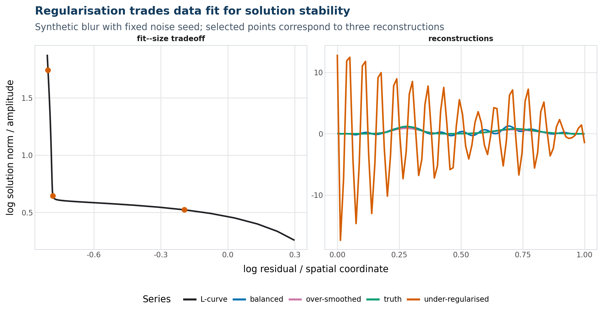

# Inverse Problems and Data Assimilation {#sec-inverse-data}

A forward model predicts measurements from causes. An inverse problem begins
with noisy measurements and asks for the causes. Blurring an image is stable
and easy; undoing the blur may amplify tiny errors catastrophically. Inverse
methods therefore combine calculus with regularisation and quantified
uncertainty.

This chapter assumes only matrices, derivatives, and elementary probability.
The necessary linear algebra from [sec-calculus-linear-algebra](32-linear-algebra-data.md#sec-calculus-linear-algebra) is summarised
before each use.

## Forward maps and identifiability

Write a forward model as

$$
y=G(\theta)+\eta,
$$

where $\theta$ is the unknown parameter or state, $G$ predicts ideal data, and
$\eta$ represents measurement error.

Questions must be asked in this order:

1. **Identifiability:** can distinct parameters produce the same exact data?
2. **Stability:** do nearby data imply nearby parameters?
3. **Computation:** can an approximation be found efficiently?
4. **Uncertainty:** which features remain supported after noise and modeling
   error?

No algorithm can recover a direction that the forward map never records
without importing additional assumptions.

**Example.** Measuring only $\theta_1+\theta_2$ cannot distinguish
$(1,0)$ from $(0,1)$. Repeating the same measurement more accurately does not
repair structural nonidentifiability.

## Well-posedness and ill-posedness

Hadamard called a problem well posed when:

1. a solution exists;
2. it is unique;
3. it depends continuously on the data.

Failure of any condition is ill-posedness.

Differentiation of noisy data is a simple example. Let

$$
f_n(x)=\frac1n\sin(n^2x).
$$

Then $\|f_n\|_\infty\to0$, but

$$
f_n'(x)=n\cos(n^2x)
$$

does not approach zero. Arbitrarily small high-frequency perturbations in the
function create large derivative changes.

Backward heat flow is another: a forward Fourier mode is multiplied by
$e^{-k^2t}$, while inversion multiplies it by $e^{k^2t}$.

## Linear inverse problems and SVD

For

$$
y=A\theta+\eta,
$$

take the singular value decomposition

$$
A=U\Sigma V^T.
$$

If all singular values are positive, the formal least-squares inverse is

$$
\widehat\theta
=\sum_i\frac{u_i^Ty}{\sigma_i}v_i.
$$

Noise component $u_i^T\eta$ is amplified by $1/\sigma_i$. Small singular values
are weakly observed parameter directions.

The pseudoinverse sets coefficients associated with zero singular values to
zero and returns the minimum-norm least-squares solution. This is one convention
for selecting among infinitely many solutions, not information recovered from
the data.

**Truncated SVD** keeps only $\sigma_i\ge\tau$:

$$
\widehat\theta_\tau
=\sum_{\sigma_i\ge\tau}
\frac{u_i^Ty}{\sigma_i}v_i.
$$

It trades resolution for noise control. The threshold is part of the method and
must be reported.

## Tikhonov regularisation

Choose $\lambda>0$ and minimise

$$
\|A\theta-y\|^2+\lambda\|L(\theta-\theta_0)\|^2.
$$

$\theta_0$ is a reference and $L$ selects what is penalised. With
$L=I$ and $\theta_0=0$, the normal equations are

$$
(A^TA+\lambda I)\theta_\lambda=A^Ty.
$$

In singular coordinates,

$$
\theta_\lambda
=\sum_i
\frac{\sigma_i}{\sigma_i^2+\lambda}
(u_i^Ty)v_i.
$$

The filter factor behaves like $1/\sigma_i$ for well-observed directions but
suppresses very small $\sigma_i$.

As $\lambda$ increases, variance from noise falls but bias toward the penalty
model rises. Regularisation does not create missing information; it makes an
assumption explicit.

Other penalties encode other structures:

- $\|D\theta\|^2$ favours smoothness;
- $\|\theta\|_1$ favours sparsity;
- total variation favours piecewise-constant reconstructions;
- constraints encode positivity or conservation.

## Worked regularisation clinic: one weak direction

Take the deliberately transparent forward matrix

$$
A=\begin{pmatrix}1&0\\0&0.01\end{pmatrix}
$$

and true parameter $\theta=(1,1)^T$. Exact data are $(1,0.01)^T$. Suppose the
first datum is exact for this illustration and the second has error $0.005$, so

$$
y=\begin{pmatrix}1\\0.015\end{pmatrix}.
$$

The unregularised inverse divides each datum by its singular value:

$$
\widehat\theta=A^{-1}y
=\begin{pmatrix}1\\1.5\end{pmatrix}.
$$

An absolute measurement error of five thousandths has become a parameter error
of one half. The residual is exactly zero, illustrating again that fit and
stability are different.

With identity Tikhonov regularisation and $\lambda=10^{-4}$, the singular
filter for the first direction is $1/(1+10^{-4})$, while for the second it is

$$
\frac{0.01}{0.01^2+10^{-4}}=50.
$$

Therefore

$$
\theta_\lambda
\approx\begin{pmatrix}0.9999\\0.75\end{pmatrix}.
$$

The weak component no longer amplifies the noise all the way to $1.5$, but it
is biased toward zero. If $\lambda$ is increased to $10^{-2}$, that component
becomes about $0.0149$, almost erased. No choice simultaneously removes noise
amplification and preserves every weak feature. The defensible choice depends
on the noise scale and on which bias is scientifically acceptable.

This example uses dimensionless parameters. If $\theta_1$ were metres and
$\theta_2$ kilograms, the penalty $\theta_1^2+\theta_2^2$ would add quantities
with incompatible units. One repair is to introduce reference scales
$s_1,s_2$ and penalise

$$
\left(\frac{\theta_1-\theta_{0,1}}{s_1}\right)^2
+\left(\frac{\theta_2-\theta_{0,2}}{s_2}\right)^2.
$$

Likewise, an ordinary residual norm assumes comparable measurement units and
noise. With positive-definite noise covariance $\Gamma$, the statistically scaled data misfit is

$$
(A\theta-y)^T\Gamma^{-1}(A\theta-y).
$$

It is dimensionless and gives a residual measured in standard-deviation units.
Correlated errors require off-diagonal covariance entries; merely dividing each
component by its own standard deviation does not remove correlation.

The singular-filter formula can be read as a short program in which every
factor has a name. Using the SVD avoids explicitly forming $A^TA$:

```python
import numpy as np
from numpy.typing import NDArray

def tikhonov_svd(
    forward_matrix: NDArray[np.float64],
    observations: NDArray[np.float64],
    penalty_strength: float,
) -> NDArray[np.float64]:
    """Return the identity-penalty Tikhonov estimate from singular filters."""
    if forward_matrix.ndim != 2 or min(forward_matrix.shape) == 0:
        raise ValueError("forward_matrix must be nonempty and two-dimensional")
    if observations.shape != (forward_matrix.shape[0],):
        raise ValueError("observations must contain one value per matrix row")
    if penalty_strength <= 0.0:
        raise ValueError("penalty_strength must be positive")
    left_vectors, singular_values, right_vectors_transpose = np.linalg.svd(
        forward_matrix, full_matrices=False
    )
    filter_factors = singular_values / (
        singular_values**2 + penalty_strength
    )
    data_coordinates = left_vectors.T @ observations
    return right_vectors_transpose.T @ (filter_factors * data_coordinates)

weak_forward_map = np.diag([1.0, 0.01])
noisy_observations = np.array([1.0, 0.015])
for penalty_strength in (1e-6, 1e-4, 1e-2):
    estimate = tikhonov_svd(
        weak_forward_map, noisy_observations, penalty_strength
    )
    residual = float(
        np.linalg.norm(weak_forward_map @ estimate - noisy_observations)
    )
    print(penalty_strength, estimate, residual)
```

The output makes the bias–fit tradeoff visible for the clinic's two singular
directions. It does not select a defensible penalty from real data or recover
information absent from the forward map.

## Choosing a regularisation parameter

If the noise norm is known to be about $\delta$, the discrepancy principle
chooses $\lambda$ so

$$
\|A\theta_\lambda-y\|\approx c\delta
$$

with $c$ modestly above one. Fitting far below the noise level overfits.

Cross-validation withholds data and assesses prediction. Generalised
cross-validation approximates this efficiently for linear smoothers.

The **L-curve** plots solution norm against residual norm on log scales as
$\lambda$ varies. Its corner is intended to balance fit and regularity.

<figure id="fig-regularization-lcurve">


<figcaption>

Figure 37.1: Regularisation traces an L-shaped tradeoff between data fit and solution size.

</figcaption>
</figure>

[Figure 37.1](#fig-regularization-lcurve) uses synthetic data whose truth is known for
evaluation. Real applications cannot select a parameter by comparison with an
unknown truth. L-curves can lack a sharp corner and visual selection should be
supplemented by sensitivity analysis.

## Nonlinear least squares

Minimise

$$
\Phi(\theta)=\frac12\|r(\theta)\|^2,
\qquad
r(\theta)=G(\theta)-y.
$$

With Jacobian $J(\theta)$,

$$
\nabla\Phi=J^Tr,
$$

and the exact Hessian is

$$
\nabla^2\Phi=J^TJ+\sum_i r_i\nabla^2r_i.
$$

Gauss–Newton drops the second term and solves

$$
J^TJ\,s=-J^Tr.
$$

It works well near a solution with small residual and sufficiently independent
Jacobian columns. Levenberg–Marquardt stabilises the step:

$$
(J^TJ+\lambda I)s=-J^Tr.
$$

Line search or trust-region logic controls step acceptance. Multiple starts
probe local minima but do not prove global optimality.

The singular values of $J$ diagnose **local** identifiability. A parameter may
be locally identifiable near one solution while a distant second solution
produces the same data.

## Nonlinear case study: estimating a cooling rate

Suppose ambient temperature $T_a$ and initial temperature $T_0$ are known, and
Newton cooling predicts

$$
T(t;k)=T_a+(T_0-T_a)e^{-kt},
\qquad k>0.
$$

One exact measurement at a positive time determines

$$
k=-\frac1t
\log\left(\frac{T(t)-T_a}{T_0-T_a}\right),
$$

provided the observed temperature lies strictly between $T_0$ and $T_a$.
The logarithm is dimensionless and $k$ has inverse-time units.

Take $T_a=20\,{}^\circ\mathrm C$, $T_0=100\,{}^\circ\mathrm C$, and
$T(10\,\mathrm{min})=60\,{}^\circ\mathrm C$. Then

$$
k=\frac{\log2}{10}\approx0.06931\,\mathrm{min}^{-1}.
$$

Differentiate the inverse formula with respect to the measured temperature:

$$
\frac{\partial k}{\partial T}
=-\frac1{t(T-T_a)}.
$$

At the stated measurement this is
$-1/400\,\mathrm{min}^{-1}/{}^\circ\mathrm C$. A one-degree positive error
therefore changes $k$ by about $-0.0025\,\mathrm{min}^{-1}$, roughly
$3.6\%$ of the estimate. As the object approaches ambient temperature,
$T-T_a$ becomes small and the same thermometer error causes much larger rate
uncertainty. Later data show more decay but can carry less usable signal.

The inverse and its local sensitivity share the same domain checks. Those
checks distinguish a physically admissible cooling observation from a value
for which the logarithm would not represent this model.

```python
from math import isfinite, log

def infer_cooling_rate(
    observed_temperature: float,
    ambient_temperature: float,
    initial_temperature: float,
    elapsed_time: float,
) -> tuple[float, float]:
    """Return the cooling rate and its derivative with respect to observation."""
    values = (
        observed_temperature,
        ambient_temperature,
        initial_temperature,
        elapsed_time,
    )
    if any(not isfinite(value) for value in values) or elapsed_time <= 0.0:
        raise ValueError("temperatures must be finite and elapsed time positive")
    initial_difference = initial_temperature - ambient_temperature
    observed_difference = observed_temperature - ambient_temperature
    ratio = (
        observed_difference / initial_difference
        if initial_difference != 0.0
        else -1.0
    )
    if not 0.0 < ratio < 1.0:
        raise ValueError(
            "observation must lie strictly between initial and ambient values"
        )
    rate = -log(ratio) / elapsed_time
    sensitivity = -1.0 / (elapsed_time * observed_difference)
    return rate, sensitivity

rate, sensitivity = infer_cooling_rate(60.0, 20.0, 100.0, 10.0)
print(rate, sensitivity)
```

The output reproduces $\log(2)/10$ and $-1/400$. It is an exact inverse for
one noiseless observation under the stated model, not a multi-observation
uncertainty analysis or a validation of Newton cooling.

With several measurements, define residuals

$$
r_i(k)=T_a+(T_0-T_a)e^{-kt_i}-T_i
$$

and minimise a noise-weighted sum of squares. The Jacobian entry is

$$
J_i(k)=-(T_0-T_a)t_i e^{-kt_i}.
$$

It has units temperature times time, so $J_i\Delta k$ has temperature units as
required. Measurements all taken at nearly the same time provide repeated
precision but little new geometric information. Measurements spread over a
useful range can improve identifiability, provided late values are not drowned
by sensor resolution or model discrepancy.

If $T_a$ is also unknown, the second Jacobian column is

$$
\frac{\partial T(t;k,T_a)}{\partial T_a}=1-e^{-kt}.
$$

At very short times both sensitivity patterns can be weak, and particular
combinations of $k$ and $T_a$ may produce almost indistinguishable data.
Computing singular values of the scaled Jacobian across the proposed sample
times is an experimental-design check, not merely a post-fit diagnostic.

Gauss–Newton itself can fail before any data issue is resolved. For the toy
forward map $G(\theta)=\theta^2$ and positive datum $y$, the residual is
$r=\theta^2-y$ and $J=2\theta$. Away from zero the Gauss–Newton step is

$$
s=-\frac{\theta^2-y}{2\theta},
$$

the familiar Newton step for a square root. At the initial guess $\theta=0$,
the Jacobian vanishes and the normal equation supplies no step even though zero
is not a solution. A damping parameter cannot create a missing descent
direction when $J^Tr=0$; a different initialisation, parameterisation, or
global strategy is needed. “The optimiser stopped” is not evidence that the
inverse problem was solved.

## Bayesian inversion

Bayes' rule combines a likelihood and prior:

$$
\pi(\theta\mid y)
\propto \pi(y\mid\theta)\pi_0(\theta).
$$

If $\eta\sim N(0,\Gamma)$ conditionally on every unknown parameter value, with a fixed positive-definite covariance (independent Gaussian noise is sufficient), then the ordinary finite-dimensional likelihood density is

$$
\pi(y\mid\theta)
\propto
\exp\left(
-\frac12
(G(\theta)-y)^T\Gamma^{-1}(G(\theta)-y)
\right).
$$

A Gaussian prior with positive-definite covariance
$\theta\sim N(\theta_0,C_0)$ adds the quadratic

$$
\frac12(\theta-\theta_0)^TC_0^{-1}(\theta-\theta_0).
$$

The maximum a posteriori estimate minimises a Tikhonov-like objective. The
posterior, however, contains more than its mode: correlations, credible
regions, skewness, and multiple modes. These ordinary inverses and Lebesgue densities require the positive-definite covariances just stated. Singular or noiseless Gaussian models require a support/measure formulation; the later filter needs only its stated innovation inverse, not positive-definite state or posterior covariance. For a nonlinear forward map the objective is generally not quadratic in the parameter.

A prior is not an embarrassment to hide. In an ill-posed problem, every stable
method imports assumptions; Bayesian analysis expresses them probabilistically.
Prior sensitivity and model discrepancy must be examined.

Credible probability under the model is not automatically frequentist coverage
under repeated real experiments.

## Worked observation clinic: when a fit bounds state error {#sec-observation-certificate}

The [observability section](36-control-theory.md#observability) asks whether
outputs distinguish initial states. A sampled-data certificate must also
quantify how measurement error and a nonzero data misfit affect recovery.
The stacked observation map and its null-space criterion are standard
finite-window observability results ([Boyd 2008](bibliography.md#ref-boyd2008observability), slides 19–4
to 19–7; [Dahleh et al. 2011](bibliography.md#ref-dahleh2011observability), Section 24.3). Boyd also derives
left-inverse noise amplification ([Boyd 2008](bibliography.md#ref-boyd2008observability), slides 19–18
to 19–21). The exact examples and sharp disturbance bounds below apply
that theory to the stated two-component model.

This is deterministic **initial-state recovery**, distinct from the
one-time Kalman innovation in the next section. Known inputs can be
subtracted from reports; an unknown process increment changes the inverse
problem. A Gaussian standard deviation is not a sure noise bound.
Prior-conditioned inference can use information beyond identifiable data,
and this clinic does not replace the chapter's Gaussian filter model.

### From a stacked misfit to a state-error certificate

Let the known discrete model be

$$
x_{k+1}=Fx_k,\qquad y_k=Hx_k+v_k,\qquad k=0,\ldots,m-1.
$$

There is no process disturbance in this first model. The initial state
$x_0$ is unrestricted in $\mathbb R^n$. Coordinates and observations are
dimensionless, or have been scaled in stated common reference units.
Stack the observations and their sensor errors:

$$
Y=\mathcal O_m x_0+\nu,\qquad
\mathcal O_m=\begin{pmatrix}H\\HF\\\vdots\\HF^{m-1}\end{pmatrix}.
$$

For any candidate $\widehat x_0$, define the **stacked data misfit**
$d=\mathcal O_m\widehat x_0-Y$. This is distinct from the chapter's
one-time Kalman innovation. If $\|\nu\|_2\le\delta$ and
$\mathcal O_m$ has full column rank, its smallest singular value
$\sigma_*>0$ gives

$$
\begin{aligned}
\sigma_*\|\widehat x_0-x_0\|_2
&\le\|\mathcal O_m(\widehat x_0-x_0)\|_2\\
&=\|d+\nu\|_2\\
&\le\|d\|_2+\delta.
\end{aligned}
$$

Dividing gives a state-error bound. The first inequality follows from the
SVD, so full **column** rank and a positive stability constant are essential.
A floating estimate of that constant is not automatically a validated
lower bound. No least-squares optimality assumption is needed for this
inequality. If a nonzero $z$ satisfies $\mathcal O_mz=0$, then $x_0$ and
$x_0+tz$ produce the same noiseless observations for every real $t$;
there can be no finite bound on the unrestricted whole-state error from
misfit alone. Extra state constraints or a prior supply extra information.

### Two decaying components, one sensor

Use the exactly specified discrete matrices

$$
F=\begin{pmatrix}1/2&0\\0&1/4\end{pmatrix},\qquad
H=\begin{pmatrix}1&1\end{pmatrix}.
$$

Both components decay under repeated forward propagation. Using the
observability idea already introduced in Chapter 36, one observation
at time zero still misses the direction $(1,-1)^T$. Two observations give

$$
\mathcal O_2=
\begin{pmatrix}1&1\\1/2&1/4\end{pmatrix},\qquad
B=\mathcal O_2^{-1}=
\begin{pmatrix}-1&4\\2&-4\end{pmatrix}.
$$

Direct multiplication proves that this is the inverse. Its row sums of
absolute values are $5$ and $6$, so $\|B\|_\infty=6$. Consequently,
in the infinity norm, $\|d\|_\infty\le\varepsilon$ and
$\|\nu\|_\infty\le\delta$ imply

$$
\|\widehat x_0-x_0\|_\infty\le6(\varepsilon+\delta).
$$

This uses infinity norms throughout; the earlier displayed singular-value
bound uses Euclidean norms. For true state $(1,1)^T$, exact data are
$(2,3/4)^T$. Sensor error $(1/100,-1/100)^T$ gives reports
$Y=(201/100,37/50)^T$. The exact reported-data fit is

$$
\widehat x_0=BY=(19/20,53/50)^T.
$$

Its misfit is zero, while its state error is
$(-1/20,3/50)^T$, of infinity norm $3/50=6/100$. Thus the stated
noise-aware bound is attained. A perfect fit has removed computation error
for these reported observations; it has not removed measurement uncertainty.
The matrices are exact model inputs, so no ODE discretisation error has been
silently included in this certificate.

### Changed task: an unmeasured process increment

Keep $F,H$ and the two observation times, but change the dynamics between
the observations to

$$
x_1=Fx_0+(0,u)^T.
$$

The increment $u$ is unknown. States remain unrestricted in $\mathbb R^2$.
An estimate still fits the **nominal** map, with
$d=\mathcal O_2\widehat x_0-Y$.

1. With exact observations $Y=(2,3/4)^T$ and no bound on $u$, find every
   compatible initial state as a function of $u$. Does the nominal fit
   $\widehat x_0=(1,1)^T$ and its zero misfit imply a finite state-error
   bound just because $\mathcal O_2$ is invertible?
2. Now take $\varepsilon,\delta,\gamma\ge0$ with
   $|u|\le\gamma$, $\|\nu\|_\infty\le\delta$ and
   $\|d\|_\infty\le\varepsilon$. Derive a bound including both sources
   of uncertainty, and prove it is sharp over these allowed independent
   boxes. Explain why the disturbance bound cannot be absorbed into the
   numerical residual or a floating-point tolerance.
3. For true state $(1,1)^T$, $u=-1/200$, sensor error
   $(1/100,-1/100)^T$, and an exact nominal fit, compute the reports,
   recovered state and error. Compare with your bound.

**Separate hint.** Stack the changed equations before taking a norm:
$Y=\mathcal O_2x_0+(0,u)^T+\nu$. Apply the displayed exact inverse.
For sharpness, align signs of $d$, $\nu$ and $u$ with the second row
of the inverse rather than rounding the resulting numbers.

**Separate worked answer.** For exact $Y=(2,3/4)^T$,

$$
x_0(u)=B\bigl(Y-(0,u)^T\bigr)=(1-4u,1+4u)^T.
$$

All these states give the same two observations. The nominal estimate's error
has infinity norm $4|u|$, which is unbounded when $u$ is unrestricted.
Invertibility of the wrong, disturbance-free inverse problem cannot restore
the changed model's missing information. Positivity or bounded-state
constraints would change this unrestricted family and must be declared.
Later observations could also change identifiability under additional
assumptions about subsequent process increments; this conclusion concerns
only the stated two-observation window.

For bounded uncertainties,

$$
\widehat x_0-x_0=B\{d+\nu+(0,u)^T\},\qquad
\|\widehat x_0-x_0\|_\infty
\le6(\varepsilon+\delta)+4\gamma.
$$

Indeed $B(0,u)^T=(4u,-4u)^T$. Put $s=\varepsilon+\delta$ and choose
$d=(\varepsilon,-\varepsilon)^T$,
$\nu=(\delta,-\delta)^T$, $u=-\gamma$.
Then the error is $(-5s-4\gamma,6s+4\gamma)^T$, attaining the bound.
These choices are consistent with an actual experiment: fix any true state,
form its reports with those disturbances, and solve
$\mathcal O_2\widehat x_0=Y+d$.
The bound encloses possible initial states; bounded $u$ need not uniquely
identify the joint unknowns $(x_0,u)$. In the boundary case
$\gamma=\delta=0$, exact reports fix $u=0$ and $x_0=BY$ uniquely.

Here $\gamma$ bounds the specified scalar injection $u$ in $(0,u)^T$,
whose observed increment is $H(0,u)^T=u$. It is not a bound on an
arbitrary two-component process vector. If the changed model instead
allowed $x_1=Fx_0+\eta$ with $\|\eta\|_\infty\le\gamma$, then
$|H\eta|\le2\gamma$ and the corresponding bound would be
$6(\varepsilon+\delta)+8\gamma$. It is sharp: with the same misfit
and sensor-error signs and $\eta=(-\gamma,-\gamma)^T$, the error is
$(-5s-8\gamma,6s+8\gamma)^T$. The disturbance channel, its norm and
the meaning of its bound must therefore be stated together.

For the stated numeric case,

$$
Y=(201/100,147/200)^T,\qquad
\widehat x_0=(93/100,27/25)^T,
$$

so the state error is $(-7/100,2/25)^T$. Its infinity norm is
$2/25=6/100+4/200$, exactly the bound with $\varepsilon=0$.
Process uncertainty remains even if the nominal linear solve is exact.

## Sequential data assimilation

A state-space model evolves and is observed:

$$
x_{k+1}=F x_k+w_k,
\qquad
y_k=H x_k+v_k.
$$

Assume a possibly degenerate Gaussian initial state independent of all mutually independent zero-mean Gaussian process and measurement noises with covariances $Q$ and $R$.
Initialise the filter with the mean and covariance of the initial state. The Kalman filter alternates forecast and correction.

Forecast:

$$
\widehat x_k^- =F\widehat x_{k-1}^+,
\qquad
P_k^-=FP_{k-1}^+F^T+Q.
$$

Innovation and gain (the ordinary inverse requires a nonsingular innovation covariance):

$$
r_k=y_k-H\widehat x_k^-,
\qquad
K_k=P_k^-H^T(HP_k^-H^T+R)^{-1}.
$$

Correction:

$$
\widehat x_k^+
=\widehat x_k^-+K_kr_k,
\qquad
P_k^+=(I-K_kH)P_k^-.
$$

Under these sufficient Gaussian assumptions and nonsingular innovation covariance, this is the exact conditional mean and covariance; the conditional covariance may be singular. More generally, for a linear model with finite second moments, correct initial moments and zero-mean noises uncorrelated across time, with each other and with the initial state, the same recursion gives the linear minimum-mean-square estimator and its unconditional error covariance. That broader statement alone does not assert a Gaussian posterior.
The Joseph covariance form

$$
P^+=(I-KH)P^-(I-KH)^T+KRK^T
$$

is more robust to floating-point loss of symmetry and positive
semidefiniteness.

For nonlinear models, extended and ensemble Kalman filters are approximations;
particle filters represent distributions with weighted samples. Each brings
new finite-sample or linearisation errors.

## A scalar tracking derivation

Let temperature follow a random walk:

$$
x_{k+1}=x_k+w_k,\qquad y_k=x_k+v_k.
$$

If forecast variance is $P^-$ and measurement variance $R$, with positive sum, then

$$
K=\frac{P^-}{P^-+R}.
$$

The corrected estimate is

$$
\widehat x^+=(1-K)\widehat x^-+Ky.
$$

It is a weighted average. Reliable measurements have small $R$ and gain near
one; uncertain measurements have small gain. The updated variance is

$$
P^+=(1-K)P^-.
$$

Innovation sequence $r_k$ should have mean near zero and predicted covariance
$P_k^-+R$ if the model is calibrated. Persistent bias or autocorrelation signals
model failure.

## Worked assimilation update with units

Suppose the forecast temperature is
$\widehat x^-=20\,{}^\circ\mathrm C$ with variance
$P^-=4\,({}^\circ\mathrm C)^2$. A sensor reports
$y=22\,{}^\circ\mathrm C$ with error variance
$R=1\,({}^\circ\mathrm C)^2$. The scalar gain is

$$
K=\frac4{4+1}=0.8.
$$

It is dimensionless because it multiplies the innovation, which has the same
units as the state. The corrected estimate is

$$
\widehat x^+
=20+0.8(22-20)
=21.6\,{}^\circ\mathrm C,
$$

and its variance is

$$
P^+=(1-0.8)4=0.8\,({}^\circ\mathrm C)^2.
$$

The Joseph calculation gives the same exact result:

$$
P^+=(0.2)^2(4)+(0.8)^2(1)=0.16+0.64=0.8.
$$

The innovation is $2\,{}^\circ\mathrm C$ with predicted variance
$P^-+R=5\,({}^\circ\mathrm C)^2$, so the standardised innovation is
$2/\sqrt5\approx0.894$. One value of that size is unsurprising under a
Gaussian model. A long sequence with nonzero mean, too many large standardised
values, or serial correlation indicates bias, under-estimated variance, or
missing dynamics.

Process covariance $Q$ has state-squared units per discrete forecast step in
this model. Changing the time step without changing the construction of $Q$
usually changes the physical stochastic model. For a continuous random-walk
intensity, the discrete covariance normally scales with elapsed time. Treating
$Q$ as a dimensionless tuning knob can make uncertainty depend arbitrarily on
the output frequency.

Missing observations do not require inventing data: perform the forecast and
skip the correction. An outlier requires a declared robust likelihood or
quality-control rule; silently deleting it after seeing a large innovation
invalidates calibration claims. The filter equations are conditional on the
noise and independence assumptions, not universal averaging laws.

## Selected solution clinic

For Exercise 4, differentiate

$$
\Psi(\theta)=\|A\theta-y\|^2
+\lambda\|L(\theta-\theta_0)\|^2.
$$

Using $\nabla\|M\theta-c\|^2=2M^T(M\theta-c)$ gives

$$
\nabla\Psi
=2A^T(A\theta-y)
+2\lambda L^TL(\theta-\theta_0).
$$

Setting this to zero yields

$$
(A^TA+\lambda L^TL)\theta
=A^Ty+\lambda L^TL\theta_0.
$$

The simpler formula earlier in the chapter is the special case $L=I$ and
$\theta_0=0$. If $L$ has a null space, uniqueness requires that no nonzero
direction lie in both $\ker A$ and $\ker L$.

For Exercise 9, consider a linear unbiased scalar correction

$$
\widehat x^+=\widehat x^-+K(y-\widehat x^-).
$$

If forecast error $e^-$ and measurement error $v$ are independent with
variances $P^-$ and $R$, the corrected error is

$$
e^+=(1-K)e^-+Kv.
$$

Its variance is

$$
V(K)=(1-K)^2P^-+K^2R.
$$

Differentiation gives

$$
V'(K)=-2(1-K)P^-+2KR.
$$

Assuming the two variances have positive sum, setting $V'(K)=0$ produces
$K=P^-/(P^-+R)$, and
$V''(K)=2(P^-+R)>0$ proves it is the unique minimiser. Correlation between
forecast and measurement errors would add a covariance term and change the
gain. If both variances are zero, the variance cost is zero for every gain: the quotient is undefined and there is no unique minimiser. For compatible observations, the state is already known from the forecast and the conditional law is a point mass.

For Exercise 10, let $P^-$ and $R$ be positive semidefinite. For any vector
$z$, the Joseph form satisfies

$$
\begin{aligned}
z^TP^+z
={}&[(I-KH)^Tz]^TP^-[(I-KH)^Tz]\\
&+(K^Tz)^TR(K^Tz)\ge0.
\end{aligned}
$$

Thus the updated covariance is positive semidefinite in exact arithmetic. The
form also preserves symmetry explicitly and is often preferable when rounding
would make the shorter algebraic expression slightly asymmetric.

## Deblurring workflow

Suppose a one-dimensional signal $\theta$ is blurred by convolution and
observed with noise. A defensible experiment:

1. declares boundary handling and sampling units;
2. generates or records the blur kernel;
3. keeps raw observations immutable;
4. splits noise estimation from reconstruction;
5. shows the singular spectrum;
6. chooses $\lambda$ without using hidden truth in a real application;
7. reports residual structure and parameter sensitivity;
8. uses a second forward simulation $A\widehat\theta$ to check data fit;
9. reports uncertainty or a stability envelope.

<div class="callout callout-warning">
<p class="callout-title">A sharp reconstruction can be confidently wrong</p>

Under-regularisation amplifies noise; a mismatched prior can invent structure;
incorrect boundary conditions create ringing. Visual plausibility is only one
diagnostic.

</div>

## Further connections {#forward-handoff}

[Chapter 40](40-numerical-linear-algebra.md) supplies residual, conditioning,
and preconditioning certificates for the linear solves inside inversion.
[Chapter 41](41-computational-optimization.md) audits the algorithms used for
nonlinear calibration, and [Chapter 43](43-statistical-inference.md) connects
likelihood, Fisher information, confidence procedures, regression diagnostics,
and experimental design to explicitly declared sampling assumptions.

<!-- inline-formula-code:start -->
## Formula and finite computation

A useful formula in this chapter is

$$
(f^{-1})'(y)=\frac1{f'(f^{-1}(y))}
$$

A numerical inverse and the reciprocal derivative are checked together. The following standalone Python block expresses that finite rule with its inputs and stopping conditions visible.

```python
from collections.abc import Callable
from math import exp, log

def inverse_derivative(
    forward_derivative: Callable[[float], float], preimage: float
) -> float:
    """Return the reciprocal derivative at a known preimage."""
    slope = forward_derivative(preimage)
    if slope == 0.0:
        raise ValueError("the forward derivative must be nonzero")
    return 1.0 / slope

for x in (-1.0, 0.0, 1.0, 2.0):
    y = exp(x)
    predicted = inverse_derivative(exp, x)
    exact = 1.0 / y
    print(x, y, predicted, exact, log(y))
```

**What the computation establishes.** The calculation checks a declared finite instance; the surrounding argument explains what is true beyond those inputs.
<!-- inline-formula-code:end -->

## Summary and vocabulary

Inverse problems can fail uniqueness or stability even when forward simulation
is easy. SVD exposes weak directions; regularisation trades resolution for
stability; nonlinear solvers need local identifiability audits; Bayesian
methods express assumptions as probability; filters combine forecasts with
sequential observations.

## Exercises and support

<div class="exercise" id="calculus-37-inverse-data-assimilation-ex-1">
<p class="exercise-title"><strong>Exercise 1</strong></p>

Give a two-parameter forward map that is nonidentifiable and describe its
null direction.

</div>

<div class="exercise" id="calculus-37-inverse-data-assimilation-ex-2">
<p class="exercise-title"><strong>Exercise 2</strong></p>

Verify the differentiation ill-posedness example in the supremum norm.

</div>

<div class="exercise" id="calculus-37-inverse-data-assimilation-ex-3">
<p class="exercise-title"><strong>Exercise 3</strong></p>

Compute an SVD-based inverse for a diagonal matrix with one small singular
value and add measurement noise.

</div>

<div class="exercise" id="calculus-37-inverse-data-assimilation-ex-4">
<p class="exercise-title"><strong>Exercise 4</strong></p>

Derive the Tikhonov normal equations.

</div>

<div class="exercise" id="calculus-37-inverse-data-assimilation-ex-5">
<p class="exercise-title"><strong>Exercise 5</strong></p>

Plot filter factors
$\sigma/(\sigma^2+\lambda)$ for several $\lambda$.

</div>

<div class="exercise" id="calculus-37-inverse-data-assimilation-ex-6">
<p class="exercise-title"><strong>Exercise 6</strong></p>

Compare truncated SVD and Tikhonov on the same synthetic problem.

</div>

<div class="exercise" id="calculus-37-inverse-data-assimilation-ex-7">
<p class="exercise-title"><strong>Exercise 7</strong></p>

Derive the Gauss–Newton gradient and state why its approximate Hessian can
be singular.

</div>

<div class="exercise" id="calculus-37-inverse-data-assimilation-ex-8">
<p class="exercise-title"><strong>Exercise 8</strong></p>

For an affine forward map, show how a Gaussian prior and conditional Gaussian
likelihood with fixed positive-definite covariances produce a quadratic posterior objective.

</div>

<div class="exercise" id="calculus-37-inverse-data-assimilation-ex-9">
<p class="exercise-title"><strong>Exercise 9</strong></p>

Derive the scalar Kalman gain by minimising corrected variance among linear
unbiased updates.

</div>

<div class="exercise" id="calculus-37-inverse-data-assimilation-ex-10">
<p class="exercise-title"><strong>Exercise 10</strong></p>

Check that the Joseph covariance form is positive semidefinite.

</div>

<div class="exercise" id="calculus-37-inverse-data-assimilation-ex-11">
<p class="exercise-title"><strong>Exercise 11</strong></p>

Diagnose an innovation sequence with nonzero mean and lag-one correlation.

</div>

<div class="exercise" id="calculus-37-inverse-data-assimilation-ex-12">
<p class="exercise-title"><strong>Exercise 12</strong></p>

Design a blind deblurring report that labels every assumption and
   nonidentifiable ambiguity.

</div>

For Exercise 4, differentiate the quadratic objective. For Exercise 8, use an affine forward map and fixed positive-definite prior/noise covariances; take
negative logarithms of the conditional Gaussian likelihood and prior and discard constants independent of $\theta$. For
Exercise 9, write the corrected error as
$(1-K)e^-+Kv$ and minimise its variance.
