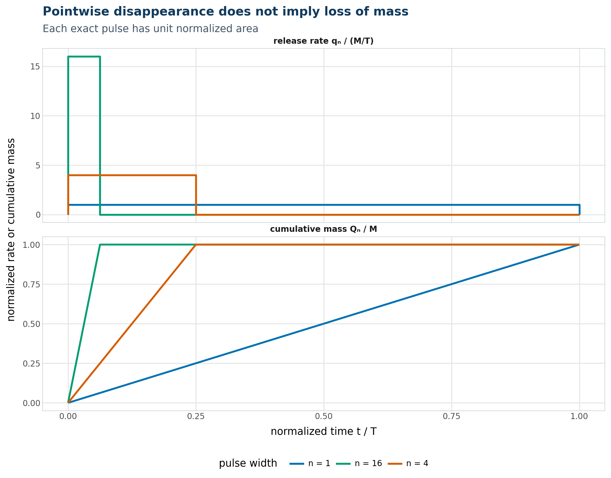

# Measure, Lebesgue Integration, and Convergence {#sec-measure-integration}

A release can become taller and shorter while carrying exactly the same mass.
At every fixed positive time its rate eventually vanishes, yet its accumulated
mass does not. This is not a paradox. It is a warning that pointwise limits do
not by themselves control integrals. Riemann integration from [sec-integrals](06-integrals-ftc.md#sec-integrals)
was designed around partitions of an interval. Measure theory instead asks how
large the sets are on which a function takes particular values. That change of
view makes discontinuous functions, probability, function spaces, and limit
interchange part of one calculus.

## Preparation from this book

The required ingredients are already available internally. Review sets,
quantifiers, direct argument, and counterexamples in
the [concise proof toolkit](00i-precalculus-bridge.md#sec-foundation-proof);
sequences and finite sums in the [computation
toolkit](00i-precalculus-bridge.md#sec-foundation-computation); limits in [sec-limits](02-limits-continuity.md#sec-limits); Riemann sums
and the Fundamental Theorem in [sec-integrals](06-integrals-ftc.md#sec-integrals); and infinite sequences in
[sec-series](10-series-taylor.md#sec-series). Probability in [sec-probability-calculus](21-probability.md#sec-probability-calculus) supplies useful
examples but is not a prerequisite.

Here is the local repair kit.

- A set is **countable** if it is finite or can be listed as
  $a_1,a_2,\ldots$. Countable unions permit one requirement for each natural
  number; uncountable unions are much less controlled.
- The indicator $\mathbf1_E(x)$ is $1$ on $E$ and $0$ elsewhere. It turns a
  set into a function and satisfies
  $\mathbf1_{E\cap F}=\mathbf1_E\mathbf1_F$.
- For sets $E_n$, $\liminf E_n$ contains points belonging to all sufficiently
  late sets, while $\limsup E_n$ contains points belonging to infinitely many.
- A sequence $a_n\uparrow a$ is nondecreasing with limit $a$. Monotonicity is
  extra information, not decorative notation.
- The extended real numbers include $+\infty$ and $-\infty$. Expressions such
  as $\infty-\infty$ remain undefined.

A reader who can negate “for every $n$ there exists $x$,” manipulate an
indicator, and explain a Riemann sum is ready to continue.

## Why another theory of integration?

Let $D=\mathbb Q\cap[0,1]$ and consider $f=\mathbf1_D$. Every interval contains
both rational and irrational numbers. Hence every lower Riemann sum is zero
and every upper Riemann sum is one. The function is not Riemann integrable.
Yet $D$ is countable and should have total length zero: listing its points and
covering the $j$th by an interval of length at most $\varepsilon/2^j$ gives
total covering length at most $\varepsilon$. The Lebesgue answer
$\int_0^1f=0$ records that $f$ differs from zero only on a negligible set.

This example does not say that discontinuities never matter. The indicator of
a positive-length interval has a positive integral. Measure theory distinguishes
the size of the exceptional set rather than merely counting discontinuities.

**Nonexample.** “A function is integrable because it is finite at every point”
is false. A nonnegative finite function can have infinite integral, and a
finite-valued function can fail measurability. Pointwise finiteness is neither
an area bound nor a structural condition.

## Sigma-algebras and measurable sets

A **sigma-algebra** $\mathcal A$ on a set $X$ is a collection of subsets such
that

1. $X\in\mathcal A$;
2. $E\in\mathcal A$ implies $X\setminus E\in\mathcal A$;
3. $E_1,E_2,\ldots\in\mathcal A$ implies
   $\bigcup_{n=1}^{\infty}E_n\in\mathcal A$.

De Morgan's laws then give closure under countable intersections, and
$\varnothing\in\mathcal A$. The pair $(X,\mathcal A)$ is a **measurable
space**. The smallest sigma-algebra containing a specified family is the one
it **generates**. On $\mathbb R$, the Borel sigma-algebra $\mathcal B$ is
generated by open intervals. It contains open and closed sets, countable sets,
and every set produced from them by countably many complements, unions, and
intersections.

Why not declare every subset measurable? For finite or countable $X$, one
often can. On the real line, requiring translation-invariant length, countable
additivity, and a value for every subset leads to contradiction; nonmeasurable
sets exist. Their construction uses a choice principle and is not needed for
calculation, but it explains why the domain of a measure must be named.

A function $f:X\to\mathbb R$ is **measurable** if

$$
\{x:f(x)>a\}\in\mathcal A
$$

for every real $a$. Equivalent definitions use $\{f\ge a\}$ or inverse images
of Borel sets. Continuous real functions are Borel measurable because inverse
images of open sets are open. Sums, products, maxima, minima, and pointwise
limits of measurable functions are measurable when the operations are defined.

## Measures, null sets, and almost everywhere

A **measure** is a function $\mu:\mathcal A\to[0,\infty]$ satisfying

$$
\mu(\varnothing)=0
$$

and countable additivity: for pairwise disjoint $E_n$,

$$
\mu\left(\bigcup_{n=1}^{\infty}E_n\right)
=\sum_{n=1}^{\infty}\mu(E_n).
$$

Lebesgue measure $m$ assigns $m((a,b))=b-a$. Counting measure assigns the
number of elements. A point mass $\delta_c$ assigns $1$ when $c\in E$ and
$0$ otherwise. A probability measure has total mass one. These are different
measures on the same sets; the measure is part of the model.

Countable additivity implies useful limit rules. If $E_n\uparrow E$, then

$$
\mu(E_n)\uparrow\mu(E).
$$

To prove this, write $E$ as the disjoint union of $E_1$ and the increments
$E_n\setminus E_{n-1}$, apply countable additivity, and take partial sums. If
$E_n\downarrow E$ and $\mu(E_1)<\infty$, then $\mu(E_n)\downarrow\mu(E)$.
The finiteness condition matters: for $E_n=[n,\infty)$, every $E_n$ has
infinite length while their intersection is empty.

A property holds **almost everywhere**, abbreviated a.e., if its failure set
has measure zero. Changing a function at finitely or countably many points does
not change its Lebesgue integral. “Almost everywhere” does not mean “at every
point except points we dislike”; the exceptional set must be measurable and
null for the declared measure.

Probability becomes a special case rather than a separate notation system. A
random variable is a measurable function $X:\Omega\to\mathbb R$, and its
distribution is the measure

$$
\mu_X(B)=\mathbb P(X\in B).
$$

Expectation is integration:

$$
\mathbb E[X]=\int_\Omega X\,d\mathbb P
=\int_{\mathbb R}x\,d\mu_X(x)
$$

when the integral exists. A density is only one way a probability measure can
arise. A point mass has no ordinary density with respect to length, and a
mixture can contain both continuous and atomic parts. This distinction repairs
the tempting but false claim that every random variable has a density.

The measure also controls which convergence claim is relevant. If random
variables agree almost surely, they may differ on possible outcomes of
probability zero. That is adequate for expectations but may be inadequate for
a safety rule that quantifies over every mathematically possible state. The
word “almost” must remain visible in the conclusion.

## Simple functions and construction of the integral

A nonnegative **simple function** has the form

$$
s=\sum_{j=1}^ka_j\mathbf1_{E_j},
\qquad a_j\ge0,
$$

with measurable $E_j$. Using disjoint level sets, define

$$
\int_Xs\,d\mu=\sum_{j=1}^ka_j\mu(E_j).
$$

The units are function-units times measure-units. If $s$ is a power density in
watts/metre and $\mu$ measures metres, the integral is watts.

For nonnegative measurable $f$, define

$$
\int_Xf\,d\mu
=\sup\left\{\int_Xs\,d\mu:0\le s\le f,
\ s\text{ simple}\right\}.
$$

One can construct simple functions $s_n\uparrow f$ by rounding values down to
dyadic levels and truncating at height $n$. Thus the definition is a controlled
limit of finite weighted areas.

For real $f$, set

$$
f^+=\max(f,0),\qquad f^-=\max(-f,0),
$$

so $f=f^+-f^-$ and $|f|=f^++f^-$. The function is **integrable** when
$\int|f|<\infty$, and then

$$
\int f=\int f^+-\int f^-.
$$

This condition prevents the undefined subtraction $\infty-\infty$. An
improper integral may converge conditionally through cancellation, as
$\int_1^\infty \sin x/x\,dx$ does, without defining a Lebesgue integral over
$[1,\infty)$ in this signed sense. The two conventions answer different
questions and must not be silently exchanged.

## Convergence theorems

The main theorems specify information strong enough to pass a limit through an
integral.

**Theorem 38.2 (Monotone Convergence).** If $0\le f_n\uparrow f$ a.e., then

$$
\int f_n\,d\mu\uparrow\int f\,d\mu.
$$

The limit may be infinite. Nonnegativity and monotonicity are the engine.

**Lemma 38.1 (Fatou's).** For nonnegative measurable $f_n$,

$$
\int\liminf_{n\to\infty}f_n\,d\mu
\le\liminf_{n\to\infty}\int f_n\,d\mu.
$$

It is deliberately one-sided: mass can escape or concentrate.

**Theorem 38.3 (Dominated Convergence).** If $f_n\to f$ a.e. and there is one
integrable $g$ with $|f_n|\le g$ a.e. for every $n$, then $f$ is integrable and

$$
\int f_n\,d\mu\longrightarrow\int f\,d\mu.
$$

Here is a derivation from Fatou. Apply Fatou to the nonnegative functions
$g+f_n$:

$$
\int(g+f)\le\liminf_n\int(g+f_n),
$$

which implies $\int f\le\liminf_n\int f_n$. Apply it again to $g-f_n$ to get
$-\int f\le\liminf_n(-\int f_n)$, equivalently
$\limsup_n\int f_n\le\int f$. The liminf and limsup agree. The domination
also makes every displayed finite subtraction legitimate.

**Nonexample.** Pointwise convergence and uniformly bounded integrals do not
imply dominated convergence. The pulse clinic below has both properties but no
single integrable envelope.

Domination is not the only route to controlled integrals. A family
$\mathcal F\subset L^1$ is **uniformly integrable** when its mass cannot hide
in arbitrarily small sets or arbitrarily high tails. One common formulation on
a finite measure space is

$$
\lim_{R\to\infty}\sup_{f\in\mathcal F}
\int_{\{|f|>R\}}|f|\,d\mu=0.
$$

The pulse family fails: for every large $R$, sufficiently narrow pulses lie
entirely above $R$ and retain integral $M$. The Vitali convergence theorem,
quoted as a vista, replaces a common dominator by uniform integrability plus
convergence in measure. This is useful in probability and PDE estimates, but
it does not weaken the hypotheses for free; it names the missing control more
precisely.

A second failure mode is **escape to infinity**. On $\mathbb R$, let
$f_n=\mathbf1_{[n,n+1]}$. Then $f_n\to0$ pointwise and every integral equals
one. The peaks do not grow, but their mass leaves every fixed bounded region.
No integrable function dominates all translates. Concentration and escape are
different mechanisms producing the same failed interchange.

## Product measure, Tonelli, and Fubini

For sigma-finite measure spaces $(X,\mu)$ and $(Y,\nu)$, product measure is
characterized on measurable rectangles by

$$
(\mu\times\nu)(A\times B)=\mu(A)\nu(B).
$$

**Theorem 38.4 (Tonelli's).** says that a nonnegative measurable $f$ may be integrated
in either order:

$$
\int_{X\times Y}f\,d(\mu\times\nu)
=\int_X\left(\int_Yf(x,y)\,d\nu(y)\right)\,d\mu(x),
$$

with $+\infty$ allowed. **Fubini's theorem** says that if
$\int|f|<\infty$, then the sections are integrable almost everywhere, both
iterated integrals are finite, and they equal the product integral.

The absolute-integrability condition is a safety check. For a conditionally
convergent double series, changing summation order can change the answer; a
double integral can inherit the same problem. A rectangular plotting grid is
not evidence that Fubini applies.

## Lp spaces and the Fundamental Theorem revisited

For $1\le p<\infty$, define

$$
\|f\|_p=\left(\int|f|^p\,d\mu\right)^{1/p},
$$

and let $\|f\|_\infty$ be the essential supremum. Functions equal a.e. have
distance zero and represent the same element of $L^p$. Hölder's inequality,
for $1/p+1/q=1$, states

$$
\int|fg|\le\|f\|_p\|g\|_q.
$$

Minkowski's inequality gives $\|f+g\|_p\le\|f\|_p+\|g\|_p$. For $p=q=2$,
Hölder is Cauchy–Schwarz and supports the Hilbert-space geometry of
[sec-functional-analysis](39-functional-analysis.md#sec-functional-analysis).

Convergence modes are not interchangeable. Uniform convergence on a finite
measure space implies $L^p$ convergence. $L^p$ convergence implies convergence
in measure. Convergence in measure has an a.e.-convergent subsequence under
standard finite-measure hypotheses, but the original sequence need not
converge pointwise.

The modern Fundamental Theorem says: if $f\in L^1([a,b])$ and

$$
F(x)=F(a)+\int_a^xf(t)\,dt,
$$

then $F$ is absolutely continuous and $F'=f$ a.e. Conversely, every absolutely
continuous $F$ has an integrable derivative a.e. and obeys this formula. Mere
continuity is insufficient; the Cantor function is continuous, increases from
zero to one, and has derivative zero a.e., so it cannot be recovered by
integrating that derivative.

Integrability also gives quantitative control over small sets. If
$f\in L^1$, then for every $\varepsilon>0$ there is $\delta>0$ such that

$$
\mu(E)<\delta
\quad\Longrightarrow\quad
\int_E|f|\,d\mu<\varepsilon.
$$

To see why, truncate $|f|$ at a height $R$ so the tail integral is below
$\varepsilon/2$, then choose $\delta<\varepsilon/(2R)$. The bounded part
contributes at most $R\mu(E)$ and the tail contributes at most
$\varepsilon/2$. This **absolute continuity of the integral** fails uniformly
for the pulse family: its entire mass lies on sets whose measure tends to zero.
The proof isolates the two controls an applied model needs—bounded ordinary
levels and negligible high tails.

Markov's inequality is another level-set bridge. For nonnegative integrable
$f$ and $a>0$,

$$
\mu\{f\ge a\}\le\frac1a\int f\,d\mu.
$$

It follows because $a\mathbf1_{\{f\ge a\}}\le f$. The result converts an
integral budget into a bound on the size of an exceedance set, but it can be
loose because it ignores the shape below and above the threshold.

## Applied clinic: a concentrated release

Observe a pollutant release for $T$ seconds and suppose the total released mass
is fixed at $M$ kilograms. Let $\tau_n=T/n$ and define

$$
q_n(t)=\frac{M}{\tau_n}\mathbf1_{(0,\tau_n)}(t)
=\frac{Mn}{T}\mathbf1_{(0,T/n)}(t).
$$

The rate $q_n$ has units kilograms/second. For every fixed $t>0$, eventually
$t>T/n$, so $q_n(t)\to0$. Defining $q_n(0)=0$ gives pointwise convergence on
the whole observation interval. However,

$$
\int_0^Tq_n(t)\,dt
=\frac{Mn}{T}\frac{T}{n}=M.
$$

Therefore

$$
\lim_n\int_0^Tq_n=M
\ne0=\int_0^T\lim_nq_n.
$$

There is no contradiction with DCT. For small $t$, choose an integer $n$ of
order $T/(2t)$. Then $t<T/n$ and $q_n(t)$ is of order $M/t$. Any common
dominating function must therefore behave at least like a constant multiple of
$1/t$ near zero, which is not integrable.

The cumulative released mass is

$$
Q_n(t)=\int_0^tq_n(s)\,ds
=M\min\left(\frac{nt}{T},1\right).
$$

For each positive $t$, $Q_n(t)\to M$, whereas $Q_n(0)=0$. The limiting
cumulative profile jumps. It resembles an ideal impulse, but no finite $q_n$
is an infinite physical rate.

Suppose a sensor reports an average over the initial window $[0,\Delta]$. If
$T/n\le\Delta$, then

$$
\overline q_{n,\Delta}
=\frac1\Delta\int_0^\Delta q_n(t)\,dt
=\frac{M}{\Delta}.
$$

A point sample taken after the pulse reports zero, while a correctly averaged
sensor retains the mass. Temporal resolution is therefore part of the
measurement model, not a cosmetic plotting choice.

<figure id="fig-measure-pulse-convergence">


<figcaption>

Figure 38.1: The release rate becomes taller and narrower while every cumulative curve reaches the same mass.

</figcaption>
</figure>

[Figure 38.1](#fig-measure-pulse-convergence) uses exact formulas rather than sampled random
events. The upper facet makes the common area difficult to see by height alone;
the cumulative facet exposes it. This is precisely why a rate plot without an
integral audit can mislead.

## Theorem, units, and error ledger

- MCT requires nonnegative monotone growth. Fatou supplies an inequality for
  nonnegative functions. DCT requires one fixed integrable dominator.
- Tonelli tolerates an infinite nonnegative integral; Fubini requires absolute
  integrability for the finite signed statement used here.
- Almost-everywhere equality depends on the declared measure. A point has zero
  Lebesgue measure but positive point-mass measure.
- An $L^p$ norm has function-units times measure-units to the power $1/p$.
  Relative norm errors are dimensionless.
- Numerical quadrature error is separate from existence of the Lebesgue
  integral. An under-resolved grid can miss a measurable pulse completely.
- A.e. convergence, convergence in measure, $L^p$ convergence, and uniform
  convergence are distinct assertions.
- The a.e. Fundamental Theorem requires absolute continuity for its converse.

## Additional worked examples

### Worked example A: a generated sigma-algebra

Let $A$ be a proper nonempty subset of $X$. Any sigma-algebra containing $A$
must contain $A^c$, $X$, and $\varnothing$. The collection

$$
\{\varnothing,A,A^c,X\}
$$

is itself closed under complements and countable unions, because every union
reduces to one of these four sets. It is therefore the smallest sigma-algebra
containing $A$.

### Worked example B: dominated convergence for powers

On $[0,1]$, let $f_n(x)=x^n$. Then $f_n(x)\to0$ for $0\le x<1$ and
$f_n(1)=1$, so $f_n\to0$ a.e. Also $0\le f_n\le1$, and the constant function
$1$ is integrable. DCT yields $\int_0^1x^n\,dx\to0$. Direct calculation checks
the conclusion:

$$
\int_0^1x^n\,dx=\frac1{n+1}\to0.
$$

The exceptional endpoint does not alter the integral.

### Worked example C: a product integral with units

Let $f(x,t)=P_0e^{-x/L}e^{-t/\tau}$ be a power density in watts/metre for
$x,t\ge0$. It is nonnegative, so Tonelli applies even before finiteness is
known. Separating the integrals gives

$$
\int_0^\infty\int_0^\infty f(x,t)\,dt\,dx
=P_0\left(\int_0^\infty e^{-x/L}dx\right)
\left(\int_0^\infty e^{-t/\tau}dt\right)
=P_0L\tau.
$$

Because $P_0$ is watts/metre, multiplying by metres and seconds gives joules,
as required. The finite result also licenses Fubini.

### Worked example D: the pulse average

For $\tau_n\le\Delta$, the pulse is supported entirely inside the sensor
window. Hence

$$
\overline q_{n,\Delta}
=\frac1\Delta\frac{M}{\tau_n}\tau_n
=\frac M\Delta.
$$

The peak rate depends on $n$, but this average does not. A sensor reporting zero
from one late sample is not estimating the same quantity as the window average.

<!-- inline-formula-code:start -->
## Formula and finite computation

A useful formula in this chapter is

$$
\int\sum_{j=1}^m a_j\mathbf1_{E_j}\,d\mu=\sum_{j=1}^m a_j\mu(E_j)
$$

A simple function is represented by level-measure pairs and integrated exactly. The following standalone Python block expresses that finite rule with its inputs and stopping conditions visible.

```python
levels_and_measures = [(2.0, 0.25), (5.0, 0.4), (0.5, 0.35)]
integral = sum(level * measure for level, measure in levels_and_measures)
print(sum(measure for _, measure in levels_and_measures), integral)
```

**What the computation establishes.** The output certifies only the declared finite case. The theorem, if one is claimed, still requires the argument developed in the chapter.
<!-- inline-formula-code:end -->

## Summary

Measure assigns size to admissible sets; measurable functions interact safely
with that structure. The Lebesgue integral is built from simple functions and
supports monotone, Fatou, dominated, Tonelli, and Fubini limit principles with
visible hypotheses. Null sets lead to almost-everywhere language and $L^p$
spaces. These ideas supply the infinite-dimensional geometry of the next
chapter and clarify convergence claims already encountered in probability,
Fourier analysis, PDEs, and stochastic models.

## Exercises

<div class="exercise" id="calculus-38-measure-integration-ex-1">
<p class="exercise-title"><strong>Exercise 1</strong></p>

List every sigma-algebra on a two-element set.

</div>

<div class="exercise" id="calculus-38-measure-integration-ex-2">
<p class="exercise-title"><strong>Exercise 2</strong></p>

Prove that a sigma-algebra is closed under countable intersections.

</div>

<div class="exercise" id="calculus-38-measure-integration-ex-3">
<p class="exercise-title"><strong>Exercise 3</strong></p>

Show that every countable subset of $\mathbb R$ has Lebesgue measure zero.

</div>

<div class="exercise" id="calculus-38-measure-integration-ex-4">
<p class="exercise-title"><strong>Exercise 4</strong></p>

Express $\max(f,g)$ using arithmetic and $|f-g|$, then prove measurability
when $f$ and $g$ are measurable.

</div>

<div class="exercise" id="calculus-38-measure-integration-ex-5">
<p class="exercise-title"><strong>Exercise 5</strong></p>

Integrate $s=2\mathbf1_{[0,1]}+3\mathbf1_{(1,2]}$ with respect to Lebesgue
measure and with respect to counting measure on the integers.

</div>

<div class="exercise" id="calculus-38-measure-integration-ex-6">
<p class="exercise-title"><strong>Exercise 6</strong></p>

For $f_n=n\mathbf1_{(0,1/n)}$, identify pointwise and $L^1$ behavior.

<details class="solution"><summary>Solution</summary>

Let $f_n=n\mathbf1_{(0,1/n)}$. For every fixed $x>0$, eventually
$x\notin(0,1/n)$, so $f_n(x)\to0$; define the value at zero to be zero as well.
However,

$$
\|f_n\|_1=\int_0^{1/n}n\,dx=1.
$$

Thus the sequence converges pointwise to zero but not in $L^1$. Its mass
concentrates at the origin. Moreover,
$\|f_n\|_p=n^{1-1/p}$ for finite $p$, so the norm is constant for $p=1$ and
grows for $p>1$. The convergence claim becomes less favorable as the norm
penalizes peak height more strongly.

</details>

</div>

<div class="exercise" id="calculus-38-measure-integration-ex-7">
<p class="exercise-title"><strong>Exercise 7</strong></p>

Apply MCT to $f_n=\min(f,n)$ for a nonnegative measurable $f$.

</div>

<div class="exercise" id="calculus-38-measure-integration-ex-8">
<p class="exercise-title"><strong>Exercise 8</strong></p>

Use Fatou to prove $\int f\le\liminf\int f_n$ for nonnegative
$f_n\to f$ a.e.

</div>

<div class="exercise" id="calculus-38-measure-integration-ex-9">
<p class="exercise-title"><strong>Exercise 9</strong></p>

Find an integrable dominator for $x^n(1-x)$ on $[0,1]$ and pass the limit
through the integral.

</div>

<div class="exercise" id="calculus-38-measure-integration-ex-10">
<p class="exercise-title"><strong>Exercise 10</strong></p>

Explain why $\int|f|<\infty$ prevents the ambiguity
$\infty-\infty$.

</div>

<div class="exercise" id="calculus-38-measure-integration-ex-11">
<p class="exercise-title"><strong>Exercise 11</strong></p>

Evaluate $\int_0^1\int_0^1(x+y)\,dx\,dy$ in both orders and attach units if
$x,y$ are metres and the integrand is joules/metre squared.

</div>

<div class="exercise" id="calculus-38-measure-integration-ex-12">
<p class="exercise-title"><strong>Exercise 12</strong></p>

Show that $f_n=\mathbf1_{(0,1/n)}$ converges in every finite $L^p$ but not
in $L^\infty$.

<details class="solution"><summary>Solution</summary>

For $f_n=\mathbf1_{(0,1/n)}$ and $1\le p<\infty$,

$$
\|f_n\|_p
=\left(\int_0^{1/n}1\,dx\right)^{1/p}
=n^{-1/p}\longrightarrow0.
$$

The essential supremum remains one because the function equals one on a set of
positive measure for every $n$. Therefore $f_n\to0$ in every finite $L^p$ but
not in $L^\infty$. This does not contradict any implication in the convergence
map: finite-$p$ norm convergence does not imply essential-uniform convergence.

</details>

</div>

<div class="exercise" id="calculus-38-measure-integration-ex-13">
<p class="exercise-title"><strong>Exercise 13</strong></p>

Find $\|x\|_1$, $\|x\|_2$, and $\|x\|_\infty$ on $[0,1]$.

</div>

<div class="exercise" id="calculus-38-measure-integration-ex-14">
<p class="exercise-title"><strong>Exercise 14</strong></p>

Prove Hölder's inequality for $p=q=2$ by minimizing
$\|f-tg\|_2^2$ over $t$.

</div>

<div class="exercise" id="calculus-38-measure-integration-ex-15">
<p class="exercise-title"><strong>Exercise 15</strong></p>

Construct a continuous function sequence converging pointwise but not
uniformly on $[0,1]$.

</div>

<div class="exercise" id="calculus-38-measure-integration-ex-16">
<p class="exercise-title"><strong>Exercise 16</strong></p>

Recompute the concentrated-release clinic for $\tau_n=T/n^2$.

<details class="solution"><summary>Solution</summary>

With $\tau_n=T/n^2$, define

$$
q_n(t)=\frac{Mn^2}{T}\mathbf1_{(0,T/n^2)}(t).
$$

The pointwise limit is again zero, while
$\int_0^Tq_n\,dt=M$. The peak now grows quadratically and the support shrinks
quadratically. The cumulative mass is

$$
Q_n(t)=M\min\left(\frac{n^2t}{T},1\right).
$$

Changing the concentration rate does not restore dominated convergence. It
does make a fixed sampling grid fail sooner, which is a numerical-resolution
effect rather than a change in total mass.

</details>

</div>

<div class="exercise" id="calculus-38-measure-integration-ex-17">
<p class="exercise-title"><strong>Exercise 17</strong></p>

For a sensor with response kernel $w$, formulate its output as
$\int w(t)q_n(t)\,dt$ and state a condition permitting passage to a limit.

</div>

<div class="exercise" id="calculus-38-measure-integration-ex-18">
<p class="exercise-title"><strong>Exercise 18</strong></p>

Explain why modifying the Cantor function's derivative on its null
exceptional set cannot recover its total change.

</div>

## Selected solutions

### Solution to Exercise 6

Let $f_n=n\mathbf1_{(0,1/n)}$. For every fixed $x>0$, eventually
$x\notin(0,1/n)$, so $f_n(x)\to0$; define the value at zero to be zero as well.
However,

$$
\|f_n\|_1=\int_0^{1/n}n\,dx=1.
$$

Thus the sequence converges pointwise to zero but not in $L^1$. Its mass
concentrates at the origin. Moreover,
$\|f_n\|_p=n^{1-1/p}$ for finite $p$, so the norm is constant for $p=1$ and
grows for $p>1$. The convergence claim becomes less favorable as the norm
penalizes peak height more strongly.

### Solution to Exercise 12

For $f_n=\mathbf1_{(0,1/n)}$ and $1\le p<\infty$,

$$
\|f_n\|_p
=\left(\int_0^{1/n}1\,dx\right)^{1/p}
=n^{-1/p}\longrightarrow0.
$$

The essential supremum remains one because the function equals one on a set of
positive measure for every $n$. Therefore $f_n\to0$ in every finite $L^p$ but
not in $L^\infty$. This does not contradict any implication in the convergence
map: finite-$p$ norm convergence does not imply essential-uniform convergence.

### Solution to Exercise 16

With $\tau_n=T/n^2$, define

$$
q_n(t)=\frac{Mn^2}{T}\mathbf1_{(0,T/n^2)}(t).
$$

The pointwise limit is again zero, while
$\int_0^Tq_n\,dt=M$. The peak now grows quadratically and the support shrinks
quadratically. The cumulative mass is

$$
Q_n(t)=M\min\left(\frac{n^2t}{T},1\right).
$$

Changing the concentration rate does not restore dominated convergence. It
does make a fixed sampling grid fail sooner, which is a numerical-resolution
effect rather than a change in total mass.
