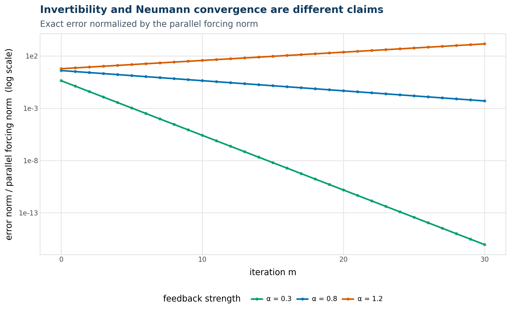

# Function Spaces, Functional Analysis, and Operator Equations {#sec-functional-analysis}

Chapter 32 treated a data vector as one geometric object rather than a list of
unrelated numbers. The same idea works for an entire function. A temperature
profile, signal, probability density, or displacement field can be added,
scaled, compared with a norm, projected onto a subspace, and transformed by a
linear operator. The price is that infinite-dimensional spaces behave in ways
that no finite matrix example reveals automatically: Cauchy limits can leave a
chosen class, closed balls need not be compact, spectra need not consist only
of eigenvalues, and point evaluation may not make sense.

This chapter develops enough functional analysis to make the operator language
in transforms, variational calculus, PDEs, and inverse problems reliable.

## Preparation from this book

Review sequences and series in [sec-series](10-series-taylor.md#sec-series), vectors and dot products in
[sec-vectors](12-vectors-space.md#sec-vectors), Fourier expansions in [sec-calculus-transforms](25-transforms.md#sec-calculus-transforms), and projection, SVD,
and conditioning in [sec-calculus-linear-algebra](32-linear-algebra-data.md#sec-calculus-linear-algebra). The $L^p$ definitions and
almost-everywhere convention come from [sec-measure-integration](38-measure-integration.md#sec-measure-integration). Chapters
[sec-calculus-variations](26-variations.md#sec-calculus-variations), [sec-calculus-pdes](27-pdes.md#sec-calculus-pdes), and [sec-inverse-data](37-inverse-data-assimilation.md#sec-inverse-data) are applications,
not prerequisites.

The repair kit is short. A **norm** obeys positivity, homogeneity, and the
triangle inequality. A sequence is **Cauchy** if its terms eventually become
arbitrarily close to one another. An inner product produces a norm by
$\|u\|=\sqrt{\langle u,u\rangle}$. Orthogonal projection is characterized by
an error perpendicular to the target subspace. In $L^p$, functions equal
almost everywhere represent the same element; statements about a particular
point therefore require extra regularity.

## Functions as vectors and norms as questions

The continuous functions on $[a,b]$, denoted $C[a,b]$, form a vector space.
Two useful norms are

$$
\|f\|_\infty=\max_{a\le x\le b}|f(x)|,
\qquad
\|f\|_1=\int_a^b|f(x)|\,dx.
$$

They ask different questions. The first controls the largest pointwise error;
the second controls accumulated error. A narrow spike can have height one but
arbitrarily small $L^1$ norm. Thus “the approximation error tends to zero” is
incomplete until the norm is named.

Sequence spaces provide discrete analogues:

$$
\ell^p=\left\{x=(x_j):\sum_{j=1}^\infty|x_j|^p<\infty\right\},
$$

for $1\le p<\infty$, with $\ell^\infty$ containing bounded sequences. The
function space $L^p$ uses the same formula with an integral.

**Nonexample.** The expression $\|f\|=|f(0)|$ is not a norm on $C[0,1]$.
A nonzero function can vanish at zero, violating positive definiteness.

Norms that are equivalent in finite dimensions need not be equivalent in
infinite dimensions. For $f_n(x)=x^n$ on $[0,1]$,

$$
\|f_n\|_\infty=1,
\qquad
\|f_n\|_2=\frac1{\sqrt{2n+1}}\longrightarrow0.
$$

No constants independent of $f$ can bound these two norms in both directions
on all of $C[0,1]$.

## Completeness and Banach spaces

A normed space is a **Banach space** if every Cauchy sequence converges to an
element of that space. Completeness is an existence principle: an iterative
construction can produce increasingly consistent approximations, but it
solves the problem inside the declared space only if the limit remains there.

Both $C[a,b]$ with the supremum norm and $L^p$ for $1\le p\le\infty$ are
complete. The same continuous functions with the $L^1$ norm are not complete.
To see the issue, approximate a jump function by continuous transition layers.
The approximations are Cauchy in $L^1$ and converge to the discontinuous step,
which lies in $L^1$ but not in $C[a,b]$.

Polynomials form another incomplete subspace of $C[0,1]$ under the supremum
norm. The Weierstrass theorem says that every continuous function is a uniform
limit of polynomials, including nonpolynomial functions such as $e^x$.
Therefore a polynomial Cauchy sequence can converge to something outside the
polynomial subspace.

Completeness is not compactness. The standard basis vectors $e_n$ in $\ell^2$
all lie in the unit ball, yet

$$
\|e_n-e_m\|_2=\sqrt2
$$

for $n\ne m$. No subsequence converges in norm. Closed bounded sets are compact
in finite-dimensional Euclidean space but generally not in infinite dimension.

Completeness also depends on the norm, not only on the underlying formulas.
The space $C^1[0,1]$ is incomplete under $\|f\|_\infty$: smooth approximations
to $|x-1/2|$ converge uniformly to a nonsmooth limit. Under the stronger norm

$$
\|f\|_{C^1}=\|f\|_\infty+\|f'\|_\infty,
$$

it is complete. A sequence Cauchy in this norm has both functions and
derivatives converging uniformly; the Fundamental Theorem then identifies the
limit's derivative. Choosing a space and choosing its norm are therefore part
of the mathematical model.

## Hilbert geometry and projection

A **Hilbert space** is a complete inner-product space. The central examples are
$\ell^2$ and $L^2$, with

$$
\langle f,g\rangle=\int f(x)\overline{g(x)}\,d\mu(x).
$$

For real-valued functions the conjugate may be omitted. Cauchy–Schwarz gives
$|\langle f,g\rangle|\le\|f\|\|g\|$.

**Theorem 39.1 (Projection).** If $M$ is a closed subspace of a Hilbert space $H$,
then every $f\in H$ has a unique decomposition

$$
f=P_Mf+r,
\qquad P_Mf\in M,\quad r\perp M.
$$

The projected element is the unique closest point in $M$. Closedness matters.
If $M$ is dense but not closed and $f\notin M$, distances to $f$ can approach
zero without attaining a minimizer.

For an orthonormal sequence $(\phi_j)$, Bessel's inequality is

$$
\sum_j|\langle f,\phi_j\rangle|^2\le\|f\|^2.
$$

If the orthonormal span is dense, Parseval's identity gives equality. Fourier
coefficients from [sec-calculus-transforms](25-transforms.md#sec-calculus-transforms) are therefore coordinates in a Hilbert
space, but equality in $L^2$ does not guarantee pointwise convergence at every
location.

As a concrete projection, approximate $f(x)=x^2$ on $[0,1]$ by $a+bx$ in
$L^2$. Orthogonality of the residual to $1$ and $x$ gives

$$
\int_0^1(x^2-a-bx)\,dx=0,
$$

$$
\int_0^1x(x^2-a-bx)\,dx=0.
$$

Solving yields $a=-1/6$ and $b=1$. This is best integrated squared error, not
an interpolant and not the best supremum-norm approximation.

## Bounded operators and linear functionals

A linear map $T:X\to Y$ between normed spaces is **bounded** when some
$C<\infty$ satisfies

$$
\|Tx\|_Y\le C\|x\|_X
$$

for every $x$. Its operator norm is

$$
\|T\|=\sup_{\|x\|_X=1}\|Tx\|_Y.
$$

For linear maps, boundedness is equivalent to continuity. This equivalence is
special to linearity.

Multiplication by an essentially bounded function $a$ defines
$(M_af)(x)=a(x)f(x)$ on $L^2$, with $\|M_a\|=\|a\|_\infty$. Integration over
$[0,1]$ is a bounded functional on $L^2$ because

$$
\left|\int_0^1f\right|
\le\|f\|_2\|1\|_2=\|f\|_2.
$$

Differentiation is not a bounded operator from $C^1[0,1]$ with only the
supremum norm on functions into $C[0,1]$: $f_n(x)=\sin(nx)/n$ has
$\|f_n\|_\infty\to0$ but $\|f_n'\|_\infty=1$. The domain norm must control a
derivative if differentiation is to be continuous.

Point evaluation is bounded on $C[0,1]$ with the supremum norm, because
$|f(x_0)|\le\|f\|_\infty$. It is not even well-defined on $L^2$ equivalence
classes: changing one value changes no $L^2$ element.

The **dual space** $H^*$ consists of bounded linear functionals. The Riesz
representation theorem says that for every $\Lambda\in H^*$ on a Hilbert
space there is a unique $g\in H$ such that

$$
\Lambda(f)=\langle f,g\rangle,
\qquad \|\Lambda\|=\|g\|.
$$

This turns linear measurements into inner products with sensitivity profiles.

Integral operators give an important class. If

$$
(Kf)(x)=\int_0^1k(x,s)f(s)\,ds
$$

and $k\in L^2([0,1]^2)$, Cauchy–Schwarz in $s$ gives

$$
|Kf(x)|^2
\le\left(\int_0^1|k(x,s)|^2\,ds\right)\|f\|_2^2.
$$

Integrating in $x$ yields

$$
\|Kf\|_2\le\|k\|_{L^2([0,1]^2)}\|f\|_2.
$$

Thus $K$ is bounded. In fact such a Hilbert–Schmidt operator is compact. Its
adjoint has kernel $\overline{k(s,x)}$, found by applying Fubini to
$\langle Kf,g\rangle$. This example connects measure-theoretic conditions to
operator geometry and to the smoothing maps in [sec-inverse-data](37-inverse-data-assimilation.md#sec-inverse-data).

## Structural theorems for Banach spaces

Three theorems explain why completeness is much more than a convenient limit
property.

The **Hahn–Banach theorem** says, in one normed-space form, that a bounded
linear functional on a subspace can be extended to the whole space without
increasing its norm. A geometric consequence is separation: if a point lies
outside a closed convex set, an appropriate continuous linear functional can
distinguish them. In Hilbert space, orthogonal projection often constructs such
a functional directly; Hahn–Banach works without an inner product. The theorem
guarantees an extension but usually does not give a unique or computationally
preferred one.

The **uniform boundedness principle** concerns a family
$\mathcal T\subset\mathcal L(X,Y)$ with Banach domain $X$. If

$$
\sup_{T\in\mathcal T}\|Tx\|_Y<\infty
\qquad\text{for every fixed }x\in X,
$$

then

$$
\sup_{T\in\mathcal T}\|T\|<\infty.
$$

Pointwise boundedness has become one common operator bound. The quantifier
order matters: the bound initially may depend on $x$. Completeness and the
Baire category theorem turn those separate bounds into a uniform conclusion.
This principle is central when partial-sum operators, discretizations, or
measurement maps converge on every input.

The **open mapping theorem** says a bounded surjective linear map between
Banach spaces sends open sets to open sets. Consequently, a bounded bijective
linear map has a bounded inverse. Algebraic invertibility alone is therefore
not enough until the domain, codomain, norms, boundedness, surjectivity, and
completeness have been checked. The related **closed graph theorem** says an
everywhere-defined linear map between Banach spaces is bounded when its graph
is closed.

These are infinite-dimensional existence and stability theorems. A program can
compute singular values of one finite matrix or test one proposed functional,
but no finite sample certifies extension for every subspace, a uniform bound
for an arbitrary operator family, or openness of every Banach-space
surjection. Their absence of a Python listing is therefore deliberate; later
finite-dimensional code illustrates consequences only after a concrete
operator and discretization have been declared.

## Adjoints, spectrum, and compactness

For a bounded operator $T$ on a Hilbert space, the **adjoint** $T^*$ satisfies

$$
\langle Tf,g\rangle=\langle f,T^*g\rangle.
$$

An operator is self-adjoint if $T=T^*$, positive if
$\langle Tf,f\rangle\ge0$, and unitary if $T^*T=TT^*=I$. These extend symmetric,
positive-semidefinite, and orthogonal matrices.

The **spectrum** of $T$ is the set of scalars $\lambda$ for which
$T-\lambda I$ lacks a bounded inverse. Every eigenvalue belongs to the
spectrum, but spectral values need not have eigenvectors. Multiplication by
$x$ on $L^2[0,1]$ has spectrum $[0,1]$ but no nonzero eigenfunction for a
particular $\lambda$: a function supported only at one point is zero in
$L^2$.

An operator is **compact** if it maps bounded sequences to sequences with
convergent subsequences after applying the operator. Finite-rank operators are
compact, and norm limits of compact operators are compact. The identity on an
infinite-dimensional space is not compact, as the sequence $Ie_n=e_n$ shows.

The compact self-adjoint spectral theorem states that a compact self-adjoint
operator has real nonzero eigenvalues of finite multiplicity, with zero as the
only possible accumulation point of the nonzero spectrum, and an orthonormal
eigenbasis for the closure of its range together with its null space. This is
the appropriate infinite-dimensional analogue of symmetric diagonalization.
It is not a theorem about arbitrary bounded operators.

Differential operators are usually **unbounded**, so their domains are part of
their definitions. Writing $Df=f'$ without specifying whether the domain is
$C^1$, a Sobolev space, periodic functions, or functions satisfying boundary
conditions hides essential information. Two operators with the same formula
but different boundary conditions can have different spectra.

An unbounded operator cannot be defined continuously on the whole Banach space,
but it may be **closed**: whenever $f_n\to f$ and $Df_n\to g$ in the ambient
norms, one has $f$ in the domain and $Df=g$. A **closable** operator has a
closed extension. The closed graph theorem says an everywhere-defined closed
linear operator between Banach spaces is bounded; therefore a genuinely
unbounded closed operator must have a proper domain. This domain discipline is
the functional-analytic version of attaching boundary and regularity
hypotheses to a differential equation.

For example, $-d^2/dx^2$ with zero endpoint values has positive discrete
eigenvalues, while periodic boundary conditions include constant functions in
the null space. The displayed derivative formula alone cannot distinguish
these problems.

## Weak convergence

A sequence $f_n$ converges **weakly** to $f$ in a Hilbert space if

$$
\langle f_n,g\rangle\to\langle f,g\rangle
$$

for every fixed $g$. Norm convergence implies weak convergence. The converse
fails: $e_n\rightharpoonup0$ in $\ell^2$ because the coordinates of every
$g\in\ell^2$ tend to zero, while $\|e_n\|=1$.

Weak convergence is useful because bounded sequences in many reflexive spaces
have weakly convergent subsequences, and convex energy functionals are often
weakly lower semicontinuous. A typical existence argument chooses a minimizing
sequence, extracts a weak limit, proves constraints survive the limit, and
uses lower semicontinuity. None of those steps is automatic for a nonconvex
functional or an unsuitable space.

Compact operators convert weak convergence into norm convergence of images:
if $f_n\rightharpoonup f$ and $K$ is compact, then $Kf_n\to Kf$ in norm. This
both helps existence proofs and explains ill-posed inversion: a compact forward
map can compress very different input directions into nearly indistinguishable
outputs.

## Operator equations and variational forms

For $Au=f$, a small residual $r=f-A\widehat u$ implies

$$
u-\widehat u=A^{-1}r
$$

only when a bounded inverse exists. Consequently

$$
\|u-\widehat u\|\le\|A^{-1}\|\,\|r\|.
$$

A residual without an inverse bound is not an error certificate.

If $\|K\|<1$, then

$$
(I-K)^{-1}=\sum_{j=0}^\infty K^j,
$$

because multiplying the finite sum by $I-K$ leaves $I-K^{m+1}$ and
$\|K^{m+1}\|\le\|K\|^{m+1}\to0$. The norm condition is sufficient, not
necessary, for invertibility.

For $u=(I-K)^{-1}f$ and the finite approximation
$u_m=\sum_{j=0}^mK^jf$, the same calculation gives the computable certificate

$$
\|u-u_m\|
\le
\frac{\|K\|^{m+1}}{1-\|K\|}\,\|f\|.
$$

The following matrix calculation returns a rounded partial sum and two
floating-point diagnostics: an evaluation of the truncation formula using
an estimated matrix 2-norm, and a computed residual norm. Neither is a
certified bound on the error of the rounded answer. In particular, the
computed norm is not a verified upper bound on the true norm. The exact
residual clinic in [Section 39.10](#sec-neumann-roundoff-certificate) supplies a separate
certificate for a declared finite system. This diagnostic listing accepts
finite float64 arrays of dimension 1–32 and powers from 0 through 10,000.

```python
import numpy as np
from numpy.typing import NDArray

def neumann_approximation(
    operator: NDArray[np.float64],
    right_side: NDArray[np.float64],
    highest_power: int,
) -> tuple[NDArray[np.float64], float, float]:
    """Return a rounded sum and float truncation/residual diagnostics."""
    matrix = np.asarray(operator)
    vector = np.asarray(right_side)
    if matrix.dtype != np.float64 or vector.dtype != np.float64:
        raise ValueError("operator and right_side must have float64 entries")
    if (matrix.ndim != 2 or matrix.shape[0] != matrix.shape[1]
            or not 1 <= matrix.shape[0] <= 32):
        raise ValueError("operator must be square with dimension 1 through 32")
    if vector.ndim != 1 or vector.size != matrix.shape[0]:
        raise ValueError("right_side must match the operator dimension")
    if not np.all(np.isfinite(matrix)) or not np.all(np.isfinite(vector)):
        raise ValueError("operator and right_side must be finite")
    if (isinstance(highest_power, bool) or not isinstance(highest_power, int)
            or not 0 <= highest_power <= 10_000):
        raise ValueError("highest_power must be an integer from 0 through 10000")
    operator_norm = float(np.linalg.norm(matrix, ord=2))
    if not np.isfinite(operator_norm) or operator_norm >= 1.0:
        raise ValueError("this diagnostic requires estimated matrix 2-norm below one")

    approximation = vector.copy()
    term = vector.copy()
    try:
        with np.errstate(over="raise", invalid="raise", divide="raise"):
            for _ in range(highest_power):
                term = matrix @ term
                approximation += term
            truncation_estimate = (
                operator_norm ** (highest_power + 1)
                * float(np.linalg.norm(vector))
                / (1.0 - operator_norm)
            )
            identity = np.eye(matrix.shape[0])
            residual_estimate = float(
                np.linalg.norm(vector - (identity - matrix) @ approximation)
            )
    except FloatingPointError as error:
        raise ValueError("computed diagnostics exceeded the finite float range") from error
    if (not np.all(np.isfinite(approximation))
            or not np.isfinite(truncation_estimate)
            or not np.isfinite(residual_estimate)):
        raise ValueError("computed diagnostics must remain finite")
    return approximation, truncation_estimate, residual_estimate

K = np.array([[0.20, 0.05], [0.00, 0.10]])
f = np.array([1.0, -0.5])
approximation, truncation_estimate, residual_estimate = neumann_approximation(K, f, 5)
print(approximation)
print("float truncation estimate:", truncation_estimate)
print("float residual estimate:", residual_estimate)
```

The mathematical bound applies to the exact partial sum, while this code also
rounds products, sums, norm evaluations and the displayed estimate. An
underflowed truncation estimate can even be zero without the total error
being zero. Changing the norm changes the exact bound and its hypotheses.
The finite-dimensional calculation cannot establish compactness or
invertibility of an infinite-dimensional operator from sampled matrix data.

For compact $K$ on a Hilbert space, the **Fredholm alternative** gives a more
structural statement about $I-K$. Either $I-K$ is invertible, or the homogeneous
equation $u-Ku=0$ has a nonzero finite-dimensional solution space. In
particular, injectivity and surjectivity are equivalent for $I-K$. When the
homogeneous equation is nontrivial, the inhomogeneous equation

$$
(I-K)u=f
$$

is solvable exactly when $f$ is orthogonal to every solution of the adjoint
homogeneous equation

$$
(I-K^*)v=0.
$$

This compatibility condition generalizes the finite-dimensional rule that a
linear system is solvable when its right side is orthogonal to the left null
space. Compactness is essential to this form of the theorem; an arbitrary
bounded operator need not have the same alternative.

Variational equations seek $u\in H$ such that

$$
a(u,v)=\ell(v)
$$

for every $v\in H$. The Lax–Milgram theorem gives a unique solution when $a$
is a bounded bilinear form and is coercive:

$$
|a(u,v)|\le M\|u\|\|v\|,
\qquad
a(v,v)\ge\alpha\|v\|^2,\quad\alpha>0,
$$

and $\ell$ is bounded. A Galerkin approximation restricts tests and trials to
a finite-dimensional subspace. Its residual is orthogonal in the variational
sense, and Céa's lemma bounds error by the best available approximation times
$M/\alpha$. This extends the weak-form discussion in [sec-calculus-pdes](27-pdes.md#sec-calculus-pdes); it
does not guarantee that a chosen mesh represents the physical data accurately.

For the Dirichlet problem $-u''+u=f$ on $(0,1)$ with $u(0)=u(1)=0$, take
$H=H_0^1(0,1)$. Here $H_0^1(0,1)$ is the completion of smooth compactly
supported functions under the norm combining an $L^2$ function and its weak
first derivative; its elements have zero boundary trace. Define

$$
a(u,v)=\int_0^1(u'v'+uv)\,dx,
\qquad
\ell(v)=\int_0^1fv\,dx.
$$

Cauchy–Schwarz shows boundedness in the norm
$\|v\|_H^2=\|v'\|_2^2+\|v\|_2^2$, while
$a(v,v)=\|v\|_H^2$ is coercive with constant one. Lax–Milgram therefore gives
one weak solution for every bounded $\ell$. This does not yet state that $u$
has two classical derivatives; that conclusion requires additional regularity
of $f$ and the domain.

## Truncation, rounding, and an exact residual certificate {#sec-neumann-roundoff-certificate}

Write $u_m$ for the **exact** Neumann partial sum and $\widehat u_m$ for the
rounded output. If a genuine upper bound $q\ge\|K\|$ is known, with
$0\le q<1$, the triangle inequality gives, in the same consistent norm,

$$
\|u-\widehat u_m\|
\le\frac{q^{m+1}}{1-q}\|f\|
+\|u_m-\widehat u_m\|.
$$

The first term controls truncation; it does not control the second term,
which includes arithmetic error. A rounded SVD norm and a rounded
evaluation of this formula are not automatically upper bounds. Goldberg's
discussion distinguishes exact and computed operations and explains why
binary arithmetic and accumulation require their own analysis
([Goldberg 1991](bibliography.md#ref-goldberg1991floating), sections on rounding error and summation).

**An exact-binary witness.** Take the scalar system $K=1/4$, $f=1$ and
$m=60$. The solution is $u=4/3$, and the exact truncation error is

$$
u-u_{60}=\frac{1}{3\cdot2^{120}}.
$$

The preceding floating-point listing returns
$\widehat u_{60}=6004799503160661/2^{52}$, displayed as
`1.3333333333333333`. Its exact forward error and true residual are

$$
u-\widehat u_{60}=\frac{1}{3\cdot2^{52}},\qquad
r=1-\tfrac34\widehat u_{60}=2^{-54}.
$$

Both the input $1/4$ and the returned binary value are exact rational
numbers here. The printed truncation estimate is about
$2.51\times10^{-37}$, yet the forward error is about
$7.40\times10^{-17}$. Worse, the computed floating residual is `0.0`:
the multiplication rounds before subtraction. A zero computed residual
does not imply a zero true residual.

**Certify the answer through a true residual.** For a finite real matrix,
use the induced infinity norm and the vector maximum norm:

$$
q_\infty=\|K\|_\infty
=\max_i\sum_j|K_{ij}|,\qquad
r_\infty=\|f-(I-K)\widehat u\|_\infty.
$$

When the **exact** row sum satisfies $q_\infty<1$, the Neumann theorem
guarantees a unique solution. For $e=u-\widehat u$, the identity
$e=Ke+r$ gives

$$
\|e\|_\infty\le q_\infty\|e\|_\infty+r_\infty,
\qquad
\boxed{\|u-\widehat u\|_\infty\le\frac{r_\infty}{1-q_\infty}}.
$$

Thus any proven upper bound on the true residual would suffice. For a small
stored system we can compute both quantities exactly: every finite float64
entry is a rational number. The standalone helper below rejects other
dtypes, then uses `Fraction.from_float` on the actual stored values.
It performs no silent data conversion to a different precision. Dimension
1–16 keeps this exact audit small; this is not a large-system solver.

```python
from fractions import Fraction
import numpy as np
from numpy.typing import NDArray

def exact_residual_certificate(
    operator: NDArray[np.float64],
    right_side: NDArray[np.float64],
    approximation: NDArray[np.float64],
) -> tuple[Fraction, Fraction, Fraction]:
    """Return exact infinity row norm, true residual norm, and error bound."""
    matrix = np.asarray(operator)
    forcing = np.asarray(right_side)
    candidate = np.asarray(approximation)
    if any(array.dtype != np.float64 for array in (matrix, forcing, candidate)):
        raise ValueError("all three arrays must have float64 entries")
    if (matrix.ndim != 2 or matrix.shape[0] != matrix.shape[1]
            or not 1 <= matrix.shape[0] <= 16):
        raise ValueError("operator must be square with dimension 1 through 16")
    dimension = matrix.shape[0]
    if (forcing.ndim != 1 or candidate.ndim != 1
            or forcing.size != dimension or candidate.size != dimension):
        raise ValueError("vectors must match the operator dimension")
    if not all(np.all(np.isfinite(array)) for array in (matrix, forcing, candidate)):
        raise ValueError("all stored entries must be finite")
    exact_matrix = tuple(
        tuple(Fraction.from_float(float(entry)) for entry in row)
        for row in matrix
    )
    exact_forcing = tuple(Fraction.from_float(float(entry)) for entry in forcing)
    exact_candidate = tuple(Fraction.from_float(float(entry)) for entry in candidate)
    row_norm = max(sum(map(abs, row), Fraction(0)) for row in exact_matrix)
    if row_norm >= 1:
        raise ValueError("exact infinity-norm row sum must be below one")
    residual_norm = max(
        abs(exact_forcing[index] - exact_candidate[index] + sum(
            (coefficient * value for coefficient, value in zip(
                row, exact_candidate, strict=True
            )), Fraction(0)
        ))
        for index, row in enumerate(exact_matrix)
    )
    return row_norm, residual_norm, residual_norm / (1 - row_norm)

K = np.array([[0.25]])
f = np.array([1.0])
rounded = np.array([4.0 / 3.0])
row_norm, true_residual, error_bound = exact_residual_certificate(K, f, rounded)
print("exact infinity row norm:", row_norm)
print("exact true residual norm:", true_residual)
print("exact infinity error bound:", error_bound)
```

For this scalar witness the returned bound is exactly
$2^{-54}/(1-1/4)=1/(3\cdot2^{52})$, equal to the actual error. Keep the
bound as a `Fraction`: converting it to an ordinary float can round it
downward. This certificate concerns the exact finite system represented by
the stored arrays and this particular candidate. It does not include
input-representation or measurement error, a physical model's uncertainty,
or error from discretizing an infinite-dimensional operator. Compatible
physical units or nondimensional scaling must also be declared before
comparing vector components in one maximum norm.

This is an **infinity-norm** certificate; the earlier diagnostic estimates
a **2-norm**. The two contraction conditions differ. If the exact row norm
is at least one, this helper reports that its sufficient condition is
unsupported. It does not establish singularity, failure of other norm
criteria, or divergence of a Neumann series. Exercise 19 changes both the
matrix and the candidate, then tests this limitation.

## Applied clinic: nonlocal thermal feedback

Let $H=L^2(0,L)$ and

$$
\phi(x)=\sqrt{\frac3{L^3}}x.
$$

Because $\int_0^L\phi^2=1$, the operator

$$
(K\theta)(x)=\phi(x)\int_0^L\phi(s)\theta(s)\,ds
$$

is orthogonal projection onto $\operatorname{span}\{\phi\}$. It satisfies
$K^2=K$, $K^*=K$, and $\|K\|=1$. The kernel $\phi(x)\phi(s)$ has units
inverse length, so integrating it against a temperature anomaly returns a
temperature anomaly.

Consider the stylized linear feedback equation

$$
(I-\alpha K)\theta=f,
$$

where $f$ is external thermal forcing and $\alpha$ is dimensionless. Decompose
$f=f_\parallel+f_\perp$, where $f_\parallel=Kf$. Projecting parallel and
perpendicular to $\phi$ gives

$$
(1-\alpha)\theta_\parallel=f_\parallel,
\qquad
\theta_\perp=f_\perp.
$$

For $\alpha\ne1$ the unique solution is

$$
\theta=f_\perp+\frac{f_\parallel}{1-\alpha}.
$$

At $\alpha=1$, a nonzero $f_\parallel$ makes the equation inconsistent. If
$f_\parallel=0$, every added multiple of $\phi$ is another solution. Thus the
same singular value produces either nonexistence or nonuniqueness depending on
the forcing.

The Neumann approximation is

$$
\theta_m=\sum_{j=0}^m\alpha^jK^jf
=f_\perp+(1+\alpha+\cdots+\alpha^m)f_\parallel.
$$

Comparison with the exact geometric sum gives

$$
\|\theta-\theta_m\|
=\frac{|\alpha|^{m+1}}{|1-\alpha|}\|f_\parallel\|.
$$

For $|\alpha|<1$ the iteration converges. At $\alpha=1.2$, the operator remains
invertible because $\alpha\ne1$, but its operator Neumann series diverges in
norm. The displayed solution iterates diverge when $f_\parallel\ne0$;
when $f_\parallel=0$, they remain equal to $f_\perp$. Failure of a chosen
algorithm is not proof that the equation lacks a solution.

<figure id="fig-operator-neumann-convergence">


<figcaption>

Figure 39.1: Neumann iteration converges at different rates below unit feedback and diverges above it even though the operator is invertible away from alpha one.

</figcaption>
</figure>

[Figure 39.1](#fig-operator-neumann-convergence) uses $f_\parallel\ne0$ for its normalized
error and plots the exact formula, not a fitted trend. The vertical separation
measures sensitivity to feedback strength. The
growing $\alpha=1.2$ curve illustrates a theorem-scope boundary: the norm-series
criterion controls this iteration, whereas invertibility fails only at
$\alpha=1$ for this projection.

## Units, error, and theorem-scope ledger

- An $L^2$ temperature norm has units kelvin times square-root length. Divide
  by a reference norm before calling an error relative or dimensionless.
- Point evaluation is not defined on an $L^2$ equivalence class.
- Closedness is required for the projection theorem; completeness is required
  for Cauchy constructions to remain in the space.
- Compact does not mean small in operator norm, and bounded sets need not be
  compact in infinite dimensions.
- Weak convergence does not imply norm convergence. Compactness may strengthen
  convergence only after applying the compact operator.
- The spectral theorem quoted here is for compact self-adjoint operators.
- $\|K\|<1$ is sufficient for Neumann inversion, not necessary for
  invertibility.
- Lax–Milgram needs boundedness and coercivity on the chosen Hilbert space.
- A small residual becomes an error bound only through a stability estimate.

## Additional worked examples

### Worked example A: projection of a quadratic

Seek $p(x)=a+bx$ minimizing $\|x^2-p\|_2$. Orthogonality to $1$ and $x$ gives

$$
\frac13-a-\frac b2=0,
\qquad
\frac14-\frac a2-\frac b3=0.
$$

The first equation gives $a=1/3-b/2$. Substitution into the second gives
$1/12-b/12=0$, so $b=1$ and $a=-1/6$. The residual is orthogonal to the whole
two-dimensional subspace because it is orthogonal to its basis.

### Worked example B: weak convergence of the standard basis

For $g=(g_j)\in\ell^2$,

$$
\langle e_n,g\rangle=g_n.
$$

Every square-summable sequence has $g_n\to0$; otherwise infinitely many terms
would stay above some positive magnitude and the square sum would diverge.
Thus $e_n\rightharpoonup0$. But $\|e_n\|_2=1$, so convergence is not in norm.

### Worked example C: norm of the rank-one projection

Cauchy–Schwarz gives

$$
\|Kf\|=|\langle f,\phi\rangle|\|\phi\|
\le\|f\|.
$$

Hence $\|K\|\le1$. Taking $f=\phi$ gives $K\phi=\phi$, so equality is attained
and $\|K\|=1$. The same calculation shows $K^*=K$.

### Worked example D: a residual certificate

Suppose $Au=f$, $A^{-1}$ is bounded with $\|A^{-1}\|\le25$, and an
approximation has residual norm $4\times10^{-5}$ in output units. Then

$$
\|u-\widehat u\|
=\|A^{-1}(f-A\widehat u)\|
\le25(4\times10^{-5})=10^{-3}
$$

in solution units. Without the inverse bound, the residual alone supplies no
such conclusion.

<!-- inline-formula-code:start -->
## Formula and finite computation

A useful formula in this chapter is

$$
x_{n+1}=Tx_n+b
$$

A matrix contraction gives a finite-dimensional model of operator iteration. The following standalone Python block expresses that finite rule with its inputs and stopping conditions visible.

```python
import numpy as np

operator = np.array([[0.4, 0.1], [0.0, 0.5]])
forcing = np.array([1.0, -1.0])
state = np.zeros(2)
for _ in range(30):
    state = operator @ state + forcing
residual = np.linalg.norm(state - (operator @ state + forcing))
print(state, residual)
```

**What the computation establishes.** The output reports a rounded iterate
and a floating residual diagnostic for this finite case. A certified error
bound requires a verified stability estimate and a bound on the true
residual, such as the exact calculation in
[Section 39.10](#sec-neumann-roundoff-certificate). The printed residual alone supplies
neither.
<!-- inline-formula-code:end -->

## Summary

Banach spaces keep Cauchy limits inside the model; Hilbert spaces add
orthogonality and projection. Bounded operators are the continuous linear
maps; Hahn–Banach, uniform boundedness, and open mapping turn completeness
into extension and stability conclusions. Adjoints encode dual action, compact
operators recover discrete spectral features, and weak convergence supports existence arguments. Operator
equations require both algebra and stability. These principles lead naturally
to the finite but very large systems studied in [sec-numerical-linear-algebra](40-numerical-linear-algebra.md#sec-numerical-linear-algebra).

## Exercises

<div class="exercise" id="calculus-39-functional-analysis-ex-1">
<p class="exercise-title"><strong>Exercise 1</strong></p>

Verify that $\|f\|_1+\|f\|_\infty$ is a norm on $C[0,1]$.

</div>

<div class="exercise" id="calculus-39-functional-analysis-ex-2">
<p class="exercise-title"><strong>Exercise 2</strong></p>

Find a sequence converging in $L^1[0,1]$ but not in $L^\infty[0,1]$.

</div>

<div class="exercise" id="calculus-39-functional-analysis-ex-3">
<p class="exercise-title"><strong>Exercise 3</strong></p>

Explain why polynomials are not complete in the supremum norm.

</div>

<div class="exercise" id="calculus-39-functional-analysis-ex-4">
<p class="exercise-title"><strong>Exercise 4</strong></p>

Compute the $L^2$ projection of $x^3$ onto constants on $[0,1]$.

</div>

<div class="exercise" id="calculus-39-functional-analysis-ex-5">
<p class="exercise-title"><strong>Exercise 5</strong></p>

Compute its projection onto $\operatorname{span}\{1,x\}$.

</div>

<div class="exercise" id="calculus-39-functional-analysis-ex-6">
<p class="exercise-title"><strong>Exercise 6</strong></p>

Prove Bessel's inequality for a finite orthonormal family using a projection.

</div>

<div class="exercise" id="calculus-39-functional-analysis-ex-7">
<p class="exercise-title"><strong>Exercise 7</strong></p>

Find the operator norm of multiplication by $a(x)=1+x$ on $L^2[0,1]$.

<details class="solution"><summary>Solution</summary>

For $a(x)=1+x$ on $[0,1]$, multiplication satisfies

$$
\|M_af\|_2^2
=\int_0^1|1+x|^2|f(x)|^2\,dx
\le4\|f\|_2^2.
$$

Hence $\|M_a\|\le2$. To show this bound is sharp, choose unit-norm functions
supported increasingly close to $x=1$. On those supports, $1+x$ approaches
two, so $\|M_af\|_2$ approaches two. The operator norm is therefore the
essential supremum, $\|M_a\|=2$, even though no nonzero $L^2$ function can be
supported at the single point where the maximum occurs.

</details>

</div>

<div class="exercise" id="calculus-39-functional-analysis-ex-8">
<p class="exercise-title"><strong>Exercise 8</strong></p>

Show that integration against $g\in L^2$ defines a bounded functional and
identify its Riesz representative.

</div>

<div class="exercise" id="calculus-39-functional-analysis-ex-9">
<p class="exercise-title"><strong>Exercise 9</strong></p>

Explain why differentiation becomes bounded if $C^1[0,1]$ is given the norm
$\|f\|_\infty+\|f'\|_\infty$.

</div>

<div class="exercise" id="calculus-39-functional-analysis-ex-10">
<p class="exercise-title"><strong>Exercise 10</strong></p>

Find the adjoint of an integral operator with square-integrable kernel
$k(x,s)$.

<details class="solution"><summary>Solution</summary>

Let

$$
(Kf)(x)=\int_0^1k(x,s)f(s)\,ds.
$$

For integrable products, Fubini gives

$$
\langle Kf,g\rangle
=\int_0^1f(s)
\overline{\left(\int_0^1\overline{k(x,s)}g(x)\,dx\right)}\,ds.
$$

Thus

$$
(K^*g)(s)=\int_0^1\overline{k(x,s)}g(x)\,dx.
$$

After renaming variables, the adjoint kernel is
$k^*(x,s)=\overline{k(s,x)}$. A real symmetric kernel therefore defines a
self-adjoint operator.

</details>

</div>

<div class="exercise" id="calculus-39-functional-analysis-ex-11">
<p class="exercise-title"><strong>Exercise 11</strong></p>

Prove that a finite-rank operator is compact.

</div>

<div class="exercise" id="calculus-39-functional-analysis-ex-12">
<p class="exercise-title"><strong>Exercise 12</strong></p>

Give a bounded sequence in $\ell^2$ with no norm-convergent subsequence.

</div>

<div class="exercise" id="calculus-39-functional-analysis-ex-13">
<p class="exercise-title"><strong>Exercise 13</strong></p>

For $K^2=K$, derive $(I-\alpha K)^{-1}$ directly when $\alpha\ne1$.

</div>

<div class="exercise" id="calculus-39-functional-analysis-ex-14">
<p class="exercise-title"><strong>Exercise 14</strong></p>

Compare the exact inverse with its Neumann series for $\alpha=-1/2$ and
$\alpha=2$.

</div>

<div class="exercise" id="calculus-39-functional-analysis-ex-15">
<p class="exercise-title"><strong>Exercise 15</strong></p>

For $a(u,v)=\int_0^1u'v'+uv$, identify a natural Hilbert norm and prove
coercivity.

<details class="solution"><summary>Solution</summary>

On $H_0^1(0,1)$ use

$$
\|u\|_H^2=\|u'\|_2^2+\|u\|_2^2.
$$

For $a(u,v)=\int_0^1(u'v'+uv)\,dx$, two applications of Cauchy–Schwarz and
the Euclidean inequality in two components give

$$
|a(u,v)|\le\|u\|_H\|v\|_H.
$$

Also $a(u,u)=\|u\|_H^2$, so coercivity holds with constant one. Consequently
Lax–Milgram supplies a unique weak solution for every bounded right-side
functional. Classical twice differentiability is a separate regularity claim.

</details>

</div>

<div class="exercise" id="calculus-39-functional-analysis-ex-16">
<p class="exercise-title"><strong>Exercise 16</strong></p>

Explain what additional constant turns a Galerkin residual into an error
estimate.

</div>

<div class="exercise" id="calculus-39-functional-analysis-ex-17">
<p class="exercise-title"><strong>Exercise 17</strong></p>

State Hahn–Banach's norm-preserving extension conclusion and explain why
it does not supply a unique extension.

</div>

<div class="exercise" id="calculus-39-functional-analysis-ex-18">
<p class="exercise-title"><strong>Exercise 18</strong></p>

Rewrite the uniform boundedness principle with quantifiers, contrasting
its pointwise-bounded hypothesis with its uniformly-bounded conclusion.

</div>

<div class="exercise" id="calculus-39-functional-analysis-ex-19">
<p class="exercise-title"><strong>Exercise 19</strong></p>

**Change the matrix and audit a rounded answer.** All entries are
dimensionless. Let
$K=\begin{pmatrix}1/4&-1/8\\0&1/2\end{pmatrix}$,
$f=(1,1)^T$, $\varepsilon=2^{-52}$ and
$\widehat u=(1+\varepsilon,2-2\varepsilon)^T$.
Solve $(I-K)u=f$ exactly. Compute the true signed residual, the induced
infinity norm and its error certificate. Compare that certificate with
the actual maximum-component error. Explain why this certifies the
stored finite system rather than a continuum model or measured data.
Then replace $K$ by
$\begin{pmatrix}3/4&1/2\\0&0\end{pmatrix}$, keeping $f$.
Does the exact row-sum test apply? Determine invertibility and the
matrix 2-norm independently; what does refusal of this particular
certificate establish?

*Hint:* solve the triangular systems from the second row upward. For
the first matrix calculate $r=f-(I-K)\widehat u$ before taking absolute
values. For the second matrix use $KK^T$ to compute its singular values.

<details class="solution"><summary>Solution</summary>

For the first matrix,

$$
I-K=\begin{pmatrix}3/4&1/8\\0&1/2\end{pmatrix},\qquad
u=\begin{pmatrix}1\\2\end{pmatrix},\qquad
u-\widehat u=\begin{pmatrix}-\varepsilon\\2\varepsilon\end{pmatrix}.
$$

Both proposed candidate entries are exactly representable in float64. The
signed residual is

$$
r=f-(I-K)\widehat u
=\begin{pmatrix}-\varepsilon/2\\\varepsilon\end{pmatrix},\qquad
r_\infty=\varepsilon.
$$

The absolute row sums of $K$ are $3/8$ and $1/2$, so $q_\infty=1/2$.
Consequently

$$
\|u-\widehat u\|_\infty
\le\frac{\varepsilon}{1-1/2}=2\varepsilon.
$$

The actual maximum-component error is also $2\varepsilon$: this bound is
sharp. Its exact rational arithmetic controls the algebraic error for these
stored entries; it makes no claim about physical observations, input
representation before storage or continuum discretization.

For the changed matrix, $q_\infty=3/4+1/2=5/4$, so the row-sum helper
cannot supply its certificate. Nevertheless

$$
I-K=\begin{pmatrix}1/4&-1/2\\0&1\end{pmatrix},\qquad
\det(I-K)=1/4,\qquad u=(6,1)^T.
$$

Moreover $KK^T=\operatorname{diag}(13/16,0)$, hence
$\|K\|_2=\sqrt{13}/4<1$. The system is uniquely solvable and its Neumann
series converges in the 2-norm, although this infinity-norm sufficient test
fails. Refusing one certificate is a statement about the scope of that
test, not proof of nonexistence, singularity or divergent iteration.

</details>

</div>

## Selected solutions

### Solution to Exercise 7

For $a(x)=1+x$ on $[0,1]$, multiplication satisfies

$$
\|M_af\|_2^2
=\int_0^1|1+x|^2|f(x)|^2\,dx
\le4\|f\|_2^2.
$$

Hence $\|M_a\|\le2$. To show this bound is sharp, choose unit-norm functions
supported increasingly close to $x=1$. On those supports, $1+x$ approaches
two, so $\|M_af\|_2$ approaches two. The operator norm is therefore the
essential supremum, $\|M_a\|=2$, even though no nonzero $L^2$ function can be
supported at the single point where the maximum occurs.

### Solution to Exercise 10

Let

$$
(Kf)(x)=\int_0^1k(x,s)f(s)\,ds.
$$

For integrable products, Fubini gives

$$
\langle Kf,g\rangle
=\int_0^1f(s)
\overline{\left(\int_0^1\overline{k(x,s)}g(x)\,dx\right)}\,ds.
$$

Thus

$$
(K^*g)(s)=\int_0^1\overline{k(x,s)}g(x)\,dx.
$$

After renaming variables, the adjoint kernel is
$k^*(x,s)=\overline{k(s,x)}$. A real symmetric kernel therefore defines a
self-adjoint operator.

### Solution to Exercise 15

On $H_0^1(0,1)$ use

$$
\|u\|_H^2=\|u'\|_2^2+\|u\|_2^2.
$$

For $a(u,v)=\int_0^1(u'v'+uv)\,dx$, two applications of Cauchy–Schwarz and
the Euclidean inequality in two components give

$$
|a(u,v)|\le\|u\|_H\|v\|_H.
$$

Also $a(u,u)=\|u\|_H^2$, so coercivity holds with constant one. Consequently
Lax–Milgram supplies a unique weak solution for every bounded right-side
functional. Classical twice differentiability is a separate regularity claim.

### Solution to Exercise 19

For the first matrix,

$$
I-K=\begin{pmatrix}3/4&1/8\\0&1/2\end{pmatrix},\qquad
u=\begin{pmatrix}1\\2\end{pmatrix},\qquad
u-\widehat u=\begin{pmatrix}-\varepsilon\\2\varepsilon\end{pmatrix}.
$$

Both proposed candidate entries are exactly representable in float64. The
signed residual is

$$
r=f-(I-K)\widehat u
=\begin{pmatrix}-\varepsilon/2\\\varepsilon\end{pmatrix},\qquad
r_\infty=\varepsilon.
$$

The absolute row sums of $K$ are $3/8$ and $1/2$, so $q_\infty=1/2$.
Consequently

$$
\|u-\widehat u\|_\infty
\le\frac{\varepsilon}{1-1/2}=2\varepsilon.
$$

The actual maximum-component error is also $2\varepsilon$: this bound is
sharp. Its exact rational arithmetic controls the algebraic error for these
stored entries; it makes no claim about physical observations, input
representation before storage or continuum discretization.

For the changed matrix, $q_\infty=3/4+1/2=5/4$, so the row-sum helper
cannot supply its certificate. Nevertheless

$$
I-K=\begin{pmatrix}1/4&-1/2\\0&1\end{pmatrix},\qquad
\det(I-K)=1/4,\qquad u=(6,1)^T.
$$

Moreover $KK^T=\operatorname{diag}(13/16,0)$, hence
$\|K\|_2=\sqrt{13}/4<1$. The system is uniquely solvable and its Neumann
series converges in the 2-norm, although this infinity-norm sufficient test
fails. Refusing one certificate is a statement about the scope of that
test, not proof of nonexistence, singularity or divergent iteration.
