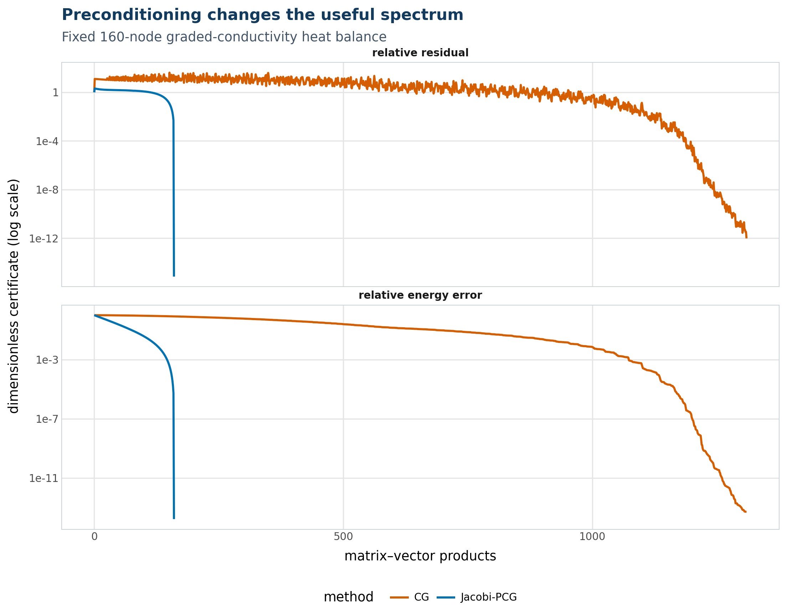

# Numerical Linear Algebra at Scale {#sec-numerical-linear-algebra}

A matrix equation can be algebraically solvable and computationally
untrustworthy. Nearly dependent columns magnify data error; elimination creates
roundoff; a sparse factorization can exhaust memory; and an iterative method
can report a small residual while the physical state remains inaccurate.
Chapter [sec-calculus-linear-algebra](32-linear-algebra-data.md#sec-calculus-linear-algebra) explained the geometry of systems, QR,
least squares, eigenvalues, and SVD. This chapter asks how to compute those
objects reliably when exact arithmetic and dense storage are unavailable.

## Preparation from this book

Review floating-point arithmetic in
the [concise computation toolkit](00i-precalculus-bridge.md#sec-foundation-computation), propagated
error in [sec-implicit](04-implicit-applications.md#sec-implicit), numerical approximation in [sec-numerical-calculus](16-numerical.md#sec-numerical-calculus),
and matrices, norms, singular values, and condition numbers in
[sec-calculus-linear-algebra](32-linear-algebra-data.md#sec-calculus-linear-algebra). The PDE grids of [sec-calculus-pdes](27-pdes.md#sec-calculus-pdes), ODE solver
certificates of [sec-numerical-odes](33-numerical-odes.md#sec-numerical-odes), and inverse problems of [sec-inverse-data](37-inverse-data-assimilation.md#sec-inverse-data)
provide applications. Functional analysis in [sec-functional-analysis](39-functional-analysis.md#sec-functional-analysis) gives a
broader interpretation but is optional.

Repair these facts before proceeding. A residual is
$r=b-A\widehat x$. A symmetric matrix is **positive definite** when
$v^TAv>0$ for every nonzero $v$. Its eigenvalues are positive. The induced
two-norm condition number is

$$
\kappa_2(A)=\|A\|_2\|A^{-1}\|_2
=\frac{\sigma_{\max}}{\sigma_{\min}}
$$

for invertible $A$. A sparse matrix stores only nonzero entries; a
**matrix-free** method computes $Av$ without storing $A$ explicitly.

## Exact problems and inexact arithmetic

Suppose $Ax=b$ and an algorithm returns $\widehat x$. **Forward error** is
$\widehat x-x$. **Residual** is $b-A\widehat x$. **Backward error** asks for
the smallest perturbations $\Delta A,\Delta b$ such that

$$
(A+\Delta A)\widehat x=b+\Delta b.
$$

An algorithm is backward stable when its answer solves a nearby problem, with
nearby measured relative to machine precision and problem scale. Stability is
an algorithm property; conditioning is a problem property.

For a nonsingular system, perturbing only the right side gives

$$
\frac{\|\widehat x-x\|}{\|x\|}
\le\kappa(A)\frac{\|r\|}{\|b\|}
$$

under compatible assumptions and nonzero denominators. A relative residual of
$10^{-12}$ can permit relative error $10^{-2}$ when $\kappa(A)=10^{10}$.

A normwise backward-error indicator is

$$
\eta=\frac{\|b-A\widehat x\|}
{\|A\|\,\|\widehat x\|+\|b\|}.
$$

The numerator and denominator have the same units. The ratio is dimensionless.

Normwise error is not always the right question. In a circuit, one current may
be physically tiny while another is large; a global norm can hide a disastrous
relative error in the small component. **Componentwise backward error** permits
each entry to be perturbed relative to its own scale. It is especially useful
for matrices whose rows represent balances of very different magnitudes.

Conversely, componentwise relative error becomes meaningless at an exact zero.
A mixed absolute-relative scale such as

$$
\frac{|r_i|}{a_{\mathrm{abs}}+a_{\mathrm{rel}}s_i}
$$

requires a declared physical scale $s_i$ and absolute floor. Row and column
equilibration can reduce avoidable scale disparities before factorization, but
the transformations and the route back to physical variables must be recorded.
Scaling can improve numerical behavior without changing the information
content or repairing near-linear dependence.

The standard rounding model is

$$
\operatorname{fl}(a\mathbin\circ b)
=(a\mathbin\circ b)(1+\delta),
\qquad |\delta|\le u,
$$

for one basic operation away from overflow, underflow, and exceptional cases.
Here $u$ is unit roundoff. A million operations do not simply create a million
identical errors; signs and data flow matter, so analysis uses structured
bounds rather than decimal-place folklore.

**Nonexample.** Printing more digits is not an accuracy certificate. Digits
can be reproducible consequences of ill-conditioned input or an unstable
algorithm.

## Direct methods

Gaussian elimination factors

$$
PA=LU,
$$

where $P$ records row exchanges, $L$ is unit lower triangular, and $U$ is upper
triangular. Partial pivoting selects a large available pivot in each column to
avoid division by a tiny number. It is highly successful in practice and has a
backward-error theory involving a growth factor, but no claim that the growth
factor is always small should be made.

For symmetric positive-definite $A$, Cholesky factorization gives

$$
A=LL^T.
$$

It uses about half the arithmetic and storage of a general dense LU, preserves
symmetry, and needs no pivoting in its standard form. Attempting Cholesky is
also a useful structural test: failure may reveal an indefinite matrix,
asymmetry, or roundoff near singularity.

Dense factorization costs order $n^3$ operations and $n^2$ storage. Sparse cost
depends on the nonzero graph and elimination order. **Fill-in** means that
zeros of $A$ become nonzeros in its factors. A two-dimensional grid matrix may
be sparse while a poor ordering creates large factors. Sparse structure must
therefore be inspected before choosing a direct method.

Factorization and solution should be separated in cost reports. If one matrix
serves many right sides, the expensive factorization is reused while each
triangular solve costs much less. If matrix entries change, reuse may no longer
be legitimate even when the sparsity pattern stays fixed.

**Iterative refinement** starts from a computed solution, evaluates a residual,
solves a correction equation

$$
A\delta x=r,
$$

and replaces $\widehat x$ by $\widehat x+\delta x$. Computing the residual in
higher precision than the factorization can recover accuracy when the factor
solve is sufficiently stable and the condition number is not too large for the
precision combination. Refinement is not magic: a correction solve using an
unreliable factorization or a residual rounded to zero cannot expose the lost
information.

Mixed-precision algorithms exploit this idea by factoring quickly in a lower
precision and refining in a higher one. Any performance claim must include
conversion cost, convergence failures, and the precision used for the final
certificate. “Solved in half precision” can conceal that accuracy was certified
and repaired in double precision.

## Stable least squares

For $\min_x\|Ax-b\|_2$, the normal equations are

$$
A^TAx=A^Tb.
$$

They are geometrically correct but computationally risky because

$$
\kappa_2(A^TA)=\kappa_2(A)^2.
$$

Householder QR constructs orthogonal reflectors

$$
H=I-2\frac{vv^T}{v^Tv}
$$

that zero selected subdiagonal entries without forming $A^TA$. If
$A=QR$ with independent columns, solve

$$
Rx=Q^Tb.
$$

Orthogonal transformations preserve the two-norm and are backward stable.
Modified Gram–Schmidt can be useful, but Householder QR is the standard robust
dense choice.

Near rank deficiency, column-pivoted QR reveals small diagonal scales in $R$.
SVD is more expensive but gives the cleanest rank and minimum-norm information.
Numerical rank depends on a tolerance and units; scaling a column from metres
to millimetres changes raw singular values without changing the physical
experiment.

## Stationary iterations

Split $A=M-N$ and iterate

$$
x^{(k+1)}=M^{-1}Nx^{(k)}+M^{-1}b.
$$

With $A=D-L-U$, Jacobi uses $M=D$, while Gauss–Seidel uses $M=D-L$. The error
satisfies

$$
e^{(k+1)}=Ge^{(k)},
\qquad G=M^{-1}N.
$$

The method converges for every starting vector exactly when the spectral radius
$\rho(G)<1$. A matrix being nonsingular does not guarantee this condition.

Strict diagonal dominance is a convenient sufficient condition for Jacobi or
Gauss–Seidel in common settings. For symmetric positive-definite matrices,
Gauss–Seidel converges, but Jacobi needs additional care. Relaxation replaces
the full update by a weighted one. A weight that accelerates one matrix can
destabilize another; it is not a universal tuning constant.

Stationary methods are often more valuable as preconditioners or smoothing
steps than as stand-alone high-accuracy solvers.

## Krylov spaces and conjugate gradients

Starting from $x_0$ with residual $r_0=b-Ax_0$, the $m$th Krylov space is

$$
\mathcal K_m(A,r_0)
=\operatorname{span}\{r_0,Ar_0,\ldots,A^{m-1}r_0\}.
$$

It records everything accessible through repeated matrix–vector products.
Arnoldi iteration builds an orthonormal basis for this space when $A$ is
general; Lanczos uses symmetry to reduce the recurrence.

For SPD $A$, solving $Ax=b$ is equivalent to minimizing

$$
\Phi(x)=\frac12x^TAx-b^Tx.
$$

Its gradient is $Ax-b=-r$. Conjugate gradients chooses directions satisfying
$p_i^TAp_j=0$ for $i\ne j$. If $r_0=0$, stop: $x_0$ already solves the
system. Otherwise initialize $p_0=r_0$. While the residual is nonzero,
one convenient recurrence is

$$
\alpha_k=\frac{r_k^Tr_k}{p_k^TAp_k},
\qquad
x_{k+1}=x_k+\alpha_kp_k,
$$

$$
r_{k+1}=r_k-\alpha_kAp_k,
\qquad
\beta_k=\frac{r_{k+1}^Tr_{k+1}}{r_k^Tr_k},
\qquad
p_{k+1}=r_{k+1}+\beta_kp_k.
$$

### When the recurrence is finished {#sec-cg-stopping}

After updating $x_{k+1}$ and $r_{k+1}$, test the new residual. If
$r_{k+1}=0$ in exact arithmetic, accept $x_{k+1}$ and stop;
$\beta_k$ and $p_{k+1}$ are needed only if continuing. A nonzero search
direction has $p_k^TAp_k>0$ for SPD $A$, but after completion a zero
direction cannot define another step. This is successful termination,
not evidence that $A$ is singular.

The official Netlib implementation checks the initial residual before
iteration and checks again after each residual update
([Project n.d.](bibliography.md#ref-netlibcgtemplate), lines 29–39 and 54–61). Its floating-point stopping
uses a tolerance; the decisions in Exercise 19 instead use exact rational
identities. Floating-point practice still needs the declared tolerance
and residual/conditioning audit developed above.

In exact arithmetic, CG reaches the solution in at most $n$ iterations.
Some right-hand sides finish in fewer than $n$ steps: **at most** does
not mean **exactly**. Write $e_m=x_m-x_\ast$, where $Ax_\ast=b$.
In the energy norm $\|e\|_A=\sqrt{e^TAe}$, the relative bound below
assumes $e_0\ne0$:

$$
\frac{\|e_m\|_A}{\|e_0\|_A}
\le2\left(\frac{\sqrt\kappa-1}{\sqrt\kappa+1}\right)^m,
$$

where $\kappa=\kappa_2(A)$. Eigenvalue clustering often gives faster behavior
than this worst-case bound. Roundoff destroys exact conjugacy, so more than
$n$ iterations or stagnation can occur in finite precision.

## GMRES, eigenproblems, and matrix-free work

For a nonsymmetric system, GMRES chooses $x_m\in x_0+\mathcal K_m(A,r_0)$ to
minimize $\|b-Ax_m\|_2$. Arnoldi produces a small upper-Hessenberg least-squares
problem. The residual norm is nonincreasing before restart, but memory and
orthogonalization cost grow with $m$. Restarted GMRES limits storage while
discarding information; it may stagnate even when unrestarted GMRES would
converge.

For eigenvalues, power iteration amplifies a dominant eigenvector component,
inverse iteration targets eigenvalues near a shift, and Rayleigh-quotient
iteration updates the shift. Rates depend on spectral separation and starting
components. A normalized eigen-residual

$$
\frac{\|Av-\lambda v\|}{\|A\|\|v\|}
$$

is a backward-style check, not automatically a bound on eigenvector angle when
eigenvalues cluster.

For a normal matrix, eigenvalue perturbations are controlled cleanly by matrix
perturbation size. A highly **nonnormal** matrix can behave very differently.
The matrix

$$
A=\begin{pmatrix}1&M\\0&1\end{pmatrix}
$$

has only eigenvalue one, yet its powers contain the growing off-diagonal term
$kM$. Small perturbations can split its defective eigenvalue substantially.
The **pseudospectrum** records values $z$ for which
$\|(A-zI)^{-1}\|$ is large, equivalently values that become eigenvalues after a
small perturbation. It helps explain transient growth and slow or irregular
Krylov convergence that eigenvalues alone miss.

This does not mean every nonsymmetric problem needs a pseudospectral plot. It
means a solver explanation based only on eigenvalue locations requires
normality or an eigenvector-conditioning audit. Residual-based Ritz values from
Arnoldi should be paired with convergence and sensitivity checks before being
reported as physical modes.

Stopping an eigensolver also needs a scale. If $Av\approx\lambda v$, report a
relative residual and normalize $v$ under a declared norm. Sign or complex
phase of an eigenvector is arbitrary; comparing raw vector entries without
alignment can manufacture an apparent error.

Large-scale low-rank approximation rarely forms a complete SVD. Lanczos
bidiagonalization builds coupled Krylov spaces for $A^TA$ and $AA^T$ through
products with $A$ and $A^T$. A randomized range finder instead probes $A$ with
a small matrix of reproducibly generated test vectors, orthonormalizes the
responses, and computes a compressed factorization. Oversampling and power
iterations improve capture of slowly decaying singular spectra.

Randomization changes the certificate. A fixed seed makes one computation
repeatable but does not convert a probabilistic error statement into a
deterministic one. Report the seed, target rank, oversampling, number of power
steps, residual estimate, and whether an independent test sketch was used.
Structured or adversarial matrices can expose weak probes, so a posterior
check such as $\|A-QQ^TA\|$ on fresh directions remains important.

The Eckart–Young theorem still defines the best rank-$k$ two-norm and
Frobenius-norm error through $\sigma_{k+1}$ and the discarded singular values.
A randomized algorithm approximates that optimum; it does not change the
theorem. In data applications, low reconstruction error also does not prove
that retained directions are scientifically meaningful or stable under new
samples.

Matrix-free implementations need only a routine $v\mapsto Av$. This is ideal
for differential operators and automatic differentiation, but it does not
remove the need to specify units, boundary conditions, or an adjoint when a
method requires one.

## Scaling and preconditioning

A preconditioner $M$ is easy to solve with and makes the transformed system
better behaved. Left preconditioning solves $M^{-1}Ax=M^{-1}b$; right
preconditioning writes $x=M^{-1}y$; PCG commonly uses an SPD $M$ in a symmetric
form. These systems have the same intended solution only when transformations
are applied consistently.

Jacobi preconditioning uses $M=\operatorname{diag}(A)$. It corrects row-scale
differences but cannot remove every form of ill-conditioning. Incomplete LU or
Cholesky retains a prescribed sparse approximation to the factors. A stronger
preconditioner reduces iterations but costs more to build and apply. Report
setup time, applications, and memory as well as iteration count.

Physical units matter. If one unknown is kelvin and another is pascals, the
Euclidean norm changes under a harmless unit conversion. Nondimensionalization
or explicit variable scales should precede solver tolerances.

Solver selection should follow structure rather than fashion. A small dense
general system suggests pivoted LU. A dense SPD system suggests Cholesky. A
least-squares problem with reasonably independent columns suggests QR; near
rank deficiency suggests SVD or rank-revealing QR. A large sparse SPD problem
suggests PCG with an SPD preconditioner. A large nonsymmetric problem suggests
GMRES or another nonsymmetric Krylov method, with restart and preconditioning
reported. Multiple right sides can make a sparse direct factorization more
competitive than an iteration count alone suggests.

Symmetry should be checked numerically relative to scale, not inferred from a
plot. Positive definiteness can follow from a derivation such as an energy
identity; a few successful random quadratic forms do not prove it. Likewise,
failure of an iterative method can diagnose a poor preconditioner rather than
the underlying matrix class.

## Applied clinic: a graded-conductivity rod

Consider a rod of length $L$, cross-sectional area $A_c$, and fixed endpoint
temperature. Let $\theta_i$ be nodal temperature rise in kelvin and
$h=L/(N+1)$. At interface $i+1/2$, define conductance

$$
g_{i+1/2}=\frac{k_{i+1/2}A_c}{h},
$$

with units watts/kelvin. Rightward heat flow is
$g_{i+1/2}(\theta_i-\theta_{i+1})$. Steady balance at node $i$ gives

$$
(g_{i-1/2}+g_{i+1/2})\theta_i
-g_{i-1/2}\theta_{i-1}
-g_{i+1/2}\theta_{i+1}=P_i,
$$

where $P_i$ is generated heat in watts. Thus $A\theta=b$, with $A$ in
watts/kelvin, $\theta$ in kelvin, and $b$ in watts.

For variations satisfying $v_0=v_{N+1}=0$,

$$
v^TAv
=\sum_{i=0}^{N}g_{i+1/2}(v_{i+1}-v_i)^2>0
$$

for nonzero $v$. This proves symmetry and positive definiteness, licenses
Cholesky and CG, and gives an energy interpretation.

Use $N=160$ and the deterministic graded conductivity

$$
k(x)=0.2\,10^{4x/L}
\ \mathrm{W\,m^{-1}K^{-1}}.
$$

After scaling by a reference conductance and temperature, compare ordinary CG
with Jacobi-PCG. At each iteration report relative residual, energy-norm error
against a direct reference solve, and matrix–vector products. Finally verify
the nodal balance and the equality between total generated heat and net
boundary heat flow.

<figure id="fig-preconditioned-cg">


<figcaption>

Figure 40.1: Jacobi preconditioning substantially reduces residual and energy error for the fixed graded-conductivity heat system.

</figcaption>
</figure>

[Figure 40.1](#fig-preconditioned-cg) uses the same matrix, right side, initial vector, and
stopping rule for both methods. The improvement is not a universal theorem
about diagonal scaling; it is evidence for this declared graded system. The
energy-error facet also shows why residual alone is an incomplete diagnostic.

## Units, error, and solver ledger

- Residual has output units; forward error has solution units; normalized
  certificates must be dimensionless.
- Backward stability cannot defeat a large condition number.
- Partial pivoting has a growth-factor qualification; Cholesky and CG require
  SPD structure.
- Normal equations square the two-norm condition number.
- CG's $n$-step result is exact-arithmetic only. GMRES restart changes the
  algorithm and its guarantees.
- A preconditioner must be included in cost, memory, and unit audits.
- A smooth convergence trace is empirical evidence for one run, not proof for
  every right side.
- Discretization error, algebraic solver error, floating-point error, and model
  error are separate. An exactly solved coarse grid can still be inaccurate.

## Additional worked examples

### Worked example A: residual amplification

Suppose $\kappa_2(A)=10^8$ and
$\|r\|_2/\|b\|_2=3\times10^{-10}$. The standard perturbation bound permits

$$
\frac{\|\widehat x-x\|_2}{\|x\|_2}
\le10^8(3\times10^{-10})=0.03.
$$

The calculation does not say the error equals three percent; it says the small
residual does not rule it out. A condition estimate is needed before reporting
digits.

### Worked example B: two CG steps

Take

$$
A=\begin{pmatrix}4&1\\1&3\end{pmatrix},
\quad b=\begin{pmatrix}1\\2\end{pmatrix},
\quad x_0=0.
$$

Then $r_0=p_0=b$,
$\alpha_0=(r_0^Tr_0)/(p_0^TAp_0)=5/20=1/4$, so
$x_1=(1/4,1/2)^T$ and $r_1=(-1/2,1/4)^T$. Next
$\beta_0=(5/16)/5=1/16$, giving
$p_1=(-7/16,3/8)^T$. Substitution in the recurrence yields the exact second
iterate

$$
x_2=\begin{pmatrix}1/11\\7/11\end{pmatrix},
$$

and direct multiplication confirms $Ax_2=b$.

### Worked example C: SPD heat matrix

Symmetry follows because each interface conductance appears as matching
off-diagonal entries $-g_{i+1/2}$. Expanding
$\sum g_{i+1/2}(v_{i+1}-v_i)^2$ collects every interior $v_i^2$ with coefficient
$g_{i-1/2}+g_{i+1/2}$ and each adjacent product with coefficient
$-2g_{i+1/2}$, exactly $v^TAv$. Positivity of all conductances and fixed endpoint
variations imply that zero energy forces every adjacent difference to vanish
and hence $v=0$. Therefore $A$ is SPD.

### Worked example D: normal-equation conditioning

If $A=U\Sigma V^T$, then $A^TA=V\Sigma^2V^T$. Its largest and smallest
positive eigenvalues are $\sigma_{\max}^2$ and $\sigma_{\min}^2$. Therefore

$$
\kappa_2(A^TA)
=\frac{\sigma_{\max}^2}{\sigma_{\min}^2}
=\kappa_2(A)^2.
$$

This is an algebraic identity, not merely a rounding observation.

<!-- inline-formula-code:start -->
## Formula and finite computation

A useful formula in this chapter is

$$
x_{k+1}=\frac{Ax_k}{\|Ax_k\|_2}
$$

Power iteration reports both the Rayleigh quotient and its residual. The following standalone Python block expresses that finite rule with its inputs and stopping conditions visible.

```python
import numpy as np

matrix = np.array([[4.0, 1.0], [1.0, 2.0]])
vector = np.array([1.0, 1.0])
for _ in range(20):
    product = matrix @ vector
    vector = product / np.linalg.norm(product)
eigenvalue = float(vector @ matrix @ vector)
residual = np.linalg.norm(matrix @ vector - eigenvalue * vector)
print(eigenvalue, residual)
```

**What the computation establishes.** The output certifies only the declared finite case. The theorem, if one is claimed, still requires the argument developed in the chapter.
<!-- inline-formula-code:end -->

## Summary

Numerical linear algebra separates conditioning of the problem from stability
of the algorithm. Direct factorizations, orthogonal least-squares methods,
stationary iterations, Krylov spaces, preconditioners, and matrix-free work
serve different structures. Residuals become meaningful only beside scaling
and stability estimates. These solver ideas are reused by the optimization
algorithms of [sec-computational-optimization](41-computational-optimization.md#sec-computational-optimization) and the finite-volume models of
[sec-conservation-laws](42-conservation-laws.md#sec-conservation-laws).

## Exercises

<div class="exercise" id="calculus-40-numerical-linear-algebra-ex-1">
<p class="exercise-title"><strong>Exercise 1</strong></p>

Distinguish residual, backward error, and forward error for a scalar equation.

</div>

<div class="exercise" id="calculus-40-numerical-linear-algebra-ex-2">
<p class="exercise-title"><strong>Exercise 2</strong></p>

Construct a $2\times2$ system with small residual and visibly large forward
error.

</div>

<div class="exercise" id="calculus-40-numerical-linear-algebra-ex-3">
<p class="exercise-title"><strong>Exercise 3</strong></p>

Compute one elimination step with and without pivoting for a tiny pivot.

<details class="solution"><summary>Solution</summary>

Consider

$$
A=\begin{pmatrix}10^{-12}&1\\1&1\end{pmatrix},
\qquad
b=\begin{pmatrix}1\\2\end{pmatrix}.
$$

Eliminating without pivoting uses multiplier $10^{12}$ and subtracts nearly
equal huge quantities, exposing roundoff. Partial pivoting exchanges the rows,
uses pivot one, and multiplier $10^{-12}$. Both operations are algebraically
equivalent, but the second avoids manufacturing a huge intermediate scale.
The exact solution is close to $(1,1)^T$; a computed answer should still be
checked through residual and conditioning.

</details>

</div>

<div class="exercise" id="calculus-40-numerical-linear-algebra-ex-4">
<p class="exercise-title"><strong>Exercise 4</strong></p>

Derive Cholesky factors for a $2\times2$ SPD matrix.

</div>

<div class="exercise" id="calculus-40-numerical-linear-algebra-ex-5">
<p class="exercise-title"><strong>Exercise 5</strong></p>

Count dense storage and leading arithmetic for LU and Cholesky.

</div>

<div class="exercise" id="calculus-40-numerical-linear-algebra-ex-6">
<p class="exercise-title"><strong>Exercise 6</strong></p>

Apply one Householder reflector to a three-component vector.

</div>

<div class="exercise" id="calculus-40-numerical-linear-algebra-ex-7">
<p class="exercise-title"><strong>Exercise 7</strong></p>

Explain geometrically why normal equations square the condition number.

</div>

<div class="exercise" id="calculus-40-numerical-linear-algebra-ex-8">
<p class="exercise-title"><strong>Exercise 8</strong></p>

Derive the Jacobi iteration matrix for the one-dimensional Poisson matrix.

<details class="solution"><summary>Solution</summary>

For the tridiagonal Poisson matrix with diagonal entries two and off-diagonal
entries minus one, write $A=D-L-U$ with $D=2I$. Jacobi iteration has

$$
G_J=D^{-1}(L+U),
$$

so each new interior value is the average of its two old neighbors plus the
scaled right side. For three interior nodes,

$$
G_J=\frac12
\begin{pmatrix}
0&1&0\\
1&0&1\\
0&1&0
\end{pmatrix}.
$$

Its eigenvalues are $\cos(k\pi/4)$ for $k=1,2,3$, and the largest magnitude is
$\sqrt2/2<1$. Thus Jacobi converges for every starting vector in this case.

</details>

</div>

<div class="exercise" id="calculus-40-numerical-linear-algebra-ex-9">
<p class="exercise-title"><strong>Exercise 9</strong></p>

Test its convergence from its eigenvalues for three interior nodes.

</div>

<div class="exercise" id="calculus-40-numerical-linear-algebra-ex-10">
<p class="exercise-title"><strong>Exercise 10</strong></p>

Perform two CG iterations for a different $2\times2$ SPD system.

</div>

<div class="exercise" id="calculus-40-numerical-linear-algebra-ex-11">
<p class="exercise-title"><strong>Exercise 11</strong></p>

Prove that CG search directions are descent directions for the quadratic.

</div>

<div class="exercise" id="calculus-40-numerical-linear-algebra-ex-12">
<p class="exercise-title"><strong>Exercise 12</strong></p>

Explain why a nonsymmetric matrix invalidates the standard CG derivation.

</div>

<div class="exercise" id="calculus-40-numerical-linear-algebra-ex-13">
<p class="exercise-title"><strong>Exercise 13</strong></p>

Compare unrestarted and restarted GMRES storage.

</div>

<div class="exercise" id="calculus-40-numerical-linear-algebra-ex-14">
<p class="exercise-title"><strong>Exercise 14</strong></p>

Compute one power-iteration step and its eigen-residual.

</div>

<div class="exercise" id="calculus-40-numerical-linear-algebra-ex-15">
<p class="exercise-title"><strong>Exercise 15</strong></p>

Propose a diagonal scaling for variables with kelvin and pascal units.

</div>

<div class="exercise" id="calculus-40-numerical-linear-algebra-ex-16">
<p class="exercise-title"><strong>Exercise 16</strong></p>

Derive the telescoping heat balance for the graded rod.

<details class="solution"><summary>Solution</summary>

Sum the nodal balance over all interior nodes. Every interface heat flow between
two interior nodes appears once as outflow and once as inflow, so it cancels.
Only the two boundary-interface flows remain. Therefore

$$
\sum_{i=1}^NP_i
=g_{1/2}(\theta_1-\theta_0)
+g_{N+1/2}(\theta_N-\theta_{N+1}),
$$

with signs interpreted as outward heat flow. Both sides have watt units. This
global conservation check can detect a wrong boundary contribution even when
the algebraic residual of an incorrectly assembled matrix is tiny.

</details>

</div>

<div class="exercise" id="calculus-40-numerical-linear-algebra-ex-17">
<p class="exercise-title"><strong>Exercise 17</strong></p>

Design a solver report separating discretization and algebraic error.

<details class="solution"><summary>Solution</summary>

A defensible report uses four layers. First, halve the physical mesh and compare
the quantity of interest to estimate discretization error. Second, on each fixed
mesh reduce the algebraic tolerance and confirm that the result stops changing
at the expected scale. Third, report the dimensionless backward error and a
condition or stability estimate linking residual to state error. Fourth, check
an independent physical invariant such as total heat balance. The report names
floating precision and preconditioner cost. Solving one grid to an extremely
small residual addresses only the second layer and cannot certify the continuum
model.

</details>

</div>

<div class="exercise" id="calculus-40-numerical-linear-algebra-ex-18">
<p class="exercise-title"><strong>Exercise 18</strong></p>

Give a case in which preconditioner setup dominates the solution cost.

</div>

<div class="exercise" id="calculus-40-numerical-linear-algebra-ex-19">
<p class="exercise-title"><strong>Exercise 19</strong></p>

**Decide whether another quotient should be formed.** Work in exact
arithmetic with $A=\operatorname{diag}(1,4)$ and $x_0=(0,0)^T$.
Compare $b=(0,0)^T$, $b=(1,0)^T$ and $b=(1,1)^T$. Before the first
quotient and after each residual update, record **STOP** or
**CONTINUE**. Compute only the quotients required by that decision;
report the solution and the number of updates in each case.
For the one-step case, identify what becomes undefined if the
recurrence is continued after completion. Does this indicate a
singular matrix? Explain why the relative energy-error ratio is
unnecessary and undefined for an already exact initial guess.
Compare your decisions with [Worked example B](#worked-example-b-two-cg-steps)
and [Exercise 10](#exercises); their ordinary two-step calculations do
not require every new right-hand side to take two steps.

*Hint:* an exact zero residual is the identity $Ax=b$. Check it
before dividing. For $b=(1,1)^T$, start with $r_0=p_0=b$ and retain
rational arithmetic; verify the final vector directly against the
diagonal system.

<details class="solution"><summary>Solution</summary>

The matrix is SPD because its diagonal eigenvalues are $1$ and $4$.
For $b=0$, $r_0=0$ and the initial vector is already the unique solution.
The decision is **STOP before any quotient**, with zero updates. Here
$e_0=0$, so the relative ratio $\|e_m\|_A/\|e_0\|_A$ is not defined;
there is no initial error left to reduce.

For $b=(1,0)^T$, $r_0=p_0=(1,0)^T$ and $\alpha_0=1$. Hence
$x_1=(1,0)^T$ and $r_1=0$: **STOP after one update**. If that decision
is ignored, $\beta_0=0$ and $p_1=0$ can still be formed, but the next
$\alpha_1$ would be $0/0$. The unique solution has already been reached;
the SPD matrix has not become singular.

For the changed right-hand side $b=(1,1)^T$,

$$
\begin{aligned}
\alpha_0&=2/5,&x_1&=(2/5,2/5)^T,&r_1&=(3/5,-3/5)^T,\\
\beta_0&=9/25,&p_1&=(24/25,-6/25)^T.
\end{aligned}
$$

The first updated residual is nonzero, so **CONTINUE**. Next,
$p_1^TAp_1=144/125$ and $r_1^Tr_1=18/25$, giving
$\alpha_1=5/8$, $x_2=(1,1/4)^T$ and $r_2=0$.
Now **STOP after two updates**; direct multiplication verifies $Ax_2=b$.
The same two-dimensional SPD matrix has therefore required zero, one or
two updates as the right-hand side changes.

This standalone certificate processes only those three fixed cases.
Terminal trace rows omit a new $\beta$ and direction because no further
step is required. Its two-update work bound belongs to this exact
two-dimensional experiment, not a general floating-point stopping rule.

```python
from fractions import Fraction

zero = (Fraction(0), Fraction(0))
cg_stop_audits = []
for forcing in (zero, (Fraction(1), Fraction(0)), (Fraction(1), Fraction(1))):
    point = zero
    residual = forcing
    direction = residual
    decisions = [(0, "STOP" if residual == zero else "CONTINUE")]
    history = []
    for update in range(1, 3):
        if residual == zero:
            break
        squared_residual = sum(value * value for value in residual)
        product = (direction[0], 4 * direction[1])
        curvature = sum(a * b for a, b in zip(direction, product))
        alpha = squared_residual / curvature
        point = tuple(a + alpha * b for a, b in zip(point, direction))
        residual = tuple(a - alpha * b for a, b in zip(residual, product))
        record = {
            "alpha": alpha,
            "curvature": curvature,
            "point": point,
            "residual": residual,
        }
        history.append(record)
        if residual == zero:
            decisions.append((update, "STOP"))
            break
        beta = sum(value * value for value in residual) / squared_residual
        direction = tuple(a + beta * b for a, b in zip(residual, direction))
        record["beta"] = beta
        record["next_direction"] = direction
        decisions.append((update, "CONTINUE"))
    cg_stop_audits.append((forcing, point, decisions, history))
    print("b", forcing, "x", point, "decisions", decisions, "trace", history)
```

</details>

</div>

## Selected solutions

### Solution to Exercise 3

Consider

$$
A=\begin{pmatrix}10^{-12}&1\\1&1\end{pmatrix},
\qquad
b=\begin{pmatrix}1\\2\end{pmatrix}.
$$

Eliminating without pivoting uses multiplier $10^{12}$ and subtracts nearly
equal huge quantities, exposing roundoff. Partial pivoting exchanges the rows,
uses pivot one, and multiplier $10^{-12}$. Both operations are algebraically
equivalent, but the second avoids manufacturing a huge intermediate scale.
The exact solution is close to $(1,1)^T$; a computed answer should still be
checked through residual and conditioning.

### Solution to Exercise 8

For the tridiagonal Poisson matrix with diagonal entries two and off-diagonal
entries minus one, write $A=D-L-U$ with $D=2I$. Jacobi iteration has

$$
G_J=D^{-1}(L+U),
$$

so each new interior value is the average of its two old neighbors plus the
scaled right side. For three interior nodes,

$$
G_J=\frac12
\begin{pmatrix}
0&1&0\\
1&0&1\\
0&1&0
\end{pmatrix}.
$$

Its eigenvalues are $\cos(k\pi/4)$ for $k=1,2,3$, and the largest magnitude is
$\sqrt2/2<1$. Thus Jacobi converges for every starting vector in this case.

### Solution to Exercise 16

Sum the nodal balance over all interior nodes. Every interface heat flow between
two interior nodes appears once as outflow and once as inflow, so it cancels.
Only the two boundary-interface flows remain. Therefore

$$
\sum_{i=1}^NP_i
=g_{1/2}(\theta_1-\theta_0)
+g_{N+1/2}(\theta_N-\theta_{N+1}),
$$

with signs interpreted as outward heat flow. Both sides have watt units. This
global conservation check can detect a wrong boundary contribution even when
the algebraic residual of an incorrectly assembled matrix is tiny.

### Solution to Exercise 17

A defensible report uses four layers. First, halve the physical mesh and compare
the quantity of interest to estimate discretization error. Second, on each fixed
mesh reduce the algebraic tolerance and confirm that the result stops changing
at the expected scale. Third, report the dimensionless backward error and a
condition or stability estimate linking residual to state error. Fourth, check
an independent physical invariant such as total heat balance. The report names
floating precision and preconditioner cost. Solving one grid to an extremely
small residual addresses only the second layer and cannot certify the continuum
model.

### Solution to Exercise 19

The matrix is SPD because its diagonal eigenvalues are $1$ and $4$.
For $b=0$, $r_0=0$ and the initial vector is already the unique solution.
The decision is **STOP before any quotient**, with zero updates. Here
$e_0=0$, so the relative ratio $\|e_m\|_A/\|e_0\|_A$ is not defined;
there is no initial error left to reduce.

For $b=(1,0)^T$, $r_0=p_0=(1,0)^T$ and $\alpha_0=1$. Hence
$x_1=(1,0)^T$ and $r_1=0$: **STOP after one update**. If that decision
is ignored, $\beta_0=0$ and $p_1=0$ can still be formed, but the next
$\alpha_1$ would be $0/0$. The unique solution has already been reached;
the SPD matrix has not become singular.

For the changed right-hand side $b=(1,1)^T$,

$$
\begin{aligned}
\alpha_0&=2/5,&x_1&=(2/5,2/5)^T,&r_1&=(3/5,-3/5)^T,\\
\beta_0&=9/25,&p_1&=(24/25,-6/25)^T.
\end{aligned}
$$

The first updated residual is nonzero, so **CONTINUE**. Next,
$p_1^TAp_1=144/125$ and $r_1^Tr_1=18/25$, giving
$\alpha_1=5/8$, $x_2=(1,1/4)^T$ and $r_2=0$.
Now **STOP after two updates**; direct multiplication verifies $Ax_2=b$.
The same two-dimensional SPD matrix has therefore required zero, one or
two updates as the right-hand side changes.

This standalone certificate processes only those three fixed cases.
Terminal trace rows omit a new $\beta$ and direction because no further
step is required. Its two-update work bound belongs to this exact
two-dimensional experiment, not a general floating-point stopping rule.

```python
from fractions import Fraction

zero = (Fraction(0), Fraction(0))
cg_stop_audits = []
for forcing in (zero, (Fraction(1), Fraction(0)), (Fraction(1), Fraction(1))):
    point = zero
    residual = forcing
    direction = residual
    decisions = [(0, "STOP" if residual == zero else "CONTINUE")]
    history = []
    for update in range(1, 3):
        if residual == zero:
            break
        squared_residual = sum(value * value for value in residual)
        product = (direction[0], 4 * direction[1])
        curvature = sum(a * b for a, b in zip(direction, product))
        alpha = squared_residual / curvature
        point = tuple(a + alpha * b for a, b in zip(point, direction))
        residual = tuple(a - alpha * b for a, b in zip(residual, product))
        record = {
            "alpha": alpha,
            "curvature": curvature,
            "point": point,
            "residual": residual,
        }
        history.append(record)
        if residual == zero:
            decisions.append((update, "STOP"))
            break
        beta = sum(value * value for value in residual) / squared_residual
        direction = tuple(a + beta * b for a, b in zip(residual, direction))
        record["beta"] = beta
        record["next_direction"] = direction
        decisions.append((update, "CONTINUE"))
    cg_stop_audits.append((forcing, point, decisions, history))
    print("b", forcing, "x", point, "decisions", decisions, "trace", history)
```
