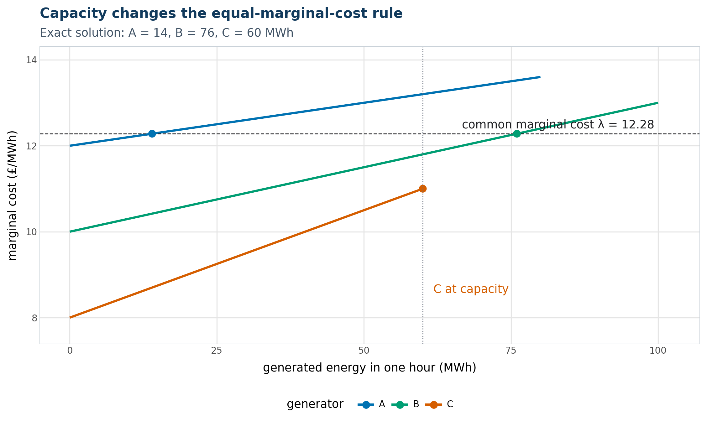

# Algorithms for Continuous Optimization {#sec-computational-optimization}

An optimality condition is not an algorithm. The equation $\nabla f(x)=0$ can
describe a maximum, saddle, badly scaled minimum, or inaccessible stationary
point. Constraints add feasibility, and a computer adds finite precision,
stopping tolerances, and derivative errors. This chapter turns the calculus of
[sec-shape](05-shape-optimization.md#sec-shape) and the KKT theory of [sec-constrained-optimization](20-constrained-optimization.md#sec-constrained-optimization) into methods that
choose steps, reject misleading models, and report evidence about termination.

The recurring principle is simple: construct a local model, propose a step,
measure what actually happened, and preserve a certificate ledger.

## Preparation from this book

Review derivatives and Taylor approximation in [sec-derivative](03-derivative.md#sec-derivative) and [sec-shape](05-shape-optimization.md#sec-shape),
gradients and Hessians in [sec-partials](13-partial-derivatives.md#sec-partials), constraints and convexity in
[sec-constrained-optimization](20-constrained-optimization.md#sec-constrained-optimization), automatic derivatives in [sec-calculus-ad](29-automatic-differentiation.md#sec-calculus-ad), and
stable matrix solves in [sec-calculus-linear-algebra](32-linear-algebra-data.md#sec-calculus-linear-algebra) and
[sec-numerical-linear-algebra](40-numerical-linear-algebra.md#sec-numerical-linear-algebra). Variational problems in [sec-calculus-variations](26-variations.md#sec-calculus-variations),
control in [sec-control-theory](36-control-theory.md#sec-control-theory), and nonlinear inversion in [sec-inverse-data](37-inverse-data-assimilation.md#sec-inverse-data) are
later applications.

Repair kit:

- The directional derivative is $Df(x)[p]=\nabla f(x)^Tp$.
- A direction is descending when $\nabla f(x)^Tp<0$.
- A differentiable function is convex when
  $f(y)\ge f(x)+\nabla f(x)^T(y-x)$.
- A twice differentiable function is locally strongly convex when its Hessian
  is uniformly positive definite.
- The Hessian quadratic model at $x$ is
  $m(p)=f(x)+g^Tp+\tfrac12p^THp$.
- A feasible algorithm must monitor both objective progress and constraint
  violation.

## Formulation, scaling, and nonexamples

Write a general problem as

$$
\min_x f(x)
\quad\text{subject to}\quad
c(x)=0,\qquad g(x)\le0.
$$

The decision variables, objective, and constraints require units. If $f$ is
pounds and $x_i$ is metres, then $\partial f/\partial x_i$ is pounds/metre.
Components of a raw gradient can therefore be incomparable when variables use
different units. Introduce characteristic scales $x_i=s_i z_i$ and optimize in
dimensionless $z$ when possible.

Parameterization changes geometry. Enforcing $x>0$ by $x=e^z$ removes a bound
but can magnify or shrink derivatives. Squaring a parameter enforces
nonnegativity but makes the derivative vanish at zero. There is no neutral
parameterization from an algorithm's perspective.

Many decisions have several objectives. A weighted sum

$$
f_w(x)=w_1f_1(x)+w_2f_2(x)
$$

is meaningful only after units are reconciled and weights are interpreted. If
$f_1$ is pounds and $f_2$ is tonnes of carbon, then $w_2/w_1$ acts like a
carbon price. Varying weights traces supported points of a Pareto frontier for
convex problems, but a nonconvex frontier can contain efficient points no
weighted sum reaches.

A **Pareto-efficient** point admits no feasible change that is no worse in every objective and strictly better in at least one. Weak Pareto efficiency rules out changes strictly improving every objective;
neither notion by itself determines a stakeholder's preferred compromise.
Optimization can expose tradeoffs; it cannot choose social values without a
declared decision rule. Sensitivity plots should show objective units and
constraint activity rather than hiding the policy choice inside arbitrary
normalization.

**Nonexample.** Minimizing $f(x)=x^3$ by solving $f'(x)=0$ returns $x=0$, but
zero is neither a local minimum nor maximum. Stationarity is necessary only for
an unconstrained differentiable interior minimum, not sufficient.

**Nonexample.** A large finite quadratic penalty generally does not produce
an exactly feasible point and may cause severe ill-conditioning. Exact nonsmooth penalties can recover constrained solutions at finite parameters,
but only under their own threshold and regularity hypotheses.

## Gradient descent and smoothness

The steepest descent direction in the Euclidean norm is $-\nabla f(x)$. The
iteration

$$
x_{k+1}=x_k-\alpha_k\nabla f(x_k)
$$

requires a step size. If the gradient is $L$-Lipschitz,

$$
\|\nabla f(x)-\nabla f(y)\|\le L\|x-y\|,
$$

then the descent lemma gives

$$
f(x+p)\le f(x)+\nabla f(x)^Tp+\frac L2\|p\|^2.
$$

Taking $p=-\alpha\nabla f(x)$ shows decrease for $0<\alpha<2/L$ when the
gradient is nonzero. For the conservative choice $\alpha=1/L$,

$$
f(x_{k+1})
\le f(x_k)-\frac1{2L}\|\nabla f(x_k)\|^2.
$$

If $f$ is convex and has an attained minimizer, this supports an objective-gap rate of order $1/k$, with a constant depending on the initial distance to a minimizer. If it is
$\mu$-strongly convex, fixed-step gradient descent converges geometrically at a
rate governed by $L/\mu$. These are global statements only under the named
global hypotheses.

Steepest depends on the norm. Under a weighted norm
$\|p\|_M^2=p^TMp$, the steepest direction is proportional to
$-M^{-1}\nabla f$. Preconditioning optimization is therefore geometry selection,
not merely a linear-solver trick.

For a quadratic $f(x)=\tfrac12x^TAx-b^Tx$ with SPD $A$, gradient descent is
Richardson iteration for $Ax=b$. The slow zigzag on elongated level sets is the
same conditioning phenomenon studied in [sec-numerical-linear-algebra](40-numerical-linear-algebra.md#sec-numerical-linear-algebra).

## Line searches and stopping rules

Given a descent direction $p_k$, a line search chooses $\alpha>0$. The Armijo
condition requires

$$
f(x_k+\alpha p_k)
\le f(x_k)+c_1\alpha\nabla f(x_k)^Tp_k,
$$

with $0<c_1<1$. Backtracking starts from a trial step and repeatedly multiplies
it by $\rho\in(0,1)$ until this sufficient decrease holds. For a smooth
function and genuine descent direction, sufficiently small steps pass.

The Wolfe curvature condition additionally requires

$$
\nabla f(x_k+\alpha p_k)^Tp_k
\ge c_2\nabla f(x_k)^Tp_k,
\qquad c_1<c_2<1.
$$

It prevents an unnecessarily tiny step before the one-dimensional slope has
changed enough. Strong Wolfe uses an absolute value and is common with
quasi-Newton methods.

Stopping must combine evidence. After the objective and variables have been
nondimensionalized, useful dimensionless quantities include

$$
\frac{\|\nabla f(x_k)\|}{1+|f(x_k)|},
\qquad
\frac{\|x_{k+1}-x_k\|}{1+\|x_k\|},
$$

plus correspondingly scaled primal feasibility, dual feasibility, and
complementarity for constrained problems. A tiny step may mean convergence,
roundoff, an active trust-region boundary, or a broken line search. One number
cannot distinguish them.

## Newton, quasi-Newton, and trust regions

Newton's method minimizes the local quadratic model by solving

$$
H_kp_k=-g_k,
\qquad g_k=\nabla f(x_k),\quad H_k=\nabla^2f(x_k).
$$

If $H_k$ is positive definite, $p_k$ is descending because

$$
g_k^Tp_k=-p_k^TH_kp_k<0.
$$

Near a solution with nonsingular positive-definite Hessian and a Lipschitz
Hessian, full Newton steps converge quadratically. Far away, the Hessian may be
indefinite, the step may ascend, or the quadratic model may be poor. Line search
and trust-region logic are globalization mechanisms, not proof of a global
minimum.

A trust-region method solves approximately

$$
\min_{\|p\|\le\Delta_k}m_k(p)
$$

and compares actual with predicted reduction:

$$
\rho_k=\frac{f(x_k)-f(x_k+p_k)}{m_k(0)-m_k(p_k)}.
$$

Poor agreement shrinks $\Delta_k$; good agreement accepts the step and may
enlarge it. If the denominator is nonpositive, the local model or step solver
has failed to predict descent.

BFGS builds an inverse-Hessian approximation from
$s_k=x_{k+1}-x_k$ and $y_k=g_{k+1}-g_k$. The update preserves positive
definiteness when $s_k^Ty_k>0$. Limited-memory BFGS stores a small set of vector
pairs instead of a dense matrix. BFGS uses gradient changes; it does not make a
nonsmooth objective twice differentiable.

## Constrained algorithms

For a closed convex feasible set $C$, projected gradient uses

$$
x_{k+1}=P_C(x_k-\alpha_k\nabla f(x_k)).
$$

Projection onto a box clips components. Projection onto an affine subspace is
a least-squares problem. Projection onto a simplex or capped simplex requires a
shared threshold; independently clipping and then rescaling is generally not
the Euclidean projection.

For equality constraints $c(x)=0$, a Newton step for the KKT equations solves

$$
\begin{pmatrix}
H & J^T\\
J & 0
\end{pmatrix}
\begin{pmatrix}p\\w\end{pmatrix}
=-
\begin{pmatrix}\nabla_xL\\c\end{pmatrix},
$$

where $J$ is the constraint Jacobian. The saddle-point matrix is indefinite
even when the reduced problem is a minimum, so Cholesky of the full block is
inappropriate.

Barrier methods replace $g_i(x)\le0$ by terms such as
$-\mu\sum_i\log(-g_i(x))$ and follow a central path as $\mu\downarrow0$.
They require a strictly feasible interior and careful linear solves.
Augmented-Lagrangian methods combine multipliers with quadratic penalties;
sequential quadratic programming solves constrained quadratic models. These
methods inherit KKT necessity only under constraint qualifications.

Constraint qualifications are not technical decoration. Minimize $f(x)=x$
subject to $x^2=0$. The only feasible point, zero, is automatically the global
minimum, but the constraint derivative vanishes there. No multiplier
$\lambda$ can satisfy $1+\lambda(2x)=0$ at zero. The usual Lagrange multiplier
condition fails because the equality constraint has no first-order feasible
geometry. An algorithm that treats every multiplier failure as “not optimal”
would reject the only feasible solution.

For inequality constraints, Slater's condition provides a useful convex
qualification: a convex problem with a strictly feasible point has strong dual
behavior under standard assumptions. When the feasible set has empty interior
or constraints are redundant and singular, multiplier estimates can be
nonunique or unstable. Report constraint Jacobian rank and active-set
sensitivity rather than only the final primal variables.

## Nonsmooth and composite problems

For convex nonsmooth $f$, a vector $s$ is a **subgradient** at $x$ if

$$
f(y)\ge f(x)+s^T(y-x)
$$

for every $y$. At zero, $|x|$ has subdifferential $[-1,1]$. Choosing one
automatic derivative at a kink does not reproduce this whole set.

The proximal map of a convex function $h$ is

$$
\operatorname{prox}_{\lambda h}(v)
=\arg\min_x\left\{h(x)+\frac1{2\lambda}\|x-v\|^2\right\}.
$$

For $h(x)=|x|$, solving separately on positive, negative, and zero regions
gives soft thresholding:

$$
\operatorname{prox}_{\lambda|\cdot|}(v)
=\operatorname{sign}(v)\max(|v|-\lambda,0).
$$

For $f=g+h$ with differentiable $g$, proximal gradient alternates a gradient
step on $g$ with this exact local treatment of $h$. It is better matched to an
$L^1$ penalty than smoothing the corner without declaring the change of model.

ADMM, coordinate descent, and stochastic gradients are useful vistas. Their
convergence assumptions differ; stochastic noise introduces an accuracy floor
and makes seeds, batching, and data order part of reproducibility.

Derivative verification should use methods with different failure mechanisms.
For a smooth scalar objective, compare a directional derivative with

$$
\frac{f(x+hp)-f(x-hp)}{2h}.
$$

A range of $h$ should show second-order truncation before roundoff dominates.
Agreement at one step can be accidental. For gradients, test several declared
directions rather than every coordinate when dimension is large. Complex-step
differentiation can avoid subtraction for analytic code, but branches,
absolute values, and non-complex-safe libraries invalidate it.

Automatic differentiation has its own audit. Reverse mode can compute a scalar
objective gradient efficiently, yet memory grows with the computational graph.
Checkpointing trades recomputation for storage. A derivative of an iterative
inner solve depends on whether the algorithm, its converged mathematical
solution, or a stopped finite iteration is being differentiated. Those objects
are not always equivalent.

Stochastic gradient methods replace the full gradient with a random estimate.
Unbiasedness and bounded variance are common analytical assumptions. A fixed
step generally settles into a noise neighborhood; decreasing steps can converge
more accurately but slowly. Validation loss, gradient variance, data passes,
and random seeds belong in the stopping ledger. A smooth training curve is not
evidence of a unique or globally optimal solution.

Global optimization requires different evidence. Multiple starting points can
discover several basins but cannot prove that an unseen better basin is absent.
Random search, evolutionary methods, and simulated annealing are exploratory
unless paired with a theorem suited to their schedules and domain. For a
bounded problem, interval branch-and-bound constructs lower and upper bounds on
subregions; convergence depends on valid bounds, not merely dense sampling.

Convex relaxation replaces a difficult feasible set or objective by a convex
one whose optimum supplies a lower bound for minimization. A feasible candidate
supplies an upper bound. Their difference is an **optimality gap** with objective
units. A zero or small certified gap is stronger evidence than repeated local
convergence, but the relaxation and feasibility calculations must include
roundoff margins. This chapter does not develop mixed-integer or global
algorithms fully; it establishes why a local solver's success flag must not be
reported as a global certificate.

Nonsmooth nonconvex objectives combine both hazards. A derivative may not exist,
a subgradient can include zero without local minimality, and automatic
differentiation may choose one branch. In such cases the method, stationarity
notion, and claimed scope should be stated together.

## Applied clinic: economic energy dispatch

During a fixed one-hour period, let $E_i$ be energy in MWh and

$$
C_i(E_i)=a_iE_i^2+b_iE_i
$$

be cost in pounds. Thus $a_i$ has units pounds/MWh squared, $b_i$ has
pounds/MWh, and marginal cost $C_i'=2a_iE_i+b_i$ has pounds/MWh.

Use the data

| Generator | $a_i$ | $b_i$ | capacity $U_i$ (MWh) |
|---|---:|---:|---:|
| A | 0.010 | 12 | 80 |
| B | 0.015 | 10 | 100 |
| C | 0.025 | 8 | 60 |

and demand $D=150$ MWh. Minimize total cost subject to

$$
\sum_iE_i=D,
\qquad 0\le E_i\le U_i.
$$

With multiplier $\lambda$ for demand, lower multipliers $\mu_i$, and upper
multipliers $\nu_i$, stationarity is

$$
2a_iE_i+b_i-\lambda-\mu_i+\nu_i=0.
$$

Complementarity gives $\mu_iE_i=0$ and $\nu_i(E_i-U_i)=0$. For a trial
$\lambda$, all conditions except demand are solved by

$$
E_i(\lambda)=
\operatorname{clip}\left(\frac{\lambda-b_i}{2a_i},0,U_i\right).
$$

The sum is continuous and nondecreasing, so bisection finds the multiplier.
The all-interior trial overfills generator C. Set $E_C=60$ and solve

$$
\frac{\lambda-12}{0.02}
+\frac{\lambda-10}{0.03}=90.
$$

This gives

$$
\lambda=12.28,
\qquad(E_A,E_B,E_C)=(14,76,60).
$$

The demand check is $14+76+60=150$. Marginal costs are

$$
C_A'(14)=12.28,
\qquad C_B'(76)=12.28,
\qquad C_C'(60)=11.
$$

Generator C would be cheaper at the margin but cannot exceed its capacity, so
$\nu_C=12.28-11=1.28$ pounds/MWh. The total cost is

$$
0.01(14)^2+12(14)
+0.015(76)^2+10(76)
+0.025(60)^2+8(60)
=1586.60\ \text{pounds}.
$$

All $a_i>0$, the feasible set is convex, and demand is feasible. The objective
is strictly convex, so the KKT point is the unique global minimizer. Startup
costs, integer on/off decisions, network losses, ramp limits, and uncertainty
would change the model and may destroy this conclusion.

<figure id="fig-economic-dispatch-kkt">


<figcaption>

Figure 41.1: The two unconstrained generators meet a common marginal cost while the cheapest marginal generator is held at its capacity.

</figcaption>
</figure>

[Figure 41.1](#fig-economic-dispatch-kkt) turns complementarity into geometry. Equal marginal
cost applies to interior generators, not blindly to every generator. The gap
between C's endpoint and $\lambda$ is the shadow value of relaxing its capacity
in this local convex model.

## Units, guarantees, and failure ledger

- Gradient components inherit objective-units per variable-unit. Scale before
  comparing them.
- Smooth convex and strongly convex rates require their named hypotheses.
- Newton's quadratic rate is local; an indefinite Hessian can produce ascent.
- BFGS positivity requires the curvature condition.
- KKT necessity requires a constraint qualification; KKT sufficiency requires
  convexity of the relevant problem.
- A finite barrier or quadratic-penalty parameter defines an auxiliary objective;
  exact nonsmooth penalties have separate finite-parameter exactness conditions.
- Automatic differentiation differentiates code, not the physical assumptions.
- Report objective change, stationarity, feasibility, complementarity,
  iterations, and derivative checks separately.
- Optimization error is distinct from parameter uncertainty and model error.

## Additional worked examples

### Worked example A: a safe quadratic step

For $f(x)=\tfrac12x^TAx-b^Tx$ with SPD $A$, let
$g=Ax-b$ and take $p=-g$. Along the line,

$$
f(x-\alpha g)
=f(x)-\alpha g^Tg+\frac{\alpha^2}{2}g^TAg.
$$

Differentiating in $\alpha$ gives the exact line minimizer

$$
\alpha_*=\frac{g^Tg}{g^TAg}>0.
$$

Positive definiteness makes the second derivative $g^TAg$ positive. This step
decreases the quadratic unless $g=0$.

### Worked example B: soft thresholding

Minimize $|x|+(x-v)^2/(2\lambda)$. If $x>0$, stationarity gives
$1+(x-v)/\lambda=0$, hence $x=v-\lambda$, valid when $v>\lambda$. If $x<0$,
stationarity gives $-1+(x-v)/\lambda=0$, hence $x=v+\lambda$, valid when
$v<-\lambda$. When $|v|\le\lambda$, the subgradient condition at zero is
$0\in[-1,1]-v/\lambda$. Combining cases yields

$$
x=\operatorname{sign}(v)\max(|v|-\lambda,0).
$$

### Worked example C: dispatch multipliers

At $(14,76,60)$, A and B are interior, so their bound multipliers vanish and
stationarity gives $\lambda=12.28$. C is at its upper bound, with lower
multiplier zero. Its stationarity equation gives
$11-12.28+\nu_C=0$, hence $\nu_C=1.28\ge0$. All complementarity products vanish
and demand holds. Strict convexity makes these sufficient conditions.

### Worked example D: a stationary nonminimum

For $f(x)=x^3$, $f'(0)=0$. But for every radius $r>0$, points
$x\in(-r,0)$ have $f(x)<0=f(0)$ and points $x\in(0,r)$ have $f(x)>0$. Thus zero
is neither a local minimum nor maximum. A stopping rule based solely on
$|f'|$ would incorrectly certify it without curvature or objective checks.

<!-- inline-formula-code:start -->
## Formula and finite computation

A useful formula in this chapter is

$$
x_{k+1}=x_k-\alpha\nabla f(x_k)
$$

For a quadratic objective, every iteration can report objective and gradient norm. The following standalone Python block expresses that finite rule with its inputs and stopping conditions visible.

```python
point = 8.0
step_size = 0.2
trace: list[tuple[float, float]] = []
for _ in range(12):
    gradient = 2.0 * (point - 3.0)
    trace.append(((point - 3.0) ** 2, abs(gradient)))
    point -= step_size * gradient
print(point, trace[-1])
```

**What the computation establishes.** The output certifies only the declared finite case. The theorem, if one is claimed, still requires the argument developed in the chapter.
<!-- inline-formula-code:end -->

## Summary

Optimization algorithms combine models, step control, linear algebra, and
certificates. Gradient, Newton, quasi-Newton, projected, barrier, and proximal
methods fit different structures. Their guarantees have explicit smoothness,
convexity, regularity, and scaling hypotheses. The dispatch clinic demonstrates
how KKT theory becomes a reproducible algorithm and how units and active bounds
shape interpretation.

## Exercises

<div class="exercise" id="calculus-41-computational-optimization-ex-1">
<p class="exercise-title"><strong>Exercise 1</strong></p>

Give the units of gradient and Hessian entries for a cost depending on length
and temperature.

</div>

<div class="exercise" id="calculus-41-computational-optimization-ex-2">
<p class="exercise-title"><strong>Exercise 2</strong></p>

Nondimensionalize an objective with variables measured in metres and
millimetres.

</div>

<div class="exercise" id="calculus-41-computational-optimization-ex-3">
<p class="exercise-title"><strong>Exercise 3</strong></p>

Derive the descent lemma conclusion for a step $-\alpha\nabla f$.

</div>

<div class="exercise" id="calculus-41-computational-optimization-ex-4">
<p class="exercise-title"><strong>Exercise 4</strong></p>

Run three gradient steps on a diagonal quadratic with condition number 100.

</div>

<div class="exercise" id="calculus-41-computational-optimization-ex-5">
<p class="exercise-title"><strong>Exercise 5</strong></p>

Verify Armijo acceptance for a quadratic and a sufficiently small step.

<details class="solution"><summary>Solution</summary>

For $f(x)=x^2/2$, direction $p=-x$, and $0<c_1<1$, the Armijo condition is

$$
\frac12(1-\alpha)^2x^2
\le\frac12x^2-c_1\alpha x^2.
$$

For $x\ne0$ and $\alpha>0$, cancellation reduces this to

$$
\alpha\le2(1-c_1).
$$

Thus every sufficiently small positive step passes, while a very large trial
can fail. Backtracking with factor $\rho\in(0,1)$ must eventually enter this
interval. When $x=0$, the point is already stationary and no descent direction
is required.

</details>

</div>

<div class="exercise" id="calculus-41-computational-optimization-ex-6">
<p class="exercise-title"><strong>Exercise 6</strong></p>

Give a case where a small step does not imply convergence.

</div>

<div class="exercise" id="calculus-41-computational-optimization-ex-7">
<p class="exercise-title"><strong>Exercise 7</strong></p>

Derive the Newton step for one-dimensional logistic loss.

</div>

<div class="exercise" id="calculus-41-computational-optimization-ex-8">
<p class="exercise-title"><strong>Exercise 8</strong></p>

Show that an SPD Hessian makes the Newton direction descending.

</div>

<div class="exercise" id="calculus-41-computational-optimization-ex-9">
<p class="exercise-title"><strong>Exercise 9</strong></p>

Compute the trust-region ratio for a specified quadratic model and trial
point.

</div>

<div class="exercise" id="calculus-41-computational-optimization-ex-10">
<p class="exercise-title"><strong>Exercise 10</strong></p>

Project a point onto an interval and onto a line.

<details class="solution"><summary>Solution</summary>

Projection of $z$ onto $[a,b]$ is

$$
P_{[a,b]}(z)=\min\{b,\max\{a,z\}\}.
$$

For the line $C=\{x:n^Tx=c\}$ with $n\ne0$, minimize
$\tfrac12\|x-z\|^2$ subject to $n^Tx=c$. Stationarity gives
$x-z+\lambda n=0$. Substitution into the constraint yields
$\lambda=(n^Tz-c)/\|n\|^2$, hence

$$
P_C(z)=z-\frac{n^Tz-c}{\|n\|^2}n.
$$

The correction is normal to the line, as the projection theorem requires.

</details>

</div>

<div class="exercise" id="calculus-41-computational-optimization-ex-11">
<p class="exercise-title"><strong>Exercise 11</strong></p>

Derive the KKT block system for one equality constraint.

</div>

<div class="exercise" id="calculus-41-computational-optimization-ex-12">
<p class="exercise-title"><strong>Exercise 12</strong></p>

Explain why its full matrix is generally indefinite.

</div>

<div class="exercise" id="calculus-41-computational-optimization-ex-13">
<p class="exercise-title"><strong>Exercise 13</strong></p>

Derive the logarithmic barrier for two box constraints.

</div>

<div class="exercise" id="calculus-41-computational-optimization-ex-14">
<p class="exercise-title"><strong>Exercise 14</strong></p>

Compute the subdifferential of $|x-a|$ at $x=a$.

</div>

<div class="exercise" id="calculus-41-computational-optimization-ex-15">
<p class="exercise-title"><strong>Exercise 15</strong></p>

Apply one proximal-gradient step to a quadratic plus $L^1$ penalty.

</div>

<div class="exercise" id="calculus-41-computational-optimization-ex-16">
<p class="exercise-title"><strong>Exercise 16</strong></p>

Re-solve the dispatch clinic for demand 180 MWh.

<details class="solution"><summary>Solution</summary>

For demand 180 MWh, generator C remains at its 60 MWh cap. A and B must supply
120 MWh, so

$$
\frac{\lambda-12}{0.02}
+\frac{\lambda-10}{0.03}=120.
$$

Solving gives $\lambda=12.64$ pounds/MWh and

$$
(E_A,E_B,E_C)=(32,88,60).
$$

Both A and B remain below their caps. Their marginal costs equal 12.64, while
C's marginal cost remains 11 and its upper multiplier is 1.64. Demand,
stationarity, multiplier signs, and complementarity all check.

</details>

</div>

<div class="exercise" id="calculus-41-computational-optimization-ex-17">
<p class="exercise-title"><strong>Exercise 17</strong></p>

Determine the demand range for which generator A is at its lower bound.

</div>

<div class="exercise" id="calculus-41-computational-optimization-ex-18">
<p class="exercise-title"><strong>Exercise 18</strong></p>

Add a carbon-price term with correct units and describe how the marginal
   curves change.

</div>

<div class="exercise" id="calculus-41-computational-optimization-ex-19">
<p class="exercise-title"><strong>Exercise 19</strong></p>

Construct a nonconvex problem whose KKT point is not a minimum.

<details class="solution"><summary>Solution</summary>

Minimize $f(x)=-x^2$ on the unconstrained line. The stationary condition gives
$f'(0)=0$, so zero is a KKT point. Yet $f''(0)=-2<0$, and every nonzero nearby
point has $f(x)<f(0)$. Zero is a strict local maximum, not a minimum. KKT
stationarity becomes sufficient only after the relevant convexity assumptions
are established.

</details>

</div>

<div class="exercise" id="calculus-41-computational-optimization-ex-20">
<p class="exercise-title"><strong>Exercise 20</strong></p>

Design an optimization report that separates solver, sampling, and model
uncertainty.

</div>

## Selected solutions

### Solution to Exercise 5

For $f(x)=x^2/2$, direction $p=-x$, and $0<c_1<1$, the Armijo condition is

$$
\frac12(1-\alpha)^2x^2
\le\frac12x^2-c_1\alpha x^2.
$$

For $x\ne0$ and $\alpha>0$, cancellation reduces this to

$$
\alpha\le2(1-c_1).
$$

Thus every sufficiently small positive step passes, while a very large trial
can fail. Backtracking with factor $\rho\in(0,1)$ must eventually enter this
interval. When $x=0$, the point is already stationary and no descent direction
is required.

### Solution to Exercise 10

Projection of $z$ onto $[a,b]$ is

$$
P_{[a,b]}(z)=\min\{b,\max\{a,z\}\}.
$$

For the line $C=\{x:n^Tx=c\}$ with $n\ne0$, minimize
$\tfrac12\|x-z\|^2$ subject to $n^Tx=c$. Stationarity gives
$x-z+\lambda n=0$. Substitution into the constraint yields
$\lambda=(n^Tz-c)/\|n\|^2$, hence

$$
P_C(z)=z-\frac{n^Tz-c}{\|n\|^2}n.
$$

The correction is normal to the line, as the projection theorem requires.

### Solution to Exercise 16

For demand 180 MWh, generator C remains at its 60 MWh cap. A and B must supply
120 MWh, so

$$
\frac{\lambda-12}{0.02}
+\frac{\lambda-10}{0.03}=120.
$$

Solving gives $\lambda=12.64$ pounds/MWh and

$$
(E_A,E_B,E_C)=(32,88,60).
$$

Both A and B remain below their caps. Their marginal costs equal 12.64, while
C's marginal cost remains 11 and its upper multiplier is 1.64. Demand,
stationarity, multiplier signs, and complementarity all check.

### Solution to Exercise 19

Minimize $f(x)=-x^2$ on the unconstrained line. The stationary condition gives
$f'(0)=0$, so zero is a KKT point. Yet $f''(0)=-2<0$, and every nonzero nearby
point has $f(x)<f(0)$. Zero is a strict local maximum, not a minimum. KKT
stationarity becomes sufficient only after the relevant convexity assumptions
are established.
