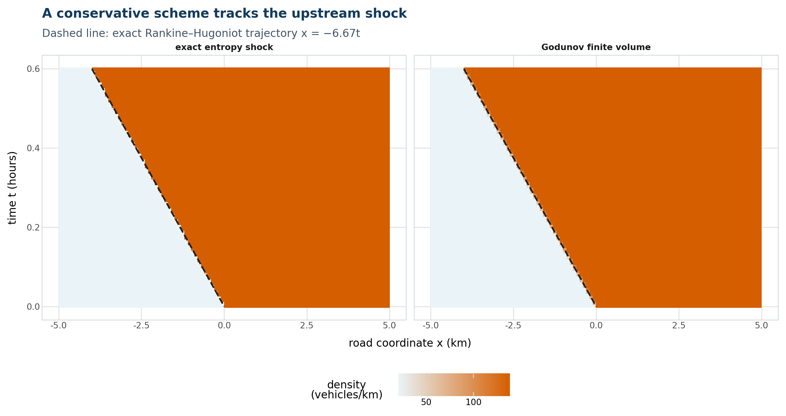

# Nonlinear Conservation Laws and Finite-Volume Methods {#sec-conservation-laws}

A smooth traffic profile can steepen into a moving queue front even when no
cars appear or disappear. Classical derivatives then fail exactly where the
most important feature forms. Conservation must survive that loss of
smoothness. Integral balance, weak solutions, entropy conditions, and
finite-volume schemes provide a coherent route from physical bookkeeping to a
computable discontinuous solution.

Chapter [sec-calculus-pdes](27-pdes.md#sec-calculus-pdes) introduced linear transport, characteristics, and
finite differences. Chapter [sec-tensor-continuum](35-tensor-continuum.md#sec-tensor-continuum) derived continuum balance
laws. Here the flux depends nonlinearly on the state, characteristics can
cross, weak solutions are nonunique until an admissibility rule is added, and
the numerical method is designed around conserved cell totals.

## Preparation from this book

Review derivatives in [sec-derivative](03-derivative.md#sec-derivative), the Fundamental Theorem in
[sec-integrals](06-integrals-ftc.md#sec-integrals), ODE trajectories in [sec-odes](09-differential-equations.md#sec-odes), flux orientation in
[sec-vector-calculus](15-vector-calculus.md#sec-vector-calculus), PDE classification and characteristics in
[sec-calculus-pdes](27-pdes.md#sec-calculus-pdes), and continuum balances in [sec-tensor-continuum](35-tensor-continuum.md#sec-tensor-continuum). Error and
stability language from [sec-numerical-odes](33-numerical-odes.md#sec-numerical-odes) and integration concepts from
[sec-measure-integration](38-measure-integration.md#sec-measure-integration) are helpful but locally repaired.

The essential repair is a signed control-volume balance. If $u(x,t)$ is an
amount per unit length and $f$ is rightward amount per unit time, then on a
fixed interval $[a,b]$,

$$
\frac d{dt}\int_a^bu(x,t)\,dx
=f(u(a,t))-f(u(b,t))+\int_a^bs(x,t)\,dx.
$$

Inflow at the left is positive, outflow at the right is negative, and $s$ is a
source per length per time. Every later sign can be checked against this one
physical statement.

## Conservation before differentiation

If $u$ and $f(u)$ are differentiable, the Fundamental Theorem turns the
integral balance into

$$
u_t+(f(u))_x=s.
$$

This is a scalar conservation law. The conservative form keeps the derivative
on the flux. Expanding it gives

$$
u_t+f'(u)u_x=s
$$

only where $u$ is differentiable. The two expressions agree for smooth fields
but not automatically across a jump.

**Nonexample.** Discretizing $f'(u)u_x$ and calling the result conservative is
false in general. A discrete product rule usually fails, and the resulting
scheme can propagate a shock at the wrong speed even when it looks stable.

Conservation units give an immediate audit. If $u$ is kilograms/metre, then
$u_t$ is kilograms/(metre second), $f$ is kilograms/second, and $f_x$ has the
same units as $u_t$. The characteristic speed $f'(u)$ has metres/second.

## Linear transport and domains of dependence

For $f(u)=cu$ and $s=0$,

$$
u_t+cu_x=0.
$$

Along $x(t)=x_0+ct$,

$$
\frac d{dt}u(x(t),t)=u_t+x'u_x=u_t+cu_x=0.
$$

Therefore $u(x,t)=u_0(x-ct)$. Information travels at the constant speed $c$.
If $c>0$, an interval needs data from its left boundary; prescribing unrelated
right-boundary values overdetermines the transport problem.

For a variable coefficient equation $u_t+c(x,t)u_x=0$, characteristics satisfy
$x'=c(x,t)$. Conservative transport $u_t+(cu)_x=0$ expands to
$u_t+cu_x=-c_xu$, so amplitude changes along a characteristic. The equations
model different quantities when $c$ varies.

The **domain of dependence** of a point consists of initial and boundary data
connected to it by backward characteristics. A numerical domain of dependence
must contain the continuum one; otherwise the method cannot receive the
information needed by the PDE.

## Nonlinear characteristics and shock formation

For

$$
u_t+f'(u)u_x=0,
$$

characteristics solve

$$
x'(t)=f'(u),
\qquad u'(t)=0.
$$

The state stays constant along each curve, so its speed also stays constant,
but different initial states travel at different speeds. If faster
characteristics begin behind slower ones, they intersect and a classical
single-valued solution cannot continue.

For inviscid Burgers' equation

$$
u_t+\left(\frac{u^2}{2}\right)_x=0,
$$

the characteristic from initial point $\xi$ is

$$
x=\xi+u_0(\xi)t.
$$

Differentiate with respect to $\xi$:

$$
\frac{\partial x}{\partial\xi}=1+u_0'(\xi)t.
$$

If the minimum initial slope is negative, the first crossing time is

$$
t_*=-\frac1{\min_\xi u_0'(\xi)}.
$$

This derivation assumes the minimum is attained and the profile is smooth
enough before crossing. It predicts loss of classical regularity, not the
post-crossing solution.

For increasing initial data, characteristics spread instead. A discontinuous
limit can produce a continuous **rarefaction fan** rather than a shock.

## Weak solutions and Rankine–Hugoniot jumps

A function $u$ for which both $u$ and $f(u)$ are locally integrable is a
**weak solution** of $u_t+f(u)_x=0$ with initial data $u_0$ if, for every
smooth compactly supported test function $\varphi$ that vanishes at large time,

$$
\int_0^\infty\int_{\mathbb R}
\left(u\varphi_t+f(u)\varphi_x\right)\,dx\,dt
+\int_{\mathbb R}u_0(x)\varphi(x,0)\,dx=0.
$$

This formula moves derivatives onto the smooth test function. Every sufficiently
smooth classical solution satisfies it by integration by parts. A weak solution
may contain jumps.

Suppose a jump separates constant states $u_L$ and $u_R$ along $x=st$. Apply
conservation to a thin control volume moving with the jump. During time
$\Delta t$, the boundary sweeps an amount
$s(u_R-u_L)\Delta t$, while the flux difference contributes
$(f(u_R)-f(u_L))\Delta t$. Balance gives the Rankine–Hugoniot condition

$$
s=\frac{f(u_R)-f(u_L)}{u_R-u_L}.
$$

It is the chord slope of the flux graph. It has speed units. The derivation is
conservation, not an average of characteristic speeds.

Weak solutions are not unique. Burgers data with $u_L<u_R$ admit a jump with
the Rankine–Hugoniot speed, but that jump has characteristics emerging from it
and is physically unstable. An admissibility condition is necessary.

## Entropy and Riemann problems

A **Riemann problem** has two constant initial states separated at one point.
For a $C^1$ strictly convex flux on the interval between the states, $u_L>u_R$ creates a shock and $u_L<u_R$ creates a
rarefaction. Strictly concave fluxes reverse this classification; merely convex or concave fluxes can have affine state intervals carrying entropy contacts.

For a decreasing jump with a $C^1$ convex flux whose derivative is nonconstant on the state interval, the strict Lax condition is

$$
f'(u_L)>s>f'(u_R)
$$

for $u_L>u_R$. For any decreasing jump with a $C^1$ convex flux, the chord slope satisfies $f'(u_L)\ge s\ge f'(u_R)$; an affine state interval gives equality and an entropy contact.
Characteristics enter a strict shock from both sides; a contact travels with them. More generally, entropy inequalities encode
irreversibility and select admissible weak solutions.

For Burgers data $u_L<u_R$, the entropy rarefaction is

$$
u(x,t)=
\begin{cases}
u_L,&x/t\le u_L,\\
x/t,&u_L<x/t<u_R,\\
u_R,&x/t\ge u_R.
\end{cases}
$$

The fan is self-similar: it depends on $x/t$. Substitution verifies the PDE in
the smooth interior, while continuity at the fan edges prevents jump terms.

**Theorem 42.1 (Scoped).** For a scalar conservation law with suitably regular flux
and bounded initial data, there is a unique entropy solution in the standard
Kruzkov class, with $L^1$ contraction. This statement is not transferred
unchanged to systems, nonlocal fluxes, or boundary problems.

One way to motivate entropy is **vanishing viscosity**. Replace the conservation
law by

$$
u_t+f(u)_x=\varepsilon u_{xx},
\qquad \varepsilon>0.
$$

Diffusion smooths jumps and dissipates convex quantities. Under appropriate
scalar hypotheses, solutions approach the entropy solution as
$\varepsilon\downarrow0$. The limit is not obtained by setting
$\varepsilon=0$ before solving; the thin viscous layer contains the selection
mechanism.

For a convex entropy function $\eta(u)$, define entropy flux $q_\eta$ through

$$
q_\eta'(u)=\eta'(u)f'(u).
$$

A smooth solution satisfies
$\eta(u)_t+q_\eta(u)_x=0$. Entropy solutions satisfy the distributional
inequality

$$
\eta(u)_t+q_\eta(u)_x\le0,
$$

which permits dissipation at shocks. One entropy pair may not ensure uniqueness;
the scalar Kruzkov theory uses a family. Entropy here is a mathematical
admissibility quantity and should not be identified automatically with
thermodynamic entropy or Shannon information.

## Finite-volume derivation

Let cell $I_j=[x_{j-1/2},x_{j+1/2}]$ have width $\Delta x$. Define the cell
average

$$
\overline u_j^n
\approx\frac1{\Delta x}\int_{I_j}u(x,t^n)\,dx.
$$

Integrating the conservation law over the cell and time step gives the exact
balance

$$
\overline u_j^{n+1}
=\overline u_j^n
-\frac{\Delta t}{\Delta x}
\left(\overline f_{j+1/2}-\overline f_{j-1/2}\right).
$$

A numerical flux $F(u_L,u_R)$ approximates the time-averaged physical flux at
an interface:

$$
u_j^{n+1}=u_j^n
-\frac{\Delta t}{\Delta x}
\left(F(u_j^n,u_{j+1}^n)-F(u_{j-1}^n,u_j^n)\right).
$$

Consistency requires $F(u,u)=f(u)$. Summing over cells telescopes every
interior flux, leaving only boundary fluxes. This exact discrete conservation
is the defining advantage of finite volume.

Sources require a separate cell integral. Boundary ghost states must encode
inflow, outflow, reflection, or periodicity consistently. Setting ghost values
because they “look smooth” can change total mass.

The first-order update treats each cell as piecewise constant. Higher-order
finite-volume methods reconstruct slopes inside cells and evolve interface
states with a higher-order time integrator. An unlimited centered slope can
overshoot near a jump and create negative density. A **slope limiter** reduces
the reconstruction where neighboring differences disagree. Total-variation-
diminishing methods prevent new variation in a scalar discrete solution under
their CFL conditions, but Godunov's order barrier says a linear monotone method
cannot be more than first order everywhere.

This tradeoff explains why “higher order” is not one global visual property. A
method can be second order in smooth regions and deliberately first order near
shocks. Accuracy studies should separate those regions and report positivity,
oscillation, conservation, and shock position.

## Upwind, Lax–Friedrichs, and Godunov fluxes

For linear transport $f(u)=cu$, upwind flux is

$$
F(u_L,u_R)=
\begin{cases}
cu_L,&c\ge0,\\
cu_R,&c<0.
\end{cases}
$$

It uses the state from which characteristics arrive. Centered averaging ignores
direction and can oscillate.

The local Lax–Friedrichs flux is

$$
F(u_L,u_R)
=\frac{f(u_L)+f(u_R)}2
-\frac a2(u_R-u_L),
$$

where $a$ bounds $|f'|$ locally. The second term is numerical viscosity. Too
small an $a$ risks instability; unnecessarily large $a$ smears features.

Godunov flux solves each interface Riemann problem and samples its flux at
$x/t=0$. For a scalar flux it can be written

$$
F(u_L,u_R)=
\begin{cases}
\min_{u\in[u_L,u_R]}f(u),&u_L\le u_R,\\
\max_{u\in[u_R,u_L]}f(u),&u_L>u_R.
\end{cases}
$$

The formula remains meaningful for concave traffic flux because the extrema
select the correct interface state.

An explicit monotone method needs a Courant restriction such as

$$
\frac{\Delta t}{\Delta x}\max|f'(u)|\le1.
$$

This is dimensionless. It makes the numerical domain of dependence wide enough
and supports monotonicity, but it does not by itself guarantee small error.

## Convergence and systems scope

The Lax–Wendroff theorem for conservation laws states, roughly, that if a
bounded sequence of conservative, consistent discrete approximations converges
sufficiently strongly, then its limit is a weak solution. It does not prove the
sequence converges, and it does not by itself select the entropy solution.
Monotone scalar schemes under a suitable CFL condition do have entropy
convergence theory.

At a shock, pointwise error remains order one inside the few cells across which
the method smears the jump. $L^1$ error and shock-position error are more useful
than maximum error. Grid refinement should track total mass, observed order
away from discontinuities, shock location, positivity, and boundary influence.

Systems such as shallow-water and compressible Euler equations have several
wave families, contacts, vacuum or dry states, and positivity constraints.
Scalar entropy and Godunov formulas do not transfer by replacing numbers with
vectors. They are destinations after this chapter, not hidden prerequisites.

Boundaries require characteristic reasoning. For scalar transport, prescribe a
state only where characteristics enter the domain. At an outflow boundary the
interior determines departing information; forcing an unrelated exterior value
can send a spurious wave inward through the numerical Riemann problem. For a
nonlinear flux, whether a boundary is inflow can depend on the current state
through $f'(u)$. A robust implementation records boundary fluxes directly and
verifies that their signed sum matches the change of cell totals.

Steady states with sources create another challenge. A naive flux/source split
may disturb an exact equilibrium at every time step. **Well-balanced** schemes
are designed so selected flux gradients and sources cancel discretely.
Preserving one equilibrium does not guarantee accuracy for all transients, but
failure to preserve it can bury a small physical perturbation under numerical
imbalance.

## Applied clinic: an upstream traffic shock

Let $\rho(x,t)$ be vehicles/km and $q(\rho)$ vehicles/hour. Conservation gives

$$
\rho_t+(q(\rho))_x=0.
$$

Use the Lighthill–Whitham–Richards flux

$$
q(\rho)=v_f\rho\left(1-\frac\rho{\rho_j}\right),
$$

with free-flow speed $v_f=100$ km/hour and jam density
$\rho_j=150$ vehicles/km. Take

$$
\rho_L=20,
\qquad \rho_R=140\quad\text{vehicles/km}.
$$

Then

$$
q_L=100(20)\left(1-\frac{20}{150}\right)
=1733.33\quad\text{vehicles/hour},
$$

$$
q_R=100(140)\left(1-\frac{140}{150}\right)
=933.33\quad\text{vehicles/hour}.
$$

Rankine–Hugoniot gives

$$
s=\frac{933.33-1733.33}{140-20}
=-6.67\quad\text{km/hour}.
$$

The queue front moves upstream although every car moves downstream. Information
speed and vehicle speed are different quantities.

The conservation jump formula and the factored LWR expression should agree
independently.  The implementation also reports the two characteristic speeds
needed for the scalar Lax shock check.

```python
from math import isfinite

def lwr_shock_audit(
    left_density: float,
    right_density: float,
    free_flow_speed: float,
    jam_density: float,
) -> tuple[float, float, float, bool]:
    """Return shock speed, characteristics, and the Lax inequality result."""
    values = (left_density, right_density, free_flow_speed, jam_density)
    if any(not isfinite(value) for value in values):
        raise ValueError("all traffic inputs must be finite")
    if jam_density <= 0.0 or free_flow_speed <= 0.0:
        raise ValueError("speeds and jam density must be positive")
    if not 0.0 <= left_density <= jam_density or not (
        0.0 <= right_density <= jam_density
    ):
        raise ValueError("densities must lie between zero and jam density")
    if left_density == right_density:
        raise ValueError("a jump needs distinct left and right states")

    def flux(density: float) -> float:
        return free_flow_speed * density * (1.0 - density / jam_density)

    shock_speed = (flux(right_density) - flux(left_density)) / (
        right_density - left_density
    )
    factored_speed = free_flow_speed * (
        1.0 - (left_density + right_density) / jam_density
    )
    if abs(shock_speed - factored_speed) > 1e-10:
        raise RuntimeError("the two shock-speed formulas disagree")
    left_characteristic = free_flow_speed * (
        1.0 - 2.0 * left_density / jam_density
    )
    right_characteristic = free_flow_speed * (
        1.0 - 2.0 * right_density / jam_density
    )
    return (
        shock_speed,
        left_characteristic,
        right_characteristic,
        left_characteristic > shock_speed > right_characteristic,
    )

print(lwr_shock_audit(20.0, 140.0, 100.0, 150.0))
```

The output gives $s=-6.67$ km/hour and confirms the two characteristic
inequalities for this Riemann problem. It does not validate LWR as a traffic
model or establish convergence of the later finite-volume discretization.

For the quadratic LWR flux, the shock-speed formula simplifies to

$$
s=v_f\left(1-\frac{\rho_L+\rho_R}{\rho_j}\right).
$$

This follows by factoring $q(\rho_R)-q(\rho_L)$. Hence

$$
\frac{\partial s}{\partial\rho_L}
=\frac{\partial s}{\partial\rho_R}
=-\frac{v_f}{\rho_j}.
$$

With the clinic values, an error of one vehicle/km in either state changes the
predicted shock speed by about $0.667$ km/hour. Arrival-time error becomes large
when the estimated shock speed is close to zero. Reporting detector time
without density sensitivity would overstate the precision of the equilibrium
traffic model.

The characteristic speed is

$$
q'(\rho)=100\left(1-\frac{2\rho}{150}\right).
$$

Thus

$$
q'(20)=73.33>s=-6.67>q'(140)=-86.67,
$$

so characteristics enter the shock and the Lax condition holds. A detector two
kilometres upstream is reached after

$$
t=\frac{-2\ \mathrm{km}}{-6.67\ \mathrm{km/hour}}
=0.30\ \mathrm{hour}=18\ \mathrm{minutes}.
$$

For a Godunov computation on $[-5,5]$ km with $\Delta x=0.1$ km, choose
$\Delta t=0.9\Delta x/v_f=0.0009$ hour. Hold the Riemann states at the outer
boundaries. At every output time, compare the numerical transition with the
exact line $x=st$ and audit the cell-sum vehicle total after accounting for
boundary flux.

<figure id="fig-traffic-shock-finite-volume">


<figcaption>

Figure 42.1: The exact upstream traffic shock remains sharp while the first-order Godunov method conserves vehicles but spreads the jump across several cells.

</figcaption>
</figure>

[Figure 42.1](#fig-traffic-shock-finite-volume) uses fixed Riemann data and a fixed CFL number.
The numerical band is not uncertainty; it is first-order numerical diffusion.
Its center follows the conservative shock speed, while its width motivates a
grid-refinement audit.

A verification table for this clinic should use at least three grids. For each
$\Delta x$, choose $\Delta t$ from the same CFL number, interpolate neither the
exact jump nor the cell averages before defining the comparison, and record

1. total-vehicle balance including boundary flux;
2. numerical shock position from the half-density crossing;
3. $L^1$ density error against exact cell averages;
4. minimum and maximum density; and
5. work measured by cell updates.

Exact cell averages matter because sampling the discontinuous exact solution at
cell centers changes which cell owns the jump. The shock-position error may be
first order while maximum error remains order one. If total balance fails to
roundoff, refinement cannot be interpreted as convergence of the intended
conservative scheme.

The same experiment should be repeated with a rarefaction Riemann problem. A
method that transports the clinic shock correctly can still approximate a
smooth fan poorly through excessive viscosity. Comparing both wave types
separates correct jump speed from general accuracy.

## Units, theorem, and error ledger

- Density, flux, characteristic speed, and shock speed have distinct units.
- Conservative and advective forms are equivalent only for sufficiently smooth
  fields under the stated product rule.
- Classical characteristics stop supplying a single-valued solution after
  crossing.
- Rankine–Hugoniot is necessary for a moving jump but does not select a unique
  weak solution.
- Entropy admissibility is essential; scalar uniqueness does not automatically
  extend to systems.
- CFL is a stability/domain-of-dependence restriction, not an error certificate.
- Lax–Wendroff assumes convergence; it does not manufacture it.
- Numerical diffusion, algebraic roundoff, boundary error, and model error must
  be separated.
- LWR assumes an equilibrium density–flow relation and omits delayed response,
  lane changes, ramps, and heterogeneous vehicles.

<!-- inline-formula-code:start -->
## Formula and finite computation

A useful formula in this chapter is

$$
u_i^{n+1}=u_i^n-\frac{\Delta t}{\Delta x}(F_{i+1/2}-F_{i-1/2})
$$

The telescoping flux difference preserves total mass on a periodic finite-volume grid. The following standalone Python block expresses that finite rule with its inputs and stopping conditions visible.

```python
import numpy as np

state = np.array([1.0, 2.0, 0.0, 3.0])
flux = 0.5 * state**2
ratio = 0.1
next_state = state - ratio * (flux - np.roll(flux, 1))
print(state.sum(), next_state.sum(), next_state)
```

**What the computation establishes.** The output certifies only the declared finite case. The theorem, if one is claimed, still requires the argument developed in the chapter.
<!-- inline-formula-code:end -->

## Summary

Integral conservation survives shocks. Weak formulations admit discontinuous
solutions, Rankine–Hugoniot fixes jump speed, and entropy chooses the physical
branch. Finite-volume methods preserve cell totals by sharing one interface
flux between neighboring cells. Their convergence and stability theorems have
precise scalar, monotonicity, and CFL scopes. The traffic clinic links those
ideas from units through an exact shock to a reproducible computation.

## Exercises

<div class="exercise" id="calculus-42-conservation-laws-ex-1">
<p class="exercise-title"><strong>Exercise 1</strong></p>

Derive the differential conservation law from the integral balance for a
smooth field.

</div>

<div class="exercise" id="calculus-42-conservation-laws-ex-2">
<p class="exercise-title"><strong>Exercise 2</strong></p>

Check units for a solute concentration and volumetric flux in a pipe.

</div>

<div class="exercise" id="calculus-42-conservation-laws-ex-3">
<p class="exercise-title"><strong>Exercise 3</strong></p>

Solve linear advection with a translated Gaussian initial profile.

</div>

<div class="exercise" id="calculus-42-conservation-laws-ex-4">
<p class="exercise-title"><strong>Exercise 4</strong></p>

Distinguish $u_t+cu_x=0$ from $u_t+(cu)_x=0$ when $c=c(x)$.

</div>

<div class="exercise" id="calculus-42-conservation-laws-ex-5">
<p class="exercise-title"><strong>Exercise 5</strong></p>

Find the first Burgers characteristic-crossing time for
$u_0(x)=1-\sin x$.

</div>

<div class="exercise" id="calculus-42-conservation-laws-ex-6">
<p class="exercise-title"><strong>Exercise 6</strong></p>

Derive Rankine–Hugoniot using a moving interval.

</div>

<div class="exercise" id="calculus-42-conservation-laws-ex-7">
<p class="exercise-title"><strong>Exercise 7</strong></p>

Classify Burgers Riemann data $(u_L,u_R)=(2,-1)$.

</div>

<div class="exercise" id="calculus-42-conservation-laws-ex-8">
<p class="exercise-title"><strong>Exercise 8</strong></p>

Write the entropy rarefaction for $(u_L,u_R)=(-1,2)$.

</div>

<div class="exercise" id="calculus-42-conservation-laws-ex-9">
<p class="exercise-title"><strong>Exercise 9</strong></p>

Give a Rankine–Hugoniot weak jump that violates the Lax condition.

</div>

<div class="exercise" id="calculus-42-conservation-laws-ex-10">
<p class="exercise-title"><strong>Exercise 10</strong></p>

Show that finite-volume interior fluxes telescope when summed over cells.

</div>

<div class="exercise" id="calculus-42-conservation-laws-ex-11">
<p class="exercise-title"><strong>Exercise 11</strong></p>

Derive upwind flux from the linear Riemann problem.

</div>

<div class="exercise" id="calculus-42-conservation-laws-ex-12">
<p class="exercise-title"><strong>Exercise 12</strong></p>

Compute one Lax–Friedrichs update for three cells.

</div>

<div class="exercise" id="calculus-42-conservation-laws-ex-13">
<p class="exercise-title"><strong>Exercise 13</strong></p>

Evaluate Godunov flux for Burgers data on both sides of zero.

</div>

<div class="exercise" id="calculus-42-conservation-laws-ex-14">
<p class="exercise-title"><strong>Exercise 14</strong></p>

Compute a CFL-limited time step for speed 30 metres/second and grid width
12 metres.

<details class="solution"><summary>Solution</summary>

With maximum information speed 30 metres/second and grid width 12 metres, the
unit-CFL limit is

$$
\Delta t\le\frac{12\ \mathrm m}{30\ \mathrm{m/s}}=0.4\ \mathrm s.
$$

A safety factor 0.9 would use $0.36$ second. The ratio
$30\Delta t/12$ is dimensionless. Choosing $\Delta t=0.4$ second satisfies a
necessary restriction for the named explicit upwind-type method; it does not
guarantee that the grid resolves the profile accurately.

</details>

</div>

<div class="exercise" id="calculus-42-conservation-laws-ex-15">
<p class="exercise-title"><strong>Exercise 15</strong></p>

Explain why maximum-norm convergence is unsuitable for a smeared shock.

</div>

<div class="exercise" id="calculus-42-conservation-laws-ex-16">
<p class="exercise-title"><strong>Exercise 16</strong></p>

Repeat the traffic shock calculation for $\rho_R=100$ vehicles/km.

</div>

<div class="exercise" id="calculus-42-conservation-laws-ex-17">
<p class="exercise-title"><strong>Exercise 17</strong></p>

Predict how halving $\Delta x$ changes the first-order shock thickness in
physical distance.

</div>

<div class="exercise" id="calculus-42-conservation-laws-ex-18">
<p class="exercise-title"><strong>Exercise 18</strong></p>

Add an on-ramp source with correct units and state how total vehicle balance
changes.

<details class="solution"><summary>Solution</summary>

Let an on-ramp add $R(x,t)$ vehicles/(km hour). The law becomes

$$
\rho_t+q(\rho)_x=R.
$$

For a cell, a consistent update adds
$\Delta t\,\overline R_j^n$, which has vehicles/km units. Summing over cells and
multiplying by $\Delta x$ gives

$$
N^{n+1}-N^n
=\Delta t(F_{1/2}-F_{N+1/2})
+\Delta t\sum_j\overline R_j^n\Delta x.
$$

Thus change in total vehicles equals boundary inflow minus outflow plus ramp
input. A source discretization that does not reproduce this sum fails the
declared conservation audit.

</details>

</div>

## Selected solutions

### Solution to Exercise 7: Burgers shock

For $f(u)=u^2/2$, $u_L=2$, and $u_R=-1$,

$$
s=\frac{f(-1)-f(2)}{-1-2}
=\frac{1/2-2}{-3}=\frac12.
$$

Characteristic speeds are $f'(2)=2$ and $f'(-1)=-1$, so
$2>1/2>-1$. Characteristics enter the jump and it is an entropy shock.

### Solution to Exercise 8: Burgers rarefaction

For $u_L=-1<u_R=2$, a shock would violate entropy. The self-similar solution is

$$
u(x,t)=
\begin{cases}
-1,&x/t\le-1,\\
x/t,&-1<x/t<2,\\
2,&x/t\ge2.
\end{cases}
$$

Inside the fan, $u=x/t$ gives $u_t=-x/t^2$ and $uu_x=(x/t)(1/t)=x/t^2$,
so $u_t+uu_x=0$. Edge values match continuously.

### Solution to Exercise 10: finite-volume conservation

Sum the update over $j=1,\ldots,N$:

$$
\sum_j u_j^{n+1}
=\sum_j u_j^n
-\frac{\Delta t}{\Delta x}
\sum_j(F_{j+1/2}-F_{j-1/2}).
$$

Every interior flux appears once with each sign. Only
$F_{N+1/2}-F_{1/2}$ remains. Multiplying by $\Delta x$ shows that change in
total discrete amount equals boundary inflow minus outflow.

### Additional solved check: traffic detector time

The shock begins at $x=0$ and follows $x=st$ with
$s=-6.67$ km/hour. Solving $-2=-6.67t$ gives
$t=0.2999$ hour. Multiplying by 60 gives approximately 18.0 minutes. The
negative signs cancel because both detector displacement and shock velocity are
upstream.

### Solution to Exercise 14

With maximum information speed 30 metres/second and grid width 12 metres, the
unit-CFL limit is

$$
\Delta t\le\frac{12\ \mathrm m}{30\ \mathrm{m/s}}=0.4\ \mathrm s.
$$

A safety factor 0.9 would use $0.36$ second. The ratio
$30\Delta t/12$ is dimensionless. Choosing $\Delta t=0.4$ second satisfies a
necessary restriction for the named explicit upwind-type method; it does not
guarantee that the grid resolves the profile accurately.

### Solution to Exercise 18

Let an on-ramp add $R(x,t)$ vehicles/(km hour). The law becomes

$$
\rho_t+q(\rho)_x=R.
$$

For a cell, a consistent update adds
$\Delta t\,\overline R_j^n$, which has vehicles/km units. Summing over cells and
multiplying by $\Delta x$ gives

$$
N^{n+1}-N^n
=\Delta t(F_{1/2}-F_{N+1/2})
+\Delta t\sum_j\overline R_j^n\Delta x.
$$

Thus change in total vehicles equals boundary inflow minus outflow plus ramp
input. A source discretization that does not reproduce this sum fails the
declared conservation audit.
