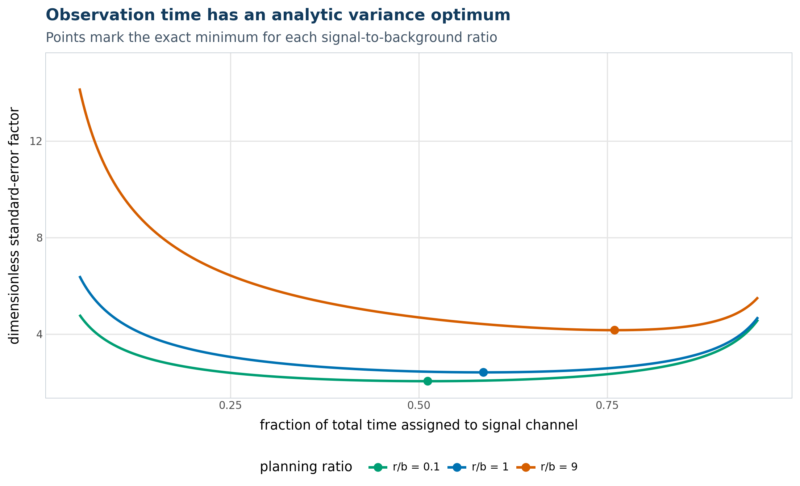

# Statistical Inference and Experimental Design {#sec-statistical-inference}

A data set is fixed after collection, but an uncertainty statement asks what
would vary under a repeated data-generating process. That distinction separates
a numerical summary from statistical inference. A likelihood connects a model
to observed data; an estimator turns data into a claim; a sampling distribution
describes the claim's variability; and experimental design decides which data
will be informative before they exist.

This chapter extends probability from [sec-probability-calculus](21-probability.md#sec-probability-calculus), Monte Carlo
from [sec-calculus-stochastic](30-stochastic.md#sec-calculus-stochastic), linear modeling from
[sec-calculus-linear-algebra](32-linear-algebra-data.md#sec-calculus-linear-algebra), and identifiability from [sec-inverse-data](37-inverse-data-assimilation.md#sec-inverse-data). It
emphasizes units, model scope, and the difference among sampling, measurement,
computational, and structural uncertainty.

## Preparation from this book

Review samples and spread in
the [concise data toolkit](00i-precalculus-bridge.md#sec-foundation-computation), derivatives in
[sec-derivative](03-derivative.md#sec-derivative), integration in [sec-integrals](06-integrals-ftc.md#sec-integrals), random variables and expectation
in [sec-probability-calculus](21-probability.md#sec-probability-calculus), least squares in [sec-calculus-linear-algebra](32-linear-algebra-data.md#sec-calculus-linear-algebra), and
likelihood language in [sec-inverse-data](37-inverse-data-assimilation.md#sec-inverse-data). Optimization from
[sec-computational-optimization](41-computational-optimization.md#sec-computational-optimization) helps with nonlinear likelihoods but is not
required for the hand derivations.

Repair kit:

- A random variable has a distribution, expectation, and variance under a
  declared probability model.
- Independent observations have a joint density or mass function equal to a
  product; logarithms turn this product into a sum.
- An estimator is a random variable before data are observed. Its realized
  numerical value is an estimate.
- A standard deviation describes variation of observations; a standard error
  describes variation of an estimator.
- A probability model is an assumption to audit, not a consequence of having
  data.

## Populations, estimands, and estimators

An **estimand** is the population or model quantity being targeted: a mean,
rate, treatment contrast, slope, quantile, or prediction. The **sampling
process** says how observations arise. An **estimator**
$\widehat\theta=T(X_1,\ldots,X_n)$ is a rule; its observed value is an
**estimate**.

Bias and variance are

$$
\operatorname{Bias}(\widehat\theta)
=\mathbb E[\widehat\theta]-\theta,
$$

$$
\operatorname{Var}(\widehat\theta)
=\mathbb E[(\widehat\theta-\mathbb E\widehat\theta)^2].
$$

Mean-squared error decomposes as

$$
\mathbb E[(\widehat\theta-\theta)^2]
=\operatorname{Var}(\widehat\theta)
+\operatorname{Bias}(\widehat\theta)^2.
$$

This identity follows by adding and subtracting
$\mathbb E\widehat\theta$ and observing that the centered cross term has
expectation zero. It makes bias–variance tradeoffs quantitative.

An estimator is **consistent** when it converges in probability to the target
as sample size grows. Consistency is asymptotic and does not say that a given
finite estimate is close. Unbiasedness is finite-sample but can coexist with
enormous variance. Neither property repairs a misspecified estimand.

An estimand should also match the decision population. A treatment effect among
people eligible for a trial differs from an effect among those actually
enrolled, treated, or compliant. A rate standardized per person-year differs
from risk over a fixed calendar period. These are not alternative units for one
number; they can be different mathematical targets.

Before calculation, write an **estimand statement** naming population,
intervention or exposure, comparison, outcome, time horizon, and summary. Then
record which parts are observed and which require assumptions. This discipline
prevents an algorithm from silently replacing a scientific question by the
quantity most convenient to estimate. Precision about the wrong target is not
useful inference.

**Nonexample.** The average blood pressure of people who voluntarily download
an app is not automatically an unbiased estimate of a national mean, even if
the app sample is enormous. Sampling selection is not reduced by more digits.

## Likelihood and maximum likelihood

For observed data $x$ under model density or mass $p_\theta$, the likelihood is

$$
L(\theta;x)=p_\theta(x),
$$

viewed as a function of $\theta$ with $x$ fixed. It is not a probability
density for $\theta$ unless a separate Bayesian construction normalizes it.
The log-likelihood is $\ell=\log L$.

For independent observations,

$$
\ell(\theta)=\sum_{i=1}^n\log p_\theta(x_i).
$$

The **score** is $U(\theta)=\partial\ell/\partial\theta$. An interior maximum
often solves $U(\widehat\theta)=0$, but boundaries, multiple maxima, and
nonidentifiability must be checked.

For Bernoulli data $X_i\in\{0,1\}$ with success probability $p$,

$$
\ell(p)=S\log p+(n-S)\log(1-p),
\qquad S=\sum_iX_i.
$$

Differentiation gives

$$
\ell'(p)=\frac Sp-\frac{n-S}{1-p}.
$$

For $0<S<n$, the MLE is $\widehat p=S/n$, and
$\ell''(p)<0$. If $S=0$ or $S=n$, the maximum lies on the boundary and the
interior score equation is not the right argument.

Maximum likelihood is invariant under one-to-one reparameterization: the MLE
of $g(\theta)$ is $g(\widehat\theta)$. Numerical conditioning may nevertheless
change dramatically. Optimizing a positive scale through its logarithm can be
more stable than imposing repeated clipping.

## Sampling distributions and central limits

For iid observations with mean $\mu$ and finite variance $\sigma^2$, the Law of
Large Numbers gives $\overline X_n\to\mu$ in probability, while the Central
Limit Theorem gives

$$
\frac{\sqrt n(\overline X_n-\mu)}{\sigma}
\Longrightarrow N(0,1).
$$

Thus $\operatorname{SE}(\overline X)=\sigma/\sqrt n$, estimated by
$s/\sqrt n$ when appropriate. The $1/\sqrt n$ law means reducing standard error
by ten requires one hundred times as many independent observations.

The theorem needs independence or a justified dependence variant and finite
variance. Heavy tails can make convergence slow or invalidate the stated
normal limit. Repeated measurements from one subject are not automatically
independent sample-size contributions.

The **bootstrap** approximates a sampling distribution by recomputing an
estimator on resampled data. A nonparametric iid bootstrap samples observations
with replacement; a parametric bootstrap simulates from a fitted model. Time
series, clustered data, and spatial data require block or cluster-aware
resampling. A fixed random seed makes a computation reproducible but does not
make the bootstrap assumptions valid.

## Fisher information and the delta method

For a regular scalar model, Fisher information in one observation is

$$
I(\theta)=\mathbb E_\theta[U(\theta)^2]
=-\mathbb E_\theta[\ell''(\theta)].
$$

For $n$ independent observations, information adds. The Cramer–Rao inequality
states, under regularity conditions, that an unbiased estimator satisfies

$$
\operatorname{Var}(\widehat\theta)\ge\frac1{I_n(\theta)}.
$$

It does not compare arbitrary biased estimators and can fail at boundaries or
when differentiation and integration cannot be interchanged.

Expected information averages curvature under the model; observed information
uses $-\ell''(\widehat\theta)$ for the realized data. Their difference can
matter in small samples.

The **delta method** propagates an asymptotic distribution through a smooth
function. If

$$
\sqrt n(\widehat\theta-\theta)
\Longrightarrow N(0,V),
$$

then for differentiable $g$,

$$
\sqrt n(g(\widehat\theta)-g(\theta))
\Longrightarrow N(0,[g'(\theta)]^2V).
$$

If $g'(\theta)=0$, this first-order approximation degenerates and a higher
order analysis is needed. The delta method is a local linearization, not a
general nonlinear uncertainty guarantee.

## Confidence intervals and tests

A procedure $C(X)$ has 95 percent coverage when

$$
\mathbb P_\theta(\theta\in C(X))=0.95
$$

under repeated samples for each target value in its stated scope. Once a
particular interval is observed, the frequentist statement is about the
procedure, not a new probability distribution placed on the fixed parameter.

A Wald interval has the form

$$
\widehat\theta\pm z_{1-\alpha/2}\widehat{\operatorname{SE}}.
$$

It can be unreliable for skewed estimators, small samples, weak information,
or boundaries. Score and likelihood-ratio intervals often respect likelihood
shape better. Exact procedures control coverage without an asymptotic normal
approximation, usually at the cost of conservative width or model-specific
calculation.

A $p$-value is the probability, under the null model, of a test statistic at
least as incompatible with the null as the observed one. It is not the
probability the null is true, not the probability the result occurred “by
chance,” and not an effect size. Searching many analyses and reporting only a
small value destroys its nominal calibration unless multiplicity and selection
are addressed.

Repeatedly inspecting accumulating data changes the reference distribution.
If a conventional level-0.05 test is run after every new observation until it
rejects, the overall false-positive probability can greatly exceed 0.05.
Group-sequential designs allocate an error budget across planned looks;
always-valid confidence sequences control coverage uniformly over time under
their assumptions. Stopping rules are therefore part of the experiment, not
mere administrative detail.

Optional stopping does not make every analysis invalid. A likelihood or
martingale-based procedure designed for the stopping rule can remain valid,
and a preregistered maximum sample size with a declared sequential boundary can
save resources. What fails is applying a fixed-sample calibration after an
unreported search over stopping times.

Estimation after selection also needs care. The estimate that first crosses a
threshold is biased away from the null, a form of winner's curse. A confidence
interval computed as though that observation time were fixed may undercover.
Report the monitoring plan, all looks, and the procedure used to preserve
coverage.

Confidence intervals do not validate the sampling model. Residual structure,
instrument drift, missingness, and selection can dominate a narrow interval.

## Regression inference

The linear model is

$$
y=X\beta+\varepsilon,
\qquad
\mathbb E[\varepsilon\mid X]=0.
$$

Under independent homoscedastic errors with variance $\sigma^2$ and full-rank
$X$, least squares has

$$
\widehat\beta=(X^TX)^{-1}X^Ty,
\qquad
\operatorname{Var}(\widehat\beta\mid X)
=\sigma^2(X^TX)^{-1}.
$$

Numerically, compute $\widehat\beta$ by QR rather than forming normal equations,
as explained in [sec-numerical-linear-algebra](40-numerical-linear-algebra.md#sec-numerical-linear-algebra). Estimate variance from residual
degrees of freedom when model assumptions justify it.

A coefficient interval concerns the conditional mean relation. A prediction
interval for a new observation includes both coefficient uncertainty and new
outcome noise, so it is wider. If response is degrees Celsius and predictor is
hours, a slope and its standard error have degrees Celsius/hour units.

Leverage comes from diagonal entries of
$H=X(X^TX)^{-1}X^T$; influence also depends on residual size. Heteroscedasticity
invalidates the simple covariance formula. Robust sandwich estimates can give
asymptotically valid standard errors under weaker variance assumptions, but
they do not repair nonlinear mean structure, dependence, or measurement error.

## Model checking, selection, and causal scope

Residual plots can reveal mean curvature, changing spread, outliers, and time
dependence. A normal quantile plot assesses a distributional approximation; it
does not test independence. Diagnostics should be tied to the assumption they
probe.

Likelihood-ratio comparisons require nested models and regularity for their
standard chi-squared reference. AIC estimates a relative expected predictive
tradeoff under its assumptions. Cross-validation estimates performance for a
declared split mechanism. If preprocessing, feature selection, or tuning uses
the held-out data, the estimate is optimistic.

Association becomes causal only through a design or assumptions connecting
observed and counterfactual outcomes. Randomization supports this connection;
regression adjustment alone does not guarantee it. Missing data mechanisms,
interference, noncompliance, and post-treatment selection require explicit
treatment.

Missingness needs its own model. Data are **missing completely at random** when
missingness is independent of observed and unobserved values, **missing at
random** when it may depend on observed values after conditioning, and
**missing not at random** when unobserved values still affect missingness.
Complete-case analysis is unbiased only under suitable mechanisms and target
definitions. Inverse-probability weighting can correct known or consistently
estimated observation probabilities, but small probabilities create unstable
weights and high variance.

Measurement error also changes the estimand. In simple regression, random error
in a predictor commonly attenuates a slope toward zero under a classical model;
ordinary least squares assumes the design matrix is measured as declared.
Replicate instruments, calibration data, or a latent-variable model may be
needed. A robust standard error does not correct bias from an erroneous
predictor.

Sensitivity analysis should therefore accompany any assumption that is not
identified by observed data. Vary a plausible missingness odds ratio,
misclassification rate, or unmeasured-confounding strength and show how the
scientific conclusion changes. This is different from sampling a parameter
from a convenient distribution without explaining why that range is plausible.

## Experimental design

Design begins with an estimand, a plausible model, and a decision criterion.
Randomization protects against systematic assignment bias, replication measures
variability, blocking removes known nuisance variation, and controls identify a
comparison. Repeated technical measurements are not a replacement for
independent biological or experimental units.

For a balanced two-group randomized experiment with independent outcomes,
common variance $\sigma^2$, and $n$ observations per group, the difference of
sample means has variance

$$
\operatorname{Var}(\overline Y_1-\overline Y_0)
=\frac{2\sigma^2}{n}.
$$

Blocking on a strong pre-treatment predictor can reduce residual variance while
preserving random assignment within blocks. Blocking on a post-treatment
quantity can instead bias the comparison. The experimental unit is the unit
randomized; measuring ten leaves on one randomized plant does not create ten
independent treatment assignments.

For a two-sided normal mean test with known standard deviation, an approximate
sample-size relation is

$$
n\approx
\left(\frac{(z_{1-\alpha/2}+z_{1-\beta})\sigma}{\delta}\right)^2,
$$

where $\delta$ is the effect to detect and $1-\beta$ is power. The formula is a
planning approximation tied to a normal model and fixed effect, not a promise
of scientific importance.

For nonlinear models, expected Fisher information depends on measurement
locations. D-optimal design maximizes determinant to shrink an information
ellipsoid volume; A-optimal design minimizes average variance. Both are local
to assumed parameter values unless a robust or Bayesian averaging criterion is
declared.

## Applied clinic: signal and background counting

Let signal-channel count and background count be independent:

$$
S\sim\operatorname{Poisson}((r+b)t_s),
\qquad
B\sim\operatorname{Poisson}(bt_b),
$$

where signal rate $r\ge0$ and background rate $b\ge0$ have inverse-second units.
The expected counts are dimensionless.

Ignoring factorial constants, the log-likelihood is

$$
\ell(r,b)
=S\log((r+b)t_s)-(r+b)t_s
+B\log(bt_b)-bt_b.
$$

The logarithms receive dimensionless expected counts. Interior score equations
are

$$
\frac{\partial\ell}{\partial r}
=\frac S{r+b}-t_s=0,
$$

$$
\frac{\partial\ell}{\partial b}
=\frac S{r+b}-t_s+\frac Bb-t_b=0.
$$

Therefore

$$
\widehat b=\frac B{t_b},
\qquad
\widehat r=\frac S{t_s}-\frac B{t_b}.
$$

If this $\widehat r$ is negative, the constrained maximum is on $r=0$, where

$$
\widehat b=\frac{S+B}{t_s+t_b}.
$$

For an interior estimator, independence and Poisson variance give

$$
\operatorname{Var}(\widehat r)
=\frac{r+b}{t_s}+\frac b{t_b}.
$$

With total time $T=t_s+t_b$, minimize

$$
V(t_s)=\frac{r+b}{t_s}+\frac b{T-t_s}.
$$

Differentiation gives

$$
-\frac{r+b}{t_s^2}+\frac b{(T-t_s)^2}=0,
$$

so

$$
t_s^*=T\frac{\sqrt{r+b}}{\sqrt{r+b}+\sqrt b},
\qquad
V_{\min}=\frac{(\sqrt{r+b}+\sqrt b)^2}{T}.
$$

For planning values $r=9$ per second, $b=1$ per second, and $T=60$ seconds,
$t_s^*=45.58$ seconds and $t_b^*=14.42$ seconds. Round to 46 and 14 seconds.
If $S=460$ and $B=14$, then

$$
\widehat r=10-1=9.00\ \mathrm{s}^{-1},
\qquad
\widehat b=1.00\ \mathrm{s}^{-1},
$$

and

$$
\widehat{\operatorname{SE}}(\widehat r)
=\sqrt{\frac{10}{46}+\frac1{14}}
=0.537\ \mathrm{s}^{-1}.
$$

A large-sample 95 percent Wald interval is

$$
9.00\pm1.96(0.537)=[7.95,10.05]\ \mathrm{s}^{-1}.
$$

The allocation, interior estimators, plug-in standard error, and Wald interval
can be evaluated together so units and boundary conditions are not silently
lost between formulas.

```python
from math import isfinite, sqrt

def signal_background_summary(
    signal_count: int,
    background_count: int,
    signal_time: float,
    background_time: float,
) -> tuple[float, float, float, tuple[float, float]]:
    """Return interior rate estimates, standard error, and a Wald interval."""
    if signal_count < 0 or background_count < 0:
        raise ValueError("counts must be nonnegative")
    if not all(
        isfinite(time) and time > 0.0
        for time in (signal_time, background_time)
    ):
        raise ValueError("observation times must be finite and positive")
    background_rate = background_count / background_time
    signal_rate = signal_count / signal_time - background_rate
    if signal_rate < 0.0:
        raise ValueError("the unconstrained estimate is on the r < 0 side of the boundary")
    standard_error = sqrt(
        (signal_rate + background_rate) / signal_time
        + background_rate / background_time
    )
    interval = (
        signal_rate - 1.96 * standard_error,
        signal_rate + 1.96 * standard_error,
    )
    return signal_rate, background_rate, standard_error, interval

summary = signal_background_summary(460, 14, 46.0, 14.0)
print(summary)
```

The output reproduces the rates, $0.537$ standard error, and the displayed
large-sample interval up to rounding. It does not repair low-count or boundary
coverage; the conditional exact test addresses that separate inferential task.

Near $r=0$ or with small counts, this symmetric approximation can cross the
boundary and miscover. Under $H_0:r=0$, conditioning on $S+B=N$ gives

$$
S\mid N\sim\operatorname{Binomial}
\left(N,\frac{t_s}{t_s+t_b}\right),
$$

which supplies an exact test without estimating $b$.

<figure id="fig-poisson-allocation-design">


<figcaption>

Figure 43.1: The standard-error-optimal observation allocation shifts toward the signal channel as the signal-to-background ratio increases.

</figcaption>
</figure>

[Figure 43.1](#fig-poisson-allocation-design) plots the dimensionless factor
$\sqrt{(1+\kappa)/p+1/(1-p)}$. The minima are analytic, not visually selected.
The curves also show that extreme allocations are inefficient because either
signal-plus-background or background becomes poorly estimated.

## Units, error, and theorem-scope ledger

- Counts are dimensionless; rates and their standard errors have inverse-time
  units; Fisher information for a rate has time-squared units.
- LLN, CLT, MLE normality, likelihood-ratio reference laws, and bootstrap each
  have distinct regularity and dependence assumptions.
- Cramer–Rao concerns regular unbiased estimators and does not certify a model.
- Wald intervals are especially fragile near boundaries and at low counts.
- A confidence level is repeated-sampling coverage, not posterior probability.
- A $p$-value is not the probability that the null is true.
- Numerical maximization error, sampling error, measurement error, selection
  bias, and model discrepancy must be reported separately.
- The detector model assumes independent stationary Poisson counts, constant
  background, and no dead time or overdispersion.
- The allocation optimum depends on planning values; sensitivity analysis is
  part of design.

<!-- inline-formula-code:start -->
## Formula and finite computation

A useful formula in this chapter is

$$
\widehat{\operatorname{SE}}(\bar X)=\operatorname{sd}(\bar X^{*})
$$

A fixed resampling design makes the bootstrap calculation reproducible. The following standalone Python block expresses that finite rule with its inputs and stopping conditions visible.

```python
import numpy as np
from numpy.typing import NDArray

def bootstrap_mean_interval(
    observations: NDArray[np.float64],
    repetitions: int = 5_000,
    seed: int = 20260811,
) -> tuple[float, float, float]:
    """Return the sample mean and a percentile bootstrap interval."""
    if observations.ndim != 1 or observations.size < 2 or repetitions < 100:
        raise ValueError("provide a one-dimensional sample and at least 100 repeats")
    generator = np.random.default_rng(seed)
    indices = generator.integers(0, observations.size, (repetitions, observations.size))
    bootstrap_means = observations[indices].mean(axis=1)
    lower, upper = np.quantile(bootstrap_means, [0.025, 0.975])
    return float(observations.mean()), float(lower), float(upper)

sample = np.array([4.1, 5.0, 4.7, 6.2, 5.5, 4.9, 5.8, 5.1])
print(bootstrap_mean_interval(sample))
```

**What the computation establishes.** The calculation checks a declared finite instance; the surrounding argument explains what is true beyond those inputs.
<!-- inline-formula-code:end -->

## Summary

Statistical inference begins with a sampling model and estimand. Likelihood,
sampling distributions, Fisher information, confidence procedures, regression,
and experimental design answer different questions. Their approximations and
units must stay visible. The detector clinic illustrates constrained maximum
likelihood, boundary behavior, standard error, exact conditioning, and optimal
resource allocation in one reproducible model.

## Exercises

<div class="exercise" id="calculus-43-statistical-inference-ex-1">
<p class="exercise-title"><strong>Exercise 1</strong></p>

Distinguish an estimand, estimator, and estimate in a survey example.

</div>

<div class="exercise" id="calculus-43-statistical-inference-ex-2">
<p class="exercise-title"><strong>Exercise 2</strong></p>

Prove the mean-squared-error decomposition.

</div>

<div class="exercise" id="calculus-43-statistical-inference-ex-3">
<p class="exercise-title"><strong>Exercise 3</strong></p>

Find the Bernoulli MLE including the two boundary cases.

</div>

<div class="exercise" id="calculus-43-statistical-inference-ex-4">
<p class="exercise-title"><strong>Exercise 4</strong></p>

Derive Fisher information for one Bernoulli observation.

</div>

<div class="exercise" id="calculus-43-statistical-inference-ex-5">
<p class="exercise-title"><strong>Exercise 5</strong></p>

Compute the standard error of a sample mean and state its units.

</div>

<div class="exercise" id="calculus-43-statistical-inference-ex-6">
<p class="exercise-title"><strong>Exercise 6</strong></p>

Give a dependent-data example where $s/\sqrt n$ is inappropriate.

</div>

<div class="exercise" id="calculus-43-statistical-inference-ex-7">
<p class="exercise-title"><strong>Exercise 7</strong></p>

Use the delta method for the logarithm of a positive rate estimate.

</div>

<div class="exercise" id="calculus-43-statistical-inference-ex-8">
<p class="exercise-title"><strong>Exercise 8</strong></p>

Explain why the first-order delta method fails for $g(\theta)=\theta^2$ at
$\theta=0$.

</div>

<div class="exercise" id="calculus-43-statistical-inference-ex-9">
<p class="exercise-title"><strong>Exercise 9</strong></p>

Interpret a 95 percent confidence procedure without assigning probability to
the fixed parameter.

</div>

<div class="exercise" id="calculus-43-statistical-inference-ex-10">
<p class="exercise-title"><strong>Exercise 10</strong></p>

Contrast a coefficient interval with a prediction interval.

</div>

<div class="exercise" id="calculus-43-statistical-inference-ex-11">
<p class="exercise-title"><strong>Exercise 11</strong></p>

Derive the least-squares covariance under homoscedastic independent errors.

<details class="solution"><summary>Solution</summary>

Condition on a fixed full-rank design $X$ and write

$$
\widehat\beta-\beta
=(X^TX)^{-1}X^T\varepsilon.
$$

If $\operatorname{Var}(\varepsilon\mid X)=\sigma^2I$, then

$$
\operatorname{Var}(\widehat\beta\mid X)
=(X^TX)^{-1}X^T(\sigma^2I)X(X^TX)^{-1}
=\sigma^2(X^TX)^{-1}.
$$

The simplification uses symmetry and invertibility. Correlated or
heteroscedastic errors replace $\sigma^2I$ by a different covariance and
invalidate this formula.

</details>

</div>

<div class="exercise" id="calculus-43-statistical-inference-ex-12">
<p class="exercise-title"><strong>Exercise 12</strong></p>

Identify which residual plot feature challenges which model assumption.

</div>

<div class="exercise" id="calculus-43-statistical-inference-ex-13">
<p class="exercise-title"><strong>Exercise 13</strong></p>

Explain leakage in a cross-validation pipeline.

</div>

<div class="exercise" id="calculus-43-statistical-inference-ex-14">
<p class="exercise-title"><strong>Exercise 14</strong></p>

Give an associational regression claim that does not identify a causal
effect.

</div>

<div class="exercise" id="calculus-43-statistical-inference-ex-15">
<p class="exercise-title"><strong>Exercise 15</strong></p>

Derive the approximate normal-test sample-size formula.

</div>

<div class="exercise" id="calculus-43-statistical-inference-ex-16">
<p class="exercise-title"><strong>Exercise 16</strong></p>

Derive the interior Poisson signal and background MLEs.

</div>

<div class="exercise" id="calculus-43-statistical-inference-ex-17">
<p class="exercise-title"><strong>Exercise 17</strong></p>

Derive the boundary estimate when the raw signal difference is negative.

</div>

<div class="exercise" id="calculus-43-statistical-inference-ex-18">
<p class="exercise-title"><strong>Exercise 18</strong></p>

Recompute optimal time allocation for $r/b=0.1$, $1$, and $9$.

</div>

<div class="exercise" id="calculus-43-statistical-inference-ex-19">
<p class="exercise-title"><strong>Exercise 19</strong></p>

Compare optimal and equal allocation variance for the clinic values.

<details class="solution"><summary>Solution</summary>

For $r=9$, $b=1$, and total time 60 seconds, equal allocation gives

$$
V_{\mathrm{equal}}=\frac{10}{30}+\frac1{30}
=0.3667\ \mathrm{s}^{-2}.
$$

The analytic optimum gives

$$
V_{\min}=\frac{(\sqrt{10}+1)^2}{60}
=0.2887\ \mathrm{s}^{-2}.
$$

Variance falls by about 21.3 percent, while standard error falls from
$0.606$ to $0.537$ per second, about 11.3 percent. Reporting both avoids
confusing a variance reduction with the smaller reduction on the standard-error
scale.

</details>

</div>

<div class="exercise" id="calculus-43-statistical-inference-ex-20">
<p class="exercise-title"><strong>Exercise 20</strong></p>

Describe how detector dead time or drifting background would alter the
likelihood and design.

</div>

## Selected solutions

### Solution to Exercise 4: Bernoulli information

For one Bernoulli observation,

$$
\ell(p)=X\log p+(1-X)\log(1-p),
$$

and

$$
-\ell''(p)=\frac X{p^2}+\frac{1-X}{(1-p)^2}.
$$

Taking expectation with $\mathbb E[X]=p$ gives

$$
I(p)=\frac1p+\frac1{1-p}=\frac1{p(1-p)}.
$$

For $n$ independent observations information is $n/[p(1-p)]$, whose inverse
equals the variance $p(1-p)/n$ of the sample proportion.

### Solution to Exercise 7: delta method for a log rate

Suppose $\widehat r$ is approximately normal with mean $r>0$ and variance
$V$. For $g(r)=\log r$, $g'(r)=1/r$. The delta method gives

$$
\operatorname{Var}(\log\widehat r)\approx\frac V{r^2}.
$$

Replacing unknown quantities by estimates gives standard error
$\widehat{\operatorname{SE}}(\widehat r)/\widehat r$. An interval on the log
scale can be exponentiated to remain positive. It is still an asymptotic
interval and is unreliable when $\widehat r$ is near zero.

### Solution to Exercises 16–17: constrained Poisson MLE

The interior scores give $r+b=S/t_s$ and $b=B/t_b$. If
$S/t_s\ge B/t_b$, these satisfy $r\ge0$. Otherwise the unconstrained estimate
has negative signal and is infeasible. Set $r=0$; then the combined
log-likelihood score is

$$
\frac{S+B}{b}-(t_s+t_b)=0,
$$

so $\widehat b=(S+B)/(t_s+t_b)$. This pools both channels under the no-signal
boundary model.

### Solution to Exercise 18: optimal allocation

Write $A=r+b$ and $C=b$. With $t_b=T-t_s$,

$$
V'(t_s)=-\frac A{t_s^2}+\frac C{(T-t_s)^2}.
$$

At an interior optimum,
$\sqrt A/t_s=\sqrt C/(T-t_s)$. Solving gives

$$
t_s=T\frac{\sqrt A}{\sqrt A+\sqrt C}.
$$

The second derivative
$2A/t_s^3+2C/(T-t_s)^3$ is positive, so this is the unique minimum. Substitution
gives $V_{\min}=(\sqrt A+\sqrt C)^2/T$.

### Solution to Exercise 11

Condition on a fixed full-rank design $X$ and write

$$
\widehat\beta-\beta
=(X^TX)^{-1}X^T\varepsilon.
$$

If $\operatorname{Var}(\varepsilon\mid X)=\sigma^2I$, then

$$
\operatorname{Var}(\widehat\beta\mid X)
=(X^TX)^{-1}X^T(\sigma^2I)X(X^TX)^{-1}
=\sigma^2(X^TX)^{-1}.
$$

The simplification uses symmetry and invertibility. Correlated or
heteroscedastic errors replace $\sigma^2I$ by a different covariance and
invalidate this formula.

### Solution to Exercise 19

For $r=9$, $b=1$, and total time 60 seconds, equal allocation gives

$$
V_{\mathrm{equal}}=\frac{10}{30}+\frac1{30}
=0.3667\ \mathrm{s}^{-2}.
$$

The analytic optimum gives

$$
V_{\min}=\frac{(\sqrt{10}+1)^2}{60}
=0.2887\ \mathrm{s}^{-2}.
$$

Variance falls by about 21.3 percent, while standard error falls from
$0.606$ to $0.537$ per second, about 11.3 percent. Reporting both avoids
confusing a variance reduction with the smaller reduction on the standard-error
scale.
