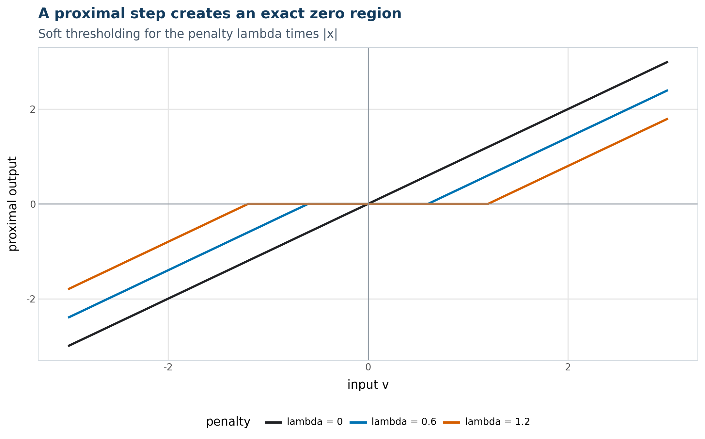

# Nonsmooth and Convex Calculus {#sec-nonsmooth-convex}

The derivative is a remarkably efficient local summary, but important models
are deliberately nonsmooth. Absolute error, one-sided penalties, contact,
friction, sparsity, and hard constraints all create corners or boundaries. At a
corner there may be no single tangent slope; nevertheless there can be enough
one-sided information to state optimality, design an algorithm, and certify a
global answer. Convex analysis supplies that information without smoothing away
the feature the model was built to express.

## Preparation from this book

Review tangent slopes in [sec-derivative](03-derivative.md#sec-derivative), convexity and constrained extrema in
[sec-constrained-optimization](20-constrained-optimization.md#sec-constrained-optimization), vector geometry in
[sec-calculus-linear-algebra](32-linear-algebra-data.md#sec-calculus-linear-algebra), and gradient-based algorithms in
[sec-computational-optimization](41-computational-optimization.md#sec-computational-optimization). The local repair kit is short:

- a set is **convex** when the segment between any two of its points stays in
  the set;
- a function is convex when its graph lies below every chord;
- the dot product $g^T(y-x)$ is a linear prediction in direction $y-x$; and
- a minimum certificate must distinguish a stationary candidate from a global
  conclusion.

No separate course in optimization is assumed.

## Convex functions and supporting slopes

A function $f:C\to\mathbb R$ on a convex set $C$ is **convex** if, for
$0\le t\le1$,

$$
f((1-t)x+ty)\le (1-t)f(x)+tf(y).
$$

The inequality says mixing inputs cannot cost more than mixing their costs.
Strict convexity replaces the inequality by a strict one for distinct points
and $0<t<1$; it implies at most one minimizer but does not guarantee that a
minimizer exists. Coercivity, compactness, or another existence argument is
still needed.

For a differentiable convex function, the tangent plane supports the graph:

$$
f(y)\ge f(x)+\nabla f(x)^T(y-x).
$$

This is stronger than a first-order approximation because it is a global lower
bound. If $\nabla f(x)=0$, the inequality immediately gives $f(y)\ge f(x)$ for
every $y$; a stationary point is therefore globally minimizing.

At a corner, replace the unique gradient by every valid supporting slope. A
vector $g$ is a **subgradient** of convex $f$ at $x$ when

$$
f(y)\ge f(x)+g^T(y-x)\qquad\text{for every }y.
$$

The set of all such vectors is the **subdifferential** $\partial f(x)$. When
$f$ is differentiable, $\partial f(x)=\{\nabla f(x)\}$. For $f(x)=|x|$,

$$
\partial |x|=
\begin{cases}
\{-1\},&x<0,\\
[-1,1],&x=0,\\
\{1\},&x>0.
\end{cases}
$$

The interval at zero is not indecision. Every slope between $-1$ and $1$
supports the V-shaped graph there.

### One-sided slopes and global lower supports {#sec-signed-supports}

**Nonexample.** A derivative chosen from one side is not automatically a
subgradient. For $f(x)=-|x|$, the number $1$ is the **left-hand** slope at
zero; the right-hand slope is $-1$. Indeed,

$$
\frac{f(t)-f(0)}{t}=\frac{-|t|}{t}
=\begin{cases}-1,&t>0,\\1,&t<0.\end{cases}
$$

A global affine lower support at zero would require $-|y|\ge gy$ for
every real $y$. Positive $y$ forces $g\le-1$; negative $y$ forces
$g\ge1$ because division reverses the inequality. These conditions are
incompatible, so **no global supporting slope exists** there, including
either one-sided slope.

Throughout this clinic, “support” means the global affine lower-bound
inequality used in convex subgradient calculus
([Boyd et al. 2022](bibliography.md#ref-boyd2022subgradients), Section 1, page 1). Applying that inequality to
this nonconvex example gives an empty support set. Other generalized
gradients use different definitions; they are not the support convention
being tested here.

For a finite convex function $f:\mathbb R^d\to\mathbb R$, nonnegative
scaling satisfies

$$
\partial(\alpha f)(x)=\alpha\,\partial f(x),\qquad \alpha\ge0
$$

([Boyd et al. 2022](bibliography.md#ref-boyd2022subgradients), Section 3.1, page 6). Multiplication of a lower
bound by a negative number reverses its inequality, so the same rule
cannot simply be applied to negative factors. Exercise 13 tests that
change after shifting the corner and adding an affine term.

## Fermat's rule without differentiability

For a proper convex function, $x_\star$ minimizes $f$ exactly when

$$
0\in\partial f(x_\star).
$$

The proof is almost the definition. If zero is a subgradient, then
$f(y)\ge f(x_\star)$ for every $y$. Conversely, if $x_\star$ is a global
minimum, the same inequality shows that zero satisfies the subgradient
condition. Unlike the smooth equation $\nabla f=0$, this rule includes corners.

For a differentiable convex function $h$ and convex function $g$, a minimizer
of $h+g$ satisfies

$$
0\in\nabla h(x_\star)+\partial g(x_\star).
$$

The sum rule requires standard domain qualifications in full generality. In the
finite, continuous cases used here, it behaves as expected.

Consider the scalar objective

$$
F(x)=\frac12(x-v)^2+\lambda|x|,
\qquad \lambda\ge0.
$$

For $x>0$, Fermat's rule gives $x-v+\lambda=0$; for $x<0$, it gives
$x-v-\lambda=0$. At $x=0$, it requires $v\in[-\lambda,\lambda]$. Combining
the cases yields the **soft-threshold map**

$$
S_\lambda(v)=\operatorname{sign}(v)\max(|v|-\lambda,0).
$$

The entire interval $[-\lambda,\lambda]$ maps exactly to zero. That exact
zero region explains why an absolute-value penalty can select sparse models
while a quadratic penalty usually only makes coefficients small.

<figure id="fig-soft-threshold-map">


<figcaption>

Figure 44.1: Soft thresholding is the identity when the penalty is zero, develops a flat zero interval for positive penalties, and shifts the outer rays toward zero.

</figcaption>
</figure>

The plot should be read horizontally as an algorithm: choose an input $v$, move
to the selected penalty curve, and read the proximal output. Its corners are
the mathematical mechanism, not a plotting defect.

## Constraints as extended-valued functions

A hard constraint can be absorbed into the objective through the indicator

$$
\iota_C(x)=
\begin{cases}
0,&x\in C,\\
+\infty,&x\notin C.
\end{cases}
$$

Minimizing $f+\iota_C$ is exactly minimizing $f$ over $C$. At $x\in C$, the
subdifferential of $\iota_C$ is the **normal cone**

$$
N_C(x)=\{g:g^T(y-x)\le0\text{ for every }y\in C\}.
$$

Thus constrained optimality becomes
$0\in\partial f(x_\star)+N_C(x_\star)$. This compact relation contains the
geometry behind Lagrange multipliers and complementary slackness. At an
interior point the normal cone is just $\{0\}$; on a boundary it contains
outward supporting directions.

Using $+\infty$ is an ordering convention, not floating-point advice. A program
should normally represent feasibility explicitly rather than perform arithmetic
with an infinite penalty.

## Proximal maps

For a proper closed convex function $g$ and step $\tau>0$, define

$$
\operatorname{prox}_{\tau g}(v)
=\underset{x}{\operatorname{argmin}}
\left(g(x)+\frac{1}{2\tau}\|x-v\|_2^2\right).
$$

The quadratic term is strongly convex, so the minimizer is unique. Fermat's
rule gives

$$
0\in\partial g(x)+\frac{x-v}{\tau},
\qquad
\frac{v-x}{\tau}\in\partial g(x).
$$

For $g=\iota_C$, the proximal map is Euclidean projection onto $C$. For
$g(x)=\lambda\|x\|_1$, it applies soft thresholding coordinate by coordinate.
The map therefore generalizes both projection and an implicit gradient step.

If $F(x)=h(x)+g(x)$, where $h$ has a Lipschitz gradient and $g$ has a convenient
proximal map, **proximal gradient** uses

$$
x_{k+1}=\operatorname{prox}_{\tau g}
\bigl(x_k-\tau\nabla h(x_k)\bigr).
$$

The first action follows the smooth decrease direction; the second resolves the
nonsmooth structure exactly. For suitable step sizes this method has an
objective convergence guarantee. Observing decreasing values for ten steps is
not itself that guarantee.

## Case study: sparse denoising

Suppose $v_i=\theta_i+\varepsilon_i$ and many true coefficients $\theta_i$ are
believed to be zero. The separable estimate

$$
\widehat\theta=\underset{x}{\operatorname{argmin}}
\left(\frac12\|x-v\|_2^2+\lambda\|x\|_1\right)
$$

is $\widehat\theta_i=S_\lambda(v_i)$. The units of $\lambda$ match the units of
$v_i$: the squared-error gradient has those units under the displayed scaling.
A larger $\lambda$ removes more components but biases surviving magnitudes
toward zero.

```python
from collections.abc import Sequence

def soft_threshold(values: Sequence[float], penalty: float) -> list[float]:
    if penalty < 0:
        raise ValueError("penalty must be nonnegative")
    return [
        max(value - penalty, 0.0) - max(-value - penalty, 0.0)
        for value in values
    ]

observed = [0.08, -0.22, 1.7, -2.4, 0.61]
for penalty in (0.1, 0.5, 1.0):
    print(penalty, soft_threshold(observed, penalty))
```

This computation implements the exact optimizer of the declared separable
finite problem. It does not choose a scientifically appropriate penalty or
prove that the unknown signal is sparse.

## Failure and precision audit

- Keep the derivative convention explicit. Under the global affine
  lower-support inequality used here, a supporting slope zero certifies
  a global minimum, even without convexity. Other generalized derivative
  definitions can have zero at a maximum; their calculus is not the
  convention used in the support tests above.
- Strict convexity gives uniqueness, not existence. The function $e^x$ is
  strictly convex on $\mathbb R$ but does not attain its infimum zero.
- A tiny step can make proximal gradient unnecessarily slow; an oversized step
  can destroy its descent guarantee.
- A nonsmooth model may be correct even when its optimizer is statistically
  unstable. Optimization error and modeling error are separate.
- Finite precision blurs comparisons near a threshold. State a tolerance when
  data have measurement uncertainty, but do not silently replace the
  mathematical penalty by arbitrary clipping.

<!-- inline-formula-code:start -->
## Formula and finite computation

The coordinate formula

$$
S_\lambda(v)=\operatorname{sign}(v)\max(|v|-\lambda,0)
$$

can be written without a special sign convention at zero:

```python
def soft_threshold_scalar(value: float, penalty: float) -> float:
    if penalty < 0:
        raise ValueError("penalty must be nonnegative")
    return max(value - penalty, 0.0) - max(-value - penalty, 0.0)

for value in (-1.4, -0.3, 0.0, 0.3, 1.4):
    print(value, soft_threshold_scalar(value, 0.5))
```

**What the computation establishes.** The outputs evaluate the exact scalar
proximal formula at five inputs. They do not prove the subgradient optimality
condition, a convergence theorem for an iterative method, or the suitability
of an absolute-value penalty for particular data.
<!-- inline-formula-code:end -->

## Summary

Convexity turns supporting hyperplanes into global bounds. Subgradients replace
a missing unique slope, and $0\in\partial f$ extends Fermat's rule to corners.
Indicator functions encode constraints, normal cones encode their boundary
geometry, and proximal maps turn nonsmooth optimality conditions into usable
updates. These ideas extend derivative-based calculus without claiming that
every nonsmooth or nonconvex problem has become easy.

## Exercises

<div class="exercise" id="calculus-44-nonsmooth-convex-ex-1">
<p class="exercise-title"><strong>Exercise 1</strong></p>

Verify the chord inequality for $f(x)=x^2$ directly.

</div>

<div class="exercise" id="calculus-44-nonsmooth-convex-ex-2">
<p class="exercise-title"><strong>Exercise 2</strong></p>

Prove that a nonnegative weighted sum of convex functions is convex.

</div>

<div class="exercise" id="calculus-44-nonsmooth-convex-ex-3">
<p class="exercise-title"><strong>Exercise 3</strong></p>

Derive $\partial |x|$ from the supporting-line definition.

<details class="solution"><summary>Solution</summary>

At zero, $g$ is a subgradient of $|x|$ exactly when
$|y|\ge gy$ for every $y$. Positive $y$ requires $g\le1$ and negative $y$
requires $g\ge-1$, so $\partial|0|=[-1,1]$. Away from zero the function is
differentiable, giving the singleton containing its sign.

</details>

</div>

<div class="exercise" id="calculus-44-nonsmooth-convex-ex-4">
<p class="exercise-title"><strong>Exercise 4</strong></p>

Find $\partial\max(x,0)$ for negative, zero, and positive $x$.

</div>

<div class="exercise" id="calculus-44-nonsmooth-convex-ex-5">
<p class="exercise-title"><strong>Exercise 5</strong></p>

Use Fermat's rule to minimize $|x-3|+|x+1|$ and interpret nonuniqueness.

<details class="solution"><summary>Solution</summary>

Between $-1$ and $3$, the two distances sum to $4$. To the left, moving right
decreases both relevant one-sided total slopes; to the right, moving right
increases both. Hence every point of $[-1,3]$ minimizes the objective. The
subdifferential contains zero throughout that interval. Convexity certifies
global, not merely local, minimality.

</details>

</div>

<div class="exercise" id="calculus-44-nonsmooth-convex-ex-6">
<p class="exercise-title"><strong>Exercise 6</strong></p>

Derive the soft-threshold formula by its three sign cases.

</div>

<div class="exercise" id="calculus-44-nonsmooth-convex-ex-7">
<p class="exercise-title"><strong>Exercise 7</strong></p>

Show that $\operatorname{prox}_{\iota_{[a,b]}}(v)=\min(b,\max(a,v))$.

<details class="solution"><summary>Solution</summary>

Minimizing $\iota_{[a,b]}(x)+\tfrac12(x-v)^2$ restricts $x$ to the interval.
If $v$ lies inside, the unconstrained minimizer $v$ is feasible. If $v<a$, the
quadratic increases as $x$ moves right from its closest feasible point $a$; if
$v>b$, the closest feasible point is $b$. Combining the cases gives
$\min(b,\max(a,v))$.

</details>

</div>

<div class="exercise" id="calculus-44-nonsmooth-convex-ex-8">
<p class="exercise-title"><strong>Exercise 8</strong></p>

Find the normal cone of $[0,\infty)$ at an interior point and at zero.

</div>

<div class="exercise" id="calculus-44-nonsmooth-convex-ex-9">
<p class="exercise-title"><strong>Exercise 9</strong></p>

Apply two proximal-gradient steps to
$h(x)=\tfrac12(x-4)^2$, $g(x)=|x|$, starting at zero with $\tau=1/2$.

</div>

<div class="exercise" id="calculus-44-nonsmooth-convex-ex-10">
<p class="exercise-title"><strong>Exercise 10</strong></p>

Explain why $e^x$ shows that strict convexity alone does not imply an
attained minimum.

</div>

<div class="exercise" id="calculus-44-nonsmooth-convex-ex-11">
<p class="exercise-title"><strong>Exercise 11</strong></p>

Implement coordinate soft thresholding and check the defining subgradient
inclusion for inputs outside, inside, and at the threshold.

</div>

<div class="exercise" id="calculus-44-nonsmooth-convex-ex-12">
<p class="exercise-title"><strong>Exercise 12</strong></p>

Compare quadratic and absolute-value penalties on five noisy coefficients;
report shrinkage, exact zeros, and one modeling limitation.

</div>

<div class="exercise" id="calculus-44-nonsmooth-convex-ex-13">
<p class="exercise-title"><strong>Exercise 13</strong></p>

**Shift the corner; change the sign.** At $x_0=2$, compare
$f_+(x)=2x+3|x-2|$ and $f_-(x)=2x-3|x-2|$ on all of
$\mathbb R$. Compute the left- and right-hand slopes from difference
quotients. For each function, determine every real $g$ such that
$f(x)\ge f(2)+g(x-2)$ for **every real $x$**. Which function is
convex, and why is negative scaling of $\partial|x-2|$ not a valid
shortcut for the other? Give an exact finite certificate for a
proposed slope, or an explicit violating point. Explain why two
coefficient inequalities can settle all real inputs in this model,
whereas checking a finite collection of arbitrary points cannot.

*Hint:* set $t=x-2$. Both functions equal $4$ at the corner and are
affine on each half-line. For $f_s(x)=2x+3s|x-2|$, $s=\pm1$, put
$L=2-3s$ and $R=2+3s$. The gap from the proposed support is
$(g-L)(-t)$ for $t<0$ and $(R-g)t$ for $t>0$.

<details class="solution"><summary>Solution</summary>

Write $f_s(2+t)=4+2t+3s|t|$ with $s=1$ for $f_+$ and $s=-1$ for
$f_-$. The left quotient is $L=2-3s$, and the right quotient is
$R=2+3s$. The exact gap above the affine line through $(2,4)$ is

$$
f_s(2+t)-(4+gt)=
\begin{cases}
(g-L)(-t),&t<0,\\
0,&t=0,\\
(R-g)t,&t>0.
\end{cases}
$$

Since $-t$ and $t$ are positive on their respective half-lines, the gap
is nonnegative for every real input **if and only if**

$$
g-L\ge0,\qquad R-g\ge0,
\qquad\text{equivalently }L\le g\le R.
$$

For $f_+$, $(L,R)=(-1,5)$ and all global supporting slopes are
$[-1,5]$. This function is convex: it is an affine function plus a
positive multiple of an absolute value. Its convex subdifferential is
therefore $\partial f_+(2)=[-1,5]$, including both endpoints. An endpoint
support agrees with the function on one entire half-line.

For $f_-$, $(L,R)=(5,-1)$, so support would require both $g\ge5$ and
$g\le-1$. There is no global affine lower support at the corner. The
function is concave, and multiplying the convex support set by $-3$
and adding $2$ would incorrectly predict the nonempty interval
$2-3[-1,1]=[-1,5]$. The nonnegative-scaling hypothesis matters.

The two coefficient tests are a finite certificate **because the gap
formula proves its sign on each full half-line**. If $g-L<0$, the point
$x=1$ has negative gap $g-L$. Otherwise a failed test has $R-g<0$,
and $x=3$ has that negative gap. This supplies exact counterexamples,
not a sampling-based inference about arbitrary functions.

```python
from fractions import Fraction

support_intervals = []
support_certificates = []
for sign in map(Fraction, (1, -1)):
    left_slope = 2 - 3 * sign
    right_slope = 2 + 3 * sign
    support_intervals.append((sign, left_slope, right_slope, left_slope <= right_slope))
    for slope in map(Fraction, (-2, -1, 0, 2, 5, 6)):
        left_coefficient = slope - left_slope
        right_coefficient = right_slope - slope
        is_support = left_coefficient >= 0 and right_coefficient >= 0
        witness = None
        witness_gap = None
        if not is_support:
            witness = Fraction(1) if left_coefficient < 0 else Fraction(3)
            witness_gap = (
                2 * witness + 3 * sign * abs(witness - 2)
                - (4 + slope * (witness - 2))
            )
        support_certificates.append(
            (sign, slope, left_coefficient, right_coefficient,
             is_support, witness, witness_gap)
        )
        print(sign, slope, "support", is_support,
              "coefficients", left_coefficient, right_coefficient,
              "witness", witness, "gap", witness_gap)
```

</details>

</div>

## Selected solutions

### Solution to Exercise 3

At zero, $g$ is a subgradient of $|x|$ exactly when
$|y|\ge gy$ for every $y$. Positive $y$ requires $g\le1$ and negative $y$
requires $g\ge-1$, so $\partial|0|=[-1,1]$. Away from zero the function is
differentiable, giving the singleton containing its sign.

### Solution to Exercise 5

Between $-1$ and $3$, the two distances sum to $4$. To the left, moving right
decreases both relevant one-sided total slopes; to the right, moving right
increases both. Hence every point of $[-1,3]$ minimizes the objective. The
subdifferential contains zero throughout that interval. Convexity certifies
global, not merely local, minimality.

### Solution to Exercise 7

Minimizing $\iota_{[a,b]}(x)+\tfrac12(x-v)^2$ restricts $x$ to the interval.
If $v$ lies inside, the unconstrained minimizer $v$ is feasible. If $v<a$, the
quadratic increases as $x$ moves right from its closest feasible point $a$; if
$v>b$, the closest feasible point is $b$. Combining the cases gives
$\min(b,\max(a,v))$.

### Solution to Exercise 13

Write $f_s(2+t)=4+2t+3s|t|$ with $s=1$ for $f_+$ and $s=-1$ for
$f_-$. The left quotient is $L=2-3s$, and the right quotient is
$R=2+3s$. The exact gap above the affine line through $(2,4)$ is

$$
f_s(2+t)-(4+gt)=
\begin{cases}
(g-L)(-t),&t<0,\\
0,&t=0,\\
(R-g)t,&t>0.
\end{cases}
$$

Since $-t$ and $t$ are positive on their respective half-lines, the gap
is nonnegative for every real input **if and only if**

$$
g-L\ge0,\qquad R-g\ge0,
\qquad\text{equivalently }L\le g\le R.
$$

For $f_+$, $(L,R)=(-1,5)$ and all global supporting slopes are
$[-1,5]$. This function is convex: it is an affine function plus a
positive multiple of an absolute value. Its convex subdifferential is
therefore $\partial f_+(2)=[-1,5]$, including both endpoints. An endpoint
support agrees with the function on one entire half-line.

For $f_-$, $(L,R)=(5,-1)$, so support would require both $g\ge5$ and
$g\le-1$. There is no global affine lower support at the corner. The
function is concave, and multiplying the convex support set by $-3$
and adding $2$ would incorrectly predict the nonempty interval
$2-3[-1,1]=[-1,5]$. The nonnegative-scaling hypothesis matters.

The two coefficient tests are a finite certificate **because the gap
formula proves its sign on each full half-line**. If $g-L<0$, the point
$x=1$ has negative gap $g-L$. Otherwise a failed test has $R-g<0$,
and $x=3$ has that negative gap. This supplies exact counterexamples,
not a sampling-based inference about arbitrary functions.

```python
from fractions import Fraction

support_intervals = []
support_certificates = []
for sign in map(Fraction, (1, -1)):
    left_slope = 2 - 3 * sign
    right_slope = 2 + 3 * sign
    support_intervals.append((sign, left_slope, right_slope, left_slope <= right_slope))
    for slope in map(Fraction, (-2, -1, 0, 2, 5, 6)):
        left_coefficient = slope - left_slope
        right_coefficient = right_slope - slope
        is_support = left_coefficient >= 0 and right_coefficient >= 0
        witness = None
        witness_gap = None
        if not is_support:
            witness = Fraction(1) if left_coefficient < 0 else Fraction(3)
            witness_gap = (
                2 * witness + 3 * sign * abs(witness - 2)
                - (4 + slope * (witness - 2))
            )
        support_certificates.append(
            (sign, slope, left_coefficient, right_coefficient,
             is_support, witness, witness_gap)
        )
        print(sign, slope, "support", is_support,
              "coefficients", left_coefficient, right_coefficient,
              "witness", witness, "gap", witness_gap)
```
