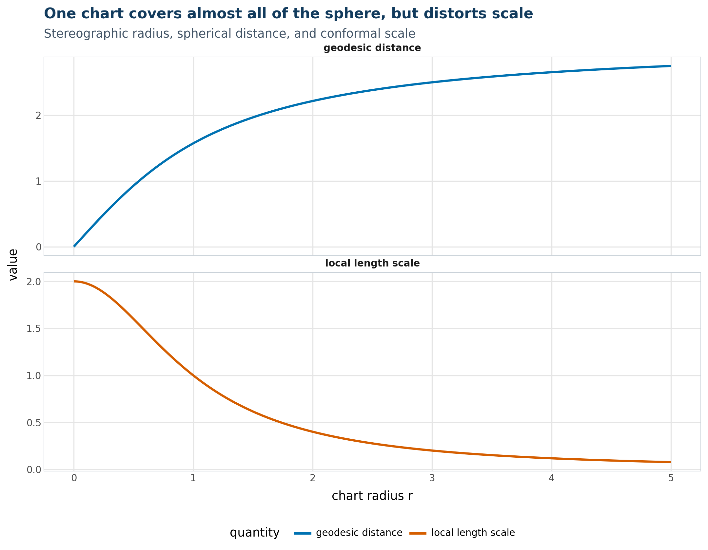

# Calculus on Manifolds {#sec-calculus-manifolds}

Latitude and longitude do not make Earth rectangular. They provide coordinates
on regions, and different coordinates overlap according to smooth conversion
rules. A **manifold** makes that familiar practice into a definition: locally it
looks like ordinary Euclidean space, even when no single global coordinate
system works. Calculus then proceeds chart by chart, while the chain rule proves
that tangent vectors, derivatives, integrals, and differential equations do not
depend on a chart chosen for convenience.

## Preparation from this book

Review parametrized surfaces and tangent planes in [sec-partials](13-partial-derivatives.md#sec-partials),
coordinate changes in [sec-multiple-integrals](14-multiple-integrals.md#sec-multiple-integrals), vector fields and Stokes'
Theorem in [sec-vector-calculus](15-vector-calculus.md#sec-vector-calculus), differential forms in [sec-forms](22-forms.md#sec-forms), and curves
and metrics in [sec-calculus-geometry](28-differential-geometry.md#sec-calculus-geometry). Only a small amount of topology is
needed here:

- an open set contains a small Euclidean ball around each of its points;
- a homeomorphism is a continuous bijection with continuous inverse; and
- local information may require several overlapping neighborhoods.

This chapter develops the working calculus. A dedicated topology volume studies
the global topological questions more deeply.

## Charts and smooth compatibility

An $n$-dimensional **topological manifold** is a space $M$ in which every point
has a neighborhood $U$ homeomorphic to an open subset of $\mathbb R^n$, with
the usual Hausdorff and countability conditions. A pair $(U,\varphi)$ is a
**chart**, and $\varphi:U\to\varphi(U)\subset\mathbb R^n$ assigns coordinates.
When charts overlap, the coordinate conversion is

$$
\psi\circ\varphi^{-1}:
\varphi(U\cap V)\longrightarrow\psi(U\cap V).
$$

A **smooth atlas** requires every such transition map to be smooth, with smooth
inverse. A smooth manifold is the space together with a maximal compatible
atlas. The definition does not privilege one chart.

The circle illustrates why this machinery is necessary. An angle gives a
convenient coordinate after a point or a ray is removed, but no continuous
single-valued angle covers the entire circle without a seam. Two overlapping
arc charts suffice. Similarly, stereographic projection gives a chart on the
sphere after one pole is removed; a second projection covers the missing pole.

<figure id="fig-manifold-chart-distortion">


<figcaption>

Figure 45.1: Stereographic chart radius corresponds nonlinearly to spherical distance, while its local length scale decays toward the omitted pole.

</figcaption>
</figure>

The upper panel shows that an infinite coordinate radius approaches a finite
geodesic distance to the omitted pole. The lower panel shows that conformality
preserves angles, not lengths. A chart may be perfectly smooth while badly
conditioned for numerical work near its boundary.

**Nonexample.** The crossing set
$\{(x,y):xy=0\}$ is not a one-dimensional manifold at the origin. Removing the
origin from a small neighborhood leaves four arms, unlike an interval with its
midpoint removed, which leaves two. A picture made from smooth line segments
need not be a manifold where they meet.

## Tangent vectors without ambient coordinates

For a surface embedded in $\mathbb R^3$, a tangent vector can be the velocity
of a curve on the surface. The same definition works intrinsically. Two smooth
curves $\gamma_1,\gamma_2$ through $p$ represent the same tangent vector when,
in one—and therefore every—chart,

$$
\frac{d}{dt}(\varphi\circ\gamma_1)(0)
=\frac{d}{dt}(\varphi\circ\gamma_2)(0).
$$

The equivalence classes form the tangent space $T_pM$, an $n$-dimensional
vector space. In coordinates $x^1,\ldots,x^n$, a tangent vector has components
$v^i$ relative to coordinate directions. Under new coordinates $y=y(x)$,

$$
\widetilde v^a
=\sum_{i=1}^n\frac{\partial y^a}{\partial x^i}v^i.
$$

This is the multivariable chain rule. Components change; the geometric tangent
vector does not.

A **cotangent vector** is a linear functional on $T_pM$. The differential of a
smooth function $f:M\to\mathbb R$ is the cotangent vector

$$
(df)_p(v)=v(f).
$$

In coordinates, $df=\sum_i(\partial f/\partial x^i)\,dx^i$. Gradients require
more structure: a Riemannian metric turns the covector $df$ into a vector
$\operatorname{grad}f$ by
$g(\operatorname{grad}f,v)=df(v)$. This distinction explains why raw gradient
components depend on a chosen inner product.

## Differentials and the chain rule

For a smooth map $F:M\to N$, the **differential** or pushforward

$$
dF_p:T_pM\longrightarrow T_{F(p)}N
$$

sends the velocity of $\gamma$ to the velocity of $F\circ\gamma$. In charts it
is multiplication by the Jacobian matrix of the coordinate representation.
For $G:N\to P$,

$$
d(G\circ F)_p=dG_{F(p)}\circ dF_p.
$$

This coordinate-free chain rule follows immediately by applying both sides to
the velocity of every curve through $p$. It is the same theorem as the matrix
chain rule, now stated so that its domain and codomain are visible.

The inverse function theorem says that if $dF_p$ is invertible, then $F$ is a
local diffeomorphism near $p$. The constant-rank and implicit function theorems
describe level sets and images locally. In particular, if
$F:\mathbb R^m\to\mathbb R^k$ has rank $k$ along $F^{-1}(c)$, that level set is
an $(m-k)$-dimensional submanifold. The rank hypothesis matters: the zero set
of $x^2-y^2$ crosses at the origin because its gradient vanishes there.

## Vector fields, flows, and Lie brackets

A **vector field** assigns $X_p\in T_pM$ smoothly to each point. An integral
curve solves

$$
\dot\gamma(t)=X_{\gamma(t)}.
$$

In a chart this is an ordinary system of differential equations. Existence and
uniqueness are local consequences of [sec-odes](09-differential-equations.md#sec-odes), but a
trajectory may leave a chart while remaining perfectly regular on the
manifold. A field is **complete** if its flow exists for all real time.
Compactness gives completeness for every smooth vector field on a compact
manifold; an unbounded Euclidean field can escape in finite time.

The **Lie bracket** measures the failure of two flows to commute:

$$
[X,Y]^j
=\sum_i\left(X^i\frac{\partial Y^j}{\partial x^i}
-Y^i\frac{\partial X^j}{\partial x^i}\right).
$$

Although written in coordinates, the bracket transforms as a vector field.
Following $X$, then $Y$, then reversing both produces a displacement whose
leading nonzero term is governed by $[X,Y]$. This observation matters in
control, mechanics, and integrability.

## Pullbacks, integration, and Stokes

The natural action on covectors goes backward. If $\omega$ is a covector at
$F(p)$, the **pullback** is

$$
(F^*\omega)_p(v)=\omega_{F(p)}(dF_pv).
$$

Pullback extends to differential forms, commutes with wedge products, and
satisfies $d(F^*\omega)=F^*(d\omega)$. A parametrization is therefore not just
a list of coordinates: it pulls an integrand back to a Euclidean coordinate
domain where ordinary integration applies.

An oriented $n$-manifold can be integrated by charts and a partition of unity.
The chartwise change-of-variables formula makes the pieces independent of
coordinates. For a compactly supported $(n-1)$-form on an oriented manifold
with boundary, generalized Stokes is

$$
\int_M d\omega=\int_{\partial M}\omega.
$$

The Fundamental Theorem of Calculus, Green, classical Stokes, and divergence
theorems are instances of this one boundary principle. Code can approximate
both integrals on a triangulated finite model; it cannot establish the theorem
for arbitrary smooth manifolds.

## Coordinate computation: stereographic inverse

The inverse stereographic chart from the plane to the unit sphere is

$$
\sigma(u,v)=
\frac{1}{1+u^2+v^2}
\bigl(2u,2v,u^2+v^2-1\bigr).
$$

The output has unit length. As $u^2+v^2$ grows, it approaches the north pole
without ever reaching it at a finite coordinate.

```python
from math import sqrt

def inverse_stereographic(
    plane_u: float, plane_v: float
) -> tuple[float, float, float]:
    """Map named plane coordinates to the sphere minus its north pole."""
    denominator = 1.0 + plane_u * plane_u + plane_v * plane_v
    return (
        2.0 * plane_u / denominator,
        2.0 * plane_v / denominator,
        (plane_u * plane_u + plane_v * plane_v - 1.0) / denominator,
    )

for coordinate in ((0.0, 0.0), (1.0, 0.0), (2.0, -1.0), (20.0, 0.0)):
    point = inverse_stereographic(*coordinate)
    norm = sqrt(sum(component * component for component in point))
    print(coordinate, point, norm)
```

The norm check verifies an algebraic property at four points. It does not prove
smooth compatibility of an atlas or a global theorem about the sphere.

## Failure and precision audit

- Coordinates are labels, not the points themselves. A coordinate singularity
  need not be a geometric singularity.
- An injective immersion need not be an embedding; global topology and the
  subspace topology must also agree.
- Full rank at one point gives a local conclusion. It does not guarantee global
  invertibility.
- A tangent vector transforms with a Jacobian, a covector with the inverse
  transformation, and a density with an absolute determinant. Mixing these
  rules creates coordinate-dependent answers.
- A mesh represents a finite approximation. Holes smaller than the mesh or
  changes in triangulation can alter numerical invariants.

<!-- inline-formula-code:start -->
## Formula and finite computation

For the inverse stereographic formula

$$
\sigma(u,v)=
\frac{(2u,2v,u^2+v^2-1)}{1+u^2+v^2},
$$

the identity $\|\sigma(u,v)\|_2=1$ has a direct finite evaluation:

```python
def sphere_chart(plane_u: float, plane_v: float) -> tuple[float, float, float]:
    """Evaluate inverse stereographic projection in named plane coordinates."""
    scale = 1.0 / (1.0 + plane_u * plane_u + plane_v * plane_v)
    return (
        2.0 * plane_u * scale,
        2.0 * plane_v * scale,
        (plane_u * plane_u + plane_v * plane_v - 1.0) * scale,
    )

for plane_u, plane_v in ((0.0, 0.0), (0.5, 0.5), (3.0, -2.0)):
    point = sphere_chart(plane_u, plane_v)
    squared_norm = sum(component**2 for component in point)
    print((plane_u, plane_v), point, squared_norm)
```

**What the computation establishes.** Floating-point output confirms the unit
sphere identity to displayed precision for three chart coordinates. The
algebraic identity for all inputs, smoothness of transition maps, and global
manifold claims still require proof.
<!-- inline-formula-code:end -->

## Summary

A manifold is Euclidean only locally. Charts translate local questions into
ordinary multivariable calculus, and smooth transition maps make the answers
compatible. Tangent vectors are curve velocities, differentials are linear
maps between tangent spaces, flows solve chartwise ODEs, and pullbacks turn
forms on a target into forms that can be integrated on a source. Generalized
Stokes expresses the global boundary principle without choosing preferred
coordinates.

## Exercises

<div class="exercise" id="calculus-45-calculus-manifolds-ex-1">
<p class="exercise-title"><strong>Exercise 1</strong></p>

Give two overlapping charts for the circle and compute their transition.

</div>

<div class="exercise" id="calculus-45-calculus-manifolds-ex-2">
<p class="exercise-title"><strong>Exercise 2</strong></p>

Verify algebraically that inverse stereographic projection has unit norm.

</div>

<div class="exercise" id="calculus-45-calculus-manifolds-ex-3">
<p class="exercise-title"><strong>Exercise 3</strong></p>

Show that the graph of a smooth $f:\mathbb R^n\to\mathbb R$ is a manifold.

</div>

<div class="exercise" id="calculus-45-calculus-manifolds-ex-4">
<p class="exercise-title"><strong>Exercise 4</strong></p>

Explain why a figure-eight curve fails to be a one-manifold at its crossing.

</div>

<div class="exercise" id="calculus-45-calculus-manifolds-ex-5">
<p class="exercise-title"><strong>Exercise 5</strong></p>

Compute how a tangent component changes under $y=3x$.

</div>

<div class="exercise" id="calculus-45-calculus-manifolds-ex-6">
<p class="exercise-title"><strong>Exercise 6</strong></p>

Find the differential of $F(x,y)=(x^2-y^2,2xy)$.

<details class="solution"><summary>Solution</summary>

The Jacobian is

$$
dF_{(x,y)}=
\begin{pmatrix}
2x&-2y\\
2y&2x
\end{pmatrix}.
$$

Its determinant is $4(x^2+y^2)$, so it is locally invertible away from the
origin. The theorem gives a local conclusion; the map still wraps angles
globally.

</details>

</div>

<div class="exercise" id="calculus-45-calculus-manifolds-ex-7">
<p class="exercise-title"><strong>Exercise 7</strong></p>

Use the rank theorem to classify the unit sphere as a regular level set.

<details class="solution"><summary>Solution</summary>

Let $G(x,y,z)=x^2+y^2+z^2$. On $G^{-1}(1)$, the gradient
$2(x,y,z)$ never vanishes. Thus $1$ is a regular value and the level set is a
$3-1=2$ dimensional submanifold of $\mathbb R^3$.

</details>

</div>

<div class="exercise" id="calculus-45-calculus-manifolds-ex-8">
<p class="exercise-title"><strong>Exercise 8</strong></p>

Find where the level set $y^2-x^3=0$ fails the regular-level hypothesis.

</div>

<div class="exercise" id="calculus-45-calculus-manifolds-ex-9">
<p class="exercise-title"><strong>Exercise 9</strong></p>

Compute the bracket of $X=\partial_x$ and $Y=x\partial_y$.

<details class="solution"><summary>Solution</summary>

For a test function $f$,
$X(Yf)=\partial_x(x\partial_yf)=\partial_yf+x\partial_{xy}f$, while
$Y(Xf)=x\partial_{yx}f$. Mixed derivatives cancel, leaving
$[X,Y]f=\partial_yf$. Hence $[X,Y]=\partial_y$.

</details>

</div>

<div class="exercise" id="calculus-45-calculus-manifolds-ex-10">
<p class="exercise-title"><strong>Exercise 10</strong></p>

Pull back the form $y\,dx$ under $F(t)=(t,t^2)$.

</div>

<div class="exercise" id="calculus-45-calculus-manifolds-ex-11">
<p class="exercise-title"><strong>Exercise 11</strong></p>

Explain why latitude-longitude coordinates are ill-conditioned at a pole
without concluding that the sphere is singular.

</div>

<div class="exercise" id="calculus-45-calculus-manifolds-ex-12">
<p class="exercise-title"><strong>Exercise 12</strong></p>

Triangulate a square, orient its two triangles, and show cancellation of
the shared edge in the discrete Stokes pattern.

</div>

## Selected solutions

### Solution to Exercise 6

The Jacobian is

$$
dF_{(x,y)}=
\begin{pmatrix}
2x&-2y\\
2y&2x
\end{pmatrix}.
$$

Its determinant is $4(x^2+y^2)$, so it is locally invertible away from the
origin. The theorem gives a local conclusion; the map still wraps angles
globally.

### Solution to Exercise 7

Let $G(x,y,z)=x^2+y^2+z^2$. On $G^{-1}(1)$, the gradient
$2(x,y,z)$ never vanishes. Thus $1$ is a regular value and the level set is a
$3-1=2$ dimensional submanifold of $\mathbb R^3$.

### Solution to Exercise 9

For a test function $f$,
$X(Yf)=\partial_x(x\partial_yf)=\partial_yf+x\partial_{xy}f$, while
$Y(Xf)=x\partial_{yx}f$. Mixed derivatives cancel, leaving
$[X,Y]f=\partial_yf$. Hence $[X,Y]=\partial_y$.
