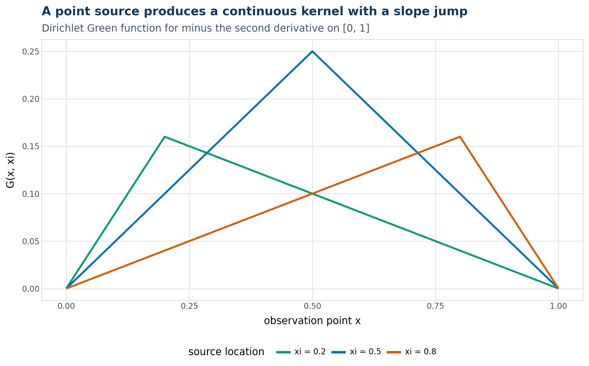

# Green Functions and Integral Equations {#sec-green-integral-equations}

A differential equation describes local balance through derivatives. A Green
function describes the same linear system through its response to a point
source. Once that response is known, superposition assembles the response to a
distributed source by integration. This change of representation turns many
boundary-value problems into integral equations, exposes boundary conditions
inside a kernel, and provides both analytic formulas and numerical methods.

## Preparation from this book

Review the Fundamental Theorem in [sec-integrals](06-integrals-ftc.md#sec-integrals), integration by parts in
[sec-techniques](07-integration-techniques.md#sec-techniques), linear differential equations in
[sec-odes](09-differential-equations.md#sec-odes), superposition and transforms in [sec-calculus-transforms](25-transforms.md#sec-calculus-transforms),
PDE boundary data in [sec-calculus-pdes](27-pdes.md#sec-calculus-pdes), and bounded operators in
[sec-functional-analysis](39-functional-analysis.md#sec-functional-analysis). The essential linear-algebra fact is that solving
$Ax=b$ can be viewed as applying an inverse $A^{-1}$ when that inverse exists.
A Green operator is the infinite-dimensional version, with all the same
questions about null spaces, compatibility, and conditioning.

## Impulse response for a boundary-value problem

Consider

$$
-u''(x)=f(x),\qquad 0<x<1,
\qquad u(0)=u(1)=0.
$$

The **Green function** $G(x,\xi)$ is the response at observation point $x$ to
a unit source at $\xi$. Formally it satisfies

$$
-\frac{\partial^2}{\partial x^2}G(x,\xi)=\delta(x-\xi),
\qquad G(0,\xi)=G(1,\xi)=0,
$$

where the Dirac delta is a distribution, not an ordinary infinitely tall
function. Away from $x=\xi$, the second derivative is zero, so $G$ is linear
on each side. Continuity at $\xi$ and the derivative jump

$$
\partial_xG(\xi^+,\xi)-\partial_xG(\xi^-,\xi)=-1
$$

determine

$$
G(x,\xi)=
\begin{cases}
x(1-\xi),&x\le\xi,\\
\xi(1-x),&x\ge\xi.
\end{cases}
$$

<figure id="fig-green-kernel">


<figcaption>

Figure 46.1: The one-dimensional Green kernel is piecewise linear, vanishes at both boundaries, and has a source-dependent peak and slope jump.

</figcaption>
</figure>

The moving corner records the delta source. The kernel is symmetric:
$G(x,\xi)=G(\xi,x)$. That symmetry reflects self-adjointness of the differential
operator with these boundary conditions, not a universal property of Green
functions.

Superposition gives

$$
u(x)=\int_0^1G(x,\xi)f(\xi)\,d\xi.
$$

To verify it for smooth $f$, split the integral at $\xi=x$, differentiate the
two pieces with the Leibniz rule, and differentiate once more. Boundary terms
from the moving split cancel at first derivative and leave the required jump
at second derivative. The endpoint values vanish because the kernel does.

For $f\equiv1$,

$$
u(x)=\frac{x(1-x)}2.
$$

Direct differentiation gives $-u''=1$, and the two boundary conditions hold.
Both checks are necessary: adding any linear function would preserve the
differential equation but usually violate the boundary data.

**Nonexample.** The expression $|x-\xi|/2$ has a derivative jump and is a
fundamental solution on the line up to sign convention, but it does not vanish
at $0$ and $1$. It is not the Green function for the displayed Dirichlet
problem until a boundary-correcting homogeneous term is added.

## Boundary conditions live in the kernel

Changing a differential operator or its boundary conditions changes its Green
function. Neumann conditions for $-u''$ expose an important obstruction:
constant functions lie in the null space. Integrating $-u''=f$ over $[0,1]$
with $u'(0)=u'(1)=0$ gives the compatibility condition

$$
\int_0^1f(x)\,dx=0.
$$

When it holds, solutions are unique only up to an additive constant unless a
normalization such as $\int u=0$ is imposed. An inverse cannot be defined on
the entire data space when the operator has a null space. A generalized Green
function must project away the incompatible component.

For a non-self-adjoint operator, the kernel need not be symmetric. For a
time-evolution problem, causality often forces a retarded kernel to vanish
before the source acts. Always state the operator, domain, boundary or initial
conditions, and sign convention before quoting a Green formula.

## Fredholm and Volterra equations

An integral equation of the second kind has the form

$$
u(x)-\lambda\int_a^bK(x,\xi)u(\xi)\,d\xi=f(x).
$$

Writing $(Ku)(x)=\int K(x,\xi)u(\xi)\,d\xi$ gives
$(I-\lambda K)u=f$. If $\|\lambda K\|<1$, the Neumann series converges:

$$
u=\sum_{n=0}^{\infty}(\lambda K)^nf.
$$

The proof mirrors a geometric series. Partial sums $S_N$ satisfy
$(I-\lambda K)S_N=f-(\lambda K)^{N+1}f$, and the remainder tends to zero in
operator norm. The strict norm bound is sufficient, not necessary; some
operators remain invertible outside it.

A **Fredholm** equation integrates over a fixed interval. A **Volterra**
equation uses a moving upper limit:

$$
u(x)=f(x)+\int_a^xK(x,\xi)u(\xi)\,d\xi.
$$

Its triangular dependence resembles an initial-value problem: the value at
$x$ depends only on earlier inputs. For $K=1$ and $f=1$, differentiating gives
$u'=u$ with $u(a)=1$, so $u(x)=e^{x-a}$. Conversely, integrating that ODE
recovers the Volterra equation. Differentiation is valid only under appropriate
regularity.

First-kind equations,

$$
\int_a^bK(x,\xi)u(\xi)\,d\xi=f(x),
$$

are often ill-posed. A smoothing kernel can erase high-frequency information,
so tiny perturbations in $f$ cause large changes in a reconstructed $u$.
Regularization from [sec-inverse-data](37-inverse-data-assimilation.md#sec-inverse-data) is then part of the mathematical problem,
not a cosmetic numerical option.

## From differential to integral form

Integrating an ODE can lower the derivative burden. For

$$
y'(t)=F(t,y(t)),\qquad y(t_0)=y_0,
$$

the Fundamental Theorem gives

$$
y(t)=y_0+\int_{t_0}^tF(s,y(s))\,ds.
$$

This integral equation is equivalent for continuously differentiable
solutions. It also supports Picard iteration:

$$
y_{n+1}(t)=y_0+\int_{t_0}^tF(s,y_n(s))\,ds.
$$

The contraction argument in [sec-functional-analysis](39-functional-analysis.md#sec-functional-analysis) turns this iteration into
an existence-and-uniqueness theorem under a Lipschitz condition on a short
interval. A plotted sequence of iterates is evidence about one example, not a
replacement for that condition.

Weak PDE formulations use the same idea at a larger scale. Integration by
parts moves derivatives from an unknown solution onto test functions, where
less smoothness is required. A Green identity can then represent solutions by
volume sources plus boundary layer potentials.

## Numerical quadrature and the Nyström idea

Choose quadrature nodes $\xi_j$ and weights $w_j$. A Fredholm equation becomes

$$
u(x_i)-\lambda\sum_{j=1}^n
w_jK(x_i,\xi_j)u(\xi_j)=f(x_i).
$$

This is a finite linear system. The discretization inherits some operator
structure but can also introduce conditioning and quadrature error. Refining
$n$ checks observed convergence for a declared problem; it cannot establish
invertibility of the continuous operator.

For the Dirichlet Green kernel and $f=1$, composite trapezoidal quadrature
approximates the exact parabola:

```python
from collections.abc import Callable

def green(evaluation_point: float, source_point: float) -> float:
    if not 0.0 <= evaluation_point <= 1.0 or not 0.0 <= source_point <= 1.0:
        raise ValueError("x and source must lie in [0, 1]")
    if evaluation_point <= source_point:
        return evaluation_point * (1.0 - source_point)
    return source_point * (1.0 - evaluation_point)

def green_solution(
    evaluation_point: float,
    forcing: Callable[[float], float],
    panels: int,
) -> float:
    if panels < 2:
        raise ValueError("panels must be at least 2")
    width = 1.0 / panels
    total = 0.0
    for index in range(panels + 1):
        source = index * width
        weight = 0.5 if index in (0, panels) else 1.0
        total += weight * green(evaluation_point, source) * forcing(source)
    return width * total

for panels in (10, 40, 160):
    approximation = green_solution(0.3, lambda source: 1.0, panels)
    exact = 0.3 * (1.0 - 0.3) / 2.0
    print(panels, approximation, abs(approximation - exact))
```

The corner at $\xi=x$ limits the smoothness seen by a quadrature panel. Placing
the split point explicitly or using piecewise quadrature improves the audit.

## Conditioning and model scope

An exact kernel formula can still lead to a sensitive inverse problem.
Distinguish four questions:

1. Does the continuous operator have a solution?
2. Is the solution unique?
3. Does it depend continuously on the data?
4. Does the chosen discretization approximate it stably?

Existence without uniqueness requires a normalization or quotient space.
Uniqueness without stability remains unsuitable for noisy inversion. A stable
finite matrix does not prove the continuous problem is well posed, and an
ill-conditioned matrix may reflect a poor basis rather than an intrinsically
ill-posed operator.

<!-- inline-formula-code:start -->
## Formula and finite computation

The Green representation becomes a weighted finite sum,

$$
u(x_i)\approx\sum_{j=0}^{n}w_jG(x_i,\xi_j)f(\xi_j).
$$

The following midpoint rule makes every finite choice visible:

```python
def dirichlet_green(evaluation_point: float, source_point: float) -> float:
    if not 0.0 <= evaluation_point <= 1.0 or not 0.0 <= source_point <= 1.0:
        raise ValueError("arguments must lie in [0, 1]")
    return min(evaluation_point, source_point) * (
        1.0 - max(evaluation_point, source_point)
    )

def midpoint_response(evaluation_point: float, panels: int) -> float:
    if panels <= 0:
        raise ValueError("panels must be positive")
    width = 1.0 / panels
    return width * sum(
        dirichlet_green(evaluation_point, (index + 0.5) * width)
        for index in range(panels)
    )

for evaluation_point in (0.25, 1.0 / 3.0):
    exact = evaluation_point * (1.0 - evaluation_point) / 2.0
    for panels in (8, 32, 128):
        value = midpoint_response(evaluation_point, panels)
        print(evaluation_point, panels, value, "signed error", value - exact)
```

**What the computation establishes.** The quarter-point rows have zero
quadrature error in exact arithmetic: the corner is a panel boundary, and
midpoint quadrature integrates each linear piece exactly. Those rows check
an exactness case, not a convergence rate. The third-point rows place the
corner inside a panel and expose a nonzero error. The displayed floating
values also contain rounding; the exact errors are derived below. Neither
table establishes operator invertibility or convergence for arbitrary
forcing and kernels.
<!-- inline-formula-code:end -->

## When grid alignment hides midpoint error {#sec-green-midpoint-phase}

For constant forcing, write

$$
h=1/n,\qquad \xi_j=(j+\tfrac12)h,\qquad
Q_n(x)=h\sum_{j=0}^{n-1}G(x,\xi_j),\qquad
I(x)=\frac{x(1-x)}2,
$$

where $n$ is a positive integer and $0\le x\le1$. The following are
**exact-arithmetic signed errors** for the same panel counts:

| Panels $n$ | At $x=1/4$ | At $x=1/3$ |
|---:|---:|---:|
| 8 | $0$ | $1/1152$ |
| 32 | $0$ | $1/18432$ |
| 128 | $0$ | $1/294912$ |

**Derive the error from one panel.** Midpoint quadrature is exact on
affine functions, as follows from its polynomial degree
([Bindel 2012](bibliography.md#ref-bindel2012quadrature), PDF pages 3–4). The Green kernel is affine on
either side of $\xi=x$. If $x$ is a grid boundary, all panels therefore
have zero error; the endpoints $x=0,1$ also give zero response.

Otherwise let $a<x<a+h$ be the unique panel containing the corner, and set
$\theta=(x-a)/h=\{nx\}$, the fractional part of $nx$. With
$z_+=\max(z,0)$, the kernel can be written

$$
G(x,\xi)=(1-x)\xi-(\xi-x)_+.
$$

The affine term contributes no error. On the corner panel, the integral
of $(\xi-x)_+$ is $h^2(1-\theta)^2/2$, while its midpoint contribution
is $h^2(1/2-\theta)_+$. The minus sign in the kernel gives

$$
\begin{aligned}
Q_n(x)-I(x)
&=h^2\left(\frac{(1-\theta)^2}{2}-(1/2-\theta)_+\right)\\
&=\frac{h^2}{2}\min(\theta,1-\theta)^2.
\end{aligned}
$$

For a grid boundary, define $\theta=\{nx\}=0$; the same final formula
agrees with the exactness argument. Consequently

$$
\boxed{0\le Q_n(x)-I(x)\le\frac{h^2}{8}}.
$$

This bound is sharp when the corner is a panel midpoint. It is a bound
for this kernel with **constant forcing**, derived without assuming a
global second derivative across the corner.

The phase affects error ratios. At $x=1/5$, panel counts $4,8,16$ give
errors $1/800,1/800,1/12800$: successive doublings have different ratios.
An arbitrary sequence of increasing panel counts need not give decreasing
errors either: at $x=1/4$, $n=4$ gives zero but $n=5$ gives $1/800$.
The earlier trapezoidal example is also aligned at its selected observation
point, so its roundoff-sized discrepancies do not demonstrate a refinement
rate. Changing the forcing changes the integrand; alignment alone will no
longer ensure exactness in Exercise 13.

## Summary

A Green function packages a linear operator and its boundary conditions into a
source-to-response kernel. Integrating that kernel against a source reconstructs
the solution. Fredholm and Volterra equations expose operator and causal
structure, while Neumann and Picard iterations connect integral representations
to convergence proofs. Quadrature converts kernels into matrices, but existence,
uniqueness, stability, and discretization accuracy remain separate obligations.

## Exercises

<div class="exercise" id="calculus-46-green-integral-equations-ex-1">
<p class="exercise-title"><strong>Exercise 1</strong></p>

Derive the two linear pieces of the Dirichlet Green kernel from its endpoint,
continuity, and derivative-jump conditions.

</div>

<div class="exercise" id="calculus-46-green-integral-equations-ex-2">
<p class="exercise-title"><strong>Exercise 2</strong></p>

Verify $G(x,\xi)=G(\xi,x)$ for both orderings of $x$ and $\xi$.

</div>

<div class="exercise" id="calculus-46-green-integral-equations-ex-3">
<p class="exercise-title"><strong>Exercise 3</strong></p>

Integrate the kernel against $f(\xi)=1$ and recover $x(1-x)/2$.

<details class="solution"><summary>Solution</summary>

Split at $\xi=x$:

$$
\int_0^1G(x,\xi)\,d\xi
=(1-x)\int_0^x\xi\,d\xi
+x\int_x^1(1-\xi)\,d\xi
=\frac{x(1-x)}2.
$$

Differentiating twice gives $-u''=1$, and both endpoints vanish.

</details>

</div>

<div class="exercise" id="calculus-46-green-integral-equations-ex-4">
<p class="exercise-title"><strong>Exercise 4</strong></p>

Compute the solution for $f(\xi)=\xi$ and check the ODE and endpoints.

</div>

<div class="exercise" id="calculus-46-green-integral-equations-ex-5">
<p class="exercise-title"><strong>Exercise 5</strong></p>

Explain why Neumann data for $-u''=1$ are incompatible on $[0,1]$.

<details class="solution"><summary>Solution</summary>

Integrate the equation:
$\int_0^1-u''\,dx=-u'(1)+u'(0)=0$ under homogeneous Neumann data, whereas
$\int_0^1 1\,dx=1$. The contradiction is a compatibility failure, not a
numerical-solver failure.

</details>

</div>

<div class="exercise" id="calculus-46-green-integral-equations-ex-6">
<p class="exercise-title"><strong>Exercise 6</strong></p>

Convert $y'=ty$, $y(0)=1$ into a Volterra equation.

</div>

<div class="exercise" id="calculus-46-green-integral-equations-ex-7">
<p class="exercise-title"><strong>Exercise 7</strong></p>

Compute the first three Picard iterates for $y'=y$, $y(0)=1$.

<details class="solution"><summary>Solution</summary>

Starting with $y_0=1$,
$y_1=1+t$, $y_2=1+t+t^2/2$, and
$y_3=1+t+t^2/2+t^3/6$. Picard iteration is constructing the exponential
series. Finite iterates approximate on bounded intervals; convergence follows
from the contraction or factorial remainder argument.

</details>

</div>

<div class="exercise" id="calculus-46-green-integral-equations-ex-8">
<p class="exercise-title"><strong>Exercise 8</strong></p>

Prove the finite Neumann-series remainder identity.

</div>

<div class="exercise" id="calculus-46-green-integral-equations-ex-9">
<p class="exercise-title"><strong>Exercise 9</strong></p>

Discretize a two-node Fredholm equation and write its matrix.

</div>

<div class="exercise" id="calculus-46-green-integral-equations-ex-10">
<p class="exercise-title"><strong>Exercise 10</strong></p>

Compare midpoint and trapezoidal Green quadrature under refinement.

</div>

<div class="exercise" id="calculus-46-green-integral-equations-ex-11">
<p class="exercise-title"><strong>Exercise 11</strong></p>

Give an example of a smooth kernel that suppresses oscillatory inputs and
explain why inversion is sensitive.

</div>

<div class="exercise" id="calculus-46-green-integral-equations-ex-12">
<p class="exercise-title"><strong>Exercise 12</strong></p>

State operator, domain, boundary conditions, source, and observation units
for a physical Green-function model of your choice.

</div>

<div class="exercise" id="calculus-46-green-integral-equations-ex-13">
<p class="exercise-title"><strong>Exercise 13</strong></p>

**Keep the alignment; change the forcing.** For the same Dirichlet
problem, set $f(\xi)=\xi^2$ and observe at $x=1/4$. Derive and verify
the exact solution of $-u''=x^2$, $u(0)=u(1)=0$. Let
$Q_n^{(2)}(x)=h\sum_{j=0}^{n-1}G(x,\xi_j)\xi_j^2$ with
$\xi_j=(j+1/2)h$, $h=1/n$ and $4\mid n$. Does putting the corner on
a panel boundary still make midpoint quadrature exact? Derive the
signed error, evaluate it for $n=8,32,128$, and check it with exact
rational arithmetic. Explain why the constant-forcing result does not
settle this changed problem.

*Hint:* the integrand $g(\xi)=G(x,\xi)\xi^2$ is cubic on each side
of the aligned corner. For a cubic on one panel of width $h$, centered
Taylor expansion gives the exact identity
$Q_{\mathrm{panel}}-I_{\mathrm{panel}}=-h^3g''(\text{midpoint})/24$.
Sum separately on the two sides; $g''$ is linear on each side.

<details class="solution"><summary>Solution</summary>

Integrating $u''=-x^2$ twice and imposing the endpoints gives

$$
u(x)=\frac{x-x^4}{12},\qquad u(1/4)=\frac{21}{1024}.
$$

Direct differentiation verifies the ODE and both endpoint conditions.
The integrand in the Green representation is

$$
g(\xi)=
\begin{cases}
(1-x)\xi^3,&\xi\le x,\\
x\xi^2-x\xi^3,&\xi\ge x.
\end{cases}
$$

Because $4\mid n$, no panel crosses the corner at $x=1/4$. On every
panel the cubic midpoint identity in the hint is exact: odd centered
powers integrate to zero, and the quadratic term contributes
$h^3g''(\text{midpoint})/24$ to the integral. Since $g''$ is linear on
each side, its midpoint sum equals its integral on that side. Therefore

$$
\begin{aligned}
Q_n^{(2)}(x)-u(x)
&=-\frac{h^2}{24}
\left[g_L'(x)-g_L'(0)+g_R'(1)-g_R'(x)\right]\\
&=\frac{x(1-x)}{24n^2}.
\end{aligned}
$$

Here $g_L'(0)=0$, $g_R'(1)=-x$ and
$g_R'(x)-g_L'(x)=-x^2$, so the bracket is $-x(1-x)$. We applied the
polynomial identity on each smooth piece, not a global smooth-error
theorem across the corner. At the quarter point,

$$
Q_n^{(2)}(1/4)-\frac{21}{1024}=\frac{1}{128n^2}>0.
$$

The errors for $n=8,32,128$ are respectively $1/8192$, $1/131072$ and
$1/2097152$. The following standalone oracle directly sums exact rational
midpoint contributions for this fixed changed problem; its printed error
can be compared with the independently derived formula.

```python
from fractions import Fraction

observation = Fraction(1, 4)
continuum_response = (observation - observation**4) / 12
quadratic_audit_rows = []
for panels in (8, 32, 128):
    sources = [Fraction(2 * index + 1, 2 * panels) for index in range(panels)]
    response = sum(
        (min(observation, source) * (1 - max(observation, source)) * source**2
         for source in sources), Fraction(0)
    ) / panels
    signed_error = response - continuum_response
    proved_error = observation * (1 - observation) / (24 * panels**2)
    quadratic_audit_rows.append((panels, response, signed_error, proved_error))
    print(panels, response, "signed error", signed_error, "proved", proved_error)
```

For constant forcing, the aligned integrand was piecewise affine. With
quadratic forcing it is piecewise cubic, so midpoint's affine exactness
no longer settles the integral. Alignment removes the corner from panel
interiors, but it does not remove each panel's polynomial quadrature error.

</details>

</div>

## Selected solutions

### Solution to Exercise 3

Split at $\xi=x$:

$$
\int_0^1G(x,\xi)\,d\xi
=(1-x)\int_0^x\xi\,d\xi
+x\int_x^1(1-\xi)\,d\xi
=\frac{x(1-x)}2.
$$

Differentiating twice gives $-u''=1$, and both endpoints vanish.

### Solution to Exercise 5

Integrate the equation:
$\int_0^1-u''\,dx=-u'(1)+u'(0)=0$ under homogeneous Neumann data, whereas
$\int_0^1 1\,dx=1$. The contradiction is a compatibility failure, not a
numerical-solver failure.

### Solution to Exercise 7

Starting with $y_0=1$,
$y_1=1+t$, $y_2=1+t+t^2/2$, and
$y_3=1+t+t^2/2+t^3/6$. Picard iteration is constructing the exponential
series. Finite iterates approximate on bounded intervals; convergence follows
from the contraction or factorial remainder argument.

### Solution to Exercise 13

Integrating $u''=-x^2$ twice and imposing the endpoints gives

$$
u(x)=\frac{x-x^4}{12},\qquad u(1/4)=\frac{21}{1024}.
$$

Direct differentiation verifies the ODE and both endpoint conditions.
The integrand in the Green representation is

$$
g(\xi)=
\begin{cases}
(1-x)\xi^3,&\xi\le x,\\
x\xi^2-x\xi^3,&\xi\ge x.
\end{cases}
$$

Because $4\mid n$, no panel crosses the corner at $x=1/4$. On every
panel the cubic midpoint identity in the hint is exact: odd centered
powers integrate to zero, and the quadratic term contributes
$h^3g''(\text{midpoint})/24$ to the integral. Since $g''$ is linear on
each side, its midpoint sum equals its integral on that side. Therefore

$$
\begin{aligned}
Q_n^{(2)}(x)-u(x)
&=-\frac{h^2}{24}
\left[g_L'(x)-g_L'(0)+g_R'(1)-g_R'(x)\right]\\
&=\frac{x(1-x)}{24n^2}.
\end{aligned}
$$

Here $g_L'(0)=0$, $g_R'(1)=-x$ and
$g_R'(x)-g_L'(x)=-x^2$, so the bracket is $-x(1-x)$. We applied the
polynomial identity on each smooth piece, not a global smooth-error
theorem across the corner. At the quarter point,

$$
Q_n^{(2)}(1/4)-\frac{21}{1024}=\frac{1}{128n^2}>0.
$$

The errors for $n=8,32,128$ are respectively $1/8192$, $1/131072$ and
$1/2097152$. The following standalone oracle directly sums exact rational
midpoint contributions for this fixed changed problem; its printed error
can be compared with the independently derived formula.

```python
from fractions import Fraction

observation = Fraction(1, 4)
continuum_response = (observation - observation**4) / 12
quadratic_audit_rows = []
for panels in (8, 32, 128):
    sources = [Fraction(2 * index + 1, 2 * panels) for index in range(panels)]
    response = sum(
        (min(observation, source) * (1 - max(observation, source)) * source**2
         for source in sources), Fraction(0)
    ) / panels
    signed_error = response - continuum_response
    proved_error = observation * (1 - observation) / (24 * panels**2)
    quadratic_audit_rows.append((panels, response, signed_error, proved_error))
    print(panels, response, "signed error", signed_error, "proved", proved_error)
```

For constant forcing, the aligned integrand was piecewise affine. With
quadratic forcing it is piecewise cubic, so midpoint's affine exactness
no longer settles the integral. Alignment removes the corner from panel
interiors, but it does not remove each panel's polynomial quadrature error.
