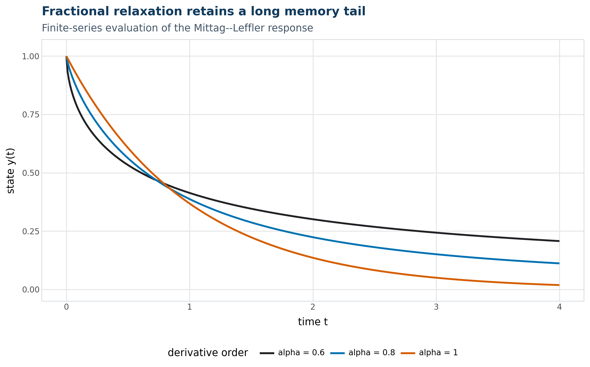

# Fractional Calculus and Memory {#sec-fractional-calculus}

An ordinary derivative is local: once a sufficiently smooth function is known
near time $t$, its derivative at $t$ is determined. Many materials and
transport processes retain history. Their present rate depends on a weighted
record of earlier states. Fractional calculus builds such memory into operators
whose order need not be an integer. The word “fractional” does not mean merely
taking an ordinary derivative and raising it to a power; it refers to a family
of nonlocal integral and derivative operators.

## Preparation from this book

Review convolution and Laplace transforms in [sec-calculus-transforms](25-transforms.md#sec-calculus-transforms), gamma functions
and asymptotics in [sec-calculus-asymptotics](24-asymptotics-special.md#sec-calculus-asymptotics), differential equations in
[sec-odes](09-differential-equations.md#sec-odes), and quadrature error in [sec-numerical-calculus](16-numerical.md#sec-numerical-calculus). The only
new conceptual step is nonlocality: an integral from the initial time to the
present carries the entire past into the current operator value.

Fractional derivatives have several inequivalent conventions. Every formula
in this chapter states its convention, lower terminal, and order. Omitting
those choices is like writing an integral without limits or measure.

## Fractional integration

For $\alpha>0$, the left Riemann–Liouville fractional integral from $0$ is

$$
(I^\alpha f)(t)
=\frac{1}{\Gamma(\alpha)}
\int_0^t(t-s)^{\alpha-1}f(s)\,ds.
$$

When $\alpha=1$, this is the ordinary accumulation
$\int_0^t f(s)\,ds$. The kernel emphasizes recent history when
$0<\alpha<1$ but never discards the distant past. Its integrable singularity at
$s=t$ requires careful quadrature.

For powers $f(t)=t^\beta$ with $\beta>-1$, substitution $s=tu$ and the beta
integral give

$$
I^\alpha t^\beta
=\frac{\Gamma(\beta+1)}
{\Gamma(\beta+\alpha+1)}t^{\beta+\alpha}.
$$

The dimensions expose an important feature. If $t$ has time units, $I^\alpha$
contributes time to the power $\alpha$. A parameter multiplying a fractional
derivative must carry different units when $\alpha$ changes; comparing fitted
coefficients across orders without rescaling is generally meaningless.

Fractional integrals satisfy a semigroup law under suitable integrability:

$$
I^\alpha I^\beta f=I^{\alpha+\beta}f.
$$

The proof writes the two nested integrals, swaps their order, and evaluates an
inner beta integral. Fubini or Tonelli hypotheses are doing real work; drawing
two convolution arrows is not a proof.

## Riemann–Liouville and Caputo derivatives

For $0<\alpha<1$, the Riemann–Liouville derivative is

$$
D_{\mathrm{RL}}^\alpha f
=\frac{d}{dt}I^{1-\alpha}f,
$$

whereas the Caputo derivative is

$$
D_{\mathrm C}^\alpha f
=I^{1-\alpha}f'
=\frac{1}{\Gamma(1-\alpha)}
\int_0^t\frac{f'(s)}{(t-s)^\alpha}\,ds.
$$

They differ in how initial data enter. The Caputo derivative of a constant is
zero; the Riemann–Liouville derivative of $1$ is
$t^{-\alpha}/\Gamma(1-\alpha)$. More precisely,

$$
D_{\mathrm C}^\alpha f
=D_{\mathrm{RL}}^\alpha\bigl(f-f(0)\bigr).
$$

This relation makes the Caputo convention convenient for classical initial
conditions such as $y(0)=y_0$. Riemann–Liouville models may instead require
fractional initial data. Neither convention is universally correct; the
physical derivation and data determine the choice.

A sufficient regularity assumption for this identity is
$f\in C^1([0,T])$, evaluated at $0<t\le T$, with lower terminal zero.
Some later power and relaxation examples have an integrable initial
singularity instead; their defining integrals must be checked directly.
Neither this identity nor a finite history sum assigns an ordinary derivative
value at the singular initial endpoint.

For $\beta>0$,

$$
D_{\mathrm C}^\alpha t^\beta
=\frac{\Gamma(\beta+1)}
{\Gamma(\beta+1-\alpha)}t^{\beta-\alpha}.
$$

The formula resembles the ordinary power rule but carries gamma factors and a
noninteger change of exponent. It must not be applied blindly at $t=0$, where
the result may be singular.

**Nonexample.** In general,
$D^\alpha(fg)$ is not
$fD^\alpha g+gD^\alpha f$. A fractional product rule is an infinite series
under suitable analytic assumptions. Reusing the ordinary Leibniz rule erases
the operator's memory.

## Fractional relaxation

Replace exponential relaxation $y'=-\lambda y$ by the Caputo model

$$
D_{\mathrm C}^\alpha y(t)=-\lambda y(t),
\qquad y(0)=1,
\qquad 0<\alpha\le1,\quad\lambda>0.
$$

The solution is the Mittag–Leffler function

$$
y(t)=E_\alpha(-\lambda t^\alpha),
\qquad
E_\alpha(z)=\sum_{k=0}^{\infty}
\frac{z^k}{\Gamma(\alpha k+1)}.
$$

At $\alpha=1$, $E_1(z)=e^z$. For smaller $\alpha$, relaxation initially falls
but develops a much longer tail than an exponential.

<figure id="fig-fractional-relaxation">


<figcaption>

Figure 47.1: Fractional relaxation curves decay more slowly at late times than the exponential order-one curve.

</figcaption>
</figure>

The figure is a finite-series evaluation, not an oracle. Alternating
Mittag–Leffler series can lose accuracy for large arguments; asymptotic
expansions, contour methods, or tested special-function libraries are preferable
outside a controlled range.

The slow tail can represent a broad distribution of ordinary relaxation time
scales. It should not be interpreted automatically as evidence for a literal
fractional mechanism. Several heterogeneous integer-order models can produce
similar data.

## Laplace-transform view

For a sufficiently regular function of exponential order, the Caputo
derivative has transform

$$
\mathcal L\{D_{\mathrm C}^\alpha y\}(s)
=s^\alpha Y(s)-s^{\alpha-1}y(0).
$$

Applying this to fractional relaxation gives

$$
Y(s)=\frac{s^{\alpha-1}}{s^\alpha+\lambda}.
$$

The branch of $s^\alpha$ matters in complex inversion. For positive real $s$
the expression is unambiguous; contour inversion requires a branch cut and
analytic convention. This is one reason transform tables must state domains,
not only symbolic pairs.

## Grünwald–Letnikov differences {#sec-fractional-history-convention}

### Name the operator before refining the grid

Fix $0<\alpha<1$, lower terminal zero, and a uniform grid
$t_j=jh$, including **all** samples from $t_0=0$ through $t_n=nh>0$.
Here $\binom{\alpha}{0}=1$ and, for $k\ge1$,
$\binom{\alpha}{k}=\alpha(\alpha-1)\cdots(\alpha-k+1)/k!$; this product defines
binomial coefficients at a noninteger upper argument. Define the raw history sum

$$
G_h^\alpha f(t_n)
=h^{-\alpha}\sum_{k=0}^{n}w_kf(t_{n-k}),
\qquad w_k=(-1)^k\binom{\alpha}{k}.
$$

This is the backward Euler convolution quadrature, also called the
Grünwald–Letnikov approximation, for the **left Riemann–Liouville**
derivative from zero. For a Caputo derivative from the same terminal, use

$$
G_{h,\mathrm C}^\alpha f(t_n)
=h^{-\alpha}\sum_{k=0}^{n}w_k
\bigl(f(t_{n-k})-f(0)\bigr).
$$

The initial value is subtracted from **every** sample, not merely the last
term in the sum. This is the discrete counterpart of
$D_{\mathrm C}^\alpha f=D_{\mathrm{RL}}^\alpha(f-f(0))$.
The same recurrence and initial-value subtraction appear in the
convolution-quadrature formulation of Jin, Lazarov and Zhou, Section 4.1,
equations (4.1)–(4.3) ([Jin et al. 2018](bibliography.md#ref-jin2018fractional)). A smaller step size does not
select a convention that the formula never specified.

Weights can be generated without factorials:

$$
w_0=1,\qquad
w_k=-w_{k-1}\frac{\alpha-k+1}{k}.
$$

### An exact constant test

Before testing another power, predict the two history sums on $f(t)=1$.
The centered Caputo sum is exactly zero on every grid. For the raw sum, let
$S_n=\sum_{k=0}^n w_k$. Pascal's identity and cancellation of consecutive
binomial sums give

$$
\begin{aligned}
S_n&=(-1)^n\binom{\alpha-1}{n}
=\prod_{j=1}^n\frac{j-\alpha}{j},\\
S_n&=\frac{\Gamma(n+1-\alpha)}
{\Gamma(1-\alpha)\Gamma(n+1)}.
\end{aligned}
$$

The empty product at $n=0$ is one. For $0<\alpha<1$, every factor is
positive; the sum does not vanish merely because all noninitial weights
are negative. The beta integral from [sec-calculus-asymptotics](24-asymptotics-special.md#sec-calculus-asymptotics) proves the
needed ratio asymptotic directly. Substitute $v=n(1-u)$ in
$B(n+1-\alpha,\alpha)$ to obtain

$$
n^\alpha\frac{\Gamma(n+1-\alpha)}{\Gamma(n+1)}
=\frac1{\Gamma(\alpha)}\int_0^n
\left(1-\frac vn\right)^{n-\alpha}v^{\alpha-1}\,dv
\longrightarrow1.
$$

Indeed, for $n\ge2$ the integrand, extended by zero for $v\ge n$, is
bounded by $e^{-v/2}v^{\alpha-1}$, which is integrable on $(0,\infty)$.
It converges pointwise for $v>0$ to $e^{-v}v^{\alpha-1}$, so dominated
convergence gives the integral $\Gamma(\alpha)$. Thus
$S_n\sim n^{-\alpha}/\Gamma(1-\alpha)$. At a **fixed** positive time
$t=nh$, with $h=t/n$,

$$
G_h^\alpha1(t)=h^{-\alpha}S_n
\longrightarrow\frac{t^{-\alpha}}{\Gamma(1-\alpha)}.
$$

This is precisely the Riemann–Liouville constant derivative, rather than a
small discretization error in a Caputo zero. A test restricted to
$f(t)=t^\beta$, $\beta>0$, has $f(0)=0$ and cannot distinguish these two
conventions. The initial-value test addresses a different question from
the convergence-rate test.

### Why centering gives the Caputo limit

Here is a fixed-time convergence argument with explicit hypotheses. Let
$0<\alpha<1$, $f\in C^1([0,t])$, $t>0$, and $h=t/n$. Write
$f_j=f(jh)$. Expanding each sample into its initial value and successive
increments gives the exact summation identity

$$
\sum_{k=0}^n w_k f_{n-k}
=S_nf_0+\sum_{j=1}^n S_{n-j}(f_j-f_{j-1}).
$$

Thus the centered history sum removes exactly the first term. On
$((j-1)h,jh]$, define $K_h(s)=h^{-\alpha}S_{n-j}$. The Fundamental
Theorem of Calculus then makes the remaining sum an exact integral:

$$
G_{h,\mathrm C}^\alpha f(t)
=\int_0^t K_h(s)f'(s)\,ds.
$$

For each fixed $s<t$, the gamma-ratio asymptotic yields
$K_h(s)\to(t-s)^{-\alpha}/\Gamma(1-\alpha)$.
It also supplies a constant $C_\alpha$ with
$0<S_m\le C_\alpha(m+1)^{-\alpha}$ for all integers $m\ge0$:
choose a bound for the asymptotic tail and increase it to cover the finitely
many remaining indices. For $m=n-j$ and $s$ in that cell,
$t-s\le(m+1)h$, so

$$
0<K_h(s)\le C_\alpha(t-s)^{-\alpha}.
$$

The derivative $f'$ is bounded, and $(t-s)^{-\alpha}$ is integrable because
$\alpha<1$. Dominated convergence therefore proves
$G_{h,\mathrm C}^\alpha f(t)\to D_{\mathrm C}^\alpha f(t)$.
The raw sum adds $h^{-\alpha}S_nf(0)$, whose limit is the initial-value
term above, proving convergence to $D_{\mathrm{RL}}^\alpha f(t)$ under
these hypotheses. This argument proves a limit at fixed $t>0$; it supplies
neither a general rate nor a uniform estimate through the initial layer.

Unlike a first derivative, each new value uses all earlier samples. A direct
simulation with $N$ time steps therefore costs order $N^2$ work and order $N$
memory. Sum-of-exponentials approximations, short-memory models, and fast
convolution can reduce cost, but each introduces another approximation.

The finite helper requires the convention by name. It uses all supplied
uniform-grid samples from the declared lower terminal, with a teaching work
bound of 10,000 intervals. Inputs and intermediate results must fit finite
floating arithmetic; this is not a relative-error certificate.

```python
from collections.abc import Sequence
from math import fsum, gamma, isfinite
from numbers import Real

def _finite_real(value: float, name: str) -> float:
    """Normalize an ordinary real input without silently accepting booleans."""
    if isinstance(value, bool) or not isinstance(value, Real):
        raise ValueError(f"{name} must be a finite real number")
    try:
        result = float(value)
    except (OverflowError, ValueError) as error:
        raise ValueError(f"{name} is outside floating-point range") from error
    if not isfinite(result):
        raise ValueError(f"{name} must be finite")
    return result

def fractional_weights(order: float, count: int) -> list[float]:
    """Return weights zero through count for 0 < order < 1."""
    order = _finite_real(order, "order")
    if not 0.0 < order < 1.0:
        raise ValueError("order must lie strictly between 0 and 1")
    if type(count) is not int or not 0 <= count <= 10000:
        raise ValueError("count must be an integer from 0 through 10000")
    weights = [1.0]
    for index in range(1, count + 1):
        weights.append(-weights[-1] * (order - index + 1.0) / index)
    return weights

def grunwald_history(
    order: float,
    samples: Sequence[float],
    step_size: float,
    *,
    convention: str,
) -> float:
    """Evaluate the named RL or centered Caputo history sum at the last node."""
    if not isinstance(samples, Sequence) or isinstance(samples, (str, bytes)):
        raise ValueError("samples must be a finite real sequence")
    if not 2 <= len(samples) <= 10001:
        raise ValueError("provide samples for 1 through 10000 intervals")
    if not isinstance(convention, str) or convention not in ("riemann-liouville", "caputo"):
        raise ValueError("convention must be riemann-liouville or caputo")
    width = _finite_real(step_size, "step_size")
    if width <= 0.0 or not isfinite(width * (len(samples) - 1)):
        raise ValueError("step_size must give a finite positive time horizon")
    values = [_finite_real(value, "sample") for value in samples]
    weights = fractional_weights(order, len(values) - 1)
    normalized_order = _finite_real(order, "order")
    initial = values[0] if convention == "caputo" else 0.0
    try:
        value = width ** (-normalized_order) * fsum(
            weight * (sample - initial)
            for weight, sample in zip(weights, reversed(values))
        )
    except (OverflowError, ValueError) as error:
        raise ValueError("history sum exceeds floating-point range") from error
    if not isfinite(value):
        raise ValueError("history sum exceeds floating-point range")
    return value

def power_derivative(order: float, power: float, steps: int) -> float:
    """Evaluate the raw history test on a zero-initial-value power at time one."""
    power = _finite_real(power, "power")
    if power <= 0.0 or type(steps) is not int or not 1 <= steps <= 10000:
        raise ValueError("power must be positive and steps an integer from 1 to 10000")
    width = 1.0 / steps
    samples = [(index * width) ** power for index in range(steps + 1)]
    return grunwald_history(
        order, samples, width, convention="riemann-liouville"
    )

order, power = 0.6, 2.0
exact = gamma(power + 1.0) / gamma(power + 1.0 - order)
for steps in (50, 200, 800):
    approximation = power_derivative(order, power, steps)
    print(steps, approximation, abs(approximation - exact))

for steps in (16, 64, 256):
    samples = [2.0 + (index / steps) ** 2 for index in range(steps + 1)]
    raw = grunwald_history(0.5, samples, 1.0 / steps, convention="riemann-liouville")
    centered = grunwald_history(0.5, samples, 1.0 / steps, convention="caputo")
    print("offset quadratic:", steps, raw, centered, raw - centered)
```

This test evaluates at $t=1$, where the power-law exact result has no endpoint
singularity. The original zero-initial-value powers still check discretization,
and the offset quadratic now exposes the convention. The observed errors
depend on smoothness, order, formula, and grid. Subtracting large rounded
initial values can also lose small increments; the finite-input checks do not
recover information already lost in measurement or floating representation.

### An exact finite oracle for the convention gap

For half order, the product identity simplifies to

$$
S_n=\frac{\binom{2n}{n}}{4^n}.
$$

For $f(t)=2+t^2$ at $t=1$, the finite raw-minus-centered gap is exactly
$2\sqrt n\,S_n$. If $n=m^2$, even that scale is rational. The following
standalone oracle evaluates the product exactly for rational orders; it does
not call the floating recurrence or fit a convergence curve.

```python
from fractions import Fraction
from math import pi, sqrt

def partial_weight_sum_exact(order: Fraction, count: int) -> Fraction:
    """Return the exact cumulative GL weight via its product identity."""
    if not isinstance(order, Fraction) or not 0 < order < 1:
        raise ValueError("order must be an exact Fraction strictly between 0 and 1")
    if type(count) is not int or not 0 <= count <= 10000:
        raise ValueError("count must be an integer from 0 through 10000")
    result = Fraction(1)
    for index in range(1, count + 1):
        result *= (index - order) / index
    return result

for root_count in (4, 8, 16):
    count = root_count**2
    exact_gap = 2 * root_count * partial_weight_sum_exact(Fraction(1, 2), count)
    print(count, float(exact_gap), "limit:", 2.0 / sqrt(pi))
```

This oracle checks the discrete gap exactly before conversion for display.
Its nonzero limit follows from the proved gamma asymptotic. It does not prove
a convergence rate for arbitrary input data or infer a physical convention
from an observed curve. A constant offset is deliberately used to test the
operator choice separately from the power approximation.

### Initial subtraction keeps the history

Centering uses $f(s)-f(0)$ for **all** $0\le s\le t$; it does not discard
any earlier interval. Moving the lower terminal to $a>0$ instead changes the
operator to

$$
D_{\mathrm C,a}^\alpha f(t)
=\frac1{\Gamma(1-\alpha)}\int_a^t(t-s)^{-\alpha}f'(s)\,ds,
\qquad t>a.
$$

Its corresponding centered history starts at $a$ and subtracts $f(a)$.
For $f(t)=t$, half order, and $t=2$, the terminal-zero and terminal-one
values are respectively $2\sqrt2/\sqrt\pi$ and $2/\sqrt\pi$. The missing
integral over $[0,1]$ is real history, even though both centered formulas
annihilate constants. Refining only the retained interval cannot restore it.

## Initial layers and numerical accuracy

Even with smooth forcing, a fractional evolution solution often has weak
regularity near its initial time. Applying a high-order quadrature formula that
assumes ordinary smoothness can produce a lower observed order. Graded meshes
place more points near the initial layer. Convolution quadrature derives stable
weights from a classical time-stepping method and can handle operator-valued
problems.

Three errors must be kept separate:

- **model error:** whether a power-law memory kernel represents the system;
- **history discretization error:** how the convolution integral is
  approximated; and
- **history truncation error:** whether old memory is deliberately discarded.

A small time step controls neither model misspecification nor an unjustified
short-memory approximation.

## Constitutive example

A fractional Kelvin–Voigt material may relate stress $\sigma$ and strain
$\varepsilon$ by

$$
\sigma(t)=E\varepsilon(t)+\eta_\alpha
D_{\mathrm C}^\alpha\varepsilon(t).
$$

Here $E$ has pressure units, while $\eta_\alpha$ has pressure times
time to the power $\alpha$. Setting $\alpha=1$ recovers an ordinary viscous
term. For a step strain, idealized derivatives can be singular at the loading
instant; real instruments have finite rise time, which belongs in the model.

Identifying $E$, $\eta_\alpha$, and $\alpha$ simultaneously can be poorly
conditioned over a narrow frequency or time range. Plotting a good fitted curve
does not establish parameter uniqueness.

<!-- inline-formula-code:start -->
## Formula and finite computation

The Mittag–Leffler response is defined by

$$
E_\alpha(z)=\sum_{k=0}^{\infty}
\frac{z^k}{\Gamma(\alpha k+1)}.
$$

A bounded partial sum makes its finite status explicit:

```python
from math import gamma

def mittag_leffler(order: float, argument: float, terms: int) -> float:
    if not 0.0 < order <= 1.0:
        raise ValueError("order must lie in (0, 1]")
    if terms <= 0:
        raise ValueError("terms must be positive")
    return sum(
        argument**index / gamma(order * index + 1.0)
        for index in range(terms)
    )

for order in (1.0, 0.8, 0.6):
    estimates = [mittag_leffler(order, -(time**order), 60) for time in (0.5, 1.0, 2.0)]
    print(order, estimates)
```

**What the computation establishes.** These values are 60-term series
approximations at three moderate times. They do not prove convergence of the
series, validate cancellation error for large negative arguments, or show that
a fractional model is preferable for particular data.
<!-- inline-formula-code:end -->

## Summary

Fractional integrals are power-law convolutions, and fractional derivatives
combine differentiation with memory. Riemann–Liouville and Caputo conventions
encode initial data differently. Mittag–Leffler functions replace exponentials
in elementary relaxation, while Grünwald–Letnikov weights turn nonlocal
operators into history sums. Units, endpoint regularity, convention choice, and
memory cost are integral parts of every calculation.

## Exercises

<div class="exercise" id="calculus-47-fractional-calculus-ex-1">
<p class="exercise-title"><strong>Exercise 1</strong></p>

Show that $I^1f$ is the ordinary integral from zero to $t$.

</div>

<div class="exercise" id="calculus-47-fractional-calculus-ex-2">
<p class="exercise-title"><strong>Exercise 2</strong></p>

Derive $I^\alpha t^\beta$ using $s=tu$ and the beta integral.

</div>

<div class="exercise" id="calculus-47-fractional-calculus-ex-3">
<p class="exercise-title"><strong>Exercise 3</strong></p>

Compute the Riemann–Liouville derivative of the constant function.

<details class="solution"><summary>Solution</summary>

Since $I^{1-\alpha}1=t^{1-\alpha}/\Gamma(2-\alpha)$, differentiation gives

$$
D_{\mathrm{RL}}^\alpha1
=\frac{t^{-\alpha}}{\Gamma(1-\alpha)}.
$$

The gamma recurrence
$\Gamma(2-\alpha)=(1-\alpha)\Gamma(1-\alpha)$ was used.

</details>

</div>

<div class="exercise" id="calculus-47-fractional-calculus-ex-4">
<p class="exercise-title"><strong>Exercise 4</strong></p>

Use the Caputo definition to show that the derivative of a constant is zero.

<details class="solution"><summary>Solution</summary>

The Caputo definition integrates the ordinary derivative $f'$. For a constant,
$f'=0$, so the integral is zero. This calculation also explains why classical
initial values enter its Laplace transform naturally.

</details>

</div>

<div class="exercise" id="calculus-47-fractional-calculus-ex-5">
<p class="exercise-title"><strong>Exercise 5</strong></p>

Check that the power rule approaches the ordinary derivative as
$\alpha\to1$.

</div>

<div class="exercise" id="calculus-47-fractional-calculus-ex-6">
<p class="exercise-title"><strong>Exercise 6</strong></p>

Derive the Laplace-domain solution of fractional relaxation.

</div>

<div class="exercise" id="calculus-47-fractional-calculus-ex-7">
<p class="exercise-title"><strong>Exercise 7</strong></p>

Verify the recurrence for the first four fractional-difference weights.

</div>

<div class="exercise" id="calculus-47-fractional-calculus-ex-8">
<p class="exercise-title"><strong>Exercise 8</strong></p>

Implement the power test at $t=1$ and estimate an observed convergence rate.

</div>

<div class="exercise" id="calculus-47-fractional-calculus-ex-9">
<p class="exercise-title"><strong>Exercise 9</strong></p>

Explain why a uniform high-order method may lose order near $t=0$.

</div>

<div class="exercise" id="calculus-47-fractional-calculus-ex-10">
<p class="exercise-title"><strong>Exercise 10</strong></p>

Determine the units of $\eta_\alpha$ in the fractional Kelvin–Voigt model.

<details class="solution"><summary>Solution</summary>

Strain is dimensionless, so $D_{\mathrm C}^\alpha\varepsilon$ has units
time to the power $-\alpha$. Stress has pressure units. Therefore
$\eta_\alpha$ must have pressure times time to the power $\alpha$; its numerical
value cannot be compared across different time units without conversion.

</details>

</div>

<div class="exercise" id="calculus-47-fractional-calculus-ex-11">
<p class="exercise-title"><strong>Exercise 11</strong></p>

Compare an exponential and a Mittag–Leffler curve over two different time
windows; discuss identifiability.

</div>

<div class="exercise" id="calculus-47-fractional-calculus-ex-12">
<p class="exercise-title"><strong>Exercise 12</strong></p>

Give one scientific reason to use Caputo data and one reason a
Riemann–Liouville formulation might be natural.

</div>

<div class="exercise" id="calculus-47-fractional-calculus-ex-13">
<p class="exercise-title"><strong>Exercise 13</strong></p>

**Change the initial value, then the remembered interval.** Let
$f(t)=2+t^2$, lower terminal zero, $\alpha=1/2$, and final time one.
Predict whether the old positive-power test would notice replacing a
Caputo formula by the raw history sum. Derive both continuum derivatives
at time one. For $n=m^2$ uniform intervals, prove an exact rational formula
for the raw-minus-centered discrete gap and check it with the independent
oracle at $n=16,64,256$. Does its limit vanish? Explain what grid
refinement does and does not repair. Finally use the different field
$g(t)=t$ at time two to compare lower terminals zero and one. Explain why
initial subtraction and a shorter remembered interval are distinct changes.

<details class="solution"><summary>Solution</summary>

The earlier test $t^\beta$, $\beta>0$, has initial value zero, so its raw
and centered sums coincide. It cannot identify the convention. Adding a
constant changes the Riemann–Liouville derivative but not the Caputo
derivative. The gamma power rule and constant derivative give

$$
\begin{aligned}
D_{\mathrm C}^{1/2}(2+t^2)\big|_{t=1}
&=\frac{\Gamma(3)}{\Gamma(5/2)}
=\frac8{3\sqrt\pi},\\
D_{\mathrm{RL}}^{1/2}(2+t^2)\big|_{t=1}
&=\frac2{\sqrt\pi}+\frac8{3\sqrt\pi}
=\frac{14}{3\sqrt\pi}.
\end{aligned}
$$

At every finite $n$, linearity of the raw sum makes the discrete difference
equal to its action on the initial constant two:

$$
G_h^{1/2}f(1)-G_{h,\mathrm C}^{1/2}f(1)
=2\sqrt n\,\frac{\binom{2n}{n}}{4^n}.
$$

For $n=m^2$, this equals the rational number
$2m\binom{2m^2}{m^2}/4^{m^2}$ computed by the oracle. The limit is
$2/\sqrt\pi$, exactly the continuum convention gap. Refinement reduces
discretization error for each selected operator; it does not turn the raw
Riemann–Liouville operator into the Caputo operator.

For $g(t)=t$ and a general terminal $a<2$, $g'=1$ gives

$$
D_{\mathrm C,a}^{1/2}g(2)
=\frac1{\sqrt\pi}\int_a^2(2-s)^{-1/2}\,ds
=\frac{2\sqrt{2-a}}{\sqrt\pi}.
$$

Thus $a=0$ gives $2\sqrt2/\sqrt\pi$, whereas $a=1$ gives
$2/\sqrt\pi$. Centering at either terminal only fixes its initial-value
convention; it preserves the full history from that terminal onward. The
shorter integral loses a nonzero contribution. Neither a smaller step on
$[1,2]$ nor subtraction of $g(1)$ recovers the missing history on $[0,1]$.

</details>

</div>

## Selected solutions

### Solution to Exercise 3

Since $I^{1-\alpha}1=t^{1-\alpha}/\Gamma(2-\alpha)$, differentiation gives

$$
D_{\mathrm{RL}}^\alpha1
=\frac{t^{-\alpha}}{\Gamma(1-\alpha)}.
$$

The gamma recurrence
$\Gamma(2-\alpha)=(1-\alpha)\Gamma(1-\alpha)$ was used.

### Solution to Exercise 4

The Caputo definition integrates the ordinary derivative $f'$. For a constant,
$f'=0$, so the integral is zero. This calculation also explains why classical
initial values enter its Laplace transform naturally.

### Solution to Exercise 10

Strain is dimensionless, so $D_{\mathrm C}^\alpha\varepsilon$ has units
time to the power $-\alpha$. Stress has pressure units. Therefore
$\eta_\alpha$ must have pressure times time to the power $\alpha$; its numerical
value cannot be compared across different time units without conversion.

### Solution to Exercise 13

The earlier test $t^\beta$, $\beta>0$, has initial value zero, so its raw
and centered sums coincide. It cannot identify the convention. Adding a
constant changes the Riemann–Liouville derivative but not the Caputo
derivative. The gamma power rule and constant derivative give

$$
\begin{aligned}
D_{\mathrm C}^{1/2}(2+t^2)\big|_{t=1}
&=\frac{\Gamma(3)}{\Gamma(5/2)}
=\frac8{3\sqrt\pi},\\
D_{\mathrm{RL}}^{1/2}(2+t^2)\big|_{t=1}
&=\frac2{\sqrt\pi}+\frac8{3\sqrt\pi}
=\frac{14}{3\sqrt\pi}.
\end{aligned}
$$

At every finite $n$, linearity of the raw sum makes the discrete difference
equal to its action on the initial constant two:

$$
G_h^{1/2}f(1)-G_{h,\mathrm C}^{1/2}f(1)
=2\sqrt n\,\frac{\binom{2n}{n}}{4^n}.
$$

For $n=m^2$, this equals the rational number
$2m\binom{2m^2}{m^2}/4^{m^2}$ computed by the oracle. The limit is
$2/\sqrt\pi$, exactly the continuum convention gap. Refinement reduces
discretization error for each selected operator; it does not turn the raw
Riemann–Liouville operator into the Caputo operator.

For $g(t)=t$ and a general terminal $a<2$, $g'=1$ gives

$$
D_{\mathrm C,a}^{1/2}g(2)
=\frac1{\sqrt\pi}\int_a^2(2-s)^{-1/2}\,ds
=\frac{2\sqrt{2-a}}{\sqrt\pi}.
$$

Thus $a=0$ gives $2\sqrt2/\sqrt\pi$, whereas $a=1$ gives
$2/\sqrt\pi$. Centering at either terminal only fixes its initial-value
convention; it preserves the full history from that terminal onward. The
shorter integral loses a nonzero contribution. Neither a smaller step on
$[1,2]$ nor subtraction of $g(1)$ recovers the missing history on $[0,1]$.
