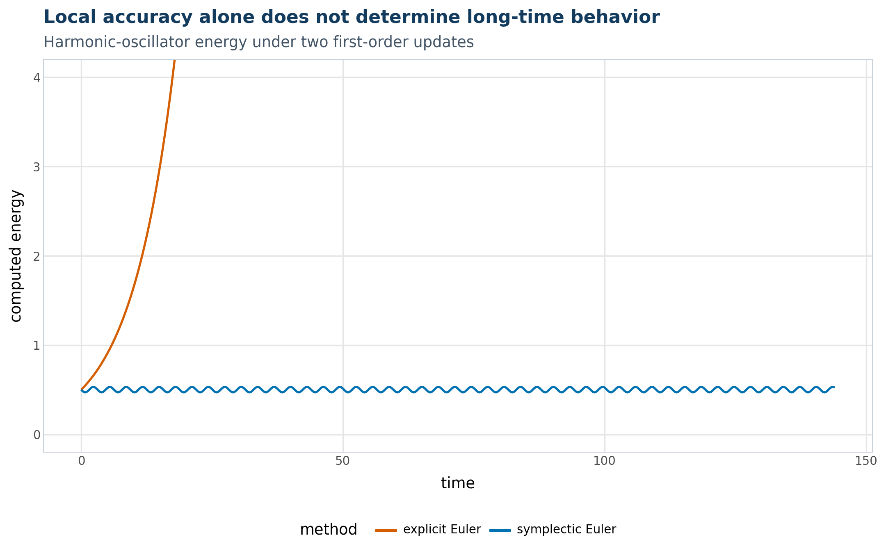

# Geometric and Structure-Preserving Integration {#sec-geometric-integration}

A numerical method can have small local error and still tell the wrong
long-time story. Artificial energy drift may turn a stable orbit into an
outward spiral; numerical damping may erase oscillations; a nonconservative
update may create mass. **Geometric integration** designs discrete updates that
respect selected structures of the differential equation—symplectic form,
first integrals, reversibility, constraints, or conservation laws—so qualitative
behavior survives far beyond one step.

## Preparation from this book

Review phase portraits in [sec-phase-space](17-phase-space.md#sec-phase-space), oscillation and energy in
[sec-oscillation](18-oscillation.md#sec-oscillation), stable ODE methods in [sec-numerical-odes](33-numerical-odes.md#sec-numerical-odes), variational
principles in [sec-calculus-variations](26-variations.md#sec-calculus-variations), differential forms in [sec-forms](22-forms.md#sec-forms), and conservative
finite volumes in [sec-conservation-laws](42-conservation-laws.md#sec-conservation-laws). The central distinction is:
**accuracy** measures closeness over a chosen interval; **structure preservation**
states an exact algebraic property of the update map. Neither automatically
implies the other.

## Hamiltonian systems

Let position $q\in\mathbb R^d$, momentum $p\in\mathbb R^d$, and Hamiltonian
$H(q,p)$. Hamilton's equations are

$$
\dot q=\nabla_pH(q,p),
\qquad
\dot p=-\nabla_qH(q,p).
$$

Along an exact trajectory,

$$
\frac{dH}{dt}
=\nabla_qH^T\dot q+\nabla_pH^T\dot p=0.
$$

The cancellation proves energy conservation when $H$ has no explicit time
dependence. More deeply, the flow preserves the two-form
$\omega=\sum_i dq^i\wedge dp_i$. In matrix notation, with
$z=(q,p)$ and

$$
J=\begin{pmatrix}0&I\\-I&0\end{pmatrix},
$$

the system is $\dot z=J\nabla H(z)$. A differentiable map $\Phi$ is
**symplectic** when

$$
(D\Phi(z))^TJ(D\Phi(z))=J.
$$

Symplectic maps preserve phase-space volume, but volume preservation alone is
weaker. In dimensions greater than two, a unit determinant does not guarantee
the matrix identity.

For the unit harmonic oscillator,
$H(q,p)=\tfrac12(q^2+p^2)$ and
$\dot q=p$, $\dot p=-q$. Exact trajectories are circles and have period
$2\pi$.

## Why explicit Euler drifts

Explicit Euler gives

$$
\begin{pmatrix}q_{n+1}\\p_{n+1}\end{pmatrix}
= \begin{pmatrix}1&h\\-h&1\end{pmatrix}
\begin{pmatrix}q_n\\p_n\end{pmatrix}.
$$

The update matrix has determinant $1+h^2>1$, so every step expands area and
multiplies oscillator energy by $1+h^2$. Making $h$ smaller slows the drift but
does not change its direction.

Symplectic Euler updates momentum first and then position:

$$
p_{n+1}=p_n-hq_n,
\qquad
q_{n+1}=q_n+hp_{n+1}.
$$

Its determinant is exactly one, and in two dimensions it is symplectic. It does
not preserve the original energy exactly. Instead, for a stable step it
typically keeps energy in a bounded oscillatory envelope corresponding to a
nearby modified Hamiltonian.

<figure id="fig-geometric-integrator-energy">


<figcaption>

Figure 48.1: Explicit Euler creates severe outward energy drift, whereas symplectic Euler keeps oscillator energy in a bounded band over the same long interval.

</figcaption>
</figure>

The graph does not say symplectic Euler has smaller pointwise error at every
time. It says the method respects a geometry that controls the qualitative
energy behavior.

**Nonexample.** Renormalizing $(q,p)$ to the original energy after every Euler
step preserves this one scalar, but it need not preserve phase, symplectic
geometry, momentum maps, or the correct response under perturbation. Enforcing
one invariant by projection is not automatically a faithful integrator.

## Störmer–Verlet

For a separable Hamiltonian $H(q,p)=T(p)+V(q)$, the Störmer–Verlet or leapfrog
scheme is

$$
\begin{aligned}
p_{n+1/2}&=p_n-\frac h2\nabla V(q_n),\\
q_{n+1}&=q_n+h\nabla T(p_{n+1/2}),\\
p_{n+1}&=p_{n+1/2}-\frac h2\nabla V(q_{n+1}).
\end{aligned}
$$

It is second order, symplectic, and time reversible. The method composes exact
flows of the kinetic and potential sub-Hamiltonians in a symmetric order.
Reversing $h$ reverses the three substeps.

For $T(p)=p^2/(2m)$, the middle step uses velocity $p/m$. Units provide a quick
audit: a force times a time step changes momentum, and a velocity times a time
step changes position.

High-order symplectic splitting methods compose more subflows, sometimes with
negative substeps. They are valuable when the split pieces can be evolved
exactly or cheaply. A formally high order is not useful if a negative substep
violates a positivity or irreversibility constraint in the model.

## Discrete variational mechanics

Classical trajectories make the action stationary:

$$
\mathcal S[q]=\int_{t_0}^{t_1}L(q,\dot q)\,dt.
$$

Replace each short action by a **discrete Lagrangian**
$L_d(q_k,q_{k+1};h)$. Stationarity of the discrete sum gives the
discrete Euler–Lagrange equations

$$
D_2L_d(q_{k-1},q_k)+D_1L_d(q_k,q_{k+1})=0.
$$

This is not merely discretizing the continuous Euler–Lagrange differential
equation. It discretizes the variational principle first. The equations are
initially an implicit relation. Under the local regularity condition below,
they define a symplectic map; symmetries of the discrete Lagrangian yield
discrete momentum conservation through a Noether principle.

Different quadrature approximations to the short action generate different
integrators. The midpoint discrete action produces an implicit method; endpoint
choices produce symplectic Euler variants.

### From a relation to a local symplectic map {#sec-variational-local-map}

Fix a step $h>0$. Work in coordinates $q,Q\in\mathbb R^d$, and suppose
$L_d(q,Q;h)$ is $C^2$ on an **open neighborhood** of a pair $(q_*,Q_*)$.
The discrete momenta use the signs

$$
p=-D_1L_d(q,Q;h),\qquad P=D_2L_d(q,Q;h).
$$

Along a discrete trajectory, the Euler–Lagrange equation matches the
outgoing momentum from one pair with the incoming momentum of the next.
These signs and the distinction between local regularity and global
invertibility are the discrete Legendre-transform construction
([Marsden and West 2001](bibliography.md#ref-marsden2001discrete), Sections 1.4.4–1.5.3, printed pages 381–386).

**A sufficient local hypothesis.** Set $p_*=-D_1L_d(q_*,Q_*;h)$ and assume
the mixed $d\times d$ block

$$
A_{ij}=\frac{\partial^2L_d}{\partial q^i\partial Q^j}(q_*,Q_*;h)
$$

is nonsingular. The derivative with respect to $Q$ of
$F(q,p,Q)=p+D_1L_d(q,Q;h)$ is $A$. The implicit function theorem therefore
gives a $C^1$ solution $Q=Q(q,p)$ for $(q,p)$ near $(q_*,p_*)$, unique
among $Q$ near $Q_*$. Define

$$
\Phi_h(q,p)=\bigl(Q(q,p),D_2L_d(q,Q(q,p);h)\bigr).
$$

This is a **local branch**, not a claim that every initial state has a
step or that distant branches cannot coexist. The hypothesis concerns
the mixed block, not the full Hessian of $L_d$.

**Why the branch is symplectic.** With the canonical one-form
$\lambda=\sum_i p_i\,dq^i$, use
$\omega=-d\lambda=\sum_i dq^i\wedge dp_i$, as earlier in the chapter.
First work in the independent coordinates $(q,Q)$, defining $p,P$ by the
momentum relations. There

$$
dL_d=-\sum_i p_i\,dq^i+\sum_i P_i\,dQ^i,
\qquad
0=d^2L_d=\sum_i dq^i\wedge dp_i-\sum_i dQ^i\wedge dP_i.
$$

Pull back this two-form identity by the $C^1$ parametrization
$(q,p)\mapsto(q,Q(q,p))$. It gives $\Phi_h^*\omega=\omega$, or
$(D\Phi_h)^TJ(D\Phi_h)=J$. Nondegeneracy of $\omega$ forces
$D\Phi_h$ to be invertible, so the inverse function theorem makes this
a local $C^1$ diffeomorphism. The differentiation took place before
parametrizing the branch; no second derivative of the $C^1$ branch was
assumed.

The theorem establishes a local canonical map under stated hypotheses.
It does not prove global solvability, global uniqueness, trajectory
accuracy, or stability. A small numerical residual in $F=0$ alone does
not certify an exact solution or a unique branch; Exercise 13 separates
these issues with an exactly computable changed model.

## Exact preservation of selected integrals

Suppose an ODE is written as

$$
\dot y=S(y)\nabla H(y),
\qquad S(y)^T=-S(y).
$$

Then $dH/dt=\nabla H^TS\nabla H=0$. A **discrete gradient**
$\overline\nabla H(x,y)$ satisfies

$$
H(y)-H(x)=\overline\nabla H(x,y)^T(y-x),
\qquad
\overline\nabla H(x,x)=\nabla H(x).
$$

The update

$$
\frac{y_{n+1}-y_n}{h}
=\overline S(y_n,y_{n+1})
\overline\nabla H(y_n,y_{n+1}),
$$

with skew-symmetric $\overline S$, preserves $H$ exactly in exact arithmetic.
It may be implicit, and the nonlinear solver tolerance then controls how
closely the computed step preserves the invariant.

An energy-preserving method is not necessarily symplectic, and a symplectic
method does not generally preserve $H$ exactly. Choose the property that
matches the modeled mechanism and intended time scale.

## Constraints and manifolds

Mechanical systems may satisfy $g(q)=0$. A naive step leaves the constraint
surface. Projection can restore position while damaging momentum geometry.
SHAKE and RATTLE introduce constraint multipliers within Verlet-like updates so
positions, and where appropriate momenta, satisfy their constraints while the
scheme remains symplectic on the constrained phase space.

Constraint solves need tolerances. Reporting $g(q)$ after every step is a
constraint residual, not a trajectory-error estimate. A nearly satisfied
constraint can coexist with a large phase error.

## Backward error analysis

Rather than ask only how far a numerical point is from the exact trajectory,
backward error analysis asks: *which nearby differential equation does the
method solve almost exactly?* For a symplectic method applied to an analytic
Hamiltonian system, a formal modified Hamiltonian has the form

$$
\widetilde H=H+h^rH_r+h^{r+1}H_{r+1}+\cdots.
$$

Over very long but finite times, the numerical trajectory approximately
conserves a truncation of $\widetilde H$. This explains bounded energy
oscillation. The series is generally asymptotic, not convergent forever, and
its conclusion requires smoothness and step-size conditions.

Resonance between a time step and a fast physical frequency can still cause
failure. Structure preservation is not permission to ignore resolution.

## Finite experiment

The following comparison keeps the same step and initial data:

```python
def oscillator(method: str, step: float, steps: int) -> tuple[float, float, float]:
    if method not in {"euler", "symplectic"}:
        raise ValueError("unknown method")
    if step <= 0.0 or steps < 0:
        raise ValueError("step must be positive and steps nonnegative")
    q, p = 1.0, 0.0
    for _ in range(steps):
        if method == "euler":
            q, p = q + step * p, p - step * q
        else:
            p = p - step * q
            q = q + step * p
    return q, p, 0.5 * (q * q + p * p)

for method in ("euler", "symplectic"):
    print(method, oscillator(method, 0.1, 1_000))
```

The explicit update uses simultaneous old values through tuple assignment. The
symplectic update intentionally uses the new momentum in the position step.

## Failure and precision audit

- Symplectic is a structural property of the map, not a synonym for stable,
  accurate, or energy preserving.
- Exact algebraic preservation may be weakened by iterative solver tolerance
  and floating-point roundoff.
- Adaptive step sizes can destroy symplecticity unless incorporated through an
  appropriate extended formulation.
- Dissipative systems should lose energy. Applying a conservative integrator to
  a genuinely damped model preserves the wrong structure.
- A conserved discrete mass can coexist with negative concentrations or
  oscillatory shocks; other qualitative properties need separate checks.

<!-- inline-formula-code:start -->
## Formula and finite computation

Symplectic Euler for the unit oscillator is

$$
p_{n+1}=p_n-hq_n,\qquad q_{n+1}=q_n+hp_{n+1}.
$$

The update and its energy ledger are finite:

```python
def symplectic_energy(step: float, steps: int) -> list[float]:
    if step <= 0.0 or steps < 0:
        raise ValueError("step must be positive and steps nonnegative")
    position, momentum = 1.0, 0.0
    energies = [0.5]
    for _ in range(steps):
        momentum -= step * position
        position += step * momentum
        energies.append(0.5 * (position**2 + momentum**2))
    return energies

history = symplectic_energy(0.1, 2_000)
print(min(history), max(history), history[-1])
```

**What the computation establishes.** The finite ledger shows bounded energy
variation for one oscillator, step, and duration. It does not prove
symplecticity, long-time bounds for every Hamiltonian, or adequacy of the step
for a different frequency scale.
<!-- inline-formula-code:end -->

## Summary

Hamiltonian flow preserves symplectic geometry, and ordinary Euler fails even
the oscillator's area test. Symplectic Euler and Verlet trade exact energy for
bounded modified-energy behavior; discrete variational principles explain their
structure. Discrete gradients can preserve a selected first integral exactly,
while constrained methods keep trajectories on a manifold. Accuracy,
stability, geometry, conservation, and solver tolerance are distinct parts of a
numerical audit.

## Exercises

<div class="exercise" id="calculus-48-geometric-integration-ex-1">
<p class="exercise-title"><strong>Exercise 1</strong></p>

Derive energy conservation from Hamilton's equations.

</div>

<div class="exercise" id="calculus-48-geometric-integration-ex-2">
<p class="exercise-title"><strong>Exercise 2</strong></p>

Compute the determinant of the explicit-Euler oscillator matrix.

</div>

<div class="exercise" id="calculus-48-geometric-integration-ex-3">
<p class="exercise-title"><strong>Exercise 3</strong></p>

Write the symplectic-Euler matrix and verify determinant one.

<details class="solution"><summary>Solution</summary>

The update is

$$
\begin{pmatrix}q_{n+1}\\p_{n+1}\end{pmatrix}
= \begin{pmatrix}1-h^2&h\\-h&1\end{pmatrix}
\begin{pmatrix}q_n\\p_n\end{pmatrix}.
$$

Its determinant is $(1-h^2)+h^2=1$. In two dimensions this is the symplectic
condition for a linear map.

</details>

</div>

<div class="exercise" id="calculus-48-geometric-integration-ex-4">
<p class="exercise-title"><strong>Exercise 4</strong></p>

Show directly that explicit Euler multiplies oscillator energy by $1+h^2$.

<details class="solution"><summary>Solution</summary>

For explicit Euler,
$q_+=q+hp$ and $p_+=p-hq$. Expanding gives
$q_+^2+p_+^2=(1+h^2)(q^2+p^2)$ because cross terms cancel. Thus the energy
grows geometrically at every nonzero step.

</details>

</div>

<div class="exercise" id="calculus-48-geometric-integration-ex-5">
<p class="exercise-title"><strong>Exercise 5</strong></p>

Apply one Verlet step to $q=1,p=0$ with $h=0.1$.

</div>

<div class="exercise" id="calculus-48-geometric-integration-ex-6">
<p class="exercise-title"><strong>Exercise 6</strong></p>

Prove time reversibility of the three-step Verlet composition.

</div>

<div class="exercise" id="calculus-48-geometric-integration-ex-7">
<p class="exercise-title"><strong>Exercise 7</strong></p>

Derive a discrete Euler–Lagrange equation from variation of three
consecutive terms.

</div>

<div class="exercise" id="calculus-48-geometric-integration-ex-8">
<p class="exercise-title"><strong>Exercise 8</strong></p>

Construct a scalar discrete gradient for $H(y)=y^4/4$.

<details class="solution"><summary>Solution</summary>

For $x\ne y$, use

$$
\overline\nabla H(x,y)=\frac{H(y)-H(x)}{y-x}
=\frac{y^3+y^2x+yx^2+x^3}{4}.
$$

At $x=y$, define it as $H'(x)=x^3$. The polynomial expression already takes
that value continuously, so it is a valid discrete gradient.

</details>

</div>

<div class="exercise" id="calculus-48-geometric-integration-ex-9">
<p class="exercise-title"><strong>Exercise 9</strong></p>

Explain why exact energy projection need not preserve phase.

</div>

<div class="exercise" id="calculus-48-geometric-integration-ex-10">
<p class="exercise-title"><strong>Exercise 10</strong></p>

Compare Euler, symplectic Euler, and Verlet under step halving; report
phase and energy errors separately.

</div>

<div class="exercise" id="calculus-48-geometric-integration-ex-11">
<p class="exercise-title"><strong>Exercise 11</strong></p>

Describe how a nonlinear-solver tolerance enters an implicit
energy-preserving method.

</div>

<div class="exercise" id="calculus-48-geometric-integration-ex-12">
<p class="exercise-title"><strong>Exercise 12</strong></p>

Choose a dissipative model and state which structure should replace energy
conservation in its numerical audit.

</div>

<div class="exercise" id="calculus-48-geometric-integration-ex-13">
<p class="exercise-title"><strong>Exercise 13</strong></p>

**Change the oscillator; audit whether a step exists.** In
nondimensional variables, replace the preceding ordinary oscillator
by the inverted oscillator $L(q,v)=(v^2+q^2)/2$, whose continuous
equation is $q''=q$. Use the midpoint discrete action
$L_d(q,Q;h)=hL((q+Q)/2,(Q-q)/h)$ for $h>0$.
Derive $p=-D_1L_d$, $P=D_2L_d$ and the mixed derivative.
At $h=2$, classify the outputs for initial states $(q,p)=(1,0)$
and $(0,0)$. Does a nonsingular full Hessian of $L_d$ suffice?
For $h\ne2$, derive the linear update and verify its symplectic
matrix identity; evaluate the $h=1$ step from $(1,0)$.
Finally, at $h=2$ evaluate the residual $p+D_1L_d$ for
$(q,p)=(\varepsilon,0)$, $\varepsilon>0$, and explain what a small
residual can establish. Check the classifications with exact
rational arithmetic, distinguishing an implicit relation, a local
map and the well-posed continuous ODE.

*Hint:* collect the incoming-momentum equation as
$aQ=p+bq$, where $a=1/h-h/4$ and $b=1/h+h/4$.
Treat $a=0$ before dividing. When $a\ne0$, use
$P=bQ-aq$ and the identity $b^2-a^2=1$.

<details class="solution"><summary>Solution</summary>

The changed model has $\partial^2L/\partial v^2=1$ and smooth continuous
equations $\dot q=p$, $\dot p=q$. Its exact flow is globally defined:
$q(t)=q(0)\cosh t+p(0)\sinh t$ and
$p(t)=q(0)\sinh t+p(0)\cosh t$. The failure below belongs to the selected
discrete step relation, not the continuous initial-value problem.

The midpoint action and momenta are

$$
L_d=\frac{(Q-q)^2}{2h}+\frac h8(q+Q)^2,
\qquad
D_{12}L_d=-\frac1h+\frac h4,
$$

$$
p=\frac{Q-q}{h}-\frac h4(q+Q)=aQ-bq,
\qquad
P=\frac{Q-q}{h}+\frac h4(q+Q)=bQ-aq.
$$

At $h=2$, $L_d=(q^2+Q^2)/2$, so its full Hessian is the identity,
but its mixed block is zero. The momentum equations reduce to

$$
p=-q,\qquad P=Q.
$$

For $(q,p)=(1,0)$, the first equation is impossible. For $(0,0)$,
every real $Q=t$ is allowed and $P=t$: infinitely many outputs, not a
single-valued map on an open phase-space neighborhood. Thus neither
global existence nor uniqueness follows from writing a discrete action,
and full-Hessian nonsingularity is the wrong criterion.

For $h>0$, $h\ne2$, $a\ne0$; direct elimination gives the global linear
map for this particular quadratic example:

$$
\begin{pmatrix}Q\\P\end{pmatrix}
=M_h\begin{pmatrix}q\\p\end{pmatrix},\qquad
M_h=\frac{1}{1-h^2/4}
\begin{pmatrix}1+h^2/4&h\\h&1+h^2/4\end{pmatrix}.
$$

Its determinant is
$((1+h^2/4)^2-h^2)/(1-h^2/4)^2=1$; in this two-dimensional phase
space, direct multiplication gives $M_h^TJM_h=J$. At $h=1$,
$(1,0)$ maps to $(5/3,4/3)$. This globally solvable example does not
strengthen the earlier local theorem for general $L_d$.

At $h=2$ the incoming residual is $R=p+D_1L_d=p+q$, independent of
the trial $Q$. For $(\varepsilon,0)$ it is $\varepsilon$, arbitrarily
small but with no exact solution when $\varepsilon>0$. For $(0,0)$
it is exactly zero for every $Q$, so even a zero residual does not
establish uniqueness. The family witnesses in this standalone oracle
illustrate the algebraically proved free parameter; three printed
points alone would not prove infinitude.

```python
from fractions import Fraction

variational_audit_rows = []
for step, position, momentum in (
    (Fraction(1), Fraction(1), Fraction(0)),
    (Fraction(2), Fraction(1), Fraction(0)),
    (Fraction(2), Fraction(1, 2**40), Fraction(0)),
    (Fraction(2), Fraction(0), Fraction(0)),
):
    incoming_coefficient = 1 / step - step / 4
    outgoing_coefficient = 1 / step + step / 4
    target = momentum + outgoing_coefficient * position
    outputs = []
    if incoming_coefficient == 0:
        status = "no solution" if target != 0 else "infinitely many"
        if target == 0:
            outputs = [(value, value) for value in map(Fraction, (-1, 0, 2))]
    else:
        next_position = target / incoming_coefficient
        next_momentum = (
            outgoing_coefficient * next_position - incoming_coefficient * position
        )
        status = "unique"
        outputs = [(next_position, next_momentum)]
    variational_audit_rows.append((step, position, momentum, status, outputs, target))
    print(step, position, momentum, status, "outputs", outputs, "target", target)
```

</details>

</div>

## Selected solutions

### Solution to Exercise 3

The update is

$$
\begin{pmatrix}q_{n+1}\\p_{n+1}\end{pmatrix}
= \begin{pmatrix}1-h^2&h\\-h&1\end{pmatrix}
\begin{pmatrix}q_n\\p_n\end{pmatrix}.
$$

Its determinant is $(1-h^2)+h^2=1$. In two dimensions this is the symplectic
condition for a linear map.

### Solution to Exercise 4

For explicit Euler,
$q_+=q+hp$ and $p_+=p-hq$. Expanding gives
$q_+^2+p_+^2=(1+h^2)(q^2+p^2)$ because cross terms cancel. Thus the energy
grows geometrically at every nonzero step.

### Solution to Exercise 8

For $x\ne y$, use

$$
\overline\nabla H(x,y)=\frac{H(y)-H(x)}{y-x}
=\frac{y^3+y^2x+yx^2+x^3}{4}.
$$

At $x=y$, define it as $H'(x)=x^3$. The polynomial expression already takes
that value continuously, so it is a valid discrete gradient.

### Solution to Exercise 13

The changed model has $\partial^2L/\partial v^2=1$ and smooth continuous
equations $\dot q=p$, $\dot p=q$. Its exact flow is globally defined:
$q(t)=q(0)\cosh t+p(0)\sinh t$ and
$p(t)=q(0)\sinh t+p(0)\cosh t$. The failure below belongs to the selected
discrete step relation, not the continuous initial-value problem.

The midpoint action and momenta are

$$
L_d=\frac{(Q-q)^2}{2h}+\frac h8(q+Q)^2,
\qquad
D_{12}L_d=-\frac1h+\frac h4,
$$

$$
p=\frac{Q-q}{h}-\frac h4(q+Q)=aQ-bq,
\qquad
P=\frac{Q-q}{h}+\frac h4(q+Q)=bQ-aq.
$$

At $h=2$, $L_d=(q^2+Q^2)/2$, so its full Hessian is the identity,
but its mixed block is zero. The momentum equations reduce to

$$
p=-q,\qquad P=Q.
$$

For $(q,p)=(1,0)$, the first equation is impossible. For $(0,0)$,
every real $Q=t$ is allowed and $P=t$: infinitely many outputs, not a
single-valued map on an open phase-space neighborhood. Thus neither
global existence nor uniqueness follows from writing a discrete action,
and full-Hessian nonsingularity is the wrong criterion.

For $h>0$, $h\ne2$, $a\ne0$; direct elimination gives the global linear
map for this particular quadratic example:

$$
\begin{pmatrix}Q\\P\end{pmatrix}
=M_h\begin{pmatrix}q\\p\end{pmatrix},\qquad
M_h=\frac{1}{1-h^2/4}
\begin{pmatrix}1+h^2/4&h\\h&1+h^2/4\end{pmatrix}.
$$

Its determinant is
$((1+h^2/4)^2-h^2)/(1-h^2/4)^2=1$; in this two-dimensional phase
space, direct multiplication gives $M_h^TJM_h=J$. At $h=1$,
$(1,0)$ maps to $(5/3,4/3)$. This globally solvable example does not
strengthen the earlier local theorem for general $L_d$.

At $h=2$ the incoming residual is $R=p+D_1L_d=p+q$, independent of
the trial $Q$. For $(\varepsilon,0)$ it is $\varepsilon$, arbitrarily
small but with no exact solution when $\varepsilon>0$. For $(0,0)$
it is exactly zero for every $Q$, so even a zero residual does not
establish uniqueness. The family witnesses in this standalone oracle
illustrate the algebraically proved free parameter; three printed
points alone would not prove infinitude.

```python
from fractions import Fraction

variational_audit_rows = []
for step, position, momentum in (
    (Fraction(1), Fraction(1), Fraction(0)),
    (Fraction(2), Fraction(1), Fraction(0)),
    (Fraction(2), Fraction(1, 2**40), Fraction(0)),
    (Fraction(2), Fraction(0), Fraction(0)),
):
    incoming_coefficient = 1 / step - step / 4
    outgoing_coefficient = 1 / step + step / 4
    target = momentum + outgoing_coefficient * position
    outputs = []
    if incoming_coefficient == 0:
        status = "no solution" if target != 0 else "infinitely many"
        if target == 0:
            outputs = [(value, value) for value in map(Fraction, (-1, 0, 2))]
    else:
        next_position = target / incoming_coefficient
        next_momentum = (
            outgoing_coefficient * next_position - incoming_coefficient * position
        )
        status = "unique"
        outputs = [(next_position, next_momentum)]
    variational_audit_rows.append((step, position, momentum, status, outputs, target))
    print(step, position, momentum, status, "outputs", outputs, "target", target)
```
