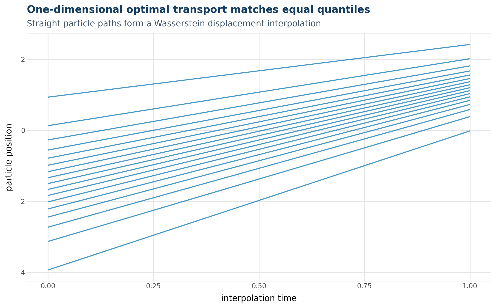

# Optimal Transport and Gradient Flows {#sec-optimal-transport}
Two probability distributions can have the same mean and variance while placing
mass in very different locations. Optimal transport compares them by asking how
much work is required to move one distribution into the other. The resulting
geometry connects multivariable calculus, probability, linear programming,
partial differential equations, and optimization. In that geometry, diffusion
itself can be read as steepest descent of an energy.

## Preparation from this book

Review probability densities and expectations in [sec-probability-calculus](21-probability.md#sec-probability-calculus),
multiple integrals and Jacobians in [sec-multiple-integrals](14-multiple-integrals.md#sec-multiple-integrals), constrained
optimization in [sec-constrained-optimization](20-constrained-optimization.md#sec-constrained-optimization), PDE conservation laws in
[sec-calculus-pdes](27-pdes.md#sec-calculus-pdes), and convex algorithms in [sec-computational-optimization](41-computational-optimization.md#sec-computational-optimization). Measure
language from [sec-measure-integration](38-measure-integration.md#sec-measure-integration) is useful, but the finite and
one-dimensional constructions below provide a direct route.

## Couplings and transport cost

Let $\mu$ and $\nu$ be probability measures on a metric space, each with finite $p$th moment for the chosen $1\le p<\infty$: $\int d(x,x_0)^p\,d\mu(x)<\infty$ and likewise for $\nu$, for some fixed point $x_0$. A **coupling**
$\pi$ is a joint distribution whose first marginal is $\mu$ and second
marginal is $\nu$. It describes how much source mass at $x$ is assigned to
target location $y$. For $p\ge1$, the Wasserstein cost is

$$
W_p(\mu,\nu)
=\left(
\inf_{\pi\in\Pi(\mu,\nu)}
\int d(x,y)^p\,d\pi(x,y)
\right)^{1/p}.
$$

The admissible set $\Pi(\mu,\nu)$ enforces both marginals. A low pointwise cost
is irrelevant if it fails to move all source mass or supply the required target
mass.

For discrete distributions

$$
\mu=\sum_{i=1}^m a_i\delta_{x_i},
\qquad
\nu=\sum_{j=1}^n b_j\delta_{y_j},
$$

a coupling is a nonnegative matrix $P$ with row sums $a_i$ and column sums
$b_j$. The transport problem is the linear program

$$
\min_{P_{ij}\ge0}
\sum_{i,j}C_{ij}P_{ij},
\qquad
\sum_jP_{ij}=a_i,\quad
\sum_iP_{ij}=b_j.
$$

Here $C_{ij}=d(x_i,y_j)^p$. Units matter: $W_p$ has distance units, while the
objective before taking the $p$th root has distance to the power $p$.

**Nonexample.** Matching each source point independently to its nearest target
can overload one target and leave another empty. Nearest-neighbor assignment is
not generally a coupling with the required marginals.

## The one-dimensional quantile formula

On the real line, crossing transport paths waste convex cost. If
$x_1<x_2$ are sent to $y_2<y_1$, uncrossing the assignments does not increase
$|x-y|^p$. Repeating this exchange yields monotone matching. In terms of
quantile functions,

$$
W_p(\mu,\nu)^p
=\int_0^1
\left|F_\mu^{-1}(r)-F_\nu^{-1}(r)\right|^p\,dr.
$$

For equally weighted empirical samples of the same size, sort both samples and
pair equal ranks. This is an exact finite optimum, not merely a heuristic.

If the source has a continuous distribution and $T=F_\nu^{-1}\circ F_\mu$,
then $T$ pushes $\mu$ forward to $\nu$. The notation
$T_\#\mu=\nu$ means $\nu(B)=\mu(T^{-1}(B))$. In higher dimensions there is no
universal sorting order; under quadratic cost and suitable regularity, the
optimal map is the gradient of a convex potential.

## Displacement interpolation

Given an optimal map $T$ for quadratic cost, define

$$
T_t(x)=(1-t)x+tT(x),
\qquad
\mu_t=(T_t)_\#\mu.
$$

This moves particles along straight paths while their distribution changes
nonlinearly. It is a constant-speed geodesic in Wasserstein space.

<figure id="fig-transport-geodesic">


<figcaption>

Figure 49.1: Equal quantiles travel along noncrossing straight paths from a broad left distribution to a narrower right distribution.

</figcaption>
</figure>

The noncrossing fan is specific to one-dimensional monotone transport. A density
plot alone can hide which mass moved where; trajectories make the coupling
visible.

Linear interpolation of densities,
$(1-t)\rho_0+t\rho_1$, is a different path. It fades mass out at one location
and into another rather than transporting particles through intermediate
locations.

## Kantorovich duality

The coupling problem has a dual. For general cost $c$,

$$
\inf_{\pi\in\Pi(\mu,\nu)}\int c\,d\pi
= \sup_{\varphi(x)+\psi(y)\le c(x,y)}
\left(\int\varphi\,d\mu+\int\psi\,d\nu\right).
$$

The potentials $\varphi,\psi$ assign source and target prices whose combined
price never exceeds transport cost. Any feasible dual pair supplies a lower
bound; any feasible coupling supplies an upper bound. Equality is a certificate
of optimality under the theorem's hypotheses.

For $W_1$, the dual becomes a supremum over one-Lipschitz functions:

$$
W_1(\mu,\nu)
=\sup_{\operatorname{Lip}(f)\le1}
\left(\int f\,d\mu-\int f\,d\nu\right).
$$

This formulation connects transport to distributional tests. Restricting the
function class gives a lower bound, not necessarily the true distance.

## Entropic regularization and Sinkhorn scaling

The discrete linear program can be expensive at large scale. Entropic
regularization solves

$$
\min_{P\in\Pi(a,b)}
\langle C,P\rangle
+\varepsilon\sum_{i,j}P_{ij}(\log P_{ij}-1).
$$

The solution has the scaling form
$P=\operatorname{diag}(u)K\operatorname{diag}(v)$ with
$K_{ij}=e^{-C_{ij}/\varepsilon}$. Alternately rescaling rows and columns gives
the Sinkhorn algorithm.

The regularized cost is not the unregularized Wasserstein distance. Larger
$\varepsilon$ improves smoothness and often computation but spreads the plan
and biases the objective. Very small $\varepsilon$ causes underflow in
$e^{-C/\varepsilon}$; log-domain updates are then essential. A small marginal
residual certifies approximate feasibility, not small bias relative to the
unregularized problem.

## Dynamic formulation

For quadratic cost on Euclidean space, the Benamou–Brenier formula expresses
transport as minimum kinetic action:

$$
W_2(\mu_0,\mu_1)^2
=\inf_{\rho,v}
\int_0^1\int\rho_t(x)\|v_t(x)\|^2\,dx\,dt,
$$

subject to the continuity equation

$$
\partial_t\rho+\nabla\mathbin{\cdot}(\rho v)=0,
\qquad \rho_0=\mu_0,\quad\rho_1=\mu_1.
$$

This is fluid mechanics without creation or destruction of mass. The static
coupling says where mass starts and ends; the dynamic formulation chooses a
whole velocity field between them.

Discretizing the continuity equation must preserve total mass. A visually
smooth animation that loses mass is not a valid approximation of the
constrained problem.

## Gradient flows of distributions

Ordinary gradient descent for energy $E(x)$ moves
$\dot x=-\nabla E(x)$. In Wasserstein geometry, an energy
$\mathcal F(\rho)$ generates a PDE. Formally,

$$
\partial_t\rho
=\nabla\mathbin{\cdot}
\left(\rho\nabla\frac{\delta\mathcal F}{\delta\rho}\right).
$$

For entropy

$$
\mathcal F(\rho)=\int\rho\log\rho\,dx,
$$

the first variation is $1+\log\rho$, so the flow becomes

$$
\partial_t\rho
=\nabla\mathbin{\cdot}(\rho\nabla\log\rho)
=\Delta\rho.
$$

Thus the heat equation is steepest descent of entropy in Wasserstein geometry.
The entropy decreases under this convention while the density spreads. Sign
conventions vary across fields, so state whether entropy means
$\int\rho\log\rho$ or its negative.

Adding potential energy
$\int V\rho$ gives drift-diffusion:

$$
\partial_t\rho=\Delta\rho+\nabla\mathbin{\cdot}(\rho\nabla V).
$$

Its stationary density is proportional to $e^{-V}$ when normalizable and when
boundary conditions support zero flux.

## The minimizing-movement scheme

The Jordan–Kinderlehrer–Otto time step chooses

$$
\rho_{k+1}
=\underset{\rho}{\operatorname{argmin}}
\left(
\mathcal F(\rho)
+\frac{1}{2\tau}W_2(\rho,\rho_k)^2
\right).
$$

This is an implicit Euler step in the geometry of probability measures. The
energy favors descent; the squared transport term penalizes moving too far in
one time step. As $\tau\to0$, suitable interpolations converge to a gradient
flow under hypotheses that go far beyond the finite optimization problem.

The form mirrors the proximal map in [sec-nonsmooth-convex](44-nonsmooth-convex.md#sec-nonsmooth-convex). Euclidean squared
distance has been replaced by Wasserstein squared distance.

## A Gaussian JKO clinic: exact optimization and finite time {#sec-gaussian-jko}

The Gaussian update and the global transport–entropy proof below follow
Peyré's Proposition 3 ([Peyré 2026](bibliography.md#ref-peyre2026quantiles)). We expand the admissible class,
equality cases and finite-step comparison for this lesson. The original JKO
construction treats entropy plus potential energy and proves convergence
under its hypotheses ([Jordan et al. 1998](bibliography.md#ref-jordan1998variational), Sections 2, 4 and 5).

Work on $\mathbb R$, with **nondimensional position and time**, and use
diffusivity one: the heat equation is $\rho_t=\rho_{xx}$. In particular its
variance grows by $2t$, rather than $t$. Let

$$
\mathcal P_2(\mathbb R)
=\left\{\mu:\mu\text{ is a probability measure},\quad
\int x^2\,d\mu(x)<\infty\right\}.
$$

On this full competitor class define

$$
\mathcal H(\mu)=
\begin{cases}
\displaystyle\int_{\mathbb R}\rho\log\rho\,dx,
   &\mu=\rho\,dx,\\
+\infty,&\mu\text{ has no density}.
\end{cases}
$$

Here $0\log0=0$. A density may also have $\mathcal H=+\infty$; finite
second moment bounds the negative part of the entropy integral, so this
extended value is well defined. One way to see the bound is to set
$g(x)=e^{-x^2}$. On $\{\rho\le1\}$, the inequality
$u\log(u/g)\ge-g/e$ gives
$-\rho\log\rho\le x^2\rho+e^{-x^2}/e$, an integrable upper bound.
Singular measures and densities of infinite entropy cannot improve on the
finite Gaussian candidate below.

Fix $\mu_0=\mathcal N(m_0,s_0^2)$ with **$s_0>0$** and **$\tau>0$**. The
one-step problem is to minimize

$$
J_\tau(\mu)=\frac{W_2(\mu,\mu_0)^2}{2\tau}+\mathcal H(\mu)
\qquad\text{over }\mu\in\mathcal P_2(\mathbb R).
$$

**A global lower bound.** Take any finite-entropy competitor, with mean $a$
and standard deviation $s$. Necessarily $s>0$: zero variance would force a
point mass. In any coupling $(X,Y)$ of $\mu$ and $\mu_0$,

$$
\begin{aligned}
\mathbb E[(X-Y)^2]
&=(a-m_0)^2+s^2+s_0^2
  -2\mathbb E[(X-a)(Y-m_0)]\\
&\ge (a-m_0)^2+(s-s_0)^2,
\end{aligned}
$$

by Cauchy–Schwarz. Infimizing over couplings preserves this lower bound.
For $\gamma_{a,s}=\mathcal N(a,s^2)$, relative entropy gives a second bound:

$$
0\le\operatorname{KL}(\mu\Vert\gamma_{a,s})
=\mathcal H(\mu)+\log s+\tfrac12\log(2\pi e).
$$

Indeed $\log\gamma_{a,s}(x)=-\log(s\sqrt{2\pi})-(x-a)^2/(2s^2)$,
whose $\mu$-expectation is determined by these moments. Thus every competitor
has objective at least

$$
j_\tau(a,s)=
\frac{(a-m_0)^2+(s-s_0)^2}{2\tau}
-\log s-\tfrac12\log(2\pi e),\qquad a\in\mathbb R,\ s>0.
$$

**Both bounds can be equal at once.** Choose $Y\sim\mu_0$ and
$X=a+(s/s_0)(Y-m_0)$. Then $X\sim\gamma_{a,s}$ and this coupling costs
exactly $(a-m_0)^2+(s-s_0)^2$. Its entropy also attains the lower bound,
since $\operatorname{KL}(\gamma_{a,s}\Vert\gamma_{a,s})=0$.
Consequently minimizing $j_\tau$ solves the full measure problem. This is
stronger than assuming a Gaussian shape and optimizing only within it.

The unique mean minimizer is $a=m_0$. The scale objective tends to
$+\infty$ at both endpoints $s\downarrow0$ and $s\to\infty$, and has
second derivative $1/\tau+1/s^2>0$. Its stationary equation gives

$$
\frac{s_+-s_0}{\tau}=\frac1{s_+},\qquad
s_+^2-s_0s_+-\tau=0,\qquad
\boxed{s_+=\frac{s_0+\sqrt{s_0^2+4\tau}}2}.
$$

Therefore the unique global minimizer is $\mathcal N(m_0,s_+^2)$.
Uniqueness over the full class follows because equality in the entropy bound
forces the competitor itself to be Gaussian, and the moment minimizer is
unique.

**The time-step discrepancy is not solver error.** The exact heat solution
at time $\tau$ is $\mathcal N(m_0,s_0^2+2\tau)$. Since
$\tau=s_+(s_+-s_0)$, direct subtraction gives

$$
\underbrace{s_0^2+2\tau}_{\text{heat variance}}
-\underbrace{s_+^2}_{\text{JKO variance}}
=(s_+-s_0)^2>0.
$$

For $s_0=1$ and $\tau=2$, $s_+=2$: JKO gives variance **4**, whereas heat
gives variance **5**. Both calculations are exact. The difference arises
from taking a finite variational time step. An approximate numerical
optimizer could add a further error; reducing its optimization residual
does not remove this discrepancy. In scale coordinates JKO applies implicit
Euler to $s'=1/s$, rather than evaluating the exact heat flow at time $\tau$.

**A changed energy.** Keep the same nondimensional convention and set

$$
\mathcal F(\mu)=\mathcal H(\mu)+\tfrac12\int x^2\,d\mu(x).
$$

For any competitor with moments $(a,s)$ the additional term is exactly
$(a^2+s^2)/2$. The two simultaneous equality cases above still apply, so
the global problem becomes minimizing
$j_\tau(a,s)+(a^2+s^2)/2$. Its stationary conditions are

$$
\frac{a_+-m_0}{\tau}+a_+=0,\qquad
\frac{s_+-s_0}{\tau}+s_+-\frac1{s_+}=0.
$$

The positive Hessian entries are $1/\tau+1$ and
$1/\tau+1+1/s^2$; the objective diverges at the scale endpoints and at
$|a|\to\infty$. These conditions therefore identify the unique global
minimizer, again over $\mathcal P_2(\mathbb R)$:

$$
a_+=\frac{m_0}{1+\tau},\qquad
(1+\tau)s_+^2-s_0s_+-\tau=0,\qquad
s_+=\frac{s_0+\sqrt{s_0^2+4\tau(1+\tau)}}{2(1+\tau)}.
$$

This energy's continuous flow is the Ornstein–Uhlenbeck equation
$\rho_t=\rho_{xx}+\partial_x(x\rho)$, with drift $-x$ and diffusivity one.
For Gaussian data the mean and variance evolve as

$$
m(t)=m_0e^{-t},\qquad
v(t)=1+(s_0^2-1)e^{-2t}.
$$

These solve $m'=-m$ and $v'=2-2v$; the Gaussian density with those parameters
satisfies the PDE. Exercise 13 changes the energy and tests the mean as well
as the variance.

**Finite computation.** Return the mean and **standard deviation**, not the
variance. The formulas above can be evaluated without first squaring a large
initial scale. For the quadratic energy, put $A=1+\tau$, $b=s_0/A$ and
$c=\tau/A$; the positive root is $b/2+\operatorname{hypot}(b/2,\sqrt c)$.
For entropy alone use $b=s_0$, $c=\tau$. The following standalone listing
validates the declared finite input domain and rejects an unrepresentable
output. Rounded output is not a bound on numerical error.

```python
from math import hypot, isfinite, sqrt
from numbers import Real

def _finite_jko_real(value: float, name: str) -> float:
    if isinstance(value, bool) or not isinstance(value, Real):
        raise ValueError(f"{name} must be a finite real number")
    try:
        result = float(value)
    except (OverflowError, ValueError) as error:
        raise ValueError(f"{name} must be representable as a float") from error
    if not isfinite(result):
        raise ValueError(f"{name} must be a finite real number")
    return result

def gaussian_jko_step(
    initial_mean: float,
    initial_scale: float,
    time_step: float,
    *,
    energy: str,
) -> tuple[float, float]:
    mean = _finite_jko_real(initial_mean, "initial_mean")
    scale = _finite_jko_real(initial_scale, "initial_scale")
    step = _finite_jko_real(time_step, "time_step")
    if scale <= 0 or step <= 0:
        raise ValueError("initial_scale and time_step must be positive")
    if not isinstance(energy, str) or energy not in ("entropy", "quadratic"):
        raise ValueError("energy must be 'entropy' or 'quadratic'")
    if energy == "entropy":
        next_mean, linear, constant = mean, scale, step
    elif energy == "quadratic":
        denominator = 1.0 + step
        next_mean = mean / denominator
        linear, constant = scale / denominator, step / denominator
    half_linear = 0.5 * linear
    next_scale = half_linear + hypot(half_linear, sqrt(constant))
    if not isfinite(next_scale) or next_scale <= 0:
        raise ValueError("updated scale is outside the finite float range")
    return next_mean, next_scale

heat_mean, heat_scale = gaussian_jko_step(0.0, 1.0, 2.0, energy="entropy")
print("entropy JKO mean, variance:", heat_mean, heat_scale**2)
print("exact heat variance at time 2:", 1.0 + 2.0 * 2.0)
print("quadratic JKO mean, scale:", gaussian_jko_step(2.0, 1.0, 1.0, energy="quadratic"))
```

For an independent exact oracle, choose rational $s_0>0$ and $s_+>s_0$, then
set $\tau=s_+(s_+-s_0)$. The heat stationarity equation and variance
discrepancy can then be checked with rational arithmetic, without evaluating
the square-root update. For the quadratic energy, a rational $s_+$ strictly
between $s_0$ and $1$ yields the positive step
$\tau=s_+(s_0-s_+)/(s_+^2-1)$. This tests both contraction from above one
and expansion from below one. The case $s_0=1$ has stationary scale one for
every positive step, while its mean can still move.

## Empirical one-dimensional computation

Equal-size empirical samples give a transparent exact calculation:

```python
from collections.abc import Sequence
from math import sqrt

def empirical_wasserstein_2(left: Sequence[float], right: Sequence[float]) -> float:
    if not left or len(left) != len(right):
        raise ValueError("samples must be nonempty and have equal size")
    ordered_left = sorted(float(value) for value in left)
    ordered_right = sorted(float(value) for value in right)
    mean_squared_cost = sum(
        (source - target) ** 2
        for source, target in zip(ordered_left, ordered_right, strict=True)
    ) / len(ordered_left)
    return sqrt(mean_squared_cost)

source = [-2.0, -1.2, -0.5, 0.4, 1.3]
target = [-0.7, 0.1, 0.9, 1.5, 2.8]
print(empirical_wasserstein_2(source, target))
print(list(zip(sorted(source), sorted(target), strict=True)))
```

The sample size and equal weights are part of the formula. Unequal weights
require splitting mass across quantile intervals rather than pairing list
entries one for one.

## Modeling and precision audit

- A transport distance depends on ground metric and cost power. Rescaling one
  feature can dominate a multivariate answer.
- Samples approximate distributions. Empirical transport has sampling error
  that can deteriorate rapidly with dimension.
- Entropic regularization changes both the plan and objective; report
  $\varepsilon$ and marginal residuals.
- Optimal transport describes minimal rearrangement under declared admissible
  couplings. It does not identify a physical causal trajectory without a model.
- Balanced transport requires equal total mass. Unbalanced transport introduces
  explicit creation or destruction penalties rather than silently normalizing.
- A finite grid can block routes or blur supports, altering the computed cost.

<!-- inline-formula-code:start -->
## Formula and finite computation

For equally weighted one-dimensional empirical measures,

$$
W_2^2=\frac1n\sum_{i=1}^n
\left(x_{(i)}-y_{(i)}\right)^2.
$$

Sorting implements the monotone optimal coupling:

```python
from math import sqrt

def sorted_wasserstein_2(source: list[float], target: list[float]) -> float:
    if len(source) == 0 or len(source) != len(target):
        raise ValueError("lists must be nonempty and equally long")
    pairs = zip(sorted(source), sorted(target), strict=True)
    return sqrt(sum((x - y) ** 2 for x, y in pairs) / len(source))

print(sorted_wasserstein_2([0.0, 4.0, 1.0], [3.0, 2.0, 2.0]))
```

**What the computation establishes.** The number is the exact quadratic
transport distance between these two equal-weight, three-atom empirical
measures on the line. It does not estimate population distance without a
sampling analysis or justify sorting in higher-dimensional spaces.
<!-- inline-formula-code:end -->

## Summary

Optimal transport minimizes movement cost over couplings with fixed marginals.
On the line, monotone quantile matching gives an exact formula; in higher
dimensions, primal plans, dual potentials, and convex maps replace sorting.
Entropic regularization enables scalable approximate coupling, while the
dynamic formulation casts transport as mass-conserving kinetic action.
Wasserstein gradient flows turn distributional energies into PDEs and reveal
the heat equation as a geometric descent.

## Exercises

<div class="exercise" id="calculus-49-optimal-transport-gradient-flows-ex-1">
<p class="exercise-title"><strong>Exercise 1</strong></p>

List all couplings between two equally weighted two-point distributions.

</div>

<div class="exercise" id="calculus-49-optimal-transport-gradient-flows-ex-2">
<p class="exercise-title"><strong>Exercise 2</strong></p>

Show by an exchange argument that crossing pairs increase quadratic cost on
the line.

</div>

<div class="exercise" id="calculus-49-optimal-transport-gradient-flows-ex-3">
<p class="exercise-title"><strong>Exercise 3</strong></p>

Compute $W_1$ and $W_2$ between $\delta_0$ and $\delta_a$.

<details class="solution"><summary>Solution</summary>

There is only one coupling: all unit mass moves from $0$ to $a$. Its
$p$-cost is $|a|^p$, so taking the $p$th root gives
$W_p(\delta_0,\delta_a)=|a|$ for every $p\ge1$.

</details>

</div>

<div class="exercise" id="calculus-49-optimal-transport-gradient-flows-ex-4">
<p class="exercise-title"><strong>Exercise 4</strong></p>

Compute empirical $W_2$ for two four-point samples by sorting.

</div>

<div class="exercise" id="calculus-49-optimal-transport-gradient-flows-ex-5">
<p class="exercise-title"><strong>Exercise 5</strong></p>

Give a nearest-neighbor assignment that violates target marginals.

<details class="solution"><summary>Solution</summary>

Let sources be $0$ and $0.1$, targets be $0$ and $10$, all with mass one half.
Independent nearest-neighbor matching sends both sources to target $0$. The
second target receives no mass, so the column marginals are wrong. A valid
coupling must send one half of the total mass to $10$ despite its larger cost.

</details>

</div>

<div class="exercise" id="calculus-49-optimal-transport-gradient-flows-ex-6">
<p class="exercise-title"><strong>Exercise 6</strong></p>

Verify that displacement interpolation of two point masses moves at constant
Wasserstein speed.

</div>

<div class="exercise" id="calculus-49-optimal-transport-gradient-flows-ex-7">
<p class="exercise-title"><strong>Exercise 7</strong></p>

Construct feasible primal and dual solutions for a two-by-two cost matrix.

</div>

<div class="exercise" id="calculus-49-optimal-transport-gradient-flows-ex-8">
<p class="exercise-title"><strong>Exercise 8</strong></p>

Perform two Sinkhorn row-and-column scaling cycles on a positive matrix.

</div>

<div class="exercise" id="calculus-49-optimal-transport-gradient-flows-ex-9">
<p class="exercise-title"><strong>Exercise 9</strong></p>

Explain the bias–stability tradeoff controlled by $\varepsilon$.

</div>

<div class="exercise" id="calculus-49-optimal-transport-gradient-flows-ex-10">
<p class="exercise-title"><strong>Exercise 10</strong></p>

Derive the heat equation from the entropy first variation.

<details class="solution"><summary>Solution</summary>

For $\mathcal F(\rho)=\int\rho\log\rho$, the first variation is
$1+\log\rho$. Substitution into the formal Wasserstein gradient-flow equation
gives
$\partial_t\rho=\nabla\mathbin{\cdot}(\rho\nabla\log\rho)$.
Since $\rho\nabla\log\rho=\nabla\rho$ where $\rho>0$, the result is
$\partial_t\rho=\Delta\rho$.

</details>

</div>

<div class="exercise" id="calculus-49-optimal-transport-gradient-flows-ex-11">
<p class="exercise-title"><strong>Exercise 11</strong></p>

Show formally that a no-flux continuity equation conserves total mass.

</div>

<div class="exercise" id="calculus-49-optimal-transport-gradient-flows-ex-12">
<p class="exercise-title"><strong>Exercise 12</strong></p>

Design a transport comparison for data with two differently scaled
features and justify the ground metric.

</div>

<div class="exercise" id="calculus-49-optimal-transport-gradient-flows-ex-13">
<p class="exercise-title"><strong>Exercise 13</strong></p>

**Change the energy, then inspect both moments.** Starting from
$\mu_0=\mathcal N(2,1)$, take $\tau=1$ and minimize
$W_2(\mu,\mu_0)^2/2+\mathcal H(\mu)+\tfrac12\int x^2\,d\mu$
over $\mathcal P_2(\mathbb R)$. Derive the mean and scale stationary
conditions and justify global optimality over all competitors. Compare
the result with the exact time-one solution of
$\rho_t=\rho_{xx}+\partial_x(x\rho)$. Does agreement of the variances
establish agreement of the measures? Identify which discrepancy would
persist even with an exact variational solver.

<details class="solution"><summary>Solution</summary>

For a finite-entropy competitor of mean $a$ and standard deviation $s>0$,
the clinic's coupling and relative-entropy bounds give

$$
\frac12W_2(\mu,\mu_0)^2+\mathcal H(\mu)
+\frac12\int x^2\,d\mu
\ge
\frac{(a-2)^2+(s-1)^2}{2}-\log s
-\tfrac12\log(2\pi e)+\frac{a^2+s^2}{2}.
$$

Every pair $(a,s)$ has a Gaussian attaining both bounds simultaneously.
The strictly convex right-hand side has stationary conditions

$$
(a-2)+a=0,\qquad (s-1)+s-\frac1s=0.
$$

Hence $a=1$ and $2s^2-s-1=(2s+1)(s-1)=0$ gives the sole positive root
$s=1$. The unique global JKO minimizer is **$\mathcal N(1,1)$**; singular
and infinite-entropy competitors have infinite objective.

For the continuous Ornstein–Uhlenbeck flow, $m'=-m$ and $v'=2-2v$ with
$m(0)=2$, $v(0)=1$ give $m(1)=2/e$ and $v(1)=1$. Thus the exact
time-one distribution is **$\mathcal N(2/e,1)$**. The variance stays at its
equilibrium value, but the means differ: $1\ne2/e$. Equal variances alone
cannot certify equality of measures. This finite-step mean discrepancy
remains after exact optimization; any numerical solver error is additional.

</details>

</div>

## Selected solutions

### Solution to Exercise 3

There is only one coupling: all unit mass moves from $0$ to $a$. Its
$p$-cost is $|a|^p$, so taking the $p$th root gives
$W_p(\delta_0,\delta_a)=|a|$ for every $p\ge1$.

### Solution to Exercise 5

Let sources be $0$ and $0.1$, targets be $0$ and $10$, all with mass one half.
Independent nearest-neighbor matching sends both sources to target $0$. The
second target receives no mass, so the column marginals are wrong. A valid
coupling must send one half of the total mass to $10$ despite its larger cost.

### Solution to Exercise 10

For $\mathcal F(\rho)=\int\rho\log\rho$, the first variation is
$1+\log\rho$. Substitution into the formal Wasserstein gradient-flow equation
gives
$\partial_t\rho=\nabla\mathbin{\cdot}(\rho\nabla\log\rho)$.
Since $\rho\nabla\log\rho=\nabla\rho$ where $\rho>0$, the result is
$\partial_t\rho=\Delta\rho$.

### Solution to Exercise 13

For a finite-entropy competitor of mean $a$ and standard deviation $s>0$,
the clinic's coupling and relative-entropy bounds give

$$
\frac12W_2(\mu,\mu_0)^2+\mathcal H(\mu)
+\frac12\int x^2\,d\mu
\ge
\frac{(a-2)^2+(s-1)^2}{2}-\log s
-\tfrac12\log(2\pi e)+\frac{a^2+s^2}{2}.
$$

Every pair $(a,s)$ has a Gaussian attaining both bounds simultaneously.
The strictly convex right-hand side has stationary conditions

$$
(a-2)+a=0,\qquad (s-1)+s-\frac1s=0.
$$

Hence $a=1$ and $2s^2-s-1=(2s+1)(s-1)=0$ gives the sole positive root
$s=1$. The unique global JKO minimizer is **$\mathcal N(1,1)$**; singular
and infinite-entropy competitors have infinite objective.

For the continuous Ornstein–Uhlenbeck flow, $m'=-m$ and $v'=2-2v$ with
$m(0)=2$, $v(0)=1$ give $m(1)=2/e$ and $v(1)=1$. Thus the exact
time-one distribution is **$\mathcal N(2/e,1)$**. The variance stays at its
equilibrium value, but the means differ: $1\ne2/e$. Equal variances alone
cannot certify equality of measures. This finite-step mean discrepancy
remains after exact optimization; any numerical solver error is additional.
