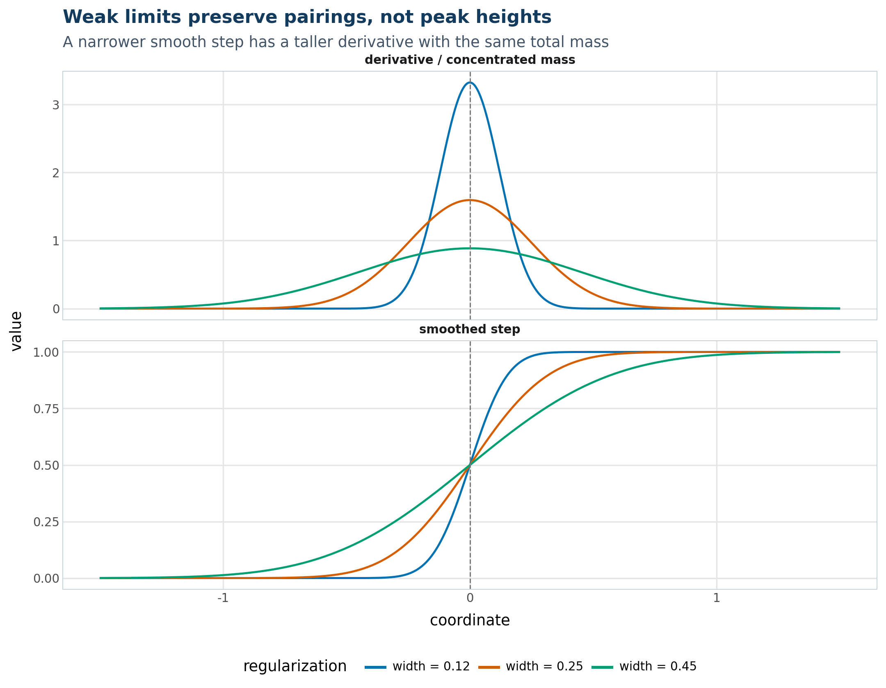

# Distributions, Weak Derivatives, and Sobolev Calculus {#sec-distributions-sobolev}

Classical derivatives describe smooth functions point by point. Shocks,
point loads, corners, and finite-energy fields often do not have that much
regularity. Distribution theory keeps differentiation available by moving it
onto smooth test functions. Sobolev spaces then measure functions and their
weak derivatives in integral norms. This is the language that makes the Dirac
delta, weak PDE solutions, finite elements, and many variational arguments fit
inside one calculus.

## Preparation from this book

Review integration by parts in [sec-techniques](07-integration-techniques.md#sec-techniques), differential forms and boundary
orientation in [sec-forms](22-forms.md#sec-forms), PDE weak formulations in [sec-calculus-pdes](27-pdes.md#sec-calculus-pdes),
Lebesgue integration in [sec-measure-integration](38-measure-integration.md#sec-measure-integration), and function spaces in
[sec-functional-analysis](39-functional-analysis.md#sec-functional-analysis). The required bridge is short:

- a compactly supported smooth test function vanishes outside a bounded set;
- an integral pairing can describe an object without assigning it a value at
  each point; and
- convergence against every test function follows from local $L^1$
  convergence, but neither it nor pointwise convergence implies the other
  without additional hypotheses.

The real-analysis volume supplies a longer proof route, but the definitions and
computations needed here are developed internally.

## Test functions and distributions

Let $\mathcal D(\Omega)=C_c^\infty(\Omega)$ be the smooth functions whose
support is compactly contained in the open set $\Omega$. A **distribution**
$T$ assigns a scalar $\langle T,\varphi\rangle$ to every
$\varphi\in\mathcal D(\Omega)$, linearly and continuously in the test-function
topology.

Every locally integrable function $f$ defines the **regular distribution**

$$
\langle T_f,\varphi\rangle=\int_\Omega f(x)\varphi(x)\,dx.
$$

Two locally integrable functions that agree almost everywhere define the same
distribution. A distribution need not arise from a function. The Dirac mass
at $a$ is

$$
\langle\delta_a,\varphi\rangle=\varphi(a).
$$

It is therefore misleading to call $\delta_a$ an ordinary function that is
zero except for an infinite value. Its defining action is evaluation. Units
also become clear: if $x$ has length units, $\delta_a$ has inverse-length units
so its integral is dimensionless.

**Nonexample.** Sampling a very narrow plotted Gaussian does not produce the
Dirac distribution exactly. It produces a regular function with a declared
width and grid. Convergence to $\delta_a$ is a statement about all fixed test
functions, not the height of one pixel.

## Which convergence controls a pairing? {#sec-distributional-convergence}

We write $T_n\to T$ **in distributions** on an open set $\Omega$ when

$$
\langle T_n,\varphi\rangle\longrightarrow\langle T,\varphi\rangle
\qquad\text{for every fixed }\varphi\in C_c^\infty(\Omega).
$$

The test may be chosen freely, but it is held fixed while $n$ tends to
infinity. A different test or grid at each $n$ does not check this definition.
For the next two examples, take $\Omega=(-1,1)$. Before reading the
calculations, predict whether a vanishing point sample must force every
integral pairing to vanish, and whether a vanishing pairing must force every
point sample to settle.

### Concentration: pointwise zero, distributional mass

The concentrated-release clinic in [sec-measure-integration](38-measure-integration.md#sec-measure-integration) already shows
why a shrinking pulse can keep its total mass. Here its new role is to
separate two notions of convergence. Set

$$
p_n(x)=n\mathbf1_{(0,1/n)}(x),\qquad n=1,2,\ldots.
$$

For each fixed $x>0$, eventually $1/n<x$; for $x\le0$, every pulse is
already zero. Thus $p_n(x)\to0$ at **every** point of $(-1,1)$, including
zero. Nevertheless, substitution $t=nx$ gives

$$
\langle T_{p_n},\varphi\rangle
=\int_0^1\varphi(t/n)\,dt\longrightarrow\varphi(0).
$$

For $n\ge2$, the mean-value estimate even supplies

$$
\left|\langle T_{p_n},\varphi\rangle-\varphi(0)\right|
\le\frac{\|\varphi'\|_\infty}{2n}.
$$

Consequently $T_{p_n}\to\delta_0$, rather than $T_0$. Choosing a smooth
test that equals one near zero makes the failure visible: its pairings are
eventually exactly one. No pointwise representative of the zero function can
retain that mass. The pulse also has $L^1$ norm one on any fixed compact
neighborhood of zero once $n$ is large, so local $L^1$ convergence to zero
fails. The earlier clinic explains the missing common integrable dominator;
pointwise convergence alone cannot replace that hypothesis.

### Oscillation: distributional zero, unsettled point values

Now set $s_n(x)=\sin(n\pi x)$. For every test function, integration by
parts gives

$$
\begin{aligned}
\langle T_{s_n},\varphi\rangle
&=\frac1{n\pi}\int_{-1}^1\cos(n\pi x)\varphi'(x)\,dx,\\
\left|\langle T_{s_n},\varphi\rangle\right|
&\le\frac{\|\varphi'\|_{L^1(-1,1)}}{n\pi}\longrightarrow0.
\end{aligned}
$$

The boundary term vanishes because $\varphi$ is zero near both endpoints.
Hence $T_{s_n}\to0$ in distributions. At $x=1/2$, however, the values repeat
$1,0,-1,0$, so there is no pointwise limit there. Cancellation against each
fixed smooth test does not require individual values to become small.
Together, these examples show that pointwise and distributional convergence
are **incomparable**, even when all approximating functions are locally
integrable. They do not give a hierarchy with pointwise convergence above
distributional convergence.

### The reliable bridge: local integral control

For $f_n,f\in L^1_{\mathrm{loc}}(\Omega)$, suppose
$\int_K|f_n-f|\to0$ for every compact $K\subset\Omega$. If
$K=\operatorname{supp}\varphi$, then

$$
\left|\langle T_{f_n}-T_f,\varphi\rangle\right|
\le\|\varphi\|_\infty\int_K|f_n-f|\longrightarrow0.
$$

Thus $L^1_{\mathrm{loc}}$ convergence **does** imply distributional
convergence. Uniform convergence on every compact subset implies it as well,
because compact sets have finite volume. Another valid route is
almost-everywhere convergence together with one common locally integrable
dominator: dominated convergence on the support of each test supplies the
needed local integral convergence. The concentration example fails precisely
this local control. The definitions, concentration and oscillation examples,
and dominated route can be compared with Dyatlov's Propositions 2.3 and
2.8–2.10 ([Dyatlov 2022](bibliography.md#ref-dyatlov2022distributions)); Hunter's Section 3.3 gives the same
test-function framework ([Hunter 2014](bibliography.md#ref-hunter2014pde)). The calculations here use the
declared one-sided pulse and real oscillation, with their constants shown.

## Distributional derivatives

Integration by parts motivates the derivative of any distribution:

$$
\langle T',\varphi\rangle=-\langle T,\varphi'\rangle.
$$

The boundary term is absent because the test function has compact support
inside the domain. Repeating this definition gives

$$
\langle D^\alpha T,\varphi\rangle
=(-1)^{|\alpha|}\langle T,D^\alpha\varphi\rangle
$$

for a multi-index $\alpha$. Every distribution can therefore be differentiated
arbitrarily many times even when no pointwise derivative exists.

Let $H$ be the Heaviside step, equal to zero left of the origin and one right
of it. Then

$$
\langle H',\varphi\rangle
=-\int_0^\infty\varphi'(x)\,dx
=\varphi(0)
=\langle\delta_0,\varphi\rangle.
$$

Thus $H'=\delta_0$ distributionally. Similarly, $|x|'=\operatorname{sign}(x)$
as a weak first derivative and
$|x|''=2\delta_0$ as a distribution. The point singularity records the jump
in slope that ordinary second differentiation cannot represent.

In several variables, distributional gradient, divergence, curl, and Laplacian
are defined by the same transfer of derivatives. This makes the continuity
equation and conservation laws meaningful across jumps.

### Taking derivatives through a distributional limit

If $T_n\to T$ in distributions, then

$$
\langle T_n',\varphi\rangle
=-\langle T_n,\varphi'\rangle
\longrightarrow-\langle T,\varphi'\rangle
=\langle T',\varphi\rangle.
$$

This follows because $\varphi'$ is another fixed smooth compactly supported
test. In particular, the pointwise-zero pulse above has
$T_{p_n}'\to\delta_0'$, where
$\langle\delta_0',\varphi\rangle=-\varphi'(0)$. For $n\ge2$, both pulse
endpoints lie inside $(-1,1)$ and direct integration gives

$$
T_{p_n}'=n(\delta_0-\delta_{1/n}),\qquad
\langle T_{p_n}',\varphi\rangle
=n\bigl(\varphi(0)-\varphi(1/n)\bigr).
$$

The sign is essential: this last difference tends to $-\varphi'(0)$.
The derivative of the pointwise limit is zero; it differs from this
distributional derivative limit because the original functions did not
converge to zero in distributions. There is no failure of differentiation's
continuity in the stated topology. Dyatlov's Section 3.1 proves that
continuity directly; Hunter's Theorem 3.20 gives the related weak-derivative
criterion when both functions and their derivatives converge in
$L^1_{\mathrm{loc}}$. That stronger criterion requires both convergence
assumptions and represents the limiting derivative by a locally integrable
function; it does not turn a Dirac mass into an $L^1$ function.

### Exact finite pairings with honest test functions

A polynomial on $(-1,1)$ is generally **not** compactly supported there.
To use polynomial calculations as distributional tests, choose
$\chi\in C_c^\infty(-1,1)$ with $\chi=1$ on $[-1/2,1/2]$, and take
$\varphi(x)=P(x)\chi(x)$. Such a cutoff exists explicitly: set
$\eta(t)=e^{-1/t}$ for $t>0$ and zero otherwise,
$S(t)=\eta(t)/(\eta(t)+\eta(1-t))$, and

$$
\chi(x)=1-S\left(\frac{x^2-1/4}{5/16}\right).
$$

The denominator defining $S$ is always positive; its standard smooth
extension gives $S=0$ for $t\le0$ and $S=1$ for $t\ge1$.
Thus $\chi=0$ for $|x|\ge3/4$, so its support is compactly inside the
domain. For integer height power $a$, positive integer width power $b$,
$n\ge2$, $h=n^{-b}$, and $P(x)=\sum_{j=0}^d c_jx^j$, the entire pulse
interval lies in this cutoff's plateau. Its exact pairings are

$$
\begin{aligned}
\langle n^a\mathbf1_{(0,h)},P\chi\rangle
&=n^a\sum_{j=0}^d\frac{c_jh^{j+1}}{j+1},\\
\langle (n^a\mathbf1_{(0,h)})',P\chi\rangle
&=-n^a\sum_{j=1}^d c_jh^j.
\end{aligned}
$$

The following bounded exact-arithmetic calculation checks these finite
pairings. Coefficients are listed from constant term upwards. The cutoff is
not approximated numerically: it equals one throughout the interval being
integrated, including its endpoints, and its derivative vanishes there.

```python
from fractions import Fraction

def pulse_pairings(
    index: int,
    height_power: int,
    width_power: int,
    coefficients: tuple[Fraction, ...],
) -> tuple[Fraction, Fraction]:
    """Pair an integer-power pulse and its derivative with a cutoff polynomial."""
    if type(index) is not int or not 2 <= index <= 10**6:
        raise ValueError("index must be an integer from 2 through 1000000")
    if type(height_power) is not int or not -12 <= height_power <= 12:
        raise ValueError("height_power must be an integer from -12 through 12")
    if type(width_power) is not int or not 1 <= width_power <= 12:
        raise ValueError("width_power must be an integer from 1 through 12")
    if not isinstance(coefficients, tuple) or not 1 <= len(coefficients) <= 12:
        raise ValueError("provide a tuple of 1 through 12 exact coefficients")
    if any(not isinstance(value, Fraction) for value in coefficients):
        raise TypeError("each coefficient must be an exact Fraction")
    height = Fraction(index) ** height_power
    width = Fraction(1, index**width_power)
    ordinary = height * sum(
        (value * width ** (degree + 1) / (degree + 1)
         for degree, value in enumerate(coefficients)),
        Fraction(0),
    )
    derivative = -height * sum(
        (value * width**degree
         for degree, value in enumerate(coefficients) if degree > 0),
        Fraction(0),
    )
    return ordinary, derivative

polynomial = (Fraction(1), Fraction(2), Fraction(-1))
for height_power in (0, 1, 2):
    for index in (4, 16, 64):
        print(height_power, index, *pulse_pairings(index, height_power, 1, polynomial))
```

**What this checks.** The integer cases reveal vanishing mass, unit mass,
and growing mass, and independently expose the derivative's minus sign.
They do not test every smooth function, every real exponent, or an infinite
limit. The changed task below requires those proofs. Sampling a pulse on a
fixed grid could instead miss it altogether; exact interval integration
avoids that finite numerical error without replacing the proof.

## Weak derivatives and Sobolev spaces

A locally integrable function $g$ is the **weak derivative** of
$u$ on an interval when

$$
\int u(x)\varphi'(x)\,dx=-\int g(x)\varphi(x)\,dx
$$

for every smooth compactly supported $\varphi$. Weak derivatives are
distributions that happen to be represented by functions. They are unique
up to equality almost everywhere.

For $1\le p\le\infty$, the Sobolev space

$$
W^{1,p}(\Omega)
=\{u\in L^p(\Omega):D_i u\in L^p(\Omega)\text{ for every }i\}.
$$

When $p=2$, write $H^1=W^{1,2}$ and use the norm

$$
\|u\|_{H^1}^2
=\|u\|_{L^2}^2+\|\nabla u\|_{L^2}^2.
$$

The function $|x|$ belongs to $H^1(-1,1)$ because its weak derivative is the
bounded sign function. A jump step does not belong to $H^1(-1,1)$: its
distributional derivative is a Dirac mass, not an $L^2$ function.

This distinction is more informative than saying both functions are
nondifferentiable at one point. The corner has finite weak first-derivative
energy; the jump does not.

## Traces, embeddings, and compactness

A Sobolev function is formally an almost-everywhere equivalence class, so a
boundary value cannot simply be assumed to exist. A **trace theorem** provides
a bounded boundary-value operator under domain and exponent hypotheses.
$H_0^1(\Omega)$ is the closure of compactly supported smooth functions in the
$H^1$ norm and encodes zero trace, not merely zero at a few sampled boundary
nodes.

Sobolev embedding theorems convert integrability of weak derivatives into
continuity or stronger integrability when dimension and exponent permit.
Rellich compactness strengthens bounded Sobolev sequences to convergent
subsequences in weaker norms. The exact conclusions depend on dimension,
boundary regularity, and exponents; no single slogan “one weak derivative
implies continuity” is valid in every dimension.

These theorems are not naturally replaced by finite code. A mesh can check a
discrete norm for chosen samples, but universal trace, embedding, and
compactness statements require proof in infinite-dimensional spaces.

## Weak Poisson problems

For a bounded domain $\Omega$, consider

$$
-\Delta u=f\quad\text{in }\Omega,\qquad u=0\quad\text{on }\partial\Omega.
$$

Multiply by $v\in H_0^1(\Omega)$ and integrate by parts:

$$
\int_\Omega\nabla u\mathbin{\cdot}\nabla v\,dx
=\int_\Omega fv\,dx.
$$

This is the weak problem. It asks for one weak derivative of $u$, whereas the
classical equation asks for second derivatives. The bilinear form

$$
a(u,v)=\int_\Omega\nabla u\mathbin{\cdot}\nabla v\,dx
$$

is continuous and coercive on $H_0^1$ after a Poincaré inequality, while the
right side is a bounded functional for suitable $f$. Lax–Milgram then gives a
unique weak solution. Extra assumptions may upgrade that solution to a
classical one; weak existence alone does not.

Finite elements choose a finite-dimensional subspace
$V_h\subset H_0^1$ and solve $a(u_h,v_h)=\ell(v_h)$ for every $v_h\in V_h$.
Conformity matters: a visually plausible interpolant outside the energy space
does not inherit the variational theorem.

## Mollifiers and approximation

Choose a smooth nonnegative kernel $\rho$ with integral one and set

$$
\rho_\varepsilon(x)=\varepsilon^{-n}\rho(x/\varepsilon),
\qquad
u_\varepsilon=\rho_\varepsilon*u.
$$

Convolution smooths locally, and $u_\varepsilon$ approaches $u$ in the norm
appropriate to the hypotheses. Differentiation commutes with convolution:
$D^\alpha(u*\rho_\varepsilon)=u*D^\alpha\rho_\varepsilon$.

<figure id="fig-weak-smoothing">


<figcaption>

Figure 50.1: A narrowing smooth step approaches the Heaviside profile while its derivative concentrates into a unit-mass spike.

</figcaption>
</figure>

In [Figure 50.1](#fig-weak-smoothing), the derivatives do not converge pointwise to an
ordinary function at zero. Their areas against smooth test functions converge
to evaluation at zero. That pairing is the relevant limit.

## A finite weak-derivative audit

In this audit, work on $\mathbb R$ and use a smooth test supported in
$[-1,1]$. It is admissible on $\mathbb R$; support touching the endpoints
would not be compactly contained in the different domain $(-1,1)$.
The defining identity for $u(x)=|x|$ and $g(x)=\operatorname{sign}(x)$ is

$$
\int_{-1}^1|x|\varphi'(x)\,dx
=-\int_{-1}^1\operatorname{sign}(x)\varphi(x)\,dx.
$$

A grid can compare finite quadrature approximations to both sides:

```python
import numpy as np
from numpy.typing import NDArray

def trapezoidal_integral(
    coordinates: NDArray[np.float64], values: NDArray[np.float64]
) -> float:
    """Integrate sampled values on a strictly increasing grid."""
    if coordinates.ndim != 1 or values.shape != coordinates.shape:
        raise ValueError("coordinates and values must be matching vectors")
    if coordinates.size < 2 or np.any(np.diff(coordinates) <= 0.0):
        raise ValueError("coordinates must be strictly increasing")
    return float(np.trapezoid(values, coordinates))

for panel_count in (100, 400, 1600):
    coordinates = np.linspace(-1.0, 1.0, panel_count + 1)
    test_values = np.zeros_like(coordinates)
    test_derivative = np.zeros_like(coordinates)
    interior = np.abs(coordinates) < 1.0
    interior_coordinates = coordinates[interior]
    denominator = 1.0 - interior_coordinates**2
    bump = np.exp(-1.0 / denominator)
    bump_derivative = -2.0 * interior_coordinates * bump / denominator**2
    test_values[interior] = bump * (1.0 + 0.4 * interior_coordinates)
    test_derivative[interior] = (
        bump_derivative * (1.0 + 0.4 * interior_coordinates) + 0.4 * bump
    )
    left_pairing = trapezoidal_integral(
        coordinates, np.abs(coordinates) * test_derivative
    )
    right_pairing = -trapezoidal_integral(
        coordinates, np.sign(coordinates) * test_values
    )
    print(panel_count, left_pairing, right_pairing, left_pairing - right_pairing)
```

The shrinking discrepancy is evidence for one test function and one quadrature
family. It does not verify the identity for every test function or prove that
the sign function is the weak derivative.

## Failure and precision audit

- A distribution is defined by its action on tests, not by point values.
- Weak derivative, almost-everywhere classical derivative, and distributional
  derivative coincide only under the relevant regularity hypotheses.
- Grid refinement can miss an increasingly narrow concentration unless
  quadrature resolves it.
- Pointwise and distributional convergence are incomparable; local $L^1$
  convergence is a sufficient bridge, and distributional differentiation
  preserves distributional limits.
- Boundary terms depend on the test space and trace conditions; dropping them
  without explanation changes the problem.
- A weak solution may not be unique without coercivity, a normalization, or
  another structural argument.
- Sobolev embeddings change with spatial dimension and exponent.

<!-- inline-formula-code:start -->
## Formula and finite computation

The Gaussian regularization of a unit step and its derivative are

$$
H_\varepsilon(x)=\frac12\left[1+\operatorname{erf}
\left(\frac{x}{\sqrt2\varepsilon}\right)\right],
\qquad
H_\varepsilon'(x)=
\frac{e^{-x^2/(2\varepsilon^2)}}{\sqrt{2\pi}\varepsilon}.
$$

The second expression has unit integral on the whole line:

```python
from math import exp, pi, sqrt

def gaussian_delta(coordinate: float, width: float) -> float:
    """Evaluate a normalized Gaussian approximation to a point mass."""
    if width <= 0.0:
        raise ValueError("width must be positive")
    normalization = sqrt(2.0 * pi) * width
    return exp(-(coordinate**2) / (2.0 * width**2)) / normalization

for width in (0.4, 0.2, 0.1):
    step_size = width / 30.0
    coordinates = [
        -6.0 * width + index * step_size for index in range(361)
    ]
    values = [gaussian_delta(coordinate, width) for coordinate in coordinates]
    mass = step_size * (
        sum(values) - 0.5 * values[0] - 0.5 * values[-1]
    )
    print(width, max(values), mass)
```

**What the computation establishes.** The finite window captures nearly all
Gaussian mass and shows height increasing as width shrinks. It does not create
an actual Dirac distribution or prove convergence against every test function.
<!-- inline-formula-code:end -->

## Summary

Distributions extend functions by their action on smooth test functions and
make every derivative meaningful. Weak derivatives represented in $L^p$ lead
to Sobolev spaces, where integral control replaces pointwise smoothness.
Traces encode boundary data, weak formulations lower derivative requirements,
and mollifiers connect rough objects to smooth approximations. Finite
quadrature can illustrate pairings and concentration; the universal
infinite-dimensional statements remain proof obligations.

## Exercises

<div class="exercise" id="calculus-50-distributions-sobolev-ex-1">
<p class="exercise-title"><strong>Exercise 1</strong></p>

Show that two locally integrable functions equal almost everywhere define
the same regular distribution.

</div>

<div class="exercise" id="calculus-50-distributions-sobolev-ex-2">
<p class="exercise-title"><strong>Exercise 2</strong></p>

Derive $H'=\delta_0$ using a compactly supported test function.

<details class="solution"><summary>Solution</summary>

For a test function $\varphi$,
$\langle H',\varphi\rangle=-\int_0^\infty\varphi'(x)\,dx$.
Compact support makes the value at infinity zero, leaving $\varphi(0)$, which
is precisely $\langle\delta_0,\varphi\rangle$.

</details>

</div>

<div class="exercise" id="calculus-50-distributions-sobolev-ex-3">
<p class="exercise-title"><strong>Exercise 3</strong></p>

Show distributionally that $(|x|)''=2\delta_0$.

</div>

<div class="exercise" id="calculus-50-distributions-sobolev-ex-4">
<p class="exercise-title"><strong>Exercise 4</strong></p>

Decide which of $|x|$, $H(x)$, and $|x|^{-1/4}$ belong to $H^1(-1,1)$.

<details class="solution"><summary>Solution</summary>

The weak derivative of $|x|$ is the bounded sign function, so $|x|\in H^1$.
The step derivative is a Dirac mass, not an $L^2$ function, so $H\notin H^1$.
Although $|x|^{-1/4}\in L^2(-1,1)$, its classical derivative has square
behaving like $|x|^{-5/2}$ and is not integrable; it is not in $H^1(-1,1)$.

</details>

</div>

<div class="exercise" id="calculus-50-distributions-sobolev-ex-5">
<p class="exercise-title"><strong>Exercise 5</strong></p>

Verify the weak derivative of $x^2$ from the definition.

</div>

<div class="exercise" id="calculus-50-distributions-sobolev-ex-6">
<p class="exercise-title"><strong>Exercise 6</strong></p>

Derive the weak form of $-(p(x)u')'=f$ with zero boundary trace.

<details class="solution"><summary>Solution</summary>

Multiplication by $v\in H_0^1$ and integration by parts give

$$
\int p(x)u'(x)v'(x)\,dx=\int f(x)v(x)\,dx.
$$

The trace condition removes the boundary term. Positivity bounded away from
zero for $p$ supplies coercivity; boundedness of $p$ supplies continuity.

</details>

</div>

<div class="exercise" id="calculus-50-distributions-sobolev-ex-7">
<p class="exercise-title"><strong>Exercise 7</strong></p>

Explain why nodal boundary values do not by themselves define an
$H^1$ trace theorem.

</div>

<div class="exercise" id="calculus-50-distributions-sobolev-ex-8">
<p class="exercise-title"><strong>Exercise 8</strong></p>

Prove that a normalized mollifier preserves the integral of an integrable
function.

</div>

<div class="exercise" id="calculus-50-distributions-sobolev-ex-9">
<p class="exercise-title"><strong>Exercise 9</strong></p>

Modify the code to test three different smooth compactly supported
functions.

</div>

<div class="exercise" id="calculus-50-distributions-sobolev-ex-10">
<p class="exercise-title"><strong>Exercise 10</strong></p>

Compare grid resolution with mollifier width and diagnose under-resolution.

</div>

<div class="exercise" id="calculus-50-distributions-sobolev-ex-11">
<p class="exercise-title"><strong>Exercise 11</strong></p>

State which hypotheses in Lax–Milgram supply existence and uniqueness.

</div>

<div class="exercise" id="calculus-50-distributions-sobolev-ex-12">
<p class="exercise-title"><strong>Exercise 12</strong></p>

Give a physical model in which a point source is preferable to an
   unresolved narrow ordinary source, and state the approximation boundary.

</div>

<div class="exercise" id="calculus-50-distributions-sobolev-ex-13">
<p class="exercise-title"><strong>Exercise 13</strong></p>

**Changed height and width.** On $\Omega=(-1,1)$, fix real
$\alpha$ and $\beta>0$, and define
$r_n(x)=n^\alpha\mathbf1_{(0,n^{-\beta})}(x)$.
First predict the pointwise limit and whether shrinking support alone
determines the distributional limit. Then prove the complete
classification of $T_{r_n}$ and $T_{r_n}'$ for $\alpha<\beta$,
$\alpha=\beta$, and $\alpha>\beta$. In the last case, exhibit one fixed
test that prevents each sequence from having **any** distributional
limit, rather than merely ruling out zero. Justify every test's compact
support and each sign. Finally explain why moving the concentration
point to an excluded boundary would change what these tests can see.

<details class="solution"><summary>Solution</summary>

For each fixed $x>0$, eventually $n^{-\beta}<x$; for $x\le0$, every
$r_n(x)$ is zero. Thus the pointwise limit is zero for every real $\alpha$.
For any fixed test $\varphi$, substitution gives

$$
\langle T_{r_n},\varphi\rangle
=n^{\alpha-\beta}\int_0^1\varphi(n^{-\beta}t)\,dt.
$$

If $\alpha<\beta$, the absolute value is bounded by
$n^{\alpha-\beta}\|\varphi\|_\infty\to0$. If $\alpha=\beta$, the
mean-value estimate bounds its difference from $\varphi(0)$ by
$\|\varphi'\|_\infty n^{-\beta}/2$. Therefore the limits are respectively
zero and $\delta_0$. Continuity of distributional differentiation gives
the derivative limits zero and $\delta_0'$, respectively.

For $\alpha>\beta$, take the fixed cutoff $\chi$ constructed above. For
all sufficiently large $n$, its plateau contains $[0,n^{-\beta}]$, so

$$
\langle T_{r_n},\chi\rangle=n^{\alpha-\beta}\longrightarrow+\infty.
$$

A distribution must give a finite scalar on this test. Hence there is no
distributional limit, even though the pointwise limit exists. For the
derivatives, $n^{-\beta}\in(-1,1)$ for $n\ge2$, and direct integration gives

$$
T_{r_n}'=n^\alpha(\delta_0-\delta_{n^{-\beta}}).
$$

Use the different fixed test $\psi(x)=x\chi(x)$. It has the same compact
support, $\psi(0)=0$, and $\psi(n^{-\beta})=n^{-\beta}$ for large $n$.
Consequently

$$
\langle T_{r_n}',\psi\rangle
=-n^{\alpha-\beta}\longrightarrow-\infty.
$$

This rules out **every** derivative limit in the supercritical case.
For an additional sign check in the critical case,
$\langle\delta_0',x\chi\rangle=-1$, just as the finite differences give.
The three regimes are governed by the mass $n^{\alpha-\beta}$, rather than
the height or width separately.

The domain matters. If the same pulses are regarded as distributions on
$(0,1)$, every compactly supported test vanishes on a neighborhood of zero.
Both pairings are then eventually exactly zero for each fixed test, for
**all** $\alpha$ and $\beta>0$. Thus both sequences converge to zero in
$\mathcal D'(0,1)$, even in the growing-mass case. There is no interior
$\delta_0$ on that domain. A model with an actual boundary source requires
a test space or boundary formulation that records it.

</details>

</div>

## Selected solutions

### Solution to Exercise 2

For a test function $\varphi$,
$\langle H',\varphi\rangle=-\int_0^\infty\varphi'(x)\,dx$.
Compact support makes the value at infinity zero, leaving $\varphi(0)$, which
is precisely $\langle\delta_0,\varphi\rangle$.

### Solution to Exercise 4

The weak derivative of $|x|$ is the bounded sign function, so $|x|\in H^1$.
The step derivative is a Dirac mass, not an $L^2$ function, so $H\notin H^1$.
Although $|x|^{-1/4}\in L^2(-1,1)$, its classical derivative has square
behaving like $|x|^{-5/2}$ and is not integrable; it is not in $H^1(-1,1)$.

### Solution to Exercise 6

Multiplication by $v\in H_0^1$ and integration by parts give

$$
\int p(x)u'(x)v'(x)\,dx=\int f(x)v(x)\,dx.
$$

The trace condition removes the boundary term. Positivity bounded away from
zero for $p$ supplies coercivity; boundedness of $p$ supplies continuity.

### Solution to Exercise 13

For each fixed $x>0$, eventually $n^{-\beta}<x$; for $x\le0$, every
$r_n(x)$ is zero. Thus the pointwise limit is zero for every real $\alpha$.
For any fixed test $\varphi$, substitution gives

$$
\langle T_{r_n},\varphi\rangle
=n^{\alpha-\beta}\int_0^1\varphi(n^{-\beta}t)\,dt.
$$

If $\alpha<\beta$, the absolute value is bounded by
$n^{\alpha-\beta}\|\varphi\|_\infty\to0$. If $\alpha=\beta$, the
mean-value estimate bounds its difference from $\varphi(0)$ by
$\|\varphi'\|_\infty n^{-\beta}/2$. Therefore the limits are respectively
zero and $\delta_0$. Continuity of distributional differentiation gives
the derivative limits zero and $\delta_0'$, respectively.

For $\alpha>\beta$, take the fixed cutoff $\chi$ constructed above. For
all sufficiently large $n$, its plateau contains $[0,n^{-\beta}]$, so

$$
\langle T_{r_n},\chi\rangle=n^{\alpha-\beta}\longrightarrow+\infty.
$$

A distribution must give a finite scalar on this test. Hence there is no
distributional limit, even though the pointwise limit exists. For the
derivatives, $n^{-\beta}\in(-1,1)$ for $n\ge2$, and direct integration gives

$$
T_{r_n}'=n^\alpha(\delta_0-\delta_{n^{-\beta}}).
$$

Use the different fixed test $\psi(x)=x\chi(x)$. It has the same compact
support, $\psi(0)=0$, and $\psi(n^{-\beta})=n^{-\beta}$ for large $n$.
Consequently

$$
\langle T_{r_n}',\psi\rangle
=-n^{\alpha-\beta}\longrightarrow-\infty.
$$

This rules out **every** derivative limit in the supercritical case.
For an additional sign check in the critical case,
$\langle\delta_0',x\chi\rangle=-1$, just as the finite differences give.
The three regimes are governed by the mass $n^{\alpha-\beta}$, rather than
the height or width separately.

The domain matters. If the same pulses are regarded as distributions on
$(0,1)$, every compactly supported test vanishes on a neighborhood of zero.
Both pairings are then eventually exactly zero for each fixed test, for
**all** $\alpha$ and $\beta>0$. Thus both sequences converge to zero in
$\mathcal D'(0,1)$, even in the growing-mass case. There is no interior
$\delta_0$ on that domain. A model with an actual boundary source requires
a test space or boundary formulation that records it.
