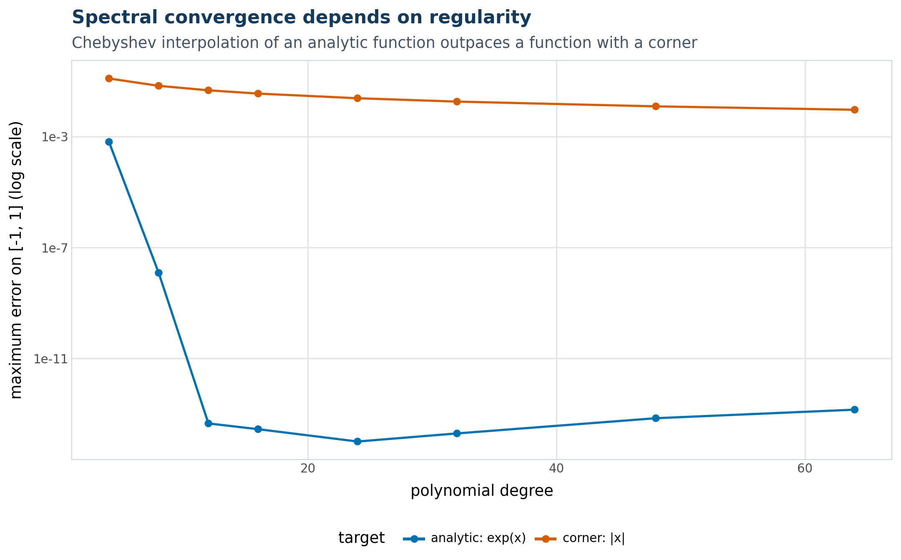

# Spectral and Pseudospectral Methods {#sec-spectral-methods}

Finite differences approximate a derivative from nearby values. Spectral
methods approximate the whole function in a global basis and differentiate the
approximation. When a periodic or smooth problem matches that basis, accuracy
can improve far faster than any fixed algebraic power of grid spacing.
Nonsmoothness, aliasing, boundary treatment, and conditioning determine when
that promise is realized.

## Preparation from this book

Review series and approximation error in [sec-series](10-series-taylor.md#sec-series), Fourier transforms and
sampling in [sec-calculus-transforms](25-transforms.md#sec-calculus-transforms), PDE types and finite differences in
[sec-calculus-pdes](27-pdes.md#sec-calculus-pdes), stable linear algebra in [sec-numerical-linear-algebra](40-numerical-linear-algebra.md#sec-numerical-linear-algebra), and
weak formulations in [sec-distributions-sobolev](50-distributions-sobolev.md#sec-distributions-sobolev). No prior numerical-PDE course
is assumed.

The governing idea is simple: choose basis functions that already express
expected smoothness and boundary geometry, determine finitely many
coefficients, then differentiate or integrate the finite expansion exactly.

## Projection onto a basis

Let $\{\phi_k\}$ be orthogonal in an inner product. A truncated expansion is

$$
u_N(x)=\sum_{k=0}^{N}a_k\phi_k(x),
\qquad
a_k=\frac{\langle u,\phi_k\rangle}
{\langle\phi_k,\phi_k\rangle}.
$$

The continuous formula is a projection. A **spectral Galerkin** method enforces
the residual orthogonal to a trial space. A **collocation** or pseudospectral
method enforces the equation at selected nodes. Quadrature may make these
routes algebraically related, but they have different definitions and error
arguments.

The term “spectral accuracy” means error decreases faster than every fixed
power of $1/N$ for sufficiently smooth data; analytic functions often show
geometric or exponential decay. It is not a guarantee for discontinuous data.

## Fourier spectral differentiation {#sec-fourier-nyquist}

### Declare the real interpolant

Take real samples $v_j$ on the endpoint-excluded periodic grid
$x_j=jL/N$, $j=0,\ldots,N-1$, with $L>0$. Their normalized discrete Fourier
coefficients are

$$
c_k=\frac1N\sum_{j=0}^{N-1}v_j e^{-2\pi ikj/N},
\qquad k=0,\ldots,N-1.
$$

For real data, $c_{N-k}=\overline{c_k}$. Put
$q=\lfloor(N-1)/2\rfloor$. This chapter chooses the following **real
trigonometric interpolant**:

$$
\begin{aligned}
(I_Nv)(x)&=c_0+2\operatorname{Re}
\sum_{k=1}^q c_k e^{2\pi ikx/L}+C_N(x),\\
C_N(x)&=
\begin{cases}
c_{N/2}\cos(\pi Nx/L),&N\text{ even},\\
0,&N\text{ odd}.
\end{cases}
\end{aligned}
$$

In the even case, $c_{N/2}$ is real and the last cosine is the **Nyquist
mode**. We explicitly set its sine coefficient to zero. This convention
matters: $\cos(\pi Nx/L)+a\sin(\pi Nx/L)$ has the same nodal values for
every real $a$, but different sampled first derivatives. Real samples alone
do not select the off-grid function. The declared space, with this sine term
omitted, does select a unique interpolant. An asymmetric complex Fourier band
is another convention and must not silently replace this real one.

Define the nodal operators

$$
(D_1v)_j=(I_Nv)'(x_j),\qquad
(D_2v)_j=(I_Nv)''(x_j).
$$

Ordinary paired modes have first-derivative multiplier $i2\pi k/L$ and
second-derivative multiplier $-(2\pi k/L)^2$. For even $N$, write
$\omega=\pi N/L$. The Nyquist cosine has derivative
$-\omega\sin(\omega x)$, whose samples are zero, but second derivative
$-\omega^2\cos(\omega x)$, whose samples are not zero. Consequently its
multiplier is **zero for $D_1$ and $-\omega^2$ for direct $D_2$**.
On odd grids the top positive and negative frequencies remain an ordinary
pair; there is no singled-out Nyquist cosine to discard.

The FFT converts values to coefficients in order $N\log N$ work. Its wave
numbers must match both the library's ordering and the physical period. The
first multiplier has inverse-length units, and the second has inverse-length-
squared units. Missing $2\pi/L$ can preserve a curve's shape while giving the
wrong derivative and heat-decay rate.

### Why two sampled first derivatives can lose a second derivative

Before calculating, predict whether differentiating twice must give the same
nodal vector by both routes. For even $N$, let $z_j=(-1)^j$. Its chosen
interpolant is $\cos(\omega x)$, so

$$
D_1z=0,\qquad D_1^2z=0,\qquad D_2z=-\omega^2z.
$$

There is no failure of ordinary calculus: differentiating
$\cos(\omega x)$ twice gives the displayed nonzero answer. The composed
nodal operation first samples $-\omega\sin(\omega x)$, losing it at every
node, then interpolates the resulting zero vector before differentiating
again. In operator language, if $S_N$ samples at the nodes and $\partial_x$
differentiates functions, then
$D_1^2=S_N\partial_x I_NS_N\partial_x I_N$, whereas
$D_2=S_N\partial_x^2I_N$. The intermediate interpolation is an additional
operation. Chapter 50's distinction between an operation and its declared
mode of convergence remains relevant: these are exact finite-interpolant
identities, not derivative-error bounds for an unknown original field.

The discrepancy has a complete formula. Define the alternating-mode
projection on even grids by

$$
a(v)=\frac1N\sum_{j=0}^{N-1}(-1)^jv_j,\qquad
Pv=a(v)z.
$$

Since $a(z)=1$, $P^2=P$. Also $a(v)=c_{N/2}$, so $v-Pv$ has no Nyquist
component. On its constant and ordinary paired modes, differentiating and
resampling stays within the same interpolating space. Thus
$D_2(v-Pv)=D_1^2(v-Pv)$. Combining this with the three identities for $z$
proves, for **every** real nodal vector,

$$
\boxed{D_2=D_1^2-\omega^2P}\qquad(N\text{ even}).
$$

Therefore the two operators agree on a particular even-grid vector exactly
when its alternating coefficient is zero. On odd grids, all nonconstant
modes are ordinary pairs, so $D_2=D_1^2$ on the entire nodal space. These
claims concern the declared interpolation convention; they cannot resolve
unobserved frequencies already aliased in the samples. Johnson's MIT notes,
Section 3, derive the distinct first- and second-derivative Nyquist rules
([Johnson 2011](bibliography.md#ref-johnson2011fft)).

### A heat-flow consequence with time error removed

For the periodic heat equation $u_t=\kappa u_{xx}$ with $\kappa>0$, ordinary
mode $k$ has amplitude

$$
c_k(t)=e^{-\kappa(2\pi k/L)^2t}c_k(0).
$$

The even-grid Nyquist cosine decays at rate $\kappa\omega^2$ as well.
The semidiscrete system $\dot v=\kappa D_2v$ therefore gives
$v(t)=e^{-\kappa\omega^2t}z$ for initial data $z$. Replacing its spatial
operator by $\kappa D_1^2$ instead gives $v(t)=z$: a nonconstant mode is
frozen. Both statements solve their finite systems exactly in time; the
discrepancy is not an Euler step-size or ODE-solver error.

This also explains why checking only constant preservation or nonincreasing
discrete energy can miss a defect. With
$\langle v,w\rangle_N=N^{-1}\sum_jv_jw_j$, Fourier orthogonality gives
$D_1^T=-D_1$ and $\langle v,D_1^2v\rangle_N=-\|D_1v\|_N^2\le0$.
Yet on even grids its kernel includes $z$, whereas the kernel of $D_2$
contains only constants. The correct heat operator damps every nonconstant
mode in this spatial model. This finite-grid counterexample makes no claim
that the composition fails to converge for every fixed smooth function as
the grid is refined; the changed task examines the same physical function
on a different grid.

## Chebyshev approximation on an interval

Fourier modes fit periodic domains. On $[-1,1]$, Chebyshev polynomials satisfy

$$
T_k(x)=\cos(k\arccos x).
$$

The extrema nodes

$$
x_j=\cos\left(\frac{j\pi}{N}\right),
\qquad j=0,\ldots,N,
$$

cluster near endpoints. This clustering controls the endpoint oscillations
that can make high-degree interpolation at equally spaced nodes unstable.
An affine map transfers an interval $[a,b]$ to $[-1,1]$; every derivative then
needs the corresponding scale factor $2/(b-a)$.

Chebyshev coefficients can be obtained through a cosine transform. Clenshaw's
recurrence evaluates the resulting series stably without constructing powers
of $x$.

<figure id="fig-spectral-convergence">


<figcaption>

Figure 51.1: Chebyshev interpolation converges rapidly for an analytic function and algebraically for a corner.

</figcaption>
</figure>

[Figure 51.1](#fig-spectral-convergence) exposes the regularity dependence. The corner is not
a failure of the algorithm: it is information that global coefficients cannot
decay as rapidly.

## Differentiation matrices

Let $p_N$ interpolate values $u_j$ at Chebyshev–Lobatto nodes. A
differentiation matrix $D$ satisfies

$$
\bigl(p_N'(x_0),\ldots,p_N'(x_N)\bigr)^T
=D\,(u_0,\ldots,u_N)^T.
$$

Define the signed weights

$$
c_j=
\begin{cases}
2(-1)^j,&j=0\text{ or }j=N,\\
(-1)^j,&1\le j\le N-1.
\end{cases}
$$

Then the off-diagonal entries can be written

$$
D_{ij}=\frac{c_i}{c_j(x_i-x_j)}
\quad(i\ne j),
$$

and diagonal entries are chosen so each row sums to zero. The row-sum rule
ensures the derivative of a constant is zero and is safer than memorizing
several separate diagonal formulas.

Here $D$ differentiates a polynomial interpolant: its derivative is still in
the polynomial trial space, so $D^2$ gives that interpolant's sampled second
derivative. This differs from the even-grid Fourier Nyquist situation above.
High-degree differentiation can nevertheless be badly conditioned.
Boundary conditions replace rows or change the basis; simply
appending equations can overdetermine the discrete system.

## Galerkin and collocation PDE solves

For a linear operator $L$, Galerkin approximation seeks
$u_N=\sum_j a_j\phi_j$ such that

$$
\langle Lu_N-f,\phi_i\rangle=0
$$

for all test indices. Collocation instead requires

$$
(Lu_N)(x_i)=f(x_i)
$$

at nodes. Galerkin structure can preserve symmetry and energy identities.
Collocation is often simpler and fast. Either method needs approximation,
stability, and conditioning analysis.

For Dirichlet Poisson on $[-1,1]$, one collocation route forms $D^2$, replaces
endpoint rows with boundary equations, and solves the resulting linear system.
A small nodal residual does not alone bound the continuous error; the operator
conditioning and interpolation error are separate.

## Aliasing and nonlinear products

With $N$ samples, frequencies differing by multiples of $N$ are
indistinguishable. Multiplying two truncated fields convolves their Fourier
coefficients and can create modes outside the retained band. If those modes
are sampled back on the same grid, they fold into lower frequencies:
**aliasing**.

Padding to a larger grid before multiplication and then truncating implements
dealiasing; the common three-halves padding rule exactly handles quadratic
products under its discrete assumptions. Filtering can suppress high modes but
also changes the equations. Report the rule rather than presenting a clean
spectrum as raw truth.

## Gibbs oscillation and nonsmooth data

Near a jump, Fourier partial sums overshoot by a nonvanishing fraction even as
the oscillatory region narrows. Pointwise convergence away from the jump,
$L^2$ convergence, and uniform convergence are different claims. Spectral
viscosity, filters, domain decomposition, or shock-capturing methods can help,
but each trades resolution against stability or changes the approximation.

For conservation laws, the finite-volume methods of [sec-conservation-laws](42-conservation-laws.md#sec-conservation-laws)
retain local conservation and entropy machinery that a naive global expansion
lacks. “Higher order” does not automatically mean “more faithful at a shock.”

## Conditioning, roundoff, and verification

Spectral differentiation matrices become increasingly ill-conditioned in
ordinary norms as degree grows. Large entries near clustered endpoints amplify
roundoff. Coefficient-space recurrences, ultraspherical formulations, and
appropriate preconditioning can be superior to dense nodal matrices.

A defensible computation reports:

1. basis, nodes, normalization, and domain mapping;
2. coefficient decay or a tail diagnostic;
3. residual and boundary-condition errors;
4. change under degree refinement;
5. conditioning or a backward-error measure; and
6. any dealiasing, filtering, or regularization.

## Finite Fourier differentiation

For a periodic grid, this implementation returns $D_1v$ or direct $D_2v$
from the declared real interpolant. It accepts finite real numeric NumPy
vectors, including integer arrays, and converts them to floating arithmetic.
The derivative order is a built-in integer 1 or 2; a boolean or NumPy integer
is rejected rather than silently treated as a different parameter type.

```python
from math import isfinite
from numbers import Real
import numpy as np
from numpy.typing import NDArray

def periodic_spectral_derivative(
    sampled_values: NDArray[np.float64],
    domain_length: float,
    derivative_order: int = 1,
) -> NDArray[np.float64]:
    """Sample the first or direct second derivative of the real interpolant."""
    if not isinstance(sampled_values, np.ndarray):
        raise ValueError("sampled_values must be a real numeric NumPy vector")
    if sampled_values.ndim != 1 or sampled_values.size < 4:
        raise ValueError("sampled_values must be a vector with at least four entries")
    if sampled_values.dtype.kind not in "fiu":
        raise ValueError("samples must be real numeric values, without complex parts")
    if not np.all(np.isfinite(sampled_values)):
        raise ValueError("samples must all be finite")
    if isinstance(domain_length, bool) or not isinstance(domain_length, Real):
        raise ValueError("domain_length must be a finite positive real number")
    try:
        period = float(domain_length)
    except (OverflowError, ValueError) as error:
        raise ValueError("domain_length is outside floating-point range") from error
    if not isfinite(period) or period <= 0.0:
        raise ValueError("domain_length must be finite and positive")
    if type(derivative_order) is not int or derivative_order not in (1, 2):
        raise ValueError("derivative_order must be the built-in integer 1 or 2")
    sample_count = sampled_values.size
    grid_spacing = period / sample_count
    if grid_spacing == 0.0:
        raise ValueError("grid spacing is below floating-point range")
    try:
        with np.errstate(over="raise", invalid="raise", divide="raise"):
            values = np.asarray(sampled_values, dtype=np.float64)
            angular_wave_numbers = 2.0 * np.pi * np.fft.fftfreq(
                sample_count, d=grid_spacing
            )
            multipliers = (1j * angular_wave_numbers) ** derivative_order
            if sample_count % 2 == 0 and derivative_order == 1:
                multipliers[sample_count // 2] = 0.0
            if not np.all(np.isfinite(multipliers)):
                raise ValueError("derivative multipliers exceed floating-point range")
            coefficients = np.fft.fft(values)
            if not np.all(np.isfinite(coefficients)):
                raise ValueError("Fourier coefficients exceed floating-point range")
            derivative = np.fft.ifft(multipliers * coefficients)
    except (FloatingPointError, OverflowError) as error:
        raise ValueError("requested derivative exceeds floating-point range") from error
    if not np.all(np.isfinite(derivative)):
        raise ValueError("derivative values exceed floating-point range")
    return derivative.real

sample_count = 64
coordinates = 2.0 * np.pi * np.arange(sample_count) / sample_count
values = np.sin(3.0 * coordinates) + 0.2 * np.cos(7.0 * coordinates)
exact = 3.0 * np.cos(3.0 * coordinates) - 1.4 * np.sin(7.0 * coordinates)
approximation = periodic_spectral_derivative(values, 2.0 * np.pi)
print(float(np.max(np.abs(approximation - exact))))

alternating = (-1.0) ** np.arange(8)
first = periodic_spectral_derivative(alternating, 4.0, 1)
composed = periodic_spectral_derivative(first, 4.0, 1)
direct = periodic_spectral_derivative(alternating, 4.0, 2)
print("first, composed, direct:", first[0], composed[0], direct[0])
```

The tiny error is expected because both frequencies are exactly representable
on this grid. It does not predict accuracy for a nonperiodic endpoint mismatch,
a frequency above Nyquist, or nonsmooth data. The second example instead
prints first and composed values zero, while the direct second derivative
at node zero is $-4\pi^2$, up to floating roundoff. Its period is four, so
using unit-period or $2\pi$-period multipliers would give the wrong number.

The explicit Nyquist assignment preserves the chosen real interpolation
rule before the inverse transform; returning the real part then removes
roundoff-level imaginary residue. It does not silently discard a genuine
imaginary Nyquist derivative from an asymmetric complex convention.
Nonfinite intermediate or final results are rejected. This remains a
floating computation: small components may underflow, and finite results
are not a certificate of relative accuracy. The formulas and projection
proof above, rather than a tiny numerical discrepancy, establish the exact
operator identities.

## Failure and precision audit

- Global bases encode boundary and regularity assumptions; mismatch can
  dominate formal order.
- Coefficient decay is a diagnostic, not proof of the original model.
- FFT wave-number ordering and physical length determine derivative scale.
- On an even grid under the declared real convention, direct second
  differentiation differs from two sampled first derivatives by the
  alternating-mode projection. Odd grids and zero-Nyquist data remove that
  discrepancy.
- A differentiation matrix is a finite operator on interpolants, not the
  unbounded derivative operator on a function space.
- Aliasing can move unresolved energy into plausible low modes.
- Exponential convergence stops at roundoff and may stop much earlier under
  noise or poor conditioning.

<!-- inline-formula-code:start -->
## Formula and finite computation

For the Chebyshev–Lobatto interpolant, nodal differentiation is

$$
\mathbf u' = D\mathbf u,\qquad
D_{ij}=\frac{c_i}{c_j(x_i-x_j)}\ (i\ne j),
\qquad D_{ii}=-\sum_{j\ne i}D_{ij}.
$$

The following finite construction uses descriptive names and validates the
requested degree:

```python
import numpy as np
from numpy.typing import NDArray

def chebyshev_differentiation(
    polynomial_degree: int,
) -> tuple[NDArray[np.float64], NDArray[np.float64]]:
    """Return descending Chebyshev--Lobatto nodes and their derivative matrix."""
    if polynomial_degree < 1:
        raise ValueError("polynomial_degree must be at least one")
    indices = np.arange(polynomial_degree + 1)
    nodes = np.cos(np.pi * indices / polynomial_degree)
    signed_weights = np.ones(polynomial_degree + 1)
    signed_weights[[0, -1]] = 2.0
    signed_weights *= (-1.0) ** indices
    node_differences = nodes[:, None] - nodes[None, :]
    safe_differences = node_differences + np.eye(polynomial_degree + 1)
    matrix = (
        signed_weights[:, None]
        / signed_weights[None, :]
        / safe_differences
    )
    matrix -= np.diag(np.diag(matrix))
    matrix -= np.diag(np.sum(matrix, axis=1))
    return nodes, matrix

for polynomial_degree in (8, 16, 32):
    nodes, derivative_matrix = chebyshev_differentiation(polynomial_degree)
    sampled_values = np.exp(nodes)
    error = np.max(np.abs(derivative_matrix @ sampled_values - np.exp(nodes)))
    constant_error = np.max(np.abs(derivative_matrix @ np.ones_like(nodes)))
    print(polynomial_degree, float(error), float(constant_error))
```

**What the computation establishes.** The outputs check differentiation of one
analytic function and the row-sum invariant on three finite grids. They do not
prove spectral convergence, stability of a PDE discretization, or adequacy for
rough data.
<!-- inline-formula-code:end -->

## Summary

Spectral methods approximate whole functions in global bases. Fourier modes
diagonalize periodic differentiation, Chebyshev polynomials adapt global
approximation to intervals, and Galerkin or collocation conditions turn
differential equations into finite systems. Smoothness can yield exceptionally
rapid convergence, while jumps, aliasing, endpoint mismatch, and conditioning
set hard limits. Formula-to-code translation is especially transparent in
coefficient multiplication and differentiation matrices, provided scaling and
finite scope stay visible.

## Exercises

<div class="exercise" id="calculus-51-spectral-methods-ex-1">
<p class="exercise-title"><strong>Exercise 1</strong></p>

Derive the Fourier derivative multiplier on a domain of length $L$.

<details class="solution"><summary>Solution</summary>

Writing $e^{i2\pi kx/L}$ and differentiating multiplies the coefficient by
$i2\pi k/L$. The factor has inverse-length units. Omitting $2\pi/L$ computes a
derivative with respect to a dimensionless grid coordinate instead of $x$.

</details>

</div>

<div class="exercise" id="calculus-51-spectral-methods-ex-2">
<p class="exercise-title"><strong>Exercise 2</strong></p>

Show that the heat equation on a periodic domain of length $L$ damps
mode $k$ at rate $\kappa(2\pi k/L)^2$.

</div>

<div class="exercise" id="calculus-51-spectral-methods-ex-3">
<p class="exercise-title"><strong>Exercise 3</strong></p>

Map Chebyshev nodes from $[-1,1]$ to $[a,b]$ and derive the derivative scale.

<details class="solution"><summary>Solution</summary>

Set $x=(a+b)/2+(b-a)\xi/2$. Then
$d/dx=[2/(b-a)]d/d\xi$. The nodes are
$x_j=(a+b)/2+(b-a)\cos(j\pi/N)/2$, and a differentiation matrix on
$[-1,1]$ must be multiplied by $2/(b-a)$.

</details>

</div>

<div class="exercise" id="calculus-51-spectral-methods-ex-4">
<p class="exercise-title"><strong>Exercise 4</strong></p>

Prove $T_k(\cos\theta)=\cos(k\theta)$.

</div>

<div class="exercise" id="calculus-51-spectral-methods-ex-5">
<p class="exercise-title"><strong>Exercise 5</strong></p>

Use the row-sum construction to show $D\mathbf1=0$ exactly in arithmetic.

</div>

<div class="exercise" id="calculus-51-spectral-methods-ex-6">
<p class="exercise-title"><strong>Exercise 6</strong></p>

Compare spectral derivatives of a trigonometric polynomial and $|x|$.

</div>

<div class="exercise" id="calculus-51-spectral-methods-ex-7">
<p class="exercise-title"><strong>Exercise 7</strong></p>

Form a Chebyshev collocation system for $-u''=1$, $u(-1)=u(1)=0$.

</div>

<div class="exercise" id="calculus-51-spectral-methods-ex-8">
<p class="exercise-title"><strong>Exercise 8</strong></p>

Explain the difference between a Galerkin residual and a nodal residual.

</div>

<div class="exercise" id="calculus-51-spectral-methods-ex-9">
<p class="exercise-title"><strong>Exercise 9</strong></p>

Demonstrate aliasing by sampling two frequencies that differ by the grid
size.

<details class="solution"><summary>Solution</summary>

At nodes $x_j=2\pi j/N$,
$e^{i(k+N)x_j}=e^{ikx_j}e^{i2\pi j}=e^{ikx_j}$. The samples are identical even
though the continuous frequencies differ. No algorithm using only those
samples can distinguish the two without an additional bandwidth assumption.

</details>

</div>

<div class="exercise" id="calculus-51-spectral-methods-ex-10">
<p class="exercise-title"><strong>Exercise 10</strong></p>

Implement padded multiplication for two periodic fields and compare spectra.

</div>

<div class="exercise" id="calculus-51-spectral-methods-ex-11">
<p class="exercise-title"><strong>Exercise 11</strong></p>

Plot coefficient decay for an analytic function and a corner.

</div>

<div class="exercise" id="calculus-51-spectral-methods-ex-12">
<p class="exercise-title"><strong>Exercise 12</strong></p>

Design a verification ledger for a spectral heat-equation solve.

</div>

<div class="exercise" id="calculus-51-spectral-methods-ex-13">
<p class="exercise-title"><strong>Exercise 13</strong></p>

**Changed physical interval and grid.** A periodic rod has length
$L=4$ metres and diffusivity $\kappa=1/4$ square metres per second. On
the endpoint-excluded $N=8$ grid, sample the fixed smooth initial field

$$
u(x,0)=3+2\cos(\pi x/2)+\tfrac12\cos(2\pi x).
$$

Predict which part of these data could distinguish $D_2$ from $D_1^2$.
Compute their difference on the initial vector, including the physical
scale. Solve the two semidiscrete heat systems exactly in time and compare
them at $t_*=(\log2)/\pi^2$ seconds. Does preservation of the mean or
nonincreasing discrete energy detect the frozen mode? Finally sample the
**same continuous initial field** on $N=9$ nodes. Determine whether the
two derivative routes still differ, and explain why this does not claim
accurate differentiation of an arbitrary unresolved field.

<details class="solution"><summary>Solution</summary>

The low mode has physical angular frequency $\pi/2$ inverse metres; on
eight nodes the high mode has $\omega=\pi N/L=2\pi$ inverse metres and
samples $z_j=(-1)^j$. Thus $Pv=\tfrac12z$, and the projection identity gives

$$
(D_2-D_1^2)v=-\omega^2Pv=-2\pi^2z.
$$

The two semidiscrete solutions, each evaluated at $x_j=j/2$, are

$$
\begin{aligned}
v_j^{\mathrm{direct}}(t)
&=3+2e^{-\pi^2t/16}\cos(\pi x_j/2)
+\tfrac12e^{-\pi^2t}z_j,\\
v_j^{\mathrm{composed}}(t)
&=3+2e^{-\pi^2t/16}\cos(\pi x_j/2)
+\tfrac12z_j.
\end{aligned}
$$

The exponents are dimensionless: diffusivity times squared physical angular
frequency times time. At $t_*$, both low-mode amplitudes equal
$2\,2^{-1/16}$, but the direct high-mode amplitude is $1/4$ while the
composed amplitude stays $1/2$. Therefore
$v^{\mathrm{composed}}(t_*)-v^{\mathrm{direct}}(t_*)=\tfrac14z$.
Both systems preserve the discrete mean three. Both have nonincreasing
discrete energy, so either check alone misses the defect: the composed
system merely fails to dissipate this particular nonconstant component.

On nine nodes the same high mode is $k=4$, accompanied by $k=-4$, inside
the ordinary odd-grid band. Its first-derivative samples no longer vanish,
and $D_1^2=D_2$ on the entire nine-node space. Both systems now give the
direct solution above with $x_j=4j/9$ and $z_j$ replaced by
$\cos(2\pi x_j)$. In this task the original field lies exactly in each
declared interpolation space, so exact modal evolution also agrees with
the continuum heat solution at the nodes. That conclusion uses this
specific resolved initial field and the exact-in-time formulas. Sampling
alone still cannot identify arbitrary higher aliases, and a separate
time-stepping implementation would have its own error.

</details>

</div>

## Selected solutions

### Solution to Exercise 1

Writing $e^{i2\pi kx/L}$ and differentiating multiplies the coefficient by
$i2\pi k/L$. The factor has inverse-length units. Omitting $2\pi/L$ computes a
derivative with respect to a dimensionless grid coordinate instead of $x$.

### Solution to Exercise 3

Set $x=(a+b)/2+(b-a)\xi/2$. Then
$d/dx=[2/(b-a)]d/d\xi$. The nodes are
$x_j=(a+b)/2+(b-a)\cos(j\pi/N)/2$, and a differentiation matrix on
$[-1,1]$ must be multiplied by $2/(b-a)$.

### Solution to Exercise 9

At nodes $x_j=2\pi j/N$,
$e^{i(k+N)x_j}=e^{ikx_j}e^{i2\pi j}=e^{ikx_j}$. The samples are identical even
though the continuous frequencies differ. No algorithm using only those
samples can distinguish the two without an additional bandwidth assumption.

### Solution to Exercise 13

The low mode has physical angular frequency $\pi/2$ inverse metres; on
eight nodes the high mode has $\omega=\pi N/L=2\pi$ inverse metres and
samples $z_j=(-1)^j$. Thus $Pv=\tfrac12z$, and the projection identity gives

$$
(D_2-D_1^2)v=-\omega^2Pv=-2\pi^2z.
$$

The two semidiscrete solutions, each evaluated at $x_j=j/2$, are

$$
\begin{aligned}
v_j^{\mathrm{direct}}(t)
&=3+2e^{-\pi^2t/16}\cos(\pi x_j/2)
+\tfrac12e^{-\pi^2t}z_j,\\
v_j^{\mathrm{composed}}(t)
&=3+2e^{-\pi^2t/16}\cos(\pi x_j/2)
+\tfrac12z_j.
\end{aligned}
$$

The exponents are dimensionless: diffusivity times squared physical angular
frequency times time. At $t_*$, both low-mode amplitudes equal
$2\,2^{-1/16}$, but the direct high-mode amplitude is $1/4$ while the
composed amplitude stays $1/2$. Therefore
$v^{\mathrm{composed}}(t_*)-v^{\mathrm{direct}}(t_*)=\tfrac14z$.
Both systems preserve the discrete mean three. Both have nonincreasing
discrete energy, so either check alone misses the defect: the composed
system merely fails to dissipate this particular nonconstant component.

On nine nodes the same high mode is $k=4$, accompanied by $k=-4$, inside
the ordinary odd-grid band. Its first-derivative samples no longer vanish,
and $D_1^2=D_2$ on the entire nine-node space. Both systems now give the
direct solution above with $x_j=4j/9$ and $z_j$ replaced by
$\cos(2\pi x_j)$. In this task the original field lies exactly in each
declared interpolation space, so exact modal evolution also agrees with
the continuum heat solution at the nodes. That conclusion uses this
specific resolved initial field and the exact-in-time formulas. Sampling
alone still cannot identify arbitrary higher aliases, and a separate
time-stepping implementation would have its own error.
