# Appendix H — Python laboratories for calculus {#sec-calculus-python-laboratory}

This appendix turns calculus into a sequence of small, inspectable programs. It
assumes no programming experience. Every example is self-contained: copy one
block into a fresh Python file or notebook cell and run it without relying on an
earlier block. The examples use only Python's standard library and the NumPy,
pandas, and Plotnine packages listed in this project's `requirements.txt`.

Code is not a substitute for the definitions and proofs in the main text. It is
a second representation. A loop can expose how a limit develops, an array can
make a partition concrete, and a convergence plot can reveal whether an error
law is plausible. None of those observations proves what happens for every
input. Each laboratory therefore follows the same five-stage discipline:

1. **Predict** the sign, scale, or shape before running anything.
2. **Represent** the mathematical objects as named variables with stated units.
3. **Compute** with a finite method and an explicit stopping rule.
4. **Compare** against an exact value, invariant, refinement study, or second
   method.
5. **Interpret** what the calculation establishes—and what it cannot establish.

## A two-minute Python orientation

An assignment such as `x = 2.0` attaches the name `x` to a value. A function
packages a reusable calculation. Indentation marks the lines belonging to the
function or loop. A list stores an ordered finite collection. NumPy arrays let
one formula act on many numbers at once.

```python
from math import sin

def sampled_sine(points: list[float]) -> list[float]:
    """Evaluate sin at a finite list of inputs."""
    return [sin(x) for x in points]

x_values = [0.0, 0.5, 1.0]
print(sampled_sine(x_values))
```

The printed list is a finite table, not the entire sine function. Changing the
three inputs changes the question being asked. This elementary distinction—an
object versus a sampled representation—remains essential in every later lab.

## Lab 1 — A function table and a Plotnine graph

Plotting begins by constructing a table whose columns have mathematical names.
Plotnine then maps a column to each visual role. Merely constructing `plot` is
enough for a notebook to display it; the production figures use explicit,
high-resolution saving in `figures.py`.

```python
import numpy as np
import pandas as pd
from plotnine import aes, geom_line, ggplot, labs, theme_minimal

x = np.linspace(-2.0, 2.0, 401)
data = pd.DataFrame({"x": x, "f": x**3 - 3.0 * x})
plot = (
    ggplot(data, aes("x", "f"))
    + geom_line(color="#0072B2")
    + labs(title="f(x) = x³ − 3x", x="x", y="f(x)")
    + theme_minimal()
)
print(data.iloc[[0, 200, 400]])
```

The table makes the sampled domain visible. A common mistake is to draw a
smooth line and forget that only 401 values were calculated. Review [functions
and models](01-functions-models.md) before changing the domain or formula.

## Lab 2 — Secant slopes approaching a derivative

For $f(x)=x^2$ at $x=1$, the forward secant slope is $2+h$. The code makes the
limit visible while retaining the signed error.

```python
def square(point: float) -> float:
    """Return the square of a named input point."""
    return point * point

def forward_slope(point: float, step_size: float) -> float:
    """Return a forward difference quotient at the requested point."""
    if step_size == 0.0:
        raise ValueError("step_size must be nonzero")
    return (square(point + step_size) - square(point)) / step_size

for step_size in (1.0, 0.5, 0.1, 0.01):
    approximation = forward_slope(1.0, step_size)
    print(step_size, approximation, approximation - 2.0)
```

The final column is the error relative to the exact derivative $2$. The pattern
suggests a limit; the algebra in [Chapter 3](03-derivative.md) proves it.

## Lab 3 — Truncation error meets floating-point cancellation

The centered difference has an $O(h^2)$ truncation error for a sufficiently
smooth function. On a computer, roundoff eventually overwhelms that gain. The
following study records both effects rather than recommending “the smallest
possible $h$.”

```python
from math import cos, sin

def centered_derivative(point: float, step_size: float) -> float:
    """Approximate the derivative of sine at a named input point."""
    if step_size <= 0.0:
        raise ValueError("step_size must be positive")
    return (sin(point + step_size) - sin(point - step_size)) / (2.0 * step_size)

for exponent in range(0, 17):
    step_size = 10.0 ** (-exponent)
    error = abs(centered_derivative(1.0, step_size) - cos(1.0))
    print(f"step_size={step_size:.0e}, error={error:.3e}")
```

<figure id="fig-code-finite-difference-study">
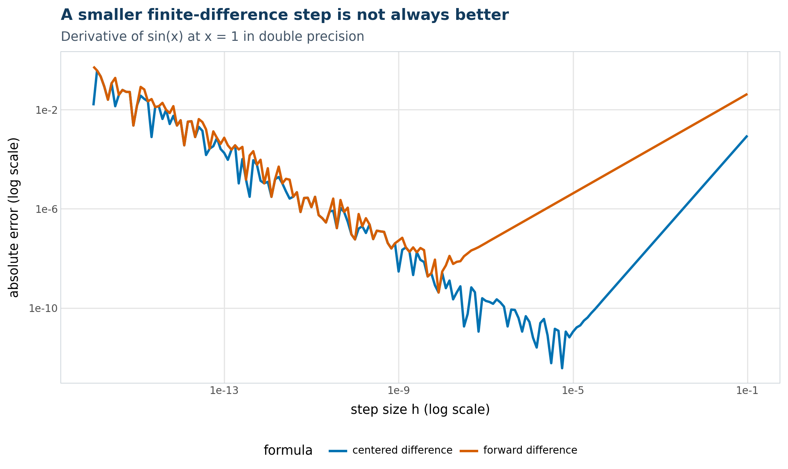

<figcaption>

Figure 57.1: Logarithmic finite-difference error curves fall with truncation error and then rise when cancellation dominates.

</figcaption>
</figure>

The U-shaped error in [Figure 57.1](#fig-code-finite-difference-study) is a numerical fact for
the displayed function, machine, and formulas. It illustrates the error model
from [Chapter 16](16-numerical.md); it is not a universal optimal step size.

## Lab 4 — Bisection as a theorem turned into an algorithm

Bisection uses a continuous real target and reliable finite endpoint signs.
This routine returns a tolerance-sized bracket midpoint or a computed zero;
nonfinite data or values, midpoint stagnation and exhausted budgets are refusals.

```python
from collections.abc import Callable
from math import isfinite

def bisect_root(
    function: Callable[[float], float],
    left: float,
    right: float,
    tolerance: float = 1e-10,
) -> tuple[float, int]:
    """Return a root bracket midpoint and the iteration count."""
    if not all(isfinite(value) for value in (left, right, tolerance)):
        raise ValueError("endpoints and tolerance must be finite")
    if tolerance <= 0.0 or left >= right:
        raise ValueError("require left < right and a positive tolerance")
    f_left = function(left)
    f_right = function(right)
    if not all(isfinite(value) for value in (f_left, f_right)):
        raise ArithmeticError("nonfinite endpoint value")
    if f_left == 0.0:
        return left, 0
    if f_right == 0.0:
        return right, 0
    if (f_left < 0.0) == (f_right < 0.0):
        raise ValueError("the endpoints must have opposite signs")
    for iterations in range(4096):
        if right - left <= tolerance:
            return left / 2.0 + right / 2.0, iterations
        middle = left / 2.0 + right / 2.0
        if not left < middle < right:
            raise ArithmeticError("midpoint stagnation before tolerance")
        f_middle = function(middle)
        if not isfinite(f_middle):
            raise ArithmeticError("nonfinite midpoint value")
        if f_middle == 0.0:
            return middle, iterations + 1
        if (f_left < 0.0) != (f_middle < 0.0):
            right = middle
        else:
            left, f_left = middle, f_middle
    if right - left <= tolerance:
        return left / 2.0 + right / 2.0, 4096
    raise RuntimeError("bisection evaluation budget exhausted")

root, steps = bisect_root(lambda x: x**3 - x - 2.0, 1.0, 2.0)
print(root, steps, root**3 - root - 2.0)
```

The residual and bracket width support different claims; a computed zero is not an exact-root proof.
Each callback must terminate; bisection makes at most 4098 calls and never accepts a stalled bracket.

## Lab 5 — Safeguarded Newton iteration

Newton's method can be fast, but a tiny derivative makes its quotient unstable
and an unlucky initial value can escape. This short version exposes both a
derivative threshold and a maximum iteration count.

```python
from collections.abc import Callable

def newton_root(
    function: Callable[[float], float],
    derivative: Callable[[float], float],
    initial: float,
    tolerance: float = 1e-12,
    max_steps: int = 30,
) -> tuple[float, int]:
    """Run Newton iteration with explicit failure conditions."""
    if tolerance <= 0.0 or max_steps <= 0:
        raise ValueError("tolerance and max_steps must be positive")
    x = initial
    for step in range(max_steps):
        value = function(x)
        if abs(value) <= tolerance:
            return x, step
        slope = derivative(x)
        if abs(slope) < 1e-14:
            raise ArithmeticError("derivative too small for a safe Newton step")
        x -= value / slope
    if abs(function(x)) <= tolerance:
        return x, max_steps
    raise RuntimeError("Newton iteration did not reach the requested residual")

root, steps = newton_root(lambda x: x**2 - 2.0, lambda x: 2.0 * x, 1.0)
print(root, steps, root**2 - 2.0)
```

The code certifies a small residual, not automatically a small error. A lower
bound on $|f'|$ near the root supplies the missing connection.

## Lab 6 — Midpoint sums with units

The next function approximates $\int_a^b f(x)\,dx$. Each rectangle has width
`dx`, so the product `function(midpoints) * dx` carries output-units times
input-units.

```python
from collections.abc import Callable

import numpy as np
from numpy.typing import NDArray

def midpoint_integral(
    function: Callable[[NDArray[np.float64]], NDArray[np.float64]],
    left: float,
    right: float,
    panels: int,
) -> float:
    """Approximate an integral with equal-width midpoint rectangles."""
    if panels <= 0 or left >= right:
        raise ValueError("require left < right and a positive panel count")
    dx = (right - left) / panels
    midpoints = left + (np.arange(panels) + 0.5) * dx
    return float(np.sum(function(midpoints)) * dx)

for panels in (4, 16, 64, 256):
    estimate = midpoint_integral(lambda x: x**2, 0.0, 1.0, panels)
    print(panels, estimate, abs(estimate - 1.0 / 3.0))
```

<figure id="fig-code-quadrature-refinement">
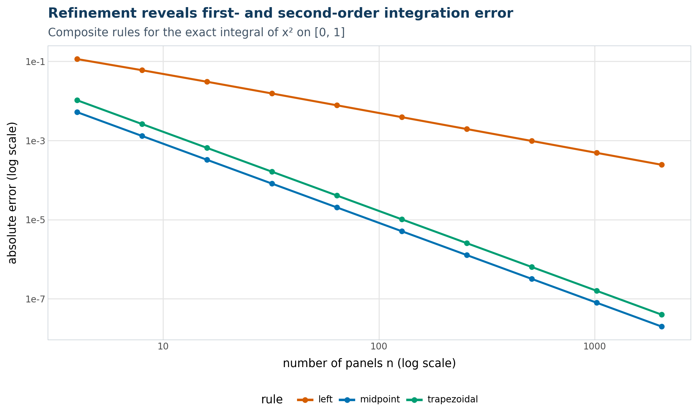

<figcaption>

Figure 57.2: Error under mesh refinement for left, midpoint, and trapezoidal rules, with reference slopes.

</figcaption>
</figure>

The slopes in [Figure 57.2](#fig-code-quadrature-refinement) are stronger evidence than one
accurate-looking decimal because they test the predicted response to refinement.

## Lab 7 — Trapezoidal refinement and an observed order

If errors behave like $C n^{-p}$, doubling $n$ reduces the error by about
$2^p$. The observed order estimates $p$ from three successive meshes.

```python
from math import log

import numpy as np

def trapezoid_square(panels: int) -> float:
    """Integrate x squared on [0, 1] with the composite trapezoidal rule."""
    if panels <= 0:
        raise ValueError("panels must be positive")
    x = np.linspace(0.0, 1.0, panels + 1)
    y = x**2
    return float((y[0] / 2.0 + y[1:-1].sum() + y[-1] / 2.0) / panels)

values = [trapezoid_square(n) for n in (16, 32, 64)]
errors = [abs(value - 1.0 / 3.0) for value in values]
observed_order = log(errors[0] / errors[1]) / log(2.0)
print(values)
print(errors, observed_order)
```

An observed order near two supports the smooth-function theory. It does not
promise the same order across a corner or singular endpoint.

## Lab 8 — Euler's method keeps a time ledger

For $y'=-2y$, the exact solution is $e^{-2t}$. Euler's method advances by the
local tangent and records the time grid explicitly.

```python
from collections.abc import Callable

import numpy as np
from numpy.typing import NDArray

def euler(
    rate: Callable[[float, float], float],
    initial: float,
    final_time: float,
    steps: int,
) -> tuple[NDArray[np.float64], NDArray[np.float64]]:
    """Solve a scalar initial-value problem by explicit Euler steps."""
    if final_time <= 0.0 or steps <= 0:
        raise ValueError("final_time and steps must be positive")
    time = np.linspace(0.0, final_time, steps + 1)
    values = np.empty(steps + 1)
    values[0] = initial
    dt = final_time / steps
    for index in range(steps):
        values[index + 1] = values[index] + dt * rate(time[index], values[index])
    return time, values

time, approximation = euler(lambda t, y: -2.0 * y, 1.0, 2.0, 40)
exact = np.exp(-2.0 * time)
print(approximation[-1], exact[-1], np.max(np.abs(approximation - exact)))
```

The returned grid prevents an ambiguous “40 steps” from becoming detached from
the final time. Chapter 33 explains stability restrictions.

## Lab 9 — Euler and fourth-order Runge–Kutta

The same mesh can support methods with very different global error. This block
keeps the right-hand side pure and compares against the exact terminal value.

```python
from collections.abc import Callable

def integrate_scalar(
    rate: Callable[[float, float], float],
    initial: float,
    final_time: float,
    steps: int,
    method: str,
) -> float:
    """Return a scalar Euler or RK4 approximation at final_time."""
    if steps <= 0 or method not in {"euler", "rk4"}:
        raise ValueError("use positive steps and method 'euler' or 'rk4'")
    dt = final_time / steps
    t, y = 0.0, initial
    for _ in range(steps):
        if method == "euler":
            y += dt * rate(t, y)
        else:
            k1 = rate(t, y)
            k2 = rate(t + dt / 2.0, y + dt * k1 / 2.0)
            k3 = rate(t + dt / 2.0, y + dt * k2 / 2.0)
            k4 = rate(t + dt, y + dt * k3)
            y += dt * (k1 + 2.0 * k2 + 2.0 * k3 + k4) / 6.0
        t += dt
    return y

for method in ("euler", "rk4"):
    value = integrate_scalar(lambda t, y: y, 1.0, 1.0, 10, method)
    print(method, value)
```

<figure id="fig-code-ode-method-comparison">
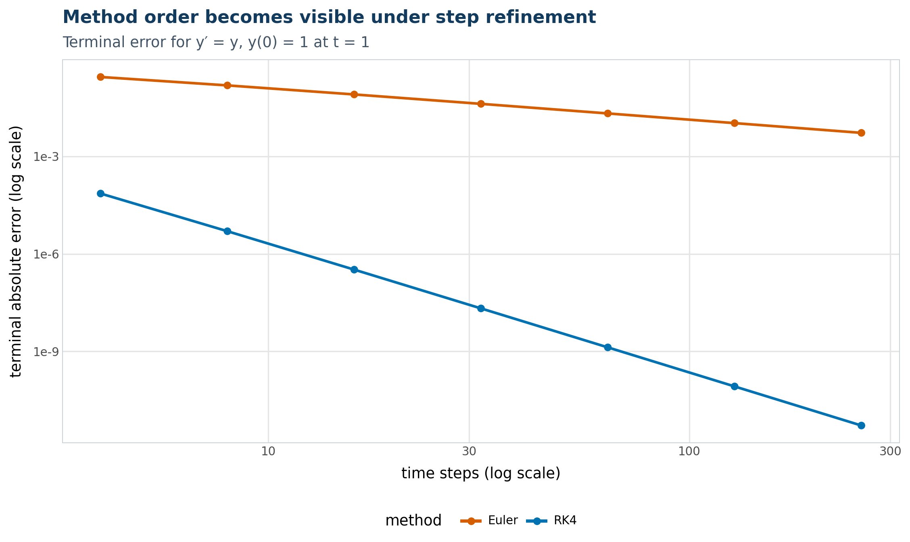

<figcaption>

Figure 57.3: Euler and RK4 global errors under step refinement for exponential growth.

</figcaption>
</figure>

The separation in [Figure 57.3](#fig-code-ode-method-comparison) is for a smooth, nonstiff
test problem. Method order alone does not settle stability or cost.

## Lab 10 — Taylor polynomials as computed approximations

The exponential series has simple coefficients, allowing a transparent loop.
The term is updated recursively so the program does not repeatedly compute a
factorial.

```python
from math import exp

def exp_taylor(input_value: float, degree: int) -> float:
    """Return the requested-degree Taylor approximation at input_value."""
    if degree < 0:
        raise ValueError("degree must be nonnegative")
    total = 1.0
    term = 1.0
    for term_index in range(1, degree + 1):
        term *= input_value / term_index
        total += term
    return total

for degree in (0, 1, 2, 4, 8, 12):
    value = exp_taylor(1.0, degree)
    print(degree, value, abs(value - exp(1.0)))
```

<figure id="fig-code-taylor-error">
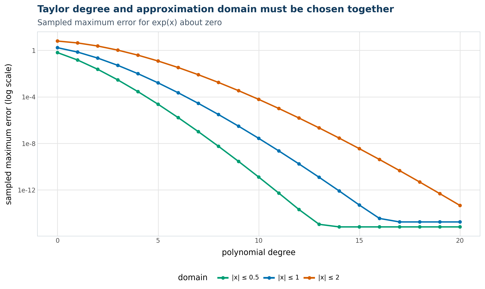

<figcaption>

Figure 57.4: Maximum exponential Taylor error over several intervals as polynomial degree increases.

</figcaption>
</figure>

[Figure 57.4](#fig-code-taylor-error) shows why a degree is meaningless without a
domain. Taylor's theorem supplies a certified remainder; the sampled maximum is
only a diagnostic.

## Lab 11 — A finite-difference gradient

A multivariable gradient can be approximated one coordinate at a time. Copying
the point before perturbing it prevents accidental mutation of the caller's
array.

```python
from collections.abc import Callable

import numpy as np
from numpy.typing import NDArray

def central_gradient(
    function: Callable[[NDArray[np.float64]], float],
    point: NDArray[np.float64],
    step: float = 1e-5,
) -> NDArray[np.float64]:
    """Approximate a gradient with centered coordinate differences."""
    if step <= 0.0 or point.ndim != 1:
        raise ValueError("step must be positive and point must be one-dimensional")
    gradient = np.empty_like(point, dtype=float)
    for index in range(point.size):
        offset = np.zeros_like(point, dtype=float)
        offset[index] = step
        gradient[index] = (function(point + offset) - function(point - offset)) / (
            2.0 * step
        )
    return gradient

point = np.array([1.0, -2.0])
estimate = central_gradient(lambda z: float(z[0] ** 2 + 3.0 * z[1] ** 2), point)
print(estimate)
```

The exact answer is $(2,-12)$. Agreement here checks an implementation on one
quadratic; it does not certify every function or step size.

## Lab 12 — Gradient descent with a stopping certificate

This quadratic has elliptical level sets. The program records every iterate,
checks the gradient norm, and reports failure rather than silently returning the
last point.

```python
import numpy as np
from numpy.typing import NDArray

def gradient(point: NDArray[np.float64]) -> NDArray[np.float64]:
    """Return the gradient of (x-1)^2 + 4(y+2)^2."""
    return np.array([2.0 * (point[0] - 1.0), 8.0 * (point[1] + 2.0)])

def gradient_descent(
    initial: NDArray[np.float64], step_size: float = 0.18, tolerance: float = 1e-8
) -> list[NDArray[np.float64]]:
    """Return a certified gradient-descent path for the declared quadratic."""
    if not 0.0 < step_size < 0.25 or tolerance <= 0.0:
        raise ValueError("require 0 < step_size < 0.25 and positive tolerance")
    path = [initial.astype(float).copy()]
    for _ in range(500):
        current_gradient = gradient(path[-1])
        if float(np.linalg.norm(current_gradient)) <= tolerance:
            return path
        path.append(path[-1] - step_size * current_gradient)
    raise RuntimeError("gradient tolerance was not reached")

path = gradient_descent(np.array([-3.0, 3.0]))
print(len(path) - 1, path[-1], np.linalg.norm(gradient(path[-1])))
```

<figure id="fig-code-gradient-descent-path">
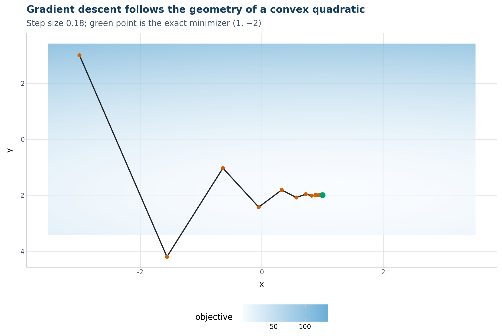

<figcaption>

Figure 57.5: Gradient-descent iterates crossing a shaded quadratic landscape toward the unique minimizer.

</figcaption>
</figure>

[Figure 57.5](#fig-code-gradient-descent-path) turns a list of vectors into geometry.
Chapter 41 proves the step-size restriction behind the convergence.

## Lab 13 — A two-dimensional midpoint integral

A double integral is a weighted sum over cells. `meshgrid` forms every pair of
midpoints without hiding the cell area.

```python
import numpy as np

def midpoint_double_integral(panels: int) -> float:
    """Approximate the integral of x+y over the unit square."""
    if panels <= 0:
        raise ValueError("panels must be positive")
    spacing = 1.0 / panels
    coordinates = (np.arange(panels) + 0.5) * spacing
    x, y = np.meshgrid(coordinates, coordinates, indexing="xy")
    return float(np.sum(x + y) * spacing**2)

for panels in (2, 4, 8, 16):
    print(panels, midpoint_double_integral(panels))
```

The answer is exactly $1$ even on these symmetric midpoint grids. That success
does not mean the rule is exact for every integrand; try $x^2+y^2$.

## Lab 14 — A parameterized line integral

For the vector field $F(x,y)=(-y,x)$ and the unit circle, the circulation is
$2\pi$. The code works from a sampled parameterization and displays the mesh
dependence.

```python
from math import pi

import numpy as np

def circle_circulation(panels: int) -> float:
    """Approximate the circulation of (-y, x) around the unit circle."""
    if panels < 3:
        raise ValueError("at least three panels are required")
    t = (np.arange(panels) + 0.5) * (2.0 * pi / panels)
    x, y = np.cos(t), np.sin(t)
    dx_dt, dy_dt = -np.sin(t), np.cos(t)
    integrand = (-y) * dx_dt + x * dy_dt
    return float(np.sum(integrand) * (2.0 * pi / panels))

for panels in (8, 32, 128):
    estimate = circle_circulation(panels)
    print(panels, estimate, estimate - 2.0 * pi)
```

The integrand happens to equal $1$, making the midpoint computation exact up to
roundoff. The orientation and parameter interval remain part of the problem.

## Lab 15 — Monte Carlo integration with uncertainty

Random sampling needs a declared generator seed and an uncertainty estimate.
For $X$ uniform on $[0,1]$, the mean of $X^2$ estimates the integral of $x^2$.

```python
from math import sqrt

import numpy as np

def monte_carlo_square(samples: int, seed: int) -> tuple[float, float]:
    """Estimate integral_0^1 x^2 dx and its Monte Carlo standard error."""
    if samples < 2:
        raise ValueError("at least two samples are required")
    generator = np.random.default_rng(seed)
    values = generator.random(samples) ** 2
    estimate = float(values.mean())
    standard_error = float(values.std(ddof=1) / sqrt(samples))
    return estimate, standard_error

for samples in (100, 1_000, 10_000):
    estimate, standard_error = monte_carlo_square(samples, seed=20260811)
    print(samples, estimate, standard_error)
```

<figure id="fig-code-monte-carlo-convergence">
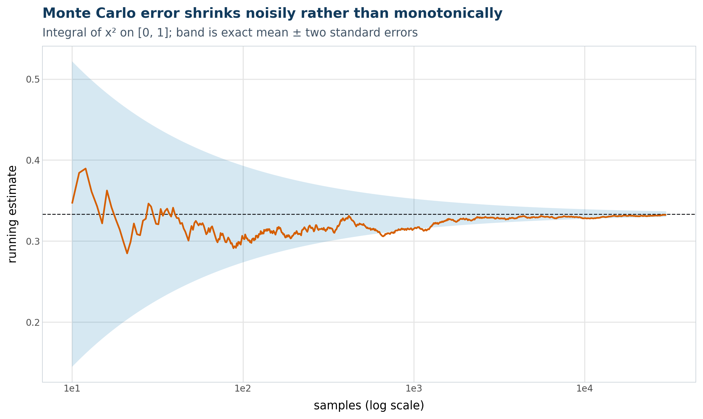

<figcaption>

Figure 57.6: Running Monte Carlo estimates with an approximate two-standard-error band around one third.

</figcaption>
</figure>

The path in [Figure 57.6](#fig-code-monte-carlo-convergence) is reproducible because its seed
is fixed. Another seed gives another valid path. A confidence band is a
repeated-sampling statement, not a deterministic error bound.

## Lab 16 — Least squares without forming normal equations

`numpy.linalg.lstsq` uses a stable factorization rather than explicitly solving
$A^TA\beta=A^Ty$, which squares the condition number.

```python
import numpy as np
from numpy.typing import NDArray

def fit_line(
    predictor_values: NDArray[np.float64],
    observed_values: NDArray[np.float64],
) -> tuple[float, float, float]:
    """Return intercept, slope, and residual norm for a least-squares line."""
    if (
        predictor_values.ndim != 1
        or observed_values.ndim != 1
        or predictor_values.shape != observed_values.shape
        or predictor_values.size < 2
    ):
        raise ValueError("x and y must be matching one-dimensional samples")
    design = np.column_stack(
        (np.ones_like(predictor_values, dtype=float), predictor_values)
    )
    coefficients, _, _, _ = np.linalg.lstsq(
        design, observed_values, rcond=None
    )
    residual_norm = float(
        np.linalg.norm(design @ coefficients - observed_values)
    )
    return float(coefficients[0]), float(coefficients[1]), residual_norm

predictor_values = np.array([0.0, 1.0, 2.0, 3.0])
observed_values = np.array([1.1, 2.9, 5.2, 6.8])
print(fit_line(predictor_values, observed_values))
```

The residual measures fit to these observations. It is neither measurement
uncertainty nor proof that a linear mechanism generated the data.

## Lab 17 — A stable explicit heat-equation step

For the one-dimensional heat equation, the ratio $r=\Delta t/\Delta x^2$ must
not exceed $1/2$ for this explicit stencil. The check is part of the program,
not an afterthought.

```python
import numpy as np
from numpy.typing import NDArray

def heat_solution(points: int, steps: int, ratio: float) -> NDArray[np.float64]:
    """Return heat-equation snapshots with zero boundary values."""
    if points < 3 or steps <= 0 or not 0.0 < ratio <= 0.5:
        raise ValueError("require points >= 3, steps > 0, and 0 < ratio <= 1/2")
    x = np.linspace(0.0, 1.0, points)
    state = np.sin(np.pi * x)
    history = [state.copy()]
    for _ in range(steps):
        updated = state.copy()
        updated[1:-1] += ratio * (state[:-2] - 2.0 * state[1:-1] + state[2:])
        state = updated
        history.append(state.copy())
    return np.vstack(history)

history = heat_solution(points=51, steps=80, ratio=0.45)
print(history.shape, history[0].max(), history[-1].max())
```

<figure id="fig-code-heat-equation-grid">
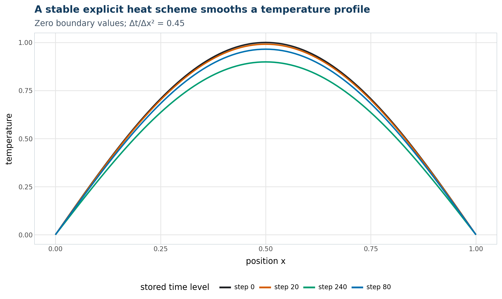

<figcaption>

Figure 57.7: Heat-equation profiles flatten over time while zero boundary values remain fixed.

</figcaption>
</figure>

[Figure 57.7](#fig-code-heat-equation-grid) shows diffusion and a discrete maximum
principle for this run. It does not prove convergence of the scheme; Chapter 27
and Chapter 33 provide the consistency and stability framework.

## Lab 18 — Bootstrap uncertainty with a fixed resampling design

The bootstrap repeatedly samples the observed values with replacement. It
approximates the sampling distribution under an empirical model; it does not
repair biased collection or dependent observations.

```python
import numpy as np
from numpy.typing import NDArray

def bootstrap_mean_interval(
    observations: NDArray[np.float64],
    repetitions: int = 5_000,
    seed: int = 20260811,
) -> tuple[float, float, float]:
    """Return the sample mean and a percentile bootstrap interval."""
    if observations.ndim != 1 or observations.size < 2 or repetitions < 100:
        raise ValueError("provide a one-dimensional sample and at least 100 repeats")
    generator = np.random.default_rng(seed)
    indices = generator.integers(0, observations.size, (repetitions, observations.size))
    bootstrap_means = observations[indices].mean(axis=1)
    lower, upper = np.quantile(bootstrap_means, [0.025, 0.975])
    return float(observations.mean()), float(lower), float(upper)

sample = np.array([4.1, 5.0, 4.7, 6.2, 5.5, 4.9, 5.8, 5.1])
print(bootstrap_mean_interval(sample))
```

<figure id="fig-code-bootstrap-distribution">
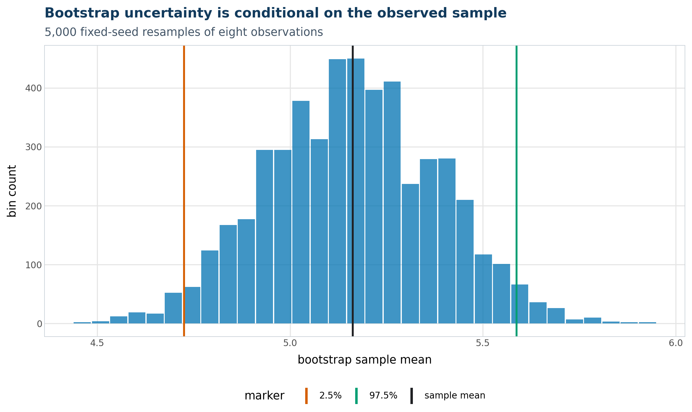

<figcaption>

Figure 57.8: Bootstrap means form a finite resampling distribution with percentile cutoffs.

</figcaption>
</figure>

The distribution in [Figure 57.8](#fig-code-bootstrap-distribution) is conditional on the
eight observed values. Chapter 43 explains coverage, skewness, dependence, and
when a different interval is preferable.

## Lab 19 — Automatic differentiation with dual-number pairs

A dual number stores a value and a derivative together as the pair
$(u,u')$. Multiplication follows the product rule, and applying sine follows
the chain rule. This tiny representation explains the forward-mode automatic
differentiation used by larger libraries.

```python
from math import cos, sin

def dual_multiply(
    left: tuple[float, float], right: tuple[float, float]
) -> tuple[float, float]:
    """Multiply (value, derivative) pairs by the product rule."""
    left_value, left_derivative = left
    right_value, right_derivative = right
    return (
        left_value * right_value,
        left_derivative * right_value + left_value * right_derivative,
    )

def dual_sine(number: tuple[float, float]) -> tuple[float, float]:
    """Apply sine to a dual pair by the chain rule."""
    value, derivative = number
    return sin(value), cos(value) * derivative

x_dual = (1.2, 1.0)
x_squared = dual_multiply(x_dual, x_dual)
function_dual = dual_multiply(x_squared, dual_sine(x_dual))
exact_derivative = 2.0 * 1.2 * sin(1.2) + 1.2**2 * cos(1.2)
print(function_dual, exact_derivative, function_dual[1] - exact_derivative)
```

The seed derivative $1$ asks for differentiation with respect to $x$.
Automatic differentiation applies calculus rules to the executed expression;
it is not symbolic simplification and it is not a small-step approximation.

<figure id="fig-code-derivative-methods">
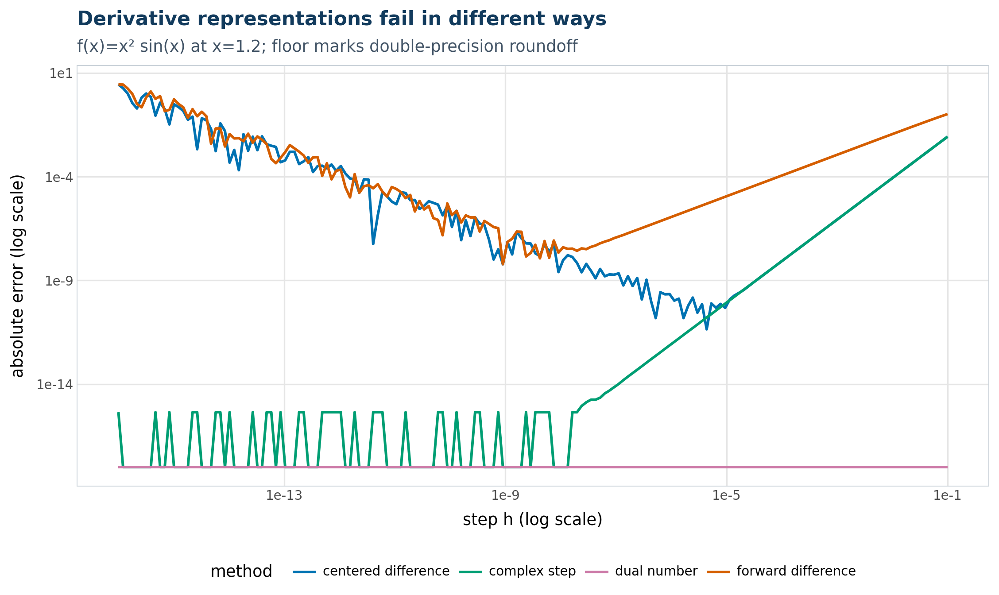

<figcaption>

Figure 57.9: Finite differences lose accuracy at tiny steps while rule-based and complex-step derivatives avoid subtractive cancellation.

</figcaption>
</figure>

## Lab 20 — Adaptive Simpson integration with a local error budget

Adaptive quadrature spends small panels where the integrand is difficult and
large panels where it is smooth. Each rejected panel divides both its interval
and its error allowance. A maximum depth turns unresolved accuracy into an
explicit failure instead of a plausible-looking number.

```python
from collections.abc import Callable
from math import pi, sin

def adaptive_simpson(
    function: Callable[[float], float],
    left: float,
    right: float,
    tolerance: float,
    max_depth: int = 20,
) -> tuple[float, int]:
    """Return an adaptive Simpson estimate and accepted-panel count."""
    if not left < right or tolerance <= 0.0 or max_depth <= 0:
        raise ValueError("require left < right, positive tolerance and depth")

    def panel(
        a_value: float,
        b_value: float,
        f_a: float,
        f_mid: float,
        f_b: float,
    ) -> float:
        return (b_value - a_value) * (f_a + 4.0 * f_mid + f_b) / 6.0

    middle = (left + right) / 2.0
    f_left, f_middle, f_right = function(left), function(middle), function(right)
    whole = panel(left, right, f_left, f_middle, f_right)
    stack = [
        (left, right, f_left, f_middle, f_right, whole, tolerance, 0)
    ]
    estimate = 0.0
    accepted = 0
    while stack:
        a_value, b_value, f_a, f_mid, f_b, coarse, budget, depth = stack.pop()
        midpoint = (a_value + b_value) / 2.0
        left_midpoint = (a_value + midpoint) / 2.0
        right_midpoint = (midpoint + b_value) / 2.0
        f_left_midpoint = function(left_midpoint)
        f_right_midpoint = function(right_midpoint)
        left_panel = panel(a_value, midpoint, f_a, f_left_midpoint, f_mid)
        right_panel = panel(midpoint, b_value, f_mid, f_right_midpoint, f_b)
        refined = left_panel + right_panel
        if abs(refined - coarse) <= 15.0 * budget:
            estimate += refined + (refined - coarse) / 15.0
            accepted += 1
            continue
        if depth >= max_depth:
            raise RuntimeError("requested tolerance was not resolved")
        stack.append(
            (
                midpoint,
                b_value,
                f_mid,
                f_right_midpoint,
                f_b,
                right_panel,
                budget / 2.0,
                depth + 1,
            )
        )
        stack.append(
            (
                a_value,
                midpoint,
                f_a,
                f_left_midpoint,
                f_mid,
                left_panel,
                budget / 2.0,
                depth + 1,
            )
        )
    return estimate, accepted

estimate, panels = adaptive_simpson(sin, 0.0, pi, tolerance=1e-10)
print(estimate, panels, abs(estimate - 2.0))
```

The factor $15$ comes from comparing fourth-order Simpson errors after halving
a panel. It is an estimator under smoothness assumptions, so the depth guard
still matters for singular or adversarial inputs.

<figure id="fig-code-adaptive-simpson-panels">
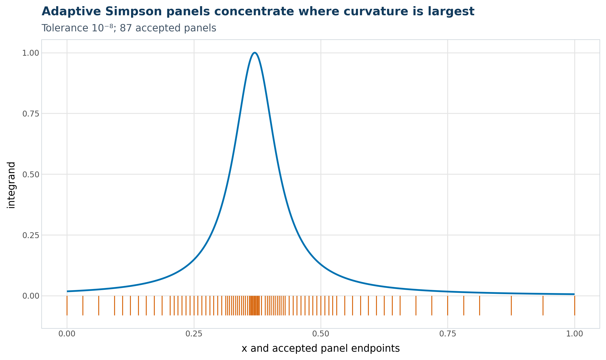

<figcaption>

Figure 57.10: Adaptive Simpson panels concentrate around a narrow feature while preserving a declared global budget.

</figcaption>
</figure>

## Lab 21 — Detect an ODE event between time steps

A projectile reaches the ground between two stored times. Reporting the first
negative sampled height would bias the event late; linear interpolation between
the bracketing heights provides a documented within-step estimate.

```python
from math import sqrt

def projectile_ground_time(
    initial_height: float,
    initial_velocity: float,
    gravity: float,
    step: float,
    max_steps: int,
) -> tuple[float, int]:
    """Estimate landing from a positive-to-nonpositive sampled height bracket."""
    if initial_height < 0.0 or gravity <= 0.0 or step <= 0.0 or max_steps <= 0:
        raise ValueError("height must be nonnegative and controls positive")

    def height(time: float) -> float:
        return initial_height + initial_velocity * time - 0.5 * gravity * time**2

    previous_time = 0.0
    previous_height = height(previous_time)
    for index in range(1, max_steps + 1):
        current_time = index * step
        current_height = height(current_time)
        if current_height <= 0.0:
            fraction = previous_height / (previous_height - current_height)
            event_time = previous_time + fraction * step
            return event_time, index
        previous_time, previous_height = current_time, current_height
    raise RuntimeError("ground event was not bracketed within max_steps")

estimated, index = projectile_ground_time(10.0, 8.0, 9.81, 0.25, 100)
exact = (8.0 + sqrt(8.0**2 + 2.0 * 9.81 * 10.0)) / 9.81
print(estimated, exact, abs(estimated - exact), index)
```

For a numerical ODE rather than this closed-form trajectory, dense-output or a
root finder can replace the linear interpolation. The invariant is the same:
retain a sign-changing bracket and declare the interpolation rule. For launch from ground level with upward velocity, landing means the positive-time return: choose a step smaller than $2v_0/g$ so that the first sample resolves the positive excursion. Otherwise this sampler misses the excursion and reports zero. Ground-level launch with nonpositive velocity is immediate contact at time zero.

<figure id="fig-code-ode-event-detection">
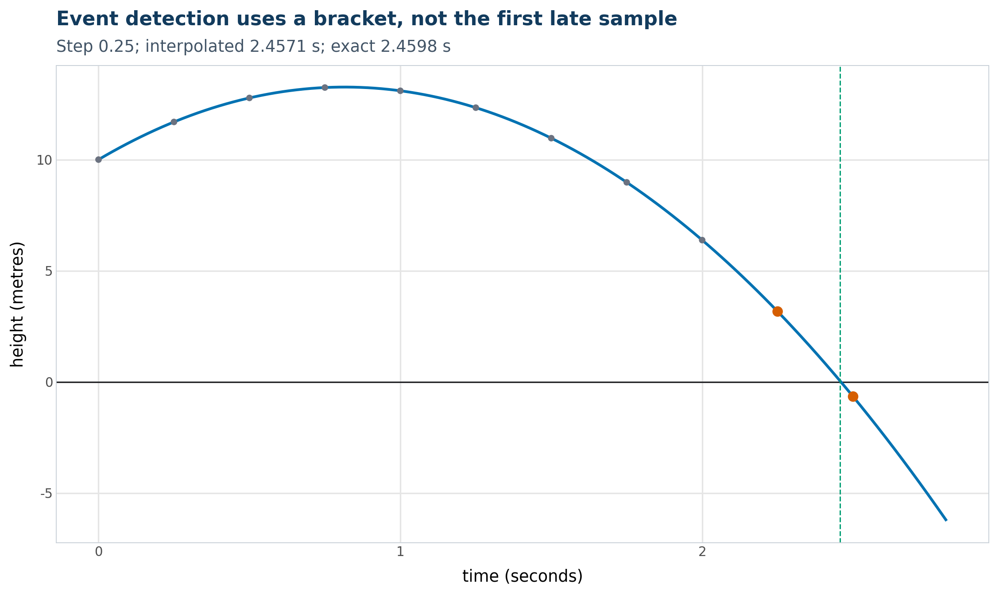

<figcaption>

Figure 57.11: A sampled projectile path brackets the ground event and interpolation locates it between time steps.

</figcaption>
</figure>

## Lab 22 — Projected gradient descent on a disk

To minimize $(x-2)^2+(y-1)^2$ subject to $x^2+y^2\leq1$, take a gradient step
and project any infeasible point radially back to the unit disk. Every stored
iterate is therefore feasible.

```python
from math import hypot

def projected_descent(
    start: tuple[float, float], step_size: float, iterations: int
) -> list[tuple[float, float]]:
    """Return feasible projected-gradient iterates for a quadratic on a disk."""
    if step_size <= 0.0 or step_size >= 0.5 or iterations <= 0:
        raise ValueError("require 0 < step_size < 1/2 and positive iterations")
    x_value, y_value = start
    if hypot(x_value, y_value) > 1.0:
        raise ValueError("start must lie in the unit disk")
    path = [(x_value, y_value)]
    for _ in range(iterations):
        candidate_x = x_value - step_size * 2.0 * (x_value - 2.0)
        candidate_y = y_value - step_size * 2.0 * (y_value - 1.0)
        radius = hypot(candidate_x, candidate_y)
        if radius > 1.0:
            candidate_x /= radius
            candidate_y /= radius
        x_value, y_value = candidate_x, candidate_y
        path.append((x_value, y_value))
    return path

path = projected_descent(start=(0.0, 0.0), step_size=0.2, iterations=12)
print(path[-1], hypot(*path[-1]))
```

The limiting point is $(2,1)/\sqrt5$, where the negative gradient points along
the active constraint normal. Projection solves this special feasible-set
subproblem exactly; more general constraints require different algorithms.

<figure id="fig-code-projected-gradient-path">
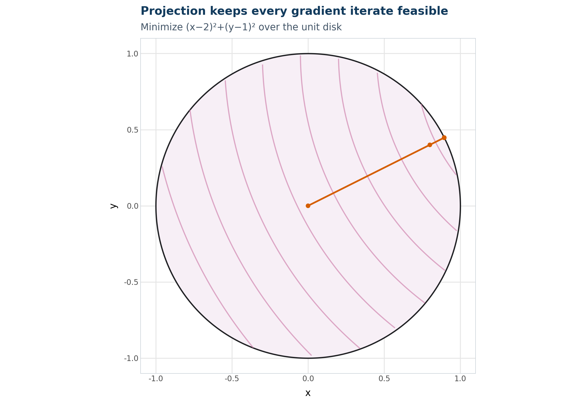

<figcaption>

Figure 57.12: Projected-gradient iterates remain in the disk and approach the active-boundary minimizer.

</figcaption>
</figure>

## Lab 23 — Balance boundary flux against integrated divergence

For $F(x,y)=(x^2,xy)$ on $[0,a]\times[0,b]$, the divergence is $3x$. Midpoint
sums on the interior and on each boundary give two independently assembled
approximations to the divergence theorem.

```python
def rectangle_divergence_audit(
    width: float, height: float, cells: int
) -> tuple[float, float]:
    """Return midpoint volume and boundary estimates for F=(x^2, x*y)."""
    if width <= 0.0 or height <= 0.0 or cells <= 0:
        raise ValueError("dimensions and cell count must be positive")
    delta_x = width / cells
    delta_y = height / cells
    volume = 0.0
    for row in range(cells):
        y_value = (row + 0.5) * delta_y
        for column in range(cells):
            x_value = (column + 0.5) * delta_x
            volume += 3.0 * x_value * delta_x * delta_y
    right_flux = sum(width**2 * delta_y for _ in range(cells))
    top_flux = sum(
        ((column + 0.5) * delta_x) * height * delta_x
        for column in range(cells)
    )
    boundary = right_flux + top_flux
    return volume, boundary

for cells in (4, 16, 64):
    volume, boundary = rectangle_divergence_audit(2.0, 1.5, cells)
    print(cells, volume, boundary, volume - boundary)
```

Both midpoint sums happen to be exact for the linear integrands here. Replacing
$F$ by a nonlinear field turns the same program into a refinement study.

## Lab 24 — Complex-step differentiation and its scope

For a real-valued target on an open real interval with a holomorphic extension
near the real evaluation point, $\operatorname{Im} f(x+ih)/h$ has error of order h squared
for finite positive real $h$ small enough to stay in that neighborhood. It is invalid for
nonanalytic operations or general complex-valued targets; real-trace, domain and roundoff checks remain caller obligations.

```python
from collections.abc import Callable
from cmath import sin
from math import cos

def complex_step_derivative(
    function: Callable[[complex], complex], point: float, step: float
) -> float:
    """Estimate the derivative of a real target via its holomorphic extension at a real point."""
    if step <= 0.0:
        raise ValueError("step must be positive")
    return float(function(complex(point, step)).imag / step)

for step in (1e-4, 1e-12, 1e-30, 1e-100):
    estimate = complex_step_derivative(sin, point=1.0, step=step)
    print(step, estimate, abs(estimate - cos(1.0)))
```

This is a numerical differentiation tool with a strong domain restriction, not
a replacement for the derivative definition or automatic differentiation.

## Lab 25 — Verify the derivative of an inverse function

If $y=f(x)$ and $f'(x)\ne0$, then

$$
(f^{-1})'(y)=\frac{1}{f'(x)}.
$$

The code keeps the preimage $x$ and image $y$ together so that the reciprocal
is evaluated at the correct point.

```python
from collections.abc import Callable
from math import exp, log

def inverse_derivative(
    forward_derivative: Callable[[float], float], preimage: float
) -> float:
    """Return the reciprocal derivative at a known preimage."""
    slope = forward_derivative(preimage)
    if slope == 0.0:
        raise ValueError("the forward derivative must be nonzero")
    return 1.0 / slope

for x in (-1.0, 0.0, 1.0, 2.0):
    y = exp(x)
    predicted = inverse_derivative(exp, x)
    exact = 1.0 / y
    print(x, y, predicted, exact, log(y))
```

For the exponential, the inverse is the logarithm and the two reciprocal
formulas agree. The program evaluates the theorem; it does not prove local
invertibility or justify the chain rule used in the proof.

<figure id="fig-code-inverse-derivative-slopes">
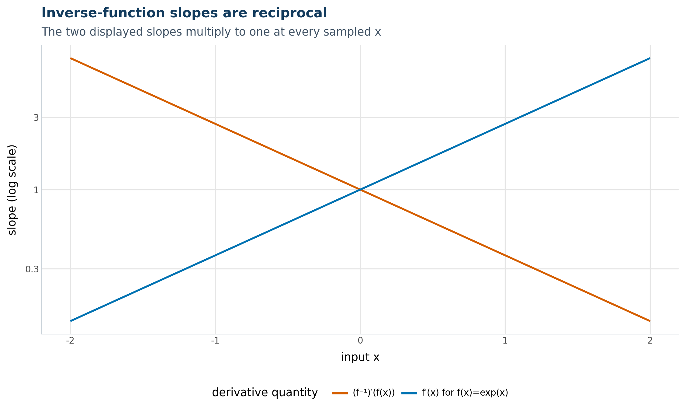

<figcaption>

Figure 57.13: Exponential and inverse logarithmic slopes are reciprocal at corresponding points.

</figcaption>
</figure>

## Lab 26 — Continue an implicit circle with Newton's method

The upper unit semicircle satisfies $F(x,y)=x^2+y^2-1=0$. Holding $x$ fixed,
Newton's method updates

$$
y\leftarrow y-\frac{F(x,y)}{F_y(x,y)}
=\frac12\left(y+\frac{1-x^2}{y}\right).
$$

```python
def upper_circle_y(
    x_coordinate: float, initial_y: float, iterations: int
) -> tuple[float, float]:
    """Return an upper-circle y estimate and its equation residual."""
    if not -1.0 < x_coordinate < 1.0 or initial_y <= 0.0 or iterations <= 0:
        raise ValueError("require |x|<1, a positive initial value, and iterations>0")
    y_coordinate = initial_y
    for _ in range(iterations):
        y_coordinate = 0.5 * (
            y_coordinate + (1.0 - x_coordinate * x_coordinate) / y_coordinate
        )
    residual = x_coordinate * x_coordinate + y_coordinate * y_coordinate - 1.0
    return y_coordinate, residual

for x_coordinate in (-0.8, -0.4, 0.0, 0.4, 0.8):
    y_coordinate, residual = upper_circle_y(
        x_coordinate, initial_y=1.0, iterations=6
    )
    implicit_slope = -x_coordinate / y_coordinate
    print(x_coordinate, y_coordinate, implicit_slope, residual)
```

The residual checks the displayed points and $-x/y$ evaluates the implicit
derivative. The implicit-function theorem explains why a nearby branch exists;
six successful iterations cannot establish that theorem.

<figure id="fig-code-implicit-circle-tangent">
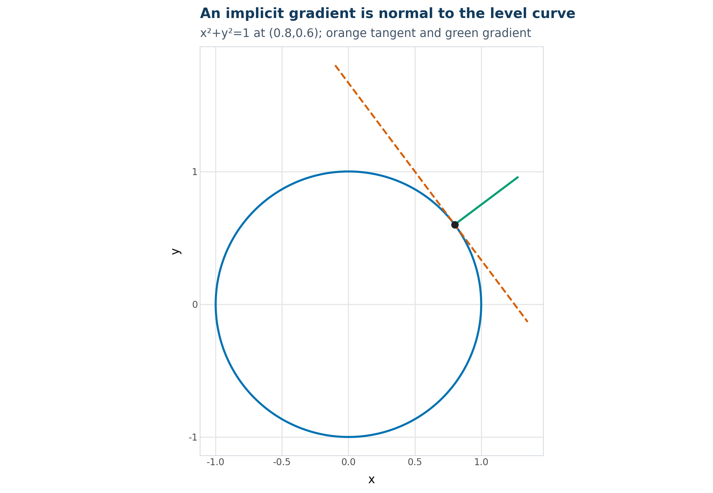

<figcaption>

Figure 57.14: A tangent to the implicit unit circle is perpendicular to the gradient normal.

</figcaption>
</figure>

## Lab 27 — Refine a polygonal arc-length approximation

Splitting a unit quarter circle into $n$ equal angles produces $n$ chords, each
of length $2\sin(\pi/(4n))$. Their total should approach $\pi/2$.

```python
from math import pi, sin

def quarter_circle_polygon_length(segments: int) -> float:
    """Return the inscribed polygonal length of a unit quarter circle."""
    if segments <= 0:
        raise ValueError("segments must be positive")
    return 2.0 * segments * sin(pi / (4.0 * segments))

for segments in (2, 4, 8, 16, 64, 256):
    length = quarter_circle_polygon_length(segments)
    print(segments, length, pi / 2.0 - length)
```

The formula avoids sampling ambiguity and shows monotone finite improvement.
Proving convergence to the integral arc-length definition still requires a
limit argument.

<figure id="fig-code-arc-length-refinement">
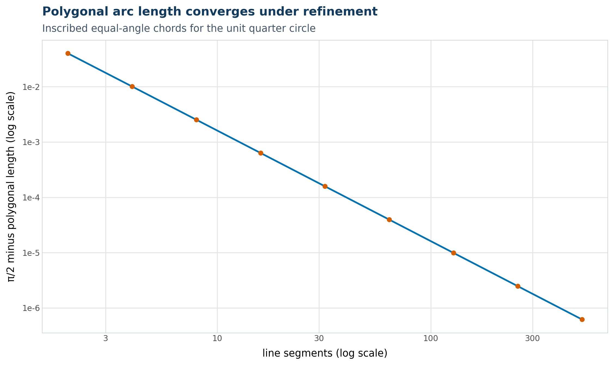

<figcaption>

Figure 57.15: Inscribed polygonal lengths converge toward the quarter-circle arc length.

</figcaption>
</figure>

## Lab 28 — Compute area from two vectors

For planar vectors $u=(u_1,u_2)$ and $v=(v_1,v_2)$, the parallelogram area is

$$
|u_1v_2-u_2v_1|.
$$

This determinant is also the magnitude of the three-dimensional cross product
after adding zero third coordinates.

```python
def parallelogram_area(first: tuple[float, float], second: tuple[float, float]) -> float:
    """Return the area spanned by two planar vectors."""
    first_x, first_y = first
    second_x, second_y = second
    return abs(first_x * second_y - first_y * second_x)

examples = (
    ((3.0, 1.0), (1.0, 2.5)),
    ((1.0, 0.0), (0.0, 1.0)),
    ((2.0, 1.0), (4.0, 2.0)),
)
for first, second in examples:
    print(first, second, parallelogram_area(first, second))
```

The last pair is parallel and has area zero. The calculation demonstrates the
formula and its degeneracy; the geometric proof comes from shearing and signed
area.

<figure id="fig-code-cross-product-area">
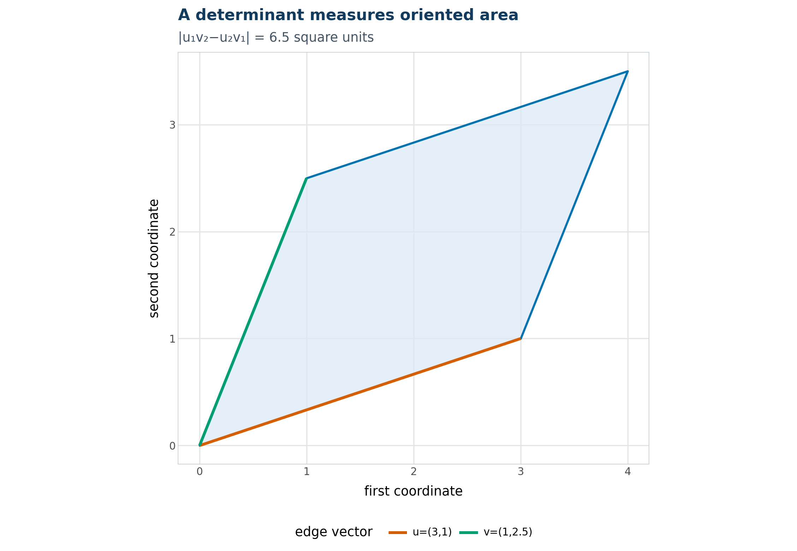

<figcaption>

Figure 57.16: A parallelogram spanned by two vectors has area equal to a determinant magnitude.

</figcaption>
</figure>

## Lab 29 — Recover an integrand from accumulated area

Given sampled values $f(x_i)$, trapezoids approximate
$F(x)=\int_0^x f(t)\,dt$. A centered finite difference then approximates
$F'(x)$. Using two numerical operations makes their separate errors visible.

```python
from math import pi, sin

def cumulative_trapezoids(values: list[float], step: float) -> list[float]:
    """Return cumulative trapezoidal sums beginning at zero."""
    if len(values) < 2 or step <= 0.0:
        raise ValueError("need at least two values and a positive step")
    totals = [0.0]
    for left, right in zip(values, values[1:]):
        totals.append(totals[-1] + step * (left + right) / 2.0)
    return totals

points = [2.0 * pi * index / 2_000 for index in range(2_001)]
step = points[1] - points[0]
values = [sin(x) + 0.3 * x for x in points]
areas = cumulative_trapezoids(values, step)
recovered = [
    (areas[index + 1] - areas[index - 1]) / (2.0 * step)
    for index in range(1, 2_000)
]
error = max(
    abs(estimate - values[index])
    for index, estimate in enumerate(recovered, start=1)
)
print(step, error, areas[-1])
```

This refinement-scale agreement demonstrates the Fundamental Theorem
numerically for one smooth function. The theorem itself explains why recovery
works for every function satisfying its hypotheses.

<figure id="fig-code-fundamental-theorem-recovery">
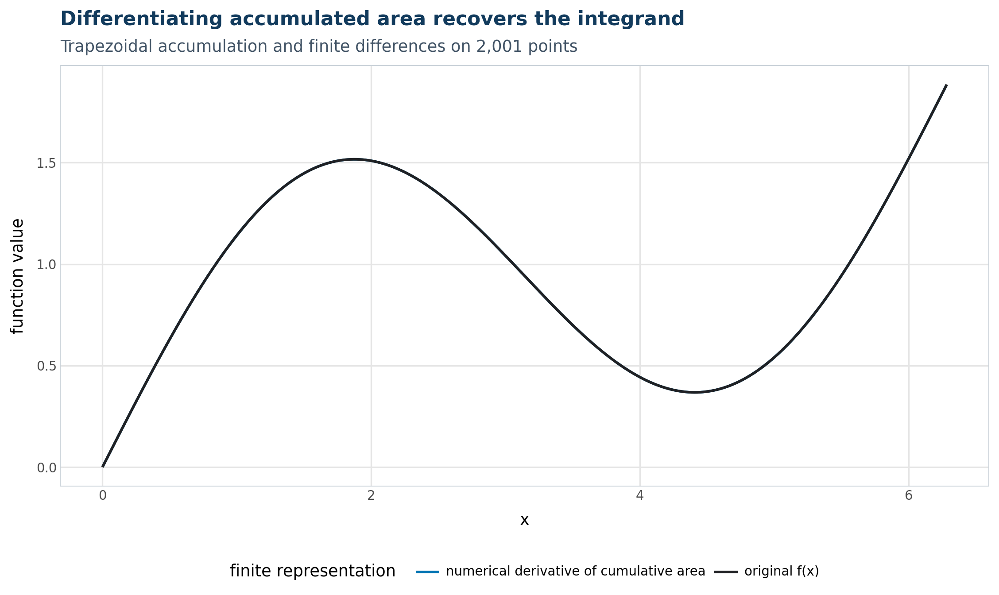

<figcaption>

Figure 57.17: A numerical derivative of cumulative trapezoidal area follows the original integrand.

</figcaption>
</figure>

## Debugging and evidence checklist

When a program disagrees with a calculation, do not immediately trust either
one. Reduce the problem to an exact case; print units and array shapes; halve a
step or double a mesh; inspect residuals; change the initial value; and compare
two methods that fail differently. Runtime validation uses explicit exceptions
because assertions can be removed by optimized Python execution.

These teaching examples expose checks, not universal all-input guarantees.
Bisection rejects nonfinite values, stalled midpoints and 4096 failed updates;
each callback must itself terminate. No example downloads data, changes global
configuration, or silently catches an error. The collection validator's finite
block checks do not certify arbitrary callbacks, all inputs or every environment.

## Where to go next

- Use Labs 2–5 with [limits and derivatives](02-limits-continuity.md) and
  [Chapter 3](03-derivative.md).
- Use Labs 6–7 with [integration](06-integrals-ftc.md) and [numerical
  calculus](16-numerical.md).
- Use Labs 8–10 with [differential equations](09-differential-equations.md),
  [Taylor series](10-series-taylor.md), and [numerical ODEs](33-numerical-odes.md).
- Use Labs 11–14 with [multivariable calculus](13-partial-derivatives.md),
  [optimization](41-computational-optimization.md), and [vector
  calculus](15-vector-calculus.md).
- Use Labs 15–18 with [probability](21-probability.md), [PDEs](27-pdes.md),
  [linear algebra](40-numerical-linear-algebra.md), and [statistical
  inference](43-statistical-inference.md).
- Use Labs 19–24 with [automatic differentiation](29-automatic-differentiation.md),
  [numerical calculus](16-numerical.md), [numerical ODEs](33-numerical-odes.md),
  [computational optimization](41-computational-optimization.md), and [vector
  calculus](15-vector-calculus.md).
- Use Labs 25–29 with [functions and models](01-functions-models.md),
  [implicit differentiation](04-implicit-applications.md), [integration
  applications](08-integration-applications.md), [vectors](12-vectors-space.md),
  and the [Fundamental Theorem](06-integrals-ftc.md).

The durable goal is not to memorize Python syntax. It is to make the finite
representation, mathematical claim, numerical certificate, and limitation
visible at the same time.
