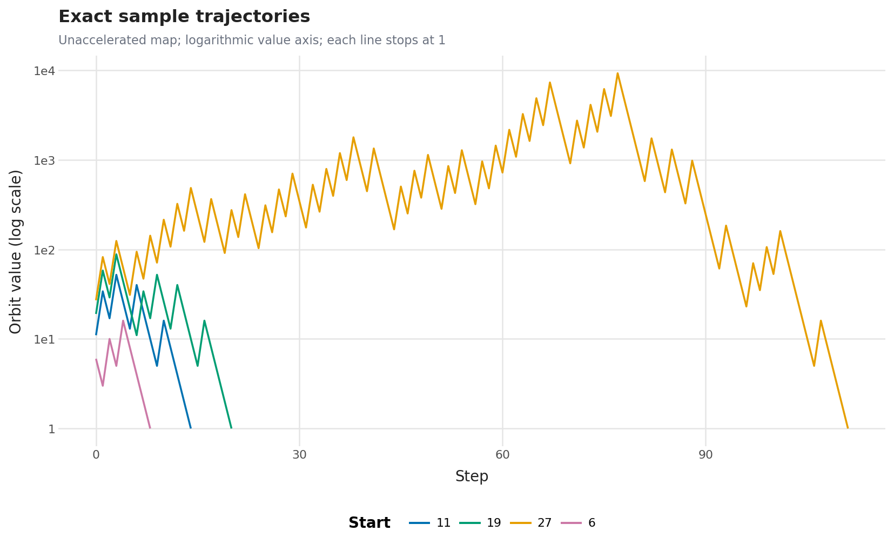

# The problem behind the slogan {#sec-problem}

## Three maps, one central question

The **unaccelerated Collatz map** $C:\mathbb N_{>0}\to\mathbb N_{>0}$ is

$$
C(n)=
\begin{cases}
n/2,&n\equiv0\pmod 2,\\
3n+1,&n\equiv1\pmod 2.
\end{cases}
$$

The forward orbit of $n$ is the sequence $n,C(n),C^2(n),\ldots$. Here $C^j$
means $j$-fold composition and $C^0(n)=n$. The Collatz conjecture says that for
every positive integer $n$, some iterate $C^j(n)$ equals 1. Once an orbit reaches
1 it enters $1\to4\to2\to1$, so “reaches 1” is equivalent to “eventually enters
the known cycle.”

Two compressed conventions are common. The **shortcut map** applies one forced
division immediately after each odd step:

$$
S(n)=
\begin{cases}
n/2,&n\text{ even},\\
(3n+1)/2,&n\text{ odd}.
\end{cases}
$$

For odd $m$, define the 2-adic valuation $\nu_2(a)$ as the exponent of the
largest power of 2 dividing the nonzero integer $a$. The **odd-to-odd map** is

$$
U(m)=\frac{3m+1}{2^{\nu_2(3m+1)}}.
$$

It discards every even value between consecutive odd values. All three
conventions ask the same qualitative convergence question on positive integers,
but step counts and parity records differ. This book uses $C$ unless it explicitly
says $S$ or $U$.

<div class="callout callout-note">
<p class="callout-title">Definition: tail and eventual behavior</p>

Two orbits have the same **tail** when some iterate of one equals some iterate of
the other. From that meeting point onward determinism makes their values equal.
An orbit is **eventually periodic** if two of its values coincide; it is
**unbounded** if its set of values has no finite upper bound.

</div>

## Equivalent formulations, with their domains attached

For $C$ on positive integers, the following are equivalent:

1. every orbit reaches 1;
2. every orbit eventually enters the $1,4,2$ cycle;
3. for every $n>1$, some iterate is smaller than $n$;
4. every positive integer has finite total stopping time.

The implication from item 3 to item 1 is strong induction. Assume every positive
integer below $n$ reaches 1. If $C^j(n)<n$, then the induction hypothesis applies
to that smaller iterate, so $n$ reaches 1. The base case is $n=1$. Conversely,
an orbit reaching 1 certainly falls below its start when $n>1$.

The domain matters. Extending the rule to zero or negative integers creates other
cycles, so a statement about all integers is not the classical conjecture. The
map matters too: under $U$, 1 is a fixed point because $U(1)=1$, whereas under
$C$ it lies in a three-term cycle.

## Worked examples

Starting from 7 under $C$ gives

$$
7\to22\to11\to34\to17\to52\to26\to13\to40\to20\to10
\to5\to16\to8\to4\to2\to1.
$$

Under $U$, only the odd entries remain:

$$
7\to11\to17\to13\to5\to1.
$$

The two displays describe the same arithmetic tail but have 16 and 5 transitions,
respectively. An assertion such as “7 has stopping time 5” is therefore incomplete
without a convention and stopping rule.

The trajectories in [Figure 1.1](#fig-sample-trajectories) show three further lessons. Orbits
merge, because a deterministic map gives equal futures after equal values. A
starting value can rise far above its origin before descending. Finally, a graph
of finitely many successful examples—even very long ones—cannot settle a
universal statement.

<figure id="fig-sample-trajectories">


<figcaption>

Figure 1.1: Sample unaccelerated trajectories for selected starting values. Each line is a finite exact computation and is not evidence about an untested integer.

</figcaption>
</figure>

## How a counterexample could look

If the conjecture is false, at least one positive orbit fails to reach 1. Such an
orbit must either enter a different cycle or be unbounded. Indeed, a bounded
infinite sequence of positive integers repeats a value by the pigeonhole
principle, and determinism then forces periodicity. “No nontrivial cycles” would
therefore settle only one of two possible failure modes.

There is another useful reduction. If any counterexample exists, there is a least
one, say $n_0$. Its orbit can never fall below $n_0$: a smaller value would reach
1 by minimality and pull $n_0$ with it. This observation motivates stopping-time
sieves, but it does not prove that descent must occur.

## Worked comparison: compression preserves values and changes time

Start at six under the standard map. The trace is six, three, ten, five, sixteen, eight, four, two, one, requiring eight transitions. Under the shortcut map the trace is six, three, five, eight, four, two, one, requiring six transitions. Each shortcut odd transition merges a standard odd transition with the forced next halving; even transitions remain single halvings. Thus compression preserves the relevant future values but removes two entries in this example.

The odd-to-odd convention cannot be applied directly to the even start six. First remove its factor of two to obtain the odd start three. Its odd trace is three, five, one, requiring two odd-to-odd transitions. The first block expands to three, ten, five under the standard map; the second expands to five, sixteen, eight, four, two, one. Together with the initial six-to-three transition, these blocks recover all eight original transitions.

More generally, if an odd input has exactly $a$ factors of two in three times that input plus one, one odd-to-odd transition represents one standard odd update followed by exactly $a$ halvings. Its standard duration is therefore $a+1$, and its shortcut duration is $a$. The exponent is finite because the intermediate positive integer is nonzero. Knowing only the number of odd-to-odd transitions does not determine the standard duration: the valuation of each block is also needed.

The reachability equivalence follows by joining these finite blocks. Every positive even input reaches an odd input after finitely many initial halvings. Every subsequent odd-to-odd transition expands into a finite standard segment, and every standard segment between successive odd entries contracts back. The terminal case needs its own clock convention: starting at one has total stopping time zero, even though following one full standard cycle takes three transitions. A repeated-cycle duration is not a first-arrival time.

## Worked theorem: an unbounded deterministic integer orbit must escape

For an arbitrary real sequence, unboundedness does not imply tending to infinity. The sequence alternating one with successive larger integers is a counterexample. A forward orbit of a fixed function on positive integers has additional structure: whenever a state repeats, the entire future repeats. That determinism makes the distinction sharper here.

Suppose a positive-integer orbit is unbounded but does not tend to infinity. Failure to tend to infinity means that some finite bound is met infinitely often: there is a fixed positive bound such that infinitely many orbit states are at most that bound. Only finitely many positive integers meet it. At least one of those states must therefore occur twice, indeed infinitely often. From its first repeated occurrence, determinism forces a periodic tail. A finite prefix followed by a periodic tail has a finite maximum, contradicting unboundedness.

Consequently every unbounded orbit of a function from positive integers to positive integers tends to infinity. The theorem does not assert that an unbounded Collatz orbit exists. It says that if one existed, it could not keep returning to a fixed bounded region while making ever-larger excursions. Conversely, an orbit that reaches the known cycle has a finite prefix and a bounded tail, regardless of how high its finite peak was.

The proof uses three specific ingredients: a discrete positive-integer state space, finiteness of every bounded initial region, and a single fixed successor for each state. A general real dynamical system may have infinitely many distinct states inside a bounded region, so the same pigeonhole argument need not apply. A nondeterministic sequence may revisit a state and choose a different successor. Naming the hypotheses protects the result from being transferred to the wrong setting.

## Worked reduction: the least counterexample has a restricted residue

Assume, conditionally, that a positive counterexample exists. Well-ordering supplies a least one. It is greater than one, since one already meets the target. It cannot be even: its next value would be half as large, and every smaller positive input reaches one by minimality. A tail beginning at that smaller input would make the supposed counterexample converge too.

The least counterexample also cannot be congruent to one modulo four. Write such an odd start as four times a nonnegative integer plus one. Three standard steps give first three times the start plus one, then half of that, then a second halving. Both halvings are legal because the first output is divisible by four. The resulting value is three times the parameter plus one, which is smaller than the original whenever the start exceeds one. Minimality again gives a convergent smaller tail and a contradiction.

Thus any least counterexample must be congruent to three modulo four. This is a rigorous necessary condition, not proof that such a counterexample exists. It also does not prove convergence for the missing class. A residue restriction can narrow a universal problem while leaving an infinite unresolved family. Subsequent sieve chapters generalise exactly this style of conditional descent argument, and their coverage obligations become more demanding as classes split.

The exceptional boundary is informative. For the start one, the three-step formula returns one rather than a strictly smaller positive integer. That does not invalidate the argument: one was the base case, and strict descent was requested only above it. Omitting the domain condition would turn a valid reduction into a false inequality at the known cycle.

## Pitfall clinic

- **Changing maps silently.** Every reported step count must name $C$, $S$, or
  $U$.
- **Assuming upward motion is failure.** Many convergent orbits make large
  excursions.
- **Treating the known cycle as a fixed point.** It is a fixed point only under
  some compressed conventions.
- **Proving descent for many residue classes, then saying “and so on.”** The
  missing classes are exactly where a universal proof can fail.
- **Calling finite verification a proof.** It proves a bounded statement, not the
  conjecture.

<!-- inline-formula-code:start -->
## Formula and finite computation

A useful formula in this chapter is

$$
C(n)=\begin{cases}n/2&2\mid n,\\3n+1&2\nmid n,\end{cases}
$$

The branch in the function is the piecewise definition verbatim. The following standalone Python block expresses that finite rule with its inputs and stopping conditions visible.

```python
def collatz_step(number: int) -> int:
    """Return one standard Collatz step for a positive integer."""
    if number <= 0:
        raise ValueError("the standard Collatz map here has domain n >= 1")
    return number // 2 if number % 2 == 0 else 3 * number + 1

for number in range(1, 11):
    print(number, collatz_step(number))
```

**What the computation establishes.** The calculation checks a declared finite instance; the surrounding argument explains what is true beyond those inputs.
<!-- inline-formula-code:end -->

## Chapter summary

The classical problem concerns $C$ on positive integers. Compressed maps preserve
the reachability question but not the statistics. A counterexample must be cyclic
away from 1 or unbounded. A proof that every $n>1$ eventually falls below itself
would imply the conjecture by strong induction—but establishing that descent is
the hard part.

## Exercises

<div class="exercise" id="collatz-problem-three-clocks">
<p class="exercise-title"><strong>Exercise 1</strong></p>

Write the $C$-, $S$-, and $U$-orbits of 9 until first reaching 1. Report three step counts and explain their differences.

<details class="hint"><summary>Hint 1</summary>

The standard trace first reaches seven after three transitions.

</details>

<details class="hint"><summary>Hint 2</summary>

Odd-to-odd blocks remove all intervening even states.

</details>

<details class="solution"><summary>Solution</summary>

The standard trace is $9,28,14,7,22,11,34,17,52,26,13,40,20,10,5,16,8,4,2,1$, giving nineteen transitions. The shortcut trace is $9,14,7,11,17,26,13,20,10,5,8,4,2,1$, giving thirteen. The odd trace is $9,7,11,17,13,5,1$, giving six. Each convention ends at the same target, while merging different legal standard steps. Counts without a named map and first-arrival rule would be incomplete.

</details>

</div>

<div class="exercise" id="collatz-problem-shared-tail">
<p class="exercise-title"><strong>Exercise 2</strong></p>

Prove that two $C$-orbits which meet have identical tails.

<details class="hint"><summary>Hint 1</summary>

Name the common state and apply the same function to both sides.

</details>

<details class="hint"><summary>Hint 2</summary>

Use induction on the number of subsequent transitions.

</details>

<details class="solution"><summary>Solution</summary>

If $C^i(a)=C^j(b)$, applying $C$ preserves equality, and induction gives $C^{i+r}(a)=C^{j+r}(b)$ for every nonnegative $r$. No injectivity is needed: predecessors may differ, but a fixed state has one successor. The traces can have different elapsed times before meeting, so shared future values do not imply equal total stopping times from the original starts.

</details>

</div>

<div class="exercise" id="collatz-problem-bounded-periodicity">
<p class="exercise-title"><strong>Exercise 3</strong></p>

Prove the bounded-orbit dichotomy: a bounded forward orbit is eventually periodic.

<details class="hint"><summary>Hint 1</summary>

A bounded positive-integer orbit lies in a finite set.

</details>

<details class="hint"><summary>Hint 2</summary>

A repeated state fixes every later successor.

</details>

<details class="solution"><summary>Solution</summary>

Choose a positive bound containing every state. Among one more visited states than the size of that finite initial interval, two coincide. If their times are i and j with i less than j, determinism makes every later value at time i plus r equal to that at time j plus r. The tail therefore repeats with period j minus i, possibly with a smaller minimal period. The argument supplies eventual periodicity, not membership in the particular cycle containing one.

</details>

</div>

<div class="exercise" id="collatz-problem-descent-induction">
<p class="exercise-title"><strong>Exercise 4</strong></p>

Show carefully that “every $n>1$ eventually falls below $n$” implies the conjecture. Identify where well-ordering is used.

<details class="hint"><summary>Hint 1</summary>

Use strong induction or a least counterexample.

</details>

<details class="hint"><summary>Hint 2</summary>

The smaller reached value need not be the next integer below the start.

</details>

<details class="solution"><summary>Solution</summary>

One reaches itself at time zero. Assume all positive inputs smaller than a given start reach one. The descent premise supplies a finite iterate smaller than that start; the induction hypothesis supplies a finite tail from it to one. Concatenating the two finite segments proves success at the start. Strong induction, justified by well-ordering of positive integers, covers every start. The proof is conditional on universal descent and does not establish that missing premise.

</details>

</div>

<div class="exercise" id="collatz-problem-extended-fixed-points">
<p class="exercise-title"><strong>Exercise 5</strong></p>

Find every integer $n$ for which $C(n)=n$ when the domain is enlarged to all integers. Why does this not address the positive-integer conjecture?

<details class="hint"><summary>Hint 1</summary>

Solve the even and odd branch equations separately.

</details>

<details class="hint"><summary>Hint 2</summary>

Check integrality and parity of each algebraic candidate.

</details>

<details class="solution"><summary>Solution</summary>

The even equation requires n divided by two to equal n, hence n equals zero, which is even and works. The odd equation requires three n plus one to equal n, hence n equals negative one half, which is not an integer and is rejected. Thus zero is the only integer fixed point. It lies outside the classical positive domain, and a fixed-point classification does not exclude cycles of longer period or divergent positive orbits.

</details>

</div>

<div class="exercise" id="collatz-problem-expand-odd-block">
<p class="exercise-title"><strong>Exercise 6</strong></p>

Describe precisely how to translate one $U$-step into a variable number of $C$-steps.

<details class="hint"><summary>Hint 1</summary>

First perform the odd multiplication-and-addition update.

</details>

<details class="hint"><summary>Hint 2</summary>

The valuation counts every subsequent forced halving.

</details>

<details class="solution"><summary>Solution</summary>

For odd positive $m$, let $a=\nu_2(3m+1)$. Perform one standard update to $3m+1$, then exactly $a$ halvings to obtain the next odd state. This takes $a+1$ standard transitions. The valuation is at least one and finite. At $m=1$ this is a traversal of the known cycle; it should not be confused with the zero first-arrival time of a start already at one.

</details>

</div>

<div class="exercise" id="collatz-problem-least-even">
<p class="exercise-title"><strong>Exercise 7</strong></p>

Prove that a least positive counterexample, if one exists, cannot be even. State why this does not prove that every odd input succeeds.

<details class="hint"><summary>Hint 1</summary>

The even branch immediately produces a smaller positive integer.

</details>

<details class="hint"><summary>Hint 2</summary>

Minimality only handles smaller starts, not every unresolved residue class.

</details>

<details class="solution"><summary>Solution</summary>

A least counterexample exceeds one. If it were even, its half would be a smaller positive input and hence would reach one by minimality. Adding the first transition would make the alleged counterexample reach one too, a contradiction. The reasoning excludes an even least counterexample but leaves odd candidates. It does not establish the descent premise for every odd input or provide a complete coverage argument.

</details>

</div>

<div class="exercise" id="collatz-problem-one-mod-four">
<p class="exercise-title"><strong>Exercise 8</strong></p>

Prove that every positive $n\equiv1\pmod4$ with $n>1$ reaches a smaller value after three standard transitions.

<details class="hint"><summary>Hint 1</summary>

Write the start as four q plus one.

</details>

<details class="hint"><summary>Hint 2</summary>

The first output has two factors of two.

</details>

<details class="solution"><summary>Solution</summary>

For $n=4q+1$, the first output is $12q+4$, the second $6q+2$, and the third $3q+1$. The difference between start and third output is $q$, positive because $n>1$ forces $q\ge1$. Both intermediate halving branches are even as required. At $q=0$ the start is one and equality replaces strict descent. Thus the condition above one is necessary for this stated inequality.

</details>

</div>

<div class="exercise" id="collatz-problem-negative-cycle">
<p class="exercise-title"><strong>Exercise 9</strong></p>

Under the extended integer rule, trace negative one until it repeats and compare it with the positive known cycle.

<details class="hint"><summary>Hint 1</summary>

The odd branch remains the same algebraic formula.

</details>

<details class="hint"><summary>Hint 2</summary>

Negative two is even.

</details>

<details class="solution"><summary>Solution</summary>

Negative one maps to negative two, which maps back to negative one. This is a two-state cycle outside the positive domain. The positive cycle is one to four to two to one. Neither cycle is a fixed point of the standard map. The negative cycle refutes a careless assertion about every nonzero integer reaching positive one, but it is not a counterexample to the classical assertion whose domain contains only positive integers.

</details>

</div>

<div class="exercise" id="collatz-problem-unbounded-escape">
<p class="exercise-title"><strong>Exercise 10</strong></p>

Prove that an unbounded orbit of a deterministic map on positive integers tends to infinity, and name a hypothesis that fails for an arbitrary real sequence.

<details class="hint"><summary>Hint 1</summary>

Failure of tending to infinity gives infinitely many visits below one fixed bound.

</details>

<details class="hint"><summary>Hint 2</summary>

A finite region then contains a repeated state.

</details>

<details class="solution"><summary>Solution</summary>

If infinitely many orbit values lie in a fixed finite positive-integer interval, two are equal. Determinism forces a periodic tail, making the full orbit bounded and contradicting the assumption. Hence every finite interval is eventually left forever, which is tending to infinity. An arbitrary real sequence can have infinitely many distinct states in a bounded interval, and a general listed sequence need not assign one successor consistently to a repeated value. Those missing hypotheses prevent the same argument from applying universally.

</details>

</div>
