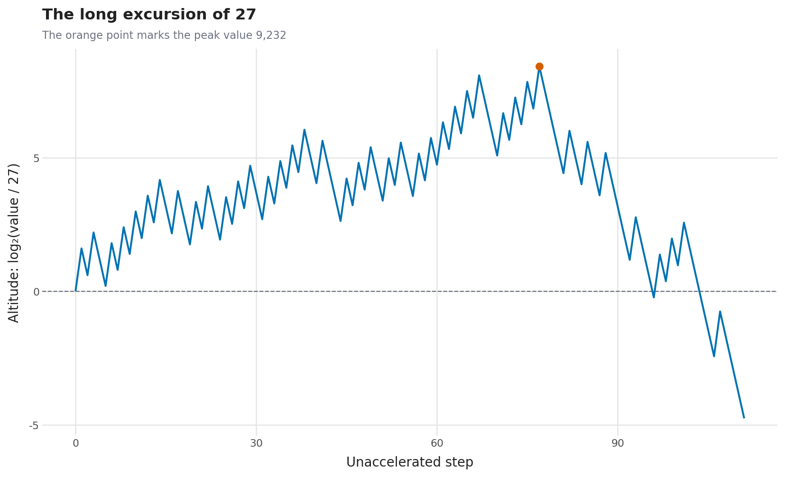
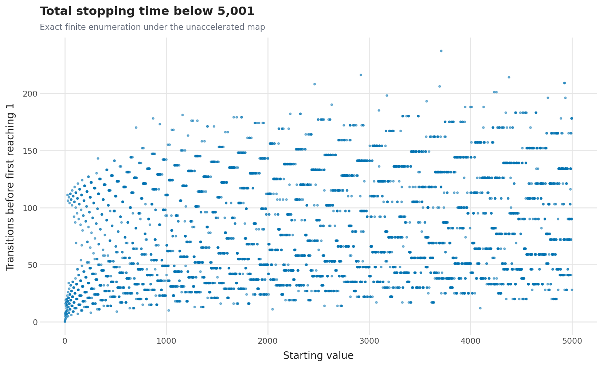
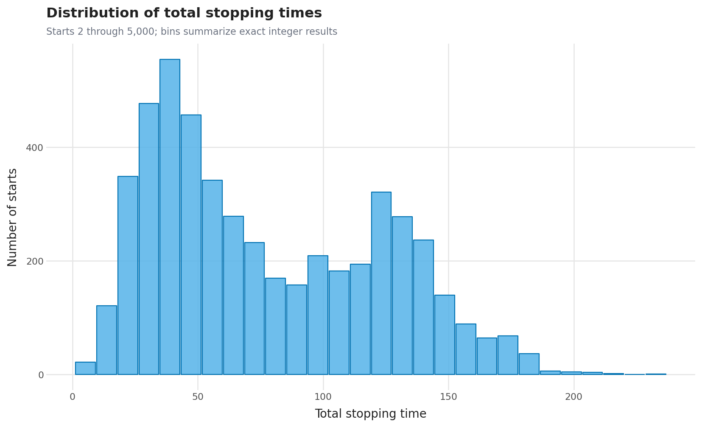

# Measuring an orbit {#sec-measuring}

## Stopping quantities

Fix the unaccelerated map $C$. For $n>1$, the **stopping time** is

$$
\sigma(n)=\min\{j\ge 1:C^j(n)<n\},
$$

when such a $j$ exists. The **total stopping time** is

$$
\tau(n)=\min\{j\ge 0:C^j(n)=1\}.
$$

We use $\tau(1)=0$. If the required set is empty, the corresponding quantity is
infinite. Authors sometimes reverse these names or count shortcut steps, so a
data table should carry its definition, not merely a column named “stopping
time.”

The **peak** or maximum excursion is

$$
M(n)=\max_{0\le j\le\tau(n)} C^j(n)
$$

for a verified convergent orbit. The normalized peak $M(n)/n$ compares relative
excursions. The log-altitude $\log_2(C^j(n)/n)$ is positive above the starting
height and negative below it. These are different summaries: a long orbit need
not have the greatest peak, and a large absolute peak need not have the largest
normalized excursion.

## A detailed case: 27

The orbit of 27 is a standard antidote to the belief that visible early descent
should be easy. Exact iteration gives

$$
\sigma(27)=96,\qquad \tau(27)=111,\qquad M(27)=9232.
$$

Thus 27 takes 96 transitions merely to reach a value below 27, and 15 more to
reach 1. Its maximum is more than 341 times its starting value. The first few
terms are

$$
27,82,41,124,62,31,94,47,142,71,214,107,322,161,484,\ldots.
$$

[Figure 2.1](#fig-orbit-27-altitude) plots log-altitude rather than raw height. The horizontal
line marks the start. Multiple returns near that line precede the eventual drop;
the shape warns against extrapolating from a short prefix.

<figure id="fig-orbit-27-altitude">


<figcaption>

Figure 2.1: Logarithmic altitude of the exact orbit starting at 27, with the starting height as zero.

</figcaption>
</figure>

## Records are sample-dependent

For a bound $N$, a number $n\le N$ is a **total-stopping-time record** if
$\tau(n)>\tau(m)$ for every $m<n$. A peak record is defined analogously. Record
status refers to the ordered range searched and the chosen statistic. It is not
an intrinsic label independent of convention.

[Figure 2.2](#fig-stopping-scatter) displays $\tau(n)$ for $1\le n\le5000$. The upward envelope
contains records; the interior shows that neighboring starts can behave very
differently. The plot establishes only the displayed finite computation. In
particular, its apparent shape is not a bound for later values.

<figure id="fig-stopping-scatter">


<figcaption>

Figure 2.2: Total stopping times for starts from 1 through 5000 under the unaccelerated map.

</figcaption>
</figure>

## Distributions and censoring

A histogram answers a different question: how often do observed stopping times
fall in each bin? [Figure 2.3](#fig-stopping-distribution) shows the same finite range. It must
not be read as a limiting probability law. Integers in a bounded interval are
sampled uniformly here; choosing a uniform exponent and then a uniform number in
a dyadic block would weight scales differently.

<figure id="fig-stopping-distribution">


<figcaption>

Figure 2.3: Histogram of finite total stopping times for starts from 2 through 5000.

</figcaption>
</figure>

If an experiment stops an orbit after a step cap, unresolved starts are
**right-censored**. Recording their current step as the stopping time biases the
distribution downward and falsely turns “unknown in this run” into “finished.” A
sound table uses a status field such as `reached_1`, `fell_below_start`,
`step_limit`, or `overflow`. For arbitrary-precision integers, overflow disappears
but memory and time limits remain.

## Worked comparison

Consider 3 and 8. Their $C$-orbits are

$$
3\to10\to5\to16\to8\to4\to2\to1,
\qquad
8\to4\to2\to1.
$$

Hence $\tau(3)=7$ and $\tau(8)=3$, while $M(3)=16$ and $M(8)=8$. But
$\sigma(3)=6$, since 2 is the first value below 3, whereas $\sigma(8)=1$. The
start 8 is itself a power of two, making its trajectory monotone. This comparison
also shows why peak, stopping time, and total stopping time should not be merged
into a vague notion of “difficulty.”

One bounded traversal can compute all three statistics while retaining a status
for an unfinished orbit. In particular, the current step at the budget is
never reported as a stopping time.

```python
def orbit_statistics(
    start: int, maximum_steps: int
) -> tuple[int | None, int | None, int, str]:
    """Return stopping time, total time, peak, and finite-run status."""
    if start <= 0 or maximum_steps < 0:
        raise ValueError("start must be positive and maximum_steps nonnegative")
    value = start
    peak = start
    stopping_time: int | None = None
    for step in range(maximum_steps + 1):
        if step > 0 and stopping_time is None and value < start:
            stopping_time = step
        if value == 1:
            return stopping_time, step, peak, "reached_1"
        if step < maximum_steps:
            value = value // 2 if value % 2 == 0 else 3 * value + 1
            peak = max(peak, value)
    return stopping_time, None, peak, "step_limit"

statistics = orbit_statistics(27, 111)
if statistics[:3] != (96, 111, 9232):
    raise RuntimeError("the orbit statistics do not match the exact case study")
print(statistics)
print(orbit_statistics(27, 20))
```

The first output recovers all three stated values; the second records a censored
run with `total_time=None`. Neither run proves that any larger start reaches
one, and an exhausted budget is not evidence of divergence.

## Worked measurement ledger: the same peak gives different ratios

The standard orbit of five is five, sixteen, eight, four, two, one. Its first value below five occurs at time three, its first one at time five, and its peak is sixteen. Dividing the peak by the start gives sixteen fifths. The standard orbit of six is six, three, ten, five, sixteen, eight, four, two, one. Its first descent occurs immediately at time one, its first one at time eight, and its peak is also sixteen. The normalized peak is now eight thirds, smaller than sixteen fifths.

Thus the two starts have equal absolute peaks while their descent times, total times and relative peaks differ. Six descends sooner than five but reaches one later. There is no contradiction because first descent asks for a threshold relative to each start, whereas total time asks for the fixed target one. After the first transition six reaches three, whose subsequent orbit can still make a long excursion above six. An early threshold crossing does not imply monotone motion afterwards.

A table should therefore retain separate columns and their definitions. If the intended question is relative amplification, the peak-to-start ratio is appropriate. If it concerns the number of map updates before reaching one, the total stopping time is appropriate. Neither determines a machine runtime without information about arithmetic sizes and implementation. A large intermediate integer can make an update more costly than one on a small integer, even when both count as one mathematical transition.

The definitions also distinguish a running maximum from a completed peak. Along any observed prefix, the running maximum is well defined and cannot decrease when another state is appended. It is a lower bound for any eventual completed peak. Equality with the full peak requires either a completed orbit or another proof bounding all later states. In these two short traces the final powers-of-two tail proves that no later value exceeds sixteen; an unfinished record without that tail would not establish the same equality.

## Worked capped record: a descent can be known before total time

Take the start five and a budget of three standard transitions. The recorded states are five at time zero, sixteen at time one, eight at time two, and four at time three. The record certifies a stopping time of three: every earlier positive-time state is at least five, while the final state is smaller. It does not yet record a visit to one, so its total stopping time field should remain unresolved with a lower bound greater than three. Its observed peak is sixteen.

If the budget had been two, the record would end at eight. Neither first descent nor first arrival at one would have occurred. The correct outcome is not “stopping time two” or “infinite stopping time”; it is no first descent observed through time two. This matters even when another argument elsewhere proves that five converges. The record should say what this computation or hand trace actually establishes, while a separate proof can justify additional properties.

A useful record contains the map name, start, transition budget, transitions performed, last state, observed peak, first-descent time if found, first-one time if found, and a status explaining why traversal stopped. It may also name exact-integer arithmetic or a machine bound. A stopped run can have a known first-descent time and an unresolved total time simultaneously. Compressing these fields into one success flag loses a mathematical distinction needed by later analysis.

Status priority must be explicit at a boundary. If the final allowed transition lands on one, then the target has been reached within the budget. A loop that checks its cap before checking the just-computed state could incorrectly mark that result unresolved. Conversely, a zero-transition run beginning at one succeeds immediately; a zero-transition run beginning at two has not yet reached one. These are consequences of the time-zero convention, not software outputs asserted here.

The short traces are handwritten mathematical examples. They neither report a new implementation run nor audit the historical figure computations. The point is to specify the quantities before any program is trusted to populate them.

## Worked sampling comparison: uniform starts and equal blocks differ

Consider the finite population of starts from one through seven. Uniform selection from that population gives every integer probability one seventh. There are three even starts, so the probability of selecting an even start is three sevenths. This is a finite sampling statement about the chosen population, independent of whether later orbit statistics are known.

Now choose one of the three blocks one through less than two, two through less than four, and four through less than eight with equal probability. Within the chosen block, choose an integer uniformly. The resulting probabilities of individual starts are one third for one, one sixth each for two and three, and one twelfth each for four through seven. The probabilities sum to one. The even probability is one sixth from the second block plus two twelfths from the third, giving one third rather than three sevenths.

Both are legitimate designs. The first answers a question about a uniformly selected integer in one finite interval. The second gives equal total weight to three scales, with different weights on individual integers. A histogram from the second design cannot be interpreted as a uniform-integer histogram merely because the number of sampled rows is large. The sampling rule, not the plotting command, determines the probability being estimated or enumerated.

If every member of each block is recorded but block averages are then averaged equally, the same weighting issue remains. The uniform-population average instead weights each block average by its population size: one seventh, two sevenths and four sevenths. This is an exact accounting identity. It does not identify a preferred asymptotic distribution for all integers, since there is no uniform probability assigning equal positive mass to each positive integer.

Later density chapters give precise alternatives for infinite statements. Here the requirement is smaller: state the finite population and weight of each observation, retain unresolved cases, and avoid attaching a sampling uncertainty interval to a complete enumeration without a separate sampling model. Counts and weights can be exact even when the eventual universal conjecture is unresolved.

## Logarithms and truthful axes

Peak values span orders of magnitude even in modest experiments. A logarithmic
axis can make the range legible, but the caption must say so. Zero cannot appear
on a log scale. A line connecting scatterplot points may imply continuity or
interpolation that the integer domain does not possess. In this book, point
plots represent functions on sampled integers; lines represent temporal order
within one orbit or an explicitly ordered summary.

<!-- inline-formula-code:start -->
## Formula and finite computation

A useful formula in this chapter is

$$
\sigma_\infty(n)=\min\{k:C^k(n)=1\}
$$

The optional result preserves the distinction between not yet found and nonexistent. The following standalone Python block expresses that finite rule with its inputs and stopping conditions visible.

```python
def total_stopping_time(start: int, max_steps: int = 100_000) -> int | None:
    """Return steps to one, or None when the declared budget is exhausted."""
    if start <= 0 or max_steps < 0:
        raise ValueError("start must be positive and max_steps nonnegative")
    value = start
    for step in range(max_steps + 1):
        if value == 1:
            return step
        if step < max_steps:
            value = value // 2 if value % 2 == 0 else 3 * value + 1
    return None

for start in (1, 6, 11, 27):
    print(start, total_stopping_time(start))
```

**What the computation establishes.** The calculation checks a declared finite instance; the surrounding argument explains what is true beyond those inputs.
<!-- inline-formula-code:end -->

## Chapter summary

An orbit has several inequivalent measurements. Their definitions depend on the
map and counting convention. Records belong to a finite ordered sample, while
histograms depend on the sampling measure and treatment of unfinished cases.
Computational integrity begins by distinguishing completion from censoring.

## Exercises

<div class="exercise" id="collatz-measuring-four-starts">
<p class="exercise-title"><strong>Exercise 1</strong></p>

Compute $\sigma$, $\tau$, $M$, and $M/n$ for $n=5,6,7,8$.

<details class="hint"><summary>Hint 1</summary>

Use each trace through the first one and record the first below-start event separately.

</details>

<details class="hint"><summary>Hint 2</summary>

The standard trace of seven has its first descent at five, at time eleven.

</details>

<details class="solution"><summary>Solution</summary>

For five the values are $\sigma=3,\tau=5,M=16,M/n=16/5$. For six they are $1,8,16,8/3$. For seven they are $11,16,52,52/7$. For eight they are $1,3,8,1$. In each case the start is time zero and each arrow is one unaccelerated transition. The maximum includes the start. Comparing the rows shows that earlier first descent does not force earlier arrival at one, and an equal peak does not force an equal relative peak.

</details>

</div>

<div class="exercise" id="collatz-measuring-universal-versus-bounded">
<p class="exercise-title"><strong>Exercise 2</strong></p>

Explain why $\sigma(n)<\infty$ for every $n>1$ would prove the conjecture, but $\tau(n)<10^6$ for every $n<10^{12}$ would not.

<details class="hint"><summary>Hint 1</summary>

The first claim covers every positive start above one.

</details>

<details class="hint"><summary>Hint 2</summary>

The second claim retains a finite input bound.

</details>

<details class="solution"><summary>Solution</summary>

Universal finite descent supplies a smaller positive iterate for every start above one, so strong induction yields a finite tail to one. The bounded total-time statement covers only starts below the stated finite bound, regardless of how strong its time bound is there. It leaves larger inputs untouched. Combining a large finite range with many successful examples above it still needs a coverage argument for every remaining input.

</details>

</div>

<div class="exercise" id="collatz-measuring-shared-tail-times">
<p class="exercise-title"><strong>Exercise 3</strong></p>

Give two starting values with the same tail but different total stopping times.

<details class="hint"><summary>Hint 1</summary>

An even input maps to its half in one step.

</details>

<details class="hint"><summary>Hint 2</summary>

Choose a pair whose complete tails are short.

</details>

<details class="solution"><summary>Solution</summary>

Four and two share the tail beginning at two. Their first-one times are two and one respectively. More generally, before a first arrival at one, an even start twice n takes one transition to n, so its total time is one more than the total time from n whenever that time is finite. Shared values in a future tail do not erase the different number of earlier transitions.

</details>

</div>

<div class="exercise" id="collatz-measuring-record-schema">
<p class="exercise-title"><strong>Exercise 4</strong></p>

Design a record schema for a capped orbit experiment. Include enough fields to distinguish success, censoring, and arithmetic failure.

<details class="hint"><summary>Hint 1</summary>

Separate mathematical event fields from the reason the traversal stopped.

</details>

<details class="hint"><summary>Hint 2</summary>

A partial peak is a lower bound unless completion or a separate bound is established.

</details>

<details class="solution"><summary>Solution</summary>

Include map and clock convention, start, budget, transitions performed, last value, observed maximum, first-descent time or absent marker, first-one time or absent marker, arithmetic policy, and stop reason. Stop reasons can distinguish reached one, budget exhausted and arithmetic failure. State whether a maximum is final or prefix-only. Missing event times must not be replaced by the budget or infinity. This schema specifies what a record would mean; it reports no executed dataset.

</details>

</div>

<div class="exercise" id="collatz-measuring-sampling-designs">
<p class="exercise-title"><strong>Exercise 5</strong></p>

Compare a uniform sample from $[1,N]$ with equal-size samples from each dyadic block $[2^k,2^{k+1})$. Which questions does each design answer?

<details class="hint"><summary>Hint 1</summary>

Determine the weight assigned to an individual integer.

</details>

<details class="hint"><summary>Hint 2</summary>

Equal block weights are not population-size weights.

</details>

<details class="solution"><summary>Solution</summary>

Uniform interval sampling estimates summaries under equal weight for every integer in that finite interval. Equal samples from differently sized blocks give each scale equal aggregate influence unless later reweighted. Individual integers in small blocks then have greater selection probability. This answers a scale-balanced question rather than the original uniform-integer question. Record the block boundaries, sample sizes and weighting rule; neither design alone establishes a limiting distribution over all positive integers.

</details>

</div>

<div class="exercise" id="collatz-measuring-powers-of-two">
<p class="exercise-title"><strong>Exercise 6</strong></p>

Prove that $\tau(2^r)=r$ and determine $\sigma(2^r)$.

<details class="hint"><summary>Hint 1</summary>

Track the value after j halvings.

</details>

<details class="hint"><summary>Hint 2</summary>

First descent is defined here only for starts greater than one.

</details>

<details class="solution"><summary>Solution</summary>

For integer $r\ge0$, after $j\le r$ standard steps the value is $2^{r-j}$. It first equals one at $j=r$, so $\tau(2^r)=r$. For $r\ge1$, the first step halves a start greater than one, hence $\sigma(2^r)=1$. At $r=0$ the start is one and the chapter has not defined its first-descent time; do not silently assign it the same value. Its total time is zero.

</details>

</div>

<div class="exercise" id="collatz-measuring-cap-boundary">
<p class="exercise-title"><strong>Exercise 7</strong></p>

At start two with a one-transition budget, what status and total time should be recorded? Compare a zero-transition budget.

<details class="hint"><summary>Hint 1</summary>

The one allowed transition lands on one.

</details>

<details class="hint"><summary>Hint 2</summary>

Check the observed state before discarding it for the exhausted budget.

</details>

<details class="solution"><summary>Solution</summary>

With one transition the trace is two, one, so the target is reached within budget and total time is one. With zero transitions only two is observed, so total time is unresolved and greater than zero. A start of one with that same zero budget would already satisfy the target at time zero. The boundary convention matters for an exact completed-range claim, not only for display formatting.

</details>

</div>

<div class="exercise" id="collatz-measuring-partial-peak">
<p class="exercise-title"><strong>Exercise 8</strong></p>

A start-five trace ends after two transitions at eight and has observed maximum sixteen. State what it proves about peak and stopping quantities.

<details class="hint"><summary>Hint 1</summary>

The prefix is five, sixteen, eight.

</details>

<details class="hint"><summary>Hint 2</summary>

An unobserved future can exceed an observed maximum.

</details>

<details class="solution"><summary>Solution</summary>

The record shows no first descent and no one through time two, so both event times are greater than two or infinite on this record alone. Its observed maximum sixteen is a lower bound for the completed peak if the orbit later converges, and for the full-orbit supremum otherwise. Continuing the exact short tail would establish more, but an unfinished record should not claim that continuation was performed or infer a final maximum from the prefix alone.

</details>

</div>

<div class="exercise" id="collatz-measuring-completion-selection">
<p class="exercise-title"><strong>Exercise 9</strong></p>

For starts one, two and three, compare the mean completed total time under a one-step cap with the true mean from their full traces.

<details class="hint"><summary>Hint 1</summary>

The full times are zero, one and seven.

</details>

<details class="hint"><summary>Hint 2</summary>

Only two rows have completed under the cap.

</details>

<details class="solution"><summary>Solution</summary>

The completed-only mean is one half from times zero and one. The true three-start mean is eight thirds. The unresolved third row has a time exceeding the cap and cannot be assigned one as its completed time. Dropping it changes the population represented by the average. These are constructed exact trace comparisons; no statistical sampling claim or limiting average follows from the three values.

</details>

</div>

<div class="exercise" id="collatz-measuring-log-altitude">
<p class="exercise-title"><strong>Exercise 10</strong></p>

Express the base-two log-altitude at the peak of a convergent orbit in terms of its normalized peak. Explain why plotting raw peak and log-altitude gives different vertical scales.

<details class="hint"><summary>Hint 1</summary>

Use the quotient inside the logarithm.

</details>

<details class="hint"><summary>Hint 2</summary>

A logarithm converts multiplicative ratios to additive differences.

</details>

<details class="solution"><summary>Solution</summary>

The peak log-altitude is $\log_2(M(n)/n)$. Its input is the normalized peak, not the absolute peak alone. Equal ratios give equal peak altitudes even at different starting scales. Doubling a ratio increases the altitude by one, whereas the raw ratio doubles. The caption must identify the scale and every input must be positive; zero has no finite logarithm. A displayed finite curve establishes neither an asymptotic law nor a universal excursion bound.

</details>

</div>
