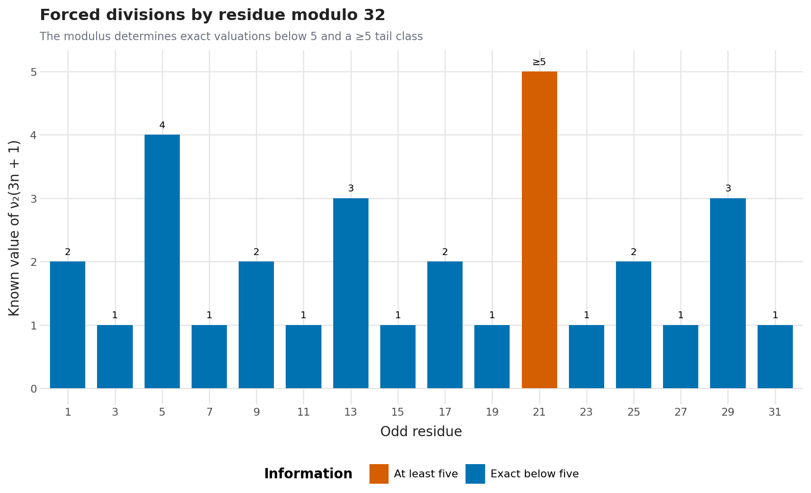

# Congruences and divisibility tools {#sec-congruences}

## Reading congruences {#sec-congruence-entry}

Chapter 1 used congruence symbols to label parity. Before manipulating them,
connect their meaning to the primer's quotient-and-remainder rule.

For a positive integer $d$ and an integer $a$, write $d\mid a$, read
“$d$ divides $a$,” when $a=dh$ for some integer $h$. That integer may be
negative or zero. For integers $a,r$ and a positive modulus $m$, write

$$
a\equiv r\pmod m
\quad\Longleftrightarrow\quad
m\mid(a-r)
\quad\Longleftrightarrow\quad
a=r+mq\text{ for an integer }q.
$$

Read $a\equiv r\pmod m$ as “$a$ is congruent to $r$ modulo $m$.”
The symbol expresses an exact integer relation, not an approximation.
This says that $a$ and $r$ have the same remainder on division by $m$.
Indeed, subtract their division formulas. Equal remainders leave a multiple
of $m$. Conversely, if the difference is a multiple of $m$, their remainders
differ by a multiple of $m$ strictly between $-m$ and $m$, hence by zero.

A **residue class** is the whole set
$r+m\mathbb Z=\{r+mq:q\text{ is an integer}\}$, where $\mathbb Z$ denotes
all integers. A **representative** is one member. The displayed $r$ need not
be the least remainder: $13\equiv9\pmod4$, and both have remainder 1.
For positive starts, retain only positive class members. Thus
$n\equiv1\pmod4$ with $n>1$ means $n=4q+1$ with $q\ge1$, the representation
used in the descent proof below.

Congruences may be added or multiplied by integers. For example,
$n=4q+1$ gives $3n+1=4(3q+1)$, an identity for the entire class.
Division requires care: $2q\equiv2\pmod6$ means $2q-2=6h$, hence
$q=1+3h$. Its conclusion is $q\equiv1\pmod3$; retaining modulus 6 would
discard valid possibilities.

Two positive integers are **coprime** when their only common positive
divisor is 1. The numbers 8 and 3 are coprime; 8 and 6 share the divisor 2.
The Chinese remainder theorem below gives its product-modulus conclusion
when the moduli are coprime.

For its example $n\equiv1\pmod8$, $n\equiv2\pmod3$, write $n=1+8q$.
Considering $q=0,1,2$ modulo 3 gives exactly $q\equiv2\pmod3$.
Thus $q=2+3t$ and $n=17+24t$. Conversely, every such integer has both
required remainders. This proves that the full intersection is 17 modulo 24;
for positive $n$, $t\ge0$. Checking 17 alone proves existence, not that
all solutions were found. The new certificate-audit exercise asks you to
check both directions when coprimality is absent. [the finite-horizon certificate article](44-presburger-certificates.md#sec-collatz-presburger-certificates) later uses this distinction in
elimination certificates.

## The arithmetic after an odd step

If $n$ is odd, then $3n+1$ is even. More is determined by the residue of $n$.
For example,

$$
n\equiv1\pmod4 \Longrightarrow 3n+1\equiv0\pmod4,
$$

whereas

$$
n\equiv3\pmod4 \Longrightarrow 3n+1\equiv2\pmod4.
$$

Thus an odd input congruent to 1 modulo 4 receives at least two divisions by two
before the next odd value, while one congruent to 3 modulo 4 receives exactly
one. The valuation $\nu_2(3n+1)$ packages this forced run.

For odd $n$, the possible values of $\nu_2(3n+1)$ begin at 1. Solving congruences
shows that exactly one odd residue class modulo $2^k$ satisfies
$\nu_2(3n+1)\ge k$. For instance, $n\equiv5\pmod8$ makes $3n+1$ divisible by 8.
This uniqueness is one source of the geometric distribution used in later
heuristics. It is an exact statement about a uniformly sampled residue class,
not yet a statement that successive valuations along one orbit are independent.

## Residue classes control finite prefixes

For the shortcut map $S$, the first $k$ branch choices depend only on
$n\bmod 2^k$. At each step, knowing one more binary digit resolves the next
parity after applying the appropriate affine branch. Consequently, every residue
class modulo $2^k$ has a fixed length-$k$ parity prefix.

This fact converts infinitely many starts into finitely many symbolic cases—but
only for a finite prefix. After $k$ steps, values in one residue class remain an
affine function of the class parameter, and their later behavior may differ.
[Figure 3.1](#fig-residue-behavior) summarizes the first compressed odd-step valuation for odd
residues modulo 32.

<figure id="fig-residue-behavior">


<figcaption>

Figure 3.1: First odd-step valuation information for odd residue classes modulo 32; the class 21 has valuation at least five, so the plotted cap is marked explicitly.

</figcaption>
</figure>

## A small descent calculation

Suppose $n=4q+1$ is odd. Then

$$
3n+1=12q+4=4(3q+1),
$$

so after the odd step and two divisions the orbit reaches $3q+1$. Since
$3q+1<4q+1=n$ for $q\ge1$, every $n\equiv1\pmod4$ with $n>1$ falls below its
start within three $C$-steps.

For $n=4q+3$, only one factor of two is forced:

$$
\frac{3n+1}{2}=6q+5>4q+3.
$$

No immediate descent follows. Splitting this class modulo a higher power of two
may reveal descending subcases, but typically leaves new resistant classes.
That expanding boundary is why a few pages of modular calculations do not become
an induction “by continuation.”

## The Chinese remainder theorem

Powers of two encode parity prefixes. Other moduli can encode restrictions such
as divisibility by 3 or possible inverse branches. When $a$ and $b$ are coprime,
the Chinese remainder theorem says that a pair of congruences modulo $a$ and
modulo $b$ specifies one class modulo $ab$. For example,

$$
n\equiv1\pmod8,\qquad n\equiv2\pmod3
$$

has one solution class modulo 24. Combining congruences is useful only if each
condition has a defined role. Multiplying moduli indiscriminately can make a
search larger without strengthening its logical certificate.

## Worked table modulo 8

For odd residues $r$ modulo 8:

| $r$ | $3r+1\pmod{24}$ | $\nu_2(3r+1)$ determined from the class | first odd-to-odd tendency |
|---:|---:|---:|:---|
| 1 | 4 | exactly 2 | multiplier near $3/4$ |
| 3 | 10 | exactly 1 | multiplier near $3/2$ |
| 5 | 16 | at least 3 | multiplier at most $3/8$ |
| 7 | 22 | exactly 1 | multiplier near $3/2$ |

The phrase “near” acknowledges the additive $+1$. For small numbers it matters;
for a heuristic at large scale it is often treated as a lower-order correction.
Rows with valuation 1 rise under $U$, but their next residue may force strong
descent. A one-step classification cannot decide the whole orbit.

## A valuation identity and its limits

Because $3$ is odd, $\nu_2(3n)=\nu_2(n)$. There is no comparably simple general
identity for $\nu_2(3n+1)$: valuation of a sum depends on cancellation. It is
unsafe to distribute $\nu_2$ over addition. The correct rules are

$$
\nu_2(ab)=\nu_2(a)+\nu_2(b)
$$

and, when the two valuations differ,

$$
\nu_2(a+b)=\min(\nu_2(a),\nu_2(b)).
$$

When they are equal, extra cancellation may raise the valuation. This elementary
detail invalidates many informal manipulations.

## Worked lifting proof: one residue gains the next factor of two

The uniqueness statement for a high valuation can be proved constructively one bit at a time. Modulo two, the equation that three times the input plus one is zero has the unique odd solution class. Suppose a class representative solves the equation modulo two to a positive integer exponent. Its two possible lifts to the next modulus are the same representative and that representative plus the old modulus. Multiplying their difference by three changes three times the input plus one by three times the old modulus.

After dividing by the old modulus, the two candidate values therefore differ by three, an odd number. Exactly one is even. Hence exactly one lift has the extra factor of two required at the next level. Induction gives one compatible odd class at every depth. This proves uniqueness and supplies a finite method for finding the class without claiming anything about unbounded orbit behavior.

For depths one through six the least odd representatives are one, one, five, five, twenty-one, twenty-one. At depth three, five is the root modulo eight. Its two lifts modulo sixteen are five and thirteen. Three times five plus one is sixteen, divisible by sixteen, while three times thirteen plus one is forty, divisible by eight but not sixteen. Thus five is the deeper root, and thirteen has exact valuation three. At the next step five and twenty-one are the two lifts modulo thirty-two, and twenty-one supplies the extra factor.

The finite counting consequence needs a sampling rule. Choose odd residues uniformly modulo two to the power $A+1$. There are $2^A$ possible odd residues. For each $a$ from one through $A$, exact valuation $a$ selects one odd class modulo $2^{a+1}$, containing $2^{A-a}$ sampled residues. Its probability is therefore $2^{-a}$. The remaining one class has valuation at least $A+1$, with probability $2^{-A}$. These probabilities sum to one by a finite geometric sum.

The last class must retain “at least.” Its stored low bits cannot determine the next unobserved factor. Nor does this one-step distribution prove independence of successive valuations along an arithmetic orbit. Both qualifications concern information not present in the finite residue experiment.

## Worked intersection: the noncoprime remainder theorem

For positive moduli $m,n$, let $g$ be their greatest common divisor. Congruences with target residues $a,b$ have a simultaneous solution exactly when $g$ divides their difference. Necessity follows because a solution differs from each target by a multiple of its modulus, so subtracting those differences gives a multiple of $g$.

For sufficiency, write the moduli as $gm'$ and $gn'$, where the reduced factors are coprime. Substitute a candidate $x=a+mt$. The remaining condition is that $m't$ equal $(b-a)/g$ modulo $n'$. Coprimality supplies an inverse for $m'$ modulo $n'$ by Bézout's identity, so this determines exactly one class of parameters modulo $n'$. Substitution gives exactly one class of original values modulo $mn/g$, the least common multiple. This argument includes the case where a reduced modulus is one: its congruence imposes no further restriction.

Apply it to an input congruent to five modulo eight and one modulo six. The target difference is divisible by the greatest common divisor two, so solutions exist. Write the input as five plus eight times a parameter. Requiring remainder one modulo six and cancelling the common factor two gives the parameter congruent to one modulo three. The full solution set is thirteen modulo twenty-four.

The proposed class thirteen modulo forty-eight is sound: every one of its members lies in the full solution class. It is incomplete: thirty-seven is a positive solution but not a member of the proposed class. Replacing the second target by two modulo six makes the difference odd, violating the common-divisor condition, so no solution exists. Merely multiplying the two moduli would mishandle both examples. A certificate must prove that every reported input works and that no legitimate input was lost.

## Worked prefix proof: preserve bits without fixing the endpoint

Suppose two positive starts agree modulo $2^k$. For $k=0$ their length-zero prefixes are both empty. For a positive depth, they have the same parity. Their shortcut outputs differ by half their original difference on the even branch and by three halves their difference on the odd branch. Either difference is divisible by $2^{k-1}$. Induction therefore gives agreement of the next $k-1$ parity symbols, and together with the first symbol proves agreement of the full length-$k$ prefix.

The proof uses the same branch at each comparison. It does not divide a congruence by two while keeping its old modulus. It also explains why one bit of guaranteed precision is consumed per shortcut transition. After the full prefix, the endpoint can still vary with the original class parameter.

For example, starts one and nine agree modulo eight. Their first three shortcut symbols are odd, even, odd. The respective traces are one, two, one, two and nine, fourteen, seven, eleven. Their endpoints two and eleven differ, and their next parities differ. The shared three-symbol prefix has not determined the fourth symbol. The affine formula for this prefix is nine times the start plus seven, divided by eight; increasing the start by eight increases its endpoint by nine.

This is the finite abstraction used by later parity-word arguments. It compresses infinitely many starts for a specified finite question while retaining the parameter where later behavior depends on it. A complete proof of convergence needs an additional argument after the stored prefix, such as a justified smaller tail or a further refinement. The bit-preservation theorem alone supplies neither.

## Pitfall clinic

A congruence argument certifies exactly the classes it covers. Checking a property
for each residue modulo 32 can prove a statement about the next five shortcut
branches if the property is prefix-local. It cannot prove convergence unless the
end of every case enters an already justified smaller region. Likewise, observing
that most classes descend does not dispose of the remaining class: a minimal
counterexample, if one exists, must live precisely in uncovered classes at every
stage.

<!-- inline-formula-code:start -->
## Formula and finite computation

For a positive odd integer $n$, the definition of $U$ gives

$$
3n+1=2^{\nu_2(3n+1)}U(n).
$$

The accelerated step returns both the removed exponent and next odd state. The following standalone Python block expresses that finite rule with its inputs and stopping conditions visible.

```python
def two_adic_valuation(integer: int) -> int:
    """Return v_2(integer) for a positive integer."""
    if integer <= 0:
        raise ValueError("integer must be positive")
    exponent = 0
    while integer % 2 == 0:
        integer //= 2
        exponent += 1
    return exponent

def odd_shortcut(odd_number: int) -> tuple[int, int]:
    """Return the next odd value and v_2(3n+1)."""
    if odd_number <= 0 or odd_number % 2 == 0:
        raise ValueError("input must be a positive odd integer")
    expanded = 3 * odd_number + 1
    exponent = two_adic_valuation(expanded)
    return expanded // (2**exponent), exponent

for odd_number in (1, 3, 5, 7, 9, 27):
    print(odd_number, odd_shortcut(odd_number))
```

**What the computation establishes.** The calculation checks a declared finite instance; the surrounding argument explains what is true beyond those inputs.
<!-- inline-formula-code:end -->

## Chapter summary

Residues modulo powers of two encode finite parity behavior, and valuations count
forced divisions. They produce genuine descent lemmas and finite sieves. Their
power is also their boundary: finite prefix knowledge is not automatic control of
an infinite orbit.

## Exercises

<div class="exercise" id="collatz-congruences-valuation-sixteen">
<p class="exercise-title"><strong>Exercise 1</strong></p>

Determine $\nu_2(3n+1)$ for each odd residue modulo 16, using “at least” when the modulus cannot determine the exact value.

<details class="hint"><summary>Hint 1</summary>

Compute three r plus one and check whether later lifts can change the last known factor.

</details>

<details class="hint"><summary>Hint 2</summary>

Only the root class modulo sixteen has unresolved valuation above the stored precision.

</details>

<details class="solution"><summary>Solution</summary>

For residues $1,3,5,7,9,11,13,15$, the valuations are respectively two, one, at least four, one, two, one, three, one. Adding sixteen to a representative adds forty-eight to three times it plus one. Where the shown valuation is below four, this preserves its odd remaining quotient. At residue five, the expression is sixteen times an integer whose parity can change with the lift, so only the lower bound is determined.

</details>

</div>

<div class="exercise" id="collatz-congruences-descent-one-four">
<p class="exercise-title"><strong>Exercise 2</strong></p>

Prove that every $n\equiv1\pmod4$, $n>1$, falls below its start.

<details class="hint"><summary>Hint 1</summary>

Use the nonnegative parameter for this class.

</details>

<details class="hint"><summary>Hint 2</summary>

Count one odd transition followed by two legal halvings.

</details>

<details class="solution"><summary>Solution</summary>

Write $n=4q+1$ with $q\ge1$. The three successive standard values are $12q+4$, $6q+2$, and $3q+1$. Both halvings are legal because their inputs are even. The third value is smaller by q, which is positive. This proves finite descent for the whole specified class. It leaves inputs congruent to three modulo four for further work and does not by itself prove universal convergence.

</details>

</div>

<div class="exercise" id="collatz-congruences-root-classes">
<p class="exercise-title"><strong>Exercise 3</strong></p>

Find the single odd residue modulo $2^k$ for which $2^k\mid3n+1$, for $k=1,\ldots,6$.

<details class="hint"><summary>Hint 1</summary>

At each depth compare the two lifts of the previous root.

</details>

<details class="hint"><summary>Hint 2</summary>

The two divided residuals differ by three and have opposite parity.

</details>

<details class="solution"><summary>Solution</summary>

The least residues are one modulo two, one modulo four, five modulo eight, five modulo sixteen, twenty-one modulo thirty-two, and twenty-one modulo sixty-four. Each satisfies the required divisibility. The two-lift argument proves uniqueness at each stage, not merely existence of these examples. A root modulo the final modulus gives a valuation lower bound; it does not determine the exact number of factors beyond that depth.

</details>

</div>

<div class="exercise" id="collatz-congruences-coprime-intersection">
<p class="exercise-title"><strong>Exercise 4</strong></p>

Solve $n\equiv5\pmod8$ and $n\equiv1\pmod3$ as one congruence modulo 24.

<details class="hint"><summary>Hint 1</summary>

Substitute n equals five plus eight q.

</details>

<details class="hint"><summary>Hint 2</summary>

Solve the remaining parameter congruence modulo three.

</details>

<details class="solution"><summary>Solution</summary>

Substitution gives $2+2q\equiv1\pmod3$, so $q\equiv1\pmod3$. Write $q=1+3t$ to obtain $n=13+24t$. Conversely this expression has the required residues modulo eight and three, proving both directions. For positive inputs, t is nonnegative. Checking thirteen alone would give one witness but not prove that the entire intersection was found.

</details>

</div>

<div class="exercise" id="collatz-congruences-sum-counterexample">
<p class="exercise-title"><strong>Exercise 5</strong></p>

Give a counterexample to the false identity $\nu_2(a+b)=\nu_2(a)+\nu_2(b)$.

<details class="hint"><summary>Hint 1</summary>

Use two nonzero odd inputs with nonzero sum.

</details>

<details class="hint"><summary>Hint 2</summary>

Their individual valuations are zero.

</details>

<details class="solution"><summary>Solution</summary>

Take one and three. Both have valuation zero, while their sum four has valuation two. Thus the asserted additive formula would give zero and is false. Multiplication does have an additive valuation law, because powers of two factor multiplicatively. A sum depends on the odd residual factors and their cancellation. Taking opposite inputs would additionally produce zero, whose finite valuation was not defined in this chapter.

</details>

</div>

<div class="exercise" id="collatz-congruences-prefix-constant">
<p class="exercise-title"><strong>Exercise 6</strong></p>

Prove that a length-$k$ parity prefix under $S$ is constant on residue classes modulo $2^k$.

<details class="hint"><summary>Hint 1</summary>

Prove the statement by induction on the depth.

</details>

<details class="hint"><summary>Hint 2</summary>

Same-parity shortcut outputs agree modulo one lower power of two.

</details>

<details class="solution"><summary>Solution</summary>

At depth zero the prefix is empty. At positive depth, congruent starts have the same parity. Their shortcut-output difference is either half or three halves of the original difference, hence divisible by $2^{k-1}$. Apply induction to their outputs for the remaining symbols and prepend the equal first parity. The argument fixes only a finite prefix; the endpoints can differ and the next symbol need not agree, as the starts one and nine illustrate.

</details>

</div>

<div class="exercise" id="collatz-congruences-noncoprime-audit">
<p class="exercise-title"><strong>Exercise 7</strong></p>

For positive integers, audit the replacement of $n\equiv5\pmod8$ and $n\equiv1\pmod6$ by $n\equiv13\pmod{48}$. Prove soundness and completeness separately, find the least missed positive input, and compare the second target $n\equiv2\pmod6$.

<details class="hint"><summary>Hint 1</summary>

Cancel the common factor only while changing the modulus.

</details>

<details class="hint"><summary>Hint 2</summary>

The parity condition alone rules out the altered target.

</details>

<details class="solution"><summary>Solution</summary>

The first intersection is $n=13+24t$ for integer t, as the parameter substitution proves. Every member of thirteen modulo forty-eight is therefore a valid solution, so the replacement is sound. It omits the other lift modulo forty-eight, beginning at thirty-seven, so it is incomplete and that is its least missed positive solution. With target two modulo six, the input would be even while five modulo eight is odd, impossible. The moduli have greatest common divisor two, so the coprime product-modulus conclusion applies to neither case. The original [combined appendix solution](c-solutions.md#sec-congruence-certificate-solution) remains available.

</details>

</div>

<div class="exercise" id="collatz-congruences-cancellation">
<p class="exercise-title"><strong>Exercise 8</strong></p>

Solve $2q\equiv2\pmod6$. Explain why keeping modulus six after cancelling two loses solutions.

<details class="hint"><summary>Hint 1</summary>

Translate the congruence to an integer equation.

</details>

<details class="hint"><summary>Hint 2</summary>

The common factor also divides the modulus.

</details>

<details class="solution"><summary>Solution</summary>

The equation is $2q-2=6h$, so $q=1+3h$. The solution class is one modulo three. It includes q equal to four, which is not one modulo six, so retaining modulus six would omit a legitimate solution. Cancellation of a nonunit changes the modulus by its common divisor when the divisibility conditions permit it. This is exactly the completeness issue that a certificate must inspect.

</details>

</div>

<div class="exercise" id="collatz-congruences-finite-valuation-law">
<p class="exercise-title"><strong>Exercise 9</strong></p>

Choose odd residues uniformly modulo sixteen. Give the probabilities of exact valuations one, two, three, and at least four for three times the residue plus one.

<details class="hint"><summary>Hint 1</summary>

There are eight equally likely odd residues.

</details>

<details class="hint"><summary>Hint 2</summary>

Use the complete table rather than interpreting the last lower bound as an exact value.

</details>

<details class="solution"><summary>Solution</summary>

Four residues have exact valuation one, two have exact valuation two, one has exact valuation three, and one has valuation at least four. The probabilities are one half, one quarter, one eighth and one eighth. They sum to one. The final class cannot be assigned exact valuation four from these stored bits. This is a finite sampling law at the first odd step, not a proof that successive valuations on one orbit are independent.

</details>

</div>

<div class="exercise" id="collatz-congruences-valuation-sum-law">
<p class="exercise-title"><strong>Exercise 10</strong></p>

Prove that if nonzero integers a and b have different finite two-adic valuations, then the valuation of their sum is the smaller one. State the zero boundary.

<details class="hint"><summary>Hint 1</summary>

Factor out the lower power of two.

</details>

<details class="hint"><summary>Hint 2</summary>

An odd integer plus an even integer remains odd.

</details>

<details class="solution"><summary>Solution</summary>

Write $a=2^r u$ and $b=2^s v$ with odd u and v, and assume $r<s$. Their sum is $2^r(u+2^{s-r}v)$. The parenthesised integer is odd, so the valuation is exactly r; in particular the sum is nonzero. If the two valuations agree, the residual sum is even and may have more factors or be zero. At zero a finite exponent is undefined under the chapter convention, so no displayed finite-valued identity should be applied to it.

</details>

</div>
