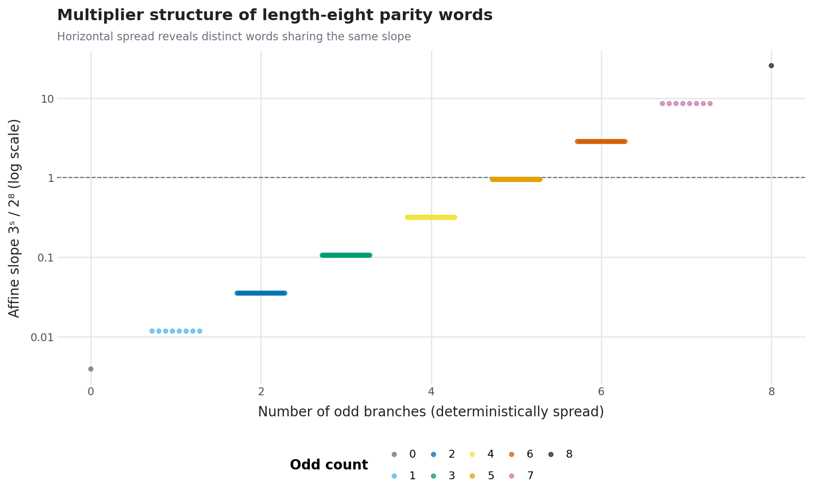

# Parity vectors and affine formulas {#sec-parity}

## Encoding a finite segment

The shortcut map has a convenient branch formula. If
$\varepsilon_j\in\{0,1\}$ records the parity of $S^j(n)$, then

$$
S^{j+1}(n)=\frac{3^{\varepsilon_j}S^j(n)+\varepsilon_j}{2}.
$$

The length-$k$ **parity vector** is
$(\varepsilon_0,\ldots,\varepsilon_{k-1})$. Let
$s_j=\varepsilon_0+\cdots+\varepsilon_{j-1}$, with $s_0=0$. Repeated
substitution gives the exact affine formula

$$
S^k(n)=\frac{3^{s_k}n+A(\boldsymbol\varepsilon)}{2^k},
$$

where

$$
A(\boldsymbol\varepsilon)=
\sum_{j=0}^{k-1}\varepsilon_j\,3^{s_k-s_{j+1}}2^j.
$$

The first term is multiplicative and the second records where the $+1$ terms
entered. Dropping $A$ may be informative for large-scale heuristics but destroys
an exact proof.

## Derivation by induction

For $k=1$ the formula is exactly the branch rule. Suppose it holds for $k$.
Then

$$
S^{k+1}(n)
=\frac{3^{\varepsilon_k}}2
\frac{3^{s_k}n+A_k}{2^k}+\frac{\varepsilon_k}{2}
=\frac{3^{s_{k+1}}n+3^{\varepsilon_k}A_k+\varepsilon_k2^k}{2^{k+1}}.
$$

The updated additive term is the stated sum for $k+1$. This proof also explains
why early $+1$ contributions acquire later factors of 3 while late contributions
acquire larger powers of 2.

As a worked example, take the formal parity word $(1,0,1)$. Here $s_3=2$ and

$$
A=1\cdot3^{1}2^0+0+1\cdot3^0 2^2=7,
$$

so

$$
S^3(n)=\frac{9n+7}{8}.
$$

For $n=3$, the shortcut orbit begins $3\to5\to8\to4$, whose parity word is
indeed $(1,1,0)$, not $(1,0,1)$. The algebraic expression for a formal word does
not make that word admissible for every starting value.

The affine numerator can be assembled from a finite bit word before any start
is chosen. Returning the multiplier, additive term, and denominator separately
keeps the part usually discarded by a drift heuristic visible.

```python
def shortcut_affine_coefficients(parity_bits: list[int]) -> tuple[int, int, int]:
    """Return multiplier, additive term, denominator for a finite shortcut word."""
    if any(bit not in (0, 1) for bit in parity_bits):
        raise ValueError("every parity entry must be zero or one")
    total_odd = sum(parity_bits)
    prefix_odd = 0
    additive = 0
    for position, bit in enumerate(parity_bits):
        prefix_odd += bit
        additive += bit * 3 ** (total_odd - prefix_odd) * 2**position
    return 3**total_odd, additive, 2 ** len(parity_bits)

multiplier, additive, denominator = shortcut_affine_coefficients([1, 0, 1])
if (multiplier, additive, denominator) != (9, 7, 8):
    raise RuntimeError("the affine word coefficients were assembled incorrectly")
print(multiplier, additive, denominator)
```

The output reconstructs $(9n+7)/8$ for the formal word `101`. It does not
claim that the word is admissible for a supplied integer; the next section's
congruence conditions perform that separate check.

## Admissibility and residue classes

A formal bit string is **admissible for $n$** when the parity of each intermediate
integer agrees with the corresponding bit. The integrality conditions determine
exactly one starting residue class modulo $2^k$. One can reconstruct it backwards:
require the numerator at each stage to have the parity needed for the next
division. Equivalently, evaluate the map symbolically and solve the resulting
congruence.

For the word $(1,0,1)$, the first bit requires $n$ odd. The second requires
$(3n+1)/2$ even, hence $3n+1\equiv0\pmod4$, giving $n\equiv1\pmod4$. The third
requires $(3n+1)/4$ odd, which yields $n\equiv1\pmod8$. Thus 1, 9, 17, and so on
begin with that word. Indeed $1\to2\to1\to2$ under $S$ has parities $(1,0,1)$.

[Figure 4.1](#fig-parity-structure) groups all length-eight words by their number of odd
branches. The vertical value $3^s/2^8$ is the affine slope. Words on the same
horizontal level can have different additive terms and different residue
classes, so the plot deliberately does not collapse a word to its odd-count.

<figure id="fig-parity-structure">


<figcaption>

Figure 4.1: Multiplicative slopes of all length-eight parity words, grouped by the number of odd branches. Point multiplicity records distinct words with the same slope.

</figcaption>
</figure>

## Descent from the affine slope

If a residue class has a fixed length-$k$ word, then

$$
S^k(n)-n=\left(\frac{3^{s_k}}{2^k}-1\right)n
+\frac{A}{2^k}.
$$

When $3^{s_k}<2^k$, the slope is less than one. For sufficiently large members
of the class, the negative linear term dominates $A/2^k$, giving descent. Any
small exceptions can be checked separately. When $3^{s_k}\ge2^k$, the formula
does not imply divergence; a later prefix may contain enough even steps to
descend.

The threshold $s_k/k<\log 2/\log 3\approx0.6309$ makes the multiplicative slope
less than one. A coin-flip model expects $s_k/k$ near $1/2$, motivating negative
average drift. That is a heuristic bridge, not a theorem that every genuine
orbit has the required parity frequency.

## Parity vectors as coordinates

The first $k$ parity bits and the residue $n\bmod2^k$ contain equivalent
information: each residue gives one word, and every word gives one residue. This
is sometimes called parity-vector conjugacy on the 2-adic integers. For ordinary
positive integers it remains a powerful finite-prefix coordinate system.
However, an arbitrary infinite bit sequence may correspond naturally to a 2-adic
integer rather than to a positive integer. Moving between those spaces without
stating the domain is a common source of false conclusions.

The [parity-language article](40-analytic-combinatorics.md#sec-collatz-analytic-combinatorics) later counts constrained families of
these finite words with generating functions. The [entropy article](41-entropy-information.md#sec-collatz-entropy-information) measures exactly what is lost when a word is
replaced by its odd count.

## Worked complete table: all two-symbol words

At depth two there are four possible starting residues and four binary words. If the start is divisible by four, two even branches give the word `00` and endpoint one quarter of the start. If the start is two modulo four, the first halving leaves an odd input, giving `01`; the endpoint is three times the start plus two, divided by four. If the start is one modulo four, the first odd shortcut leaves an even input, giving `10`; the endpoint is three times the start plus one, divided by four. Finally, a start three modulo four gives two odd branches, word `11`, and endpoint nine times the start plus five, divided by four.

Every class has been accounted for and every branch condition checked. For each word the endpoint formula applies to all positive members of its class, not every positive integer. Substituting a start from a different class can produce an integer accidentally without making the chosen intermediate branch sequence correct. The row is a conditional formula whose premise is admissibility.

The general bijection follows by extending this reasoning one bit at a time. Assume each length-$k$ word belongs to exactly one class modulo $2^k$. That class has two lifts at the next depth. Starts differing by $2^k$ have identical first $k$ branches, and their endpoints differ by $3^s$, where $s$ counts the odd branches. This difference is odd. Their next parities are therefore opposite, so exactly one lift extends the word by zero and the other extends it by one. Induction from the empty word establishes both existence and uniqueness for every finite binary word.

This proof shows why equal numbers of residues and words alone would not suffice. Two finite sets of the same size can be related nonbijectively. The lifting argument establishes that every extension occurs exactly once, supplying the missing injectivity and surjectivity rather than relying on counting notation.

## Worked threshold: the subunit slope still has an exception

The two-symbol word `10` is realised by positive starts congruent to one modulo four. Its endpoint is three times the start plus one, divided by four. Subtract the original start: the difference is one minus the start, divided by four. Strict descent therefore occurs exactly when the start exceeds one. The least positive class member one gives equality, while every other positive member, beginning at five, descends.

A slope below one has not failed here. It gives a negative coefficient on the start, but the positive additive term can offset that decrease at a small input. Solving the full inequality identifies the exception exactly. For a general admissible word with multiplier numerator p, offset A and denominator D, descent requires the start times D minus p to exceed A. If D exceeds p, divide by the positive difference and then use an integer threshold. The least permitted integer is the floor of A divided by that difference, plus one. Intersect that threshold with the word's residue class.

For word `100`, the slope numerator is three, denominator eight and offset one. Descent requires five times the start to exceed one, true for every positive integer. Its admissible class begins at five modulo eight, so every positive member of that class descends. The statement's domain is still the compatible class; the inequality cannot turn an inadmissible branch word into the actual orbit of another start.

This exact calculation explains why a floating approximation to the slope is insufficient as a certificate. The offset and strict boundary matter, and equality must not be rounded into descent. Keeping all integer coefficients permits a direct inequality check without using logarithms. The logarithmic odd-frequency threshold remains a useful way to interpret slopes, but it does not replace the integer comparison.

## Worked infinite-word boundary: every finite prefix can occur

Consider the formal word consisting entirely of ones. After $k$ odd shortcut branches, induction on the affine recurrence gives offset $3^k-2^k$. The endpoint formula becomes $3^k(n+1)/2^k-1$. Its compatible starting class is negative one modulo $2^k$. Each finite depth therefore has positive representatives, such as $2^k-1$.

There is nevertheless no positive ordinary integer with this infinite all-one itinerary. If a fixed integer belonged to the compatible class at every depth, its successor would be divisible by every power of two. A nonzero ordinary integer cannot have that property: choose a power of two larger than its absolute value, and it cannot be a nonzero multiple of that power. Hence the fixed integer would have to be negative one, outside the positive domain. Negative one really is a fixed point of the extended shortcut rule and has the all-one itinerary.

The finite classes are nested and individually nonempty among positive integers, while their positive-integer intersection is empty. This is an exact counterexample to inferring an ordinary positive start solely from a compatible path through all finite residue levels. The 2-adic completion supplies a point for that path, but it changes the state space. The article on that extension explains the topology and the positive-integer boundary.

Conversely, this example does not show that every other infinite symbolic path is harmless or that every surviving sieve boundary is empty. It identifies one specific path and proves its missing positive realisation. A general convergence argument would need a theorem handling all relevant paths with their arithmetic constraints. The finite coding bijection remains powerful precisely because its scope is explicit.

## Pitfall clinic

Three errors deserve names. **Multiplier-only reasoning** drops the additive term
inside an exact argument. **Formal-word reasoning** assumes any convenient bit
string is realized by the integer under discussion. **Frequency transfer** uses
the average over all residue classes as if it controlled every single infinite
orbit. Each can support a heuristic; none is a proof without an additional
uniform argument.

<!-- inline-formula-code:start -->
## Formula and finite computation

A useful formula in this chapter is

$$
w_k(n)=\bigl(S^j(n)\bmod2\bigr)_{j=0}^{k-1}
$$

The string is a direct finite encoding of the parity vector. The following standalone Python block expresses that finite rule with its inputs and stopping conditions visible.

```python
def shortcut_parity_word(start: int, length: int) -> str:
    """Return pre-step parity bits for the one-division shortcut map."""
    if start <= 0 or length < 0:
        raise ValueError("start must be positive and length nonnegative")
    value = start
    bits: list[str] = []
    for _ in range(length):
        bits.append(str(value % 2))
        value = value // 2 if value % 2 == 0 else (3 * value + 1) // 2
    return "".join(bits)

print(shortcut_parity_word(1, 3), shortcut_parity_word(5, 3))
print(shortcut_parity_word(27, 12))
```

**What the computation establishes.** The calculation checks a declared finite instance; the surrounding argument explains what is true beyond those inputs.
<!-- inline-formula-code:end -->

## Chapter summary

A finite parity word turns a Collatz segment into an affine map with slope
$3^s/2^k$. Its admissibility is exactly a residue condition modulo $2^k$.
The representation powers finite sieves and probabilistic models, while the
additive term, domain, and exceptional words mark the limits of those tools.

## Exercises

<div class="exercise" id="collatz-parity-two-formulas">
<p class="exercise-title"><strong>Exercise 1</strong></p>

Derive the affine formulas for the words $(0,1,1)$ and $(1,1,0)$.

<details class="hint"><summary>Hint 1</summary>

Compose each branch in the stated chronological order.

</details>

<details class="hint"><summary>Hint 2</summary>

Later odd branches multiply earlier additive constants by three.

</details>

<details class="solution"><summary>Solution</summary>

For `011`, first halve, then apply two odd shortcuts, obtaining $(9n+10)/8$. For `110`, two odd shortcuts give $(9n+5)/4$, and a final halving gives $(9n+5)/8$. Both have two odd branches and multiplier nine eighths, but offsets ten and five differ. Each expression is conditional on its complete parity word, so its admissibility must be established separately.

</details>

</div>

<div class="exercise" id="collatz-parity-two-residues">
<p class="exercise-title"><strong>Exercise 2</strong></p>

Find the residue modulo eight realising each word in the preceding exercise.

<details class="hint"><summary>Hint 1</summary>

Check the parity of every intermediate input.

</details>

<details class="hint"><summary>Hint 2</summary>

The second or third condition can require an additional low bit.

</details>

<details class="solution"><summary>Solution</summary>

For `011`, the first input is even and its half odd, so n is two modulo four. Requiring the next shortcut output odd refines this to six modulo eight. For `110`, the first two inputs are odd, giving n three modulo four; requiring the second odd shortcut output even refines it to three modulo eight. Direct traces from six and three verify examples, while the congruence derivations establish the entire classes.

</details>

</div>

<div class="exercise" id="collatz-parity-affine-induction">
<p class="exercise-title"><strong>Exercise 3</strong></p>

Verify the general affine formula by induction, including the exponent of three in every additive summand.

<details class="hint"><summary>Hint 1</summary>

Track the offset recurrence when appending one symbol.

</details>

<details class="hint"><summary>Hint 2</summary>

An old contribution acquires a factor of three exactly when the new symbol is odd.

</details>

<details class="solution"><summary>Solution</summary>

The empty word has multiplier one, offset zero and denominator one. Appending a symbol e multiplies the old numerator by $3^e$ and adds $e2^k$, then doubles the denominator. Each old summand therefore gains exponent e on three, exactly the increase in the final odd count. The new summand has no later odd branch, hence exponent zero on three and power $2^k$. This is the displayed sum with its updated prefix counts, proving the formula at the next depth.

</details>

</div>

<div class="exercise" id="collatz-parity-length-ten-slopes">
<p class="exercise-title"><strong>Exercise 4</strong></p>

For $k=10$, list the values of $s$ for which $3^s/2^{10}<1$.

<details class="hint"><summary>Hint 1</summary>

Compare exact integer powers near the threshold.

</details>

<details class="hint"><summary>Hint 2</summary>

Three to the sixth is below one thousand twenty-four, and three to the seventh above it.

</details>

<details class="solution"><summary>Solution</summary>

The allowed odd counts are zero through six. Indeed $3^6=729<1024=2^{10}$ while $3^7=2187>1024$, and powers of three increase strictly with s. Thus all smaller nonnegative counts pass and all larger counts fail. This classifies slopes for words of that length; the offset, admissible residue and any small threshold exceptions still determine exact descent.

</details>

</div>

<div class="exercise" id="collatz-parity-threshold-exception">
<p class="exercise-title"><strong>Exercise 5</strong></p>

Explain why a slope below one proves descent at the word endpoint for all sufficiently large members of its class but can leave small exceptions.

<details class="hint"><summary>Hint 1</summary>

Subtract the start from the full affine expression.

</details>

<details class="hint"><summary>Hint 2</summary>

Retain the offset when solving the strict inequality.

</details>

<details class="solution"><summary>Solution</summary>

With numerator p n plus A and denominator D, the difference is $((p-D)n+A)/D$. If p is below D, the negative linear term eventually dominates the fixed nonnegative offset. Descent is exactly $(D-p)n>A$. Small compatible n may fail; word `10` has p three, D four and A one, so the class member one gives equality while every larger member descends. The calculation concerns this finite endpoint and is not a general divergence conclusion for words with larger slope.

</details>

</div>

<div class="exercise" id="collatz-parity-bijection">
<p class="exercise-title"><strong>Exercise 6</strong></p>

Prove that residues modulo $2^k$ correspond bijectively to length-$k$ shortcut parity words.

<details class="hint"><summary>Hint 1</summary>

Extend a word by one bit using the two lifts of its residue.

</details>

<details class="hint"><summary>Hint 2</summary>

The two endpoints differ by an odd power of three.

</details>

<details class="solution"><summary>Solution</summary>

The empty word has one class modulo one. Given a unique class for a length-k word, its two lifts modulo $2^{k+1}$ share that prefix. Their endpoints differ by $3^s$, odd, so exactly one has each next parity. Each extended word therefore has exactly one lifted class. Induction proves every word occurs uniquely. The argument establishes both directions of the correspondence, rather than assuming that equal finite set sizes imply a bijection.

</details>

</div>

<div class="exercise" id="collatz-parity-all-ones">
<p class="exercise-title"><strong>Exercise 7</strong></p>

Derive the offset for k consecutive ones and prove that no positive integer realises the all-one infinite itinerary.

<details class="hint"><summary>Hint 1</summary>

Use the offset recurrence starting at zero.

</details>

<details class="hint"><summary>Hint 2</summary>

Every compatible start is negative one modulo the relevant power of two.

</details>

<details class="solution"><summary>Solution</summary>

The recurrence is $A_{k+1}=3A_k+2^k$, and $A_k=3^k-2^k$ satisfies it with the empty value zero. The endpoint is $3^k(n+1)/2^k-1$, and compatibility requires $2^k$ to divide n plus one. If that held at every k, the ordinary integer n plus one would be zero, since every nonzero integer has finite valuation. The only integer possibility is negative one, outside the positive domain. Every finite word still has positive representatives.

</details>

</div>

<div class="exercise" id="collatz-parity-lift-endpoints">
<p class="exercise-title"><strong>Exercise 8</strong></p>

Starts one and nine share a three-bit prefix. Give both traces and explain exactly where their branch information first differs.

<details class="hint"><summary>Hint 1</summary>

Use the word `101`.

</details>

<details class="hint"><summary>Hint 2</summary>

Its endpoint difference is nine when the start difference is eight.

</details>

<details class="solution"><summary>Solution</summary>

The traces through three transitions are one, two, one, two and nine, fourteen, seven, eleven. Their pre-transition parities are odd, even, odd in both cases. The endpoints two and eleven have opposite parity, so the fourth symbol differs. The finite prefix is constant on the residue class, but the endpoint and its next branch are not determined by that prefix alone. This illustrates the precision consumed by each shortcut update.

</details>

</div>

<div class="exercise" id="collatz-parity-concatenation">
<p class="exercise-title"><strong>Exercise 9</strong></p>

A length-k word has row $(pn+A)/2^k$ and a following length-l word has row $(qx+B)/2^l$. Derive the combined row and state its premise.

<details class="hint"><summary>Hint 1</summary>

Substitute the first endpoint for x in the second row.

</details>

<details class="hint"><summary>Hint 2</summary>

Both word conditions must hold along the same actual segment.

</details>

<details class="solution"><summary>Solution</summary>

The combined expression is $(qp n+qA+2^kB)/2^{k+l}$. The second offset is multiplied by $2^k$ to put both terms over the common denominator, while its multiplier q acts on the first offset. The formula describes an actual orbit only for starts realising the first word whose endpoint realises the second. Formal algebra alone does not establish that premise. For `10` followed by `0`, the row becomes $(3n+1)/8$ on the compatible `100` class.

</details>

</div>

<div class="exercise" id="collatz-parity-summary-loss">
<p class="exercise-title"><strong>Exercise 10</strong></p>

What information is lost by storing only the length and odd count of a parity word? Give an exact pair showing the loss.

<details class="hint"><summary>Hint 1</summary>

Compare words with the same branch counts in different orders.

</details>

<details class="hint"><summary>Hint 2</summary>

The locations of additions determine the offset.

</details>

<details class="solution"><summary>Solution</summary>

Words `110` and `101` have length three and two odd symbols, so both have slope nine eighths. Their offsets are five and seven, and their residue classes are three and one modulo eight respectively. The summary loses both ordering-dependent affine information and admissibility detail. An odd-count distribution can be a correct finite statistic while remaining insufficient to reconstruct exact endpoints or prove an infinite orbit claim.

</details>

</div>
