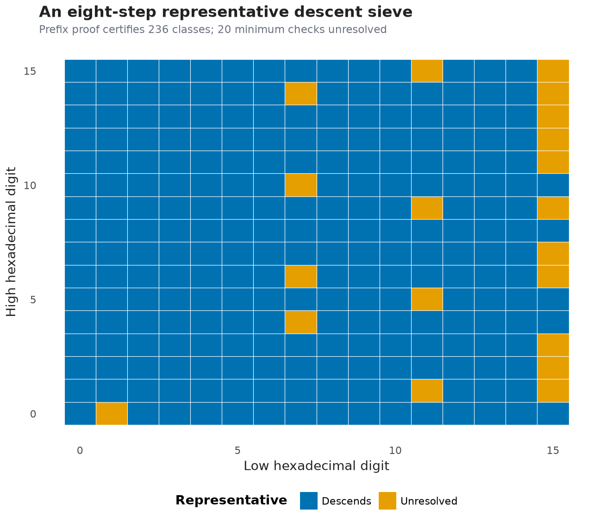

# Stopping-time sieves {#sec-sieves}

## A reusable descent certificate

Strong induction from [sec-problem](01-problem.md#sec-problem) gives a practical target: show that every
$n>1$ eventually reaches a value below $n$. A **stopping-time sieve** groups
starts by residue class, follows their shared symbolic prefix, and certifies a
class when an affine iterate lies below its start for every relevant member.

Suppose a class $n\equiv r\pmod{2^k}$ shares a length-$j$ shortcut word, where
$j\le k$. Its iterate is

$$
S^j(n)=an+b,\qquad a=\frac{3^s}{2^j},\quad b=\frac{A}{2^j}.
$$

If $a<1$ and the smallest positive member $n_0$ of the class satisfies
$an_0+b<n_0$, then every larger member $n_0+t2^k$ also descends, because

$$
S^j(n)-n=(a-1)n+b
$$

decreases as $n$ increases. This is an infinite certificate produced by a finite
calculation. It is stronger than testing one representative numerically.

## A small worked sieve

Odd numbers congruent to 1 modulo 4 descend after one odd step and two divisions,
as shown in [sec-congruences](03-congruences.md#sec-congruences). This covers one half of the odd integers. For a
class such as $n\equiv3\pmod4$, refine modulo 8 or 16 and derive a longer affine
prefix. Even starts descend in one step. The algorithm repeats:

```text
queue <- residue classes not yet certified
while queue is not empty and depth < chosen_limit:
    class <- remove one class
    derive one more parity branch
    if a uniform iterate is below the start:
        record a certificate
    else:
        split the class into its two lifts modulo the next power of 2
```

The stopping condition matters. A finite-depth run can return “covered” or
“unresolved”; it cannot return “conjecture false” merely because a class survives
the chosen depth. Likewise, a pattern of rapidly shrinking uncovered fractions
is informative experimental structure, not a proof that the limiting intersection
is empty.

[Figure 5.1](#fig-sieve-coverage) checks the least positive member of each class modulo
$256=2^8$ for descent within eight shortcut steps. The next clinic proves why
each successful check in this particular experiment certifies its whole positive
class.

<figure id="fig-sieve-coverage">


<figcaption>

Figure 5.1: Descent within eight shortcut steps modulo 256. The 236 dark classes are uniformly certified by the least-member check and shared-prefix proof; the 20 light classes are unresolved by this rule.

</figcaption>
</figure>

## When a representative becomes a certificate {#sec-sieve-representative-certificate}

The warning about representative checks has a useful positive case. Fix integers
$k\ge1$ and $0\le r<2^k$. Let $n_0$ be the least positive member of the class:
$n_0=r$ when $r>0$, and $n_0=2^k$ when $r=0$. Its positive members are exactly
$n=n_0+2^kt$, with integer $t\ge0$.

Suppose the check finds $S^j(n_0)<n_0$ for some $1\le j\le k$. The $k$ known
input bits fix the first $j$ actual shortcut branches, so [sec-parity](04-parity.md#sec-parity) gives

$$
S^j(n)=\frac{pn+A}{2^j},
\qquad p=3^s>0,\quad A\ge0
$$

throughout the class. The successful check says
$(2^j-p)n_0>A\ge0$. Because $n_0>0$, this forces $p<2^j$; a separate slope
assumption is unnecessary here. Substituting every positive class member gives

$$
n-S^j(n)
=\bigl(n_0-S^j(n_0)\bigr)
 +(2^j-p)2^{k-j}t>0.
$$

The least positive member matters: checking a larger member would leave smaller
positive members uncovered. The shared prefix is guaranteed only through the
known input depth.

The first term is strictly positive and the increment is nonnegative. Thus every
positive lift descends at the same witness time $j$. The computation supplies
the checked inputs; this argument supplies the assertion for every $t$. Section
2.1 of the 2026 preprint ([Angeltveit 2026](d-bibliography.md#ref-angel2026)) uses this elementary descent-sieve mechanism,
with its $T$ denoting our $S$.

For the pictured class $39\pmod{256}$, the actual shortcut trace is

$$
\begin{aligned}
39&\to59\to89\to134\to67\\
  &\to101\to152\to76\to38.
\end{aligned}
$$

Its word is `11101100`, and the complete affine row is
$S^8(n)=(243n+251)/256$. Therefore, for every integer $t\ge0$,

$$
\begin{aligned}
S^8(39+256t)&=38+243t,\\
(39+256t)-S^8(39+256t)&=1+13t>0.
\end{aligned}
$$

The additive term 251 is essential to this exact certificate. Checking several
lifts could suggest the formula, but would not prove the assertion for every
lift.

The companion below finds 236 successful classes. Each complete block of 256
consecutive positive integers contains 236 members of their disjoint periodic union.
A final incomplete block has fewer than 256 places, so the limiting proportion,
called the **natural density**, is $236/256=59/64$. This is a certified subset of starts descending by
eight steps, not necessarily all such starts and not a convergence theorem.

A light cell means this least-member rule did not certify the class. Class 1 is
light because its minimum 1 never drops below itself. Yet every other positive
member of that class satisfies $n\equiv1\pmod4$ and
$S^2(n)=(3n+1)/4<n$, as already proved in [sec-congruences](03-congruences.md#sec-congruences). Light cells do not
mean classes without descending members.

Keep the actual witness time with its word and affine coefficients. Descent
**by** eight steps differs from descent **at** step eight: $S^7(7)=5<7$, but
$S^8(7)=8>7$. Nor can the horizon exceed the known input depth without a new
argument. Exercise 7 asks you to repair that loss of information by refining the
class. These local certificates leave other cases open.

### A bounded finite companion

The function returns the word, multiplier, additive term, denominator and
endpoint at the first successful time. The word length records that time.
Its exact integer inputs exclude booleans, and its declared horizon cannot
exceed the known input bits. The 16-bit limit is a chosen computational bound.

```python
def least_member_certificate(
    residue: int, known_bits: int, maximum_steps: int
) -> tuple[str, int, int, int, int] | None:
    """Return a finite witness to the proved class-transfer criterion."""
    if any(type(value) is not int for value in (residue, known_bits, maximum_steps)):
        raise TypeError("residue, known_bits and maximum_steps must be integers")
    if not 1 <= known_bits <= 16:
        raise ValueError("known_bits must lie between one and sixteen")
    modulus = 2**known_bits
    if not 0 <= residue < modulus:
        raise ValueError("residue must be normalized modulo 2**known_bits")
    if not 1 <= maximum_steps <= known_bits:
        raise ValueError("maximum_steps must not exceed the known input bits")
    minimum = residue if residue else modulus
    value = minimum
    coefficient, offset, denominator = 1, 0, 1
    word = ""
    for _ in range(maximum_steps):
        bit = value % 2
        word += str(bit)
        if bit:
            coefficient *= 3
            offset = 3 * offset + denominator
        denominator *= 2
        value = value // 2 if bit == 0 else (3 * value + 1) // 2
        if value < minimum:
            if coefficient >= denominator:
                raise RuntimeError("descent did not force a subunit slope")
            if coefficient * minimum + offset != denominator * value:
                raise RuntimeError("affine row disagrees with its finite trace")
            return word, coefficient, offset, denominator, value
    return None

print(least_member_certificate(39, 8, 8))
rows = [least_member_certificate(residue, 8, 8) for residue in range(256)]
print(sum(row is not None for row in rows))
```

The output is `('11101100', 243, 251, 256, 38)`, followed by `236`.
`None` means that no witness was found under this rule and horizon; it does not
mean nontermination. The finite count becomes a count of certified whole classes
only with the shared-prefix and affine proof above.

## Uniform versus representative checks

This distinction is central. A **representative check** computes the orbit of one
number $r$. A **uniform class certificate** proves a symbolic inequality for
every $r+t2^k$. The former helps discover candidates; the latter can enter an
inductive proof. A trustworthy program should store the parity word, affine
coefficients, threshold, and checked exceptional values, so another implementation
can validate the certificate without rerunning the search strategy.

One compact exact representation stores integers $p,q,d$ with

$$
S^j(n)=\frac{pn+q}{2^d}.
$$

Comparing with $n$ then uses the integer inequality

$$
pn+q<2^d n,
$$

avoiding floating-point rounding. Exact arithmetic is not merely an optimization:
a rounding error close to slope 1 can misclassify an entire infinite class.

## Pruning and dominance

Once an orbit segment reaches an integer already known to converge, its remaining
tail need not be recomputed. In a bounded verification, a start that drops below
itself may inherit a previously established result if starts are processed in
increasing order. In a symbolic sieve, one class certificate may subsume refined
subclasses. Both are forms of pruning, but their logical dependencies should be
recorded.

A circular certificate occurs if $n$ is declared safe because it reaches $m$, and
$m$ is declared safe only because it reaches $n$. Requiring the dependency edge
to point strictly downward in the ordinary ordering prevents this cycle. More
elaborate certificate graphs need an independently verified well-founded rank.

## Coverage is not convergence

At depth $k$, there are $2^k$ parity words. Many have multiplicative slope below
one; Chernoff-type reasoning suggests that high-odd-density words are rare under
a uniform random word. But a counterexample would not be a fresh random word at
each depth. It would be one nested sequence of exceptional residue classes. A
proof must show that no positive integer realizes an indefinitely surviving
nested path, or control it by another argument.

This explains both the value and frustration of sieves. They turn broad regions
of the integers into concise certificates and isolate the hard structure. They
can strengthen density bounds and accelerate exhaustive verification. Yet the
uncovered boundary can persist no matter how impressive the finite coverage.

## Worked precision repair: one parent has two different fourth branches

The least positive member of the class three modulo eight is three. Its shortcut trace through four transitions is three, five, eight, four, two, so it descends at the fourth transition. But three known input bits guarantee only three common branches. The fourth branch can differ for another lift. Eleven belongs to the same class and follows eleven, seventeen, twenty-six, thirteen, twenty through four transitions, never dropping below eleven in that prefix.

Refine the parent into its two children modulo sixteen. For the child three plus sixteen times a nonnegative parameter, the first four bits are `1100`. The complete row has multiplier nine, offset five and denominator sixteen. Substitution gives endpoint two plus nine times the parameter. Subtracting from the start gives one plus seven times the parameter, strictly positive for every allowed parameter. This child has a valid uniform four-step descent certificate.

For the child eleven plus sixteen times the parameter, the first four bits are `1101`. Its row has multiplier twenty-seven, offset twenty-three and denominator sixteen, giving endpoint twenty plus twenty-seven times the parameter. It exceeds the start by nine plus eleven times the parameter. The earlier endpoints are seventeen plus twenty-four times the parameter, twenty-six plus thirty-six times it, and thirteen plus eighteen times it; each also exceeds the start. Thus no member of this child descends by four shortcut transitions.

This is a rigorous bounded-time exclusion, not a proof that the child fails to converge. Eleven itself descends on its next shortcut transition, from twenty to ten. Other lifts can have a different next parity. A depth-limited certificate should therefore record the first child as covered and the second as unresolved by this criterion, retaining the actual depth. The parent representative found a useful candidate, but refinement supplied the uniform logical statement.

## Worked clock repair: descent by a horizon differs from descent at it

The shortcut trace of seven begins seven, eleven, seventeen, twenty-six, thirteen, twenty, ten, five, eight. At time seven it reaches five, below the original start. At time eight it is eight, above the start again. A condition asking only whether the final state is below the start can therefore miss an earlier descent. Once a smaller tail has been reached, the induction argument does not require every later state to remain smaller.

The seven-bit prefix is `1110100`. Its exact row has multiplier eighty-one, offset seventy-three and denominator one hundred twenty-eight. For starts seven plus one hundred twenty-eight times a nonnegative parameter, the endpoint is five plus eighty-one times the parameter. The start minus endpoint is two plus forty-seven times the parameter, so the whole class descends at that seventh transition. This formula is a uniform certificate, whereas the displayed trace supplies its discovery example.

Extending the horizon by another step requires more information if one insists on sharing that extra branch. The endpoint five plus eighty-one times the parameter changes parity with the parameter. Seven input bits do not determine that next branch. Fortunately the already-established seventh-step witness remains sufficient; a certificate should store it rather than replace it by a later unsuccessful comparison.

The distinction also affects data labels. “No descent at step eight” and “no descent by step eight” are different predicates. A record supporting the first cannot be substituted for the second. The certificate's witness time, word and inequality make the intended predicate recoverable, preventing a summary label from silently changing the theorem.

## Worked dependency proof: a rank needs justified leaves

A family of certificates can reuse previously proved tails, but every dependency needs a warrant. Suppose each certificate node records an actual finite orbit segment ending either at one or at another node with strictly smaller natural-number rank. At a terminal node the recorded segment reaches one. Induction on rank proves that every node reaches one: the smaller node already has a finite successful tail, which can be joined to the recorded segment. Ranks cannot decrease forever, so this argument never relies on an infinite unresolved chain.

A directed cycle of dependencies cannot satisfy the strict-rank condition. Following its edges would require a natural number to be strictly greater than itself after a chain of strict inequalities. This rules out circular justification even if every individual claimed orbit segment were correctly recorded. The local transition arithmetic and the global dependency argument are separate obligations; both must hold.

Acyclicity alone also needs its terminal interpretation. A finite graph may have a sink labeled “safe” without a trace or theorem establishing that claim. Merely having no outgoing edge does not make the sink equal to one. A complete certificate graph identifies a valid base reason at every terminal node and then uses the rank to propagate those reasons. For an infinite graph, having no finite directed cycle is weaker than well-foundedness: a descending dependency chain could continue forever unless a well-founded rank or other termination argument excludes it.

For the ordinary descent method, the numerical start itself provides a natural rank because every certified dependency reaches a strictly smaller positive start. More elaborate ranks are possible, but their decrease must be proved on every dependency edge. A promising search heuristic can choose certificates in any order; the final proof should expose this independent well-founded structure.

## Project: build an auditable sieve

Choose a depth no greater than 16. Enumerate shortcut parity words or residues,
compute exact affine coefficients, and label each class as uniformly descending,
descending only after a finite-exception check, or unresolved. Export a table
containing the modulus, residue, word, numerator coefficients, descent step, and
dependency. A second program should validate the exported table. Report coverage
by class count and by any alternative weighting you use.

<!-- inline-formula-code:start -->
## Formula and finite computation

A useful formula in this chapter is

$$
r\mapsto C(r)\pmod m
$$

The transition table is computed for every declared residue class. The following standalone Python block expresses that finite rule with its inputs and stopping conditions visible.

```python
def residue_transitions(modulus: int) -> dict[int, set[int]]:
    """Return all Collatz transitions induced from representatives modulo 2m."""
    if modulus <= 1:
        raise ValueError("modulus must exceed one")
    transitions = {residue: set() for residue in range(modulus)}
    for representative in range(1, 2 * modulus + 1):
        image = (
            representative // 2
            if representative % 2 == 0
            else 3 * representative + 1
        )
        transitions[representative % modulus].add(image % modulus)
    return transitions

for residue, targets in residue_transitions(8).items():
    print(residue, sorted(targets))
```

**What the computation establishes.** The calculation checks a declared finite instance; the surrounding argument explains what is true beyond those inputs.
<!-- inline-formula-code:end -->

## Chapter summary

A stopping-time sieve can prove infinite families descend, but only when its
affine inequality is uniform over the class. A representative check becomes a
certificate only with the shared-prefix and affine proof. Exact coefficients,
downward dependencies, and explicit unresolved cases
turn a computation into something auditable.

## Exercises

<div class="exercise" id="collatz-sieves-even-certificate">
<p class="exercise-title"><strong>Exercise 1</strong></p>

Give a uniform certificate for even integers.

<details class="hint"><summary>Hint 1</summary>

The even branch is one exact halving.

</details>

<details class="hint"><summary>Hint 2</summary>

The positive even class has minimum two.

</details>

<details class="solution"><summary>Solution</summary>

For every positive even n, one shortcut or standard step gives n divided by two, strictly smaller than n. The class is zero modulo two, whose least positive member is two rather than zero. Its row has multiplier one, offset zero and denominator two. Positivity and evenness establish integrality and strict descent for the entire class; the zero representative would not lie in the declared domain.

</details>

</div>

<div class="exercise" id="collatz-sieves-monotone-threshold">
<p class="exercise-title"><strong>Exercise 2</strong></p>

Prove the monotonic threshold argument when the affine slope is below one.

<details class="hint"><summary>Hint 1</summary>

Subtract n from the affine endpoint.

</details>

<details class="hint"><summary>Hint 2</summary>

Increasing n adds a negative multiple to this difference.

</details>

<details class="solution"><summary>Solution</summary>

For endpoint a n plus b with a below one, the difference from n is (a minus one) times n plus b. At a larger class member n plus a nonnegative class increment, this difference changes by (a minus one) times that increment, which is nonpositive. A strictly negative value at the least relevant member therefore remains strictly negative. The argument requires a shared actual prefix and the least member of the stated domain, not merely any numerically successful start.

</details>

</div>

<div class="exercise" id="collatz-sieves-representative-depth">
<p class="exercise-title"><strong>Exercise 3</strong></p>

Explain why checking $S^j(r)<r$ for one residue representative need not certify every $r+t2^k$ when j exceeds the known input depth.

<details class="hint"><summary>Hint 1</summary>

Only k pre-transition bits are fixed by a class modulo the corresponding power of two.

</details>

<details class="hint"><summary>Hint 2</summary>

The class three modulo eight has different fourth branches at three and eleven.

</details>

<details class="solution"><summary>Solution</summary>

A class modulo $2^k$ fixes the first k branch symbols, so a longer endpoint may use different affine rows for different lifts. At depth three, the representative three descends at its fourth shortcut transition, while eleven in the same class has endpoint twenty after four transitions and has not descended. Thus the successful fourth-step trace is not a uniform parent certificate. Refining the class supplies the missing bit and makes separate child rows legitimate.

</details>

</div>

<div class="exercise" id="collatz-sieves-certificate-record">
<p class="exercise-title"><strong>Exercise 4</strong></p>

Design a JSON-like record for an independently checkable class certificate.

<details class="hint"><summary>Hint 1</summary>

Store the domain as well as the output coefficients.

</details>

<details class="hint"><summary>Hint 2</summary>

A checker must recover the exact strict inequality and its witness time.

</details>

<details class="solution"><summary>Solution</summary>

Name the map and clock, modulus, normalized residue, positive-domain exclusions, least permitted member, witness time, parity word, integer multiplier, integer offset, denominator exponent, threshold or exceptional cases, and any dependency target with its rank. The arithmetic row and branch conditions must match the domain. A source identity or hash may identify bytes but does not prove their arithmetic. This is a specification for retained evidence, not a report that a checker was executed.

</details>

</div>

<div class="exercise" id="collatz-sieves-word-extension">
<p class="exercise-title"><strong>Exercise 5</strong></p>

Find a shortcut parity word with slope greater than one but an extension with slope less than one.

<details class="hint"><summary>Hint 1</summary>

Begin with a single odd branch.

</details>

<details class="hint"><summary>Hint 2</summary>

Append enough even branches to increase the denominator.

</details>

<details class="solution"><summary>Solution</summary>

The word `1` has slope three halves, greater than one. Extending it to `100` gives slope three eighths, below one. These are formal slopes; a positive start realising the extension must lie in its compatible residue class, five modulo eight. Its offset is one, and the strict inequality gives descent for every positive member of that class. A temporarily increasing prefix does not imply divergence or prevent a later finite descent certificate.

</details>

</div>

<div class="exercise" id="collatz-sieves-ranked-dependencies">
<p class="exercise-title"><strong>Exercise 6</strong></p>

State a sufficient invariant ensuring that a dependency graph of computed descent claims is noncircular.

<details class="hint"><summary>Hint 1</summary>

Assign ranks in a well-founded order.

</details>

<details class="hint"><summary>Hint 2</summary>

Every terminal node needs a genuine base reason.

</details>

<details class="solution"><summary>Solution</summary>

Require each dependency edge to lead to a smaller natural rank, verify every recorded orbit segment, and require terminal nodes to reach one or satisfy an independently supplied base theorem. Induction on rank then propagates convergence to all nodes. A cycle would force strict rank decrease back to the same node, impossible. For infinite graphs, merely excluding finite directed cycles is insufficient; the rank also prevents infinite unresolved chains.

</details>

</div>

<div class="exercise" id="collatz-sieves-precision-repair">
<p class="exercise-title"><strong>Exercise 7</strong></p>

An investigator marks the class $3\pmod8$ covered because $3\to5\to8\to4\to2$ in four shortcut steps. Split into children modulo sixteen and decide descent by four steps for each.

<details class="hint"><summary>Hint 1</summary>

The fourth branch needs one more known input bit.

</details>

<details class="hint"><summary>Hint 2</summary>

Use starts three plus sixteen t and eleven plus sixteen t.

</details>

<details class="solution"><summary>Solution</summary>

The first child has word `1100` and row $(9n+5)/16$, yielding $2+9t$ from $3+16t$. Its descent gap is $1+7t>0$. The second has word `1101` and row $(27n+23)/16$, yielding $20+27t$ from $11+16t$, an increase of $9+11t$. Its earlier endpoints also exceed the start, so it has no descent by four. The parent claim is unsound; one child is certified and the other unresolved at that horizon. The original [precision solution](c-solutions.md#sec-sieve-precision-solution) remains available.

</details>

</div>

<div class="exercise" id="collatz-sieves-base-exclusion">
<p class="exercise-title"><strong>Exercise 8</strong></p>

The class $1\pmod{256}$ fails a least-positive-member descent check because its minimum is one. Explain how to state a valid certificate for the members above one.

<details class="hint"><summary>Hint 1</summary>

Make the base exclusion part of the domain.

</details>

<details class="hint"><summary>Hint 2</summary>

Every such member is also one modulo four.

</details>

<details class="solution"><summary>Solution</summary>

Exclude the already-solved start one explicitly. The least remaining class member is two hundred fifty-seven. The common two-step shortcut row is three n plus one divided by four, strictly below n whenever n exceeds one. This certifies every permitted member, with the excluded base case handled separately. It does not make the original least-member predicate true at one or justify reporting a changed coverage count without stating the new domain.

</details>

</div>

<div class="exercise" id="collatz-sieves-shrinking-boundary">
<p class="exercise-title"><strong>Exercise 9</strong></p>

Give nested nonempty residue sets whose natural densities tend to zero but whose positive-integer intersection is nonempty. Explain why this limits a coverage inference.

<details class="hint"><summary>Hint 1</summary>

Keep one fixed positive integer in every set.

</details>

<details class="hint"><summary>Hint 2</summary>

Use its residue modulo successively higher powers of two.

</details>

<details class="solution"><summary>Solution</summary>

Take the positive integers congruent to three modulo $2^k$ at depth k. Each set has density $2^{-k}$, the sets are nested, and their intersection is exactly the singleton three: any different integer has nonzero difference from three and cannot be divisible by every power of two. Thus densities tend to zero while the intersection is nonempty. These are abstract residue sets, not claimed outputs of a Collatz sieve. Shrinking uncovered proportions alone do not prove that every positive start is eventually covered.

</details>

</div>

<div class="exercise" id="collatz-sieves-by-versus-at">
<p class="exercise-title"><strong>Exercise 10</strong></p>

Use the shortcut orbit of seven to distinguish descent by eight steps from descent at the eighth step, and identify the valid stored witness.

<details class="hint"><summary>Hint 1</summary>

The seventh endpoint is five and the eighth eight.

</details>

<details class="hint"><summary>Hint 2</summary>

A successful earlier witness need not stay below the start afterwards.

</details>

<details class="solution"><summary>Solution</summary>

Seven reaches five at time seven, below its start, but then reaches eight at time eight. It has descended by eight steps and has not descended at the eighth endpoint. The valid witness is the seven-symbol word `1110100` with row $(81n+73)/128$ on its compatible class. Replacing that witness by the later endpoint loses a proved event. Certificate records should retain the actual successful time, not just the final horizon or a single ambiguous label.

</details>

</div>
