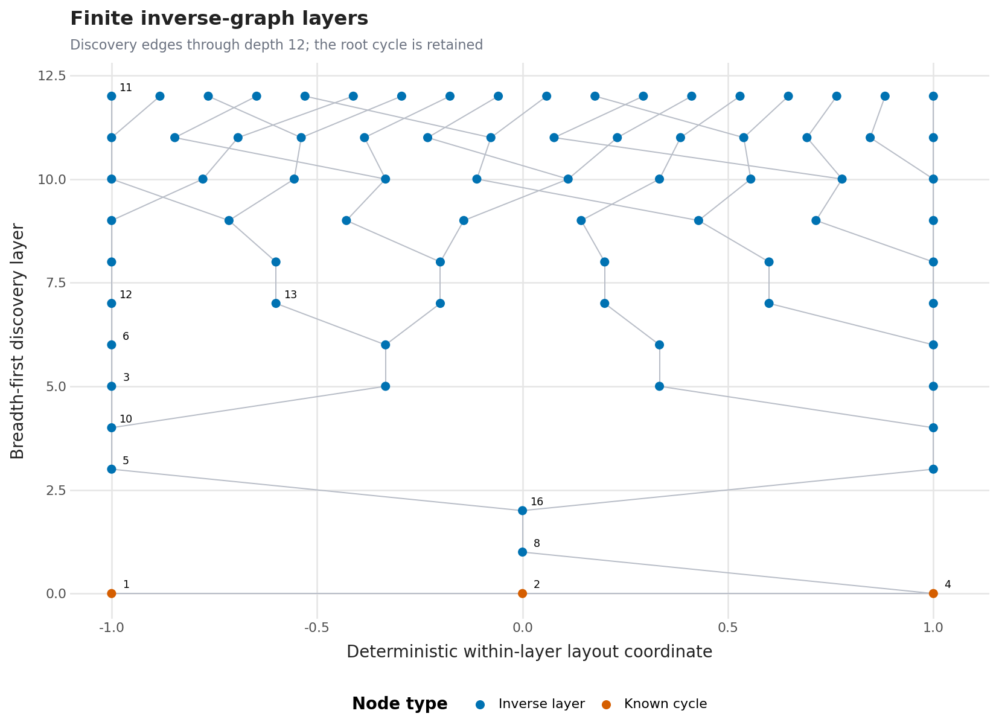

# The inverse graph {#sec-inverse}

## Reversing a many-to-one map

The forward map $C$ gives every positive integer exactly one outgoing edge. In
reverse, an integer $m$ always has the even predecessor $2m$, because
$C(2m)=m$. It may also have an odd predecessor

$$
n=\frac{m-1}{3}.
$$

This candidate is a legal odd predecessor precisely when it is a positive odd
integer. Equivalently, $m\equiv4\pmod6$. For example, 10 has predecessors 20 and
3, while 8 has only 16.

The **inverse graph** has edges $n\to C(n)$ drawn toward the future. Exploring
backward from 1 enumerates values already known to reach 1. Under the conjecture,
every positive integer occurs in that component. Without assuming the conjecture,
the component is only the set reached by the exploration.

## Cycle and tree language

Because $1\to4\to2\to1$, the full rooted component is not literally a tree. If
one removes one edge of the known cycle or treats the cycle as a single root,
the remaining structure branches tree-like. Visualizations should state which
operation they perform. Calling an automatically deduplicated spanning display
“the inverse tree” can conceal cycle edges or collisions.

[Figure 6.1](#fig-inverse-layers) shows a breadth-first exploration from the known cycle. The
horizontal coordinate is a deterministic layout aid, not a number line; vertical
position is distance from the root set. Edges show actual $C$ relations, and each
integer is drawn only at its earliest layer. The finite depth is not a claim about
the full component.

<figure id="fig-inverse-layers">


<figcaption>

Figure 6.1: Finite breadth-first layers of the inverse Collatz graph rooted at the known cycle. The horizontal positions are layout coordinates, and duplicate nodes are suppressed.

</figcaption>
</figure>

## Breadth-first construction

A careful finite algorithm maintains a set of discovered vertices:

```text
frontier <- {1, 2, 4}
seen <- frontier
for layer from 1 through depth_limit:
    next_frontier <- empty set
    for m in frontier:
        candidates <- {2*m}
        if m mod 6 = 4:
            add (m-1)/3 to candidates
        for n in candidates:
            if n not in seen:
                record edge n -> m and add n to next_frontier
    seen <- seen union next_frontier
    frontier <- next_frontier
```

If all valid edges among already-seen vertices matter, record them even when the
vertex is not added again. For a spanning layout, record only the discovery edge
and clearly label the result. A numerical cap and a depth cap answer different
questions: one truncates by value, the other by graph distance.

## The odd-to-odd inverse relation

For the map $U$, an odd predecessor $x$ of an odd $m$ must satisfy

$$
3x+1=2^a m,
\qquad
x=\frac{2^a m-1}{3},\qquad a\ge1.
$$

The numerator must be divisible by 3, and the quotient is then odd. Depending on
$m\bmod3$, admissible exponents occupy one parity class because powers of two
alternate modulo 3. Thus an odd target not divisible by 3 has infinitely many
formal positive predecessors as $a$ grows, while a target divisible by 3 has
none. The $U$-inverse graph therefore has different branching from the $C$ graph.
Switching between them silently changes graph statistics.

## Backward density questions

Let $B$ be the set of positive integers whose forward orbit reaches 1. The
conjecture is $B=\mathbb N_{>0}$. Finite inverse exploration proves membership for
the nodes it finds. One can ask how many found nodes lie below $x$, how fast
layers grow, or how residue classes are represented. Those questions illuminate
the basin but do not automatically show that its complement is empty.

Inverse methods are especially good at producing certified examples: every path
to the root is a proof of convergence for its starting node. Their difficulty is
coverage. A branch can jump above a numerical cap before later returning below
it, so searching only predecessors that stay below $x$ can miss a number below
$x$ whose witnessed path exits the box.

## Worked predecessor calculations

For $m=16$, the even predecessor is 32 and the odd predecessor is 5 because
$16\equiv4\pmod6$. For $m=5$, only 10 is a $C$-predecessor because $(5-1)/3$ is
not an integer. For $m=7$, the candidate 2 is an integer but even; it is not from
the odd branch, and $C(2)=1$, not 7. The congruence $m\equiv4\pmod6$ bundles both
integrality and oddness and prevents this error.

## Worked layers: what breadth-first order certifies

Take the whole known cycle as layer zero: one, two and four. The new predecessor at layer one is eight. Layer two contains sixteen. Layer three contains thirty-two and five. Layer four contains sixty-four and ten. These statements follow by applying the complete predecessor rule to the previous frontier and removing already discovered vertices. The cycle edges one to four, four to two and two to one remain actual edges even though their vertices are not rediscovered.

Each discovery edge points toward the earlier layer. Following those edges from any listed vertex gives a finite path to the known cycle, hence a convergence certificate. For example, five reaches sixteen, then eight, then four, entering the root set after three standard transitions. Ten reaches five first and has root distance four. The layer is distance to the root set, not necessarily first-one time: four lies in layer zero but first reaches one after two transitions under the usual counting convention.

Breadth-first minimality has an inductive proof. At layer zero the root distances are zero. If every vertex of distance at most k has been discovered, any vertex of distance k plus one has its unique forward successor at distance k, so the exhaustive predecessor rule discovers it at the next layer. Conversely a vertex discovered there has an edge to a previous-layer vertex and therefore a path of the claimed length. Deduplication excludes those already known at smaller distance. The next frontier is exactly the vertices whose minimum root distance is the new layer number.

A finite exploration thus proves membership and exact root distance for its discovered vertices. It does not classify every undiscovered integer: that integer may lie in a later finite layer or outside the basin. The union over all finite layers equals the basin, because reaching the root means having some finite path length. Replacing that union by one computed depth is the missing step in an unwarranted coverage claim.

## Worked cap: a small start can need a larger intermediate state

Impose a value cap of ten on inverse exploration from the known cycle. The search can discover eight, but the next predecessor sixteen is excluded by the cap. Consequently it cannot reach the branch through five, ten and three, although all three of those starts are at most ten. The standard trace from three is three, ten, five, sixteen, eight, four, two, one. Every valid forward path from three is this deterministic orbit, so there is no alternative path staying below the cap that a different search order could find.

The capped graph has removed a necessary intermediate vertex and its edges. A disconnected-looking result inside that graph therefore does not establish disconnectedness in the full functional graph. Raising the depth while keeping the same value cap cannot repair this particular omission. Raising the value cap may reveal it, but a new finite cap still requires its own scope statement.

A depth cap and a value cap can also favour different vertices. Powers of two have simple paths but can begin at very large values. A small start such as three can leave its initial numerical range before converging. The number of layers measures path length, while the cap measures the labels of all allowed intermediate states. Neither is a substitute for the other, and a report should state both if both constrain the exploration.

For a finite certificate, it is enough to retain the complete path actually used, including intermediate values above the displayed start range. A figure may hide those values for legibility only if it states that omission; the underlying certificate cannot hide them. The example is an exact hand trace and makes no claim that a new graph program was run.

## Worked odd predecessors: infinite branching appears in one layer

For odd target five, the congruence condition requires the exponent a to be odd. Exponents one, three, five and seven give predecessors three, thirteen, fifty-three and two hundred thirteen. For target one, the exponent must be even; exponents two, four, six and eight give one, five, twenty-one and eighty-five. These are distinct predecessors under the odd-to-odd map, despite representing standard paths of different lengths.

The parity condition follows from powers of two modulo three. For a target one modulo three, an even exponent makes the product one modulo three. For a target two modulo three, an odd exponent does so. A target divisible by three never works, because the numerator is then negative one modulo three. Whenever the quotient is an integer, it is odd: an even product minus one is odd, and division by odd three preserves oddness. The defining equation then shows that the removed power is exactly a, since the target is odd.

Increasing an admissible exponent by two turns a predecessor x into four x plus one. This identity proves strict growth and supplies infinitely many positive predecessors for every permitted target. In particular, an odd-to-odd inverse exploration needs an exponent or value bound even at depth one if it is to list finitely many vertices. A depth limit alone suffices for the standard graph, whose vertices have at most two predecessors, but not for this infinitely branching inverse relation.

Each listed predecessor still has an explicit finite standard path to its target: one odd update followed by a halvings. If the target reaches one, appending that tail proves the predecessor does too. The construction produces certified members of the basin. It does not show that every odd integer is generated from one in finitely many such stages, which is exactly the unresolved coverage question.

<!-- inline-formula-code:start -->
## Formula and finite computation

A useful formula in this chapter is

$$
C^{-1}(m)=\{2m\}\cup\{(m-1)/3\text{ when admissible}\}
$$

The function checks the inverse branch's integrality and parity conditions. The following standalone Python block expresses that finite rule with its inputs and stopping conditions visible.

```python
def collatz_predecessors(target: int) -> list[int]:
    """Return every positive predecessor under the standard Collatz map."""
    if target <= 0:
        raise ValueError("target must be positive")
    predecessors = [2 * target]
    if (target - 1) % 3 == 0:
        candidate = (target - 1) // 3
        if candidate > 0 and candidate % 2 == 1:
            predecessors.append(candidate)
    return sorted(predecessors)

for target in range(1, 13):
    print(target, collatz_predecessors(target))
```

**What the computation establishes.** The calculation checks a declared finite instance; the surrounding argument explains what is true beyond those inputs.
<!-- inline-formula-code:end -->

## Chapter summary

Backward iteration produces a directed graph, not an unrestricted inverse
function. The unaccelerated and odd-to-odd maps have different predecessor rules.
Finite inverse layers give certified members of the basin of 1, but coverage and
layout choices must be described honestly.

## Exercises

<div class="exercise" id="collatz-inverse-small-predecessors">
<p class="exercise-title"><strong>Exercise 1</strong></p>

List all standard predecessors of targets one, four, ten, twenty-two and forty.

<details class="hint"><summary>Hint 1</summary>

Every target has twice itself as an even predecessor.

</details>

<details class="hint"><summary>Hint 2</summary>

Add an odd predecessor only for targets four modulo six.

</details>

<details class="solution"><summary>Solution</summary>

The predecessor sets are respectively {two}, {eight, one}, {twenty, three}, {forty-four, seven}, and {eighty, thirteen}. The target four is the first positive admissible odd-branch target; target one would give zero from the algebraic odd candidate, which is neither positive nor odd. Each listed predecessor can be checked by the stated forward branch, and the two-branch derivation proves no others occur.

</details>

</div>

<div class="exercise" id="collatz-inverse-odd-condition">
<p class="exercise-title"><strong>Exercise 2</strong></p>

Prove that a legal odd standard predecessor exists exactly when $m\equiv4\pmod6$.

<details class="hint"><summary>Hint 1</summary>

Write the predecessor as twice an integer plus one.

</details>

<details class="hint"><summary>Hint 2</summary>

Retain positivity as well as integrality.

</details>

<details class="solution"><summary>Solution</summary>

An odd positive predecessor is $n=2q+1$ with $q\ge0$, giving $m=3n+1=6q+4$. Conversely a positive target congruent to four modulo six is $m=6q+4$ with $q\ge0$, and the candidate $2q+1$ is positive odd and maps to it. Thus the congruence is both necessary and sufficient. Merely requiring the quotient $(m-1)/3$ to be an integer would wrongly admit even candidates.

</details>

</div>

<div class="exercise" id="collatz-inverse-four-layers">
<p class="exercise-title"><strong>Exercise 3</strong></p>

Construct four inverse layers from the root cycle by hand, suppressing duplicate vertices but recording all cycle edges.

<details class="hint"><summary>Hint 1</summary>

Treat the three cycle vertices as layer zero.

</details>

<details class="hint"><summary>Hint 2</summary>

A discovered vertex remains seen at later stages.

</details>

<details class="solution"><summary>Solution</summary>

The new layers are {eight}, {sixteen}, {thirty-two, five}, and {sixty-four, ten}. Their discovery edges are eight to four, sixteen to eight, thirty-two and five to sixteen, sixty-four to thirty-two, and ten to five. Retain the three root-cycle edges separately. Each frontier is complete because every previous frontier vertex has its even predecessor and exactly the admissible odd predecessor inspected. The display is finite and does not describe all later layers.

</details>

</div>

<div class="exercise" id="collatz-inverse-exponent-parity">
<p class="exercise-title"><strong>Exercise 4</strong></p>

Determine the admissible exponent parity in the odd-to-odd inverse formula for $m\equiv1$ and $m\equiv2\pmod3$.

<details class="hint"><summary>Hint 1</summary>

Powers of two alternate one and two modulo three.

</details>

<details class="hint"><summary>Hint 2</summary>

The product with m must be one modulo three.

</details>

<details class="solution"><summary>Solution</summary>

For target one modulo three, the exponent is even. For target two modulo three, it is odd. A target zero modulo three has no predecessor because the product remains zero, leaving numerator negative one modulo three. With odd target and a positive exponent, any integral quotient is odd, so the resulting equation has exactly that valuation. The admissible exponents are unbounded; a finite listing needs an additional exponent or value cap.

</details>

</div>

<div class="exercise" id="collatz-inverse-value-cap">
<p class="exercise-title"><strong>Exercise 5</strong></p>

Explain why a value cap can omit paths for nodes lying below the cap.

<details class="hint"><summary>Hint 1</summary>

Use the full trace from three.

</details>

<details class="hint"><summary>Hint 2</summary>

The forward successor is unique, so another path cannot bypass an excluded state.

</details>

<details class="solution"><summary>Solution</summary>

With cap ten, three is an allowed start but its path visits sixteen before reaching the root cycle. Removing sixteen disconnects that path in the capped graph, preventing inverse discovery of three through its actual successor chain. Increasing depth at the same value cap cannot restore the missing vertex. Therefore an undiscovered small input may still converge by a path leaving the box; a value-capped exploration proves only the paths it retains.

</details>

</div>

<div class="exercise" id="collatz-inverse-components">
<p class="exercise-title"><strong>Exercise 6</strong></p>

Formulate the conjecture as a statement about connected components of the directed functional graph.

<details class="hint"><summary>Hint 1</summary>

Use weak connectivity, which allows following edges in either direction.

</details>

<details class="hint"><summary>Hint 2</summary>

Membership in the known basin is preserved across an edge.

</details>

<details class="solution"><summary>Solution</summary>

The conjecture says that the entire positive-integer functional graph is the weak component containing the known cycle. If a vertex reaches that cycle, its finite path places it in the component. Conversely basin membership agrees at both ends of every forward edge: a predecessor of a basin member reaches the cycle, and a successor of a basin member stays in the basin because the root cycle is forward invariant. Along a finite undirected path membership therefore persists. This concerns weak, not strong, connectivity.

</details>

</div>

<div class="exercise" id="collatz-inverse-first-one-vs-layer">
<p class="exercise-title"><strong>Exercise 7</strong></p>

Find the inverse layer of four when the whole known cycle is the root set, and compare its first-one time.

<details class="hint"><summary>Hint 1</summary>

Layer zero includes every root vertex.

</details>

<details class="hint"><summary>Hint 2</summary>

First-one time still counts standard transitions from the particular start.

</details>

<details class="solution"><summary>Solution</summary>

Four lies in layer zero by definition of the root set. Its first-one time is two, through four, two, one. Thus root distance and total stopping time are different quantities even on the root itself. For other vertices the difference depends on which cycle vertex their discovery path first meets. A caption should state the chosen root set and not relabel layer number as total time.

</details>

</div>

<div class="exercise" id="collatz-inverse-infinite-family">
<p class="exercise-title"><strong>Exercise 8</strong></p>

For target five under the odd-to-odd map, find the first three predecessors and prove the recurrence between successive admissible predecessors.

<details class="hint"><summary>Hint 1</summary>

Use odd exponents one, three and five.

</details>

<details class="hint"><summary>Hint 2</summary>

Increasing the exponent by two multiplies its power of two by four.

</details>

<details class="solution"><summary>Solution</summary>

The predecessors are three, thirteen and fifty-three. If $x=(2^a5-1)/3$, then the next admissible exponent gives $(4\cdot2^a5-1)/3=4x+1$. This is strictly larger and positive, so the process yields infinitely many distinct predecessors. Their standard path lengths are respectively two, four and six transitions. This branching count belongs to the compressed map and should not be compared with the standard graph without naming the convention.

</details>

</div>

<div class="exercise" id="collatz-inverse-depth-bound">
<p class="exercise-title"><strong>Exercise 9</strong></p>

Why does finite depth alone yield finitely many vertices in the standard inverse exploration but not in the odd-to-odd version?

<details class="hint"><summary>Hint 1</summary>

Bound the number of predecessors per vertex in each map.

</details>

<details class="hint"><summary>Hint 2</summary>

Target one already has infinitely many compressed predecessors.

</details>

<details class="solution"><summary>Solution</summary>

Every standard vertex has at most two predecessors, so finitely many roots and a finite number of layers produce a finite set, bounded by a finite branching sum. Under the odd-to-odd map, target one has a distinct predecessor for every positive even exponent, already infinitely many at one inverse step. An exponent or value cap is therefore necessary for a finite listing. This is a graph-size statement, not a conclusion about convergence of undiscovered starts.

</details>

</div>

<div class="exercise" id="collatz-inverse-no-strong-connectivity">
<p class="exercise-title"><strong>Exercise 10</strong></p>

Explain why the conjecture would not make the positive functional graph strongly connected.

<details class="hint"><summary>Hint 1</summary>

The known cycle has no outgoing edge to an outside vertex.

</details>

<details class="hint"><summary>Hint 2</summary>

Use an outside start whose path into the cycle is already known.

</details>

<details class="solution"><summary>Solution</summary>

Three reaches the known cycle by its explicit standard trace. No vertex of that cycle can reach three, because following its unique successor remains on the cycle forever. Thus three and one are not mutually reachable, even though they lie in the same weak component. Strong connectivity would require paths in both directed directions and is not the graph formulation of the Collatz conjecture. Reversing edges for exploration does not change the actual forward reachability relation.

</details>

</div>
