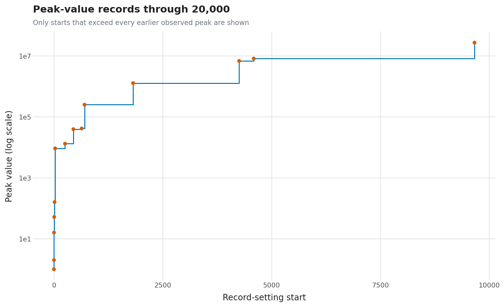
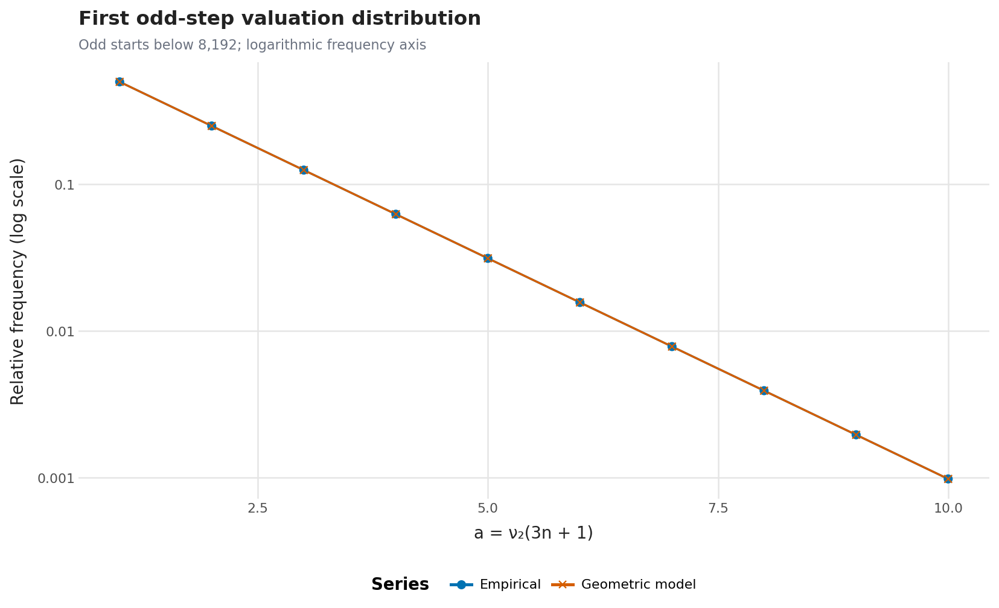
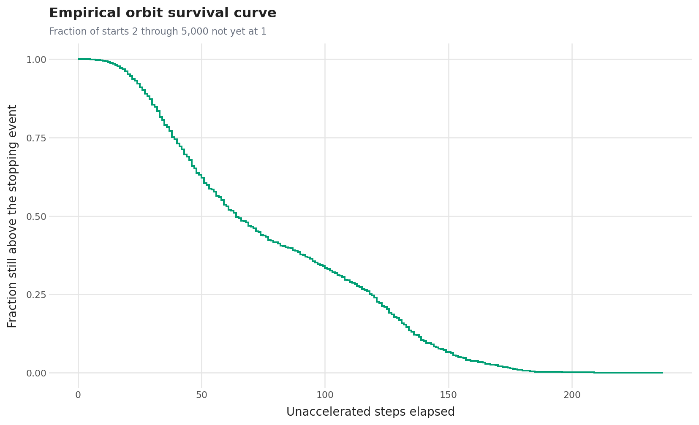

# Records, distributions, and data hygiene {#sec-data}

## What a record says

For an ordered experiment $1,2,\ldots,N$, a new record appears when a statistic
exceeds every earlier value. Records compress a large table into its upper
envelope. They are useful regression tests: if two programs disagree on an early
record, at least one convention or implementation differs. But record lists are
sensitive to the statistic, map, and endpoint.

[Figure 7.1](#fig-peak-records) plots peak records for starts through 20,000. The vertical axis
is logarithmic because peaks span several orders of magnitude. Only record-setting
starts appear, so gaps on the horizontal axis do not mean no starts were tested.

<figure id="fig-peak-records">


<figcaption>

Figure 7.1: Peak-value record setters among starting values through 20,000 under the unaccelerated map. The peak axis is logarithmic.

</figcaption>
</figure>

Peak records and stopping-time records need not coincide. A start can climb very
high and then collapse quickly, or wander for many steps without setting the
largest peak. Publishing only spectacular cases invites selection bias; the
search range and inclusion rule belong with the record table.

## A minimal data contract

An orbit experiment should record at least:

- map convention and software version;
- starting value and inclusive range definition;
- completion status and stopping criterion;
- transition count, peak, and last value;
- integer representation and overflow policy;
- step or resource cap;
- code revision, parameters, and checksum of outputs.

For parallel work, include the exact interval assigned to each worker and whether
endpoints are open or closed. Half-open intervals $[a,b)$ compose cleanly. A final
audit checks that their union is exactly the intended range and that intersections
are empty.

## Overflow is a mathematical error

With fixed-width unsigned arithmetic, the expression $3n+1$ may wrap around.
The resulting smaller integer can appear to descend and falsely certify a start.
A safe implementation either uses arbitrary-precision integers or checks before
multiplication that

$$
n\le\left\lfloor\frac{M-1}{3}\right\rfloor,
$$

where $M$ is the largest representable value. Compilers and hardware differ in
whether overflow traps, wraps, or becomes undefined behavior, so “it ran” is not
a certificate.

Compressed iteration can reduce the number of stored intermediate values but
does not remove the need to form or otherwise safely decompose $3n+1$. Optimized
code should be compared against a simple arbitrary-precision reference on random
and adversarial tests near word-size boundaries.

## Reproducible finite summaries

[Figure 7.2](#fig-valuation-distribution) compares the observed first odd-to-odd exponents
$a=\nu_2(3n+1)$ for odd $n$ in a fixed finite range with the geometric mass
$2^{-a}$. The agreement is exact up to boundary effects when complete residue
blocks are used, because one residue class modulo $2^a$ realizes the tail event.
This one-step fact does not establish independence of exponents along an orbit.

<figure id="fig-valuation-distribution">


<figcaption>

Figure 7.2: Empirical first-step odd-to-odd valuations for odd starts below 8192 compared with the geometric model.

</figcaption>
</figure>

Good data practice separates raw results from derived summaries. The raw table
lets a reviewer recompute the histogram with different bins, locate outliers, or
spot duplicated starts. Derived figures should be generated from immutable or
checksummed input, and their scripts should set seeds even when randomness enters
only through jitter or sampling.

## Survival curves and unresolved cases

For each step $t$, one may plot the fraction of sampled starts not yet at 1. This
is a finite empirical survival curve, not the probability that an arbitrary
integer survives. [Figure 7.3](#fig-survival-fraction) uses starts $2$ through $5000$ and exact
completion. The declining tail helps compare algorithms and choose a safe
exploratory cap; it does not supply a uniform bound beyond the sample.

<figure id="fig-survival-fraction">


<figcaption>

Figure 7.3: Fraction of starts from 2 through 5000 not yet at 1 after each unaccelerated step.

</figcaption>
</figure>

If some runs are capped, a survival estimator must retain them as censored rather
than completed. For a deterministic full enumeration, the simplest honest plot
shows counts in categories at each cap. Sophisticated statistical estimators do
not cure a sampling design that has no connection to the mathematical quantifier
of interest.

## Worked coverage audit: the right row count can still miss an input

Suppose the declared starts are the integers in the half-open interval from one through less than eleven. There are ten starts. One worker reports the interval from one through less than six and another reports five through less than ten. Each interval contains five starts, so the total reported row count is ten. Nevertheless five is duplicated and ten is missing. A count equal to the intended population size does not establish a partition.

For sorted nonempty half-open shards, a complete partition has the first lower endpoint equal to the intended lower bound, every shard's upper endpoint equal to the next shard's lower endpoint, and the final upper endpoint equal to the intended upper bound. These equations are sufficient because each adjacent pair joins without a gap or overlap. They are necessary for a sorted disjoint covering: a strict gap omits integers in the declared interval and a strict overlap duplicates them, with integer endpoints as assumed here.

A shard record should retain those endpoints and the exact inclusion convention. A worker retry can create a second copy of an otherwise valid interval; its results do not become new mathematical coverage. If two records for the same start disagree, silently retaining one would erase evidence of a convention, arithmetic or implementation conflict. Preserve the competing records and investigate their specifications before producing an authoritative summary.

A checksum has a different role. It identifies a particular sequence of bytes and can detect an unexpected change relative to a trusted reference. It does not prove that the bytes cover the declared starts or that their orbit arithmetic is correct. A data contract therefore needs separate identity, coverage and mathematical-predicate fields. The interval example is exact bookkeeping, not a report that a distributed computation has been performed.

## Worked arithmetic audit: a compressed endpoint can fit while an intermediate does not

Use an illustrative unsigned eight-bit bound of two hundred fifty-five. An odd standard update at eighty-five has exact output two hundred fifty-six, beyond that bound. Wraparound would return zero. At eighty-seven the exact output is two hundred sixty-two, while wraparound would return six, a positive number falsely resembling a dramatic descent. Positivity alone therefore cannot detect every overflow error.

The standard odd update is safe only when three times the input plus one is at most the representable maximum. Rearranging gives the pre-multiplication threshold already stated above. With this small bound, the threshold is eighty-four, so the largest safe odd input is eighty-three. Even inputs use a different branch and need no multiplication at that step; checking the relevant branch matters.

For the shortcut map, eighty-five has endpoint one hundred twenty-eight, which does fit. Forming the standard intermediate first would still overflow. An alternative exact identity for odd input twice q plus one is that its shortcut output is three q plus two. Computing that expression is safe under a separately proved bound on q ensuring the final result fits. This algebra changes how the value is formed, not the function being computed, provided the parity premise and machine bounds are respected.

A measurement contract must still distinguish the two maps. The standard path from eighty-five visits two hundred fifty-six before its halving. A compressed trace storing only one hundred twenty-eight cannot report the standard orbit's peak unless it separately accounts for the omitted intermediate. Safe endpoint arithmetic and correct unaccelerated peak reporting are therefore different obligations. These small calculations are authored by hand and assert no executed machine result.

## Worked summary audit: a finite survival curve has an exact population

Take the four starts one, two, three and four. Their complete standard first-one times are zero, one, seven and two. At time zero, three of the four have not reached one. At time one, two remain. At time two, only the start three remains. At time seven, none remain. The finite survival fractions are therefore three quarters, one half, one quarter and zero at those respective times.

The complementary cumulative completion fraction counts starts whose time is at most the stated horizon. It cannot decrease as the horizon increases, because an already completed start stays counted. For a full enumeration this is an exact finite summary, not an estimate carrying an automatic sampling margin. A different chosen population, such as excluding the already-complete start one, changes every denominator and the initial value.

Now stop all traces at time two. Three completed times are known, while the start three is censored beyond two. The survival fraction through time two is still exact for this population because the observed prefixes determine whether each start has arrived by then. At a later time, the capped records alone cannot decide whether the unresolved start has completed. The later completion fraction is bounded between three quarters and one until further evidence is supplied. Marking the censored case as completed at its cap would incorrectly force the later survival curve to zero.

The original full trace establishes its actual completion at seven, but that is additional evidence beyond the capped table. Keeping raw records and a derivation of the summary makes this distinction inspectable. One can recompute the curve with another cap or population without pretending that a changed plotting convention changes the underlying orbit. No asymptotic law for arbitrary positive integers follows from these four starts.

## Paper specifications and executed evidence

The examples in this chapter identify arithmetic and coverage obligations. They are useful before a computation because they make errors precise enough to detect. They do not themselves certify a program, produce a run log, or establish that the existing figure scripts were reproduced. A proposed independent comparison, a complete expected trace and a hash are different kinds of evidence, and a record should say which is actually available.

When an experiment is eventually carried out, its claimed result must match its recorded domain and termination policy. A successful bounded run remains bounded; an arithmetic failure remains unresolved for that implementation; a completed exact enumeration needs no invented sampling model. These distinctions keep data hygiene tied to the mathematical assertion rather than to the appearance of a polished figure.

## Validation layers

Three layers catch different errors. **Unit tests** check known orbits, valuation
rules, and boundary inputs. **Property tests** check invariants such as positivity,
parity of compressed outputs, and equality between accelerated and expanded
segments. **Cross-implementation tests** compare independent code paths or
languages. A large run should start only after these small tests pass; a checksum
then detects accidental changes in the resulting data.

<!-- inline-formula-code:start -->
## Formula and finite computation

A useful formula in this chapter is

$$
\widehat F_B(t)=B^{-1}\#\{n\le B:\sigma_\infty(n)\le t\}
$$

The table retains censored values rather than treating them as large observations. The following standalone Python block expresses that finite rule with its inputs and stopping conditions visible.

```python
import pandas as pd

def stopping_table(limit: int, max_steps: int) -> pd.DataFrame:
    """Return finite stopping-time records with explicit censored status."""
    if limit <= 0 or max_steps < 0:
        raise ValueError("limit must be positive and max_steps nonnegative")
    rows: list[dict[str, int | str | None]] = []
    for start in range(1, limit + 1):
        value = start
        stopping_time: int | None = None
        peak = start
        for step in range(max_steps + 1):
            peak = max(peak, value)
            if value == 1:
                stopping_time = step
                break
            if step < max_steps:
                value = value // 2 if value % 2 == 0 else 3 * value + 1
        rows.append(
            {
                "start": start,
                "stopping_time": stopping_time,
                "peak": peak,
                "status": "reached one" if stopping_time is not None else "censored",
            }
        )
    return pd.DataFrame(rows)

table = stopping_table(limit=100, max_steps=1_000)
print(table.groupby("status").size())
print(table.nlargest(5, "peak")[["start", "stopping_time", "peak"]])
```

**What the computation establishes.** The calculation checks a declared finite instance; the surrounding argument explains what is true beyond those inputs.
<!-- inline-formula-code:end -->

## Chapter summary

Computational evidence is only as trustworthy as its definitions, arithmetic,
coverage, and provenance. Records are useful summaries, not laws. Overflow,
censoring, duplicated intervals, and silent convention changes can all fabricate
success. Reproducibility is part of the mathematical claim.

## Exercises

<div class="exercise" id="collatz-data-log-records">
<p class="exercise-title"><strong>Exercise 1</strong></p>

Explain why peak records often require a logarithmic axis, and state one danger of log axes.

<details class="hint"><summary>Hint 1</summary>

Compare additive and multiplicative vertical spacing.

</details>

<details class="hint"><summary>Hint 2</summary>

A logarithm requires a positive input and changes the interpretation of distance.

</details>

<details class="solution"><summary>Solution</summary>

Large peaks can span several multiplicative scales, so a log axis makes small and large records simultaneously legible. Equal vertical gaps then represent equal ratios rather than equal absolute increases. Zero has no finite logarithm, and a caption omitting the scale can mislead a reader about growth. No theorem says peak records always require that axis or that stopping-time records never do; the displayed range and reading goal determine the useful scale.

</details>

</div>

<div class="exercise" id="collatz-data-overflow-specification">
<p class="exercise-title"><strong>Exercise 2</strong></p>

Describe three boundary cases that would reveal unsigned sixty-four-bit overflow in a standard odd update. Treat them as a paper specification rather than an executed test.

<details class="hint"><summary>Hint 1</summary>

Let M be the maximum value and T the floor of (M minus one) divided by three.

</details>

<details class="hint"><summary>Hint 2</summary>

For this word size T is even; compare a safe odd neighbour, the first unsafe odd neighbour and M itself.

</details>

<details class="solution"><summary>Solution</summary>

The input $T-1$ is odd and has an exact output within the bound, so it is a safe boundary case. The input $T+1$ is the first unsafe odd input and produces $M+1$, which wraparound would turn into zero. At odd input M the exact output is $3M+1$ while wraparound produces $M-1$, a positive false descent. A correct contract rejects or widens arithmetic before those unsafe multiplications. These are derived expectations, not executed results or an installed test suite.

</details>

</div>

<div class="exercise" id="collatz-data-half-open-join">
<p class="exercise-title"><strong>Exercise 3</strong></p>

Prove that half-open integer intervals assigned consecutively have no duplicated endpoint.

<details class="hint"><summary>Hint 1</summary>

Inspect the membership of their common boundary.

</details>

<details class="hint"><summary>Hint 2</summary>

The left interval excludes the boundary and the right includes it.

</details>

<details class="solution"><summary>Solution</summary>

For consecutive intervals from a inclusive to b exclusive and b inclusive to c exclusive, b belongs only to the second. Every smaller value in the first is below b and hence outside the second. Their union is the interval from a inclusive to c exclusive. Repeating the argument over a finite sorted chain proves a disjoint covering when first and last endpoints match the target. Matching total lengths without these adjacency conditions is insufficient.

</details>

</div>

<div class="exercise" id="collatz-data-summary-layers">
<p class="exercise-title"><strong>Exercise 4</strong></p>

Distinguish raw data, derived data, and presentation metadata for a stopping-time histogram.

<details class="hint"><summary>Hint 1</summary>

Ask what can be recomputed without running new orbits.

</details>

<details class="hint"><summary>Hint 2</summary>

Bins and colors are not orbit event times.

</details>

<details class="solution"><summary>Solution</summary>

Raw records contain starts, convention, statuses, known event times, observed peaks and provenance. Derived data aggregate those records into counts or weighted counts for specified bins, retaining unresolved cases. Presentation metadata specifies axis scales, labels, colors, ordering and alternative text. A reader should be able to recover which raw population produced each bar. Changing bins changes a summary, while changing a cap may require additional orbit evidence; neither should silently alter the raw records.

</details>

</div>

<div class="exercise" id="collatz-data-one-step-dependence">
<p class="exercise-title"><strong>Exercise 5</strong></p>

Why does the one-step geometric valuation distribution not imply independent valuations along a trajectory?

<details class="hint"><summary>Hint 1</summary>

A marginal law does not determine a joint law.

</details>

<details class="hint"><summary>Hint 2</summary>

A deterministic successor carries arithmetic information from the earlier state.

</details>

<details class="solution"><summary>Solution</summary>

Uniform finite odd residues give a specific first-step distribution through congruence counting. Independence would require joint probabilities for successive valuations to factor under a stated sampling law and horizon. Those later states are deterministic functions of the start, so fresh independent sampling cannot be assumed. Even equal marginals admit completely different dependence, such as two fair bits always equal or always opposite. A separate transfer theorem is needed for any longer-time arithmetic probability claim.

</details>

</div>

<div class="exercise" id="collatz-data-independent-evidence">
<p class="exercise-title"><strong>Exercise 6</strong></p>

State the paper evidence obligations for two independently implemented finite verifiers, including a disagreement protocol. No software execution is requested.

<details class="hint"><summary>Hint 1</summary>

Fix the mathematical predicate and range before comparing outputs.

</details>

<details class="hint"><summary>Hint 2</summary>

Preserve conflicting records rather than overwriting them.

</details>

<details class="solution"><summary>Solution</summary>

Specify the same map, start interval, arithmetic model, event convention and budget policy for both implementations. Retain exact interval partitions, per-start statuses and enough traces or certificates to inspect a discrepancy. If outputs differ, preserve both records, isolate the first differing transition or coverage claim, and resolve the underlying specification or arithmetic issue before publishing a combined conclusion. Independence of source code is useful only to the extent that the paths do not share the same hidden error. This is an analytical answer; all actual program checks remain unperformed.

</details>

</div>

<div class="exercise" id="collatz-data-count-coverage">
<p class="exercise-title"><strong>Exercise 7</strong></p>

Two shards cover starts one through less than six and five through less than ten. Their total length is ten. Do they partition starts one through less than eleven?

<details class="hint"><summary>Hint 1</summary>

List the shared start and the omitted final start.

</details>

<details class="hint"><summary>Hint 2</summary>

A length identity does not imply a union identity.

</details>

<details class="solution"><summary>Solution</summary>

No. Start five appears in both shards, while start ten appears in neither. The ten reported rows cover only nine distinct starts. Correcting the second shard to six through less than eleven gives adjacent half-open intervals with no overlap or gap. This counterexample proves why the coverage contract needs endpoints and disjointness rather than just a final row count or output checksum.

</details>

</div>

<div class="exercise" id="collatz-data-compressed-peak">
<p class="exercise-title"><strong>Exercise 8</strong></p>

For start eighty-five, compare the first standard output, the first shortcut output and the peak information lost by keeping only the shortcut endpoint.

<details class="hint"><summary>Hint 1</summary>

Three times eighty-five plus one is two hundred fifty-six.

</details>

<details class="hint"><summary>Hint 2</summary>

The shortcut immediately halves that result.

</details>

<details class="solution"><summary>Solution</summary>

The standard output is two hundred fifty-six and the shortcut output one hundred twenty-eight. The shortcut endpoint fits an eight-bit unsigned bound while the omitted standard intermediate does not. A compressed record therefore cannot report the standard peak as one hundred twenty-eight; it must account for the larger intermediate. Algebraic endpoint optimization can avoid an overflow in one convention while leaving a measurement obligation in another. The map and statistic must be specified together.

</details>

</div>

<div class="exercise" id="collatz-data-survival-population">
<p class="exercise-title"><strong>Exercise 9</strong></p>

For starts one, two, three and four with total times zero, one, seven and two, give the survival fraction at times zero, one, two and seven.

<details class="hint"><summary>Hint 1</summary>

Count times strictly greater than the requested horizon.

</details>

<details class="hint"><summary>Hint 2</summary>

The already-complete start one is in this population.

</details>

<details class="solution"><summary>Solution</summary>

The fractions are three quarters, one half, one quarter and zero. Completion by a time includes equality, so the survival count uses strictly greater times. If start one were excluded, the denominators and initial fraction would change. These are exact summaries of four declared starts. A confidence interval or statement about an arbitrary integer would need an additional sampling or limiting framework not supplied by the finite table.

</details>

</div>

<div class="exercise" id="collatz-data-hash-boundary">
<p class="exercise-title"><strong>Exercise 10</strong></p>

A dataset has the expected checksum. State what this supports and which two mathematical claims it does not establish.

<details class="hint"><summary>Hint 1</summary>

Separate byte identity from coverage and predicate validity.

</details>

<details class="hint"><summary>Hint 2</summary>

The trusted reference itself needs a provenance account.

</details>

<details class="solution"><summary>Solution</summary>

Relative to a trusted reference and the hash assumptions, matching checksums support that the same bytes are present. They do not establish that every declared start appears exactly once, nor that recorded transitions use exact correct arithmetic. A stale or erroneous reference can have a perfectly stable checksum. Coverage and arithmetic certificates address those different questions. The statement describes an evidence role and reports no new hashing, audit or execution of the dataset.

</details>

</div>
